# 《线性代数与解析几何》4.5 向量空间的内积与正交化（课件）

原件的每一页，下面附识别出的文字。

### 4.5 向量空间的内积

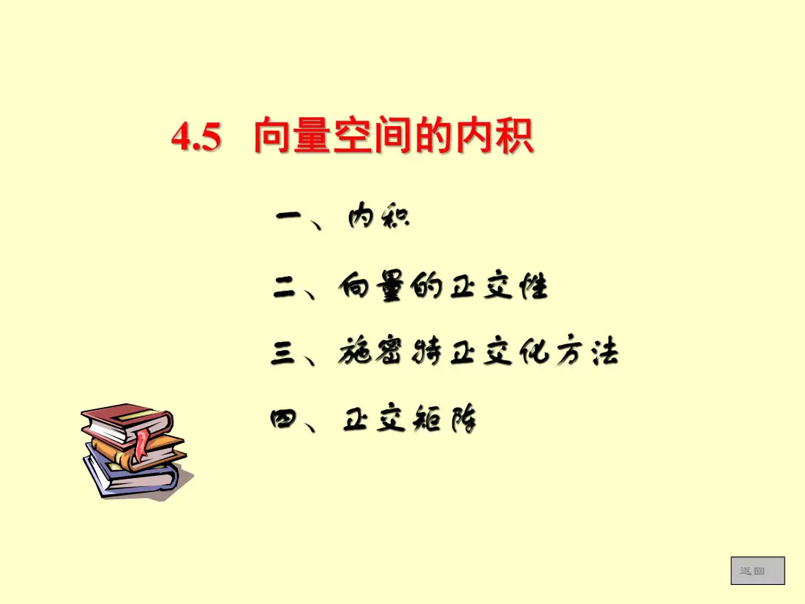

原文：

4.5 向量空间的内积
一、内积
二、向量的正交性
三、施密特正交化方法
四、正交矩阵

返回

### 一、内积

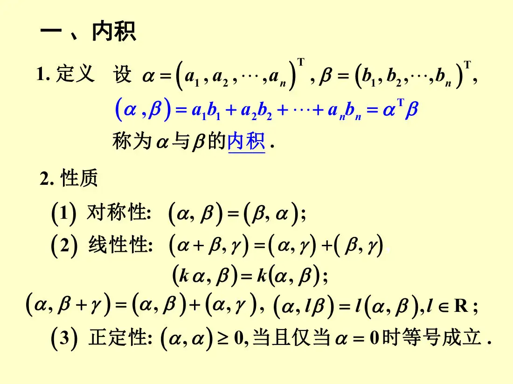

原文：

一、内积

1. 定义 设 $\alpha=\left(a_{1},a_{2},\cdots,a_{n}\right)^{\mathrm{T}},\beta=\left(b_{1},b_{2},\cdots,b_{n}\right)^{\mathrm{T}}$ ,

$$
(\alpha , \beta) = a _ {1} b _ {1} + a _ {2} b _ {2} + \dots + a _ {n} b _ {n} = \alpha^ {\mathrm{T}} \beta
$$

称为 $\alpha$ 与 $\beta$ 的内积.

2. 性质

(1) 对称性: $(\alpha, \beta) = (\beta, \alpha)$ ;

(2) 线性性: $(\alpha + \beta, \gamma) = (\alpha, \gamma) + (\beta, \gamma)$

$$
(k \alpha , \beta) = k (\alpha , \beta);
$$

$$
(\alpha , \beta + \gamma) = (\alpha , \beta) + (\alpha , \gamma), (\alpha , l \beta) = l (\alpha , \beta), l \in \mathbf {R}
$$

(3) 正定性: $(\alpha, \alpha) \geq 0$ , 当且仅当 $\alpha = 0$ 时等号成立.

### 3. 长度

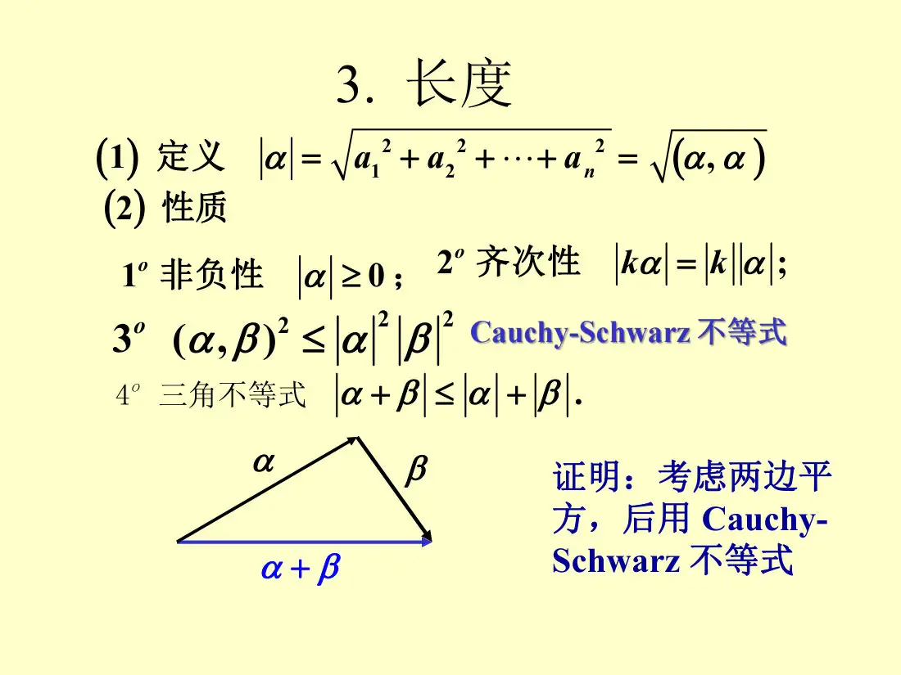

原文：

3. 长度

(1) 定义 $\left|\alpha\right|=\sqrt{a_{1}^{2}+a_{2}^{2}+\cdots+a_{n}^{2}}=\sqrt{\left(\alpha,\alpha\right)}$

(2) 性质

$1^{o}$ 非负性 $|\alpha| \geq 0$ ; $2^{o}$ 齐次性 $|k\alpha| = |k||\alpha|$ ; $3^{o} (\alpha, \beta)^{2} \leq |\alpha|^{2} |\beta|^{2}$ Cauchy-Schwarz 不等式 $4^{o}$ 三角不等式 $|\alpha + \beta| \leq |\alpha| + |\beta|$ .

证明：考虑两边平方，后用 Cauchy-Schwarz 不等式

### 其中等号成立，当且仅当 $\alpha$ 与 $\beta$ 线性相关.

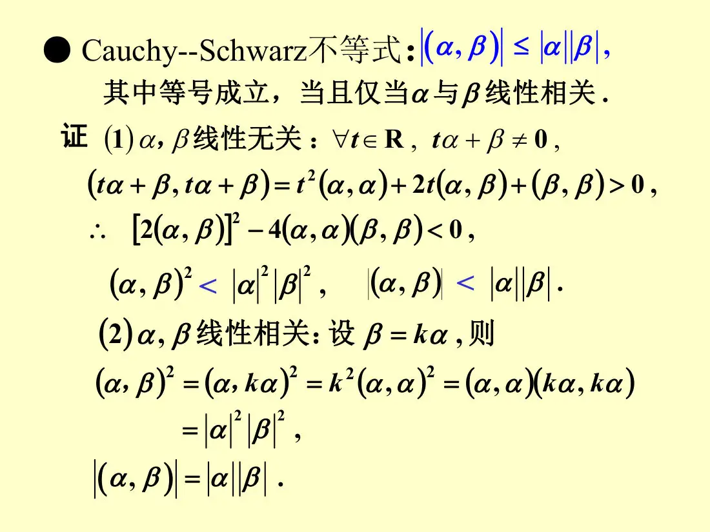

原文：

● Cauchy--Schwarz不等式: $\left|\left(\alpha,\beta\right)\right| \leq \left|\alpha\right|\left|\beta\right|$ ,
其中等号成立，当且仅当 $\alpha$ 与 $\beta$ 线性相关.

证 (1) $\alpha, \beta$ 线性无关： $\forall t \in \mathbf{R}, t \alpha + \beta \neq 0$ ，

$(t\alpha + \beta, t\alpha + \beta) = t^2(\alpha, \alpha) + 2t(\alpha, \beta) + (\beta, \beta) > 0,$ $\therefore [2(\alpha, \beta)]^2 - 4(\alpha, \alpha)(\beta, \beta) < 0,$ $(\alpha, \beta)^2 < |\alpha|^2 |\beta|^2, |(\alpha, \beta)| < |\alpha||\beta|$ .

(2) $\alpha,\beta$ 线性相关: 设 $\beta=k\alpha$ , 则

$$
\begin{array}{r l} & {(\alpha , \beta) ^ {2} = (\alpha , k \alpha) ^ {2} = k ^ {2} (\alpha , \alpha) ^ {2} = (\alpha , \alpha) (k \alpha , k \alpha)} \\ & {\qquad = | \alpha | ^ {2} | \beta | ^ {2},} \end{array}
$$

$$
\left| (\alpha , \beta) \right| = | \alpha | | \beta |
$$

### 4. 夹角

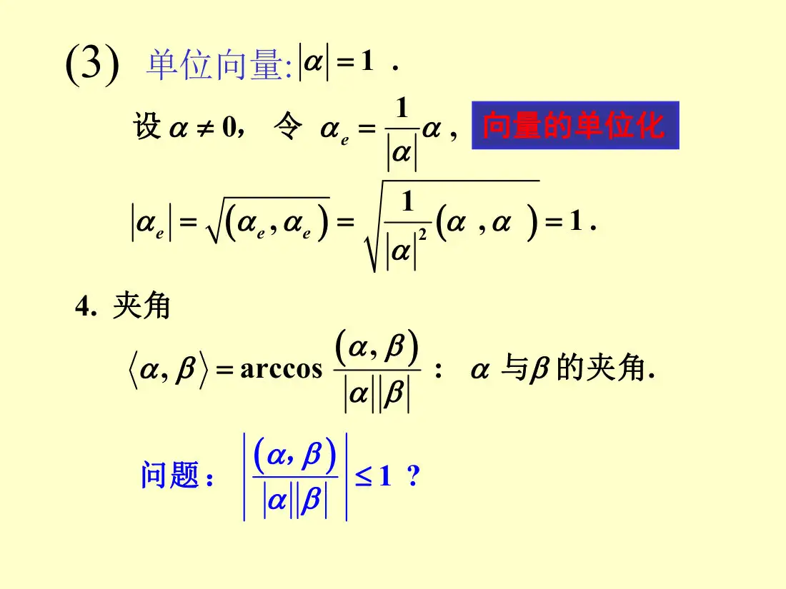

原文：

(3) 单位向量: $|\alpha| = 1$ . 设 $\alpha \neq 0$ , 令 $\alpha_{e} = \frac{1}{|\alpha|}\alpha$ , 向量的单位化 $|\alpha_{e}| = \sqrt{(\alpha_{e}, \alpha_{e})} = \sqrt{\frac{1}{|\alpha|^{2}} (\alpha, \alpha)} = 1$ .

4. 夹角

$\langle \alpha, \beta \rangle = \arccos \frac{(\alpha, \beta)}{|\alpha||\beta|} : \alpha$ 与 $\beta$ 的夹角. 问题： $\left|\frac{(\alpha, \beta)}{|\alpha||\beta|}\right| \leq 1 ?$

### 二、向量的正交性

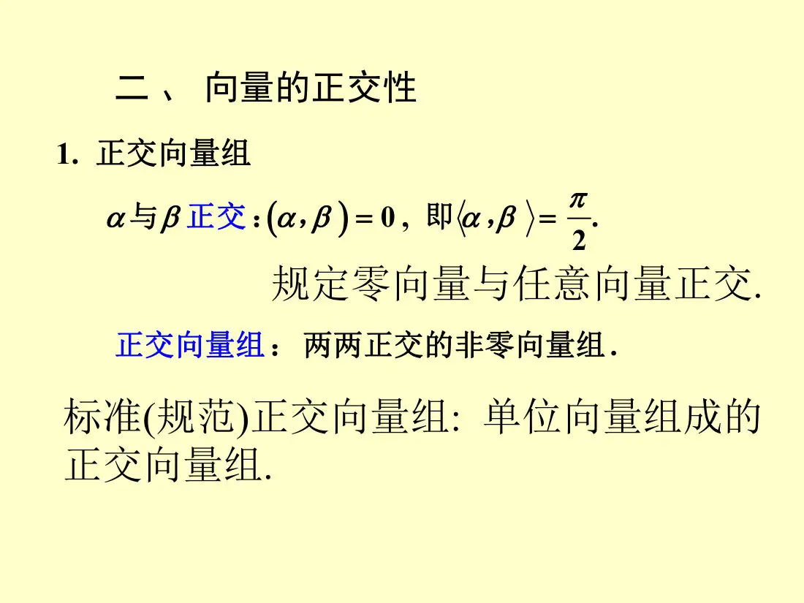

原文：

二、向量的正交性

1. 正交向量组

$\alpha$ 与 $\beta$ 正交： $(\alpha, \beta) = 0$ ，即 $\langle \alpha, \beta \rangle = \frac{\pi}{2}$ .

规定零向量与任意向量正交.

正交向量组：两两正交的非零向量组.

标准(规范)正交向量组: 单位向量组成的正交向量组.

### $$

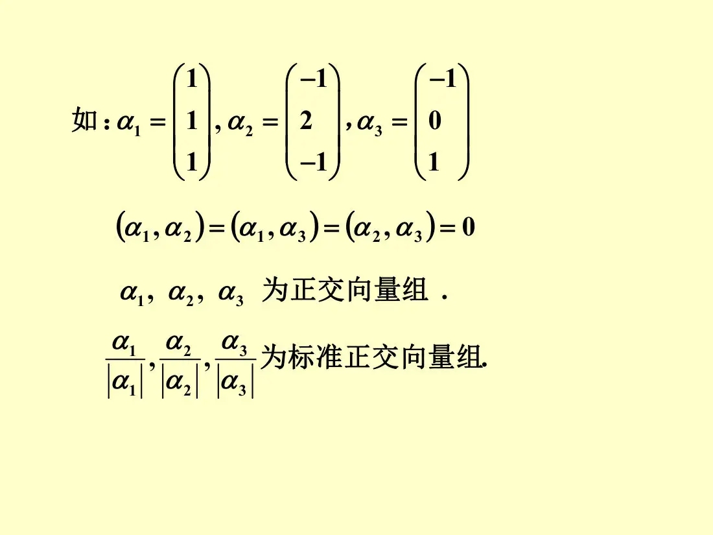

原文：

如： $\alpha_{1}=\begin{pmatrix}1\\ 1\\ 1\end{pmatrix},\alpha_{2}=\begin{pmatrix}-1\\ 2\\ -1\end{pmatrix},\alpha_{3}=\begin{pmatrix}-1\\ 0\\ 1\end{pmatrix}$

$$
(\alpha_ {1}, \alpha_ {2}) = (\alpha_ {1}, \alpha_ {3}) = (\alpha_ {2}, \alpha_ {3}) = 0
$$

$\alpha_{1}, \alpha_{2}, \alpha_{3}$ 为正交向量组．

$\frac{\alpha_{1}}{|\alpha_{1}|},\frac{\alpha_{2}}{|\alpha_{2}|},\frac{\alpha_{3}}{|\alpha_{3}|}$ 为标准正交向量组.

### 定理：正交向量组线性无关。

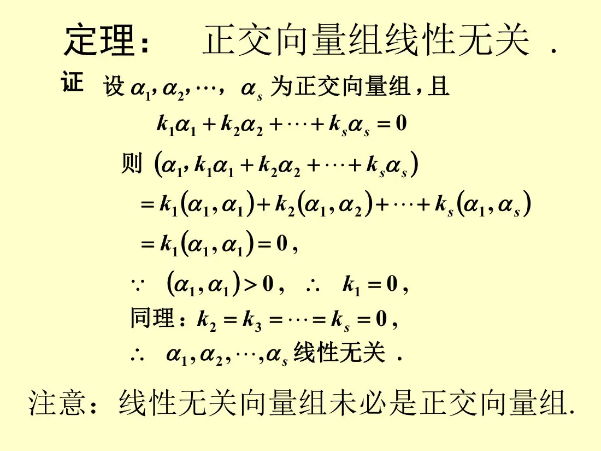

原文：

定理：正交向量组线性无关。

证 设 $\alpha_{1}, \alpha_{2}, \cdots, \alpha_{s}$ 为正交向量组，且

$$
k _ {1} \alpha_ {1} + k _ {2} \alpha_ {2} + \dots + k _ {s} \alpha_ {s} = 0
$$

$$
\begin{array}{r l} & {\text {则} \left(\alpha_ {1}, k _ {1} \alpha_ {1} + k _ {2} \alpha_ {2} + \dots + k _ {s} \alpha_ {s}\right)} \\ & {\qquad = k _ {1} (\alpha_ {1}, \alpha_ {1}) + k _ {2} (\alpha_ {1}, \alpha_ {2}) + \dots + k _ {s} (\alpha_ {1}, \alpha_ {s})} \\ & {\qquad = k _ {1} (\alpha_ {1}, \alpha_ {1}) = 0,} \\ & {\because \quad (\alpha_ {1}, \alpha_ {1}) > 0, \quad \therefore \quad k _ {1} = 0,} \end{array}
$$

同理： $k_{2}=k_{3}=\cdots=k_{s}=0$ ，

∴ $\alpha_{1},\alpha_{2},\cdots,\alpha_{s}$ 线性无关．

注意：线性无关向量组未必是正交向量组.

### $$

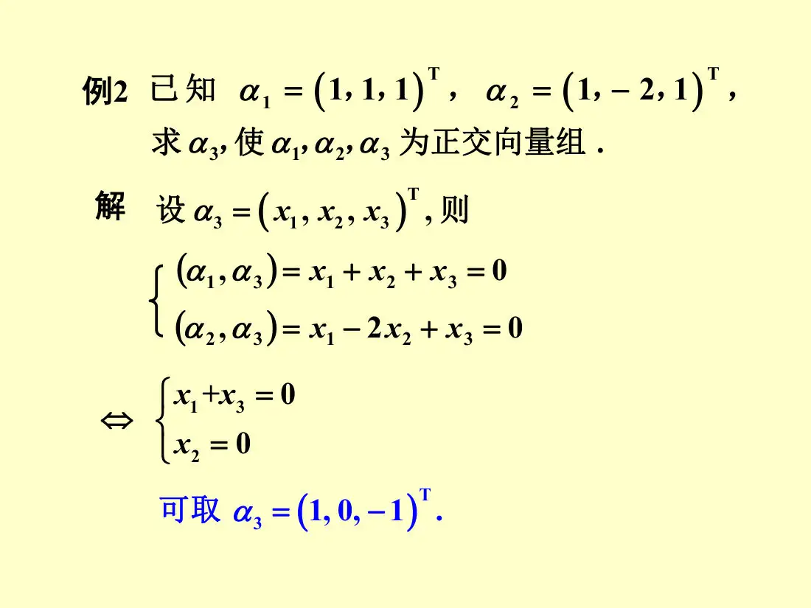

原文：

例2 已知 $\alpha_{1} = (1, 1, 1)^{\mathrm{T}}$ ， $\alpha_{2} = (1, -2, 1)^{\mathrm{T}}$ ，求 $\alpha_{3}$ ，使 $\alpha_{1}, \alpha_{2}, \alpha_{3}$ 为正交向量组。

解 设 $\alpha_{3} = (x_{1}, x_{2}, x_{3})^{\mathrm{T}}$ ，则

$$
\left\{ \begin{array}{l} (\alpha_ {1}, \alpha_ {3}) = x _ {1} + x _ {2} + x _ {3} = 0 \\ (\alpha_ {2}, \alpha_ {3}) = x _ {1} - 2 x _ {2} + x _ {3} = 0 \end{array} \right.
$$

$$
\Leftrightarrow \left\{ \begin{array}{l} x _ {1} + x _ {3} = 0 \\ x _ {2} = 0 \end{array} \right.
$$

可取 $\alpha_{3}=(1,0,-1)^{\mathrm{T}}$ .

### 2. 标准正交基

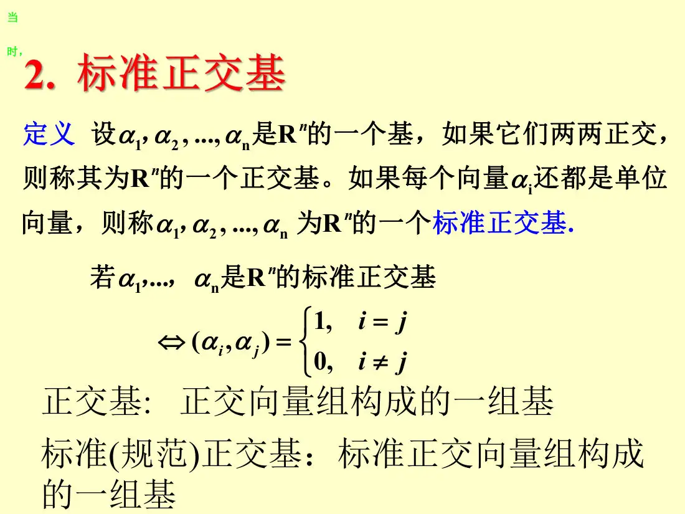

原文：

2. 标准正交基

定义 设 $\alpha_{1}, \alpha_{2}, \ldots, \alpha_{n}$ 是 $\mathbf{R}^{n}$ 的一个基，如果它们两两正交，则称其为 $\mathbf{R}^{n}$ 的一个正交基。如果每个向量 $\alpha_{i}$ 还都是单位向量，则称 $\alpha_{1}, \alpha_{2}, \ldots, \alpha_{n}$ 为 $\mathbf{R}^{n}$ 的一个标准正交基。

若 $\alpha_{1},\ldots ,\alpha_{n}$ 是 $\mathbf{R}^n$ 的标准正交基

$$
\Leftrightarrow (\alpha_ {i}, \alpha_ {j}) = \left\{ \begin{array}{l l} 1, & i = j \\ 0, & i \neq j \end{array} \right.
$$

正交基: 正交向量组构成的一组基
标准(规范)正交基: 标准正交向量组构成的一组基

### $$

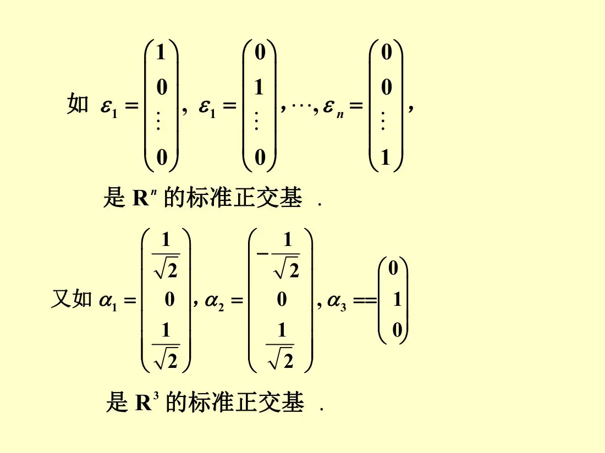

原文：

$$
\varepsilon_ {1} = \left( \begin{array}{c} 1 \\ 0 \\ \vdots \\ 0 \end{array} \right), \varepsilon_ {1} = \left( \begin{array}{c} 0 \\ 1 \\ \vdots \\ 0 \end{array} \right), \dots , \varepsilon_ {n} = \left( \begin{array}{c} 0 \\ 0 \\ \vdots \\ 1 \end{array} \right),
$$

是 $R^{n}$ 的标准正交基。

$$
\alpha_ {1} = \left( \begin{array}{c} \frac {1}{\sqrt {2}} \\ 0 \\ \frac {1}{\sqrt {2}} \end{array} \right), \alpha_ {2} = \left( \begin{array}{c} - \frac {1}{\sqrt {2}} \\ 0 \\ \frac {1}{\sqrt {2}} \end{array} \right), \alpha_ {3} = = \left( \begin{array}{c} 0 \\ 1 \\ 0 \end{array} \right)
$$

是 $R^{3}$ 的标准正交基。

### 三、施密特正交化方法

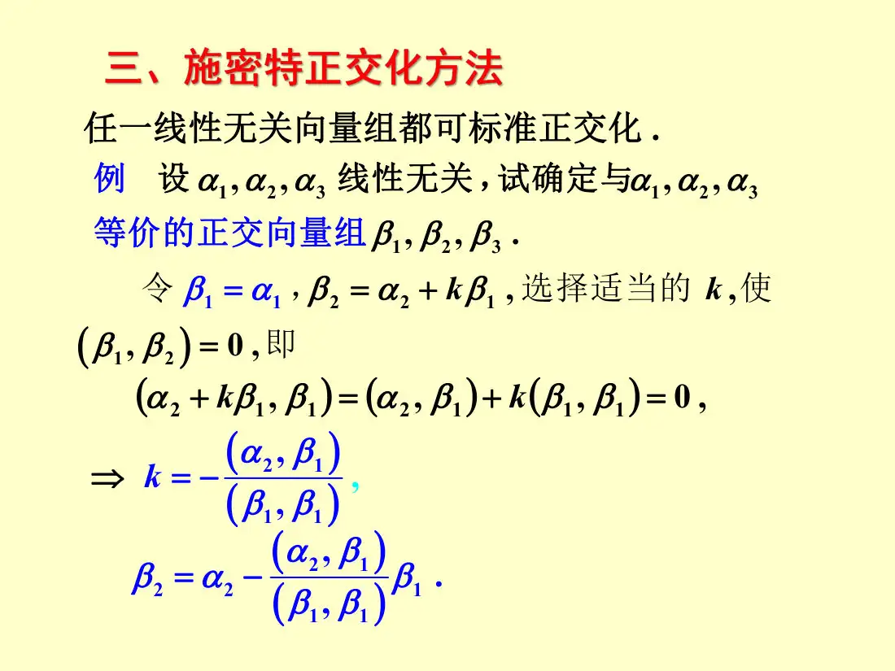

原文：

三、施密特正交化方法

任一线性无关向量组都可标准正交化。

例 设 $\alpha_{1}, \alpha_{2}, \alpha_{3}$ 线性无关，试确定与 $\alpha_{1}, \alpha_{2}, \alpha_{3}$ 等价的正交向量组 $\beta_{1}, \beta_{2}, \beta_{3}$ .

令 $\beta_{1} = \alpha_{1},\beta_{2} = \alpha_{2} + k\beta_{1}$ ，选择适当的 $k$ ，使 $(\beta_1,\beta_2) = 0$ ，即

$$
\begin{array}{l} \left(\alpha_ {2} + k \beta_ {1}, \beta_ {1}\right) = \left(\alpha_ {2}, \beta_ {1}\right) + k \left(\beta_ {1}, \beta_ {1}\right) = 0, \\ \Rightarrow k = - \frac {\left(\alpha_ {2} , \beta_ {1}\right)}{\left(\beta_ {1} , \beta_ {1}\right)}, \\ \beta_ {2} = \alpha_ {2} - \frac {\left(\alpha_ {2} , \beta_ {1}\right)}{\left(\beta_ {1} , \beta_ {1}\right)} \beta_ {1}. \end{array}
$$

### $$

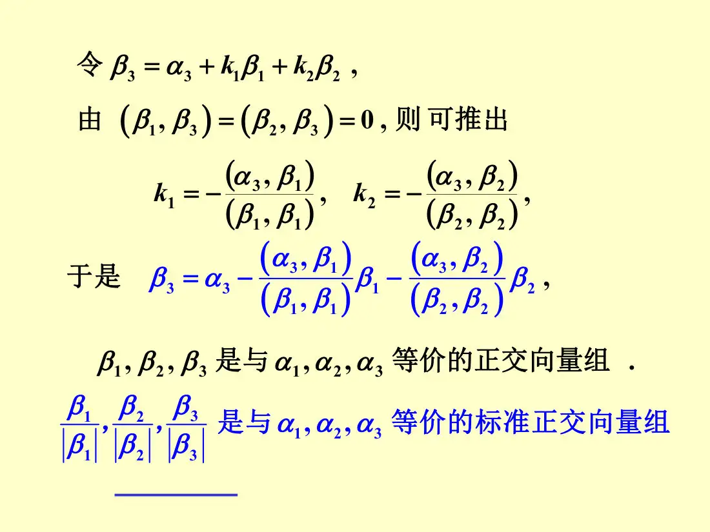

原文：

令 $\beta_{3} = \alpha_{3} + k_{1}\beta_{1} + k_{2}\beta_{2}$

由 $(\beta_{1},\beta_{3}) = (\beta_{2},\beta_{3}) = 0$ ，则可推出

$$
k _ {1} = - \frac {\left(\alpha_ {3} , \beta_ {1}\right)}{\left(\beta_ {1} , \beta_ {1}\right)}, \quad k _ {2} = - \frac {\left(\alpha_ {3} , \beta_ {2}\right)}{\left(\beta_ {2} , \beta_ {2}\right)},
$$

于是 $\beta_{3} = \alpha_{3} - \frac{(\alpha_{3},\beta_{1})}{(\beta_{1},\beta_{1})}\beta_{1} - \frac{(\alpha_{3},\beta_{2})}{(\beta_{2},\beta_{2})}\beta_{2},$

$\beta_{1}, \beta_{2}, \beta_{3}$ 是与 $\alpha_{1}, \alpha_{2}, \alpha_{3}$ 等价的正交向量组． $\frac{\beta_{1}}{|\beta_{1}|}, \frac{\beta_{2}}{|\beta_{2}|}, \frac{\beta_{3}}{|\beta_{3}|}$ 是与 $\alpha_{1}, \alpha_{2}, \alpha_{3}$ 等价的标准正交向量组

### 施密特正交化过程:

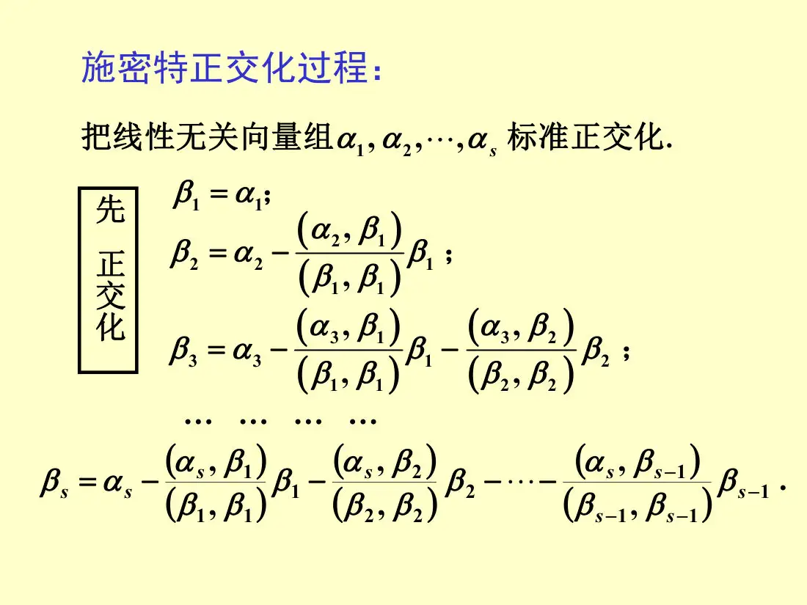

原文：

施密特正交化过程:

把线性无关向量组 $\alpha_{1},\alpha_{2},\cdots,\alpha_{s}$ 标准正交化.

先
正交化

$$
\begin{array}{l} \beta_ {1} = \alpha_ {1}; \\ \beta_ {2} = \alpha_ {2} - \frac {\left(\alpha_ {2} , \beta_ {1}\right)}{\left(\beta_ {1} , \beta_ {1}\right)} \beta_ {1}; \\ \beta_ {3} = \alpha_ {3} - \frac {\left(\alpha_ {3} , \beta_ {1}\right)}{\left(\beta_ {1} , \beta_ {1}\right)} \beta_ {1} - \frac {\left(\alpha_ {3} , \beta_ {2}\right)}{\left(\beta_ {2} , \beta_ {2}\right)} \beta_ {2}; \end{array}
$$

$$
\beta_ {s} = \alpha_ {s} - \frac {\left(\alpha_ {s} , \beta_ {1}\right)}{\left(\beta_ {1} , \beta_ {1}\right)} \beta_ {1} - \frac {\left(\alpha_ {s} , \beta_ {2}\right)}{\left(\beta_ {2} , \beta_ {2}\right)} \beta_ {2} - \dots - \frac {\left(\alpha_ {s} , \beta_ {s - 1}\right)}{\left(\beta_ {s - 1} , \beta_ {s - 1}\right)} \beta_ {s - 1}.
$$

### 单位化

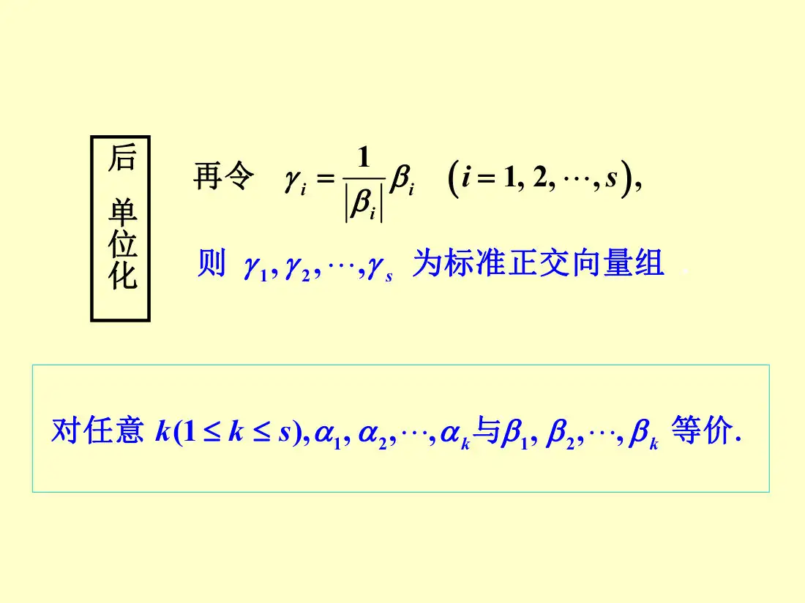

原文：

后
单位化

再令 $\gamma_{i}=\frac{1}{\left|\beta_{i}\right|}\beta_{i}\quad(i=1,2,\cdots,s)$ ,
则 $\gamma_{1},\gamma_{2},\cdots,\gamma_{s}$ 为标准正交向量组

对任意 $k(1 \leq k \leq s)$ , $\alpha_{1}$ , $\alpha_{2}$ , $\cdots$ , $\alpha_{k}$ 与 $\beta_{1}$ , $\beta_{2}$ , $\cdots$ , $\beta_{k}$ 等价.

### $$

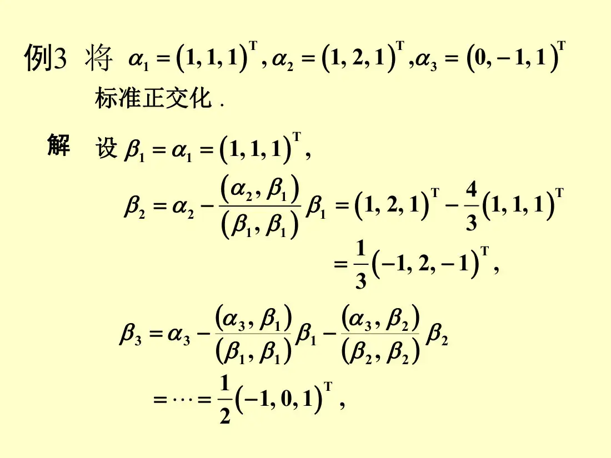

原文：

例3 将 $\alpha_{1} = (1, 1, 1)^{\mathrm{T}}, \alpha_{2} = (1, 2, 1)^{\mathrm{T}}, \alpha_{3} = (0, -1, 1)^{\mathrm{T}}$ 标准正交化.

解 设 $\beta_{1}=\alpha_{1}=(1,1,1)^{\mathrm{T}}$ ,

$$
\begin{array}{r l} \beta_ {2} = \alpha_ {2} - \frac {\left(\alpha_ {2} , \beta_ {1}\right)}{\left(\beta_ {1} , \beta_ {1}\right)} \beta_ {1} & = (1, 2, 1) ^ {\mathrm{T}} - \frac {4}{3} (1, 1, 1) ^ {\mathrm{T}} \\ & = \frac {1}{3} (- 1, 2, - 1) ^ {\mathrm{T}}, \end{array}
$$

$$
\begin{array}{r l} & {\beta_ {3} = \alpha_ {3} - \frac {(\alpha_ {3} , \beta_ {1})}{(\beta_ {1} , \beta_ {1})} \beta_ {1} - \frac {(\alpha_ {3} , \beta_ {2})}{(\beta_ {2} , \beta_ {2})} \beta_ {2}} \\ & {\qquad = \dots = \frac {1}{2} (- 1, 0, 1) ^ {\mathrm{T}},} \end{array}
$$

### $$

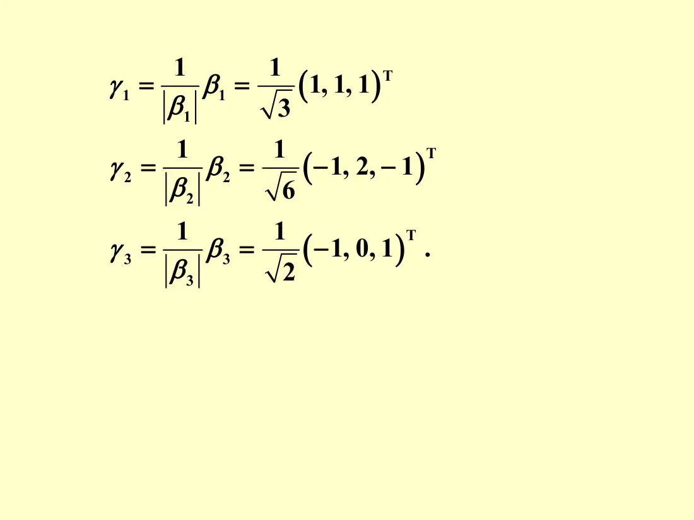

原文：

$$
\gamma_ {1} = \frac {1}{| \beta_ {1} |} \beta_ {1} = \frac {1}{\sqrt {3}} (1, 1, 1) ^ {\mathrm{T}}
$$

$$
\gamma_ {2} = \frac {1}{| \beta_ {2} |} \beta_ {2} = \frac {1}{\sqrt {6}} (- 1, 2, - 1) ^ {\mathrm{T}}
$$

$$
\gamma_ {3} = \frac {1}{| \beta_ {3} |} \beta_ {3} = \frac {1}{\sqrt {2}} (- 1, 0, 1) ^ {\mathrm{T}}.
$$

### 四、正交矩阵

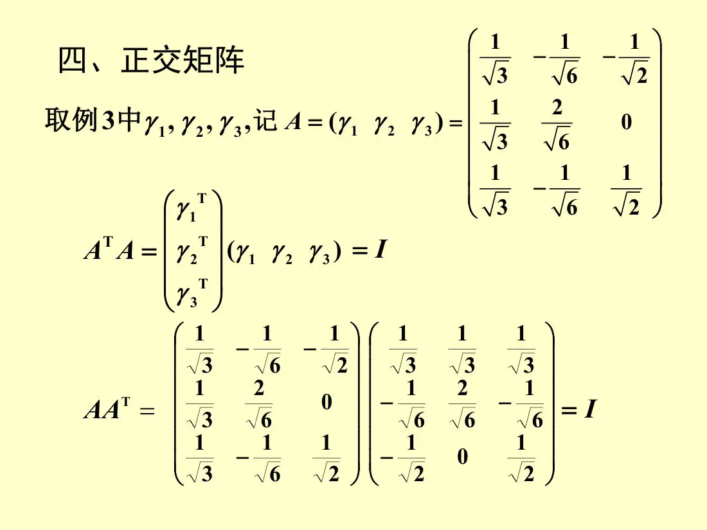

原文：

四、正交矩阵

$$
\gamma_ {1}, \gamma_ {2}, \gamma_ {3},
$$

$$
A = \left( \begin{array}{c c c} \gamma_ {1} & \gamma_ {2} & \gamma_ {3} \end{array} \right) = \left( \begin{array}{c c c} \frac {1}{\sqrt {3}} & - \frac {1}{\sqrt {6}} & - \frac {1}{\sqrt {2}} \\ \frac {1}{\sqrt {3}} & \frac {2}{\sqrt {6}} & 0 \\ \frac {1}{\sqrt {3}} & - \frac {1}{\sqrt {6}} & \frac {1}{\sqrt {2}} \end{array} \right)
$$

$$
\boldsymbol {A} ^ {\mathrm{T}} \boldsymbol {A} = \left( \begin{array}{l} \gamma_ {1} ^ {\mathrm{T}} \\ \gamma_ {2} ^ {\mathrm{T}} \\ \gamma_ {3} ^ {\mathrm{T}} \end{array} \right) (\gamma_ {1} \gamma_ {2} \gamma_ {3}) = \boldsymbol {I}
$$

$$
\boldsymbol {A} \boldsymbol {A} ^ {\mathrm{T}} = \left( \begin{array}{c c c} \frac {1}{\sqrt {3}} & - \frac {1}{\sqrt {6}} & - \frac {1}{\sqrt {2}} \\ \frac {1}{\sqrt {3}} & \frac {2}{\sqrt {6}} & 0 \\ \frac {1}{\sqrt {3}} & - \frac {1}{\sqrt {6}} & \frac {1}{\sqrt {2}} \end{array} \right) \left( \begin{array}{c c c} \frac {1}{\sqrt {3}} & \frac {1}{\sqrt {3}} & \frac {1}{\sqrt {3}} \\ - \frac {1}{\sqrt {6}} & \frac {2}{\sqrt {6}} & - \frac {1}{\sqrt {6}} \\ - \frac {1}{\sqrt {2}} & 0 & \frac {1}{\sqrt {2}} \end{array} \right) = \boldsymbol {I}
$$

### (1) $A^{-1} = A^{T};$

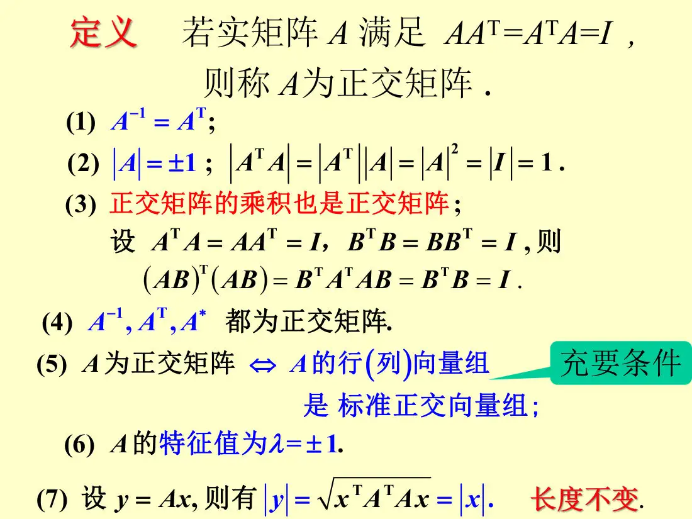

原文：

定义 若实矩阵 A 满足 $AA^{T}=A^{T}A=I$ ，则称 A 为正交矩阵。

(1) $A^{-1} = A^{T};$

(2) $|A| = \pm 1$ ; $|A^{\mathrm{T}}A| = |A^{\mathrm{T}}||A| = |A|^2 = |I| = 1$ .

(3) 正交矩阵的乘积也是正交矩阵；

设 $A^{\mathrm{T}}A = AA^{\mathrm{T}} = I, B^{\mathrm{T}}B = BB^{\mathrm{T}} = I$ ，则 $(AB)^{\mathrm{T}}(AB) = B^{\mathrm{T}}A^{\mathrm{T}}AB = B^{\mathrm{T}}B = I$ .

(4) $A^{-1}, A^{\mathrm{T}}, A^{*}$ 都为正交矩阵.

(5) A 为正交矩阵 $\Leftrightarrow$ A 的行(列)向量组 充要条件
是 标准正交向量组；

(6) A 的特征值为 $\lambda = \pm 1$ .

(7) 设 $y = Ax$ , 则有 $|y| = \sqrt{x^{\mathrm{T}}A^{\mathrm{T}}Ax} = |x|$ . 长度不变.

### 第 20 页

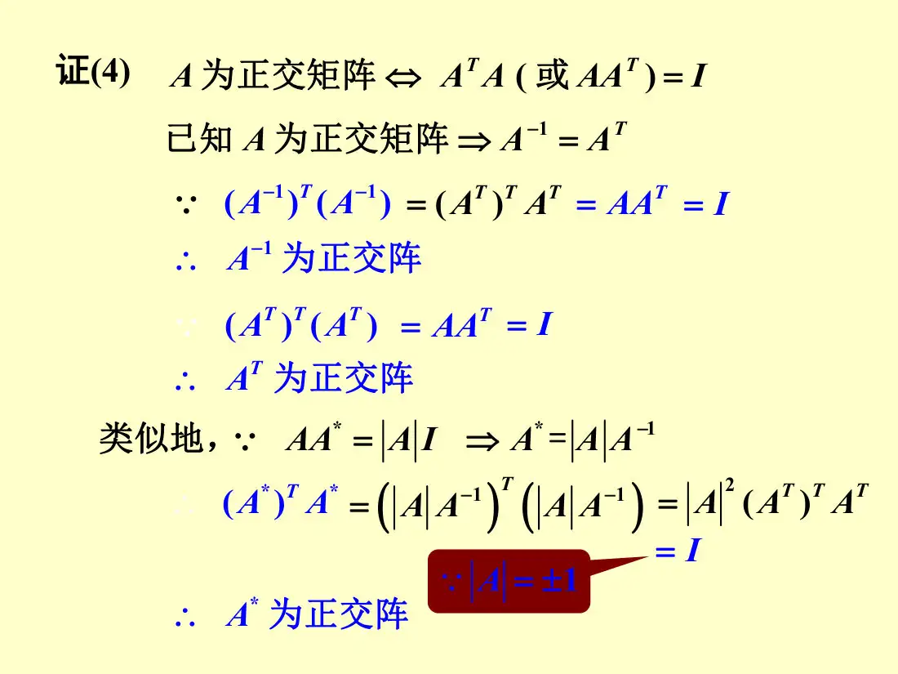

原文：

证(4) A 为正交矩阵 $\Leftrightarrow A^{T}A$ (或 $AA^{T}$ ) = I
已知 A 为正交矩阵 $\Rightarrow A^{-1} = A^{T}$ $\because (A^{-1})^{T}(A^{-1}) = (A^{T})^{T}A^{T} = AA^{T} = I$ $\therefore A^{-1}$ 为正交阵 $(A^{T})^{T}(A^{T}) = AA^{T} = I$ $\therefore A^{T}$ 为正交阵
类似地， $\because AA^{*}=|A|I\Rightarrow A^{*}=|A|A^{-1}$ $(A^{*})^{T}A^{*}=\left(|A|A^{-1}\right)^{T}\left(|A|A^{-1}\right)=|A|^{2}(A^{T})^{T}A^{T}$ $\therefore A^{*}$ 为正交阵 $\because |A|=\pm1=I$

### ∴ $A^{-1}$ 为正交阵

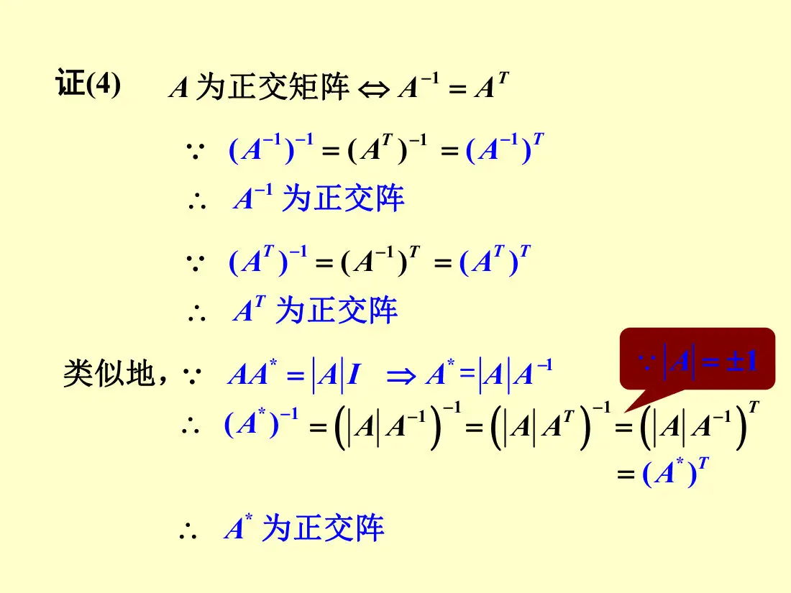

原文：

证(4) $A$ 为正交矩阵 $\Leftrightarrow A^{-1} = A^{T}$

$\because (A^{-1})^{-1} = (A^T)^{-1} = (A^{-1})^T$

∴ $A^{-1}$ 为正交阵

$\because (A^T)^{-1} = (A^{-1})^T = (A^T)^T$

∴ $A^{T}$ 为正交阵

类似地，∵ $AA^{*}=|A|I \Rightarrow A^{*}=|A|A^{-1}$ $\therefore (A^{*})^{-1} = \left(|A|A^{-1}\right)^{-1} = \left(|A|A^{T}\right)^{-1} = \left(|A|A^{-1}\right)^{T}$ $= (A^{*})^{T}$

∴ $A^{*}$ 为正交阵

### 第 22 页

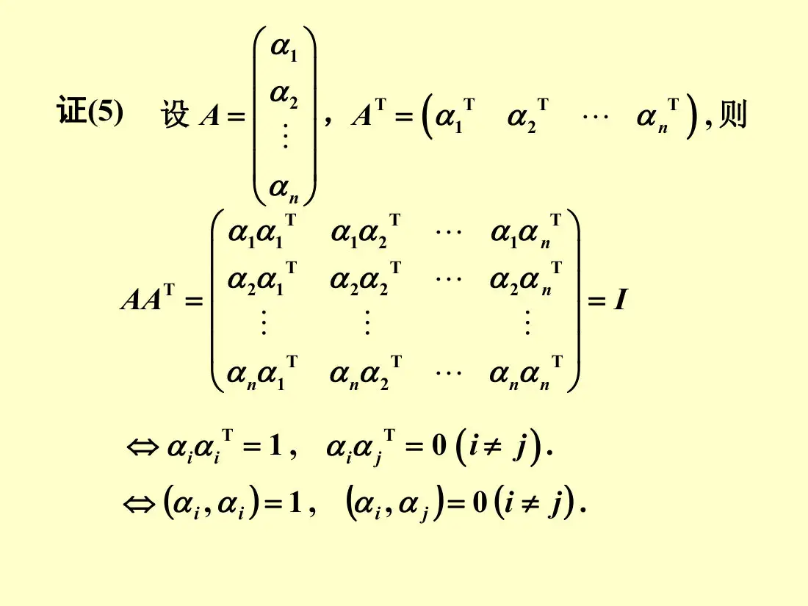

原文：

证(5) 设 $A=\begin{pmatrix}\alpha_{1}\\ \alpha_{2}\\\vdots\\ \alpha_{n}\end{pmatrix},\quad A^{T}=\begin{pmatrix}\alpha_{1}^{T}&\alpha_{2}^{T}&\cdots&\alpha_{n}^{T}\end{pmatrix}$ ，则 $AA^{T}=\begin{pmatrix}\alpha_{1}\alpha_{1}^{T}&\alpha_{1}\alpha_{2}^{T}&\cdots&\alpha_{1}\alpha_{n}^{T}\\ \alpha_{2}\alpha_{1}^{T}&\alpha_{2}\alpha_{2}^{T}&\cdots&\alpha_{2}\alpha_{n}^{T}\\ \vdots&\vdots&&\vdots\\ \alpha_{n}\alpha_{1}^{T}&\alpha_{n}\alpha_{2}^{T}&\cdots&\alpha_{n}\alpha_{n}^{T}\end{pmatrix}=I$ $\Leftrightarrow \alpha_{i}\alpha_{i}^{T}=1,\quad\alpha_{i}\alpha_{j}^{T}=0(i\neq j).$ $\Leftrightarrow (\alpha_{i}, \alpha_{i}) = 1, \quad (\alpha_{i}, \alpha_{j}) = 0 (i \neq j).$

### (6). 设 A 是正交矩阵, 求 A 的特征值.

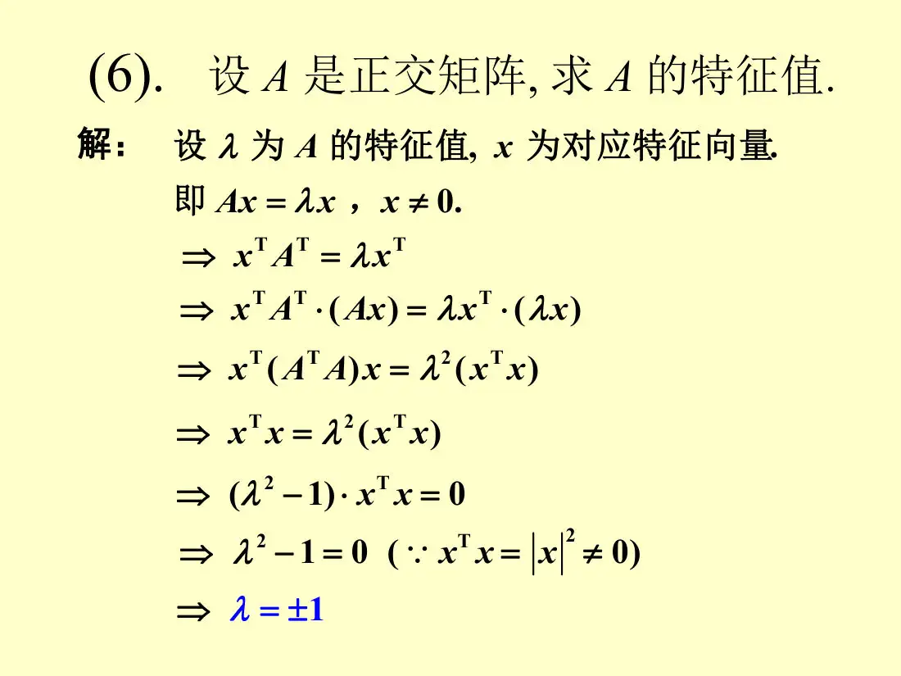

原文：

(6). 设 A 是正交矩阵, 求 A 的特征值.

解：设 $\lambda$ 为 A 的特征值，x 为对应特征向量。
即 Ax = $\lambda x$ ， $x \neq 0$ . $\Rightarrow x^{T}A^{T}=\lambda x^{T}$ $\Rightarrow x^{T}A^{T}\cdot(Ax)=\lambda x^{T}\cdot(\lambda x)$ $\Rightarrow x^{\mathrm{T}}(A^{\mathrm{T}}A)x=\lambda^{2}(x^{\mathrm{T}}x)$ $\Rightarrow x^{\mathrm{T}}x=\lambda^{2}(x^{\mathrm{T}}x)$ $\Rightarrow (\lambda^{2}-1)\cdot x^{\mathrm{T}}x=0$ $\Rightarrow \lambda^{2}-1=0 (\because x^{\mathrm{T}}x=\left|x\right|^{2}\neq0)$ $\Rightarrow \lambda = \pm 1$

### $$

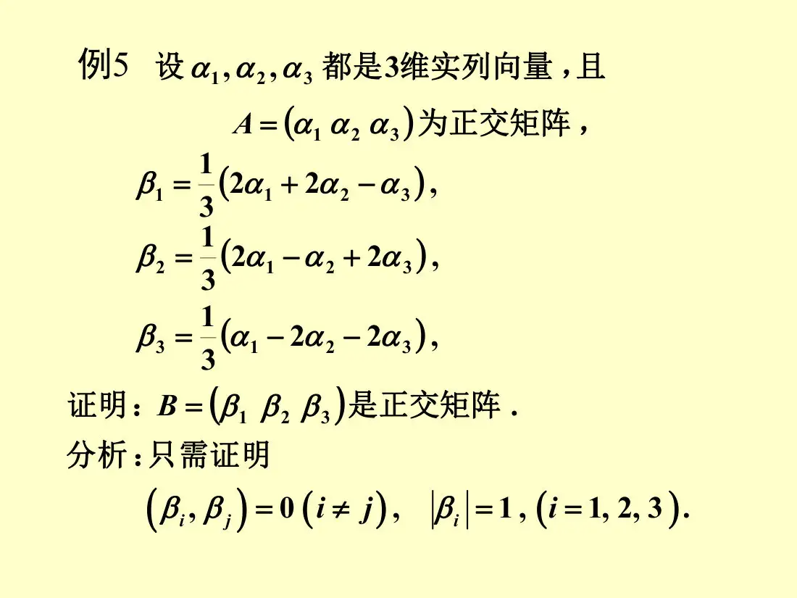

原文：

例5 设 $\alpha_{1}, \alpha_{2}, \alpha_{3}$ 都是3维实列向量，且

$A = (\alpha_{1}\alpha_{2}\alpha_{3})$ 为正交矩阵，

$$
\beta_ {1} = \frac {1}{3} (2 \alpha_ {1} + 2 \alpha_ {2} - \alpha_ {3}),
$$

$$
\beta_ {2} = \frac {1}{3} \left(2 \alpha_ {1} - \alpha_ {2} + 2 \alpha_ {3}\right),
$$

$$
\beta_ {3} = \frac {1}{3} \left(\alpha_ {1} - 2 \alpha_ {2} - 2 \alpha_ {3}\right),
$$

证明： $B=\left(\beta_{1}\beta_{2}\beta_{3}\right)$ 是正交矩阵.

分析: 只需证明

$$
\left(\beta_ {i}, \beta_ {j}\right) = 0 (i \neq j), \quad \left| \beta_ {i} \right| = 1, (i = 1, 2, 3).
$$

### $$

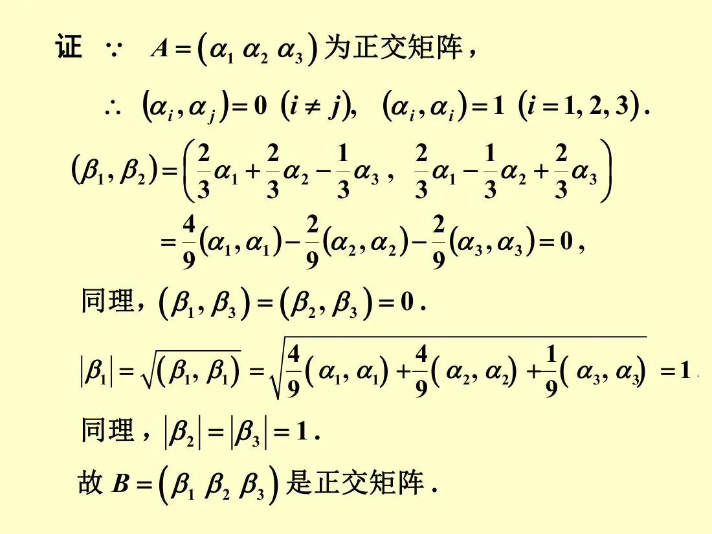

原文：

证 $\because A = (\alpha_{1}\alpha_{2}\alpha_{3})$ 为正交矩阵，

$$
\therefore \left(\alpha_ {i}, \alpha_ {j}\right) = 0 (i \neq j), \left(\alpha_ {i}, \alpha_ {i}\right) = 1 (i = 1, 2, 3).
$$

$$
\begin{array}{r l} \left(\beta_ {1}, \beta_ {2}\right) & = \left(\frac {2}{3} \alpha_ {1} + \frac {2}{3} \alpha_ {2} - \frac {1}{3} \alpha_ {3}, \frac {2}{3} \alpha_ {1} - \frac {1}{3} \alpha_ {2} + \frac {2}{3} \alpha_ {3}\right) \\ & = \frac {4}{9} \left(\alpha_ {1}, \alpha_ {1}\right) - \frac {2}{9} \left(\alpha_ {2}, \alpha_ {2}\right) - \frac {2}{9} \left(\alpha_ {3}, \alpha_ {3}\right) = 0, \end{array}
$$

同理， $(\beta_{1},\beta_{3}) = (\beta_{2},\beta_{3}) = 0$

$$
\left| \beta_ {1} \right| = \sqrt {\left(\beta_ {1} , \beta_ {1}\right)} = \sqrt {\frac {4}{9} \left(\alpha_ {1} , \alpha_ {1}\right) + \frac {4}{9} \left(\alpha_ {2} , \alpha_ {2}\right) + \frac {1}{9} \left(\alpha_ {3} , \alpha_ {3}\right)} = 1.
$$

同理， $\left|\beta_{2}\right|=\left|\beta_{3}\right|=1$ .

故 $B = \left( \beta_{1} \beta_{2} \beta_{3} \right)$ 是正交矩阵.

### 思考题

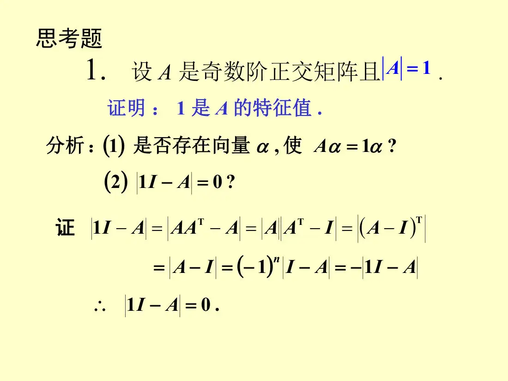

原文：

思考题

1. 设 A 是奇数阶正交矩阵且 $\left|A\right|=1$

证明：1 是 A 的特征值。

分析：(1) 是否存在向量 $\alpha$ ，使 $A\alpha = 1\alpha$ ?

(2) $|1I - A| = 0$ ?

证 $|1I - A| = |AA^{\mathrm{T}} - A| = |A||A^{\mathrm{T}} - I| = (A - I)^{\mathrm{T}}|$ $= |A - I| = (-1)^{n}|I - A| = -|1I - A|$

∴ $\left|1I-A\right|=0$ .

### 27

原文：

27

### 第 28 页

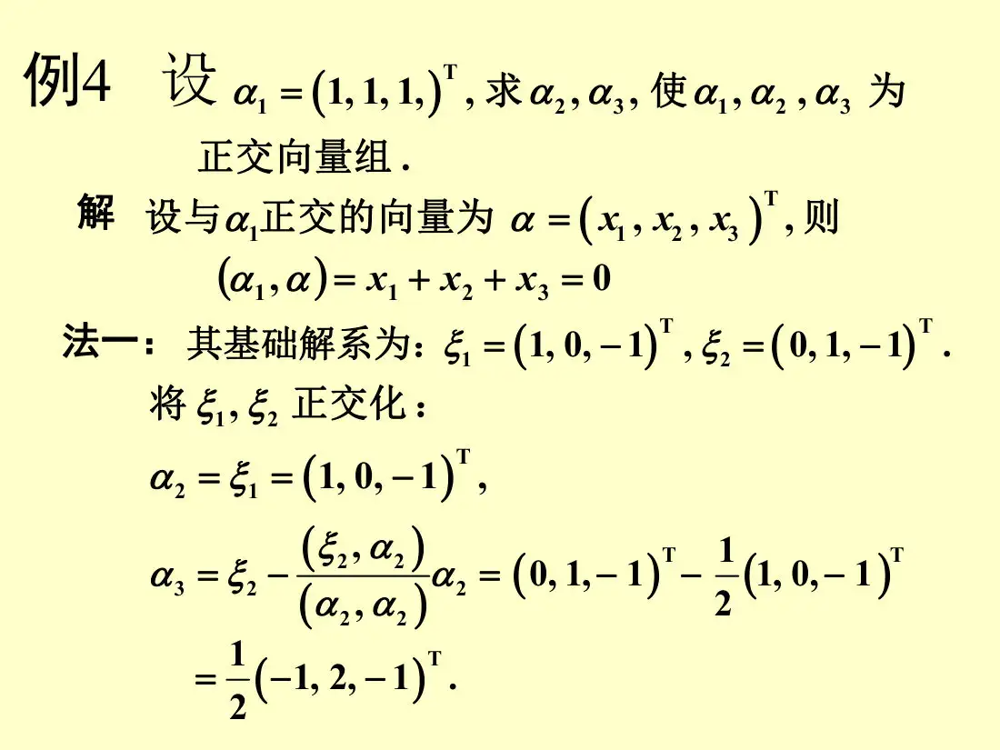

原文：

例4 设 $\alpha_{1}=(1,1,1)^{\mathrm{T}}$ ，求 $\alpha_{2},\alpha_{3}$ ，使 $\alpha_{1},\alpha_{2},\alpha_{3}$ 为正交向量组。
解 设与 $\alpha_{1}$ 正交的向量为 $\alpha=(x_{1},x_{2},x_{3})^{\mathrm{T}}$ ，则 $(\alpha_{1},\alpha)=x_{1}+x_{2}+x_{3}=0$ 法一：其基础解系为： $\xi_{1}=(1,0,-1)^{\mathrm{T}},\xi_{2}=(0,1,-1)^{\mathrm{T}}$ 将 $\xi_{1},\xi_{2}$ 正交化： $\alpha_{2}=\xi_{1}=(1,0,-1)^{\mathrm{T}}$ $\alpha_{3}=\xi_{2}-\frac{(\xi_{2},\alpha_{2})}{(\alpha_{2},\alpha_{2})}\alpha_{2}=(0,1,-1)^{\mathrm{T}}-\frac{1}{2}(1,0,-1)^{\mathrm{T}}$ $=\frac{1}{2}(-1,2,-1)^{\mathrm{T}}.$

### $$

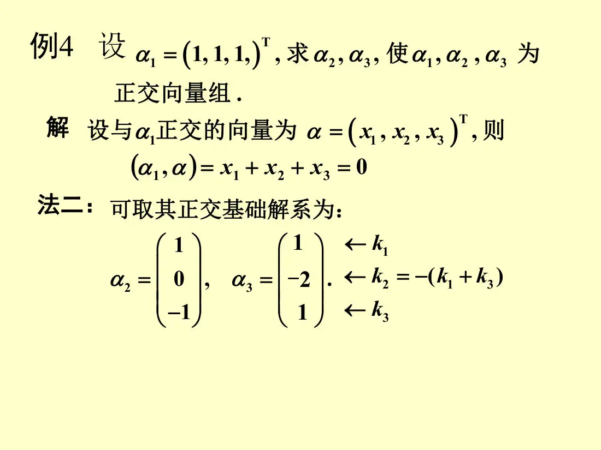

原文：

例4 设 $\alpha_{1}=(1,1,1,)^{\mathrm{T}}$ ，求 $\alpha_{2},\alpha_{3}$ ，使 $\alpha_{1},\alpha_{2},\alpha_{3}$ 为正交向量组。

解 设与 $\alpha_{1}$ 正交的向量为 $\alpha = (x_{1}, x_{2}, x_{3})^{\mathrm{T}}$ ，则

$$
(\alpha_ {1}, \alpha) = x _ {1} + x _ {2} + x _ {3} = 0
$$

法二：可取其正交基础解系为：

$$
\alpha_ {2} = \left( \begin{array}{c} 1 \\ 0 \\ - 1 \end{array} \right), \quad \alpha_ {3} = \left( \begin{array}{c} 1 \\ - 2 \\ 1 \end{array} \right). \begin{array}{l} \leftarrow k _ {1} \\ \leftarrow k _ {2} = - (k _ {1} + k _ {3}) \\ \leftarrow k _ {3} \end{array}
$$
