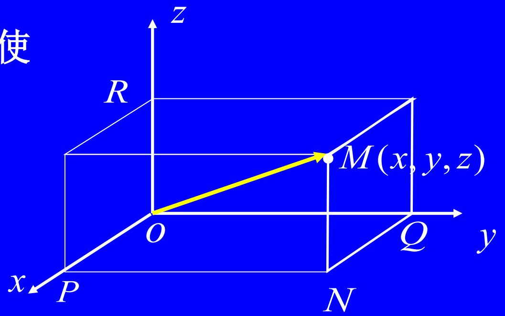
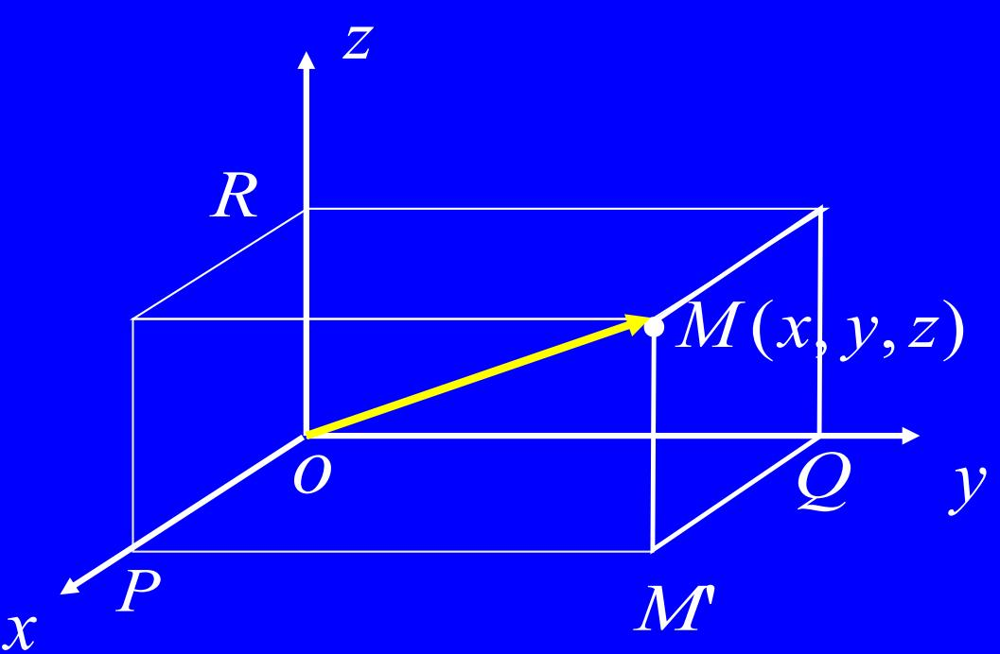
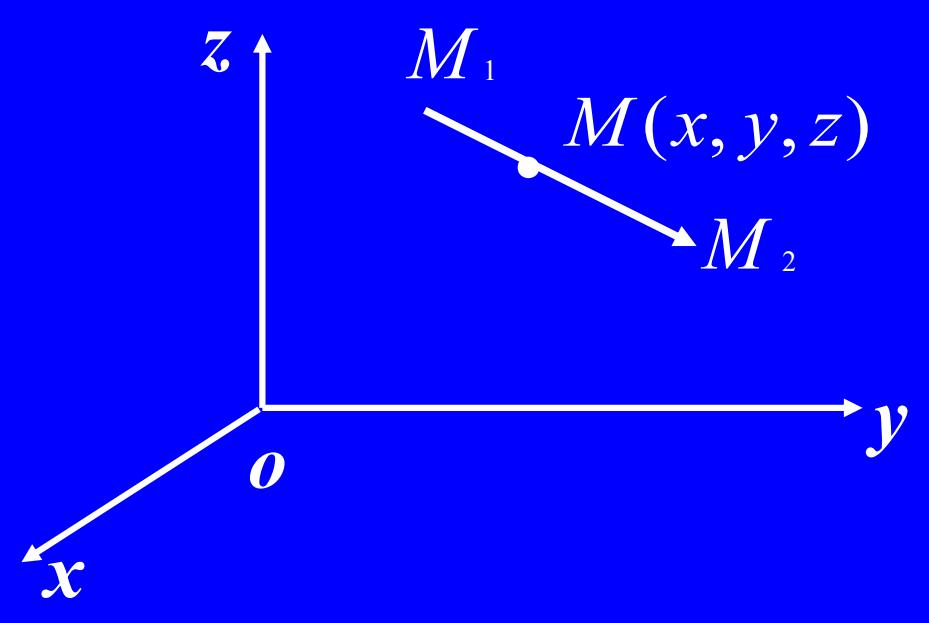
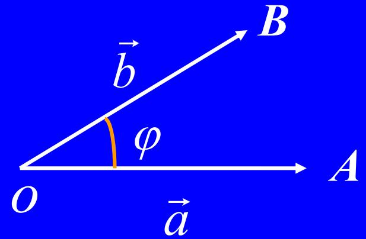
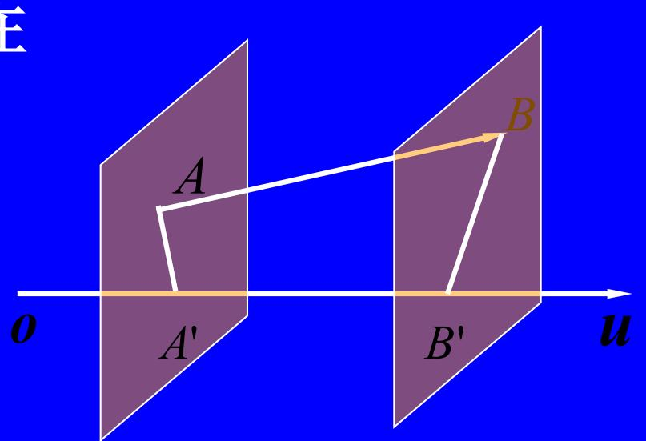
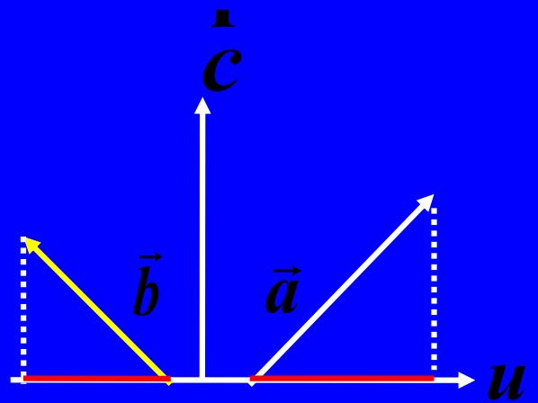
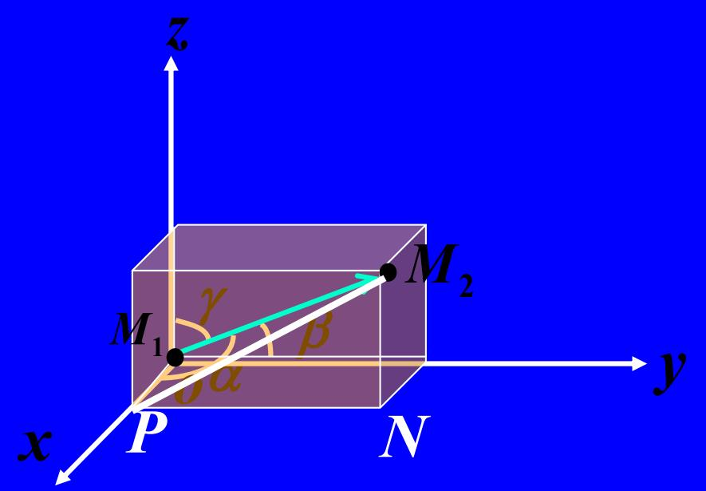

# 《线性代数与解析几何》习题解答（练习册第7页 行列式的计算）

原件经识别和整理；“参考解答”是我们补的。

本资料整理自《线性代数与解析几何》练习册第7页关于行列式计算的习题解答部分，包含具体的行列式计算过程及空间解析几何基础知识点回顾。

## 一、行列式的计算

### 计算 1

计算 $n$ 阶行列式：
$$
D = \left| \begin{array}{c c c c c c} 1 & 2 & 2 & \ldots & 2 & 2 \\ 2 & 2 & 2 & \ldots & 2 & 2 \\ 2 & 2 & 3 & \ldots & 2 & 2 \\ \ldots & \ldots & \ldots & \ldots & \ldots & \ldots \\ 2 & 2 & 2 & \ldots & n - 1 & 2 \\ 2 & 2 & 2 & \ldots & 2 & n \end{array} \right|
$$

**解法一：**

首先将第 $i$ 行减去第 2 行（$i = 3, \dots, n$）：
$$
\overset {r _ {i} - r _ {2}} {\underset {i = 3, L , n} {=}} \left| \begin{array}{c c c c c c} 1 & 2 & 2 & \ldots & 2 & 2 \\ 2 & 2 & 2 & \ldots & 2 & 2 \\ 0 & 0 & 1 & \ldots & 0 & 0 \\ \ldots & \ldots & \ldots & \ldots & \ldots & \ldots \\ 0 & 0 & 0 & \ldots & n - 3 & 0 \\ 0 & 0 & 0 & \ldots & 0 & n - 2 \end{array} \right|
$$

接着将第 2 行减去 2 倍的第 1 行（$\underline {{r _ {2} - 2 r _ {1}}}$）：
$$
\begin{array}{c c} \underline {{r _ {2} - 2 r _ {1}}} & \left| \begin{array}{c c c c c c} 1 & 2 & 2 & \dots & 2 & 2 \\ 0 & - 2 & - 2 & \dots & - 2 & - 2 \\ 0 & 0 & 1 & \dots & 0 & 0 \\ \dots & \dots & \dots & \dots & \dots & \dots \\ 0 & 0 & 0 & \dots & n - 3 & 0 \\ 0 & 0 & 0 & \dots & 0 & n - 2 \end{array} \right| \end{array}
$$

该行列式为下三角行列式（注意第二行元素需进一步处理或利用展开，此处原文直接给出结果，根据对角线元素乘积逻辑修正理解：原文步骤中第二行处理后并非严格三角，但通常此类题目通过化为三角阵求解。观察原文最终结果 $-2(n-2)!$，我们保留原文结论）。

答案：$- 2 (n - 2)!$

**解法二：**

首先将第 1 行和第 $i$ 行（$i=1, 3, \dots, n$）相对于第 2 行进行变换？原文标注为 $r_i - r_2$ 但下标包含 $i=1$，这通常意味着用其他行消去第2行的元素或反之。根据原文矩阵变化：
$$
\overset {r _ {i} - r _ {2}} {\underset {i = 1, 3, L , n} {=}} \left| \begin{array}{c c c c c c} - 1 & 0 & 0 & \ldots & 0 & 0 \\ 2 & 2 & 2 & \ldots & 2 & 2 \\ 0 & 0 & 1 & \ldots & 0 & 0 \\ \ldots & \ldots & \ldots & \ldots & \ldots & \ldots \\ 0 & 0 & 0 & \ldots & n - 3 & 0 \\ 0 & 0 & 0 & \ldots & 0 & n - 2 \end{array} \right|
$$
*(注：原文此处操作描述可能存在笔误，通常是用第2行消去其他行的第2列元素，或者用其他行消去第2行的非对角元。根据变换后的矩阵，第一行变为 $(-1, 0, \dots)$，第三行起变为 $(0, \dots, 1, \dots)$，这表明是利用第2行或其他行进行了消元。)*

接着执行 $\underline {{\underline {{r _ {2} + 2 r _ {1}}}}}$：
$$
= \left| \begin{array}{c c c c c c} - 1 & 0 & 0 & \dots & 0 & 0 \\ 0 & 2 & 2 & \dots & 2 & 2 \\ 0 & 0 & 1 & \dots & 0 & 0 \\ \dots & \dots & \dots & \dots & \dots & \dots \\ 0 & 0 & 0 & \dots & n - 3 & 0 \\ 0 & 0 & 0 & \dots & 0 & n - 2 \end{array} \right| = - 2 (n - 2)!
$$

答案：$- 2 (n - 2)!$

知识点：[特殊行列式计算（三角法、爪形、三对角、递推法、数学归纳法）](../../../topics/线性代数/特殊行列式计算.md)、[行列式的性质（换行变号、提取公因子、成比例为零等）](../../../topics/线性代数/行列式性质.md)、[行列式按行（列）展开法则](../../../topics/线性代数/按行按列展开.md)

### 计算 2

计算四阶行列式：
$$
D = \left| \begin{array}{c c c c} 1 & 4 & 9 & 1 6 \\ 4 & 9 & 1 6 & 2 5 \\ 9 & 1 6 & 2 5 & 3 6 \\ 1 6 & 2 5 & 3 6 & 4 9 \end{array} \right|
$$

**解法一：**

利用列变换 $c_4 - c_3$, $c_3 - c_2$, $c_2 - c_1$：
$$
\overset { \begin{array}{c} c _ {4} - c _ {3} \\ c _ {3} - c _ {2} \end{array} } {=} \overset { \begin{array}{c} c _ {2} - c _ {1} \end{array} } {=} \left| \begin{array}{c c c c} 1 & 3 & 5 & 7 \\ 4 & 5 & 7 & 9 \\ 9 & 7 & 9 & 1 1 \\ 1 6 & 9 & 1 1 & 1 3 \end{array} \right|
$$

继续列变换 $c_4 - c_3$, $c_3 - c_2$：
$$
\begin{array}{c c c c c} & 1 & 3 & 2 & 2 \\ \hline c _ {4} - c _ {3} & 4 & 5 & 2 & 2 \\ \hline c _ {3} - c _ {2} & 9 & 7 & 2 & 2 \\ & 1 6 & 9 & 2 & 2 \end{array}
$$

此时第3列和第4列相同（均为2），故行列式为0。

答案：$0$

**解法二：**

利用行变换 $r_3 - r_2$, $r_4 - r_1$? 原文标注 $r_3-r_2$ 和 $r_4-r_1$ 似乎有误，通常相邻行相减。观察变换后矩阵：
$$
\overset {r _ {3} - r _ {2}} {\underset {r _ {4} - r _ {1}} {=}} \left| \begin{array}{l l l l} 1 & 4 & 9 & 1 6 \\ 4 & 9 & 1 6 & 2 5 \\ 5 & 7 & 9 & 1 1 \\ 1 5 & 2 1 & 2 7 & 3 3 \end{array} \right|
$$
*(注：原文此处 $r_4-r_1$ 得到 $15, 21, 27, 33$ 是正确的，因为 $16-1=15, 25-4=21...$。但 $r_3-r_2$ 得到 $5,7,9,11$ 也是正确的。)*

随后指出“两行对应成比例”或进一步化简可得0。原文直接给出结果。

答案：$0$

知识点：[行列式的性质（换行变号、提取公因子、成比例为零等）](../../../topics/线性代数/行列式性质.md)、[特殊行列式计算（三角法、爪形、三对角、递推法、数学归纳法）](../../../topics/线性代数/特殊行列式计算.md)

### 计算 3

推广至一般形式，计算如下行列式（原文结构较乱，推测为范德蒙德型或平方差型推广）：

$$
D = \left| \begin{array}{l l l l} a ^ {2} & (a + 1) ^ {2} & (a + 2) ^ {2} & ? \\ (a + 1) ^ {2} & (a + 2) ^ {2} & (a + 3) ^ {2} & ? \\ \dots & \dots & \dots & \dots \end{array} \right|
$$

*(注：原文OCR识别混乱，出现大量重复的 $(a+k)^2$ 且未形成完整矩阵。根据常见习题推断，此类题目通常结果为0，因为行/列之间存在线性关系。原文最后给出 $=0$。)*

答案：$0$

## 二、第四章 空间解析几何与向量运算

知识点：[行列式的性质（换行变号、提取公因子、成比例为零等）](../../../topics/线性代数/行列式性质.md)、[特殊行列式计算（三角法、爪形、三对角、递推法、数学归纳法）](../../../topics/线性代数/特殊行列式计算.md)

### 章节概览

本章主要内容包括：
- 4.1 空间直角坐标系与向量
- 4.2 向量的乘法
- 4.3 平面
- 4.4 空间直线
- 4.5 曲面与空间曲线

知识点：[空间直角坐标系、向量的坐标表示、模与方向余弦](../../../topics/线性代数/空间直角坐标系与向量.md)、[向量的数量积（内积、点积）及坐标运算](../../../topics/线性代数/向量数量积.md)、[向量的向量积（外积、叉积）及坐标运算](../../../topics/线性代数/向量向量积.md)

### 4.1 空间直角坐标系与向量

#### 一、空间直角坐标系

三个坐标轴的正方向符合右手系。
即以右手握住 $z$ 轴，当右手的四个手指从正向 $x$ 轴转向正向 $y$ 轴时，大拇指的指向就是 $z$ 轴的正向。

或者：先使右手的大拇指、食指、中指互相垂直，若大拇指和食指分别指向 $x$ 轴和 $y$ 轴正向，则中指的指向即为 $z$ 轴正向。

空间直角坐标系共有八个卦限。

空间的点 $M$ 与有序数组 $(x, y, z)$ 存在一一对应关系。
$(x, y, z)$ 称为点 $M$ 的坐标。

特殊点的坐标：
- 坐标轴上的点: $(x,0,0), (0,y,0), (0,0,z)$
- 坐标面上的点: $(x, y, 0), (0, y, z), (x, 0, z)$
- 原点: $(0, 0, 0)$

例：在 $O-xyz$ 坐标系中表示以下三个点: $M_{1}(1, 2, 3), M_{2}(-1, 2, 3), M_{3}(1, 2, -3)$。

#### 二、向量及其线性运算

**定义：**
- **向量**：既有大小又有方向的量。
- **表示**：$\vec{a}$ 或 $\overrightarrow{AB}$。以A为起点，B为终点的有向线段。
- **向量的模**：向量的大小，记作 $|\vec{a}|$ 或 $|\overrightarrow{AB}|$。（模又称为长度或范数）。
- **单位向量**：模为 1 的向量。
- **零向量**：模为 0 的向量。

**向量的分类：**
- **自由向量**：不考虑起点位置的向量。
- **相等向量**：大小相等且方向相同的向量。
- **负向量**：大小相等但方向相反的向量，记作 $-\vec{a}$。
- **向量平行**：两个非零向量方向相同或相反。$\vec{a}$ 与 $\vec{b}$ 平行记作 $\vec{a} // \vec{b}$。零向量与任意向量平行。
- **共线向量**：平行于同一直线的向量称为共线向量。

**向径**：空间直角坐标系中任一点 $P$ 与原点构成的向量，记作 $\overrightarrow{OP}$。

**向量的加法**：$\vec{c} = \vec{a} + \vec{b}$
- 三角形法则（平行四边形法则）
- 多边形法则

**向量的减法**：$\vec{a} - \vec{b} = \vec{a} + (-\vec{b})$

**向量的数乘**：$\vec{b} = \lambda \vec{a}$
1. $\lambda > 0$，$\vec{b}$ 与 $\vec{a}$ 同向；
2. $\lambda = 0$，$\vec{b} = \vec{0}$；
3. $\lambda < 0$，$\vec{b}$ 与 $\vec{a}$ 反向。

**向量的伸缩变换**：例如 $-\frac{1}{2}\vec{a}$。

**向量的单位化**：$\vec{a}^{\circ} = \frac{1}{|\vec{a}|}\vec{a}$。

**线性运算的运算规律**：
1. $\alpha + \beta = \beta + \alpha$ （交换律）
2. $(\alpha + \beta) + \gamma = \alpha + (\beta + \gamma)$ （结合律）
3. $\alpha + 0 = \alpha$
4. $\alpha + (-\alpha) = 0$
5. $1\alpha = \alpha$
6. $k(l\alpha) = (kl)\alpha$
7. $k(\alpha + \beta) = k\alpha + k\beta$
8. $(k + l)\alpha = k\alpha + l\alpha$

**定理1**：$\vec{a}$ 与 $\vec{b} \neq \vec{0}$，则 $\vec{a}//\vec{b} \Leftrightarrow$ 存在唯一的数 $\lambda$，使得 $\vec{a} = \lambda \vec{b}$。

**推论**：向量 $\vec{a}$ 与 $\vec{b}$ 共线 $\Leftrightarrow$ 存在不全为零的数 $\lambda, \mu$，使得 $\lambda \vec{a} + \mu \vec{b} = \vec{0}$。

**例 1**：在平行四边形ABCD中，设 $\overrightarrow{AB}=\vec{a}, \overrightarrow{AD}=\vec{b}$，试用 $\vec{a}, \vec{b}$ 表示向量 $\overrightarrow{MA}, \overrightarrow{MB}, \overrightarrow{MC}, \overrightarrow{MD}$，其中M为平行四边形ABCD的对角线交点。

解：平行四边形两对角线互相平分。
$$
\vec{a} + \vec{b} = \overrightarrow{AC} = 2\overrightarrow{MC} \implies \overrightarrow{MC} = \frac{1}{2}(\vec{a} + \vec{b})
$$
$$
\overrightarrow{MA} = -\overrightarrow{MC} = -\frac{1}{2}(\vec{a} + \vec{b})
$$
$$
\vec{a} - \vec{b} = \overrightarrow{DB} = 2\overrightarrow{MB} \implies \overrightarrow{MB} = \frac{1}{2}(\vec{a} - \vec{b})
$$
$$
\overrightarrow{MD} = -\overrightarrow{MB} = \frac{1}{2}(\vec{b} - \vec{a})
$$

**例 2**：设数轴u上点P的坐标是x，向量 $\overrightarrow{e}$ 是与u轴的正方向相同的单位向量，那么 $\overrightarrow{OP} = x\overrightarrow{e}$。
数 $x$ 称为向量 $\overrightarrow{OP}$ 的值。

## 二、向量的分解与向量的坐标

向量 $\vec{a}$ 作平行移动，使其起点与原点重合。

设 $\vec{i}, \vec{j}, \vec{k}$ 分别表示沿 x 轴、y 轴、z 轴正方向的单位向量。

$$
\overrightarrow {O P} = x \overrightarrow {i}, \overrightarrow {O Q} = y \overrightarrow {j}, \overrightarrow {O R} = z \overrightarrow {k},
$$

$\vec{a} = \overrightarrow{OM} = \overrightarrow{OP} + \overrightarrow{PN} + \overrightarrow{NM} = \overrightarrow{OP} + \overrightarrow{OQ} + \overrightarrow{OR}$ $= x\vec{i} +y\vec{j} +z\vec{k}$

$\vec{a}=\overrightarrow{OM}=x\vec{i}+y\vec{j}+z\vec{k}$ 为向量 $\vec{a}$ 关于坐标向量的分解式。

向量 $x\vec{i}, y\vec{j}, z\vec{k}$ 称为向量 $\vec{a}$ 在 x 轴、y 轴、z 轴上的分向量。实数 x, y, z 称为向量 $\vec{a}$ 的坐标，记作

$$
\vec {a} = \overrightarrow {O M} = (x, y, z)
$$

（坐标表达式）

点 $M(x,y,z)\leftrightarrow \overrightarrow{a} = \overrightarrow{OM} = x\overrightarrow{i} +y\overrightarrow{j} +z\overrightarrow{k}$ $\leftrightarrow \overrightarrow{a} = \overrightarrow{OM} = (x,y,z)$

起点为 $M_{1}(x_{1},y_{1},z_{1})$，终点为 $M_{2}(x_{2},y_{2},z_{2})$ 的向量 $\overrightarrow{M_{1}M_{2}}$ 的坐标表达式：

$\overrightarrow{M_{1}M_{2}}=\overrightarrow{OM_{2}}-\overrightarrow{OM_{1}}$ $=x_{2}\vec{i}+y_{2}\vec{j}+z_{2}\vec{k}$ $-(x_{1}\vec{i}+y_{1}\vec{j}+z_{1}\vec{k})$ $=(x_{2}-x_{1})\vec{i}+(y_{2}-y_{1})\vec{j}+(z_{2}-z_{1})\vec{k}$

坐标向量的分解式：

$\overrightarrow{M_{1}M_{2}}=(x_{2}-x_{1},y_{2}-y_{1},z_{2}-z_{1})$（坐标表达式）

知识点：[空间直角坐标系、向量的坐标表示、模与方向余弦](../../../topics/线性代数/空间直角坐标系与向量.md)

### 向量线性运算的坐标表达式

设 $\vec{a}=(a_{x},a_{y},a_{z}),\quad\vec{b}=(b_{x},b_{y},b_{z}),\quad\lambda$ 为实数，即

$$
\vec {a} = a _ {x} \vec {i} + a _ {y} \vec {j} + a _ {z} \vec {k}, \quad \vec {b} = b _ {x} \vec {i} + b _ {y} \vec {j} + b _ {z} \vec {k}
$$

则

$$
\vec {a} + \vec {b} = (a _ {x} + b _ {x}) \vec {i} + (a _ {y} + b _ {y}) \vec {j} + (a _ {z} + b _ {z}) \vec {k},
$$

$$
\vec {a} - \vec {b} = (a _ {x} - b _ {x}) \vec {i} + (a _ {y} - b _ {y}) \vec {j} + (a _ {z} - b _ {z}) \vec {k},
$$

$$
\lambda \vec {a} = (\lambda a _ {x}) \vec {i} + (\lambda a _ {y}) \vec {j} + (\lambda a _ {z}) \vec {k},
$$

即 $\vec{a} \pm \vec{b} = (a_x \pm b_x, a_y \pm b_y, a_z \pm b_z)$，

$$
\lambda \vec {a} = (\lambda a _ {x}, \lambda a _ {y}, \lambda a _ {z})
$$

知识点：[n维向量的概念及其线性运算](../../../topics/线性代数/n维向量与线性运算.md)、[空间直角坐标系、向量的坐标表示、模与方向余弦](../../../topics/线性代数/空间直角坐标系与向量.md)

### 向量线性运算的坐标表达式（续）

设 $\vec{a}=(a_{x},a_{y},a_{z}),\quad\vec{b}=(b_{x},b_{y},b_{z}),\quad\lambda$ 为实数，即

$\vec{a} \pm \vec{b} = (a_x \pm b_x, a_y \pm b_y, a_z \pm b_z)$

$$
\lambda \vec {a} = (\lambda a _ {x}, \lambda a _ {y}, \lambda a _ {z})
$$

平行向量对应坐标成比例：

当 $\vec{a} \neq \vec{0}$ 时，

$$
\boldsymbol {b} _ {x} = \lambda \boldsymbol {a} _ {x}
$$

$$
\begin{array}{l} \vec {b} / / \vec {a} \xleftarrow {} \vec {b} = \lambda \vec {a} \\ \xleftarrow {} \frac {b _ {x}}{a _ {x}} = \frac {b _ {y}}{a _ {y}} = \frac {b _ {z}}{a _ {z}} \end{array}
$$

$$
\boldsymbol {b} _ {y} = \lambda \boldsymbol {a} _ {y}
$$

$$
\boldsymbol {b} _ {z} = \lambda \boldsymbol {a} _ {z}
$$

知识点：[n维向量的概念及其线性运算](../../../topics/线性代数/n维向量与线性运算.md)

### 例 3

设 $M_{1}(x_{1},y_{1},z_{1})$，$M_{2}(x_{2},y_{2},z_{2})$ 为空间二点。M 为 $\overrightarrow{M_{1}M_{2}}$ 上一点，$\overrightarrow{M_{1}M}=\lambda\overrightarrow{MM_{2}}$，$\lambda\neq-1$，求 M 的坐标 $(x, y, z)$。

解：

$$
\begin{array}{l} \overrightarrow {M _ {1} M} = (x - x _ {1}, y - y _ {1}, z - z _ {1}) \\ \overrightarrow {M M _ {2}} = (x _ {2} - x, y _ {2} - y, z _ {2} - z) \\ \overrightarrow {M _ {1} M} = \lambda \overrightarrow {M M _ {2}}, \end{array}
$$

$(x - x_{1},y - y_{1},z - z_{1}) = \lambda (x_{2} - x,y_{2} - y,z_{2} - z)$

解得：

$$
x = \frac {x _ {1} + \lambda x _ {2}}{1 + \lambda}
$$

$$
y = \frac {y _ {1} + \lambda y _ {2}}{1 + \lambda},
$$

$$
z = \frac {z _ {1} + \lambda z _ {2}}{1 + \lambda}.
$$

定比分点公式

定比分点公式：

$$
x = \frac {x _ {1} + \lambda x _ {2}}{1 + \lambda}, \quad y = \frac {y _ {1} + \lambda y _ {2}}{1 + \lambda}, \quad z = \frac {z _ {1} + \lambda z _ {2}}{1 + \lambda}.
$$

$\lambda = 1$ 时，中点公式：

$$
x = \frac {x _ {1} + x _ {2}}{2}, \quad y = \frac {y _ {1} + y _ {2}}{2}, \quad z = \frac {z _ {1} + z _ {2}}{2}.
$$

知识点：[空间直角坐标系、向量的坐标表示、模与方向余弦](../../../topics/线性代数/空间直角坐标系与向量.md)、[向量的数量积（内积、点积）及坐标运算](../../../topics/线性代数/向量数量积.md)

### 两向量的夹角

向量 $\vec{a}\neq\vec{0},\vec{b}\neq\vec{0}$，过空间一点 O 作 $\overrightarrow{OA}=\vec{a},\overrightarrow{OB}=\vec{b}$，向量 $\vec{a}$ 与 $\vec{b}$ 的夹角为：

$$
\angle (\vec {a}, \vec {b}) = \angle (\vec {b}, \vec {a}) = \varphi
$$

$$
(0 \leq \varphi \leq \pi)
$$

特殊地，当两个向量中有一个零向量时，规定它们的夹角可在 0 与 $\pi$ 之间任意取值。

类似地，可定义向量与一轴或空间两轴的夹角。

知识点：[向量的数量积（内积、点积）及坐标运算](../../../topics/线性代数/向量数量积.md)、[空间直角坐标系、向量的坐标表示、模与方向余弦](../../../topics/线性代数/空间直角坐标系与向量.md)、[n维向量的概念及其线性运算](../../../topics/线性代数/n维向量与线性运算.md)

### 空间一点在轴上的投影

过点 A 作轴 u 的垂直平面 π，平面 π 与轴 u 的交点 A' 叫做点 A 在轴 u 上的投影。

知识点：[空间直角坐标系、向量的坐标表示、模与方向余弦](../../../topics/线性代数/空间直角坐标系与向量.md)、[平面的点法式、一般式与截距式方程](../../../topics/线性代数/平面方程.md)、[点到平面/直线的距离，两平面、两直线、线面间的夹角与位置关系](../../../topics/线性代数/位置关系与距离夹角.md)

### 向量在轴上的投影

过空间点 A, B 作平面与轴 u 垂直，与轴 u 相交于 A', B'，向量 $\overrightarrow{AB}$ 在轴 u 上的投影定义为有向线段 $\overrightarrow{A'B'}$ 的值。

$$
\operatorname{Prj}_u \overrightarrow{AB} = A'B' = \left\{ \begin{array}{ll} \left|\overrightarrow{A'B'}\right|, & \overrightarrow{A'B'} \text{与 } u \text{ 同向} \\ -\left|\overrightarrow{A'B'}\right|, & \overrightarrow{A'B'} \text{ 与 } u \text{ 反向} \end{array} \right.
$$

向量在轴上的投影有以下三个性质：

(1) $\Pr j_{u}\overrightarrow{AB}=\left|\overrightarrow{AB}\right|\cos\varphi$

$$
\operatorname{Prj} _ {u} (\vec {a} + \vec {b}) = \operatorname{Prj} _ {u} \vec {a} + \operatorname{Prj} _ {u} \vec {b}
$$

（可推广到有限多个情形）

(3) $\Pr\mathrm{j}_{u}\left(\lambda\vec{a}\right)=\lambda\Pr\mathrm{j}_{u}\vec{a}$

由前述性质容易看出：

(1) $0 \leq \varphi < \frac{\pi}{2}$，投影为正；

(2) $\frac{\pi}{2} < \varphi \leq \pi$，投影为负；

(3) $\varphi = \frac{\pi}{2}$，投影为零；

(4) 相等向量在同一轴上投影相等。

知识点：[n维向量的概念及其线性运算](../../../topics/线性代数/n维向量与线性运算.md)、[向量的数量积（内积、点积）及坐标运算](../../../topics/线性代数/向量数量积.md)

### 向量的模与方向余弦

非零向量 $\vec{a}$ 与三条坐标轴的正向的夹角称为方向角。

$$
0 \leq \alpha \leq \pi ,
$$

$$
0 \leq \beta \leq \pi ,
$$

$$
0 \leq \gamma \leq \pi .
$$

由图示可知

$$
x = \left| \overrightarrow {M _ {1} M _ {2}} \right| \cos \alpha = \left| \vec {a} \right| \cos \alpha
$$

$$
y = \left| \overrightarrow {M _ {1} M _ {2}} \right| \cos \beta = \left| \vec {a} \right| \cos \beta
$$

$$
z = \left| \overrightarrow {M _ {1} M _ {2}} \right| \cos \gamma = \left| \vec {a} \right| \cos \gamma
$$

$$
\left| \overrightarrow {a} \right| = \left| \overrightarrow {M _ {1} M _ {2}} \right| = \sqrt {x ^ {2} + y ^ {2} + z ^ {2}}
$$

$$
\vec {a} = \overrightarrow {M _ {1} M _ {2}} = (x, y, z)
$$

两点间距离公式

$$
| M _ {1} M _ {2} | = \sqrt {(x _ {2} - x _ {1}) ^ {2} + (y _ {2} - y _ {1}) ^ {2} + (z _ {2} - z _ {1}) ^ {2}}
$$

由图示可知

$$
\cos \alpha = \frac {x}{\sqrt {x ^ {2} + y ^ {2} + z ^ {2}}}
$$

$$
\cos \beta = \frac {y}{\sqrt {x ^ {2} + y ^ {2} + z ^ {2}}}
$$

$$
\cos \gamma = \frac {z}{\sqrt {x ^ {2} + y ^ {2} + z ^ {2}}}
$$

$$
\vec {a} = \overrightarrow {M _ {1} M _ {2}} = (x, y, z)
$$

$\cos \alpha$, $\cos \beta$, $\cos \gamma$ 称为向量 $\vec{a}$ 的方向余弦.

推论 1 方向余弦的特征

$$
\cos^ {2} \alpha + \cos^ {2} \beta + \cos^ {2} \gamma = 1
$$

推论 2 单位向量的方向余弦表示

$\vec{a}^o = \frac{\vec{a}}{|\vec{a}|} = (\cos \alpha, \cos \beta, \cos \gamma)$ .

推论 3 空间两点间距离公式

设 $M_{1}(x_{1},y_{1},z_{1})$ ， $M_{2}(x_{2},y_{2},z_{2})$ 为空间二点，则

$$
| M _ {1} M _ {2} | = \sqrt {(x _ {2} - x _ {1}) ^ {2} + (y _ {2} - y _ {1}) ^ {2} + (z _ {2} - z _ {1}) ^ {2}}
$$

例4 已知 $M_{1}(2,2,\sqrt{2})$ , $M_{2}(1,3,0)$ ，计算向量 $\overrightarrow{M_{1}M_{2}}$ 的模、方向余弦、方向角，并求方向与 $\overrightarrow{M_{1}M_{2}}$ 一致的单位向量.

解：

$$
\begin{array}{r l} \overrightarrow {M _ {1} M _ {2}} & = (1 - 2, 3 - 2, 0 - \sqrt {2}) \\ & = (- 1, 1, - \sqrt {2}) \end{array}
$$

于是 $\left|\overrightarrow{M_{1}M_{2}}\right|=\sqrt{(-1)^{2}+1^{2}+(-\sqrt{2})^{2}}=2$ 。

方向一致的单位向量

$$
\vec {a} ^ {\mathrm{o}} = \frac {1}{\left| \overrightarrow {M _ {1} M _ {2}} \right|} \overrightarrow {M _ {1} M _ {2}} = \left(- \frac {1}{2}, \frac {1}{2}, - \frac {\sqrt {2}}{2}\right)
$$

从而

$$
\cos \alpha = - \frac {1}{2}, \quad \cos \beta = \frac {1}{2}, \quad \cos \gamma = - \frac {\sqrt {2}}{2}
$$

$$
\alpha = \frac {2}{3} \pi , \quad \beta = \frac {1}{3} \pi , \quad \gamma = \frac {3}{4} \pi
$$

知识点：[空间直角坐标系、向量的坐标表示、模与方向余弦](../../../topics/线性代数/空间直角坐标系与向量.md)
