# 《线性代数与解析几何》总复习及典型例题（课件）

原件的每一页，下面附识别出的文字。

### 线性代数总复习

原文：

线性代数总复习

### 第一章 行列式

原文：

第一章 行列式

### 第一节 n阶行列式的定义

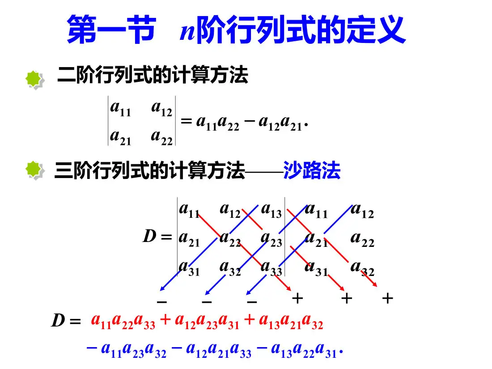

原文：

第一节 n阶行列式的定义

二阶行列式的计算方法

$$
\left| \begin{array}{c c} a _ {1 1} & a _ {1 2} \\ a _ {2 1} & a _ {2 2} \end{array} \right| = a _ {1 1} a _ {2 2} - a _ {1 2} a _ {2 1}.
$$

三阶行列式的计算方法——沙路法

$$
\begin{array}{l} D = \left| \begin{array}{c c c c c} a _ {1 1} & a _ {1 2} & a _ {1 3} \\ a _ {2 1} & a _ {2 2} & a _ {2 3} \\ a _ {3 1} & a _ {3 2} & a _ {3 3} \end{array} \right| + \left. \begin{array}{c c c c c} a _ {1 1} & a _ {1 2} \\ a _ {2 1} & a _ {2 2} \\ a _ {3 1} & a _ {3 2} \end{array} \right. \\ D = \begin{array}{l} a _ {1 1} a _ {2 2} a _ {3 3} + a _ {1 2} a _ {2 3} a _ {3 1} + a _ {1 3} a _ {2 1} a _ {3 2} \\ - a _ {1 1} a _ {2 3} a _ {3 2} - a _ {1 2} a _ {2 1} a _ {3 3} - a _ {1 3} a _ {2 2} a _ {3 1}. \end{array} \end{array}
$$

### 一些常用的行列式结果：

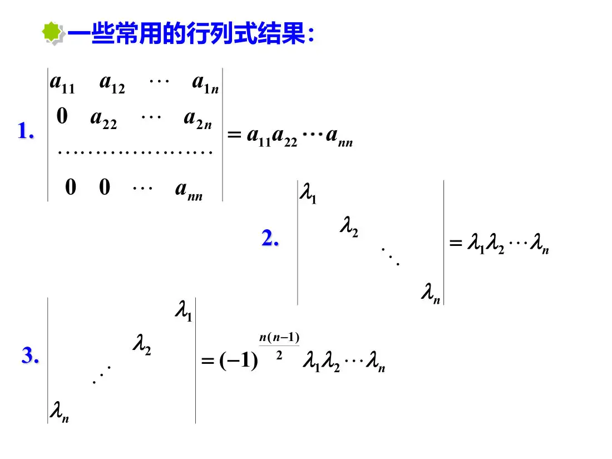

原文：

一些常用的行列式结果：

$$
\begin{array}{l} \left| \begin{array}{c c c c} a _ {1 1} & a _ {1 2} & \dots & a _ {1 n} \\ 0 & a _ {2 2} & \dots & a _ {2 n} \\ \dots & \dots & \dots & \dots \\ 0 & 0 & \dots & a _ {n n} \end{array} \right| = a _ {1 1} a _ {2 2} \dots a _ {n n} \\ 2. \left| \begin{array}{c c c c} \lambda_ {1} & & & \\ & \lambda_ {2} & & \\ & & \ddots & \\ & & & \lambda_ {n} \end{array} \right| = \lambda_ {1} \lambda_ {2} \dots \lambda_ {n} \\ 3. \left| \begin{array}{c c c c} & & \lambda_ {1} \\ & & \lambda_ {2} \\ \lambda_ {n} & & \end{array} \right| = (- 1) ^ {\frac {n (n - 1)}{2}} \lambda_ {1} \lambda_ {2} \dots \lambda_ {n} \end{array}
$$

### $$

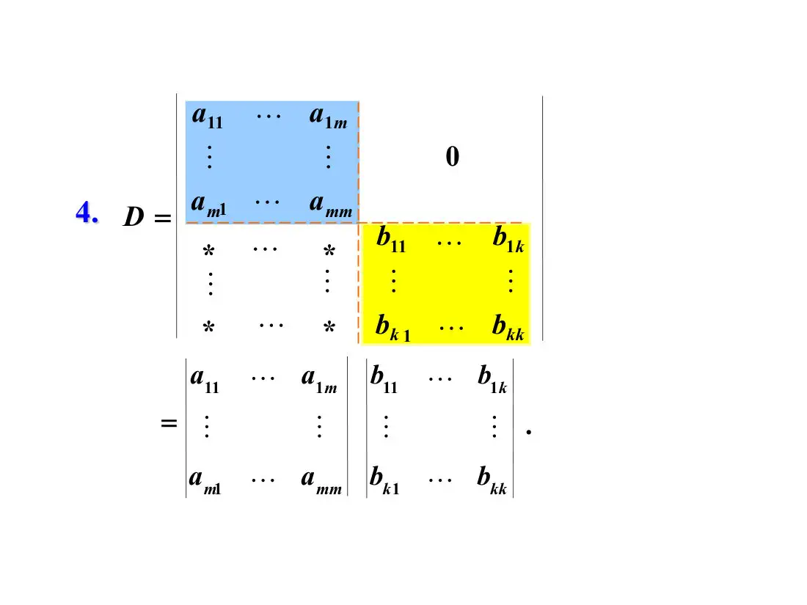

原文：

$$
\begin{array}{l} \text {4.} D = \left| \begin{array}{c c c} a _ {1 1} & \dots & a _ {1 m} \\ \vdots & & \vdots \\ a _ {m 1} & \dots & a _ {m m} \\ \hline * & \dots & * \\ \vdots & & \vdots \\ * & \dots & * \end{array} \right| \begin{array}{c c c} 0 & b _ {1 1} & \dots & b _ {1 k} \\ \vdots & & \vdots \\ b _ {k 1} & \dots & b _ {k k} \end{array} \\ = \left| \begin{array}{c c c} a _ {1 1} & \dots & a _ {1 m} \\ \vdots & & \vdots \\ a _ {m 1} & \dots & a _ {m m} \end{array} \right| \left| \begin{array}{c c c} b _ {1 1} & \dots & b _ {1 k} \\ \vdots & & \vdots \\ b _ {k 1} & \dots & b _ {k k} \end{array} \right|. \end{array}
$$

### 第二节 行列式的性质

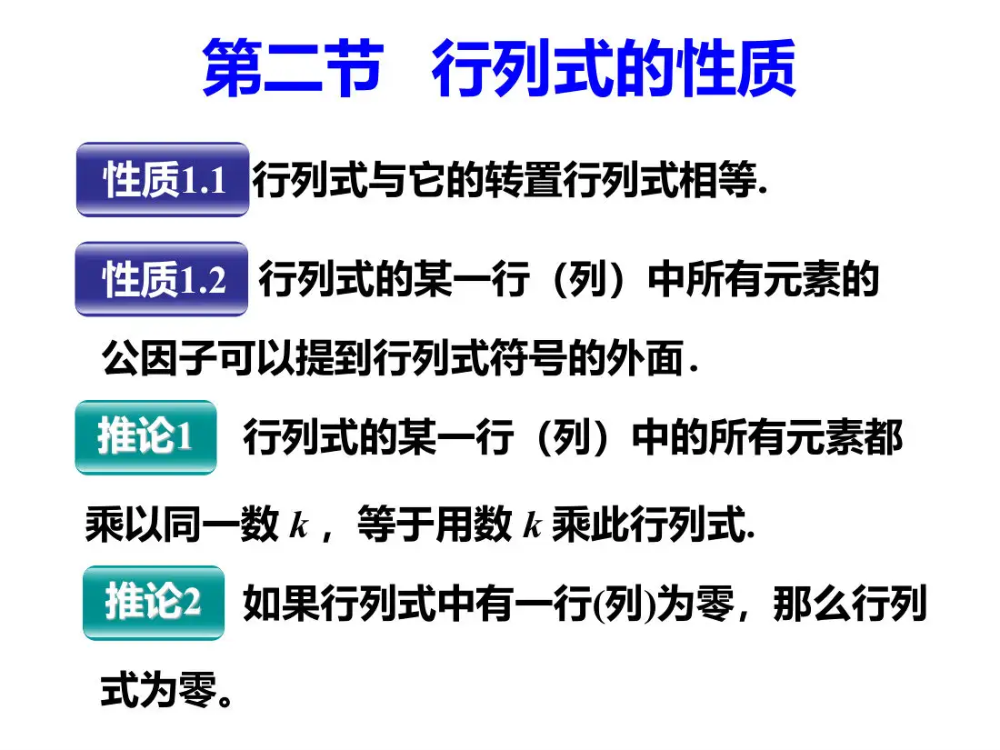

原文：

第二节 行列式的性质

性质1.1 行列式与它的转置行列式相等.

性质1.2 行列式的某一行（列）中所有元素的公因子可以提到行列式符号的外面。

推论1 行列式的某一行（列）中的所有元素都乘以同一数 $k$ ，等于用数 $k$ 乘此行列式.

推论2 如果行列式中有一行(列)为零，那么行列式为零。

### 性质1.3 对换行列式的两行（列），行列式变号.

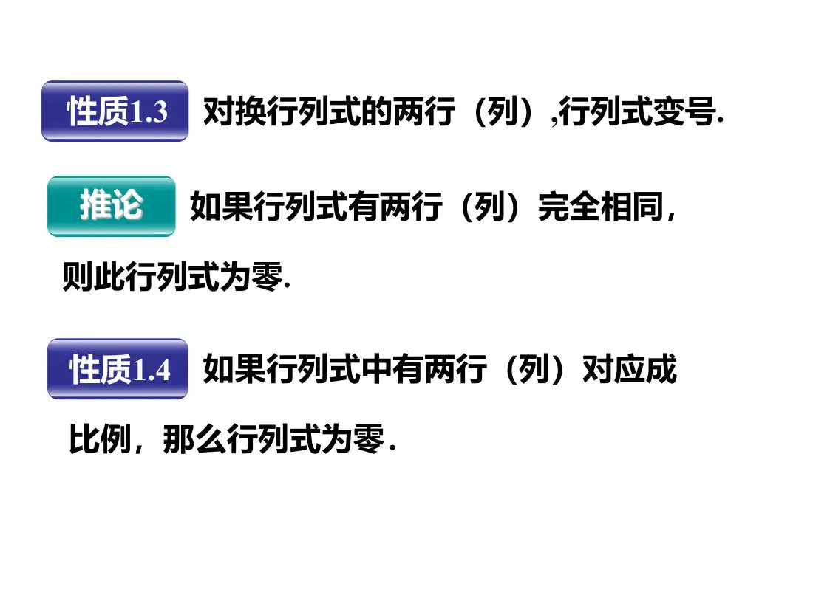

原文：

性质1.3 对换行列式的两行（列），行列式变号.

推论 如果行列式有两行（列）完全相同，则此行列式为零。

性质1.4 如果行列式中有两行（列）对应成比例，那么行列式为零。

### $$

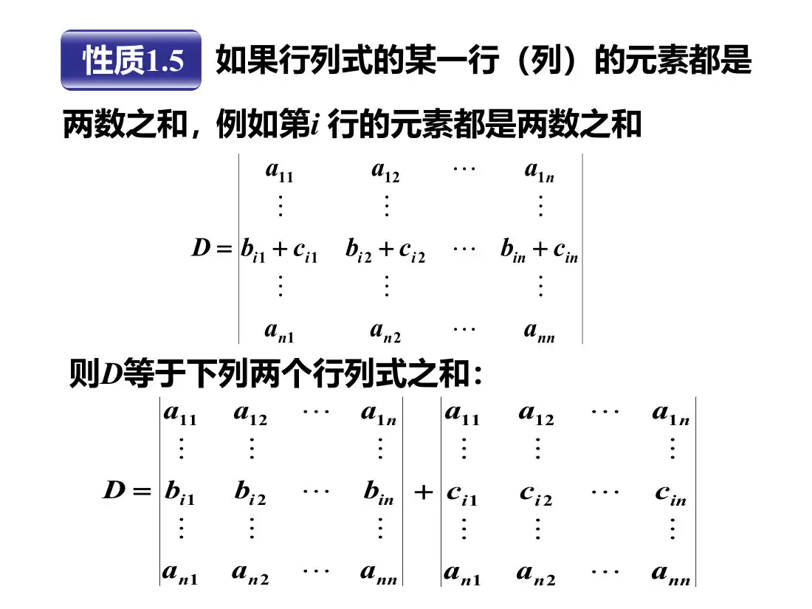

原文：

性质1.5 如果行列式的某一行（列）的元素都是两数之和，例如第 $i$ 行的元素都是两数之和

$$
D = \left| \begin{array}{c c c c} a _ {1 1} & a _ {1 2} & \dots & a _ {1 n} \\ \vdots & \vdots & & \vdots \\ b _ {i 1} + c _ {i 1} & b _ {i 2} + c _ {i 2} & \dots & b _ {i n} + c _ {i n} \\ \vdots & \vdots & & \vdots \\ a _ {n 1} & a _ {n 2} & \dots & a _ {n n} \end{array} \right|
$$

则 $D$ 等于下列两个行列式之和：

$$
D = \left| \begin{array}{c c c c} a _ {1 1} & a _ {1 2} & \dots & a _ {1 n} \\ \vdots & \vdots & & \vdots \\ b _ {i 1} & b _ {i 2} & \dots & b _ {i n} \\ \vdots & \vdots & & \vdots \\ a _ {n 1} & a _ {n 2} & \dots & a _ {n n} \end{array} \right| + \left| \begin{array}{c c c c} a _ {1 1} & a _ {1 2} & \dots & a _ {1 n} \\ \vdots & \vdots & & \vdots \\ c _ {i 1} & c _ {i 2} & \dots & c _ {i n} \\ \vdots & \vdots & & \vdots \\ a _ {n 1} & a _ {n 2} & \dots & a _ {n n} \end{array} \right|
$$

### 计算行列式常用方法：

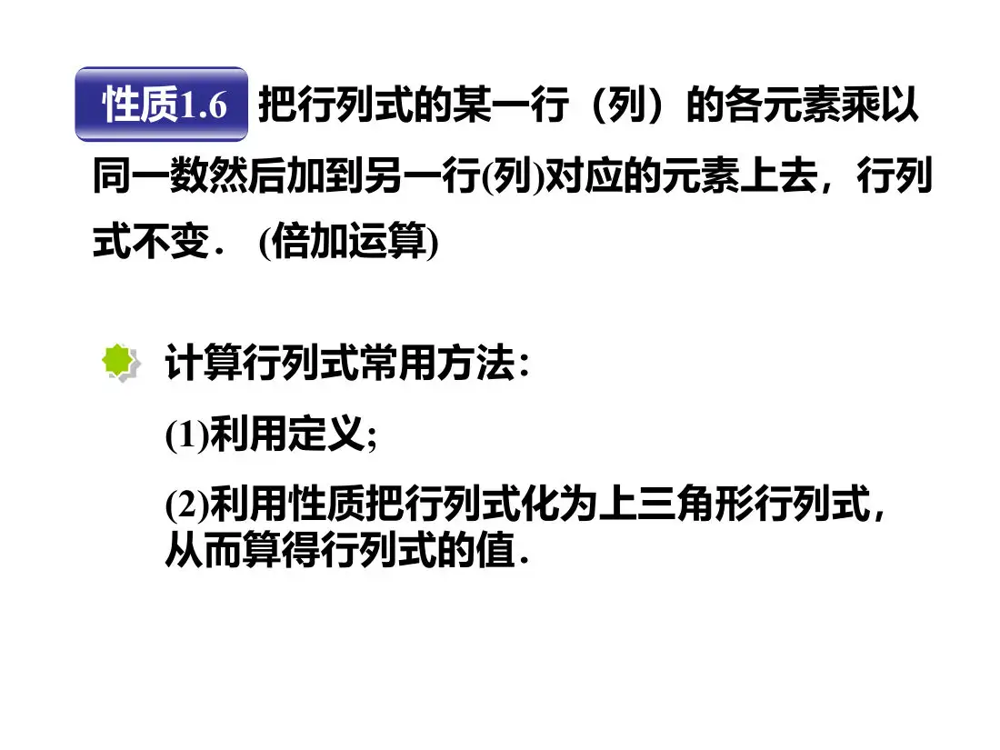

原文：

性质1.6 把行列式的某一行（列）的各元素乘以同一数然后加到另一行(列)对应的元素上去，行列式不变。（倍加运算）

计算行列式常用方法：

(1)利用定义;

(2)利用性质把行列式化为上三角形行列式，从而算得行列式的值.

### 第三节 行列式按行(列)展开

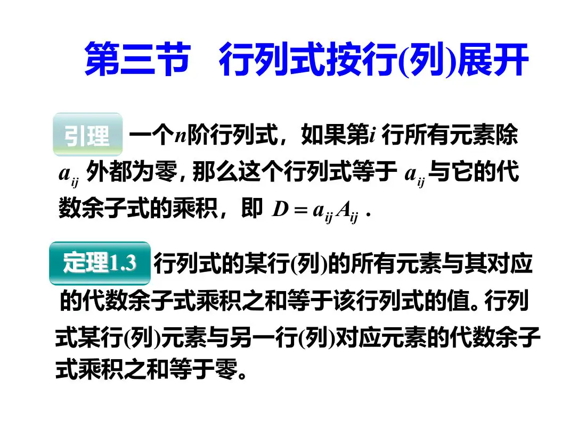

原文：

第三节 行列式按行(列)展开

引理 一个 $n$ 阶行列式，如果第 $i$ 行所有元素除 $a_{ij}$ 外都为零，那么这个行列式等于 $a_{ij}$ 与它的代数余子式的乘积，即 $D = a_{ij}A_{ij}$ 。

定理1.3 行列式的某行(列)的所有元素与其对应的代数余子式乘积之和等于该行列式的值。行列式某行(列)元素与另一行(列)对应元素的代数余子式乘积之和等于零。

### 行列式按行（列）展开法则是把高阶行列式的计算化为低阶行列式计算的重要工具.

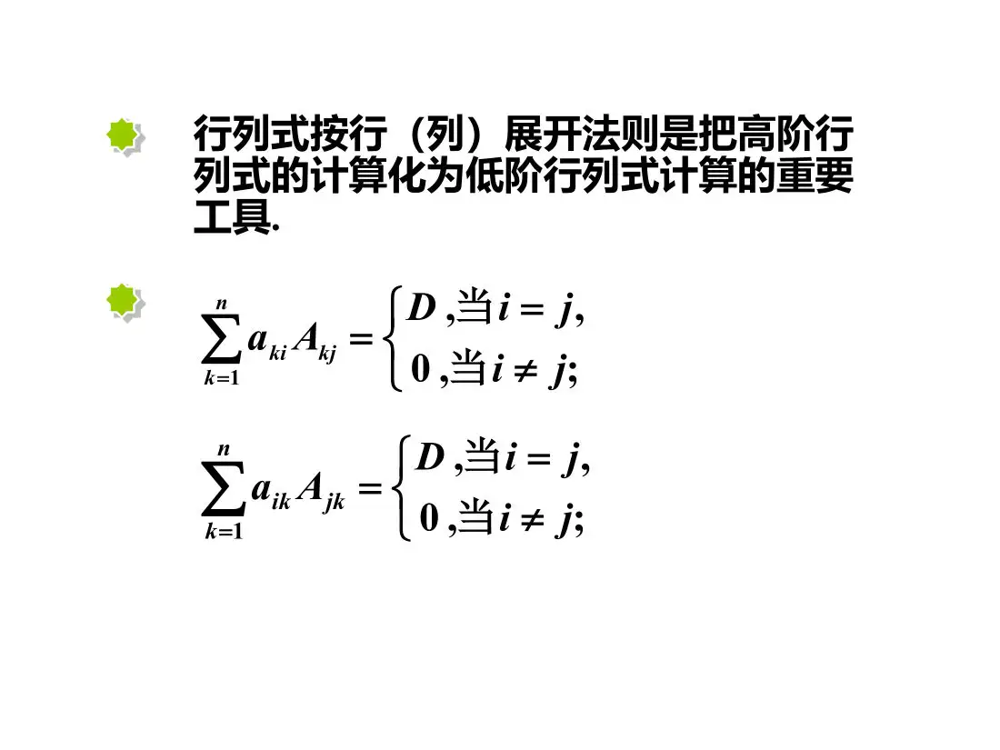

原文：

行列式按行（列）展开法则是把高阶行列式的计算化为低阶行列式计算的重要工具.

$$
\sum_ {k = 1} ^ {n} a _ {k i} A _ {k j} = \left\{ \begin{array}{l l} D, \text {当} i = j, \\ 0, \text {当} i \neq j; \end{array} \right.
$$

$$
\sum_ {k = 1} ^ {n} a _ {i k} A _ {j k} = \left\{ \begin{array}{l l} D, \text {当} i = j, \\ 0, \text {当} i \neq j; \end{array} \right.
$$

### 第二章 矩阵及其运算

原文：

第二章 矩阵及其运算

The image contains no text.

### 一、矩阵的概念

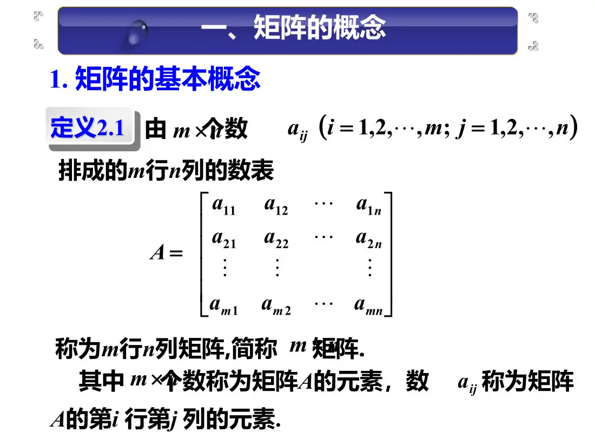

原文：

一、矩阵的概念

1. 矩阵的基本概念

定义2.1 由 $m \times n$ 数 $a_{ij} (i = 1,2,\dots,m; j = 1,2,\dots,n)$ 排成的 $m$ 行 $n$ 列的数表

$$
A = \left[ \begin{array}{c c c c} a _ {1 1} & a _ {1 2} & \dots & a _ {1 n} \\ a _ {2 1} & a _ {2 2} & \dots & a _ {2 n} \\ \vdots & \vdots & & \vdots \\ a _ {m 1} & a _ {m 2} & \dots & a _ {m n} \end{array} \right]
$$

称为m行n列矩阵,简称 m 矩阵.

其中 $m \times$ 个数称为矩阵 A 的元素，数 $a_{ij}$ 称为矩阵 A 的第 i 行第 j 列的元素.

### 二、矩阵的运算

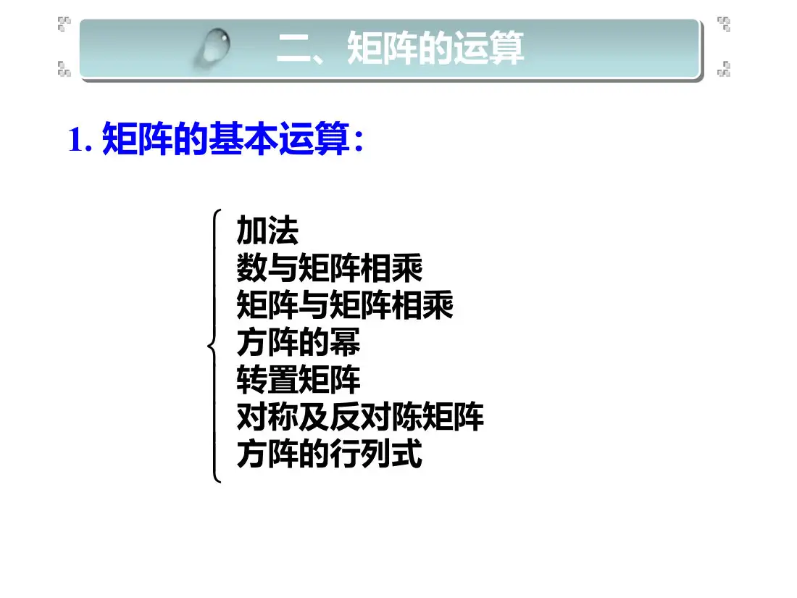

原文：

二、矩阵的运算

1. 矩阵的基本运算：

加法

数与矩阵相乘

矩阵与矩阵相乘

方阵的幂

转置矩阵

对称及反对陈矩阵

方阵的行列式

### 2. 矩阵的运算规律：

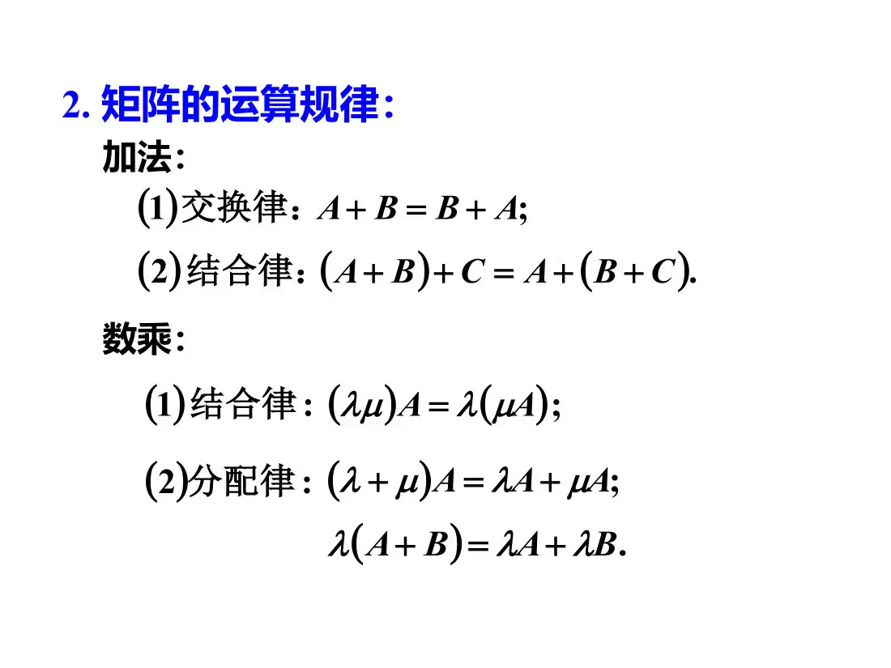

原文：

2. 矩阵的运算规律：

加法:

(1)交换律： $A+B=B+A;$

(2) 结合律: $(A + B) + C = A + (B + C)$ .

数乘:

(1) 结合律: $(\lambda\mu)A = \lambda(\mu A)$ ;

(2)分配律： $(\lambda +\mu)A = \lambda A + \mu A;$

$$
\lambda (A + B) = \lambda A + \lambda B.
$$

### 乘法：

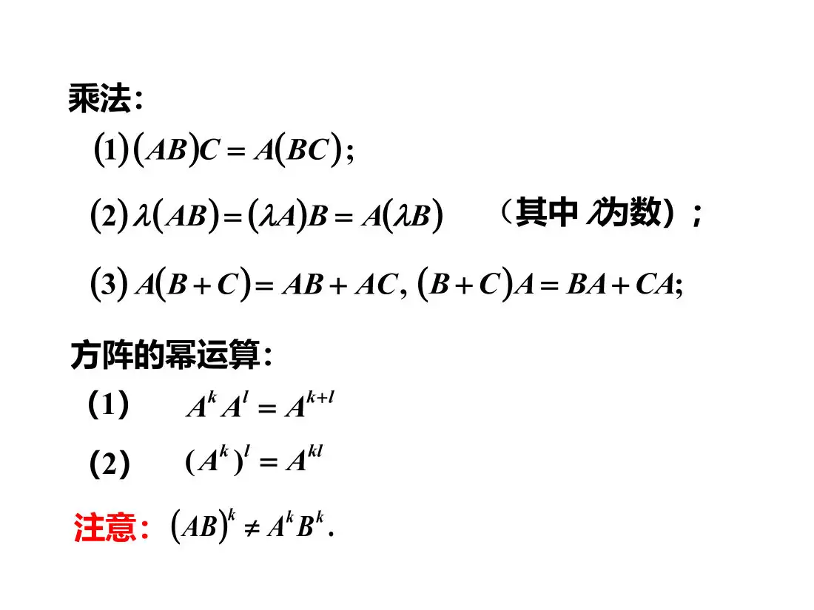

原文：

乘法：

(1)(AB)C = A(BC);

(2) $\lambda (AB) = (\lambda A)B = A(\lambda B)$ （其中 $\lambda$ 为数）；

(3) $A(B + C) = AB + AC, (B + C)A = BA + CA;$

方阵的幂运算：

(1) $A^k A^l = A^{k + l}$

(2) $(A^{k})^{l} = A^{kl}$

注意: $(AB)^{k} \neq A^{k}B^{k}$ .

### 转置运算:

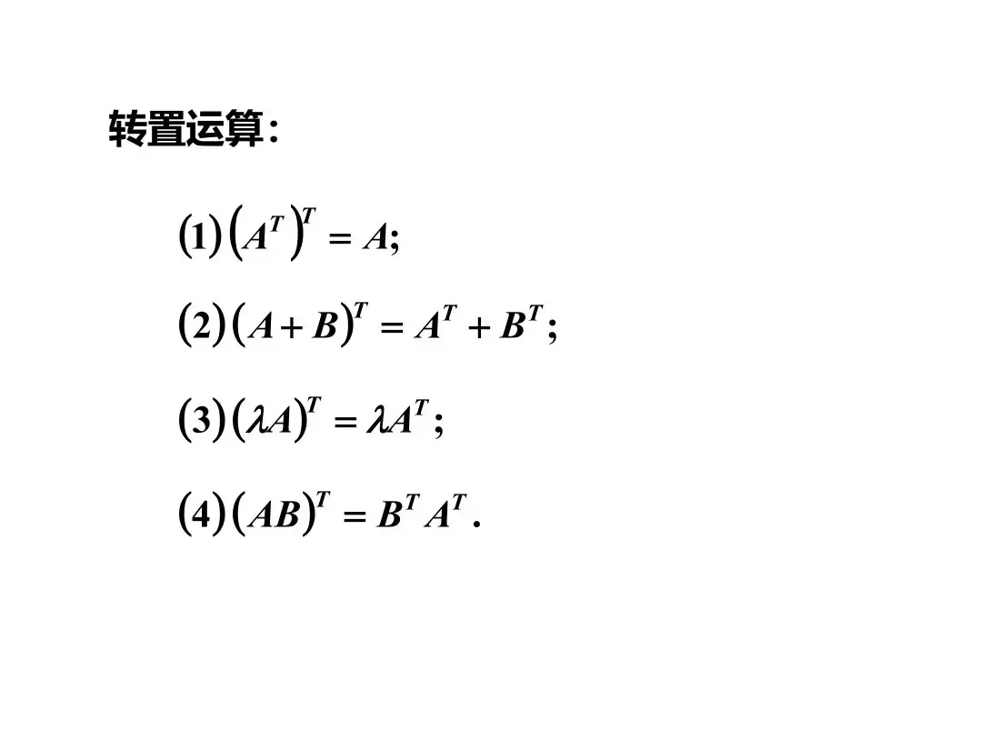

原文：

转置运算:

(1) $\left(A^{T}\right)^{T}=A;$

(2) $(A+B)^{T}=A^{T}+B^{T};$

(3) $(\lambda A)^{T}=\lambda A^{T};$

(4) $(AB)^{T}=B^{T}A^{T}.$

### 3. 方阵的行列式及其性质

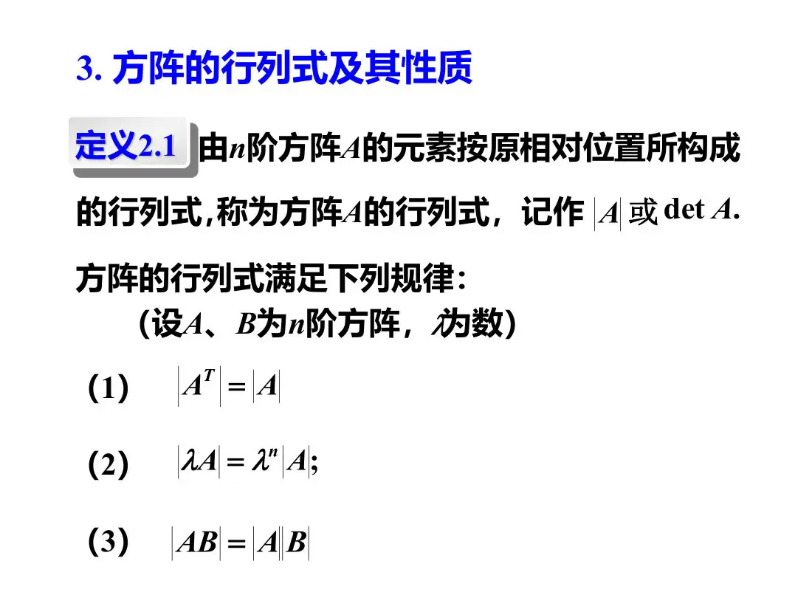

原文：

3. 方阵的行列式及其性质

定义2.1 由n阶方阵A的元素按原相对位置所构成的行列式,称为方阵A的行列式,记作 $|A|$ 或 $\det A$ .

方阵的行列式满足下列规律：

(设A、B为n阶方阵，为数)

(1) $\left|A^{T}\right|=\left|A\right|$

(2) $|\lambda A| = \lambda^n |A|$ ;

(3) $|AB| = |A||B|$

### 三、逆矩阵

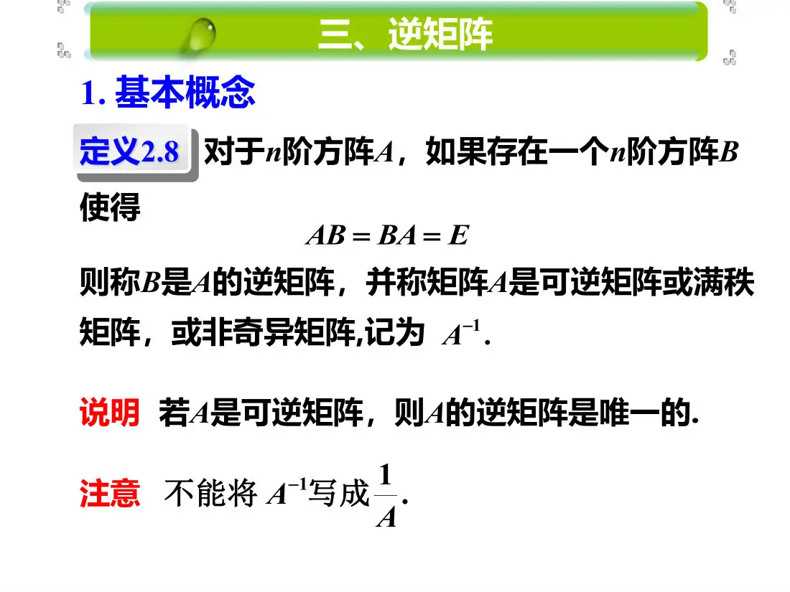

原文：

三、逆矩阵

1. 基本概念

定义2.8 对于 $n$ 阶方阵 $A$ ，如果存在一个 $n$ 阶方阵 $B$

使得

$$
A B = B A = E
$$

则称B是A的逆矩阵，并称矩阵A是可逆矩阵或满秩矩阵，或非奇异矩阵,记为 $A^{-1}$ .

说明 若 $A$ 是可逆矩阵，则 $A$ 的逆矩阵是唯一的.

注意 不能将 $A^{-1}$ 写成 $\frac{1}{A}$ .

### $$

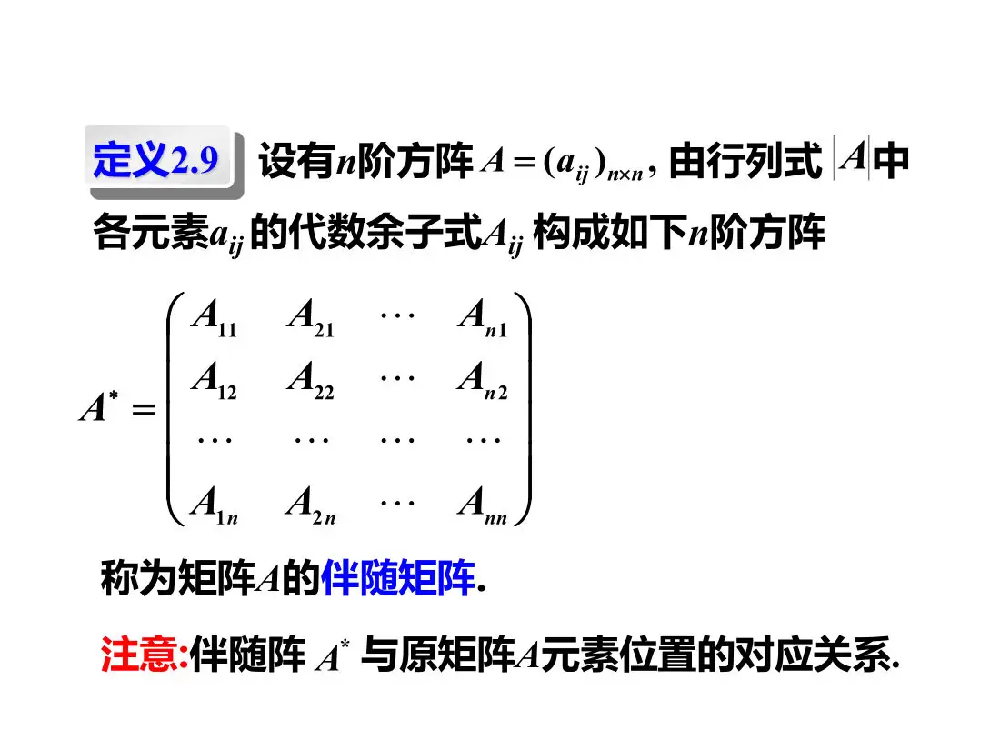

原文：

定义2.9 设有n阶方阵 $A=(a_{ij})_{n\times n}$ ，由行列式 $|A|$ 中各元素 $a_{ij}$ 的代数余子式 $A_{ij}$ 构成如下n阶方阵

$$
A ^ {*} = \left( \begin{array}{l l l l} A _ {1 1} & A _ {2 1} & \dots & A _ {n 1} \\ A _ {1 2} & A _ {2 2} & \dots & A _ {n 2} \\ \dots & \dots & \dots & \dots \\ A _ {1 n} & A _ {2 n} & \dots & A _ {n n} \end{array} \right)
$$

称为矩阵A的伴随矩阵.

注意:伴随阵 $A^{*}$ 与原矩阵A元素位置的对应关系.

### 2. 基本定理

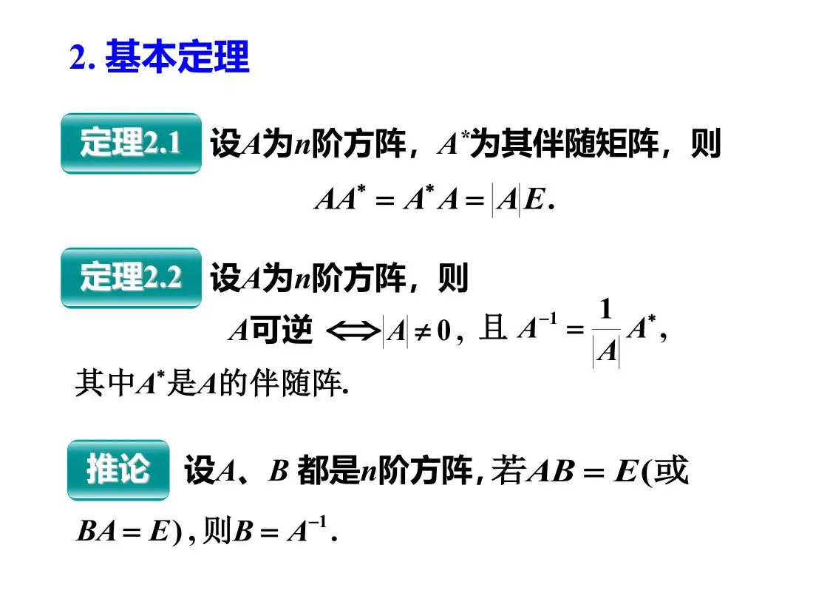

原文：

2. 基本定理

定理2.1 设 $A$ 为 $n$ 阶方阵， $A^{*}$ 为其伴随矩阵，则

$$
A A ^ {*} = A ^ {*} A = | A | E.
$$

定理2.2 设 $A$ 为 $n$ 阶方阵，则

A可逆 $\Longleftrightarrow|A|\neq0$ ，且 $A^{-1}=\frac{1}{|A|}A^{*}$ 其中 $A^{*}$ 是A的伴随阵.

推论 设A、B都是n阶方阵, 若AB=E(或BA=E), 则 $B=A^{-1}$ .

### 3. 可逆矩阵的性质

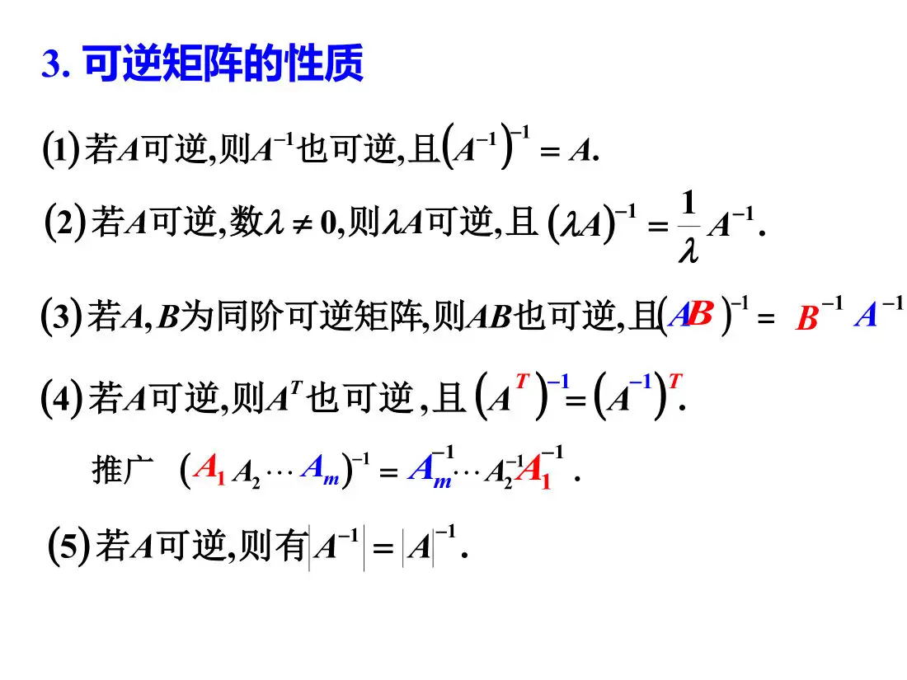

原文：

3. 可逆矩阵的性质

(1) 若 A 可逆, 则 $A^{-1}$ 也可逆, 且 $\left(A^{-1}\right)^{-1}=A$ .

(2) 若 $A$ 可逆, 数 $\lambda \neq 0$ , 则 $\lambda A$ 可逆, 且 $(\lambda A)^{-1} = \frac{1}{\lambda} A^{-1}$ .

(3) 若 A, B 为同阶可逆矩阵, 则 AB 也可逆, 且 $(AB)^{-1} = B^{-1} A^{-1}$

(4) 若 $A$ 可逆, 则 $A^T$ 也可逆, 且 $\left(A^T\right)^{-1} = \left(A^{-1}\right)^T$ .

推广 $\left(A_{1}A_{2}\dots A_{m}\right)^{-1} = A_{m}^{-1}\dots A_{2}^{-1}A_{1}^{-1}$

(5) 若 $A$ 可逆, 则有 $\left|A^{-1}\right| = \left|A\right|^{-1}$ .

### 4. 逆矩阵的计算方法

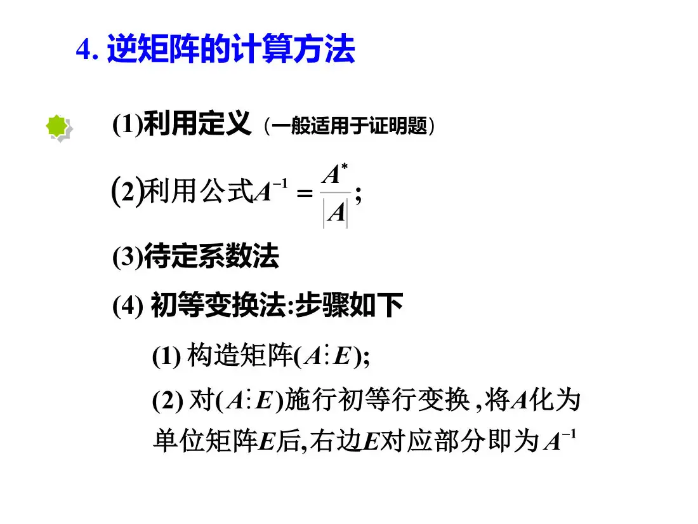

原文：

4. 逆矩阵的计算方法

(1)利用定义（一般适用于证明题）

(2)利用公式 $A^{-1}=\frac{A^{*}}{|A|}$ ;

(3)待定系数法

(4) 初等变换法: 步骤如下

(1) 构造矩阵 $(A:E)$ ;

(2) 对 $(A:E)$ 施行初等行变换, 将A化为单位矩阵E后, 右边E对应部分即为 $A^{-1}$

### 四、分块矩阵

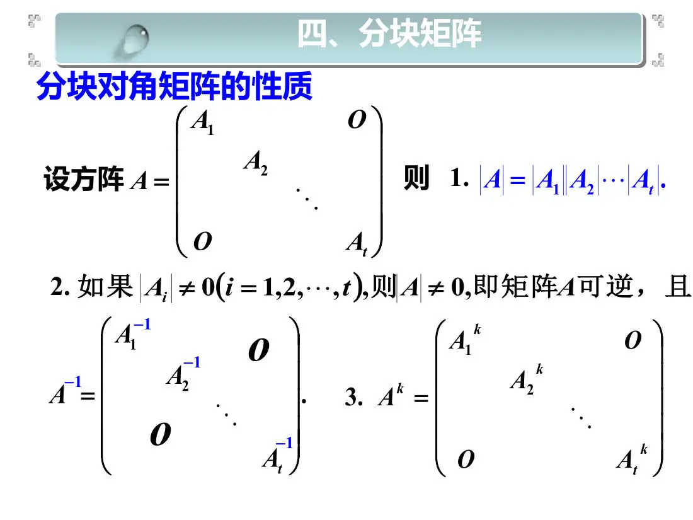

原文：

四、分块矩阵

分块对角矩阵的性质

设方阵 $A=\begin{pmatrix}A_{1}&&O\\ &A_{2}&\ddots\\ &O&A_{t}\end{pmatrix}$ 则 1. $|A|=|A_{1}||A_{2}|\cdots|A_{t}|$ .

2. 如果 $\left|A_{i}\right|\neq0(i=1,2,\cdots,t)$ ，则 $\left|A\right|\neq0$ ，即矩阵 A 可逆，且

$$
A ^ {- 1} = \left( \begin{array}{c c c c} A _ {1} ^ {- 1} & & & \boldsymbol {0} \\ & A _ {2} ^ {- 1} & & \\ & & \ddots & \\ \boldsymbol {0} & & & A _ {t} ^ {- 1} \end{array} \right).
$$

$$
A ^ {k} = \left( \begin{array}{c c c c} A _ {1} ^ {k} & & & O \\ & A _ {2} ^ {k} & & \\ & & \ddots & \\ O & & & A _ {t} ^ {k} \end{array} \right)
$$

### 特殊地，如果 $\Lambda$ 是对角矩阵

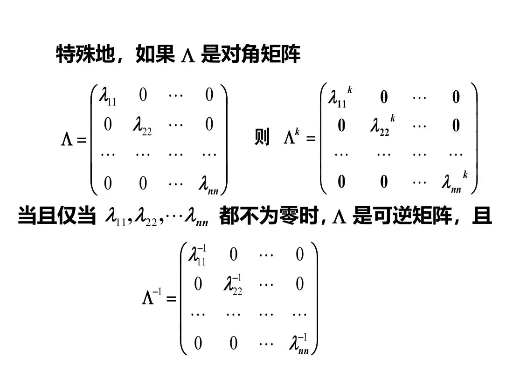

原文：

特殊地，如果 $\Lambda$ 是对角矩阵

$$
\boldsymbol {\Lambda} = \left( \begin{array}{c c c c} \lambda_ {1 1} & 0 & \dots & 0 \\ 0 & \lambda_ {2 2} & \dots & 0 \\ \dots & \dots & \dots & \dots \\ 0 & 0 & \dots & \lambda_ {n n} \end{array} \right)
$$

则

$$
\boldsymbol {\Lambda} ^ {k} = \left( \begin{array}{c c c c} \lambda_ {1 1} ^ {k} & \mathbf {0} & \dots & \mathbf {0} \\ \mathbf {0} & \lambda_ {2 2} ^ {k} & \dots & \mathbf {0} \\ \dots & \dots & \dots & \dots \\ \mathbf {0} & \mathbf {0} & \dots & \lambda_ {n n} ^ {k} \end{array} \right)
$$

当且仅当 $\lambda_{11},\lambda_{22},\cdots,\lambda_{nn}$ 都不为零时， $\Lambda$ 是可逆矩阵，且

$$
\boldsymbol {\Lambda} ^ {- 1} = \left( \begin{array}{c c c c} \lambda_ {1 1} ^ {- 1} & 0 & \dots & 0 \\ 0 & \lambda_ {2 2} ^ {- 1} & \dots & 0 \\ \dots & \dots & \dots & \dots \\ 0 & 0 & \dots & \lambda_ {n n} ^ {- 1} \end{array} \right)
$$

### 五、矩阵的初等变换与初等矩阵

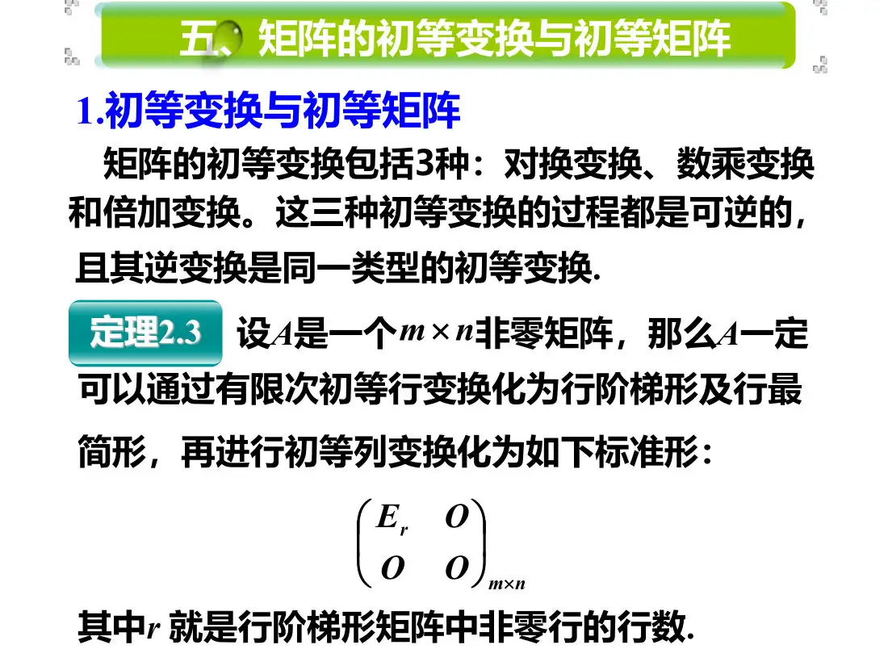

原文：

五、矩阵的初等变换与初等矩阵

1. 初等变换与初等矩阵

矩阵的初等变换包括3种：对换变换、数乘变换和倍加变换。这三种初等变换的过程都是可逆的，且其逆变换是同一类型的初等变换。

定理2.3 设 $A$ 是一个 $m \times n$ 非零矩阵，那么 $A$ 一定可以通过有限次初等行变换化为行阶梯形及行最简形，再进行初等列变换化为如下标准形：

$$
\left( \begin{array}{c c} E _ {r} & O \\ O & O \end{array} \right) _ {m \times n}
$$

其中r就是行阶梯形矩阵中非零行的行数.

### 注意：初等变换不改变矩阵的可逆性。

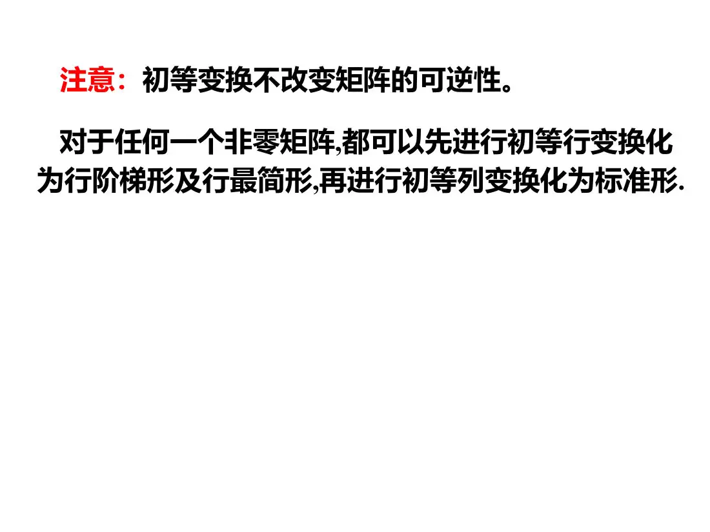

原文：

注意：初等变换不改变矩阵的可逆性。

对于任何一个非零矩阵,都可以先进行初等行变换化为行阶梯形及行最简形,再进行初等列变换化为标准形.

### $$

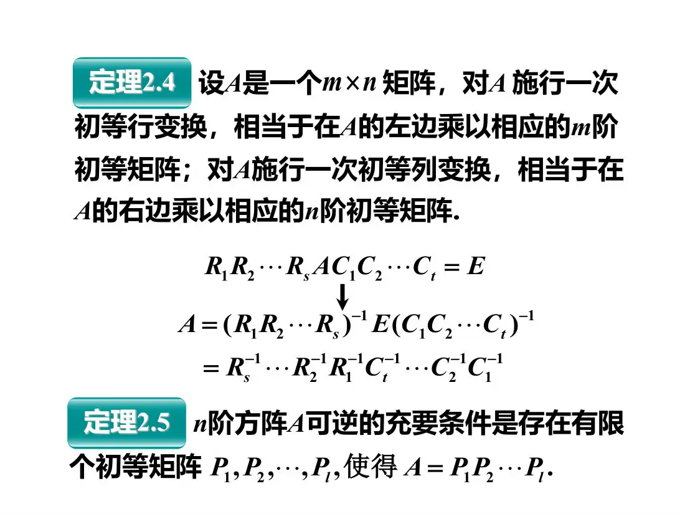

原文：

定理2.4 设 $A$ 是一个 $m \times n$ 矩阵，对 $A$ 施行一次初等行变换，相当于在 $A$ 的左边乘以相应的 $m$ 阶初等矩阵；对 $A$ 施行一次初等列变换，相当于在 $A$ 的右边乘以相应的 $n$ 阶初等矩阵。

$$
\begin{array}{c} R _ {1} R _ {2} \dots R _ {s} A C _ {1} C _ {2} \dots C _ {t} = E \\ \downarrow \\ A = (R _ {1} R _ {2} \dots R _ {s}) ^ {- 1} E (C _ {1} C _ {2} \dots C _ {t}) ^ {- 1} \\ = R _ {s} ^ {- 1} \dots R _ {2} ^ {- 1} R _ {1} ^ {- 1} C _ {t} ^ {- 1} \dots C _ {2} ^ {- 1} C _ {1} ^ {- 1} \end{array}
$$

定理2.5 n阶方阵A可逆的充要条件是存在有限个初等矩阵 $P_{1}, P_{2}, \cdots, P_{l}$ ，使得 $A = P_{1}P_{2} \cdots P_{l}$ .

### 六、矩阵的秩

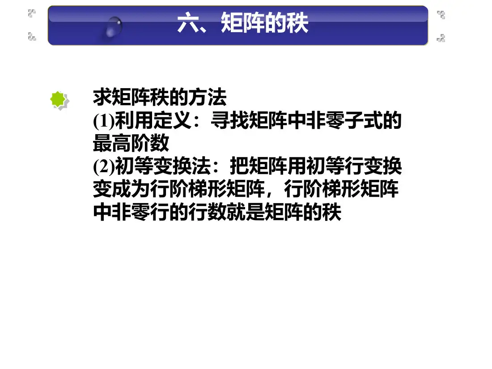

原文：

六、矩阵的秩

求矩阵秩的方法

(1)利用定义：寻找矩阵中非零子式的最高阶数

(2)初等变换法：把矩阵用初等行变换变成为行阶梯形矩阵，行阶梯形矩阵中非零行的行数就是矩阵的秩

### 对于 $n$ 阶方阵 $A$ ，下列命题等价：

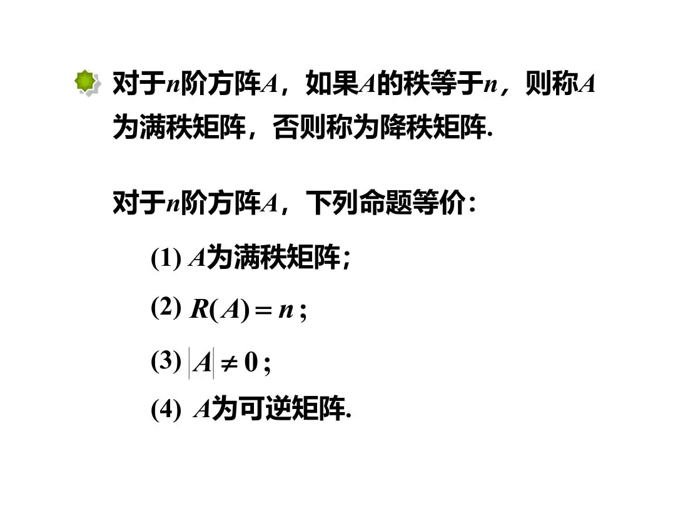

原文：

对于 $n$ 阶方阵 $A$ ，如果 $A$ 的秩等于 $n$ ，则称 $A$ 为满秩矩阵，否则称为降秩矩阵。

对于 $n$ 阶方阵 $A$ ，下列命题等价：

(1) $A$ 为满秩矩阵；

(2) $R(A)=n;$

(3) $|A| \neq 0$ ;

(4) A为可逆矩阵.

### 第三章 线性方程组

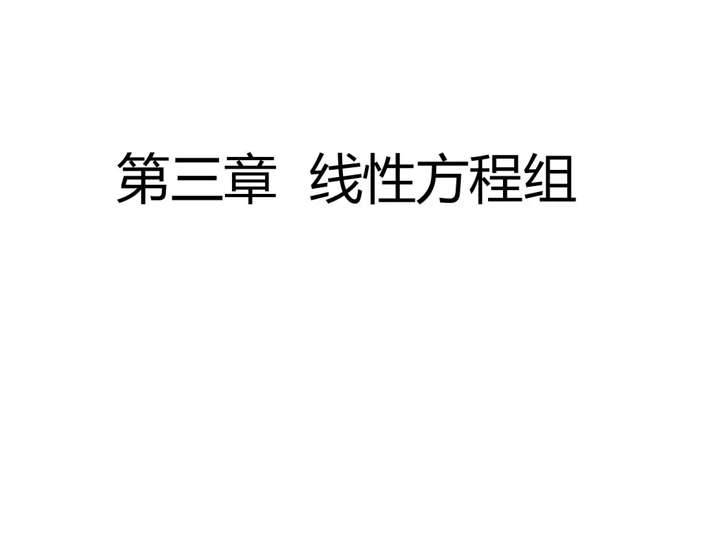

原文：

第三章 线性方程组

### 非齐次线性方程组 Ax = b

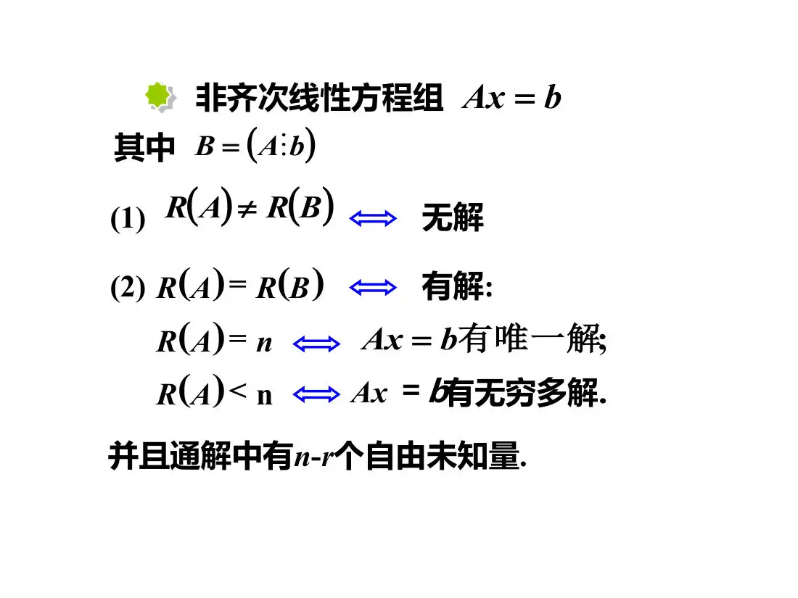

原文：

非齐次线性方程组 Ax = b

其中 $B = (A:b)$

(1) $R(A)\neq R(B)\iff$ 无解

(2) $R(A) = R(B) \iff$ 有解:

$R(A)=n \iff Ax=b$ 有唯一解;

$R(A)<n\iff Ax=b$ 有无穷多解.

并且通解中有n-r个自由未知量.

### 非齐次线性方程组 Ax = b 的具体解法:

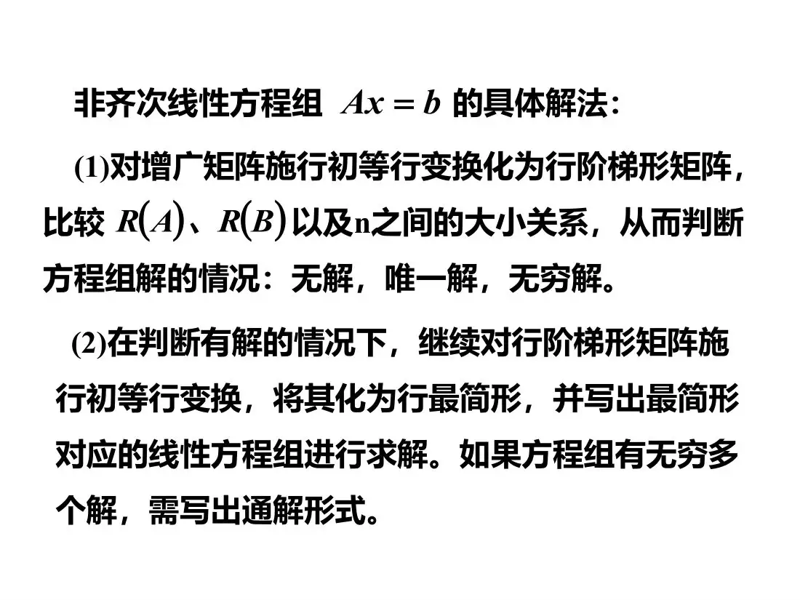

原文：

非齐次线性方程组 Ax = b 的具体解法:

(1)对增广矩阵施行初等行变换化为行阶梯形矩阵，比较 $R(A)$ 、 $R(B)$ 以及n之间的大小关系，从而判断方程组解的情况：无解，唯一解，无穷解。

(2)在判断有解的情况下，继续对行阶梯形矩阵施行初等行变换，将其化为行最简形，并写出最简形对应的线性方程组进行求解。如果方程组有无穷多个解，需写出通解形式。

### $$

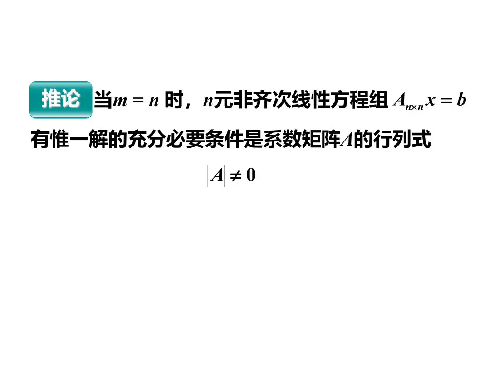

原文：

推论 当 $m = n$ 时， $n$ 元非齐次线性方程组 $A_{n \times n} x = b$ 有惟一解的充分必要条件是系数矩阵 $A$ 的行列式

$$
| A | \neq 0
$$

### 齐次线性方程组 Ax = 定有解：

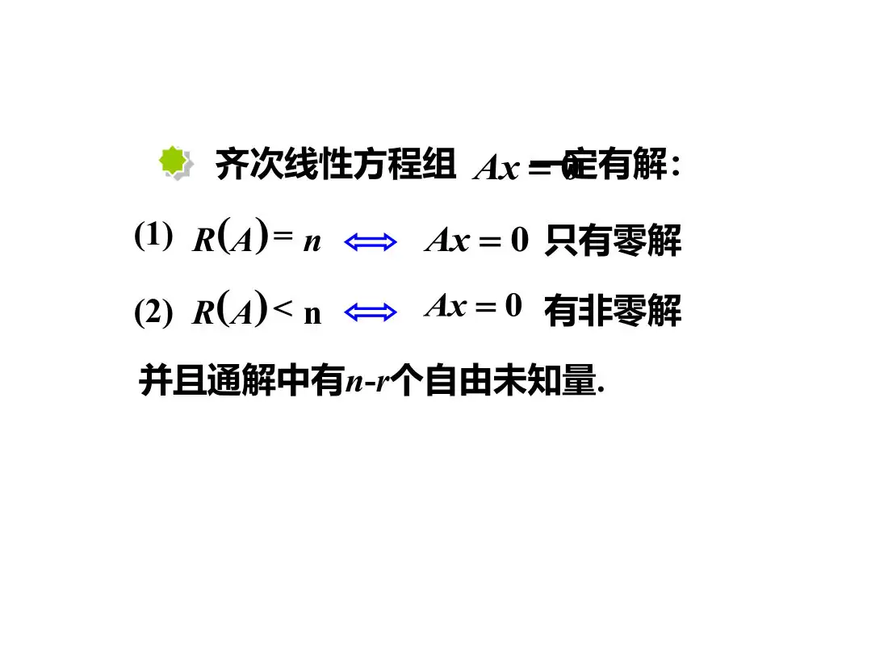

原文：

齐次线性方程组 Ax = 定有解：

(1) $R(A)=n \iff Ax=0$ 只有零解

(2) $R(A) < n \iff Ax = 0$ 有非零解并且通解中有n-r个自由未知量.

### 齐次线性方程组 Ax = 0 的具体解法:

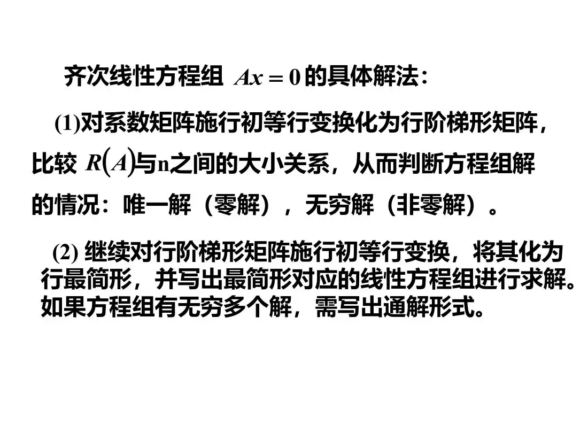

原文：

齐次线性方程组 Ax = 0 的具体解法:

(1)对系数矩阵施行初等行变换化为行阶梯形矩阵, 比较 $R(A)$ 与n之间的大小关系, 从而判断方程组解的情况: 唯一解 (零解), 无穷解 (非零解)。

(2) 继续对行阶梯形矩阵施行初等行变换，将其化为行最简形，并写出最简形对应的线性方程组进行求解。如果方程组有无穷多个解，需写出通解形式。

### 推论1 当 $m = n$ 时，

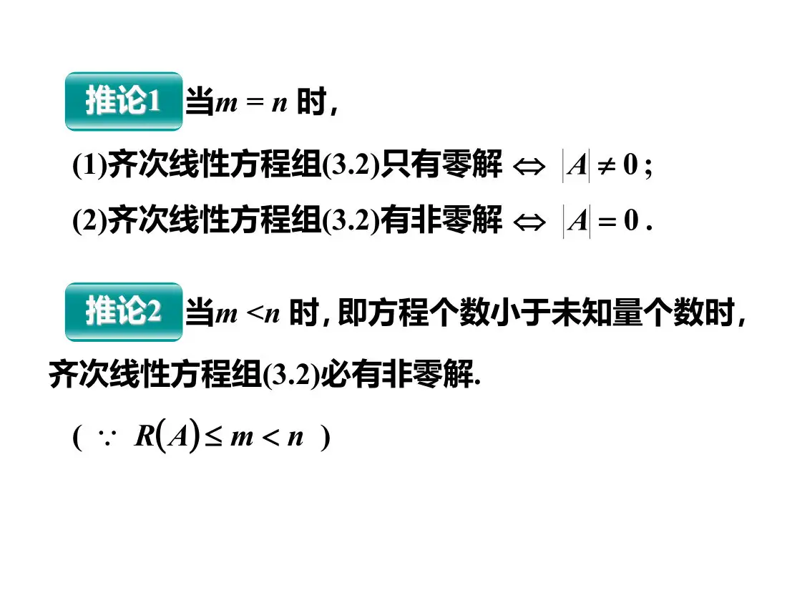

原文：

推论1 当 $m = n$ 时，

(1)齐次线性方程组(3.2)只有零解 $\Leftrightarrow |A| \neq 0$ ;

(2)齐次线性方程组(3.2)有非零解 $\Leftrightarrow |A| = 0$ .

推论2 当 $m < n$ 时, 即方程个数小于未知量个数时,齐次线性方程组(3.2)必有非零解.

$$
(\because R (A) \leq m <   n)
$$

### 第四章 向量组的线性 相关性

原文：

第四章 向量组的线性 相关性

### 第二节 向量组的线性相关性

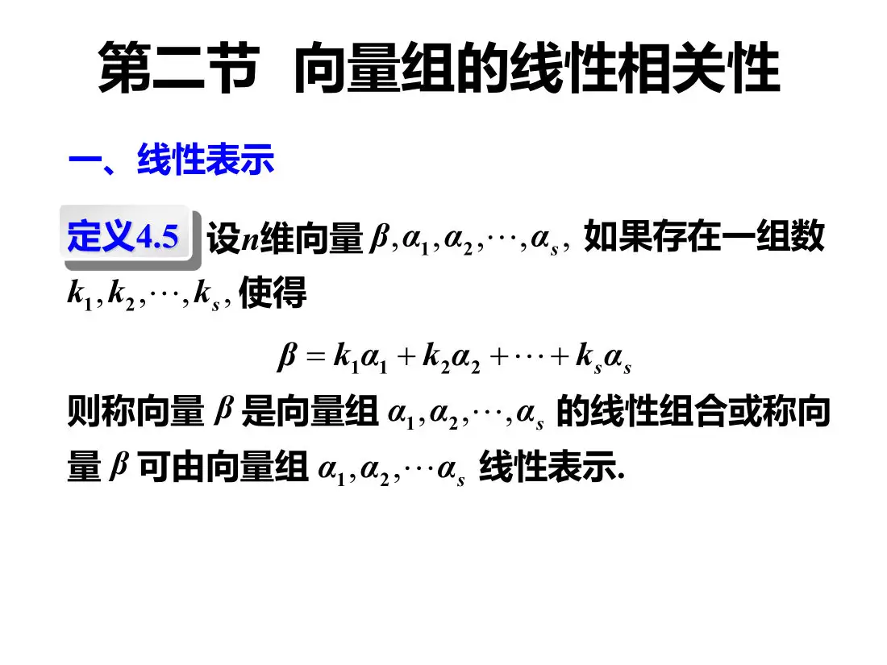

原文：

第二节 向量组的线性相关性

一、线性表示

定义4.5 设n维向量 $\beta, \alpha_{1}, \alpha_{2}, \cdots, \alpha_{s}$ ，如果存在一组数 $k_{1}, k_{2}, \cdots, k_{s}$ ，使得

$$
\boldsymbol {\beta} = \boldsymbol {k} _ {1} \alpha_ {1} + \boldsymbol {k} _ {2} \alpha_ {2} + \dots + \boldsymbol {k} _ {s} \alpha_ {s}
$$

则称向量 $\beta$ 是向量组 $\alpha_{1},\alpha_{2},\cdots,\alpha_{s}$ 的线性组合或称向量 $\beta$ 可由向量组 $\alpha_{1},\alpha_{2},\cdots,\alpha_{s}$ 线性表示.

### 第 40 页

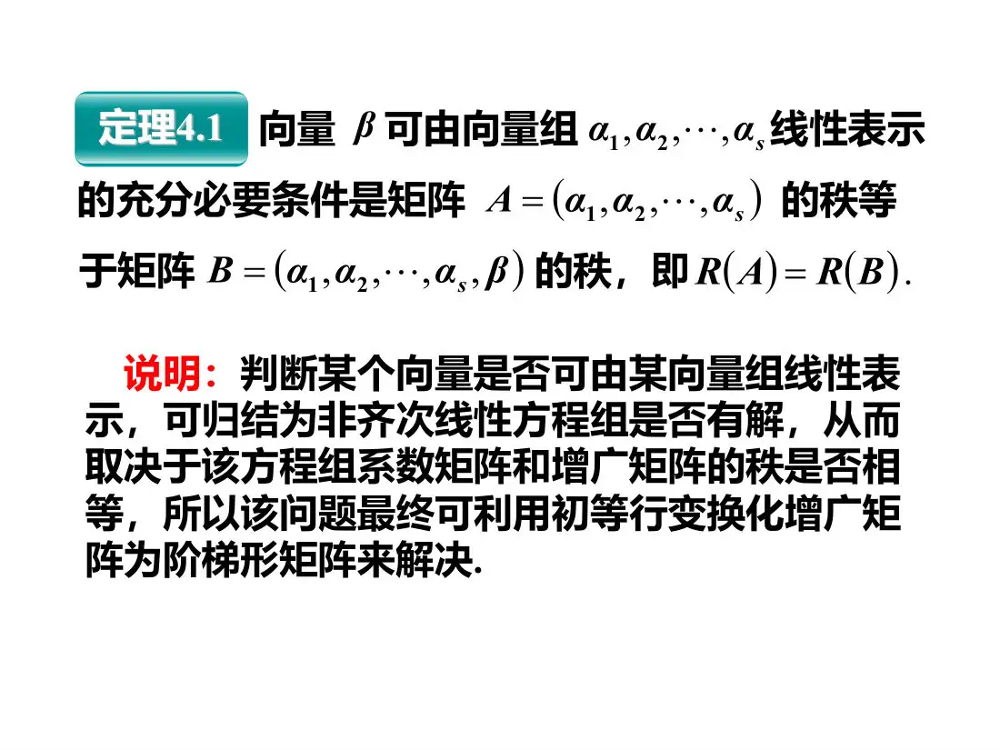

原文：

定理4.1 向量 $\beta$ 可由向量组 $\alpha_{1}, \alpha_{2}, \cdots, \alpha_{s}$ 线性表示的充分必要条件是矩阵 $A = (\alpha_{1}, \alpha_{2}, \cdots, \alpha_{s})$ 的秩等于矩阵 $B = (\alpha_{1}, \alpha_{2}, \cdots, \alpha_{s}, \beta)$ 的秩，即 $R(A) = R(B)$ .

说明：判断某个向量是否可由某向量组线性表示，可归结为非齐次线性方程组是否有解，从而取决于该方程组系数矩阵和增广矩阵的秩是否相等，所以该问题最终可利用初等行变换化增广矩阵为阶梯形矩阵来解决。

### 二、线性相关与线性无关

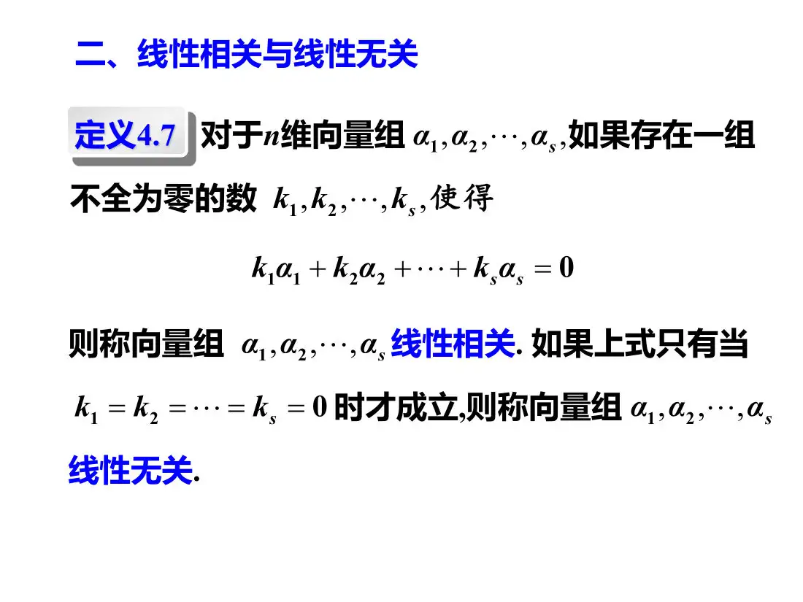

原文：

二、线性相关与线性无关

定义4.7 对于n维向量组 $\alpha_{1}, \alpha_{2}, \cdots, \alpha_{s}$ ，如果存在一组不全为零的数 $k_{1}, k_{2}, \cdots, k_{s}$ ，使得

$$
\boldsymbol {k} _ {1} \boldsymbol {\alpha} _ {1} + \boldsymbol {k} _ {2} \boldsymbol {\alpha} _ {2} + \dots + \boldsymbol {k} _ {s} \boldsymbol {\alpha} _ {s} = \mathbf {0}
$$

则称向量组 $\alpha_{1},\alpha_{2},\cdots,\alpha_{s}$ 线性相关. 如果上式只有当 $k_{1}=k_{2}=\cdots=k_{s}=0$ 时才成立, 则称向量组 $\alpha_{1},\alpha_{2},\cdots,\alpha_{s}$ 线性无关.

### 第 42 页

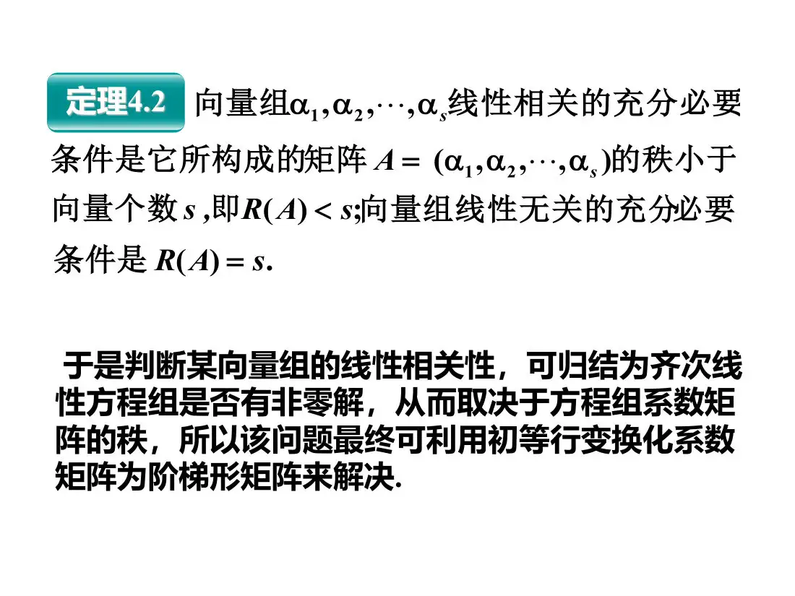

原文：

定理4.2 向量组 $\alpha_{1},\alpha_{2},\cdots,\alpha_{s}$ 线性相关的充分必要条件是它所构成的矩阵 $A=(\alpha_{1},\alpha_{2},\cdots,\alpha_{s})$ 的秩小于向量个数s,即 $R(A)<s$ ;向量组线性无关的充分必要条件是 $R(A)=s$ .

于是判断某向量组的线性相关性，可归结为齐次线性方程组是否有非零解，从而取决于方程组系数矩阵的秩，所以该问题最终可利用初等行变换化系数矩阵为阶梯形矩阵来解决。

### 第 43 页

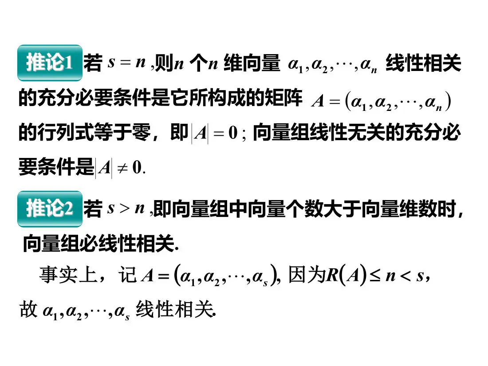

原文：

推论1 若 s = n , 则 n 个 n 维向量 $\alpha_{1}, \alpha_{2}, \cdots, \alpha_{n}$ 线性相关的充分必要条件是它所构成的矩阵 $A = (\alpha_{1}, \alpha_{2}, \cdots, \alpha_{n})$ 的行列式等于零，即 $|A| = 0$ ; 向量组线性无关的充分必要条件是 $|A| \neq 0$ .

推论2 若 s > n , 即向量组中向量个数大于向量维数时, 向量组必线性相关.

事实上，记 $A=(\alpha_{1},\alpha_{2},\cdots,\alpha_{s})$ ，因为 $R(A)\leq n<s$ ，故 $\alpha_{1},\alpha_{2},\cdots,\alpha_{s}$ 线性相关.

### 三、相关定理

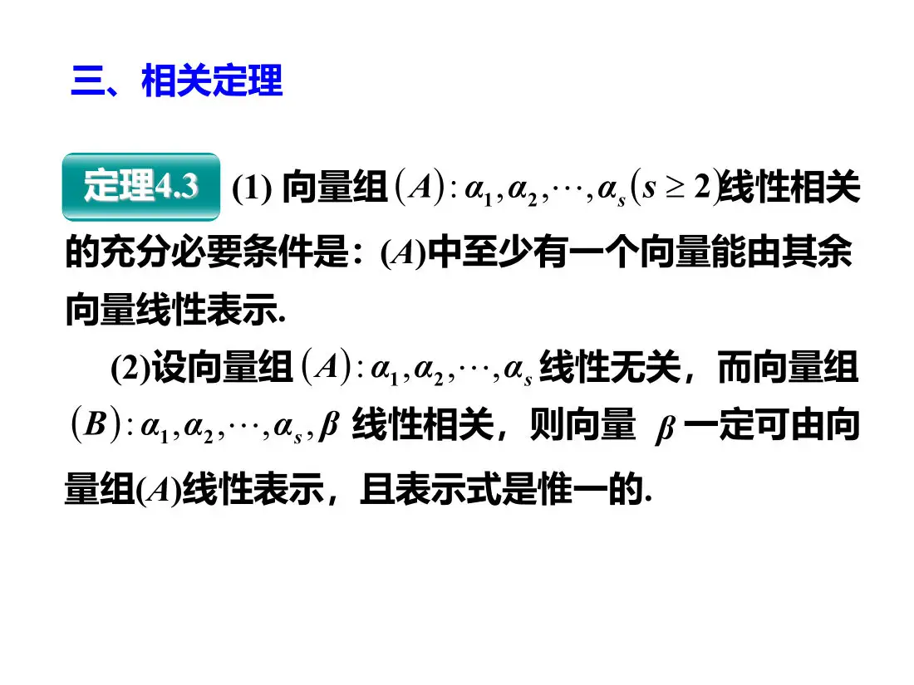

原文：

三、相关定理

定理4.3 (1) 向量组 $(A): \alpha_{1}, \alpha_{2}, \cdots, \alpha_{s} (s \geq 2)$ 线性相关的充分必要条件是: (A) 中至少有一个向量能由其余向量线性表示.

(2)设向量组 $(A)$ : $\alpha_{1}, \alpha_{2}, \cdots, \alpha_{s}$ 线性无关，而向量组 $(B)$ : $\alpha_{1}, \alpha_{2}, \cdots, \alpha_{s}, \beta$ 线性相关，则向量 $\beta$ 一定可由向量组 $(A)$ 线性表示，且表示式是惟一的.

### 第三节 极大线性无关组

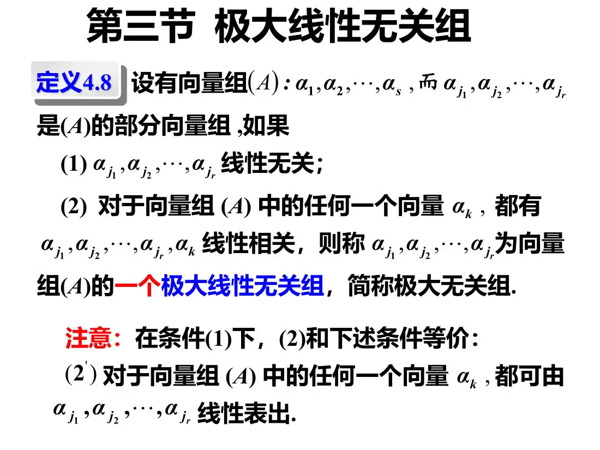

原文：

第三节 极大线性无关组

定义4.8 设有向量组(A): $\alpha_{1}, \alpha_{2}, \cdots, \alpha_{s}$ ，而 $\alpha_{j_{1}}, \alpha_{j_{2}}, \cdots, \alpha_{j_{r}}$ 是(A)的部分向量组,如果

(1) $\alpha_{j_{1}}, \alpha_{j_{2}}, \cdots, \alpha_{j_{r}}$ 线性无关;

(2) 对于向量组 (A) 中的任何一个向量 $\alpha_{k}$ ，都有 $\alpha_{j_{1}}, \alpha_{j_{2}}, \cdots, \alpha_{j_{r}}, \alpha_{k}$ 线性相关，则称 $\alpha_{j_{1}}, \alpha_{j_{2}}, \cdots, \alpha_{j_{r}}$ 为向量组 (A) 的一个极大线性无关组，简称极大无关组.

注意: 在条件(1)下, (2)和下述条件等价:

(2') 对于向量组 (A) 中的任何一个向量 $\alpha_{k}$ ，都可由 $\alpha_{j_{1}}, \alpha_{j_{2}}, \cdots, \alpha_{j_{r}}$ 线性表出.

### $$

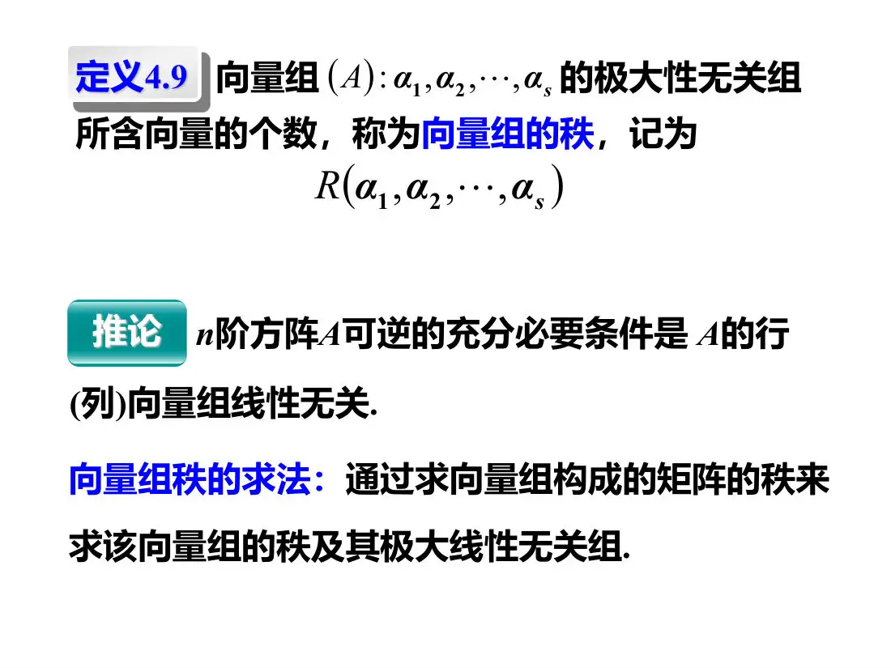

原文：

定义4.9 向量组 $(A)$ : $\alpha_{1}, \alpha_{2}, \cdots, \alpha_{s}$ 的极大性无关组所含向量的个数，称为向量组的秩，记为

$$
R (\alpha_ {1}, \alpha_ {2}, \dots , \alpha_ {s})
$$

推论 n阶方阵A可逆的充分必要条件是 A的行
(列)向量组线性无关.

向量组秩的求法：通过求向量组构成的矩阵的秩来求该向量组的秩及其极大线性无关组。

### 第四节 线性方程组解的结构

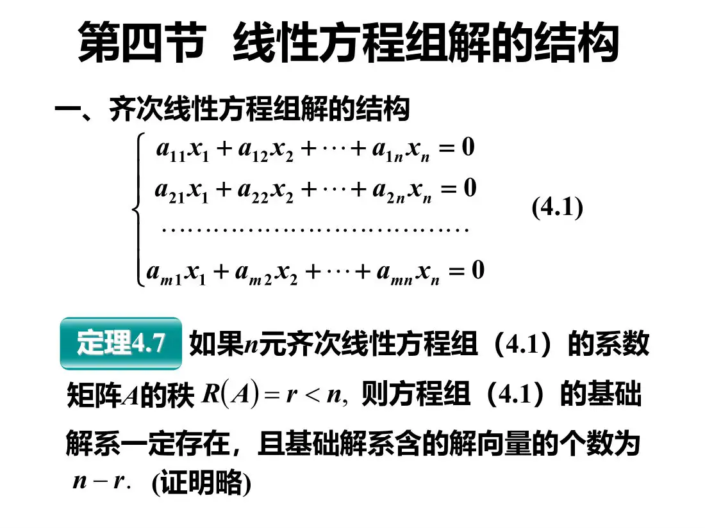

原文：

第四节 线性方程组解的结构

一、齐次线性方程组解的结构

$$
\left\{ \begin{array}{l} a _ {1 1} x _ {1} + a _ {1 2} x _ {2} + \dots + a _ {1 n} x _ {n} = 0 \\ a _ {2 1} x _ {1} + a _ {2 2} x _ {2} + \dots + a _ {2 n} x _ {n} = 0 \\ \dots\dots\\ a _ {m 1} x _ {1} + a _ {m 2} x _ {2} + \dots + a _ {m n} x _ {n} = 0 \end{array} \right.\tag{4.1}
$$

定理4.7 如果n元齐次线性方程组（4.1）的系数矩阵A的秩 $R(A)=r<n$ ，则方程组（4.1）的基础解系一定存在，且基础解系含的解向量的个数为 n-r。（证明略）

### 齐次线性方程组基础解系的求法

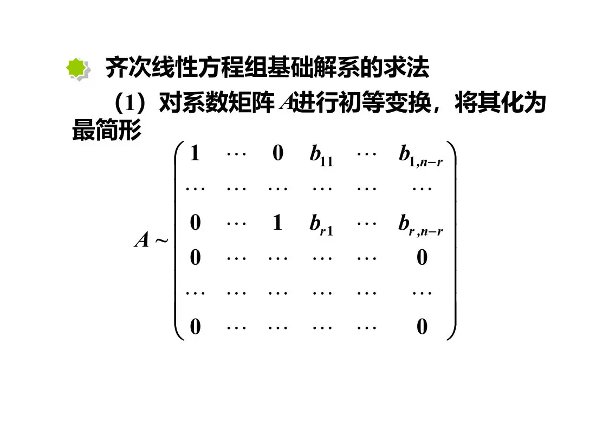

原文：

齐次线性方程组基础解系的求法

(1) 对系数矩阵 $A$ 进行初等变换, 将其化为最简形

$$
A \sim \left( \begin{array}{c c c c c c} 1 & \dots & 0 & b _ {1 1} & \dots & b _ {1, n - r} \\ \dots & \dots & \dots & \dots & \dots & \dots \\ 0 & \dots & 1 & b _ {r 1} & \dots & b _ {r, n - r} \\ 0 & \dots & \dots & \dots & \dots & 0 \\ \dots & \dots & \dots & \dots & \dots & \dots \\ 0 & \dots & \dots & \dots & \dots & 0 \end{array} \right)
$$

### $$

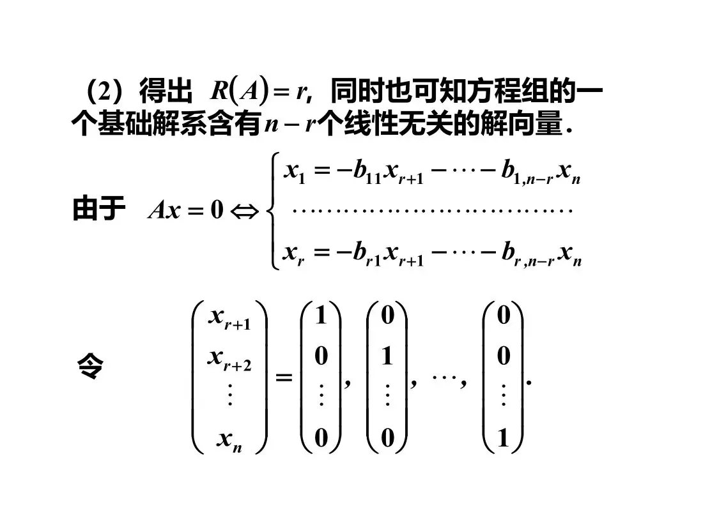

原文：

(2) 得出 $R(A)=r$ ，同时也可知方程组的一个基础解系含有 n-r 个线性无关的解向量。

由于 $Ax = 0 \Leftrightarrow \left\{ \begin{array}{l} x_{1} = -b_{11}x_{r + 1} - \dots - b_{1,n - r}x_{n} \\ \dots \\ x_{r} = -b_{r1}x_{r + 1} - \dots - b_{r,n - r}x_{n} \end{array} \right.$

令

$$
\left( \begin{array}{c} x _ {r + 1} \\ x _ {r + 2} \\ \vdots \\ x _ {n} \end{array} \right) = \left( \begin{array}{c} 1 \\ 0 \\ \vdots \\ 0 \end{array} \right), \left( \begin{array}{c} 0 \\ 1 \\ \vdots \\ 0 \end{array} \right), \dots , \left( \begin{array}{c} 0 \\ 0 \\ \vdots \\ 1 \end{array} \right).
$$

### $$

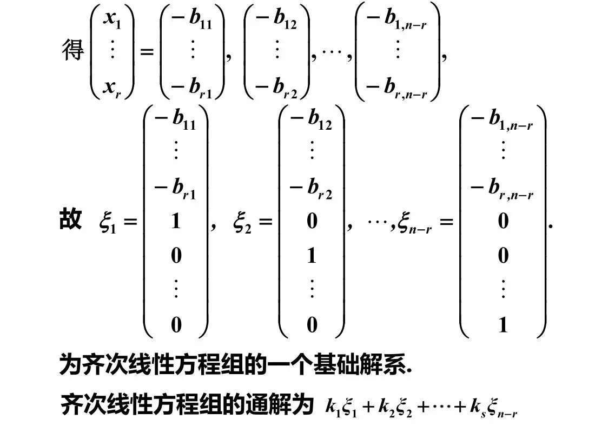

原文：

$$
\begin{array}{r l} & {\text {得} \left( \begin{array}{c} {x _ {1}} \\ {\vdots} \\ {x _ {r}} \end{array} \right) = \left( \begin{array}{c} {- b _ {1 1}} \\ {\vdots} \\ {- b _ {r 1}} \end{array} \right), \left( \begin{array}{c} {- b _ {1 2}} \\ {\vdots} \\ {- b _ {r 2}} \end{array} \right), \dots , \left( \begin{array}{c} {- b _ {1, n - r}} \\ {\vdots} \\ {- b _ {r, n - r}} \end{array} \right),} \\ & {\text {故} \xi_ {1} = \left( \begin{array}{c} {- b _ {1 1}} \\ {\vdots} \\ {- b _ {r 1}} \\ {1} \\ {0} \\ {\vdots} \\ {0} \end{array} \right), \xi_ {2} = \left( \begin{array}{c} {- b _ {1 2}} \\ {\vdots} \\ {- b _ {r 2}} \\ {0} \\ {1} \\ {\vdots} \\ {0} \end{array} \right), \dots , \xi_ {n - r} = \left( \begin{array}{c} {- b _ {1, n - r}} \\ {\vdots} \\ {- b _ {r, n - r}} \\ {0} \\ {0} \\ {\vdots} \\ {1} \end{array} \right).} \end{array}
$$

为齐次线性方程组的一个基础解系.

齐次线性方程组的通解为 $k_{1}\xi_{1}+k_{2}\xi_{2}+\cdots+k_{s}\xi_{n-r}$

### 二、非齐次线性方程组解的结构

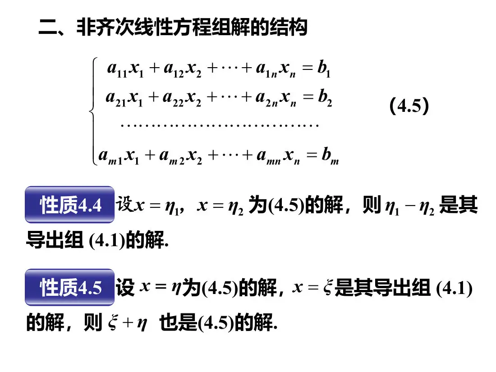

原文：

二、非齐次线性方程组解的结构

$$
\left\{ \begin{array}{l} a _ {1 1} x _ {1} + a _ {1 2} x _ {2} + \dots + a _ {1 n} x _ {n} = b _ {1} \\ a _ {2 1} x _ {1} + a _ {2 2} x _ {2} + \dots + a _ {2 n} x _ {n} = b _ {2} \\ \dots\dots\\ a _ {m 1} x _ {1} + a _ {m 2} x _ {2} + \dots + a _ {m n} x _ {n} = b _ {m} \end{array} \right.\tag{4.5}
$$

性质4.4 设 $x = \eta_{1}$ , $x = \eta_{2}$ 为(4.5)的解, 则 $\eta_{1} - \eta_{2}$ 是其导出组 (4.1)的解.

性质4.5 设 $x = \eta$ 为(4.5)的解， $x = \xi$ 是其导出组 (4.1)的解，则 $\xi + \eta$ 也是(4.5)的解.

### 说明：此定理表明

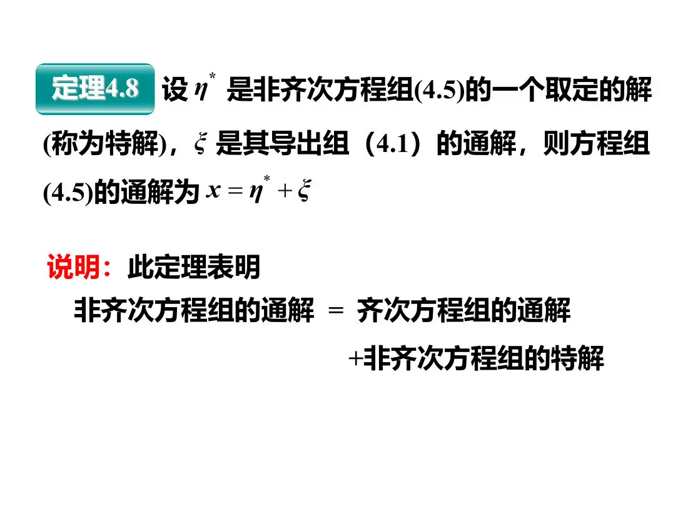

原文：

定理4.8 设 $\eta^{*}$ 是非齐次方程组(4.5)的一个取定的解 (称为特解), $\xi$ 是其导出组 (4.1) 的通解, 则方程组 (4.5)的通解为 $x = \eta^{*} + \xi$

说明：此定理表明

非齐次方程组的通解 = 齐次方程组的通解
+非齐次方程组的特解

### 第五章 特征值、特征向量 及矩阵的对角化

原文：

第五章 特征值、特征向量 及矩阵的对角化

### 一、向量的内积

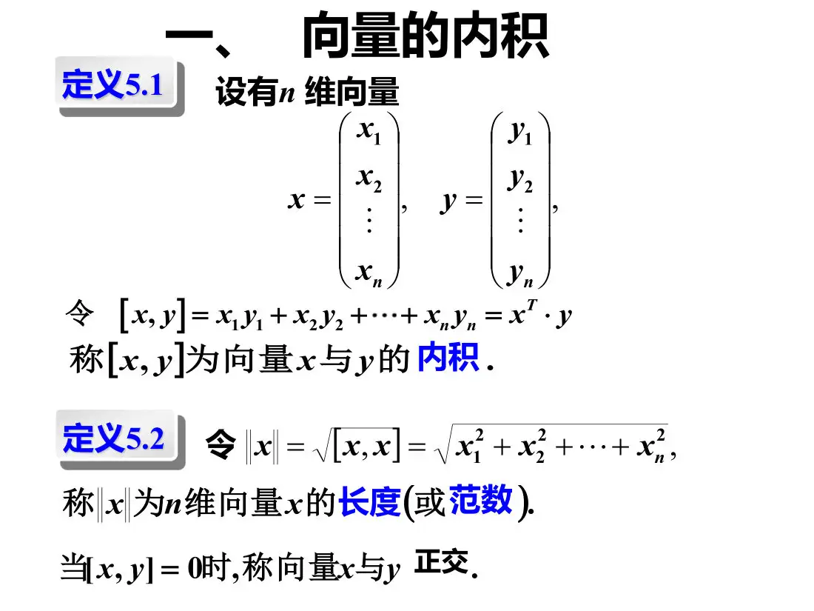

原文：

一、向量的内积

定义5.1 设有 $n$ 维向量

$$
\boldsymbol {x} = \left( \begin{array}{c} x _ {1} \\ x _ {2} \\ \vdots \\ x _ {n} \end{array} \right), \quad \boldsymbol {y} = \left( \begin{array}{c} y _ {1} \\ y _ {2} \\ \vdots \\ y _ {n} \end{array} \right),
$$

令 $\left[x,y\right]=x_{1}y_{1}+x_{2}y_{2}+\cdots+x_{n}y_{n}=x^{T}\cdot y$

称 $[x,y]$ 为向量x与y的内积.

定义5.2 令 $\| x\| = \sqrt{\left[x,x\right]} = \sqrt{x_1^2 + x_2^2 + \cdots + x_n^2},$

称 $\|x\|$ 为n维向量x的长度(或范数).

当 $[x,y]=0$ 时,称向量x与y正交.

### 第 55 页

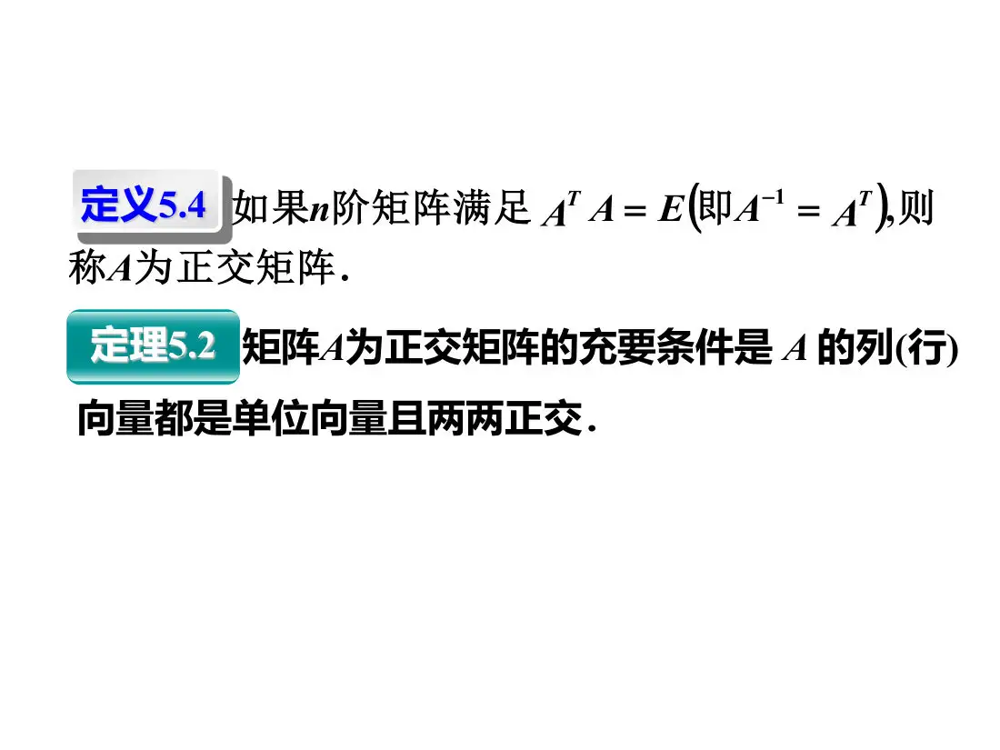

原文：

定义5.4 如果n阶矩阵满足 $A^{T}A = E(\text{即 } A^{-1} = A^{T})$ ，则称A为正交矩阵。

定理5.2 矩阵 $A$ 为正交矩阵的充要条件是 $A$ 的列(行)向量都是单位向量且两两正交。

### 二、特征值与特征向量

原文：

二、特征值与特征向量

求矩阵特征值与特征向量的步骤：

1. 计算A的特征多项式 $\det(A-\lambda E)$ ;

2. 求特征方程 $\det(A-\lambda E)=0$ 的全部根 $\lambda_{1},\lambda_{2},\cdots,\lambda_{n}$ ，就是 A 的全部特征值；

3. 对于特征值 $\lambda_{i}$ ，求齐次方程组

$$
\big (A - \lambda_ {i} E \big) x = 0
$$

的非零解,就是对应于 $\lambda_{i}$ 的特征向量.

### 矩阵特征值与特征向量的性质：

原文：

矩阵特征值与特征向量的性质：

定理5.3 设 $A_{n\times n}$ 的互异特征值为 $\lambda_{1},\lambda_{2},\cdots,\lambda_{m}$ ，与之所对应的特征向量依次为 $x_{1},x_{2},\cdots,x_{m}$ ，则 $x_{1},x_{2},\cdots,x_{m}$ ，线性无关。(证明略)

注意：属于不同特征值的特征向量是线性无关的。

特征值的常用结果：

$$
\lambda_ {1} + \lambda_ {2} + \dots + \lambda_ {n} = a _ {1 1} + a _ {2 2} + \dots + a _ {n n}; \tag {1}
$$

(2) $\lambda_{1}\lambda_{2}\cdots\lambda_{n}=|A|$ .

### 三、相似矩阵与对角化

原文：

三、相似矩阵与对角化

一般矩阵可对角化的判定方法及求解：

1. 求出A的全部互不相等的特征值 $\lambda_{1},\lambda_{2},\cdots\lambda_{m}$ ;
它们的重数依次为 $k_{1}, k_{2}, \cdots, k_{m}. (k_{1} + k_{2} + \cdots + k_{m} = n)$

2. 对每个 $k_{i}$ 重特征值 $\lambda_{i}$ , 求 $(A - \lambda_{i}E)x = 0$ 的基础解系, 如果基础解系中含有 $k_{i}$ 个线性无关的特征向量, 则矩阵 $A$ 可对角化, 否则, 不能对角化。

3. 当 A 可对角化时，将所有基础解系中的特征向量构成矩阵 P，便有 $P^{-1}AP = \Lambda$ 。注意 A 中对角元的排列次序应与 P 中列向量的排列次序相对应。

### 实对称阵对角化的方法

原文：

实对称阵对角化的方法

1. 求出A的全部互不相等的特征值 $\lambda_{1},\lambda_{2},\cdots,\lambda_{m}$ ;
它们的重数依次为 $k_{1}, k_{2}, \cdots, k_{m}$ . $(k_{1} + k_{2} + \cdots + k_{m} = n)$

2. 对每个 $k_{i}$ 重特征值 $\lambda_{i}$ ，求 $(A-\lambda_{i}E)x=0$ 的基础解系，得 $k_{i}$ 个线性无关的特征向量。再把它们正交正交化、单位化，得 $k_{i}$ 个两两正交的单位特征向量。因 $k_{1}+k_{2}+\cdots+k_{m}=n$ ，故总共可得n个两两正交的单位特征向量。

3. 把这 $n$ 个两两正交的单位特征向量构成正交阵 $P$ , 便有 $P^{-1}AP = P^{T}AP = \Lambda$ . 注意 $\Lambda$ 中对角元的排列次序应与 $P$ 中列向量的排列次序相对应.

### 第六章 二次型

原文：

第六章 二次型

重点掌握如何用正交变换法化二次型为标准型。
