# 《线性代数与解析几何》期中试卷一及同步练习册答案

按原件顺序阅读，文字可对照页图。

## 第1页

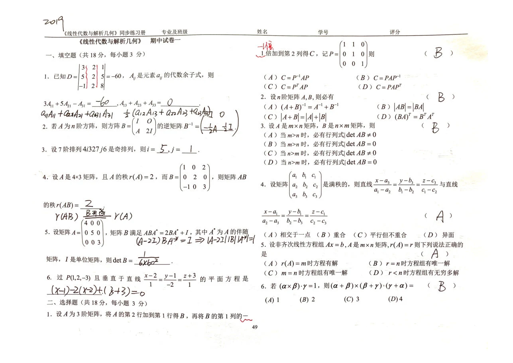

《线性代数与解析几何》 期中试卷一

### 一、填空题（共18分，每小题3分）

1. 已知 $D = \begin{vmatrix} 3 & 2 \\ 5 & 2 \\ -1 & 2 \end{vmatrix}$ $1 = -60$ ， $A_{ij}$ 是元素 $a_{ij}$ 的代数余子式，则 $3A_{11} + 5A_{21} - A_{31} = \underline{-60}$ ， $A_{13} + A_{23} + A_{33} = \underline{0}$ ． $a_{11}A_{11} + a_{23}A_{21} + a_{31}A_{31} \quad \frac{1}{2}(a_{12}A_{13} + a_{22}A_{23} + a_{33}A_{33}) \quad 0$ 2. 若 $A$ 为 $n$ 阶方阵，则方阵 $B = \begin{pmatrix} I & O \\ A & 2I \end{pmatrix}$ 的逆矩阵 $B^{-1} = \begin{pmatrix} -\frac{1}{2}A & \frac{1}{2}I \\ -\frac{1}{2}A & \frac{1}{2}I \end{pmatrix}$ .

3. 设 7 阶排列 4i327j6 是奇排列，则 $i = \underline{5}, j = \underline{1}$ .

4. 设 A 是 $4 \times 3$ 矩阵，且 A 的秩 $r(A) = 2$ ，而 $B = \begin{pmatrix} 1 & 0 & 2 \\ 0 & 2 & 0 \\ -1 & 0 & 3 \end{pmatrix}$ ，则矩阵 AB 的秩 $r(AB) = \frac{2}{B(B)}$ $\gamma(A/B)$ $\gamma(A)$ 5. 设矩阵 $A = \begin{pmatrix} 4 & 0 & 0 \\ 0 & 5 & 0 \\ 0 & 0 & 3 \end{pmatrix}$ ，矩阵 B 满足 $ABA^{*} = 2BA^{*} + I$ ，其中 $A^{*}$ 为 A 的伴随

矩阵，I 是单位矩阵，则 det B = $\frac{1}{6 \times 60^{2}}$ .

6. 过 $P(1,2,-3)$ 且垂直于直线 $\frac{x-2}{1}=\frac{y-1}{-2}=\frac{z+3}{1}$ 的平面方程是 $(x-1)-2(x-2)+(3+3)=0$

### 二、选择题（共18分，每小题3分）

1. 设 $A$ 为 3 阶矩阵,将 $A$ 的第 2 行加到第 1 行得 $B$ ,再将 $B$ 的第 1 列的一

1倍加到第2列得C，记 $P=\begin{pmatrix}1&1&0\\0&1&0\\0&0&1\end{pmatrix}$ 则 (B)

(A) $C=P^{-1}AP$ (B) $C=PAP^{-1}$ (C) $C=P^{T}AP$ (D) $C=PAP^{T}$

2. 设 $n$ 阶矩阵 $A, B$ , 则必有 (B) $(A)(A + B)^{-1} = A^{-1} + B^{-1}$ (B) $|AB| = |BA|$ (C) $|A + B| = |A| + |B|$ (D) $(BA)^T = B^T A^T$

3. 设 $A$ 是 $m \times n$ 矩阵, $B$ 是 $n \times m$ 矩阵, 则 (A) 当 $m > n$ 时, 必有行列式 $\left| \det A B \neq 0 \right.$ (B) 当 $m > n$ 时, 必有行列式 $\left| \det A B = 0 \right.$ (C) 当 $n > m$ 时, 必有行列式 $\left| \det A B \neq 0 \right.$ (D) 当 $n > m$ 时, 必有行列式 $\left| \det A B = 0 \right.$

4. 设矩阵 $\begin{pmatrix} a_{1} & b_{1} & c_{1} \\ a_{2} & b_{2} & c_{2} \\ a_{3} & b_{3} & c_{3} \end{pmatrix}$ 是满秩的，则直线 $\frac{x - a_{3}}{a_{1} - a_{2}} = \frac{y - b_{3}}{b_{1} - b_{2}} = \frac{z - c_{3}}{c_{1} - c_{2}}$ 与直线 $\frac{x-a_{1}}{a_{2}-a_{3}}=\frac{y-b_{1}}{b_{2}-b_{3}}=\frac{z-c_{1}}{c_{2}-c_{3}}$ (A)

(A)相交于一点 (B)重合 (C)平行但不重合 (D)异面
5. 设非齐次线性方程组 Ax=b, A 是 $m \times n$ 矩阵, $r(A)=r$ 则下列说法正确的是 (A)

(A) $r(A) = m$ 时方程有解 (B) $r = n$ 时方程组有唯一解 (C) $m = n$ 时方程组有唯一解 (D) $r < n$ 时方程组有无穷多解

6. 若 $(\alpha \times \beta) \cdot \gamma = 1$ ，则 $(\alpha + \beta) \times (\beta + \gamma) \cdot (\gamma + \alpha) = (B)$ (A) 1 (B) 2 (C) 3 (D) 4

2019

《线性代数与解析几何》同步练习册

专业及班级

姓名

学号

评分

49

## 第2页

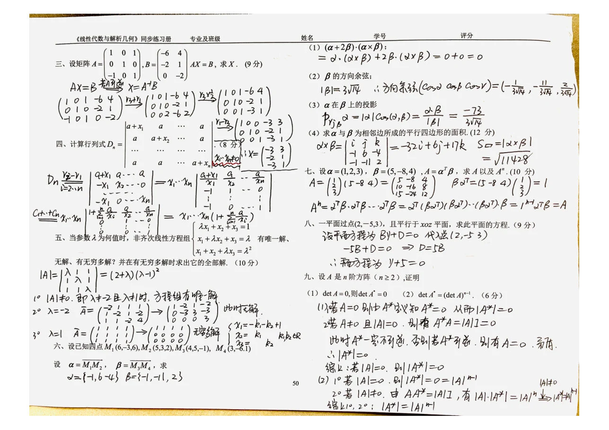

三、设矩阵 $A=\begin{pmatrix}1&0&1\\0&1&0\\-1&0&1\end{pmatrix},B=\begin{pmatrix}-6&4\\-2&1\\0&-2\end{pmatrix}$ AX=B，求 X。（9分） $AX=B\xrightarrow{若A引x_{1}}X=A^{-1}B$ $\begin{pmatrix}1&0&1&-6&4\\0&1&0&-2&1\\-1&0&1&0&-2\end{pmatrix}\xrightarrow{r_{3}+r_{1}}\begin{pmatrix}1&0&1&-6&4\\0&1&0&-2&1\\0&0&2&-6&2\end{pmatrix}\xrightarrow{r_{3}x_{2}^{2}}\begin{pmatrix}1&0&1&-6&4\\0&1&0&-2&1\\0&0&1&-3&1\end{pmatrix}$ 四、计算行列式 $D_{n}=\begin{vmatrix}a+x_{1}&a&\cdots&a\\a&a+x_{2}&\cdots&a\\\cdots&\cdots&\cdots&\cdots\\a&a&\cdots&a+x_{n}\end{vmatrix}\xrightarrow{r_{1}-r_{3}}\begin{pmatrix}1&0&0&-3&3\\0&1&0&-2&1\\0&0&1&-3&1\end{pmatrix}$ $x_{1}\cdots x_{n}\neq0$ $C_{1}+\cdots+C_{n}x_{1}\cdots x_{n}\left|\begin{matrix}1+\frac{n}{2}&\frac{a}{x_{i}} &\frac{a}{x_{2}} &\cdots &\frac{a}{x_{n}}\\0 & i & 0 & \cdots & 0\\0 & i & 0 & \cdots & 0\end{matrix}\right|=\quad x_{1}\cdots x_{n}(1+\sum_{i=1}^{n}\frac{a}{x_{i}})$ 五、当参数 $\lambda$ 为何值时，非齐次线性方程组 $\left\{\begin{aligned}\lambda x_{1}+x_{2}+x_{3}=1\\x_{1}+\lambda x_{2}+x_{3}=\lambda \\x_{1}+x_{2}+\lambda x_{3}=\lambda^{2}\end{aligned}\right.$ 有唯一解、无解、有无穷多解？并在有无穷多解时求出它的全部解。（10分）

$|A|=\left|\begin{matrix}\lambda&1&1\\1&\lambda&1\\1&1&\lambda\end{matrix}\right|=(2+\lambda)(\lambda-1)^{2}$ $1^{\circ}|A|\neq0$ . 即 $\lambda\neq-2$ 且 $\lambda\nmid1$ 时，方程组有唯一解 $2^{\circ}\lambda=-2\quad\overline{A}=\left(\begin{matrix}-2&1&1&1\\1&-2&1&-\frac{1}{2}\\1&1&-2&4\end{matrix}\right)\rightarrow\left(\begin{matrix}1&-2&1&-\frac{2}{3}\\0&-3&3&-\frac{3}{4}\\0&0&0&3\end{matrix}\right)$ 此时无解. $3^{\circ}\lambda=1\quad\overline{A}=\left(\begin{matrix}1&1&1\\1&1&1\\1&1&1\end{matrix}\right)\rightarrow\left(\begin{matrix}1&1&1\\0&0&0\\0&0&0\end{matrix}\right)$ 无穷与解 $\left\{\begin{array}{l}x_{1}=-k_{1}-k_{2}+1\\x_{2}=k_{1}\quad k_{1},k_{2}\in R\\x_{3}=k_{2}\end{array}\right.$ 六、设已知四点 $M_{1}(6,-3,6),M_{2}(5,3,2),M_{3}(4,5,-1),M_{4}(3,-6,1)$ 设 $\alpha=\overrightarrow{M_{1}M_{2}}$ , $\beta=\overrightarrow{M_{3}M_{4}}$ , 求 $\alpha=\{-1,6-4\}\quad\beta=\{-1,-11,2\}$ (1) $(\alpha+2\beta)\cdot(\alpha\times\beta)$ ; $=\alpha\cdot(\alpha\times\beta)+2\beta\cdot(\alpha\times\beta)=0+0=0$

(2) $\beta$ 的方向余弦; $\left| \beta \right|  = 3\sqrt{14}\;\therefore$ 方向余弦 $\left( {\cos \alpha \cos \beta \cos \nu }\right)  = \left( {-\frac{1}{3\sqrt{14}}, - \frac{11}{3\sqrt{14}},\frac{2}{3\sqrt{14}}}\right)$

(3) $\alpha$ 在 $\beta$ 上的投影 $p_{rj\beta}\alpha=|a|cos(\alpha,\beta)=\frac{\alpha\cdot\beta}{|\beta|}=\frac{-73}{3\sqrt{14}}$

(4) 求 $\alpha$ 与 $\beta$ 为相邻边所成的平行四边形的面积. (12 分)

$$
\alpha \times \beta = \left| \begin{array}{l l l} i & j & k \\ - 1 & b & - 4 \\ - 1 & - 1 1 & 2 \end{array} \right| = - 3 2 i + b j + 1 7 k \quad S _ {\square} = | \alpha \times \beta |
$$

七、设 $\alpha = (1,2,3)$ ， $\beta = (5, - 8,4)$ ， $A = \alpha^T\beta$ ，求 $A$ 以及 $A^n$ .(10分)

$$
A = \left( \begin{array}{l} 1 \\ 2 \\ 3 \end{array} \right) (5 - 8 4) = \left( \begin{array}{l l l} 5 & - 8 & 4 \\ 1 0 & - 1 6 & 8 \\ 1 5 & - 2 4 & 1 2 \end{array} \right)
$$

$$
\beta \alpha^ {T} = (5 - 8. 4) \binom{1}{\frac {2}{3}} = 1
$$

$$
A ^ {h} = \alpha^ {T} \beta \cdot \alpha^ {T} \beta \dots \alpha^ {T} \beta = \alpha^ {T} (\beta \alpha^ {T}) (\beta \alpha^ {T}) \dots (\beta \alpha^ {T}) \cdot \beta = 1 ^ {h - 1} \alpha^ {T} \beta = A
$$

八、一平面过点 $(2,-5,3)$ ，且平行于xoz平面，求此平面的方程。（9分）
设平面方程为BY+D=0 代入点 $(2,-5,3)$ $-5B+D=0 \Rightarrow D=5B$ ∴两方程为 $y+5=0$

九、设 $A$ 是 $n$ 阶方阵（ $n \geq 2$ ），证明

(1) $\det A = 0$ , 则 $\det A^{*} = 0$ (2) $\det A^{*} = (\det A)^{n-1}$ . (6分)

(1) 若 A = 0，则由 $A^{*}$ 定义知 $A^{*} = 0$ ，从而 $|A^{*}| = 0$ 2 若 $A \neq 0$ 且 $|A| = 0$ ，则有 $A^{*}A = |A| = 0$ 此时 $A^{*}$ 一定不到总，否则若 $A^{*}$ 到总，则有 A = 0，矛盾

∴ $|A^{*}| = 0$ 综上：若 $|A| = 0$ ，则 $|A^{*}| = 0$ (2) $10^{\circ}$ 若 $|A| = 0$ ，则 $|A^{*}| = 0 = |A|^{n-1}$ $|A| \neq 0$ $20^{\circ}$ 若 $|A| \neq 0$ 。由 $AA^{*} = |A|$ ，有 $|A| \cdot |A^{*}| = |A|^{n} \Rightarrow |A^{*}| = |A|^{n-1}$ 综上 $10^{\circ}, 20^{\circ}$ ; $|A^{*}| = |A|^{n-1}$

《线性代数与解析几何》同步练习册 专业及班级

姓名

评分

学号

## 第3页

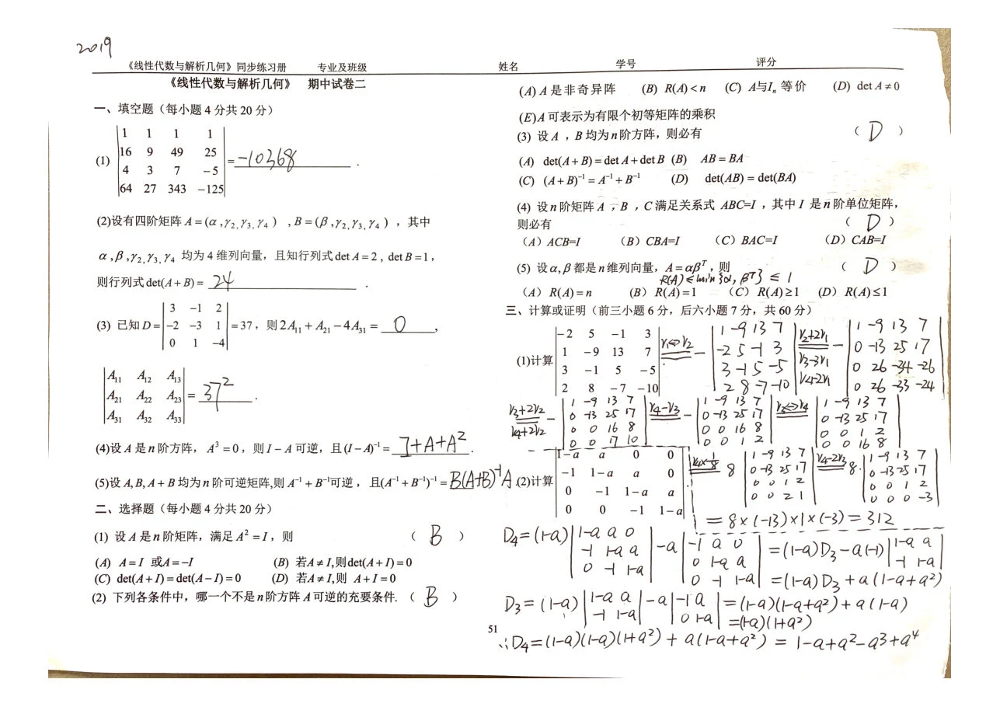

《线性代数与解析几何》 期中试卷二

### 一、填空题（每小题4分共20分）

1) $\begin{vmatrix}1 & 1 & 1 & 1 \\ 16 & 9 & 49 & 25 \\ 4 & 3 & 7 & -5 \\ 64 & 27 & 343 & -125\end{vmatrix} =$ -10368

(2)设有四阶矩阵 $A = (\alpha, \gamma_2, \gamma_3, \gamma_4)$ ， $B = (\beta, \gamma_2, \gamma_3, \gamma_4)$ ，其中 $\alpha, \beta, \gamma_2, \gamma_3, \gamma_4$ 均为 4 维列向量，且知行列式 $\det A = 2$ ， $\det B = 1$ ，则行列式 $\det(A + B) = 24$ 。

(3) 已知 $D = \begin{vmatrix} 3 & -1 & 2 \\ -2 & -3 & 1 \\ 0 & 1 & -4 \end{vmatrix} = 37$ ，则 $2A_{11} + A_{21} - 4A_{31} = \underline{0}$ ， $\left| \begin{array}{ccc} A_{11} & A_{12} & A_{13} \\ A_{21} & A_{22} & A_{23} \\ A_{31} & A_{32} & A_{33} \end{array} \right| = \underline{37^2}$ .

(4)设 $A$ 是 $n$ 阶方阵， $A^3 = 0$ ，则 $I - A$ 可逆，且 $(I - A)^{-1} = \underline{I + A + A^2}$

(5)设 $A,B,A + B$ 均为 $n$ 阶可逆矩阵,则 ${A}^{-1} + {B}^{-1}$ 可逆,且 ${\left( {A}^{-1} + {B}^{-1}\right) }^{-1} = B{\left( A + B\right) }^{-1}A$ . (2)计算二、选择题（每小题4分共20分）

(1) 设 A 是 n 阶矩阵，满足 $A^{2}=I$ ，则
(A) A=I 或 A=-I (B) 若 $A \neq I$ ，则 $\det(A+I)=0$ (C) $\det(A+I)=\det(A-I)=0$ (D) 若 $A \neq I$ ，则 $A + I = 0$

(2) 下列各条件中, 哪一个不是 $n$ 阶方阵 $A$ 可逆的充要条件. ( B )

(A) $A$ 是非奇异阵 (B) $R(A) < n$ (C) $A$ 与 $I_{n}$ 等价 (D) $\operatorname{det} A \neq 0$

(E)A 可表示为有限个初等矩阵的乘积
(3) 设 A, B 均为 n 阶方阵，则必有
(A) $\det(A+B)=\det A+\det B$ (B) AB=BA
(C) $(A+B)^{-1}=A^{-1}+B^{-1}$ (D) $\det(AB)=\det(BA)$

(4) 设 $n$ 阶矩阵 $A, B, C$ 满足关系式 $ABC = I$ , 其中 $I$ 是 $n$ 阶单位矩阵, 则必有 (D) (A) $ACB = I$ (B) $CBA = I$ (C) $BAC = I$ (D) $CAB = I$

(5) 设 $\alpha, \beta$ 都是 $n$ 维列向量， $A = \alpha \beta^T$ ，则 $R(A) \leq m! n \{\alpha, \beta^T\} \leq 1$ (A) $R(A) = n$ (B) $R(A) = 1$ (C) $R(A) \geq 1$ (D) $R(A) \leq 1$

### 三、计算或证明（前三小题6分，后六小题7分，共60分）

$$
\left|\begin{array}{r r r r}- 2&5&- 1&3\\1&- 9&1 3&7\\3&- 1&5&- 5\\2&8&- 7&- 1 0\end{array}\right| \stackrel {x _ {1} \leftrightarrow x _ {2}} {\longrightarrow} - \left|\begin{array}{l l l l}1&- 9&1 3&7\\- 2&5&- 1&3\\3&- 1&5&- 5\\2&8&- 7&- 1 0\end{array}\right| \stackrel {y _ {2} + 2 y _ {1}} {\underset {y _ {3} - 3 y _ {1}} {\rightleftharpoons}} - \left|\begin{array}{l l l l}1&- 9&1 3&7\\0&- 1 3&2 5&1 7\\0&2 6&- 3 4&- 2 6\\0&2 6&- 3 3&- 2 4\end{array}\right|
$$

$$
\frac {v _ {3} + 2 v _ {2}}{k _ {4} + 2 v _ {2}} - \left|\begin{array}{r r r r}1&- 9&1 3&7\\0&- 1 3&2 5&1 7\\0&0&1 6&8\\0&0&1 7&1 0\end{array}\right| \xlongequal {v _ {4} - v _ {3}} - \left|\begin{array}{r r r r}1&- 9&1 3&7\\0&- 1 3&2 5&1 7\\0&0&1 6&8\\0&0&1&2\end{array}\right| \xlongequal {v _ {2} \rightarrow v _ {4}} \left|\begin{array}{r r r r}1&- 9&1 3&7\\0&- 1 3&2 5&1 7\\0&0&1&2\\0&0&1 6&8\end{array}\right|
$$

$$
\left| \begin{array}{cccc} 1 - a & a & 0 & 0 \\ - 1 & 1 - a & a & 0 \\ 0 & - 1 & 1 - a & a \\ 0 & 0 & - 1 & 1 - a \\ \end{array} \right|\xrightarrow {k _ {4} \times \frac {1}{8}} 8 \left| \begin{array}{cccc} 1 & - 9 & 1 3 & 7 \\ 0 & - 1 3 & 2 5 & 1 7 \\ 6 & 0 & 1 & 2 \\ 0 & 0 & 2 & 1 \\ \end{array} \right|\xrightarrow {v _ {4} - 2 v _ {3}} 8 \cdot \left| \begin{array}{cccc} 1 & - 9 & 1 3 & 7 \\ 0 & - 1 3 & 2 5 & 1 7 \\ 0 & 0 & 1 & 2 \\ 0 & 0 & 0 & - 3 \\ \end{array} \right|
$$

$$
D _ {4} = (1 - a) \left| \begin{array}{l l l} 1 - a & a & 0 \\ - 1 & 1 - a & a \\ 0 & - 1 & 1 - a \end{array} \right| - a \left| \begin{array}{l l l} - 1 & a & 0 \\ 0 & 1 - a & a \\ 0 & - 1 & 1 - a \end{array} \right| = (1 - a) D _ {3} - a (- 1) \left| \begin{array}{l l} 1 - a & a \\ - 1 & 1 - a \end{array} \right|
$$

$$
D _ {3} = (1 - a) \left| \begin{array}{l l} 1 - a & a \\ - 1 & 1 - a \end{array} \right| - a \left| \begin{array}{l l} - 1 & a \\ 0 & 1 - a \end{array} \right| = (1 - a) (1 - a + q ^ {2}) + a (1 - a)
$$

$$
\therefore D _ {4} = (1 - a) (1 - a) (1 + a ^ {2}) + a (1 - a + a ^ {2}) = 1 - a + a ^ {2} - a ^ {3} + a ^ {4}
$$

《线性代数与解析几何》同步练习册 专业及班级

姓名

学号

评分

## 第4页

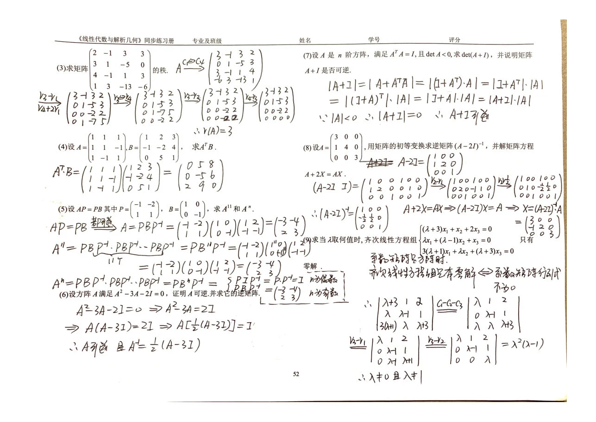

(3)求矩阵 $\begin{pmatrix} 2 & -1 & 3 & 3 \\ 3 & 1 & -5 & 0 \\ 4 & -1 & 1 & 3 \\ 1 & 3 & -13 & -6 \end{pmatrix}$ 的秩. $A \xrightarrow{C_1 \Rightarrow C_4} \begin{pmatrix} 3 & -1 & 3 & 2 \\ 0 & 1 & -5 & 3 \\ 3 & -1 & 1 & 4 \\ -6 & 3 & -13 & 1 \end{pmatrix}$

$\frac{v_{3}-v_{1}}{v_{4}+2v_{1}}\left(\begin{matrix}3-132\\01-53\\00-22\\01-75\end{matrix}\right)\xrightarrow{v_{3}\Rightarrow v_{4}}\left(\begin{matrix}3+32\\01-53\\01-75\\00-22\end{matrix}\right)\xrightarrow{v_{3}-v_{3}}\left(\begin{matrix}3+32\\01-53\\00-22\\00-22\end{matrix}\right)\xrightarrow{v_{4}-v_{3}}\left(\begin{matrix}3+32\\01-53\\00-22\\000\end{matrix}\right)$

$$
\therefore \gamma (A) = 3
$$

(4)设 $A=\begin{pmatrix}1&1&1\\1&1&-1\\1&-1&1\end{pmatrix},B=\begin{pmatrix}1&2&3\\-1&-2&4\\0&5&1\end{pmatrix}$ ，求 $A^{T}B$ .

$$
A ^ {T} \cdot B = \left( \begin{array}{l l l} 1 & 1 & 1 \\ 1 & 1 & - 1 \\ 1 & - 1 & 1 \end{array} \right) \left( \begin{array}{l l l} 1 & 2 & 3 \\ - 1 & - 2 & 4 \\ 0 & 5 & 1 \end{array} \right) = \left( \begin{array}{l l l} 0 & 5 & 8 \\ 0 & - 5 & 6 \\ 2 & 9 & 0 \end{array} \right)
$$

(5)设 $AP = PB$ 其中 $P = \left( \begin{array}{cc} - 1 & -2\\ 1 & 1 \end{array} \right)$ ， $B = \left( \begin{array}{ll}1 & 0\\ 0 & -1 \end{array} \right)$ ，求 $A^{11}$ 和 $A^n$

${AP} = {PB}\overset{\text{ 都开始 }}{ \rightarrow  }A = {PBP}^{-1} = \begin{pmatrix} - 1 &  - 2 \\  1 & 1 \end{pmatrix}\begin{pmatrix} 1 & 0 \\  0 &  - 1 \end{pmatrix}\begin{pmatrix} 1 & 2 \\  - 1 &  - 1 \end{pmatrix} = \begin{pmatrix}  - 3 &  - 4 \\  2 & 3 \end{pmatrix}$

$$
A ^ {\prime \prime} = P B P ^ {- 1} \cdot P B P ^ {- 1} \dots P B P ^ {- 1} = P B ^ {\prime \prime} P ^ {- 1} = \left( \begin{array}{l l} - 1 & - 2 \\ 1 & 1 \end{array} \right) \left( \begin{array}{l l} 1 ^ {\prime \prime} & 0 \\ 0 & + 1 ^ {\prime \prime} \end{array} \right) \left( \begin{array}{l l} 1 & 2 ^ {(9)} \\ - 1 & - 1 \end{array} \right)
$$

$$
= (- 1 - 2) (1 0) (1 2) = (- 3 - 4)
$$

$$
A ^ {n} = P B P ^ {- 1} \cdot P B P ^ {- 1} \cdot P B P ^ {- 1} = P B ^ {n} P ^ {- 1} = \left\{ \begin{array}{l l} P I P ^ {- 1} = P. P ^ {- 1} = I \\ P B P ^ {- 1} = (2 - 1) \end{array} \right.
$$

(6)设方阵 A 满足 $A^{2}-3A-2I=0$ ，证明 A 可逆。并求它的逆矩阵. $=\begin{pmatrix}-3&-4\\2&3\end{pmatrix}$ n 为奇数。

(6)设方阵 A 满足 $A^{2}-3A-2I=0$ ，证明 A 可逆，并求它的逆矩阵 $A^{2}-3A-2I=0 \Rightarrow A^{2}-3A=2I$ $\Rightarrow A(A-3I)=2I \Rightarrow A[\frac{1}{2}(A-3I)]=I$ ∴ A 引过且 $A^{-}=\frac{1}{2}(A-3I)$

(7)设 A 是 n 阶方阵，满足 $A^{T}A = I$ ，且 $\det A < 0$ ，求 $\det(A + I)$ ，并说明矩阵 $A + I$ 是否可逆. $|A+I|=|A+A^{T}A|=|(I+A^{T})\cdot A|=|I+A^{T}|\cdot|A|$ $=|(I+A)^{T}| \cdot |A| = |I + A| \cdot |A| = |A + 2| \cdot |A|$ $\because |A| < 0 \therefore |A + I| = 0 \therefore A + I \geq 1$

$$
A = \left( \begin{array}{c c c} 3 & 0 & 0 \\ 1 & 4 & 0 \\ 0 & 0 & 3 \end{array} \right)
$$

$$
(A - 2 I) ^ {- 1}
$$

$$
A + 2 X = A X
$$

$$
A - 2 I = \left( \begin{array}{l l l} 1 & 0 & 0 \\ 1 & 2 & 0 \\ 0 & 0 & 1 \end{array} \right)
$$

$$
(A - 2 I I) = \left( \begin{array}{l l l l l l} 1 & 0 & 0 & 1 & 0 & 0 \\ 1 & 2 & 0 & 0 & 1 & 0 \\ 0 & 0 & 1 & 0 & 0 & 1 \end{array} \right)
$$

$$
\left( \begin{array}{l l l l l} 1 & 0 & 0 & 1 & 0 & 0 \\ 0 & 2 & 0 & - 1 & 1 & 0 \\ 0 & 0 & 1 & 0 & 0 & 1 \end{array} \right)
$$

$$
\left( \begin{array}{l l l l} 1 & 0 & 0 & 1 \\ 0 & 1 & 0 & - \frac {1}{2} \frac {1}{2} \\ 0 & 0 & 1 & 0 \\ 0 & 0 & 1 \end{array} \right)
$$

$$
\therefore (A - 2 I) ^ {- 1} = \left( \begin{array}{l l l} 1 & 0 & 0 \\ - \frac {1}{2} & \frac {1}{2} & 0 \\ 0 & 0 & 1 \end{array} \right)
$$

(9)求当 $\lambda$ 取何值时,齐次线性方程组 $\left\{\begin{aligned}\lambda x_{1}+(\lambda-1)x_{2}+x_{3}&=0\\ 3(\lambda+1)x_{1}+\lambda x_{2}+(\lambda+3)x_{3}&=0\end{aligned}\right.$ 只有

系数矩阵只方阵时.

零解.

二次线性方程组定本零解 $\Leftrightarrow$ 系数矩阵行列式不为0

$$
\therefore \left| \begin{array}{l l l} {\lambda + 3} & {1} & {2} \\ {\lambda} & {\lambda - 1} & {1} \\ {3 (\lambda + 1)} & {\lambda} & {\lambda + 3} \end{array} \right| \stackrel {{G - C _ {2} - C _ {3}}} {{=}} \left| \begin{array}{l l l} {\lambda} & {1} & {2} \\ {0} & {\lambda - 1} & {1} \\ {\lambda} & {\lambda} & {\lambda + 3} \end{array} \right|
$$

$$
\underline {{\underline {{v _ {3} - v _ {1}}}}} \left| \begin{array}{l l l} \lambda & 1 & 2 \\ 0 & \lambda - 1 & 1 \\ 0 & \lambda - 1 & \lambda + 1 \end{array} \right| \underline {{\underline {{v _ {3} - v _ {2}}}}} \left| \begin{array}{l l l} \lambda & 1 & 2 \\ 0 & \lambda - 1 & 1 \\ 0 & 0 & \lambda \end{array} \right| = \lambda^ {2} (\lambda - 1)
$$

52

∴入≠0且入≠

《线性代数与解析几何》同步练习册 专业及班级

姓名

学号

评分

## 第5页

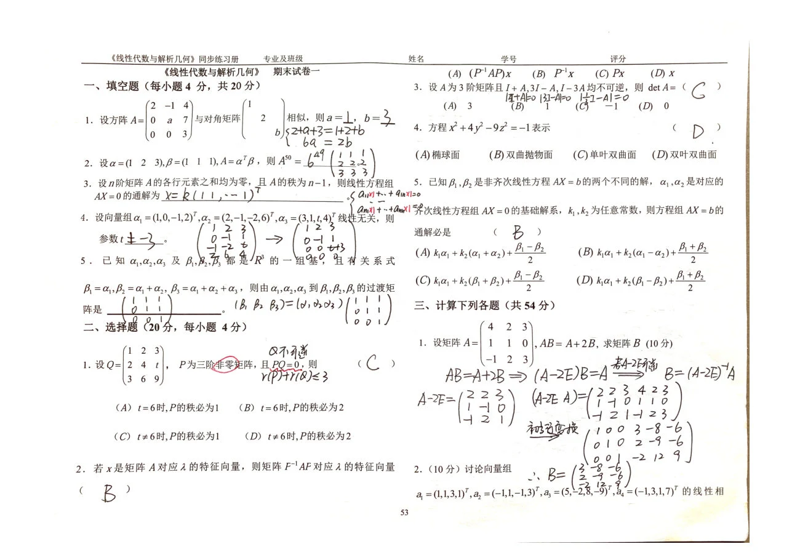

### 《线性代数与解析几何》 期末试卷一

### 一、填空题（每小题4分，共20分）

1. 设方阵 $A = \begin{pmatrix} 2 & -1 & 4 \\ 0 & a & 7 \\ 0 & 0 & 3 \end{pmatrix}$ 与对角矩阵 $\left( \begin{array}{lll} 1 & & \\ & 2 & \\ & & b \end{array} \right)$ 相似，则 $a = \underline{1}, b = \underline{3}$ $2 + a + 3 = 1 + 2 + b$ $6a = 2b$

2. 设 $\alpha = (1, 2, 3), \beta = (1, 1, 1), A = \alpha^T\beta$ ，则 $A^{50} = \frac{6^{49}}{6}\left( \begin{array}{cccc} 1 & 1 & 1 \\ 2 & 2 & 2 \\ 3 & 3 & 3 \end{array} \right)$

3. 设 $n$ 阶矩阵 $A$ 的各行元素之和均为零, 且 $A$ 的秩为 $n-1$ , 则线性方程组 $5AX = 0$ 的通解为 $x = k(11, \cdots, 1)^T$ 。 $a_{11}x + \cdots + a_{1n}x = 0$

$$
\left\{ \begin{array}{l} a _ {1 1} x + \dots + a _ {1 n} x = 0 \\ - a _ {n 1} x + \dots + a _ {n n} x = 0 \end{array} \right.
$$

4. 设向量组 $\alpha_{1}=(1,0,-1,2)^{T},\alpha_{2}=(2,-1,-2,6)^{T},\alpha_{3}=(3,1,t,4)^{T}$ 线性无关，参数 $t \neq -3$ 。 $\begin{pmatrix} 1 & 2 & 3 \\ 0 & -1 & 1 \\ -1 & -2 & 6 \\ -1 & 6 & 4 \end{pmatrix} \rightarrow \begin{pmatrix} 1 & 2 & 3 \\ 0 & -1 & 1 \\ 0 & 0 & t+3 \end{pmatrix}$

5．已知 $\alpha_{1},\alpha_{2},\alpha_{3}$ 及 $\beta_{1},\beta_{2},\beta_{3}$ 都是 $R^{3}$ 的一组基，且有关系式 $\beta_{1}=\alpha_{1},\beta_{2}=\alpha_{1}+\alpha_{2},\beta_{3}=\alpha_{1}+\alpha_{2}+\alpha_{3}$ ，则由 $\alpha_{1},\alpha_{2},\alpha_{3}$ 到 $\beta_{1},\beta_{2},\beta_{3}$ 的过渡矩阵是 $\frac{\left(\begin{array}{cc|c}1 & 1 & 1 \\ 0 & 1 & 1\end{array}\right)}{\left(\begin{array}{cc|c}0 & 0 & 1\end{array}\right)}$ 。 $(\beta_{1},\beta_{2},\beta_{3})=(\alpha_{1},\alpha_{2},\alpha_{3})\left(\begin{array}{c|c|c}1 & 1 & 1 \\ 0 & 1 & 1 \\ 0 & 0 & 1\end{array}\right)$ 二、选择题（20分，每小题4分）

1. 设 $Q = \begin{pmatrix} 1 & 2 & 3 \\ 2 & 4 & t \\ 3 & 6 & 9 \end{pmatrix}$ ，P 为三阶非零矩阵，且 PQ = 0，则 $r(P) + r(Q) \leqslant 3$ (A) t = 6 时, P 的秩必为 1 (B) t = 6 时, P 的秩必为 2
(C) $t \neq 6$ 时, P 的秩必为 1 (D) $t \neq 6$ 时, P 的秩必为 2

2. 若 $x$ 是矩阵 $A$ 对应 $\lambda$ 的特征向量，则矩阵 $F^{-1}AF$ 对应 $\lambda$ 的特征向量（B）

姓名 学号 评分 (A) $(P^{-1}AP)x$ (B) $P^{-1}x$ (C) $Px$ (D) $x$

3. 设 A 为 3 阶矩阵且 $I + A, 3I - A, I - 3A$ 均不可逆，则 det A = (C)

(A) 3 $|A| + A| = 0$ $|3| - A| = 0$ $|\frac{1}{2}I - A| = 0$ (B) 1

(C) -1

(D) 0

$$
x ^ {2} + 4 y ^ {2} - 9 z ^ {2} = - 1
$$

5. 已知 $\beta_{1}, \beta_{2}$ 是非齐次线性方程 $AX = b$ 的两个不同的解， $\alpha_{1}, \alpha_{2}$ 是对应的 $| = 0$

齐次线性方程组 AX=0 的基础解系， $k_{1},k_{2}$ 为任意常数，则方程组 AX=b 的通解必是 （B）
(A) $k_{1}\alpha_{1} + k_{2}(\alpha_{1} + \alpha_{2}) + \frac{\beta_{1} - \beta_{2}}{2}$ (B) $k_{1}\alpha_{1} + k_{2}(\alpha_{1} - \alpha_{2}) + \frac{\beta_{1} + \beta_{2}}{2}$ (C) $k_{1}\alpha_{1} + k_{2}(\beta_{1} + \beta_{2}) + \frac{\beta_{1} - \beta_{2}}{2}$ (D) $k_{1}\alpha_{1} + k_{2}(\beta_{1} - \beta_{2}) + \frac{\beta_{1} + \beta_{2}}{2}$

### 三、计算下列各题（共54分）

1. 设矩阵 $A=\begin{pmatrix}4&2&3\\1&1&0\\-1&2&3\end{pmatrix}, AB=A+2B$ ，求矩阵 B (10 分) $AB=A+2B \Rightarrow (A-2E)B=A \xrightarrow{\text{若 }A-2E \text{ 所凿}} B=(A-2E)^{-1}A$ $A-2E=\begin{pmatrix}2&2&3\\1&-1&0\\-1&2&1\end{pmatrix}$ $(A-2E,A)=\begin{pmatrix}2&2&3&4&2&3\\1&-1&0&1&1&0\\-1&2&1&-1&2&3\end{pmatrix}$ 初交变换 $\left(\begin{array}{cccc}1 & 0 & 0 & 3 & -8 & -6 \\ 0 & 1 & 0 & 2 & -9 & -6 \\ 0 & 0 & 1 & -2 & 12 & 9\end{array}\right)$ 2.（10 分）讨论向量组 $\therefore B=\begin{pmatrix}3&-8&-6\\2&-9&-6\\-2&12&9\end{pmatrix}$ $a_{1}=(1,1,3,1)^{T}, a_{2}=(-1,1,-1,3)^{T}, a_{3}=(5,-2,8,-9)^{T}, a_{4}=(-1,3,1,7)^{T}$ 的线性相关性，求秩及一个极大线性无关组，并把其它向量用极大线性无关组线性表

《线性代数与解析几何》同步练习册 专业及班级

53

## 第6页

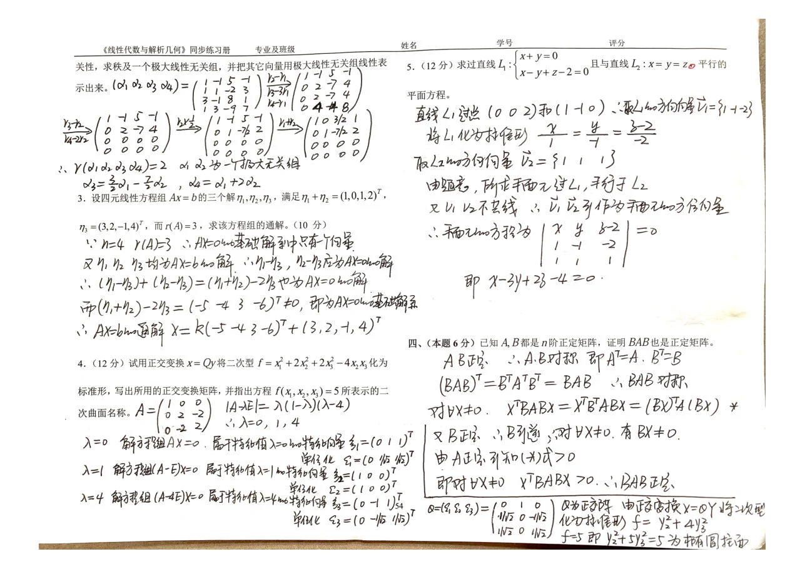

示出来。 $(\alpha_{1}\alpha_{2}\alpha_{3}\alpha_{4})=\begin{pmatrix}1&-1&5&-1\\1&1&-2&3\\3&-1&8&1\\1&3&-9&7\end{pmatrix}\xrightarrow{\substack{r_{2}-r_{1}\\r_{3}-3r_{1}\\r_{4}-r_{1}}}\begin{pmatrix}1&-1&5&-1\\0&2&-7&4\\0&2&-7&4\\0&4&-4&8\end{pmatrix}$

$\frac{{v}_{3} - {v}_{2}}{{v}_{4} - 2{v}_{2}}$ $\Rightarrow  \left( \begin{array}{rrrrr} 1 &  - 1 & 5 &  - 1 \\  0 & 2 &  - 7 & 4 \\  0 & 0 & 0 & 0 \\  0 & 0 & 0 & 0 \end{array}\right) \xrightarrow{{v}_{2} + \frac{1}{2}}\left( \begin{array}{rrr r} 1 &  - 1 & 5 &  - 1 \\  0 & 1 &  - {7/2} & 2 \\  0 & 0 & 0 & 0 \\  0 & 0 & 0 & 0 \end{array}\right) \xrightarrow{{v}_{1} + {v}_{2}}\left( \begin{array}{r} 1 \cdot  0 \cdot  {3/2} \cdot  1 \\  0 \cdot  1 \cdot   - {7/2} \cdot  2 \\  0 \cdot  0 \cdot  0 \cdot  0 \\  0 \cdot  0 \cdot  0 \end{array}\right)$

$$
\gamma (\alpha_ {1} \alpha_ {2} \alpha_ {3} \alpha_ {4}) = 2
$$

$$
\alpha_ {3} = \frac {3}{2} \alpha_ {1} - \frac {7}{2} \alpha_ {2}, \alpha_ {4} = \alpha_ {1} + 2 \alpha_ {2}
$$

$$
\eta_ {1}, \eta_ {2}, \eta_ {3}
$$

$$
\eta_ {1} + \eta_ {2} = (1, 0, 1, 2) ^ {T}
$$

$\eta_{3}=(3,2,-1,4)^{T}$ ，而 $r(A)=3$ ，求该方程组的通解。（10分） $\because n=4$ $r(A)=3$ ∴AX=0，基础解到中只有一个向量

又 $\eta_{1}\eta_{2}\eta_{3}$ 均为AX=b的解，∴ $\eta_{1}-\eta_{3}$ ， $\eta_{2}-\eta_{3}$ 应为AX=0，解 $\therefore(\eta_{1}-\eta_{3})+(\eta_{2}-\eta_{3})=(\eta_{1}+\eta_{2})-2\eta_{3}$ 也为AX=0，解

而 $(\eta_{1}+\eta_{2})-2\eta_{3}=(-5-4-3-6)^{T}\neq0$ ，即为AX=0，基础解 $\therefore$ AX=b的通解 $x=k(-5-4-3-6)^{T}+(3,2,-1,4)^{T}$

4.（12分）试用正交变换 $x = Qy$ 将二次型 $f = x_{1}^{2} + 2x_{2}^{2} + 2x_{3}^{2} - 4x_{2}x_{3}$ 化为标准形，写出所用的正交变换矩阵，并指出方程 $f(x_{1},x_{2},x_{3}) = 5$ 所表示的二次曲面名称。 $A = \begin{pmatrix} 1 & 0 & 0 \\ 0 & 2 & -2 \\ 0 & -2 & 2 \end{pmatrix}$ $|A - \lambda E| = \lambda (1 - \lambda)(\lambda - 4)$ $\therefore \lambda = 0, 1, 4$ $\lambda = 0$ 解方式组 $AX = 0$ ，属于特征值 $\lambda = 0$ 的特征向量 $\xi_{1} = (0,1)^{T}$ $\lambda = 1$ 解方式组 $(A - E)x = 0$ 属于特征值 $\lambda = 1$ 的特征向量 $\xi_{2} = (100)^{T}$ $\lambda = 4$ 解方式组 $(A - 4E)x = 0$ 属于特征值 $\lambda = 4$ 的特征向量 $\xi_{3} = (0 - 1)^{T}$ 单位化 $\xi_{2} = (100)^{T}$ 单位化 $\xi_{3} = (0 - 1)\sqrt{2}$

5.（12分）求过直线 $L_{1}:\left\{\begin{array}{l}x+y=0\\x-y+z-2=0\end{array}\right.$ 且与直线 $L_{2}:x=y=z$ 平行的平面方程。
直线 $\angle 1$ 过点 $(0,0,2)$ 和 $(1-1,0)$ 。∴取 $\angle 1$ 的方向向量 $\vec{v}_{1}=\{1-1-2\}$ 将 $L_{1}$ 化为标线形 $\frac{x}{1}=\frac{y}{7}=\frac{3-2}{-2}$ 取 $\angle 2$ 的方向向量 $\vec{v}_{2}=\{1,1,3\}$ 由题意，所求平面元过 $\angle 1$ ，平行于 $\angle 2$ 又 $v_{1},v_{2}$ 不共线 ∴ $\vec{v}_{1},\vec{v}_{2}$ 列作为平面元的方倍向量
∴平面元的方程为 $\left|\begin{array}{ccc}x & y & 8-2 \\1 & -1 & -2 \\1 & 1 & 1\end{array}\right|=0$ 即 $x-3y+23-4=0$

四、（本题6分）已知A,B都是n阶正定矩阵，证明BAB也是正定矩阵。
AB正弦. ∴A、B对称 即 $A^{T}=A$ 、 $B^{T}=B$ (BAB) $^{T}$ = $B^{T}A^{T}B^{T}$ = BAB ∴BAB对称
对 $\forall x\neq0$ 。 $x^{T}BABx$ = $x^{T}B^{T}ABx$ = (BX) $^{T}$ A(BX) \*
又B正弦. ∴B引道, 对 $\forall x\neq0$ 。有BX≠0.
由A正弦. 到知(\*)式>0
即对 $\forall x\neq0$ 。 $x^{T}BABx>0$ 。∴BAB正弦.

$Q=(\varepsilon_{1}\varepsilon_{2}\varepsilon_{3})=\begin{pmatrix}0&1&0\\1\sqrt{2}&0&-1\sqrt{2}\\1\sqrt{2}&0&1\sqrt{2}\end{pmatrix}$ Q为正交阵 由正交变换 $x=Qy$ 将二次型化为拉锥形 $f=y_{2}^{2}+4y_{3}^{2}$ f=5 即 $y_{2}^{2}+5y_{3}^{2}=5$ 为椭圆柱面

《线性代数与解析几何》同步练习册 专业及班级

姓名

学号 评分

## 第7页

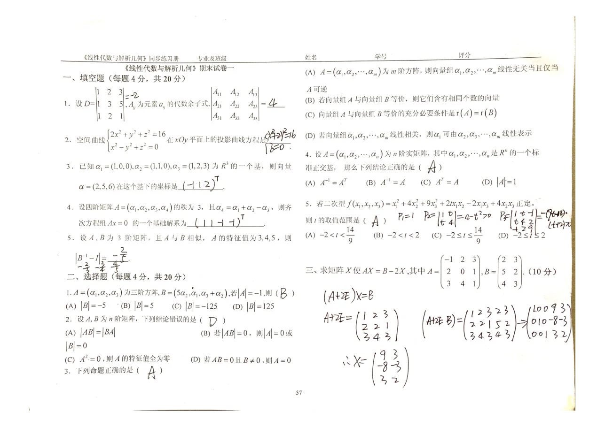

《线性代数与解析几何》期末试卷一

### 一、填空题（每题4分，共20分）

1. 设 $D = \begin{vmatrix} 1 & 2 & 3 \\ 1 & 3 & 5 \\ 1 & 2 & 1 \end{vmatrix} = -2$ , $A_{ij}$ 为元素 $a_{ij}$ 的代数余子式, $\left| \begin{array}{ccc} A_{11} & A_{12} & A_{13} \\ A_{21} & A_{22} & A_{23} \\ A_{31} & A_{32} & A_{33} \end{array} \right| = 4$

2. 空间曲线 $\left\{\begin{aligned}&2x^{2}+y^{2}+z^{2}=16\\ &x^{2}-y^{2}+z^{2}=0\end{aligned}\right.$ 在 xOy 平面上的投影曲线方程是 $\frac{(x^{2}+2y^{2}=16)}{8=0}$ .

3. 已知 $\alpha_{1} = (1,0,0), \alpha_{2} = (1,1,0), \alpha_{3} = (1,2,3)$ 为 $R^{3}$ 的一个基，则向量 $\alpha = (2,5,6)$ 在这个基下的坐标是 $(-112)^{\mathrm{T}}$ .

4. 设四阶矩阵 $A = (\alpha_{1}, \alpha_{2}, \alpha_{3}, \alpha_{4})$ 的秩为 3，且 $\alpha_{4} = \alpha_{1} + \alpha_{2} - \alpha_{3}$ ，则齐次方程组 $Ax = 0$ 的一个基础解系为 $(1, -1, -1)^{T}$ .

5. 设 A, B 为 3 阶矩阵，且 A 与 B 相似，A 的特征值为 3, 4, 5，则 $\left|B^{-1}-I\right|=\frac{-\frac{2}{5}}{-\frac{2}{3}-\frac{3}{4}\frac{4}{5}}.$

### 二、选择题（每题4分，共20分）

1. $A = (\alpha_{1},\alpha_{2},\alpha_{3})$ 为三阶方阵， $B = (5\alpha_{2},\dot{\alpha}_{1},\alpha_{3} + \alpha_{2})$ ，若 $\left|A\right| = -1$ ，则（B）(A) $|B| = -5$ (B) $|B| = 5$ (C) $|B| = -125$ (D) $|B| = 125$

2. 设 A, B 为 n 阶矩阵，下列结论错误的是（D）
(A) $\left|AB\right|=\left|BA\right|$ (B) 若 $\left|AB\right|=0$ ，则 $\left|A\right|=0$ 或 $\left|B\right|=0$ (C) $A^{2}=0$ ，则 A 的特征值全为零 (D) 若 AB=0 且 $B\neq0$ ，则 A=0
3. 下列命题正确的是（A）

(A) $A = \left( \alpha_{1}, \alpha_{2}, \cdots, \alpha_{m} \right)$ 为 m 阶方阵，则向量组 $\alpha_{1}, \alpha_{2}, \cdots, \alpha_{m}$ 线性无关当且仅当 A 可逆

(B) 若向量组 $A$ 与向量组 $B$ 等价，则它们含有相同个数的向量

(C) 向量组 $A$ 与向量组 $B$ 等价的充分必要条件是 $\mathbf{r}(A) = \mathbf{r}(B)$

(D) 若向量组 $\alpha_{1}, \alpha_{2}, \cdots, \alpha_{m}$ 线性相关，则 $\alpha_{1}$ 可由 $\alpha_{2}, \alpha_{3}, \cdots, \alpha_{m}$ 线性表示

4. 设 $A = (\alpha_{1}, \alpha_{2}, \cdots, \alpha_{n})$ 为 n 阶实矩阵，其中 $\alpha_{1}, \alpha_{2}, \cdots, \alpha_{n}$ 是 $R^{n}$ 的一个标准正交基，那么下列结论正确的是（A）

(A) $A^{-1} = A^{T}$ (B) $A^{-1} = A$ (C) $A^{T} = A$ (D) $|A| = 1$

5. 若二次型 $f(x_{1},x_{2},x_{3})=x_{1}^{2}+4x_{2}^{2}+9x_{3}^{2}+2tx_{1}x_{2}-2x_{1}x_{3}+4x_{2}x_{3}$ 正定，
则 t 的取值范围是（A） $P_{1}=1$ $P_{2}=\begin{vmatrix}1 & t \\ t & 4\end{vmatrix}=4-t^{2}>0$ $P_{3}=\begin{vmatrix}1 & t & -1 \\ t & 4 & 2 \\ t & 2 & 9\end{vmatrix}=-9(t-14)$ (A) $-2<t<\frac{14}{9}$ (B) -2<t<2 (C) $-2\leq t\leq\frac{14}{9}$ (D) $-2\leq t\leq2$

三、求矩阵 X 使 AX = B - 2X，其中 $A = \begin{pmatrix} -1 & 2 & 3 \\ 2 & 0 & 1 \\ 3 & 4 & 1 \end{pmatrix}$ ， $B = \begin{pmatrix} 2 & 3 \\ 5 & 2 \\ 4 & 3 \end{pmatrix}$ 。(10 分) $(A+2E)X=B$ $A+2E=\begin{pmatrix}1&2&3\\2&2&1\\3&4&3\end{pmatrix}$ $(A+2E-B)=\begin{pmatrix}1&2&3&2&3\\2&2&1&5&2\\3&4&3&4&3\end{pmatrix}\Rightarrow\begin{pmatrix}10093\\010-8-3\\00132\end{pmatrix}$ $\therefore x=\begin{pmatrix}9&3\\-8&-3\\3&2\end{pmatrix}$

《线性代数与解析几何》同步练习册 专业及班级

姓名

评分

学号

57

## 第8页

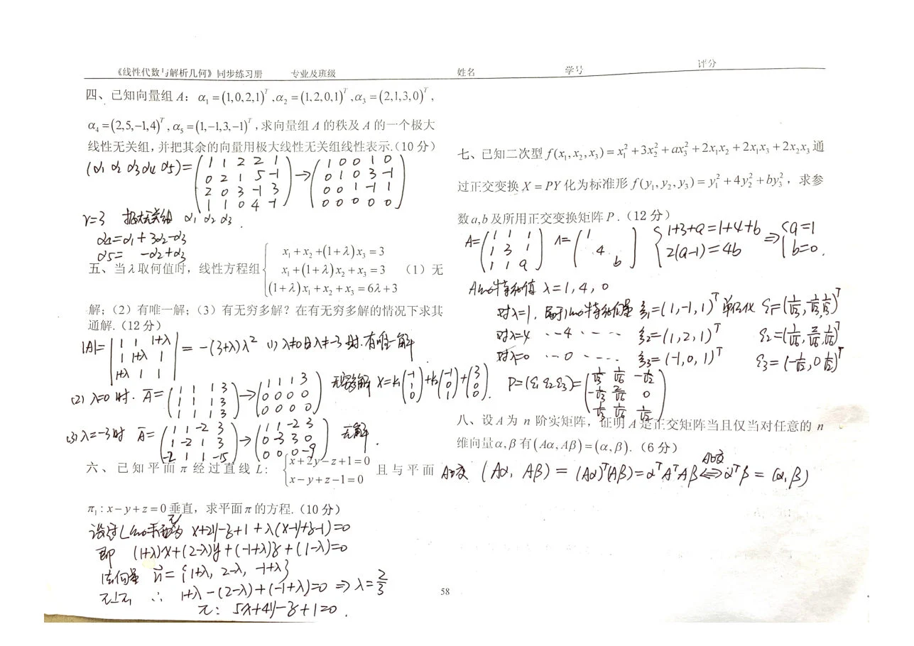

四、已知向量组 $A$ ： $\alpha_{1} = (1,0,2,1)^{T},\alpha_{2} = (1,2,0,1)^{T},\alpha_{3} = (2,1,3,0)^{T},$ $\alpha_4 = (2,5, - 1,4)^T,\alpha_5 = (1, - 1,3, - 1)^T$ ，求向量组 $A$ 的秩及 $A$ 的一个极大线性无关组，并把其余的向量用极大线性无关组线性表示.（10分）

$$
(d _ {1} d _ {2} d _ {3} d _ {4} d _ {5}) = \left(\begin{array}{c c c c c}1&1&2&2&1\\0&2&1&5&- 1\\2&0&3&- 1&3\\1&1&0&4&- 1\end{array}\right)\rightarrow \left(\begin{array}{c c c c c}1&0&0&1&0\\0&1&0&3&- 1\\0&0&1&- 1&1\\0&0&0&0&0\end{array}\right)
$$

$$
\alpha_ {1} \cdot \alpha_ {2}
$$

$\alpha_{1} = \alpha_{1} + 3\alpha_{2} - \alpha_{3}$ $\alpha_{5} = -\alpha_{2} + \alpha_{3}$ 五、当 $\lambda$ 取何值时，线性方程组 $\left\{ \begin{array}{l} x_{1} + x_{2} + (1 + \lambda)x_{3} = 3 \\ x_{1} + (1 + \lambda)x_{2} + x_{3} = 3 \\ (1 + \lambda)x_{1} + x_{2} + x_{3} = 6\lambda + 3 \end{array} \right.$ （1）无

解；（2）有唯一解；（3）有无穷多解？在有无穷多解的情况下求其通解。（12分）

$|A| = \begin{vmatrix} 1 & 1 & 1 + \lambda \\ 1 & 1 + \lambda & 1 \\ 1 + \lambda & 1 & 1 \end{vmatrix} = -(3 + \lambda) \lambda^{2}$ (1) $\lambda \neq 0$ 且 $\lambda \neq -3$ 封.有唯一解

(2) $\lambda=0$ 时. $\overline{A}=\begin{pmatrix}1 & 1 & 1 & 3 \\ 1 & 1 & 1 & 3 \\ 1 & 1 & 1 & 3\end{pmatrix}\rightarrow\begin{pmatrix}1 & 1 & 1 & 3 \\ 0 & 0 & 0 & 0 \\ 0 & 0 & 0 & 0\end{pmatrix}$ 无穷多解 $x=k_{1}\begin{pmatrix}-1\\1\\0\end{pmatrix}+k_{2}\begin{pmatrix}-1\\0\\1\end{pmatrix}+\begin{pmatrix}3\\0\\0\end{pmatrix}$

$$
(3) \lambda = - 3
$$

$$
\overline {{A}} = \left(\begin{array}{r r r r}1&1&- 2&3\\1&- 2&1&3\\- 2&1&1&- 1 5\end{array}\right)\rightarrow \left(\begin{array}{r r r r}1&1&- 2&3\\0&- 3&3&0\\0&0&0&- 9\end{array}\right)
$$

六、已知平面 $\pi$ 经过直线 L: $\left\{\begin{array}{l} x+2y-z+1=0 \\ x-y+z-1=0 \end{array}\right.$ 且与平面 $A\alpha$ $(A\alpha, A\beta)=(A\alpha)^{T}(A\beta)=\alpha^{T}A^{T}A\beta\Leftrightarrow\alpha^{T}\beta=(\alpha,\beta)$

$\pi_{1}: x - y + z = 0$ 垂直，求平面 $\pi$ 的方程。（10分）

设过 $L_{n}$ 的平面为 $x + 2y - z + 1 + \lambda (x - 1) + z - 1 = 0$ 即 $(1 + \lambda)x + (2 - \lambda)y + (-1 + \lambda)\gamma + (1 - \lambda) = 0$ 已知量 $\vec{n} = \{1 + \lambda, 2 - \lambda, -1 + \lambda\}$ 已上 $\pi_{1} \therefore 1 + \lambda - (2 - \lambda) + (-1 + \lambda) = 0 \Rightarrow \lambda = \frac{2}{3}$ $\pi: 5x + 4y - z + 1 = 0$ .

七、已知二次型 $f(x_{1},x_{2},x_{3}) = x_{1}^{2} + 3x_{2}^{2} + ax_{3}^{2} + 2x_{1}x_{2} + 2x_{1}x_{3} + 2x_{2}x_{3}$ 通过正交变换 $X = PY$ 化为标准形 $f(y_{1},y_{2},y_{3}) = y_{1}^{2} + 4y_{2}^{2} + by_{3}^{2}$ ，求参

$\text{A的特和值 } \lambda = 1,4,0$ 对 $\lambda=1$ ，属于 $\text{的特殊位置 } \exists_{1}=(1,-1,1)^{T}$ 单位化 $S=(\frac{1}{\sqrt{3}},\frac{1}{\sqrt{3}},\frac{1}{\sqrt{3}})^{T}$ 对 $\lambda=4$ ，--4，--， $\exists_{2}=(1,2,1)^{T}$ $S_{2}=(\frac{1}{\sqrt{6}},\frac{2}{\sqrt{6}},\frac{1}{\sqrt{6}})^{T}$ 对 $\lambda=0$ ，--0，--， $\exists_{3}=(-1,0,1)^{T}$ $S_{3}=(-\frac{1}{\sqrt{2}},0,\frac{1}{\sqrt{2}})^{T}$

$$
P = (S _ {1} S _ {2} S _ {3}) = \left( \begin{array}{c c c} \frac {1}{\sqrt {3}} & \frac {1}{\sqrt {6}} & - \frac {1}{\sqrt {2}} \\ - \frac {1}{\sqrt {3}} & \frac {2}{\sqrt {6}} & 0 \\ \frac {1}{\sqrt {3}} & \frac {1}{\sqrt {6}} & \frac {1}{\sqrt {2}} \end{array} \right)
$$

$$
(A \alpha , A \beta) = (\alpha , \beta)
$$

《线性代数与解析几何》同步练习册 专业及班级

姓名

学号

评分

## 第9页

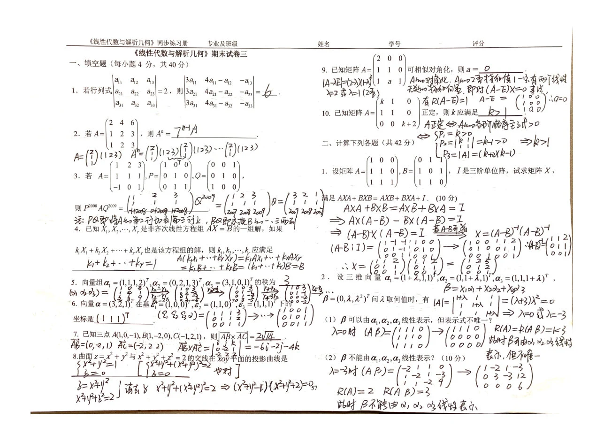

### 《线性代数与解析几何》期末试卷三

### 一、填空题（每小题4分，共40分）

1. 若行列式 $\begin{vmatrix}a_{11}&a_{12}&a_{13}\\a_{21}&a_{22}&a_{23}\\a_{31}&a_{32}&a_{33}\end{vmatrix}=2$ ，则 $\begin{vmatrix}3a_{11}&4a_{11}-a_{12}&-a_{13}\\3a_{21}&4a_{21}-a_{22}&-a_{23}\\3a_{31}&4a_{31}-a_{32}&-a_{33}\end{vmatrix}=6$ .

$$
A = \left( \begin{array}{c c c} 2 & 4 & 6 \\ 1 & 2 & 3 \\ 1 & 2 & 3 \end{array} \right)
$$

$$
A ^ {n} = 7 ^ {n - 1} A
$$

$$
A = \left( \begin{array}{l} 2 \\ 1 \end{array} \right) (1 2 3) A ^ {n} = \left( \begin{array}{l} 2 \\ 1 \end{array} \right) (1 2 3) \left( \begin{array}{l} 2 \\ 1 \end{array} \right) (1 2 3) \dots \left( \begin{array}{l} 2 \\ 1 \end{array} \right) (1 2 3)
$$

$$
A = \left( \begin{array}{c c c} 1 & 2 & 3 \\ 1 & 1 & 1 \\ - 1 & 0 & 1 \end{array} \right), P = \left( \begin{array}{c c c} 1 & 0 & 0 \\ 0 & 1 & 0 \\ 0 & 1 & 1 \end{array} \right), Q = \left( \begin{array}{c c c} 0 & 0 & 1 \\ 0 & 1 & 0 \\ 1 & 0 & 0 \end{array} \right),
$$

则 $P^{2008}AQ^{2009}=\begin{pmatrix}1&2&3\\1&1&1\\1+2008&0+2008&1+2008\end{pmatrix}Q^{2009}=\begin{pmatrix}1&2&3\\1&1&1\\2007&2008&2009\end{pmatrix}Q=\begin{pmatrix}3&2&1\\1&1&1\\2009&2008&2007\end{pmatrix}$ 注：PQ 即将 A 的第二行切到第三行上，BQ 即变换 B 的一、三两列

4. 已知 $X_{1}, X_{2}, \cdots, X_{r}$ 是非齐次线性方程组 AX=B 的一组解，如果 $k_{1}X_{1} + k_{2}X_{2} + \cdots + k_{r}X_{r}$ 也是该方程组的解，则 $k_{1}, k_{2}, \cdots, k_{r}$ 应满足 $k_{1} + k_{2} + \cdots + k_{r} = 1$ $A(k_{1}x_{1} + \cdots + k_{r}x_{r}) = k_{1}A x_{1} + \cdots + k_{r}A x_{r}$ $k_{1} + k_{2} + \cdots + k_{r} = 1$ $A(k_{1}x_{1} + \cdots + k_{r}x_{r}) = k_{1}A x_{1} + \cdots + k_{r}A x_{r}$ $k_{1} + k_{2} + \cdots + k_{r} = 1$

5. 向量组 $\alpha_{1}=(1,1,1,2)^{T},\alpha_{2}=(0,2,1,3)^{T},\alpha_{3}=(3,1,0,1)^{T}$ 的秩为 $\frac{3}{(x_{1},\alpha_{2},\alpha_{3})}=\left(\begin{array}{ccccc}1 & 0 & 3 \\ \frac{1}{2}&\frac{1}{3}&0 \\ \end{array}\right)\frac{r_{2}-r_{1}}{r_{2}-r_{1}}\left(\begin{array}{ccccc}1 & 0 & 3 \\ 0 & 2 & -3 \\ 0 & 3 & -3 \\ \end{array}\right)\xrightarrow{r_{2}\times2}\left(\begin{array}{ccccc}1 & 0 & 3 \\ 0 & 1 & -3 \\ 0 & 1 & -3 \\ 0 & 0 & 3 \\ \end{array}\right)\xrightarrow{r_{3}\times2}\left(\begin{array}{ccccc}1 & 0 & 3 \\ 0 & 1 & -1 \\ 0 & 0 & -2 \\ 0 & 0 & -2 \\ \end{array}\right)\xrightarrow{r_{4}\times2}.$ 6. 向量 $\alpha=(3,2,1)^{T}$ 在基 $\varepsilon_{1}=(1,0,0)^{T},\varepsilon_{2}=(1,1,0)^{T},\varepsilon_{3}=(1,1,1)^{T}$ 下的坐标是 $(1\quad1\quad1)^{T}$ . $(\varepsilon_{1},\varepsilon_{2},\varepsilon_{3},\alpha)=\left(\begin{array}{c:cc}1 & 1 & 1 & 3 \\ 0 & 1 & 1 & 2 \\ 0 & 0 & 1 & 1 \\ \end{array}\right)\rightarrow\cdots\rightarrow\left(\begin{array}{c:cc}1 & 0 & 0 \\ 0 & 1 & 0 \\ 0 & 0 & 1 \\ \end{array}\right)$ 7. 已知三点 A(1,0,-1), B(1,-2,0), C(-1,2,1)，则 $\left|\overrightarrow{AB}\times\overrightarrow{AC}\right|=\sqrt{2k}.$ $\overrightarrow{AB}=(0,-2,1)\overrightarrow{AC}=(-2,2,2)\overrightarrow{AB}\times\overrightarrow{AC}=\left|\begin{matrix}0&j&k\\ 0&-2&1\\ -2&2&z\end{matrix}\right|=-6i-2j-4k$ 8. 曲面 $z=x^{2}+y^{2}$ 与 $x^{2}+y^{2}+z^{2}=2$ 的交线在 xoy 平面的投影曲线是 $\left\{\begin{aligned}x^{2}+y^{2}&=1\\ z&=0\end{aligned}\right.\left[\begin{aligned}x^{2}+y^{2}+(x^{2}+y^{2})^{2}&=2\\ z&=0\end{aligned}\right.$ 对时 $\frac{3}{3}=x^{2}+y^{2}\left|\text{请去 }8x^{2}+y^{2}+(x^{2}+y^{2})^{2}=2\Rightarrow(x^{2}+y^{2}-1)(x^{2}+y^{2}+2)=0\right.$

9. 已知矩阵 $A=\begin{pmatrix}2&0&0\\1&1&0\\1&a&1\end{pmatrix}$ 可相似对角化，则 $a=\frac{0}{Am_{0}}$ 对角化。Am\_{0} 2 要特征值 1 一定有两个线性无关的特征向量，即对 $(A-E)X=0$ 两点，
10. 已知矩阵 $A=\begin{pmatrix}k&1&0\\1&1&0\\0&0(k+2)\end{pmatrix}$ 有 $R(A-E)=1$ $A-E=\begin{pmatrix}1&0&0\\1&0&0\\1&a&0\end{pmatrix}\therefore Q=0$ 正定，则 k 应满足 $\frac{k>1}{A}$ 正定 $\Leftrightarrow$ Am\_{0} 各阶顺序公式 >0
二、计算下列各题（共42分） $\Leftrightarrow SP_{1}=k>0$ $P_{2}=|k|=k-1>0$ $\Rightarrow k>1$ $P_{3}=|A|=(k+2)(k-1)$ 1. 设矩阵 $A=\begin{pmatrix}1&0&0\\1&1&0\\1&1&1\end{pmatrix}, B=\begin{pmatrix}0&1&1\\1&0&1\\1&1&0\end{pmatrix}$ ，I 是三阶单位阵，试求矩阵 X，

满足 $AXA + BXB = AXB + BXA + I$ .

(10 分) $AXA + BXB = AXB + BXA = I$ $\Rightarrow AX(A - B) - BX(A - B) = I$ $\Rightarrow (A - B) \times (A - B) = I$ 若 A - B 可逆 $X = (A - B)^{-1}(A - B)^{-1}$ $(A - B; I) = \begin{pmatrix} 1 & -1 & -1 & 1 & 0 & 0 \\ 0 & 1 & -1 & 0 & 1 & 0 \\ 0 & 0 & 1 & 0 & 0 & 1 \\ 0 & 0 & 1 & 0 & 0 & 1 \end{pmatrix} \rightarrow \begin{pmatrix} 1 & 0 & 0 & 1 & 1 & 2 \\ 0 & 1 & 0 & 0 & 1 & 1 \\ 0 & 0 & 1 & 0 & 0 & 1 \end{pmatrix} \therefore (A - B)^{-1} = \begin{pmatrix} 1 & 1 & 2 \\ 0 & 1 & 1 \\ 0 & 0 & 1 \end{pmatrix}$ $\therefore X = \begin{pmatrix} 1 & 1 & 2 \\ 0 & 1 & 1 \\ 0 & 0 & 1 \end{pmatrix} \begin{pmatrix} 1 & 1 & 2 \\ 0 & 1 & 1 \\ 0 & 0 & 1 \end{pmatrix} = \begin{pmatrix} 1 & 2 & 5 \\ 0 & 1 & 2 \\ 0 & 0 & 1 \end{pmatrix}$ 设三维向量 $\alpha_{1} = (1 + \lambda, 1, 1)^{T}, \alpha_{2} = (1, 1 + \lambda, 1)^{T}, \alpha_{3} = (1, 1, 1 + \lambda)^{T}$

$$
\beta = x _ {1} \alpha_ {1} + x _ {2} \alpha_ {2} + x _ {3} \alpha_ {3}
$$

$$
\boldsymbol {\beta} = (0, \lambda , \lambda^ {2}) ^ {T}
$$

$$
\vert A \vert = \left| \begin{array}{l l l} 1 + \lambda & 1 & 1 \\ 1 & 1 + \lambda & 1 \\ 1 & 1 & 1 + \lambda \end{array} \right| = (\lambda + 3) \lambda^ {2} = 0   \Rightarrow \lambda = 0 \text {   或   } \lambda = - 3
$$

$$
\alpha_ {1}, \alpha_ {2}, \alpha_ {3}
$$

$$
\lambda = 0
$$

$$
(A \beta) = \left(\begin{array}{c c c c}1&1&1&0\\1&1&1&0\\1&1&1&0\end{array}\right)\rightarrow \left(\begin{array}{c c c c}1&1&1&0\\0&0&0&0\\0&0&0&0\end{array}\right)
$$

(2) $\beta$ 不能由 $\alpha_{1}, \alpha_{2}, \alpha_{3}$ 线性表示？（10 分）
表示，但不唯一 $\lambda=-3$ 时 $(A\beta)=\begin{pmatrix}-2&1&1&0\\1&-2&1&-3\\1&1&-2&9\end{pmatrix}\rightarrow\begin{pmatrix}1&-2&1&-3\\0&3&-3&12\\0&0&0&6\end{pmatrix}$ $R(A)=2\quad R(A\beta)=3$ 此时 $\beta$ 不能由 $\alpha_{1}, \alpha_{2}, \alpha_{3}$ 线性表示

《线性代数与解析几何》同步练习册 专业及班级

姓名

评分

学号

## 第10页

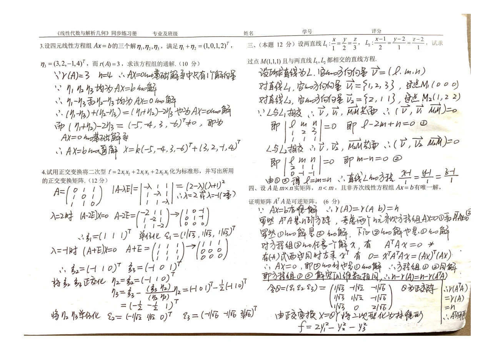

3. 设四元线性方程组 Ax = b 的三个解 $\eta_{1}, \eta_{2}, \eta_{3}$ ，满足 $\eta_{1} + \eta_{2} = (1, 0, 1, 2)^{T}$ ， $\eta_{3}=(3,2,-1,4)^{T}$ ，而 $r(A)=3$ ，求该方程组的通解。（10分）

∵ $r(A) = 3$ ， $n = 4$ ∴ $AX = 0$ ，基础解中只有1个解的量
∴ $n_1, n_2, n_3$ 均为 $AX = b$ 的解
∴ $n_1 - n_3$ 和 $n_2 - n_3$ 均为 $AX = 0$ 的解
∴ $(n_1 - n_3) + (n_2 - n_3) = (n_1 + n_2) - 2n_3$ 也为 $AX = 0$ 的解
而 $(n_1 + n_2) - 2n_3 = (-5, -4, 3, -6)^T \neq 0$ ，即为 $AX = 0$ 的基础解等
∴ $AX = b$ 的解， $x = k(-5, -4, 3, -6)^T + (3, 2, -1, 4)^T$

$$
f = 2 x _ {1} x _ {2} + 2 x _ {1} x _ {3} + 2 x _ {2} x _ {3}
$$

$$
A = \left( \begin{array}{l l l} 0 & 1 & 1 \\ 1 & 0 & 1 \\ 1 & 1 & 0 \end{array} \right)
$$

$$
\vert A - \lambda E \vert = \left| \begin{array}{c c c} - \lambda & 1 & 1 \\ 1 & - \lambda & 1 \\ 1 & 1 & - \lambda \end{array} \right| = (2 - \lambda) (\lambda + 1) ^ {2} \therefore \lambda = 2 \text {   或   } \lambda = - 1 (2 \text {   重   })
$$

$$
\lambda = 2 \mathrm{时} (A - 2 E) x = 0 A - 2 E = \left(\begin{array}{l l l}- 2&1&1\\1&- 2&1\\1&1&- 2\end{array}\right)\rightarrow \left(\begin{array}{l l l}1&0&- 1\\0&1&- 1\\0&0&0\end{array}\right)
$$

$$
\therefore \exists_ {1} = (1 1 1) ^ {T} \text { 单位化 } \varepsilon_ {1} = (1 / \sqrt {3}, 1 / \sqrt {3}, 1 / \sqrt {3}) ^ {T}
$$

$$
\lambda = - 1 \text {   时   } (A + E) x = 0 A + E = \left(\begin{array}{l l l}1&1&1\\1&1&1\\1&1&1\end{array}\right)\rightarrow \left(\begin{array}{l l l}1&1&1\\0&0&0\\0&0&0\end{array}\right)
$$

$$
\therefore \frac {3}{2} = (- 1 0) ^ {T} \frac {3}{3} = (- 0 1) ^ {T}
$$

$$
\begin{array}{r l} {\eta_ {2}} & {= \frac {3}{3 2} = (- 1 1 0) ^ {T}} \\ {\eta_ {3}} & {= \frac {3}{3 3} - \frac {(3 3 \eta_ {2})}{(\eta_ {2} \eta_ {2})} \eta_ {2} = (- 1 0 1) ^ {T} - \frac {1}{2} (- 1 1 0) ^ {T}} \\ & {= (- \frac {1}{2} - \frac {1}{2} 1) ^ {T}} \end{array}
$$

$$
\varepsilon_ {2} = (- 1 / \sqrt {2} - 1 / \sqrt {2} 0) ^ {T} \quad \varepsilon_ {3} = (- 1 / \sqrt {6} - 1 / \sqrt {6} \frac {2}{3} / \sqrt {6}) ^ {T}
$$

三、（本题 12 分）设两直线 $L_{1}:\frac{x}{1} = \frac{y}{2} = \frac{z}{3}, L_{2}:\frac{x - 1}{2} = \frac{y - 2}{1} = \frac{z - 2}{1}$ ，试求过点 $M(1,1,1)$ 且与两直线 $L_{1}, L_{2}$ 都相交的直线方程.

设所求直线为 $\angle 1$ . 官心的方向向量 $\overrightarrow{v} = (\ell, m, n)$ 对直线 $\angle 1$ , 官心的方向向量 $\overrightarrow{v_1} = \{1, 2, 3\}$ , 过点 $M_1(0,0,0)$ 对直线 $\angle 2$ , 官心的方向向量 $\overrightarrow{v_2} = \{2, 1, 1\}$ , 过点 $M_2(1,2,2)$ ∵ $\angle 1$ 与 $\angle 1$ 相交, ∴ $\overrightarrow{v}, \overrightarrow{v_1}, \overrightarrow{M_1M}$ 共轭, ∴ $(\overrightarrow{v}, \overrightarrow{v_1}, \overrightarrow{M_1M}) = 0$ 即 $\left| \begin{array}{cc} \ell & m \\ 1 & 2 \\ 1 & 1 \\ 1 & 1 \end{array} \right| = 0$ 即 $\ell - 2m + n = 0$ ① $\angle 1$ 与 $\angle 2$ 相交, ∴ $\overrightarrow{v}, \overrightarrow{v_2}$ , $\overrightarrow{M_2M}$ 共轭, ∴ $(\overrightarrow{v}, \overrightarrow{v_2}, \overrightarrow{M_2M}) = 0$ 即 $\left| \begin{array}{cc} \ell & m \\ 2 & 1 \\ 0 & -1 \\ 1 & -1 \\ 1 & -1 \\ 1 & -1 \\ 1 & -1 \\ 1 & -1 \\ 1 & -1 \\ 1 & -1 \\ 1 & -1 \\ 1 & -1 \\ 1 & -1 \\ 1 & -1 \\ 1 & -1 \\ 1 & -1 \\ 1 & -1 \\ 1 & -1 \\ 1 & -1 \\ 1 & -1 \end{array} \right| = 0$ 即 $m - n = 0$ ②

由①②得 $\ell = m = n$ ∴直线 $\angle h_0$ 的方程, $\frac{x-1}{1} = \frac{y-1}{1} = \frac{z-1}{1}$ 四、设 A 是 $m \times n$ 实矩阵, n < m, 且非齐次线性方程组 Ax = b 有唯一解,

证明矩阵 $A^T A$ 是可逆矩阵。（6分）

∵ $AX = b$ 在唯一解，∴ $Y(A) = Y(A, b) = h$ 显然 $A^T A$ 基 $n$ 所方程，考虑两个 $n$ 元齐次方程组 $AX = 0$ ①和 $A^T A X = 2$ 显然① $n$ 的解是②的解，下③④的解也是①的解

对方程组② $n$ 的任意一个解 $x$ ，有 $A^T A X = 0$ 在（x）式两边同时左来 $x^T$ 有 $0 = x^T A^T A X = (A x)^T (A x)$ ∴ $A x = 0$ ，即②的对也是①的一个解 ∴ 方程组① ②同解

即方程组① ② 解空例维数相同，∴ $n - r(A) = n - r(A^T A)$ 令 $Q = (8, 8_2, 8_3) = \begin{pmatrix} 1/\sqrt{3} & -1/\sqrt{2} & -1/\sqrt{6} \\ 1/\sqrt{3} & 1/\sqrt{2} & -1/\sqrt{6} \\ 1/\sqrt{3} & 0 & 2/\sqrt{6} \end{pmatrix} \quad Q$ 为正交阵 $\therefore V(A^T A) = Y(A) = n$ 由正交变换 $x = 0$ 将二次型化为特殊项 $f = 2y_1^2 - y_2^2 - y_3^2$

《线性代数与解析几何》同步练习册 专业及班级

姓名

评分

学号

## 第11页

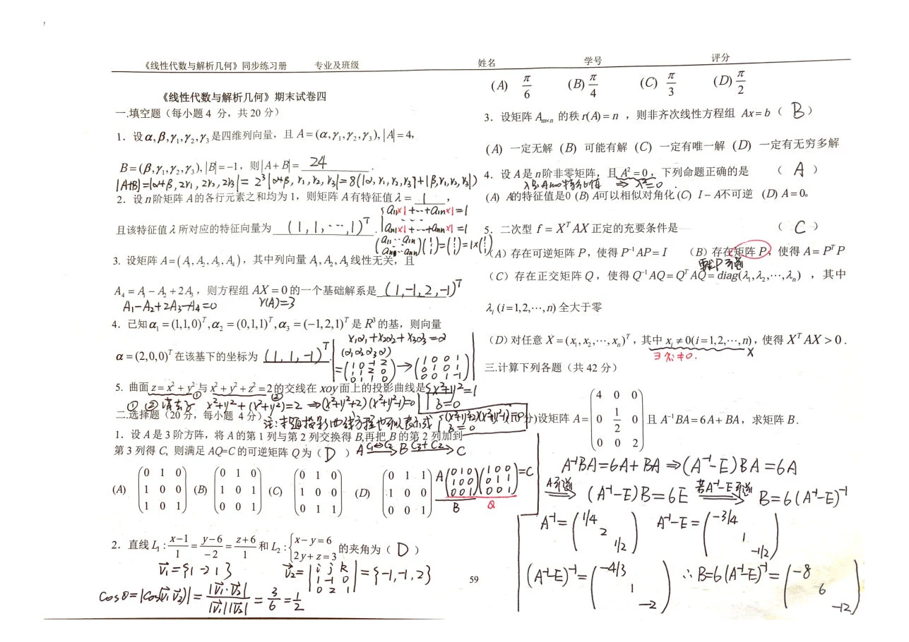

### 《线性代数与解析几何》期末试卷四

### 一.填空题（每小题4分，共20分）

1. 设 $\alpha, \beta, \gamma_{1}, \gamma_{2}, \gamma_{3}$ 是四维列向量，且 $A = (\alpha, \gamma_{1}, \gamma_{2}, \gamma_{3})$ ， $|A| = 4$ ， $B = (\beta, \gamma_{1}, \gamma_{2}, \gamma_{3})$ ， $|B| = -1$ ，则 $|A + B| = \frac{24}{24}$ $|A + B| = |\alpha + \beta, 2r_{1}, 2r_{2}, 2r_{3}| = 2^{3}|\alpha + \beta, r_{1}, r_{2}, r_{3}| = 8(|\alpha, r_{1}, r_{2}, r_{3}| + |\beta, r_{1}, r_{2}, r_{3}|)$

2. 设 $n$ 阶矩阵 $A$ 的各行元素之和均为 1, 则矩阵 $A$ 有特征值 $\lambda = \underline{1}$ , 且该特征值 $\lambda$ 所对应的特征向量为 $(1, 1, \cdots, 1)^T$ . $\left\{ \begin{array}{l} a_{11} \times 1 + \cdots + a_{1n} \times 1 = 1 \\ a_{n1} \times 1 + \cdots + a_{nn} \times 1 = 1 \\ (a_{11} \cdots a_{1n}) (1) = (1) = 1 \times (1) \\ a_{n0} \cdots a_{nn} \end{array} \right.$

3. 设矩阵 $A=(A_{1},A_{2},A_{3},A_{4})$ ，其中列向量 $A_{1},A_{2},A_{3}$ 线性无关，且 $A_{4}=A_{1}-A_{2}+2A_{3}$ ，则方程组 AX=0 的一个基础解系是 $(1,-1,2,-1)^{T}$ $A_{1}-A_{2}+2A_{3}-A_{4}=0$ $Y(A)=3$

4. 已知  \( \alpha\_{1}=(1,1,0)^{T},\alpha\_{2}=(0,1,1)^{T},\alpha\_{3}=(-1,2,1)^{T} \)  是  \( R^{3} \)  的基，则向量

 \( \alpha=(2,0,0)^{T} \)  在该基下的坐标为  \( \left(\begin{array}{cc}1,&1,-1\end{array}\right)^{T}\cdot\left|\begin{array}{c}x\_{1}\alpha\_{1}+x\_{2}\alpha\_{2}+x\_{3}\alpha\_{3}=\alpha\\(\alpha\_{1}\alpha\_{2}\alpha\_{3}\alpha\_{7})\\=(\begin{matrix}1&0&-1&2\\1&1&2&0\\0&1&1&0\end{matrix})\rightarrow(\begin{matrix}1&0&0&1\\0&1&0&1\\0&0&1&-1\end{matrix})\end{matrix}\right| \)

5. 曲面 $z = x^{2} + y^{2}$ 与 $x^{2} + y^{2} + z^{2} = 2$ 的交线在 $xoy$ 面上的投影曲线是 $\left\{ \begin{array}{l} x^{2} + y^{2} = 1 \\ x^{2} + y^{2} + (x^{2} + y^{2}) = 0 \end{array} \right.$ 二. 选择题（20分，每小题4分）

注：本题投影曲线方程也可以表示成 $\left\{ \begin{array}{l} (x^{2}+1)^{2} + 2 \\ x=0 \end{array} \right.$

$$
\xrightarrow {C _ {1} \leftrightarrow C _ {2}} B \xrightarrow {C _ {3} + C _ {2}} C
$$

$$
\left( \begin{array}{c c c} 0 & 1 & 0 \\ 1 & 0 & 0 \\ 1 & 0 & 1 \end{array} \right)
$$

$$
\left( \begin{array}{c c c} 0 & 1 & 0 \\ 1 & 0 & 1 \\ 0 & 0 & 1 \end{array} \right)
$$

$$
\left( \begin{array}{c c c} 0 & 1 & 0 \\ 1 & 0 & 0 \\ 0 & 1 & 1 \end{array} \right)
$$

$$
\left( \begin{array}{l l l} 0 & 1 & 1 \\ . 1 & 0 & 0 \\ 0 & 0 & 1 \end{array} \right) \frac {A \left( \begin{array}{l l l} 0 & 1 & 0 \\ 1 & 0 & 0 \\ 0 & 0 & 1 \end{array} \right) \left( \begin{array}{l l l} 1 & 0 & 0 \\ 0 & 1 & 1 \\ 0 & 0 & 1 \end{array} \right)}{B}
$$

2. 直线 $L_{1}:\frac{x-1}{1}=\frac{y-6}{-2}=\frac{z+6}{1}$ 和 $L_{2}:\left\{\begin{array}{l}x-y=6\\2y+z=3\end{array}\right.$ 的夹角为（D） $\overrightarrow{v}_{1}=\{1-2,3\}$ $\overrightarrow{v}_{2}=\left|\begin{array}{ccc}i & j & k \\ 1 & -1 & 0 \\ 0 & 2 & 1\end{array}\right|=\{-1,-1,2\}$ $\cos\theta=|\cos(\overrightarrow{v_{1}}\cdot\overrightarrow{v_{2}})|=\frac{|\overrightarrow{v_{1}}\cdot\overrightarrow{v_{2}}|}{|\overrightarrow{v_{1}}||\overrightarrow{v_{2}}|}=\frac{3}{6}=\frac{1}{2}$

姓名 学号 评分
(A) $\frac{\pi}{6}$ (B) $\frac{\pi}{4}$ (C) $\frac{\pi}{3}$ (D) $\frac{\pi}{2}$

3. 设矩阵 $A_{m \times n}$ 的秩 $r(A) = n$ ，则非齐次线性方程组 $Ax = b$ （B）

4. 设 A 是 n 阶非零矩阵，且 $A^{2}=0$ ，下列命题正确的是（A） $\lambda_{3}A_{n}$ 特有比值 $\Rightarrow \lambda^{2}=0$

$$
f = X ^ {T}
$$

$$
P ^ {- 1} A P = I
$$

$$
A = P ^ {T} P
$$

（C）存在正交矩阵 Q，使得 $Q^{-1}AQ = Q^{T}AQ = diag(\lambda_{1}, \lambda_{2}, \cdots, \lambda_{n})$ ，其中 $\lambda_{i} (i = 1, 2, \cdots, n)$ 全大于零

(D) 对任意 $X = (x_{1}, x_{2}, \cdots, x_{n})^{T}$ ，其中 $x_{i} \neq 0 (i = 1, 2, \cdots, n)$ ，使得 $X^{T}AX > 0$ .
三.计算下列各题（共42分）

$$
A = \left( \begin{array}{c c c} 4 & 0 & 0 \\ 0 & \frac {1}{2} & 0 \\ 0 & 0 & 2 \end{array} \right)
$$

$$
A ^ {- 1} B A = 6 A + B A
$$

$$
A ^ {- 1} B A = 6 A + B A \Rightarrow (A ^ {- 1} - E) B A = 6 A
$$

$$
(A ^ {- 1} - E) B = 6 E \xrightarrow {\text {   若   } A ^ {- 1} - E \text {   引逆   }} B = 6 (A ^ {- 1} - E) ^ {- 1}
$$

$$
A ^ {- 1} = \left( \begin{array}{l l l} 1 / 4 & & \\ & 2 & \\ & & 1 / 2 \end{array} \right) A ^ {- 1} - E = \left( \begin{array}{l l l} - 3 / 4 & & \\ & 1 & \\ & & - 1 / 2 \end{array} \right)
$$

$$
(A ^ {- 1} - E) ^ {- 1} = \left( \begin{array}{c c} - 4 / 3 & \\ & 1 \\ & - 2 \end{array} \right) \quad \therefore B = 6 (A ^ {- 1} - E) ^ {- 1} = \left( \begin{array}{c c} - 8 & \\ & 6 \\ & - 1 2 \end{array} \right)
$$

《线性代数与解析几何》同步练习册 专业及班级

## 第12页

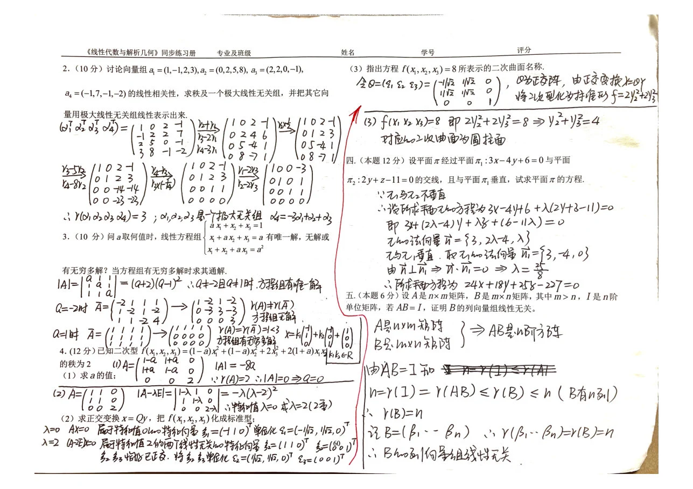

2. (10 分) 讨论向量组 $a_{1} = (1, -1, 2, 3), a_{2} = (0, 2, 5, 8), a_{3} = (2, 2, 0, -1)$ , $a_{4} = (-1, 7, -1, -2)$ 的线性相关性, 求秩及一个极大线性无关组, 并把其它向量用极大线性无关组线性表示出来.

$$
(\alpha_ {1} ^ {T} \alpha_ {2} ^ {T} \alpha_ {3} ^ {T} \alpha_ {4} ^ {T}) = \left( \begin{array}{r r r r} 1 & 0 & 2 & - 1 \\ - 1 & 2 & 2 & 7 \\ 2 & 5 & 0 & - 1 \\ 3 & 8 & - 1 & - 2 \end{array} \right) \xrightarrow [ \gamma_ {3} - 2 \gamma_ {1} ]{\gamma_ {2} + \gamma_ {1}} \left( \begin{array}{r r r r} 1 & 0 & 2 & - 1 \\ 0 & 2 & 4 & 6 \\ 0 & 5 & - 4 & 1 \\ 0 & 8 & - 7 & 1 \end{array} \right) \xrightarrow {\gamma_ {2} \times \frac {1}{2}} \left( \begin{array}{r r r r} 1 & 0 & 2 & - 1 \\ 0 & 1 & 2 & 3 \\ 0 & 5 & - 4 & 1 \\ 0 & 8 & - 7 & 1 \end{array} \right)
$$

$\frac{v_{3}-5v_{2}}{v_{4}-8v_{2}}\left(\begin{matrix}1 & 0 & 2 & -1 \\ 0 & 1 & 2 & 3 \\ 0 & 0 & -14 & -14 \\ 0 & 0 & -23 & -23\end{matrix}\right)\xrightarrow{v_{4}-v_{3}}\left(\begin{matrix}1 & 0 & 2 & -1 \\ 0 & 1 & 2 & 3 \\ 0 & 0 & 1 & 1 \\ 0 & 0 & 0 & 0\end{matrix}\right)\xrightarrow{v_{1}-2v_{3}}\left(\begin{matrix}1 & 0 & 0 & -3 \\ 0 & 1 & 0 & 1 \\ 0 & 0 & 1 & 1 \\ 0 & 0 & 0 & 0\end{matrix}\right)$

$\therefore r(\alpha_{1},\alpha_{2},\alpha_{3},\alpha_{4})=3$ ; $\alpha_{1},\alpha_{2},\alpha_{3}$ 是一个极大无关组 $\alpha_{4}=-3\alpha_{1}+\alpha_{2}+\alpha_{3}$ 3.（10分）问 a 取何值时，线性方程组 $\left\{\begin{aligned}&a x_{1}+x_{2}+x_{3}=1\\&x_{1}+ax_{2}+x_{3}=a\\&x_{1}+x_{2}+ax_{3}=a^{2}\end{aligned}\right.$ 有唯一解，无解或

有无穷多解？当方程组有无穷多解时求其通解.

$|A| = \begin{vmatrix} a & 1 & 1 \\ 1 & a & 1 \\ 1 & 1 & a \end{vmatrix} = (a+2)(a-1)^2$ ∴ $a \neq -2$ 且 $a \neq 1$ 时. 方程组有唯一解 $a = -2$ 时 $\overline{A} = \begin{pmatrix} -2 & 1 & 1 & 1 \\ 1 & -2 & 1 & -2 \\ 1 & 1 & -2 & 4 \end{pmatrix} \rightarrow \begin{pmatrix} 1 & -2 & 1 & -2 \\ 0 & -3 & 3 & -3 \\ 0 & 0 & 0 & 3 \end{pmatrix}$ $r(A) \neq r(\overline{A})$ 方程组无解.

$$
\overline {{A}} = \left(\begin{array}{l l l l}1&1&1&1\\1&1&1&1\\1&1&1&1\end{array}\right)\rightarrow \left(\begin{array}{l l l l}1&1&1&1\\0&0&0&0\\0&0&0&0\end{array}\right) \quad \text {   约组有无穷多解   } x = k _ {1} \left(\begin{array}{l}- 1\\1\\0\end{array}\right) + k _ {2} \left(\begin{array}{l}- 1\\0\\1\end{array}\right) + \left(\begin{array}{l}1\\0\\0\end{array}\right)
$$

$$
\text {已知二次型} f (x _ {1}, x _ {2}, x _ {3}) = (1 - a) x _ {1} ^ {2} + (1 - a) x _ {2} ^ {2} + 2 x _ {3} ^ {2} + 2 (1 + a) x _ {1} x _ {k _ {1} k _ {2}} \in R
$$

的秩为2 (1) $A = \left( \begin{array}{lll}1 - a & 1 + a & 0\\ 1 + a & 1 - a & 0\\ 0 & 0 & 2 \end{array} \right)$ $|A| = -8a$ （1）求 $a$ 的值； $\because r(A) = 2\therefore |A| = 0\Rightarrow q = 0$

(2) $A = \begin{pmatrix} 1 & 1 & 0 \\ 1 & 1 & 0 \\ 0 & 0 & 2 \end{pmatrix} \quad |A - \lambda E| = \begin{vmatrix} 1 - \lambda & 1 & 0 \\ 1 & 1 - \lambda & 0 \\ 0 & 0 & 2 - \lambda \end{vmatrix} = -\lambda (\lambda - 2)^{2}$ ∴ 特征值 $\lambda = 0$ 或 $\lambda = 2$ (2垂)

(2) 求正交变换 $x = Qy$ , 把 $f(x_1, x_2, x_3)$ 化成标准型; $\lambda = 0$ $AX = 0$ 属于特征值 $0$ 单元特征向量 $\xi_1 = (-110)^T$ 单位化 $\varepsilon_1 = (-1\sqrt{2}, 1\sqrt{2}, 0)^T$ $\lambda = 2$ (A-2E) $x = 0$ 属于特征值 2 的两个线性无关的特征向量 $\xi_2 = (110)^T$ $\xi_2 = (600)^T$ $\xi_2$ 奇为已正交. 将 $\xi_2$ 奇单位化 $\varepsilon_2 = (\sqrt{2}, \sqrt{2}, 0)^T$ $\varepsilon_3 = (001)^T$ (3) 指出方程 $f(x_1, x_2, x_3) = 8$ 所表示的二次曲面名称.

令 $Q = (x_1, x_2, x_3) = \begin{pmatrix} -1/\sqrt{2} & 1/\sqrt{2} & 0 \\ 1/\sqrt{2} & 1/\sqrt{2} & 0 \\ 0 & 0 & 1 \end{pmatrix}$ ， $Q$ 为正交阵，由正交变换 $x_1 = 0$ 时将二次型化为标准项 $f = 2y_2^2 + 2y_3^2$

(3) $f(x_{1}, x_{2}, x_{3}) = 8$ 即 $2y_{2}^{2} + 2y_{3}^{2} = 8 \Rightarrow y_{2}^{2} + y_{3}^{2} = 4$ 对应的二次曲面为圆挂面

四.（本题12分）设平面 $\pi$ 经过平面 $\pi_{1}: 3x - 4y + 6 = 0$ 与平面

$\pi_{2}: 2y + z - 11 = 0$ 的交线，且与平面 $\pi_{1}$ 垂直，试求平面 $\pi$ 的方程.

∵ $\pi$ 与 $\pi_{2}$ 不垂直

∴设所求两元的方程为 $3x-4y+6+\lambda(2y+3-11)=0$ 即 $3x+(2\lambda-4)y+\lambda y+(6-11\lambda)=0$ 元的法向量 $\vec{n}=\{3,2\lambda-4,\lambda\}$ 元与元垂直.取元的法向量 $\vec{n}_{1}=\{3,-4,0\}$ 由 $\vec{n}\perp\vec{n}_{1}\Rightarrow\vec{n}\cdot\vec{n}_{1}=0\Rightarrow\lambda=\frac{25}{8}$ ∴所求两和方程为 $24x+18y+25y-227=0$

五.（本题6分）设 $A$ 是 $n \times m$ 矩阵， $B$ 是 $m \times n$ 矩阵，其中 $m > n$ ， $I$ 是 $n$ 阶单位矩阵，若 $AB = I$ ，证明 $B$ 的列向量组线性无关。

A是n×m矩阵
B是m×n矩阵 }⇒AB是nB平方阵

由AB=1和 $n=r(1)\leq r$ (AI

$$
n = \gamma (I) = \gamma (A B) \leq \gamma (B) \leq n (B \mathrm{有} n \mathrm{到})
$$

$$
\therefore r (B) = n
$$

$$
\mathrm{记} B = (\beta_ {1} \dots \beta_ {n}) \quad \therefore \gamma (\beta_ {1} \dots \beta_ {n}) = \gamma (B) = n
$$

∴B的到向等组线性无关

《线性代数与解析几何》同步练习册 专业及班级

姓名

评分

学号
