# 《线性代数与解析几何》期末复习题选编

按原件顺序阅读，文字可对照页图。

## 第1页

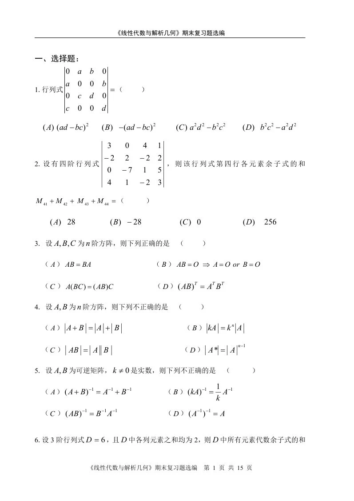

### 一、选择题：

1. 行列式 $\begin{vmatrix}0 & a & b & 0 \\ a & 0 & 0 & b \\ 0 & c & d & 0 \\ c & 0 & 0 & d\end{vmatrix}=$ ( )
(A) $(ad-bc)^{2}$ (B) $-(ad-bc)^{2}$ (C) $a^{2}d^{2}-b^{2}c^{2}$ (D) $b^{2}c^{2}-a^{2}d^{2}$

2. 设有四阶行列式 $\begin{vmatrix}3&0&4&1\\-2&2&-2&2\\0&-7&1&5\\4&1&-2&3\end{vmatrix}$ ，则该行列式第四行各元素余子式的和 $M_{41} + M_{42} + M_{43} + M_{44} = (\quad)$ (A) 28 (B) -28 (C) 0 (D) 256

3. 设 $A, B, C$ 为 $n$ 阶方阵，则下列正确的是 （ ）  
（A） $AB = BA$ （B） $AB = O \Rightarrow A = O$ or $B = O$ （C） $A(BC) = (AB)C$ （D） $(AB)^T = A^T B^T$

4. 设 A, B 为 n 阶方阵，则下列不正确的是 （）
（A） $\left|A+B\right|=\left|A\right|+\left|B\right|$ （B） $\left|kA\right|=k^{n}\left|A\right|$ （C） $\left|AB\right|=\left|A\right\|B$ （D） $\left|A^{*}\right|=\left|A\right|^{n-1}$

5. 设 $A, B$ 为可逆矩阵， $k \neq 0$ 是实数，则下列不正确的是（）
（A） $(A + B)^{-1} = A^{-1} + B^{-1}$ （B） $(kA)^{-1} = \frac{1}{k} A^{-1}$ （C） $(AB)^{-1} = B^{-1}A^{-1}$ （D） $(A^{-1})^{-1} = A$

6. 设 3 阶行列式 D = 6，且 D 中各列元素之和均为 2，则 D 中所有元素代数余子式的和$\sum_{j=1}^{3}\sum_{i=1}^{3}A_{ij} = (\quad)$ (A) 3 (B) 6 (C) 9 (D) 12

《线性代数与解析几何》期末复习题选编

《线性代数与解析几何》期末复习题选编

第1页共15页

## 第2页

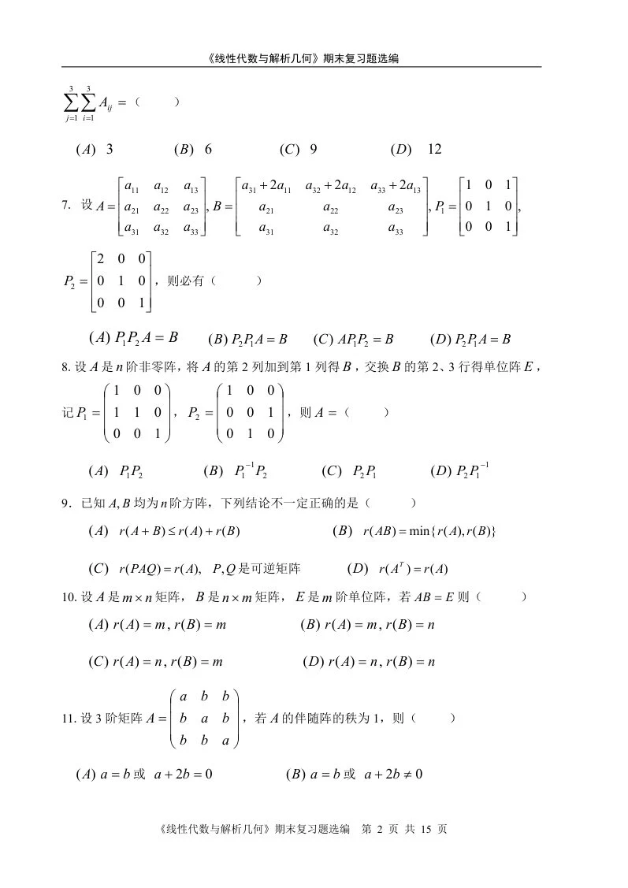

7. 设 $A=\begin{bmatrix}a_{11}&a_{12}&a_{13}\\ a_{21}&a_{22}&a_{23}\\ a_{31}&a_{32}&a_{33}\end{bmatrix}, B=\begin{bmatrix}a_{31}+2a_{11}&a_{32}+2a_{12}&a_{33}+2a_{13}\\ a_{21}&a_{22}&a_{23}\\ a_{31}&a_{32}&a_{33}\end{bmatrix}, P_{1}=\begin{bmatrix}1&0&1\\ 0&1&0\\ 0&0&1\end{bmatrix},$ $P_{2}=\begin{bmatrix}2&0&0\\ 0&1&0\\ 0&0&1\end{bmatrix}$ ，则必有（）

8. 设 A 是 n 阶非零阵，将 A 的第 2 列加到第 1 列得 B，交换 B 的第 2、3 行得单位阵 E，
记 $P_{1}=\begin{pmatrix}1&0&0\\1&1&0\\0&0&1\end{pmatrix}$ ， $P_{2}=\begin{pmatrix}1&0&0\\0&0&1\\0&1&0\end{pmatrix}$ ，则 $A=(\quad)$ (A) $P_{1}P_{2}$ (B) $P_{1}^{-1}P_{2}$ (C) $P_{2}P_{1}$ (D) $P_{2}P_{1}^{-1}$

9. 已知 $A, B$ 均为 $n$ 阶方阵，下列结论不一定正确的是（ ） $\begin{array}{l} (A) r(A + B) \leq r(A) + r(B) \\ (C) r(PAQ) = r(A), P, Q \text{是可逆矩阵} \end{array}$ $\begin{array}{l} (B) r(AB) = \min \{r(A), r(B)\} \\ (D) r(A^T) = r(A) \end{array}$

10. 设 A 是 $m \times n$ 矩阵，B 是 $n \times m$ 矩阵，E 是 m 阶单位阵，若 AB = E 则（）
(A) $r(A) = m, r(B) = m$ (B) $r(A) = m, r(B) = n$ (C) $r(A)=n, r(B)=m$ (D) $r(A)=n, r(B)=n$

11. 设 3 阶矩阵 $A = \begin{pmatrix} a & b & b \\ b & a & b \\ b & b & a \end{pmatrix}$ ，若 $A$ 的伴随阵的秩为 1，则（） $(A)a = b$ 或 $a + 2b = 0$ (B) $a = b$ 或 $a + 2b \neq 0$

《线性代数与解析几何》期末复习题选编

《线性代数与解析几何》期末复习题选编

第2页共15页

## 第3页

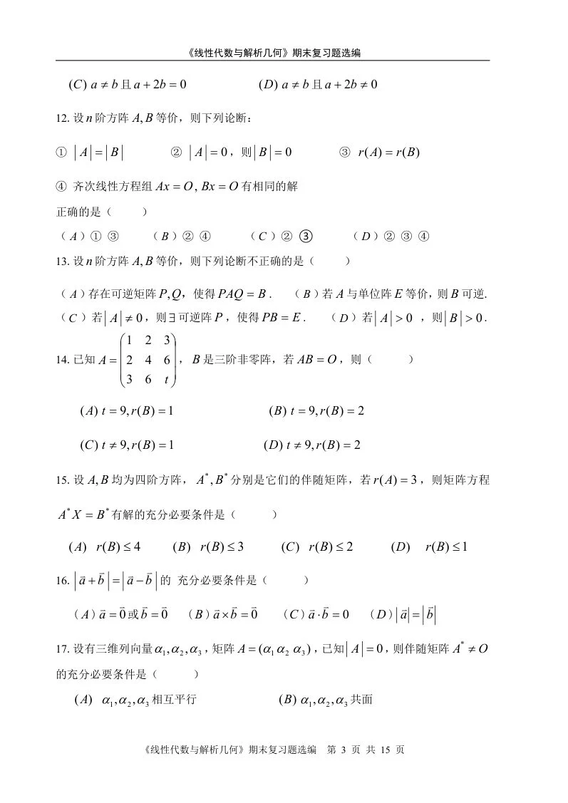

(C) $a \neq b$ 且 $a + 2b = 0$ (D) $a \neq b$ 且 $a + 2b \neq 0$

12. 设 $n$ 阶方阵 $A, B$ 等价，则下列论断： $① |A| = |B|$ $② |A| = 0$ ，则 $|B| = 0$ $③ r(A) = r(B)$

④ 齐次线性方程组 Ax = O, Bx = O 有相同的解
正确的是（）
(A) ① ③ (B) ② ④ (C) ② ③ (D) ② ③ ④

13. 设 $n$ 阶方阵 $A, B$ 等价，则下列论断不正确的是（ ）（ $A$ ）存在可逆矩阵 $P, Q$ ，使得 $PAQ = B$ 。（ $B$ ）若 $A$ 与单位阵 $E$ 等价，则 $B$ 可逆。（ $C$ ）若 $\left| A \right| \neq 0$ ，则 $\exists$ 可逆阵 $P$ ，使得 $PB = E$ 。（ $D$ ）若 $\left| A \right| > 0$ ，则 $\left| B \right| > 0$ 。14. 已知 $A = \begin{pmatrix} 1 & 2 & 3 \\ 2 & 4 & 6 \\ 3 & 6 & t \end{pmatrix}$ ， $B$ 是三阶非零阵，若 $AB = O$ ，则（ ） $(A) t = 9, r(B) = 1$ （ $B) t = 9, r(B) = 2$ （ $C) t \neq 9, r(B) = 1$ （ $D) t \neq 9, r(B) = 2$

15. 设 A, B 均为四阶方阵， $A^{*}, B^{*}$ 分别是它们的伴随矩阵，若 $r(A) = 3$ ，则矩阵方程 $A^{*}X = B^{*}$ 有解的充分必要条件是（）
(A) $r(B) \leq 4$ (B) $r(B) \leq 3$ (C) $r(B) \leq 2$ (D) $r(B) \leq 1$

16. $\left|\vec{a}+\vec{b}\right|=\left|\vec{a}-\vec{b}\right|$ 的充分必要条件是（）
(A) $\vec{a}=\vec{0}$ 或 $\vec{b}=\vec{0}$ (B) $\vec{a}\times\vec{b}=\vec{0}$ (C) $\vec{a}\cdot\vec{b}=0$ (D) $\left|\vec{a}\right|=\left|\vec{b}\right|$

17. 设有三维列向量 $\alpha_{1}, \alpha_{2}, \alpha_{3}$ ，矩阵 $A = (\alpha_{1} \alpha_{2} \alpha_{3})$ ，已知 $|A| = 0$ ，则伴随矩阵 $A^{*} \neq O$ 的充分必要条件是（）(A) $\alpha_{1}, \alpha_{2}, \alpha_{3}$ 相互平行 (B) $\alpha_{1}, \alpha_{2}, \alpha_{3}$ 共面

《线性代数与解析几何》期末复习题选编

第3页共15页

《线性代数与解析几何》期末复习题选编

## 第4页

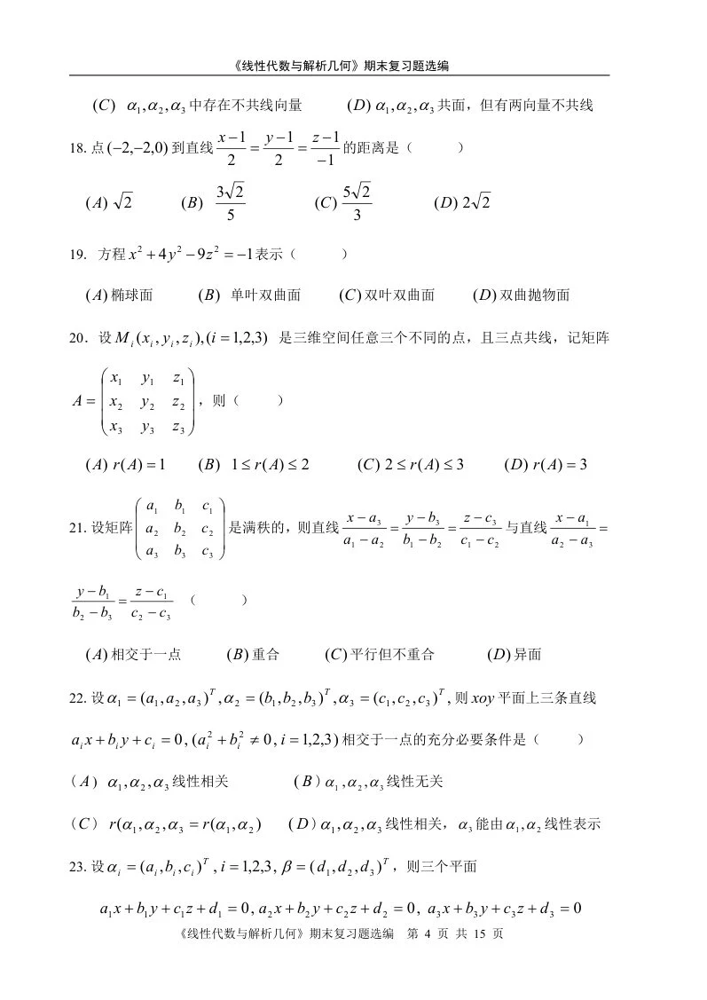

(C) $\alpha_{1},\alpha_{2},\alpha_{3}$ 中存在不共线向量 (D) $\alpha_{1},\alpha_{2},\alpha_{3}$ 共面，但有两向量不共线 18. 点 $(-2, -2,0)$ 到直线 $\frac{x - 1}{2} = \frac{y - 1}{2} = \frac{z - 1}{-1}$ 的距离是（） (A) $\sqrt{2}$ (B) $\frac{3\sqrt{2}}{5}$ (C) $\frac{5\sqrt{2}}{3}$ (D) $2\sqrt{2}$

19. 方程 $x^{2} + 4y^{2} - 9z^{2} = -1$ 表示（ ）(A)椭球面 (B)单叶双曲面 (C)双叶双曲面 (D)双曲抛物面

20. 设 $M_{i}(x_{i},y_{i},z_{i}), (i = 1,2,3)$ 是三维空间任意三个不同的点，且三点共线，记矩阵 $A = \begin{pmatrix} x_1 & y_1 & z_1 \\ x_2 & y_2 & z_2 \\ x_3 & y_3 & z_3 \end{pmatrix}$ ，则（） $(A)r(A) = 1$ （B） $1 \leq r(A) \leq 2$ （C） $2 \leq r(A) \leq 3$ （D） $r(A) = 3$

21. 设矩阵 $\begin{pmatrix} a_{1} & b_{1} & c_{1} \\ a_{2} & b_{2} & c_{2} \\ a_{3} & b_{3} & c_{3} \end{pmatrix}$ 是满秩的，则直线 $\frac{x - a_{3}}{a_{1} - a_{2}} = \frac{y - b_{3}}{b_{1} - b_{2}} = \frac{z - c_{3}}{c_{1} - c_{2}}$ 与直线 $\frac{x - a_{1}}{a_{2} - a_{3}} = \frac{y - b_{1}}{b_{2} - b_{3}} = \frac{z - c_{1}}{c_{2} - c_{3}}$ （）

(A) 相交于一点 (B) 重合 (C) 平行但不重合 (D) 异面

22. 设 $\alpha_{1}=(a_{1},a_{2},a_{3})^{T},\alpha_{2}=(b_{1},b_{2},b_{3})^{T},\alpha_{3}=(c_{1},c_{2},c_{3})^{T}$ ，则 xoy 平面上三条直线 $a_{i}x+b_{i}y+c_{i}=0,(a_{i}^{2}+b_{i}^{2}\neq0,i=1,2,3)$ 相交于一点的充分必要条件是（）

(A) $\alpha_{1},\alpha_{2},\alpha_{3}$ 线性相关 (B) $\alpha_{1},\alpha_{2},\alpha_{3}$ 线性无关

(C) $r(\alpha_{1},\alpha_{2},\alpha_{3}=r(\alpha_{1},\alpha_{2})$ (D) $\alpha_{1},\alpha_{2},\alpha_{3}$ 线性相关， $\alpha_{3}$ 能由 $\alpha_{1},\alpha_{2}$ 线性表示

23. 设 $\alpha_{i} = (a_{i}, b_{i}, c_{i})^{T}$ , $i = 1, 2, 3$ , $\beta = (d_{1}, d_{2}, d_{3})^{T}$ , 则三个平面

$$
a _ {1} x + b _ {1} y + c _ {1} z + d _ {1} = 0, a _ {2} x + b _ {2} y + c _ {2} z + d _ {2} = 0, a _ {3} x + b _ {3} y + c _ {3} z + d _ {3} = 0
$$

《线性代数与解析几何》期末复习题选编

《线性代数与解析几何》期末复习题选编

第4页共15页

## 第5页

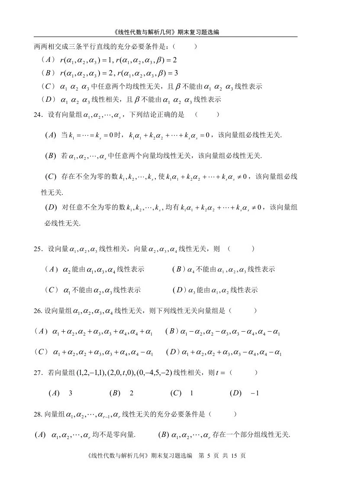

两两相交成三条平行直线的充分必要条件是：（ ）  
(A) $r(\alpha_{1},\alpha_{2},\alpha_{3}) = 1,r(\alpha_{1},\alpha_{2},\alpha_{3},\beta) = 2$ (B) $r(\alpha_1,\alpha_2,\alpha_3) = 2,r(\alpha_1,\alpha_2,\alpha_3,\beta) = 3$ (C） $\alpha_{1}\alpha_{2}\alpha_{3}$ 中任意两个均线性无关，且 $\beta$ 不能由 $\alpha_{1}\alpha_{2}\alpha_{3}$ 线性表示  
(D） $\alpha_{1}\alpha_{2}\alpha_{3}$ 线性相关，且 $\beta$ 不能由 $\alpha_{1}\alpha_{2}\alpha_{3}$ 线性表示

24. 设有向量组 $\alpha_{1}, \alpha_{2}, \cdots, \alpha_{s}$ ，下列结论正确的是（）
(A) 当 $k_{1}=\cdots=k_{s}=0$ 时， $k_{1}\alpha_{1}+k_{2}\alpha_{2}+\cdots+k_{s}\alpha_{s}=0$ ，该向量组必线性无关.
(B) 若 $\alpha_{1}, \alpha_{2}, \cdots, \alpha_{s}$ 中任意两个向量均线性无关，该向量组必线性无关.
(C) 存在不全为零的数 $k_{1}, k_{2}, \cdots, k_{s}$ ，使 $k_{1}\alpha_{1} + k_{2}\alpha_{2} + \cdots + k_{s}\alpha_{s} \neq 0$ ，该向量组必线性无关.
(D) 对任意不全为零的数 $k_{1}, k_{2}, \cdots, k_{s}$ ，均有 $k_{1}\alpha_{1} + k_{2}\alpha_{2} + \cdots + k_{s}\alpha_{s} \neq 0$ ，该向量组必线性无关.

25. 设向量 $\alpha_{1}, \alpha_{2}, \alpha_{3}$ 线性相关，向量 $\alpha_{2}, \alpha_{3}, \alpha_{4}$ 线性无关，则（） $(A)$ $\alpha_{2}$ 能由 $\alpha_{1}, \alpha_{3}, \alpha_{4}$ 线性表示 (B) $\alpha_{4}$ 不能由 $\alpha_{1}, \alpha_{2}, \alpha_{3}$ 线性表示(C) $\alpha_{1}$ 不能由 $\alpha_{2}, \alpha_{3}$ 线性表示 (D) $\alpha_{3}$ 能由 $\alpha_{1}, \alpha_{2}$ 线性表示

26. 设向量组 $\alpha_{1}, \alpha_{2}, \alpha_{3}, \alpha_{4}$ 线性无关，则下列线性无关向量组是（）
(A) $\alpha_{1} + \alpha_{2}, \alpha_{2} + \alpha_{3}, \alpha_{3} + \alpha_{4}, \alpha_{4} + \alpha_{1}$ (B) $\alpha_{1} - \alpha_{2}, \alpha_{2} - \alpha_{3}, \alpha_{3} - \alpha_{4}, \alpha_{4} - \alpha_{1}$ (C) $\alpha_{1} + \alpha_{2}, \alpha_{2} + \alpha_{3}, \alpha_{3} + \alpha_{4}, \alpha_{4} - \alpha_{1}$ (D) $\alpha_{1} + \alpha_{2}, \alpha_{2} + \alpha_{3}, \alpha_{3} - \alpha_{4}, \alpha_{4} - \alpha_{1}$

27. 若向量组 $(1,2,-1,1),(2,0,t,0),(0,-4,5,-2)$ 线性相关，则 $t = (\quad)$ (A) 3 (B) 2 (C) 1 (D) -1

28. 向量组 $\alpha_{1}, \alpha_{2}, \cdots, \alpha_{r-1}, \alpha_{r}$ 线性无关的充分必要条件是（）
(A) $\alpha_{1}, \alpha_{2}, \cdots, \alpha_{r}$ 均不是零向量. (B) $\alpha_{1}, \alpha_{2}, \cdots, \alpha_{r}$ 存在一个部分组线性无关.

《线性代数与解析几何》期末复习题选编

《线性代数与解析几何》期末复习题选编

第 5 页 共 15 页

## 第6页

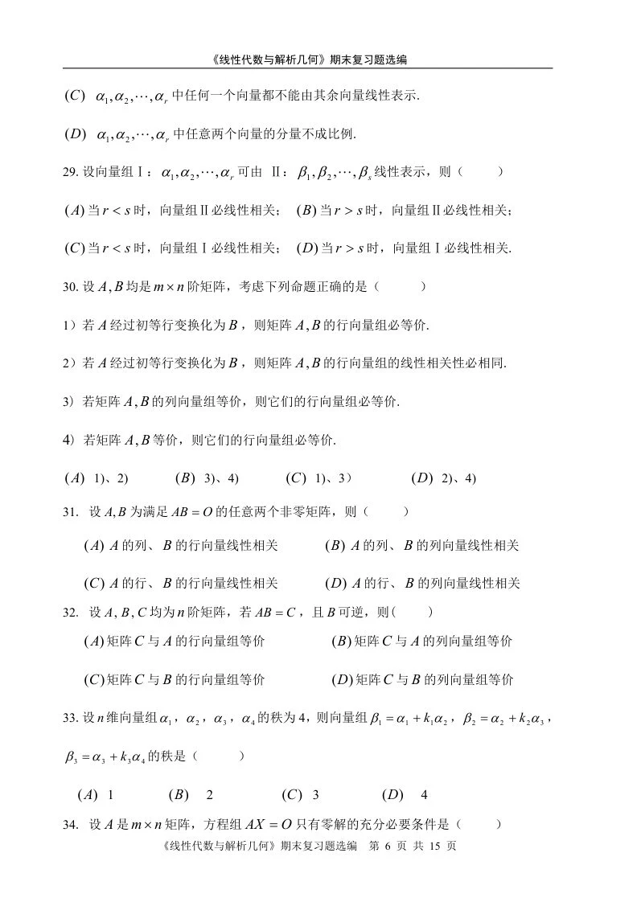

(C) $\alpha_{1},\alpha_{2},\cdots,\alpha_{r}$ 中任何一个向量都不能由其余向量线性表示.
(D) $\alpha_{1},\alpha_{2},\cdots,\alpha_{r}$ 中任意两个向量的分量不成比例.

29. 设向量组 I: $\alpha_{1}, \alpha_{2}, \cdots, \alpha_{r}$ 可由 II: $\beta_{1}, \beta_{2}, \cdots, \beta_{s}$ 线性表示，则（）
(A) 当 r < s 时，向量组 II 必线性相关；(B) 当 r > s 时，向量组 II 必线性相关；
(C) 当 r < s 时，向量组 I 必线性相关；(D) 当 r > s 时，向量组 I 必线性相关.

30. 设 A, B 均是 $m \times n$ 阶矩阵，考虑下列命题正确的是（）

1）若 A 经过初等行变换化为 B，则矩阵 A, B 的行向量组必等价.

2）若 A 经过初等行变换化为 B，则矩阵 A, B 的行向量组的线性相关性必相同.

3）若矩阵 A, B 的列向量组等价，则它们的行向量组必等价.

4）若矩阵 A, B 等价，则它们的行向量组必等价.
(A) 1)、2) (B) 3)、4) (C) 1)、3) (D) 2)、4)

31. 设 A, B 为满足 AB = O 的任意两个非零矩阵，则（）
(A) A 的列、B 的行向量线性相关 (B) A 的列、B 的列向量线性相关
(C) A 的行、B 的行向量线性相关 (D) A 的行、B 的列向量线性相关

32. 设 A, B, C 均为 n 阶矩阵，若 AB = C，且 B 可逆，则（）
(A) 矩阵 C 与 A 的行向量组等价 (B) 矩阵 C 与 A 的列向量组等价
(C) 矩阵 C 与 B 的行向量组等价 (D) 矩阵 C 与 B 的列向量组等价

33. 设 $n$ 维向量组 $\alpha_{1}, \alpha_{2}, \alpha_{3}, \alpha_{4}$ 的秩为 4，则向量组 $\beta_{1} = \alpha_{1} + k_{1}\alpha_{2}, \beta_{2} = \alpha_{2} + k_{2}\alpha_{3}, \beta_{3} = \alpha_{3} + k_{3}\alpha_{4}$ 的秩是（）(A) 1 (B) 2 (C) 3 (D) 4

34. 设 $A$ 是 $m \times n$ 矩阵，方程组 $AX = O$ 只有零解的充分必要条件是（ ）《线性代数与解析几何》期末复习题选编 第6页共15页

《线性代数与解析几何》期末复习题选编

## 第7页

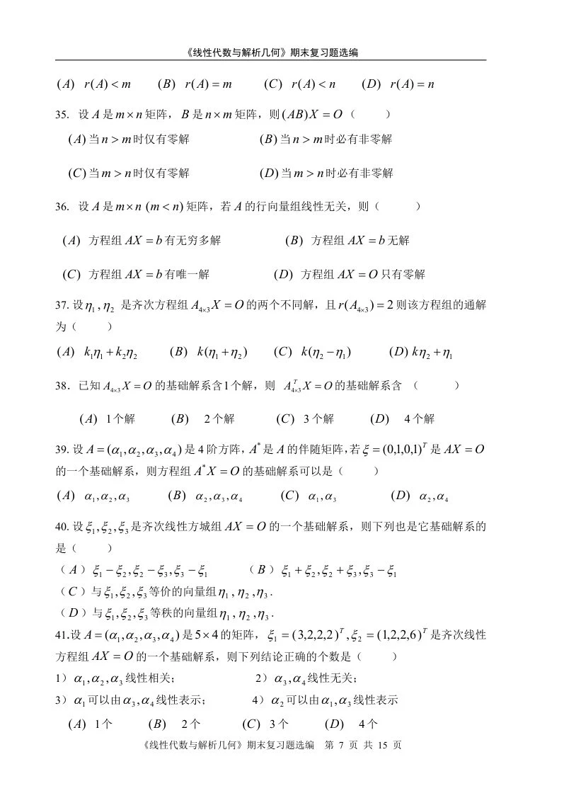

(A) $r(A) < m$ (B) $r(A) = m$ (C) $r(A) < n$ (D) $r(A) = n$

35. 设 A 是 $m \times n$ 矩阵，B 是 $n \times m$ 矩阵，则 $(AB)X = O$ （）
(A) 当 n > m 时仅有零解
(B) 当 n > m 时必有非零解
(C) 当 m > n 时仅有零解
(D) 当 m > n 时必有非零解

36. 设 A 是 $m \times n (m < n)$ 矩阵，若 A 的行向量组线性无关，则（）
(A) 方程组 AX = b 有无穷多解
(B) 方程组 AX = b 无解
(C) 方程组 AX = b 有唯一解
(D) 方程组 AX = O 只有零解

37. 设 $\eta_{1}, \eta_{2}$ 是齐次方程组 $A_{4\times3}X = O$ 的两个不同解，且 $r(A_{4\times3}) = 2$ 则该方程组的通解为（）

(A) $k_{1}\eta_{1} + k_{2}\eta_{2}$ (B) $k(\eta_{1} + \eta_{2})$ (C) $k(\eta_{2} - \eta_{1})$ (D) $k\eta_{2} + \eta_{1}$

38. 已知 $A_{4 \times 3} X = O$ 的基础解系含1个解，则 $A_{4 \times 3}^{T} X = O$ 的基础解系含（）(A) 1个解 (B) 2个解 (C) 3个解 (D) 4个解

39. 设 $A = (\alpha_{1}, \alpha_{2}, \alpha_{3}, \alpha_{4})$ 是 4 阶方阵， $A^{*}$ 是 $A$ 的伴随矩阵，若 $\xi = (0,1,0,1)^{T}$ 是 $AX = O$ 的一个基础解系，则方程组 $A^{*}X = O$ 的基础解系可以是（） $(A)$ $\alpha_{1}, \alpha_{2}, \alpha_{3}$ (B) $\alpha_{2}, \alpha_{3}, \alpha_{4}$ (C) $\alpha_{1}, \alpha_{3}$ (D) $\alpha_{2}, \alpha_{4}$

40. 设 $\xi_1, \xi_2, \xi_3$ 是齐次线性方城组 $AX = O$ 的一个基础解系，则下列也是它基础解系的是（ ） $(A) \xi_1 - \xi_2, \xi_2 - \xi_3, \xi_3 - \xi_1$ （B） $\xi_1 + \xi_2, \xi_2 + \xi_3, \xi_3 - \xi_1$

（C）与 $\xi_{1},\xi_{2},\xi_{3}$ 等价的向量组 $\eta_{1},\eta_{2},\eta_{3}$ .
(D) 与 $\xi_{1}, \xi_{2}, \xi_{3}$ 等秩的向量组 $\eta_{1}, \eta_{2}, \eta_{3}$ .

41. 设 $A = (\alpha_{1}, \alpha_{2}, \alpha_{3}, \alpha_{4})$ 是 $5 \times 4$ 的矩阵， $\xi_{1} = (3, 2, 2, 2)^{T}, \xi_{2} = (1, 2, 2, 6)^{T}$ 是齐次线性方程组 AX = O 的一个基础解系，则下列结论正确的个数是（）

1） $\alpha_{1}, \alpha_{2}, \alpha_{3}$ 线性相关；

2） $\alpha_{3}, \alpha_{4}$ 线性无关；

3） $\alpha_{1}$ 可以由 $\alpha_{3}, \alpha_{4}$ 线性表示；

4） $\alpha_{2}$ 可以由 $\alpha_{1}, \alpha_{3}$ 线性表示

(A) 1个    (B) 2个    (C) 3个    (D) 4个

《线性代数与解析几何》期末复习题选编

《线性代数与解析几何》期末复习题选编

第 7 页 共 15 页

## 第8页

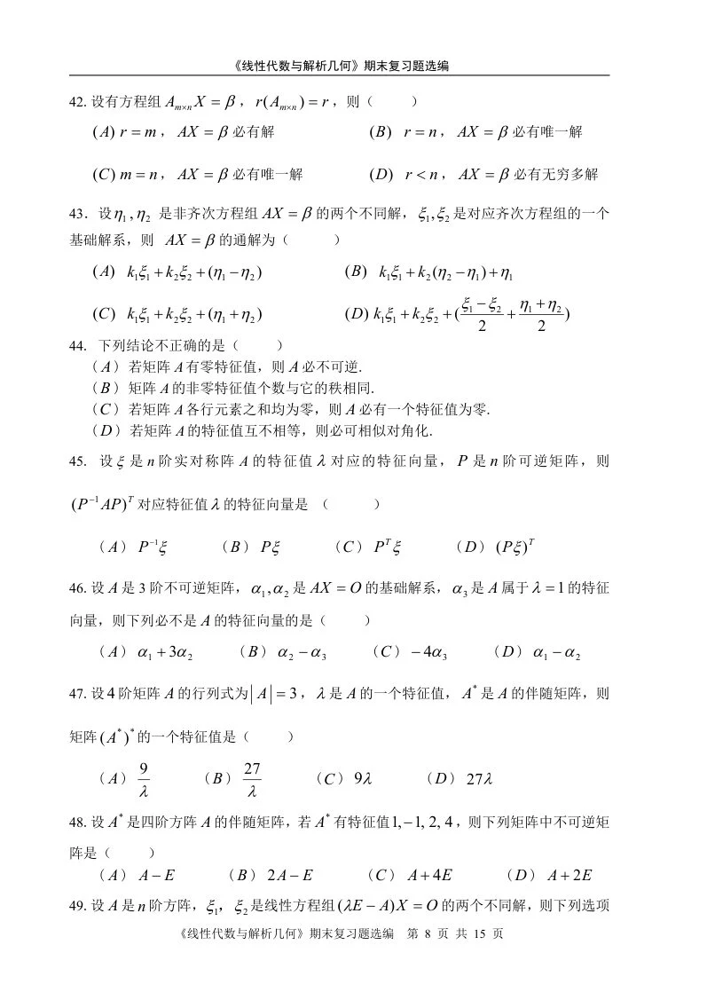

42. 设有方程组 $A_{m \times n} X = \beta, r(A_{m \times n}) = r$ ，则（ ） $(A) r = m, AX = \beta$ 必有解 (B) $r = n, AX = \beta$ 必有唯一解 $(C) m = n, AX = \beta$ 必有唯一解 (D) $r < n, AX = \beta$ 必有无穷多解

43. 设 $\eta_1, \eta_2$ 是非齐次方程组 $AX = \beta$ 的两个不同解， $\xi_1, \xi_2$ 是对应齐次方程组的一个基础解系，则 $AX = \beta$ 的通解为（ ）  
(A) $k_1\xi_1 + k_2\xi_2 + (\eta_1 - \eta_2)$ (B) $k_1\xi_1 + k_2(\eta_2 - \eta_1) + \eta_1$ (C) $k_1\xi_1 + k_2\xi_2 + (\eta_1 + \eta_2)$ (D) $k_1\xi_1 + k_2\xi_2 + (\frac{\xi_1 - \xi_2}{2} + \frac{\eta_1 + \eta_2}{2})$

44. 下列结论不正确的是（）
（A）若矩阵 A 有零特征值，则 A 必不可逆.
（B）矩阵 A 的非零特征值个数与它的秩相同.
（C）若矩阵 A 各行元素之和均为零，则 A 必有一个特征值为零.
（D）若矩阵 A 的特征值互不相等，则必可相似对角化.

45. 设 $\xi$ 是 $n$ 阶实对称阵 $A$ 的特征值 $\lambda$ 对应的特征向量， $P$ 是 $n$ 阶可逆矩阵，则 $(P^{-1}AP)^T$ 对应特征值 $\lambda$ 的特征向量是（） $(A) P^{-1}\xi$ (B) $P\xi$ (C) $P^T\xi$ (D) $(P\xi)^T$

46. 设 A 是 3 阶不可逆矩阵， $\alpha_{1}, \alpha_{2}$ 是 AX = O 的基础解系， $\alpha_{3}$ 是 A 属于 $\lambda = 1$ 的特征向量，则下列必不是 A 的特征向量的是（）

(A) $\alpha_{1} + 3\alpha_{2}$ (B) $\alpha_{2} - \alpha_{3}$ (C) $-4\alpha_{3}$ (D) $\alpha_{1} - \alpha_{2}$

47. 设 4 阶矩阵 A 的行列式为 $\left|A\right|=3$ ， $\lambda$ 是 A 的一个特征值， $A^{*}$ 是 A 的伴随矩阵，则矩阵 $(A^{*})^{*}$ 的一个特征值是（）

(A) $\frac{9}{\lambda}$ (B) $\frac{27}{\lambda}$ (C) $9\lambda$ (D) $27\lambda$

48. 设 $A^{*}$ 是四阶方阵 A 的伴随矩阵，若 $A^{*}$ 有特征值 1, -1, 2, 4，则下列矩阵中不可逆矩阵是（）
(A) A-E (B) 2A-E (C) $A+4E$ (D) $A+2E$

49. 设 $A$ 是 $n$ 阶方阵， $\xi_1$ ， $\xi_2$ 是线性方程组 $(\lambda E - A)X = O$ 的两个不同解，则下列选项中必为矩阵 $A$ 对应特征值 $\lambda$ 的特征向量是（ ） $(A)\xi_{1}$ （B） $\xi_{2}$ （C） $\xi_{1} + \xi_{2}$ （D） $\xi_{1} - \xi_{2}$

《线性代数与解析几何》期末复习题选编

《线性代数与解析几何》期末复习题选编

第8页共15页

## 第9页

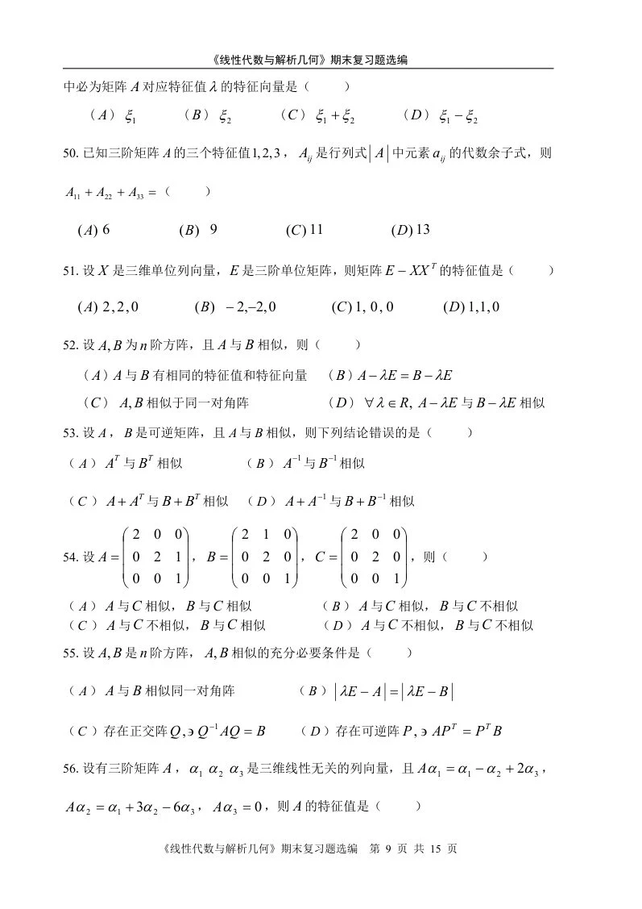

50. 已知三阶矩阵 A 的三个特征值 1,2,3， $A_{ij}$ 是行列式 $|A|$ 中元素 $a_{ij}$ 的代数余子式，则 $A_{11} + A_{22} + A_{33} = (\quad)$ (A) 6 (B) 9 (C) 11 (D) 13

51. 设 X 是三维单位列向量，E 是三阶单位矩阵，则矩阵 $E - XX^{T}$ 的特征值是（）
(A) 2, 2, 0
(B) -2, -2, 0
(C) 1, 0, 0
(D) 1, 1, 0

52. 设 A, B 为 n 阶方阵，且 A 与 B 相似，则（）
(A) A 与 B 有相同的特征值和特征向量 (B) $A - \lambda E = B - \lambda E$ (C) A, B 相似于同一对角阵 (D) $\forall \lambda \in R, A - \lambda E$ 与 $B - \lambda E$ 相似

53. 设 $A$ ， $B$ 是可逆矩阵，且 $A$ 与 $B$ 相似，则下列结论错误的是（）
（ $A$ ） $A^T$ 与 $B^T$ 相似 （ $B$ ） $A^{-1}$ 与 $B^{-1}$ 相似
（ $C$ ） $A + A^T$ 与 $B + B^T$ 相似 （ $D$ ） $A + A^{-1}$ 与 $B + B^{-1}$ 相似

54. 设 $A = \begin{pmatrix} 2 & 0 & 0 \\ 0 & 2 & 1 \\ 0 & 0 & 1 \end{pmatrix}$ ， $B = \begin{pmatrix} 2 & 1 & 0 \\ 0 & 2 & 0 \\ 0 & 0 & 1 \end{pmatrix}$ ， $C = \begin{pmatrix} 2 & 0 & 0 \\ 0 & 2 & 0 \\ 0 & 0 & 1 \end{pmatrix}$ ，则（）

（A） $A$ 与 $C$ 相似， $B$ 与 $C$ 相似 （B） $A$ 与 $C$ 相似， $B$ 与 $C$ 不相似 （C） $A$ 与 $C$ 不相似， $B$ 与 $C$ 相似 （D） $A$ 与 $C$ 不相似， $B$ 与 $C$ 不相似

55. 设 A, B 是 n 阶方阵，A, B 相似的充分必要条件是（）
（A）A 与 B 相似同一对角阵 （B） $\left|\lambda E-A\right|=\left|\lambda E-B\right|$ （C）存在正交阵 $Q,\exists Q^{-1}AQ=B$ （D）存在可逆阵 $P,\exists AP^{T}=P^{T}B$

56. 设有三阶矩阵 $A$ ， $\alpha_{1} \alpha_{2} \alpha_{3}$ 是三维线性无关的列向量，且 $A \alpha_{1} = \alpha_{1} - \alpha_{2} + 2 \alpha_{3}$ ， $A \alpha_{2} = \alpha_{1} + 3 \alpha_{2} - 6 \alpha_{3}$ ， $A \alpha_{3} = 0$ ，则 $A$ 的特征值是（）

《线性代数与解析几何》期末复习题选编

《线性代数与解析几何》期末复习题选编

第9页共15页

## 第10页

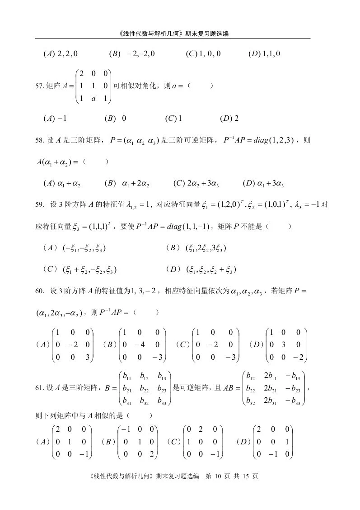

(A) 2,2,0 (B) -2,-2,0 (C) 1,0,0 (D) 1,1,0

57. 矩阵 $A = \begin{pmatrix} 2 & 0 & 0 \\ 1 & 1 & 0 \\ 1 & a & 1 \end{pmatrix}$ 可相似对角化，则 $a = (\quad)$ (A) - 1 (B) 0 (C) 1 (D) 2

58. 设 A 是三阶矩阵， $P = (\alpha_{1} \alpha_{2} \alpha_{3})$ 是三阶可逆矩阵， $P^{-1}AP = diag(1,2,3)$ ，则 $A(\alpha_{1} + \alpha_{2}) = ( )$ $(A)\alpha_{1} + \alpha_{2}$ $(B)\alpha_{1} + 2\alpha_{2}$ $(C)2\alpha_{2} + 3\alpha_{3}$ $(D)\alpha_{1} + 3\alpha_{3}$

59. 设 3 阶方阵 A 的特征值 $\lambda_{1,2}=1$ ，对应特征向量 $\xi_{1}=(1,2,0)^{T},\xi_{2}=(1,0,1)^{T},\lambda_{3}=-1$ 对应特征向量 $\xi_{3}=(1,1,1)^{T}$ ，要使 $P^{-1}AP=diag(1,1,-1)$ ，矩阵 P 不能是（）
(A) $(- \xi_{1}, - \xi_{2}, \xi_{3})$ (B) $(\xi_{1}, 2\xi_{2}, 3\xi_{3})$ (C) $(\xi_{1} + \xi_{2}, - \xi_{2}, \xi_{3})$ (D) $(\xi_{1}, \xi_{2}, \xi_{2} + \xi_{3})$

60. 设 3 阶方阵 A 的特征值为 1, 3, -2，相应特征向量依次为 $\alpha_{1}, \alpha_{2}, \alpha_{3}$ ，若矩阵 $P = (\alpha_{1}, 2\alpha_{3}, -\alpha_{2})$ ，则 $P^{-1}AP = (\quad)$ (A) $\begin{pmatrix}1&0&0\\0&-2&0\\0&0&3\end{pmatrix}$ (B) $\begin{pmatrix}1&0&0\\0&-4&0\\0&0&-3\end{pmatrix}$ (C) $\begin{pmatrix}1&0&0\\0&-2&0\\0&0&-3\end{pmatrix}$ (D) $\begin{pmatrix}1&0&0\\0&3&0\\0&0&-2\end{pmatrix}$

61. 设 A 是三阶矩阵， $B=\begin{pmatrix}b_{11}&b_{12}&b_{13}\\b_{21}&b_{22}&b_{23}\\b_{31}&b_{32}&b_{33}\end{pmatrix}$ 是可逆矩阵，且 $AB=\begin{pmatrix}b_{12}&2b_{11}&-b_{13}\\b_{22}&2b_{21}&-b_{23}\\b_{32}&2b_{31}&-b_{33}\end{pmatrix}$ 则下列矩阵中与 A 相似的是（）
(A) $\begin{pmatrix}2&0&0\\0&1&0\\0&0&-1\end{pmatrix}$ (B) $\begin{pmatrix}-1&0&0\\0&1&0\\0&0&2\end{pmatrix}$ (C) $\begin{pmatrix}0&2&0\\1&0&0\\0&0&-1\end{pmatrix}$ (D) $\begin{pmatrix}2&0&0\\0&0&1\\0&-1&0\end{pmatrix}$

《线性代数与解析几何》期末复习题选编

第10页共15页

《线性代数与解析几何》期末复习题选编

## 第11页

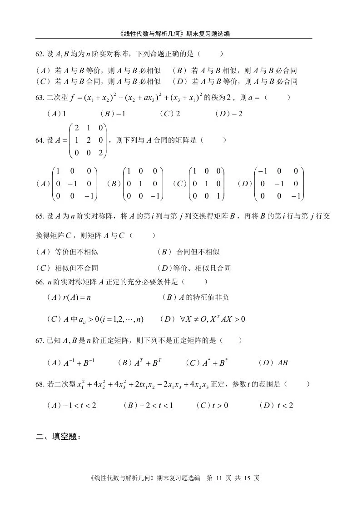

62. 设 A, B 均为 n 阶实对称阵，下列命题正确的是（）
（A）若 A 与 B 等价，则 A 与 B 必相似 （B）若 A 与 B 相似，则 A 与 B 必合同 （C）若 A 与 B 合同，则 A 与 B 必相似 （D）若 A 与 B 等价，则 A 与 B 必合同

63. 二次型 $f = (x_{1} + x_{2})^{2} + (x_{2} + ax_{3})^{2} + (x_{3} + x_{1})^{2}$ 的秩为 2，则 $a = (\quad)$ (A) 1 (B) - 1 (C) 2 (D) - 2

64. 设 $A = \begin{pmatrix} 2 & 1 & 0 \\ 1 & 2 & 0 \\ 0 & 0 & 2 \end{pmatrix}$ ，则下列与 A 合同的矩阵是（）

(A) $\begin{pmatrix} 1 & 0 & 0 \\ 0 & -1 & 0 \\ 0 & 0 & -1 \end{pmatrix}$ (B) $\begin{pmatrix} 1 & 0 & 0 \\ 0 & 1 & 0 \\ 0 & 0 & -1 \end{pmatrix}$ (C) $\begin{pmatrix} 1 & 0 & 0 \\ 0 & 1 & 0 \\ 0 & 0 & 1 \end{pmatrix}$ (D) $\begin{pmatrix} -1 & 0 & 0 \\ 0 & -1 & 0 \\ 0 & 0 & -1 \end{pmatrix}$

65. 设 A 为 n 阶实对称阵，将 A 的第 i 列与第 j 列交换得矩阵 B，再将 B 的第 i 行与第 j 行交换得矩阵 C，则矩阵 A 与 C（）
(A) 等价但不相似 (B) 合同但不相似
(C) 相似但不合同 (D) 等价、相似且合同

66. n 阶实对称矩阵 A 正定的充分必要条件是（）
(A) $r(A)=n$ (B) A 的特征值非负
(C) A 中 $a_{ii} > 0 (i = 1, 2, \cdots, n)$ (D) $\forall X \neq O, X^{T}AX > 0$

67. 已知 $A, B$ 是 $n$ 阶正定矩阵，则下列不是正定矩阵的是（） $(A) A^{-1} + B^{-1}$ $(B) A^T + B^T$ $(C) A^* + B^*$ $(D) AB$

68. 若二次型 $x_{1}^{2} + 4x_{2}^{2} + 4x_{3}^{2} + 2tx_{1}x_{2} - 2x_{1}x_{3} + 4x_{2}x_{3}$ 正定，参数 $t$ 的范围是（） $(A) - 1 < t < 2$ $(B) - 2 < t < 1$ $(C)t > 0$ $(D)t < 2$

### 二、填空题：

《线性代数与解析几何》期末复习题选编

《线性代数与解析几何》期末复习题选编

第11页共15页

## 第12页

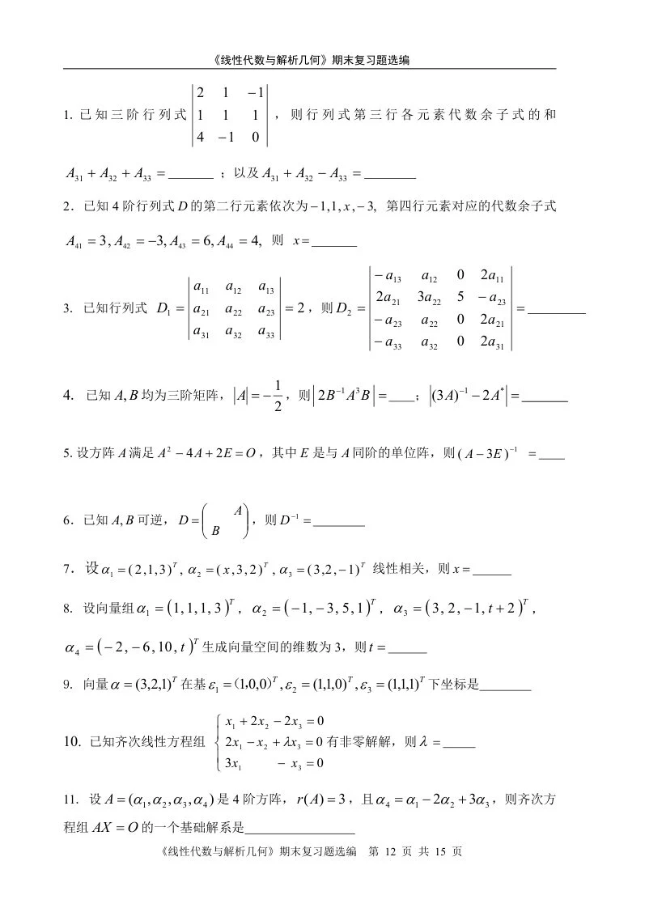

1. 已知三阶行列式 $\begin{vmatrix}2 & 1 & -1 \\ 1 & 1 & 1 \\ 4 & -1 & 0\end{vmatrix}$ ，则行列式第三行各元素代数余子式的和 $A_{31} + A_{32} + A_{33} =$ \_\_\_\_ ; 以及 $A_{31} + A_{32} - A_{33} =$ \_\_\_\_

2. 已知 4 阶行列式 $D$ 的第二行元素依次为 $-1, 1, x, -3$ , 第四行元素对应的代数余子式 $A_{41} = 3, A_{42} = -3, A_{43} = 6, A_{44} = 4$ , 则 $x =$ \_\_\_\_

3. 已知行列式 $D_{1}=\left|\begin{matrix}a_{11}&a_{12}&a_{13}\\ a_{21}&a_{22}&a_{23}\\ a_{31}&a_{32}&a_{33}\end{matrix}\right|=2$ ，则 $D_{2}=\left|\begin{matrix}-a_{13}&a_{12}&0&2a_{11}\\ 2a_{21}&3a_{22}&5&-a_{23}\\ -a_{23}&a_{22}&0&2a_{21}\\ -a_{33}&a_{32}&0&2a_{31}\end{matrix}\right|=$

4. 已知 $A, B$ 均为三阶矩阵， $\left|A\right| = -\frac{1}{2}$ ，则 $\left|2B^{-1}A^3B\right| =$ \_\_\_\_； $\left|(3A)^{-1} - 2A^*\right| =$ \_\_\_\_

5. 设方阵 A 满足 $A^{2}-4A+2E=O$ ，其中 E 是与 A 同阶的单位阵，则 $(A-3E)^{-1}=$ \_\_\_\_

6. 已知 $A, B$ 可逆， $D = \begin{pmatrix} & A \\ B & \end{pmatrix}$ ，则 $D^{-1} =$ \_\_\_\_

7. 设 $\alpha_{1} = (2,1,3)^{T}, \alpha_{2} = (x,3,2)^{T}, \alpha_{3} = (3,2,-1)^{T}$ 线性相关，则 $x =$

8. 设向量组 $\alpha_{1}=(1,1,1,3)^{T}$ ， $\alpha_{2}=(-1,-3,5,1)^{T}$ ， $\alpha_{3}=(3,2,-1,t+2)^{T}$ ， $\alpha_{4}=\left(-2,-6,10,t\right)^{T}$ 生成向量空间的维数为3，则t=\_\_\_\_

9. 向量 $\alpha=(3,2,1)^{T}$ 在基 $\varepsilon_{1}=(1,0,0)^{T},\varepsilon_{2}=(1,1,0)^{T},\varepsilon_{3}=(1,1,1)^{T}$ 下坐标是 \_\_\_\_

10. 已知齐次线性方程组 $\left\{\begin{aligned}x_{1}+2x_{2}-2x_{3}&=0\\ 2x_{1}-x_{2}+\lambda x_{3}&=0\\ 3x_{1}&-x_{3}=0\end{aligned}\right.$ 有非零解解，则 $\lambda=$ \_\_\_\_

11. 设 $A = (\alpha_{1}, \alpha_{2}, \alpha_{3}, \alpha_{4})$ 是 4 阶方阵， $r(A) = 3$ ，且 $\alpha_{4} = \alpha_{1} - 2\alpha_{2} + 3\alpha_{3}$ ，则齐次方程组 $AX = O$ 的一个基础解系是 \_\_\_\_

《线性代数与解析几何》期末复习题选编

《线性代数与解析几何》期末复习题选编

第 12 页 共 15 页

## 第13页

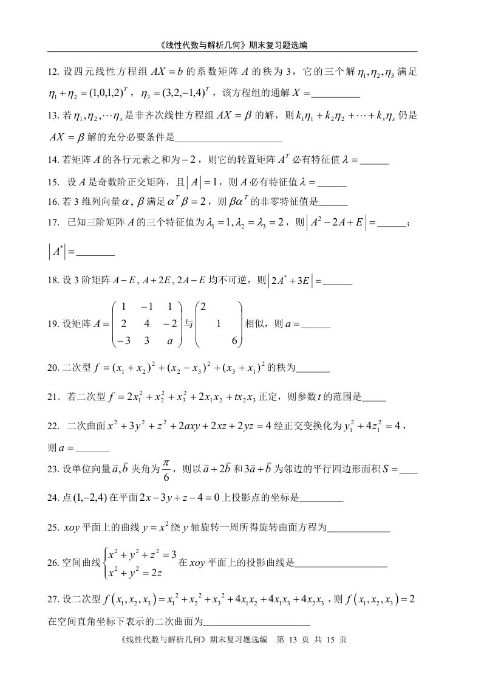

12. 设四元线性方程组 AX=b 的系数矩阵 A 的秩为 3，它的三个解 $\eta_{1},\eta_{2},\eta_{3}$ 满足 $\eta_{1}+\eta_{2}=(1,0,1,2)^{T}$ ， $\eta_{3}=(3,2,-1,4)^{T}$ ，该方程组的通解 X=\_\_\_\_

13. 若 $\eta_{1}, \eta_{2}, \cdots, \eta_{s}$ 是非齐次线性方程组 $AX = \beta$ 的解，则 $k_{1}\eta_{1} + k_{2}\eta_{2} + \cdots + k_{s}\eta_{s}$ 仍是 $AX = \beta$ 解的充分必要条件是 \_\_\_\_

14. 若矩阵 A 的各行元素之和为 -2，则它的转置矩阵 $A^{T}$ 必有特征值 $\lambda =$ \_\_\_\_

15. 设 A 是奇数阶正交矩阵，且 $\left|A\right|=1$ ，则 A 必有特征值 $\lambda=$ \_\_\_\_

16. 若 3 维列向量 $\alpha, \beta$ 满足 $\alpha^T\beta = 2$ ，则 $\beta \alpha^T$ 的非零特征值是 \_\_\_\_

17. 已知三阶矩阵 A 的三个特征值为 $\lambda_{1}=1, \lambda_{2}=\lambda_{3}=2$ ，则 $\left|A^{2}-2A+E\right|=$ \_\_\_\_； $\left|A^{*}\right|=$ \_\_\_\_

18. 设 3 阶矩阵 $A - E, A + 2E, 2A - E$ 均不可逆，则 $\left|2A^{*} + 3E\right| =$

19. 设矩阵 $A = \begin{pmatrix} 1 & -1 & 1 \\ 2 & 4 & -2 \\ -3 & 3 & a \end{pmatrix}$ 与 $\begin{pmatrix} 2 & & \\ & 1 & \\ & & 6 \end{pmatrix}$ 相似，则 a = \_\_\_\_

20. 二次型 $f = (x_{1} + x_{2})^{2} + (x_{2} - x_{3})^{2} + (x_{3} + x_{1})^{2}$ 的秩为

21. 若二次型 $f = 2x_{1}^{2} + x_{2}^{2} + x_{3}^{2} + 2x_{1}x_{2} + tx_{2}x_{3}$ 正定，则参数 $t$ 的范围是

22. 二次曲面 $x^{2} + 3y^{2} + z^{2} + 2axy + 2xz + 2yz = 4$ 经正交变换化为 $y_{1}^{2} + 4z_{1}^{2} = 4$ ，则 $a =$ \_\_\_\_

23. 设单位向量 $\vec{a}, \vec{b}$ 夹角为 $\frac{\pi}{6}$ ，则以 $\vec{a} + 2\vec{b}$ 和 $3\vec{a} + \vec{b}$ 为邻边的平行四边形面积 S = \_\_\_\_

24. 点 $(1,-2,4)$ 在平面 $2x-3y+z-4=0$ 上投影点的坐标是\_\_\_\_

25. xoy 平面上的曲线 $y = x^{2}$ 绕 y 轴旋转一周所得旋转曲面方程为 \_\_\_\_

26. 空间曲线 $\left\{\begin{aligned}x^{2}+y^{2}+z^{2}&=3\\ x^{2}+y^{2}&=2z\end{aligned}\right.$ 在 xoy 平面上的投影曲线是 \_\_\_\_

27. 设二次型 $f(x_{1}, x_{2}, x_{3}) = x_{1}^{2} + x_{2}^{2} + x_{3}^{2} + 4x_{1}x_{2} + 4x_{1}x_{3} + 4x_{2}x_{3}$ ，则 $f(x_{1}, x_{2}, x_{3}) = 2$ 在空间直角坐标下表示的二次曲面为\_\_\_\_

《线性代数与解析几何》期末复习题选编

《线性代数与解析几何》期末复习题选编

第 13 页 共 15 页

## 第14页

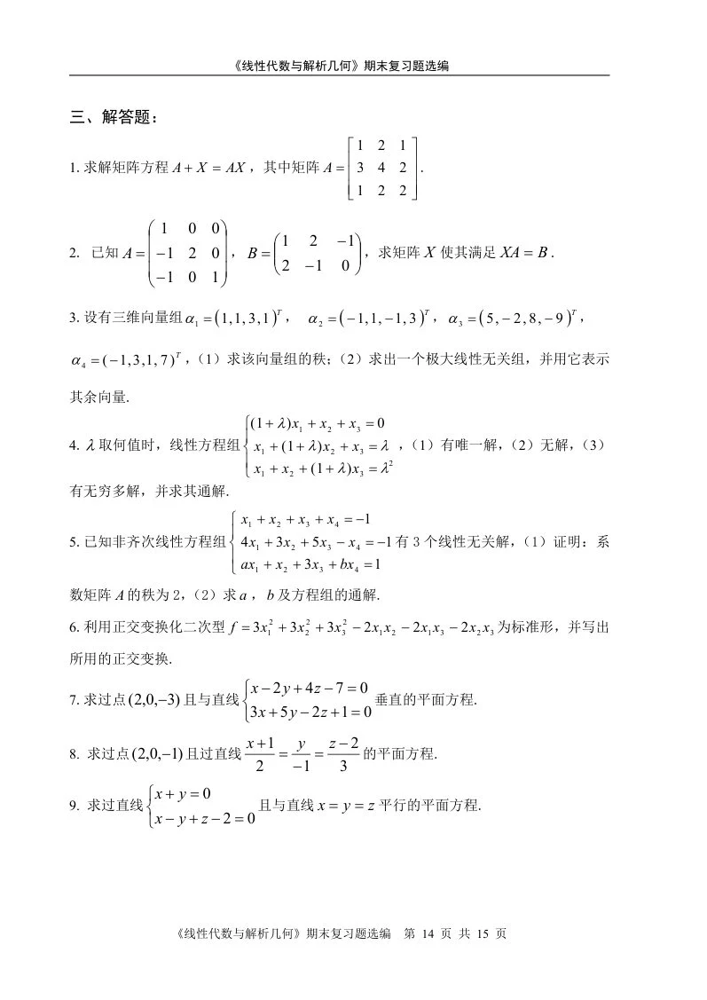

### 三、解答题：

1. 求解矩阵方程 $A + X = AX$ ，其中矩阵 $A = \begin{bmatrix} 1 & 2 & 1 \\ 3 & 4 & 2 \\ 1 & 2 & 2 \end{bmatrix}$ .

2. 已知 $A = \begin{pmatrix} 1 & 0 & 0 \\ -1 & 2 & 0 \\ -1 & 0 & 1 \end{pmatrix}$ ， $B = \begin{pmatrix} 1 & 2 & -1 \\ 2 & -1 & 0 \end{pmatrix}$ ，求矩阵 $X$ 使其满足 $XA = B$ .

3. 设有三维向量组 $\alpha_{1} = (1,1,3,1)^{T}$ ， $\alpha_{2} = (-1,1,-1,3)^{T}$ ， $\alpha_{3} = (5,-2,8,-9)^{T}$ ， $\alpha_{4} = (-1,3,1,7)^{T}$ ，（1）求该向量组的秩；（2）求出一个极大线性无关组，并用它表示其余向量.

4. $\lambda$ 取何值时，线性方程组 $\begin{cases} (1+\lambda)x_{1}+x_{2}+x_{3}=0 \\ x_{1}+(1+\lambda)x_{2}+x_{3}=\lambda \\ x_{1}+x_{2}+(1+\lambda)x_{3}=\lambda^{2} \end{cases}$ ，（1）有唯一解，（2）无解，（3）有无穷多解，并求其通解.

5. 已知非齐次线性方程组 $\begin{cases} x_{1}+x_{2}+x_{3}+x_{4}=-1 \\ 4x_{1}+3x_{2}+5x_{3}-x_{4}=-1 \\ ax_{1}+x_{2}+3x_{3}+bx_{4}=1 \end{cases}$ 有 3 个线性无关解，（1）证明：系数矩阵 $A$ 的秩为 2，（2）求 $a$ ， $b$ 及方程组的通解.

6. 利用正交变换化二次型 $f=3x_{1}^{2}+3x_{2}^{2}+3x_{3}^{2}-2x_{1}x_{2}-2x_{1}x_{3}-2x_{2}x_{3}$ 为标准形，并写出所用的正交变换.

7. 求过点 $(2,0,-3)$ 且与直线 $\begin{cases} x-2y+4z-7=0 \\ 3x+5y-2z+1=0 \end{cases}$ 垂直的平面方程.

8. 求过点 $(2,0,-1)$ 且过直线 $\frac{x+1}{2}=\frac{y}{-1}=\frac{z-2}{3}$ 的平面方程.

9. 求过直线 $\begin{cases} x+y=0 \\ x-y+z-2=0 \end{cases}$ 且与直线 $x=y=z$ 平行的平面方程.

《线性代数与解析几何》期末复习题选编

《线性代数与解析几何》期末复习题选编

第 14 页 共 15 页

## 第15页

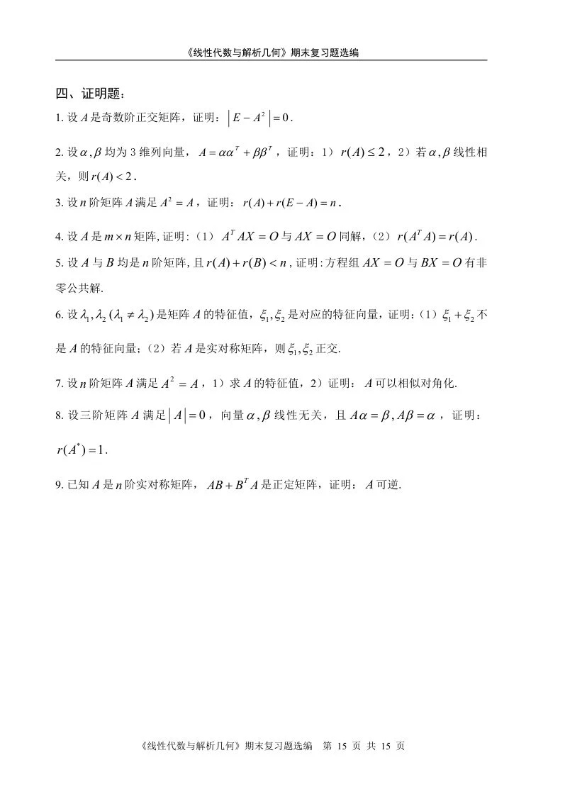

### 四、证明题：

1. 设 A 是奇数阶正交矩阵，证明： $\left|E-A^{2}\right|=0$ .

2. 设 $\alpha, \beta$ 均为 3 维列向量， $A = \alpha \alpha^T + \beta \beta^T$ ，证明：1） $r(A) \leq 2$ ，2）若 $\alpha, \beta$ 线性相关，则 $r(A) < 2$ 。

3. 设 n 阶矩阵 A 满足 $A^{2} = A$ ，证明： $r(A) + r(E - A) = n$ .

4. 设 A 是 $m \times n$ 矩阵, 证明: (1) $A^{T}AX = O$ 与 AX = O 同解, (2) $r(A^{T}A) = r(A)$ .

5. 设 A 与 B 均是 n 阶矩阵, 且 $r(A) + r(B) < n$ , 证明: 方程组 AX = O 与 BX = O 有非零公共解.

6. 设 $\lambda_1, \lambda_2 (\lambda_1 \neq \lambda_2)$ 是矩阵 $A$ 的特征值， $\xi_1, \xi_2$ 是对应的特征向量，证明：（1） $\xi_1 + \xi_2$ 不是 $A$ 的特征向量；（2）若 $A$ 是实对称矩阵，则 $\xi_1, \xi_2$ 正交.

7. 设 n 阶矩阵 A 满足 $A^{2} = A$ ，1）求 A 的特征值，2）证明：A 可以相似对角化.

8. 设三阶矩阵 $A$ 满足 $\left|A\right| = 0$ ，向量 $\alpha, \beta$ 线性无关，且 $A\alpha = \beta, A\beta = \alpha$ ，证明： $r(A^{*}) = 1$ .

9. 已知 A 是 n 阶实对称矩阵， $AB + B^{T}A$ 是正定矩阵，证明：A 可逆.

《线性代数与解析几何》期末复习题选编

《线性代数与解析几何》期末复习题选编

第 15 页 共 15 页
