# 《线性代数与解析几何》第1.3节 行列式依行（列）展开（课件）

原件的每一页，下面附识别出的文字。

### 1.3 行列式依行（列）展开

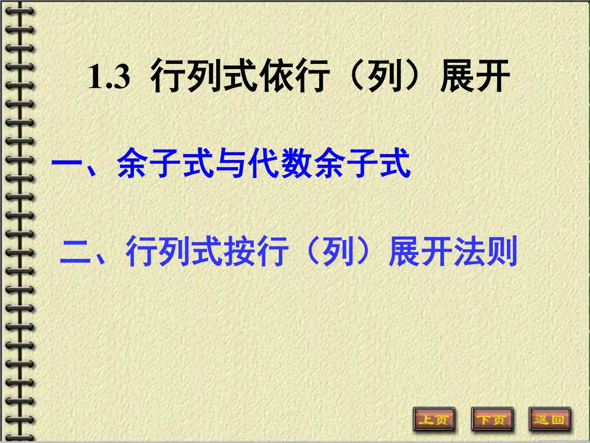

原文：

1.3 行列式依行（列）展开

一、余子式与代数余子式

二、行列式按行（列）展开法则

上页 下页 返回

### 一、余子式与代数余子式

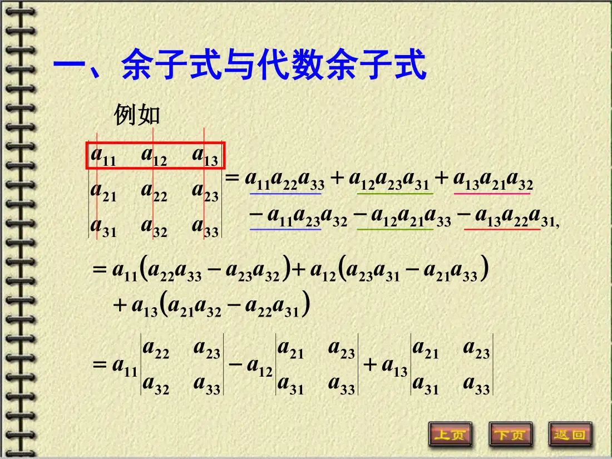

原文：

一、余子式与代数余子式

例如

$$
\begin{array}{r l} & \left| \begin{array}{c c c} a _ {1 1} & a _ {1 2} & a _ {1 3} \\ \hline a _ {2 1} & a _ {2 2} & a _ {2 3} \\ a _ {3 1} & a _ {3 2} & a _ {3 3} \end{array} \right| = \underline {{a _ {1 1} a _ {2 2} a _ {3 3}}} + \underline {{a _ {1 2} a _ {2 3} a _ {3 1}}} + \underline {{a _ {1 3} a _ {2 1} a _ {3 2}}} \\ & {- \underline {{a _ {1 1} a _ {2 3}}} a _ {3 2} - \underline {{a _ {1 2} a _ {2 1}}} a _ {3 3} - \underline {{a _ {1 3} a _ {2 2}}} a _ {3 1},} \\ & {= a _ {1 1} (a _ {2 2} a _ {3 3} - a _ {2 3} a _ {3 2}) + a _ {1 2} (a _ {2 3} a _ {3 1} - a _ {2 1} a _ {3 3})} \\ & {+ a _ {1 3} (a _ {2 1} a _ {3 2} - a _ {2 2} a _ {3 1})} \\ & {= a _ {1 1} \left| \begin{array}{c c} a _ {2 2} & a _ {2 3} \\ a _ {3 2} & a _ {3 3} \end{array} \right| - a _ {1 2} \left| \begin{array}{c c} a _ {2 1} & a _ {2 3} \\ a _ {3 1} & a _ {3 3} \end{array} \right| + a _ {1 3} \left| \begin{array}{c c} a _ {2 1} & a _ {2 3} \\ a _ {3 1} & a _ {3 3} \end{array} \right|} \end{array}
$$

上页 下页 返回

### $$

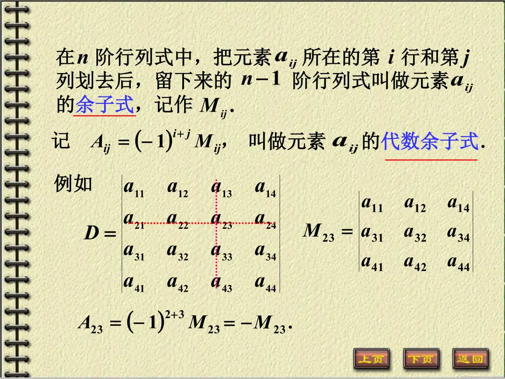

原文：

在 $n$ 阶行列式中, 把元素 $\pmb{a}_{ij}$ 所在的第 $i$ 行和第 $j$ 列划去后, 留下来的 $n - 1$ 阶行列式叫做元素 $\pmb{a}_{ij}$ 的余子式, 记作 $M_{ij}$ .

记 $A_{ij} = (-1)^{i+j} M_{ij}$ , 叫做元素 $\pmb{a}_{ij}$ 的代数余子式. 例如 $\left| \begin{array}{lll} a_{11} & a_{12} & \dot{a}_{13} & a_{14} \end{array} \right|$

$$
D = \left| \begin{array}{c c c c} a _ {1 1} & a _ {1 2} & a _ {1 3} & a _ {1 4} \\ a _ {2 1} & a _ {2 2} & a _ {2 3} & a _ {2 4} \\ a _ {3 1} & a _ {3 2} & a _ {3 3} & a _ {3 4} \\ a _ {4 1} & a _ {4 2} & a _ {4 3} & a _ {4 4} \end{array} \right| \quad M _ {2 3} = \left| \begin{array}{c c c} a _ {1 1} & a _ {1 2} & a _ {1 4} \\ a _ {3 1} & a _ {3 2} & a _ {3 4} \\ a _ {4 1} & a _ {4 2} & a _ {4 4} \end{array} \right|
$$

$$
A _ {2 3} = (- 1) ^ {2 + 3} M _ {2 3} = - M _ {2 3}.
$$

上页 下页 返回

### $$

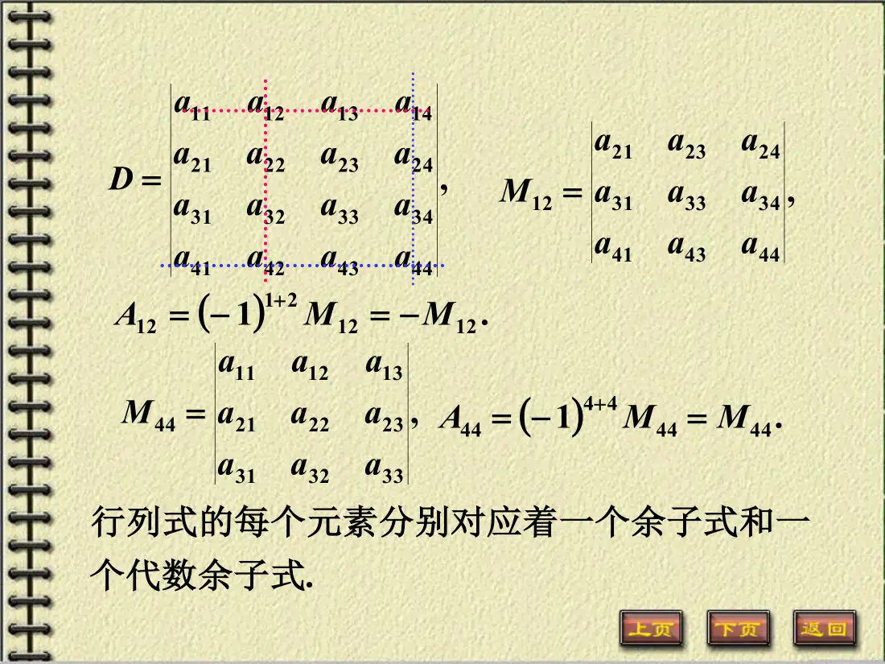

原文：

$$
D = \left| \begin{array}{c c c c} a _ {1 1} & a _ {1 2} & a _ {1 3} & a _ {1 4} \\ a _ {2 1} & a _ {2 2} & a _ {2 3} & a _ {2 4} \\ a _ {3 1} & a _ {3 2} & a _ {3 3} & a _ {3 4} \\ a _ {4 1} & a _ {4 2} & a _ {4 3} & a _ {4 4} \end{array} \right|, \quad M _ {1 2} = \left| \begin{array}{c c c} a _ {2 1} & a _ {2 3} & a _ {2 4} \\ a _ {3 1} & a _ {3 3} & a _ {3 4} \\ a _ {4 1} & a _ {4 3} & a _ {4 4} \end{array} \right|,
$$

$$
\begin{array}{l} {A _ {1 2} = (- 1) ^ {1 + 2} M _ {1 2} = - M _ {1 2}.} \\ {M _ {4 4} = \left| \begin{array}{c c c} a _ {1 1} & a _ {1 2} & a _ {1 3} \\ a _ {2 1} & a _ {2 2} & a _ {2 3} \\ a _ {3 1} & a _ {3 2} & a _ {3 3} \end{array} \right|, A _ {4 4} = (- 1) ^ {4 + 4} M _ {4 4} = M _ {4 4}.} \end{array}
$$

行列式的每个元素分别对应着一个余子式和一个代数余子式.

上页 下页 返回

### 例 在行列式

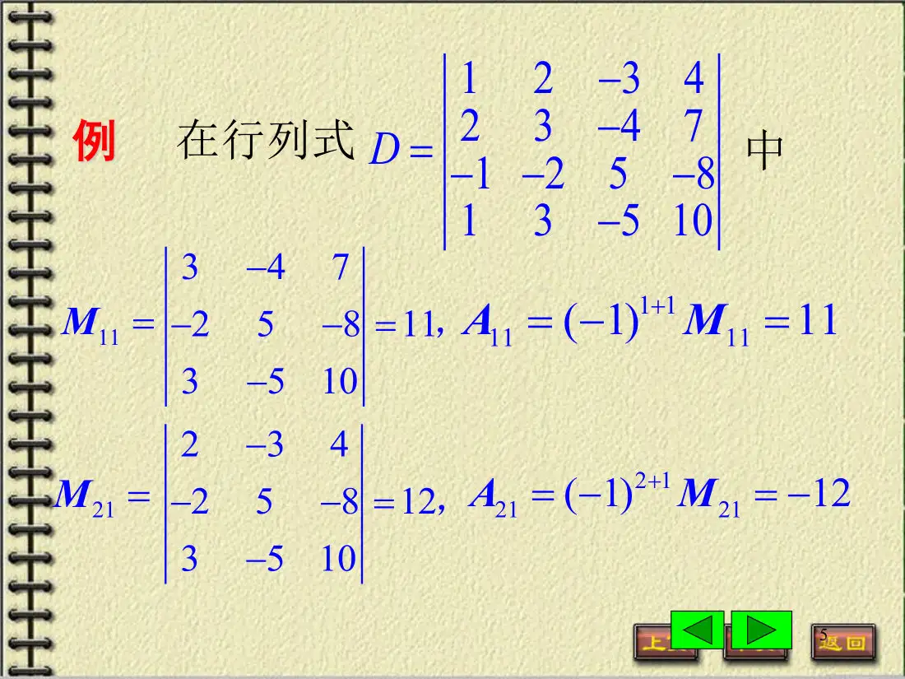

原文：

例 在行列式

$$
D = \left| \begin{array}{c c c c} 1 & 2 & - 3 & 4 \\ 2 & 3 & - 4 & 7 \\ - 1 & - 2 & 5 & - 8 \\ 1 & 3 & - 5 & 1 0 \end{array} \right|
$$

5

### 例如

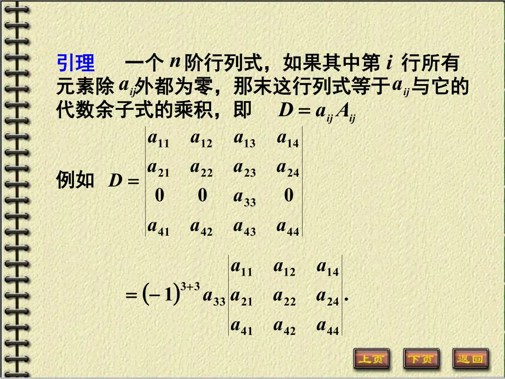

原文：

引理 一个 n 阶行列式，如果其中第 i 行所有元素除 $a_{ij}$ 外都为零，那末这行列式等于 $a_{ij}$ 与它的代数余子式的乘积，即 $D = a_{ij} A_{ij}$

例如

$$
D = \left| \begin{array}{c c c c} a _ {1 1} & a _ {1 2} & a _ {1 3} & a _ {1 4} \\ a _ {2 1} & a _ {2 2} & a _ {2 3} & a _ {2 4} \\ \mathbf {0} & \mathbf {0} & a _ {3 3} & \mathbf {0} \\ a _ {4 1} & a _ {4 2} & a _ {4 3} & a _ {4 4} \end{array} \right|
$$

$$
= (- 1) ^ {3 + 3} a _ {3 3} \left| \begin{array}{c c c} a _ {1 1} & a _ {1 2} & a _ {1 4} \\ a _ {2 1} & a _ {2 2} & a _ {2 4} \\ a _ {4 1} & a _ {4 2} & a _ {4 4} \end{array} \right|.
$$

上页 下页 返回

### 证 当 $a_{ij}$ 位于第一行第一列时,

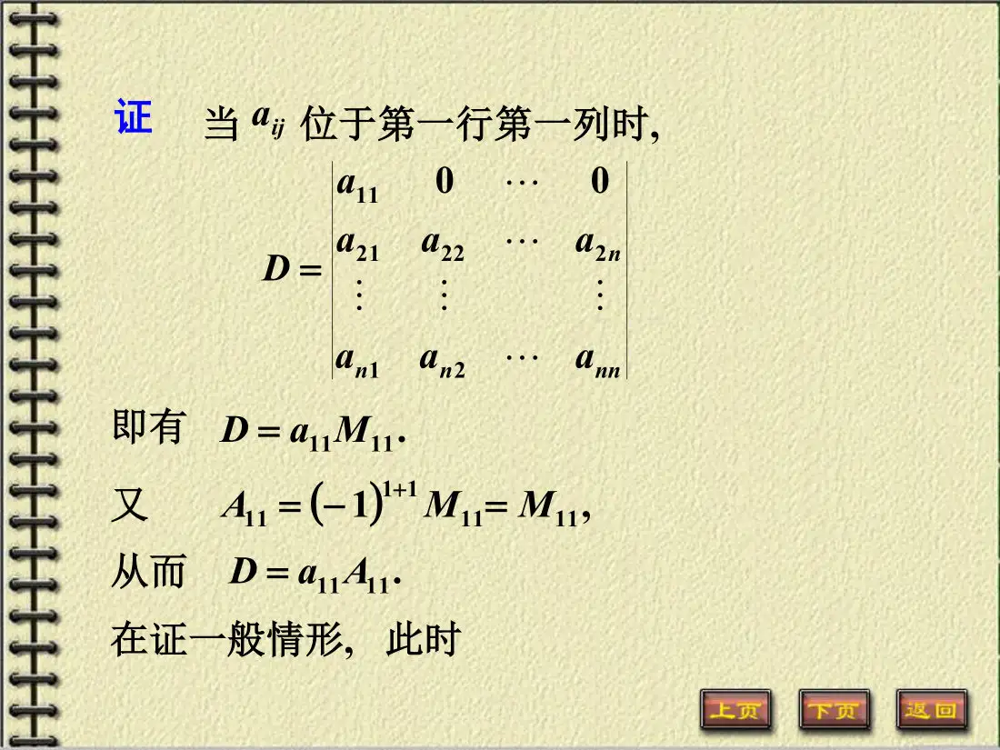

原文：

证 当 $a_{ij}$ 位于第一行第一列时,

$$
\boldsymbol {D} = \left| \begin{array}{c c c c} a _ {1 1} & 0 & \dots & 0 \\ a _ {2 1} & a _ {2 2} & \dots & a _ {2 n} \\ \vdots & \vdots & & \vdots \\ a _ {n 1} & a _ {n 2} & \dots & a _ {n n} \end{array} \right|
$$

即有 $D=a_{11}M_{11}$ .

又 $A_{11} = (-1)^{1 + 1}M_{11} = M_{11},$

从而 $D = a_{11}A_{11}$

在证一般情形，此时

上页 下页 返回

### $$

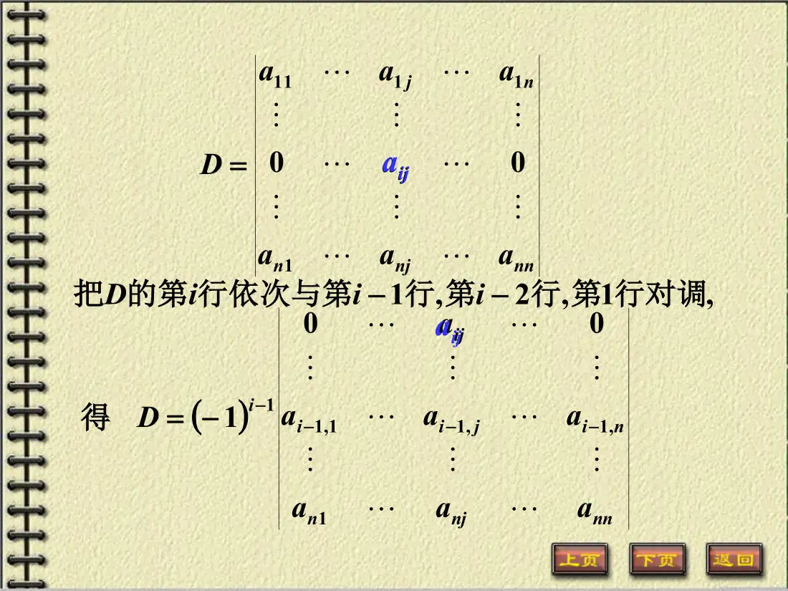

原文：

$$
D = \left| \begin{array}{c c c c c} a _ {1 1} & \dots & a _ {1 j} & \dots & a _ {1 n} \\ \vdots & & \vdots & & \vdots \\ 0 & \dots & a _ {i j} & \dots & 0 \\ \vdots & & \vdots & & \vdots \\ a _ {n 1} & \dots & a _ {n j} & \dots & a _ {n n} \end{array} \right|
$$

把D的第i行依次与第i-1行,第i-2行,第1行对调,

得

上页 下页 返回

### 再把D的第j列依次与第j-1列,第j-2列,第1列对调, 得

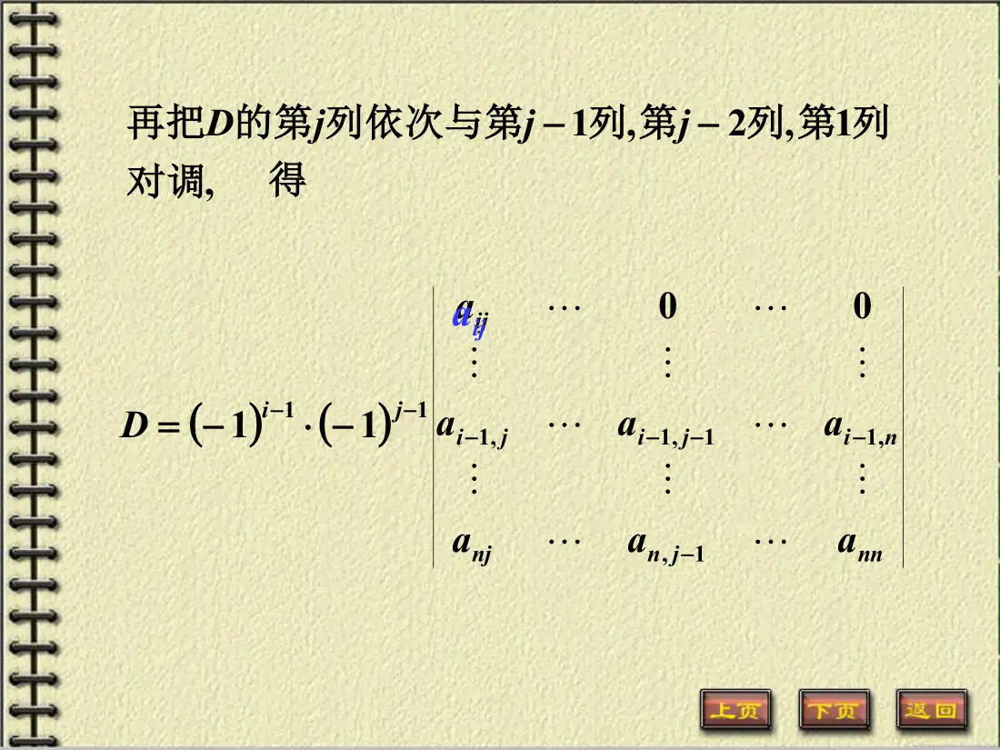

原文：

再把D的第j列依次与第j-1列,第j-2列,第1列对调, 得

$$
D = (- 1) ^ {i - 1} \cdot (- 1) ^ {j - 1} \left| \begin{array}{c c c c c} a _ {i j} & \dots & 0 & \dots & 0 \\ \vdots & & \vdots & & \vdots \\ a _ {i - 1, j} & \dots & a _ {i - 1, j - 1} & \dots & a _ {i - 1, n} \\ \vdots & & \vdots & & \vdots \\ a _ {n j} & \dots & a _ {n, j - 1} & \dots & a _ {n n} \end{array} \right|
$$

上页 下页 返回

### $$

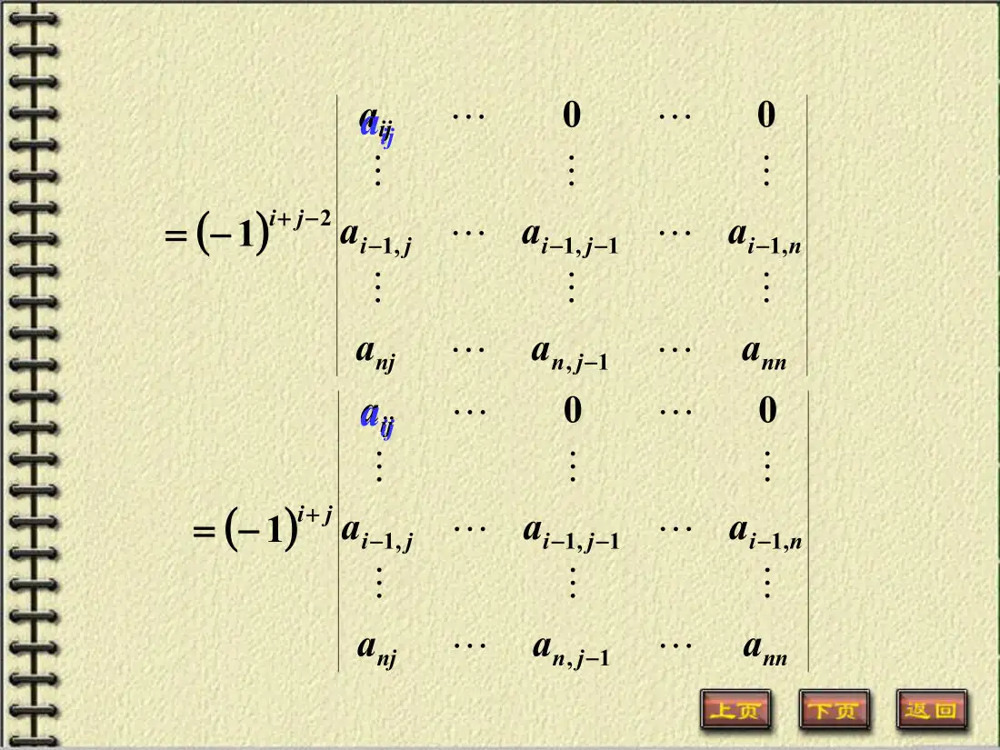

原文：

$$
\begin{array}{r l} & = (- 1) ^ {i + j - 2} \left| \begin{array}{c c c c c} a _ {i j} & \dots & 0 & \dots & 0 \\ \vdots & & \vdots & & \vdots \\ a _ {i - 1, j} & \dots & a _ {i - 1, j - 1} & \dots & a _ {i - 1, n} \\ \vdots & & \vdots & & \vdots \\ a _ {n j} & \dots & a _ {n, j - 1} & \dots & a _ {n n} \end{array} \right| \\ & = (- 1) ^ {i + j} \left| \begin{array}{c c c c c} a _ {i j} & \dots & 0 & \dots & 0 \\ \vdots & & \vdots & & \vdots \\ a _ {i - 1, j} & \dots & a _ {i - 1, j - 1} & \dots & a _ {i - 1, n} \\ \vdots & & \vdots & \\ a _ {n j} & \dots & a _ {n, j - 1} & \dots & a _ {n n} \end{array} \right| \end{array}
$$

上页 下页 返回

### 余子式仍然是 $a_{ij}$ 在

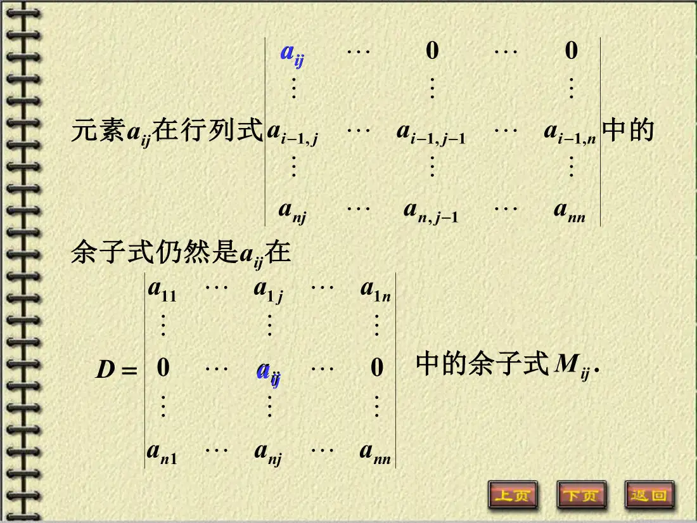

原文：

元素 $a_{ij}$ 在行列式 $\begin{vmatrix}a_{i-1,j}&\cdots&a_{i-1,j-1}&\cdots&a_{i-1,n}\\ \vdots&&\vdots&&\vdots\\ a_{nj}&\cdots&a_{n,j-1}&\cdots&a_{nn}\end{vmatrix}$ 中的

余子式仍然是 $a_{ij}$ 在

$$
D = \left| \begin{array}{c c c c c} a _ {1 1} & \dots & a _ {1 j} & \dots & a _ {1 n} \\ \vdots & & \vdots & & \vdots \\ 0 & \dots & a _ {i j} & \dots & 0 \\ \vdots & & \vdots & & \vdots \\ a _ {n 1} & \dots & a _ {n j} & \dots & a _ {n n} \end{array} \right|
$$

中的余子式 $M_{ij}$ .

上页 下页 返回

### 上页 下页 返回

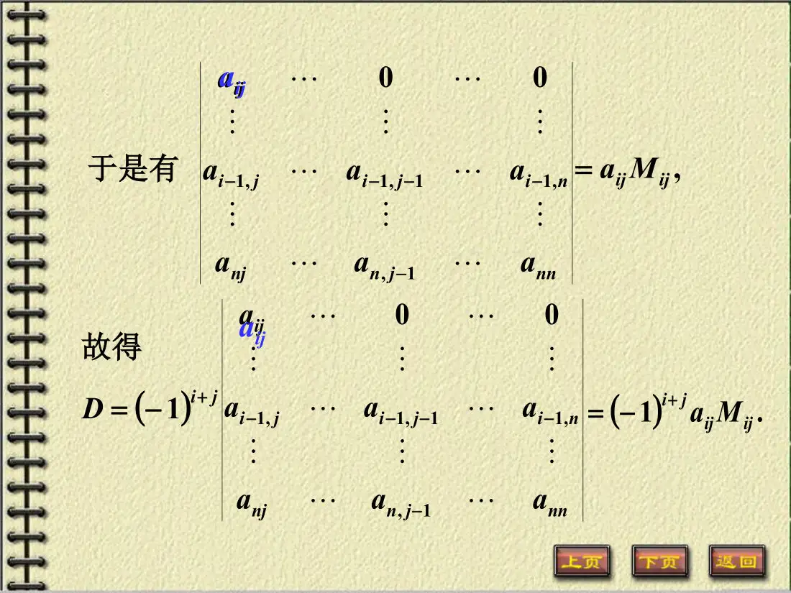

原文：

<table><tr><td>于是有</td><td colspan="5"> $\begin{vmatrix} a_{ij} & \cdots & 0 & \cdots & 0 \\ \vdots & & \vdots & & \vdots \\ a_{i-1,j} & \cdots & a_{i-1,j-1} & \cdots & a_{i-1,n} \\ \vdots & & \vdots & & \vdots \\ a_{nj} & \cdots & a_{n,j-1} & \cdots & a_{nn} \end{vmatrix} = a_{ij}M_{ij},$ </td></tr><tr><td>故得</td><td colspan="5"> $\begin{vmatrix} a_{ij} & \cdots & 0 & \cdots & 0 \\ \vdots & & \vdots & & \vdots \\ a_{i-1,j} & \cdots & a_{i-1,j-1} & \cdots & a_{i-1,n} \\ \vdots & & \vdots & & \vdots \\ a_{nj} & \cdots & a_n,j-1 & \cdots & a_{nn} \end{vmatrix} = (-1)^{i+j}a_{ij}M_{ij}.$ </td></tr></table>

上页 下页 返回

### 二、行列式按行（列）展开法则

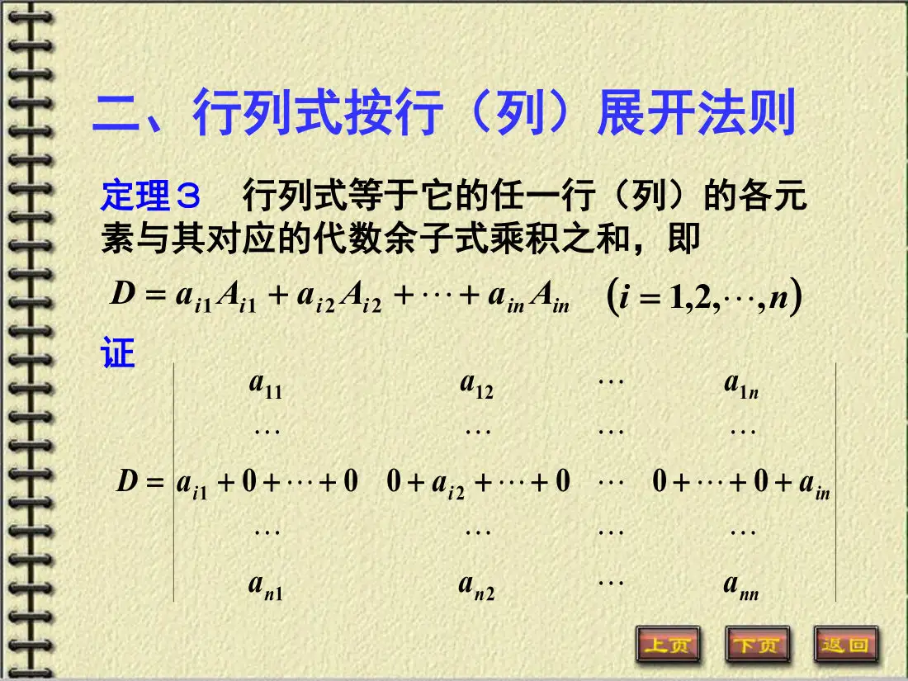

原文：

二、行列式按行（列）展开法则

定理3 行列式等于它的任一行（列）的各元素与其对应的代数余子式乘积之和，即

$$
D = a _ {i 1} A _ {i 1} + a _ {i 2} A _ {i 2} + \dots + a _ {i n} A _ {i n} \quad (i = 1, 2, \dots , n)
$$

$$
D = \left| \begin{array}{c c c c} a _ {1 1} & a _ {1 2} & \dots & a _ {1 n} \\ \dots & \dots & \dots & \dots \\ a _ {i 1} + 0 + \dots + 0 & 0 + a _ {i 2} + \dots + 0 & \dots & 0 + \dots + 0 + a _ {i n} \\ \dots & \dots & \dots & \dots \\ a _ {n 1} & a _ {n 2} & \dots & a _ {n n} \end{array} \right|
$$

上页 下页 返回

### $$

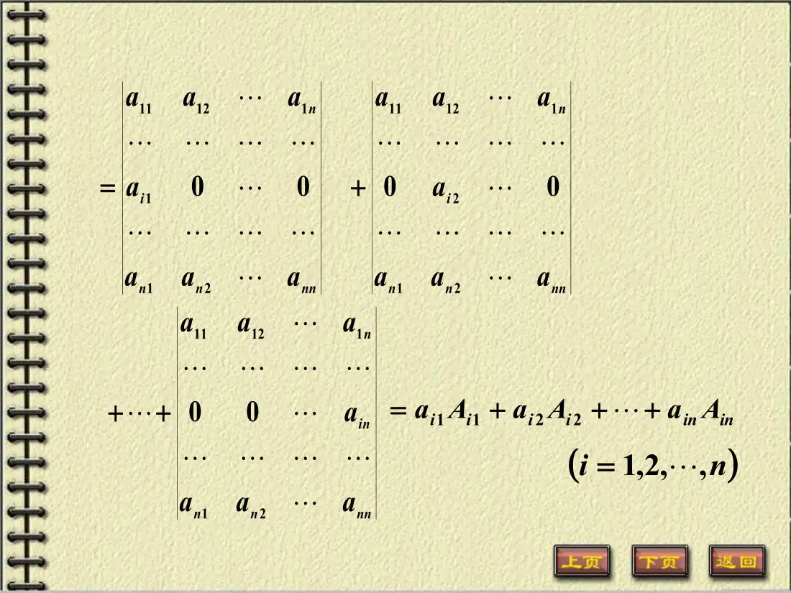

原文：

$$
\begin{array}{r l} & {= \left| \begin{array}{l l l l} a _ {1 1} & a _ {1 2} & \dots & a _ {1 n} \\ \dots & \dots & \dots & \dots \\ a _ {i 1} & 0 & \dots & 0 \\ \dots & \dots & \dots & \dots \\ a _ {n 1} & a _ {n 2} & \dots & a _ {n n} \end{array} \right| + \left| \begin{array}{l l l l} a _ {1 1} & a _ {1 2} & \dots & a _ {1 n} \\ \dots & \dots & \dots & \dots \\ 0 & a _ {i 2} & \dots & 0 \\ \dots & \dots & \dots & \dots \\ a _ {n 1} & a _ {n 2} & \dots & a _ {n n} \end{array} \right|} \\ & {+ \dots + \left| \begin{array}{l l l l} a _ {1 1} & a _ {1 2} & \dots & a _ {1 n} \\ \dots & \dots & \dots & \dots \\ 0 & 0 & \dots & a _ {i n} \\ \dots & \dots & \dots & \dots \\ a _ {n 1} & a _ {n 2} & \dots & a _ {n n} \end{array} \right| = a _ {i 1} A _ {i 1} + a _ {i 2} A _ {i 2} + \dots + a _ {i n} A _ {i n}} \\ & {\qquad (i = 1, 2, \dots , n)} \end{array}
$$

上页 下页 返回

### 第 15 页

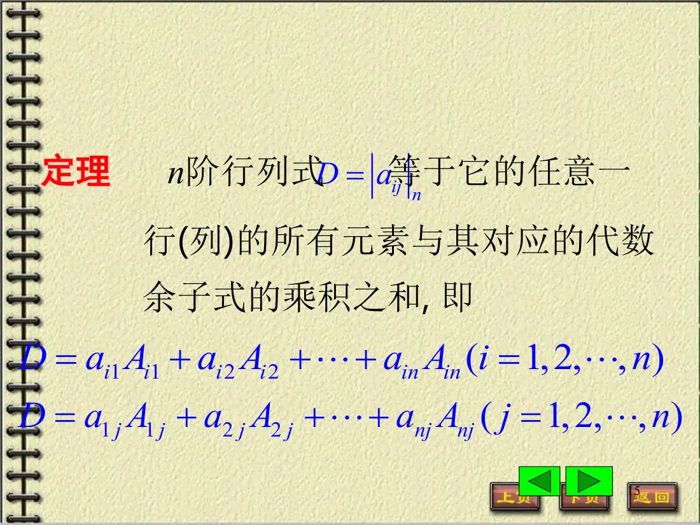

原文：

定理 n阶行列式 $D=\left|a_{ij}\right|_{n}$ 于它的任意一行(列)的所有元素与其对应的代数余子式的乘积之和, 即 $=a_{i1}A_{i1}+a_{i2}A_{i2}+\cdots+a_{in}A_{in}(i=1,2,\cdots,n)$ $=a_{1j}A_{1j}+a_{2j}A_{2j}+\cdots+a_{nj}A_{nj}(j=1,2,\cdots,n)$

### 例 计算行列式

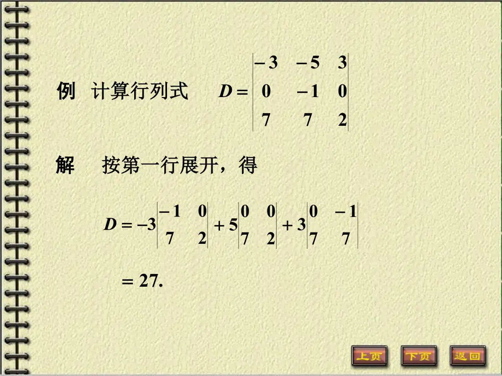

原文：

例 计算行列式

$$
\boldsymbol {D} = \left| \begin{array}{c c c} - 3 & - 5 & 3 \\ \mathbf {0} & - \mathbf {1} & \mathbf {0} \\ 7 & 7 & 2 \end{array} \right|
$$

解 按第一行展开，得

$$
\begin{array}{r l} & D = - 3 \left| \begin{array}{l l} - 1 & 0 \\ 7 & 2 \end{array} \right| + 5 \left| \begin{array}{l l} 0 & 0 \\ 7 & 2 \end{array} \right| + 3 \left| \begin{array}{l l} 0 & - 1 \\ 7 & 7 \end{array} \right| \\ & = 2 7. \end{array}
$$

上页 下页 返回

### 例 计算行列式

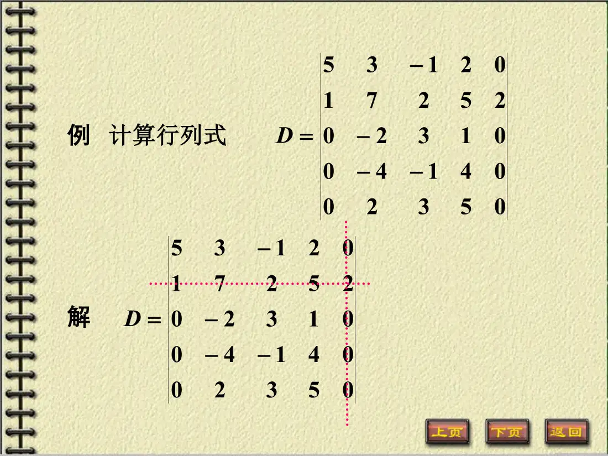

原文：

例 计算行列式

$$
D = \left| \begin{array}{r r r r r} 5 & 3 & - 1 & 2 & 0 \\ 1 & 7 & 2 & 5 & 2 \\ 0 & - 2 & 3 & 1 & 0 \\ 0 & - 4 & - 1 & 4 & 0 \\ 0 & 2 & 3 & 5 & 0 \end{array} \right|
$$

解

$$
D = \left| \begin{array}{r r r r r} 5 & 3 & - 1 & 2 & 0 \\ 1 & 7 & 2 & 5 & 2 \\ 0 & - 2 & 3 & 1 & 0 \\ 0 & - 4 & - 1 & 4 & 0 \\ 0 & 2 & 3 & 5 & 0 \end{array} \right|
$$

上页 下页 返回

### $$

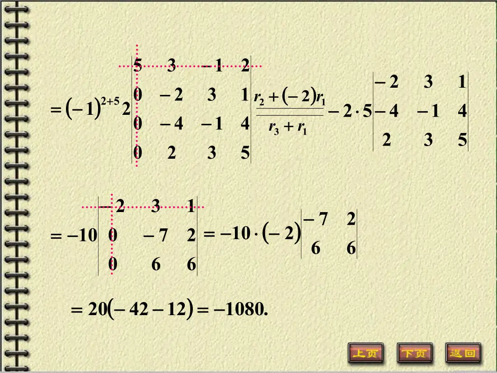

原文：

$$
= (- 1) ^ {2 + 5} 2 \left| \begin{array}{c c c c} 5 & 3 & - 1 & 2 \\ 0 & - 2 & 3 & 1 \\ 0 & - 4 & - 1 & 4 \\ 0 & 2 & 3 & 5 \end{array} \right| \frac {r _ {2} + (- 2) r _ {1}}{\overline {{r _ {3} + r _ {1}}}} - 2 \cdot 5 \left| \begin{array}{c c c} - 2 & 3 & 1 \\ - 4 & - 1 & 4 \\ 2 & 3 & 5 \end{array} \right|
$$

$$
= - 1 0 \left| \begin{array}{c c c} - 2 & 3 & 1 \\ 0 & - 7 & 2 \\ 0 & 6 & 6 \end{array} \right| = - 1 0 \cdot (- 2) \left| \begin{array}{c c} - 7 & 2 \\ 6 & 6 \end{array} \right|
$$

$$
= 2 0 (- 4 2 - 1 2) = - 1 0 8 0.
$$

上页 下页 返回

### 例1

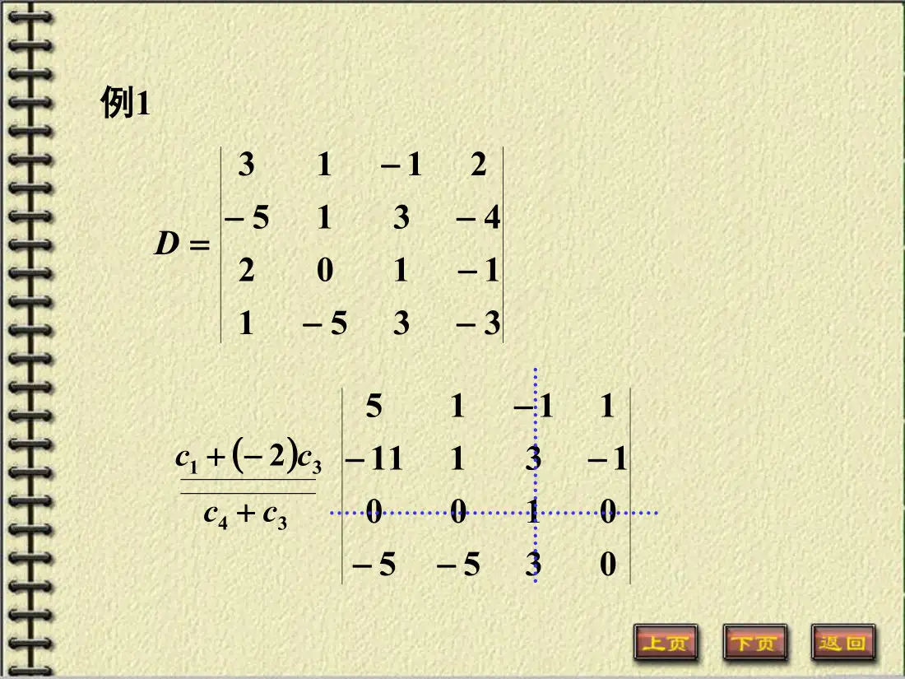

原文：

例1

$$
D = \left| \begin{array}{c c c c} 3 & 1 & - 1 & 2 \\ - 5 & 1 & 3 & - 4 \\ 2 & 0 & 1 & - 1 \\ 1 & - 5 & 3 & - 3 \end{array} \right|
$$

$$
\frac {c _ {1} + (- 2) c _ {3}}{c _ {4} + c _ {3}} \left| \begin{array}{l l l l} 5 & 1 & - 1 & 1 \\ - 1 1 & 1 & 3 & - 1 \\ 0 & 0 & 1 & 0 \\ - 5 & - 5 & 3 & 0 \end{array} \right|
$$

上页 下页 返回

### $$

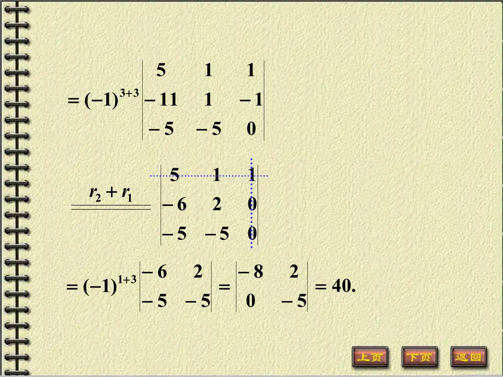

原文：

$$
= (- 1) ^ {3 + 3} \left| \begin{array}{c c c} 5 & 1 & 1 \\ - 1 1 & 1 & - 1 \\ - 5 & - 5 & 0 \end{array} \right|
$$

$$
\underline {{\underline {{r _ {2} + r _ {1}}}}} \left| \begin{array}{c c c} 5 & 1 & 1 \\ - 6 & 2 & 0 \\ - 5 & - 5 & 0 \end{array} \right|
$$

$$
= (- 1) ^ {1 + 3} \left| \begin{array}{c c} - 6 & 2 \\ - 5 & - 5 \end{array} \right| = \left| \begin{array}{c c} - 8 & 2 \\ 0 & - 5 \end{array} \right| = 4 0.
$$

上页 下页 返回

### 例 证明范德蒙(Vandermonde)行列式

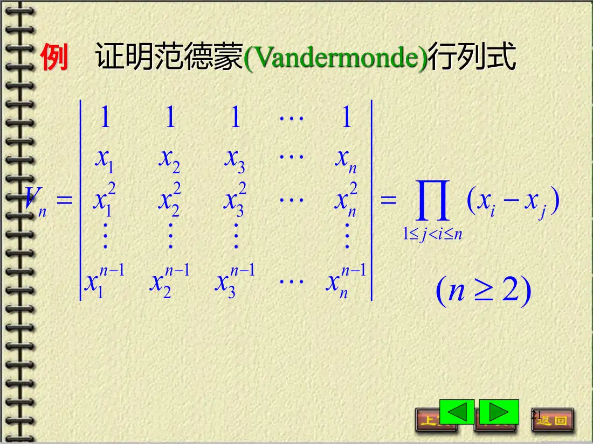

原文：

例 证明范德蒙(Vandermonde)行列式

$$
= \left| \begin{array}{c c c c c} 1 & 1 & 1 & \dots & 1 \\ x _ {1} & x _ {2} & x _ {3} & \dots & x _ {n} \\ x _ {1} ^ {2} & x _ {2} ^ {2} & x _ {3} ^ {2} & \dots & x _ {n} ^ {2} \\ \vdots & \vdots & \vdots & & \vdots \\ x _ {1} ^ {n - 1} & x _ {2} ^ {n - 1} & x _ {3} ^ {n - 1} & \dots & x _ {n} ^ {n - 1} \end{array} \right| = \prod_ {1 \leq j <   i \leq n} (x _ {i} - x _ {j}) \quad (n \geq 2)
$$

V

上返回

### 例2 证明范德蒙德(Vandermonde)行列式

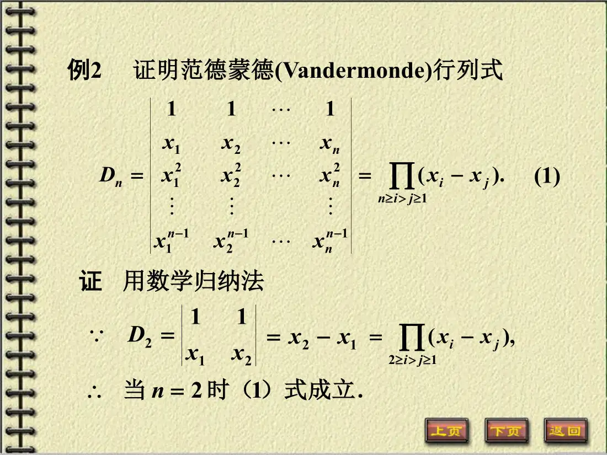

原文：

例2 证明范德蒙德(Vandermonde)行列式

$$
\begin{array}{c c c c} \mathbf {1} & \mathbf {1} & \dots & \mathbf {1} \end{array}
$$

$$
D _ {n} = \left| \begin{array}{c c c c} x _ {1} & x _ {2} & \dots & x _ {n} \\ x _ {1} ^ {2} & x _ {2} ^ {2} & \dots & x _ {n} ^ {2} \\ \vdots & \vdots & & \vdots \end{array} \right| = \prod_ {n \geq i > j \geq 1} (x _ {i} - x _ {j}).\tag{1}
$$

$$
\left| \begin{array}{c c c c} x _ {1} ^ {n - 1} & x _ {2} ^ {n - 1} & \dots & x _ {n} ^ {n - 1} \end{array} \right|
$$

证 用数学归纳法

$$
\because \quad D _ {2} = \left| \begin{array}{c c} 1 & 1 \\ x _ {1} & x _ {2} \end{array} \right| = x _ {2} - x _ {1} = \prod_ {2 \geq i > j \geq 1} (x _ {i} - x _ {j}),
$$

∴ 当 n=2 时（1）式成立.

上页 下页 返回

### 假设 (1) 对于 $n - 1$ 阶范德蒙德行列式成立, $D_{n} =$

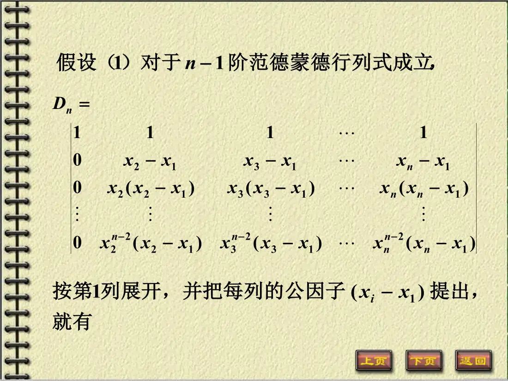

原文：

假设 (1) 对于 $n - 1$ 阶范德蒙德行列式成立, $D_{n} =$

$$
\left| \begin{array}{c c c c c} 1 & 1 & 1 & \dots & 1 \\ 0 & x _ {2} - x _ {1} & x _ {3} - x _ {1} & \dots & x _ {n} - x _ {1} \\ 0 & x _ {2} (x _ {2} - x _ {1}) & x _ {3} (x _ {3} - x _ {1}) & \dots & x _ {n} (x _ {n} - x _ {1}) \\ \vdots & \vdots & \vdots & & \vdots \\ 0 & x _ {2} ^ {n - 2} (x _ {2} - x _ {1}) & x _ {3} ^ {n - 2} (x _ {3} - x _ {1}) & \dots & x _ {n} ^ {n - 2} (x _ {n} - x _ {1}) \end{array} \right|
$$

按第1列展开，并把每列的公因子 $(x_{i} - x_{1})$ 提出，就有

上页 下页 返回

### $$

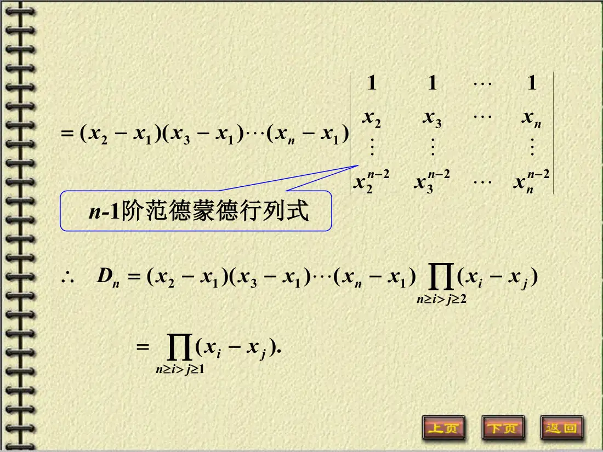

原文：

$$
= (x _ {2} - x _ {1}) (x _ {3} - x _ {1}) \dots (x _ {n} - x _ {1}) \left| \begin{array}{c c c c} 1 & 1 & \dots & 1 \\ x _ {2} & x _ {3} & \dots & x _ {n} \\ \vdots & \vdots & & \vdots \\ x _ {2} ^ {n - 2} & x _ {3} ^ {n - 2} & \dots & x _ {n} ^ {n - 2} \end{array} \right|
$$

n-1阶范德蒙德行列式

$$
\begin{array}{r l} \therefore & D _ {n} = (x _ {2} - x _ {1}) (x _ {3} - x _ {1}) \dots (x _ {n} - x _ {1}) \prod_ {n \geq i > j \geq 2} (x _ {i} - x _ {j}) \\ & = \prod_ {n \geq i > j \geq 1} (x _ {i} - x _ {j}). \end{array}
$$

上页 下页 返回

### $$

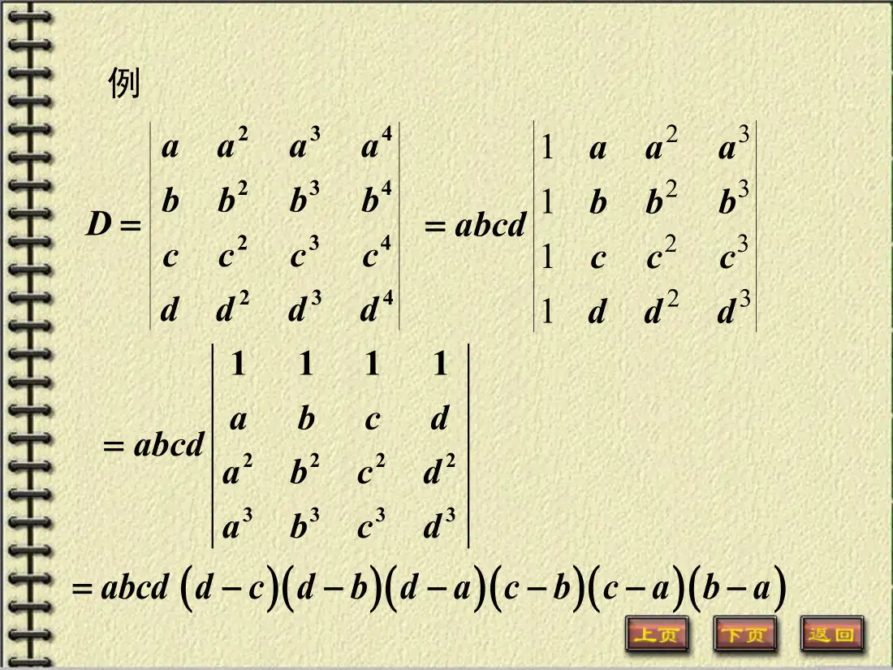

原文：

例

$$
\begin{array}{r l} & D = \left| \begin{array}{l l l l} a & a ^ {2} & a ^ {3} & a ^ {4} \\ b & b ^ {2} & b ^ {3} & b ^ {4} \\ c & c ^ {2} & c ^ {3} & c ^ {4} \\ d & d ^ {2} & d ^ {3} & d ^ {4} \end{array} \right| = a b c d \left| \begin{array}{l l l l} 1 & a & a ^ {2} & a ^ {3} \\ 1 & b & b ^ {2} & b ^ {3} \\ 1 & c & c ^ {2} & c ^ {3} \\ 1 & d & d ^ {2} & d ^ {3} \end{array} \right| \\ & = a b c d \left| \begin{array}{l l l l} 1 & 1 & 1 & 1 \\ a & b & c & d \\ a ^ {2} & b ^ {2} & c ^ {2} & d ^ {2} \\ a ^ {3} & b ^ {3} & c ^ {3} & d ^ {3} \end{array} \right| \end{array}
$$

$$
= a b c d (d - c) (d - b) (d - a) (c - b) (c - a) (b - a)
$$

上页 下页 返回

### $$

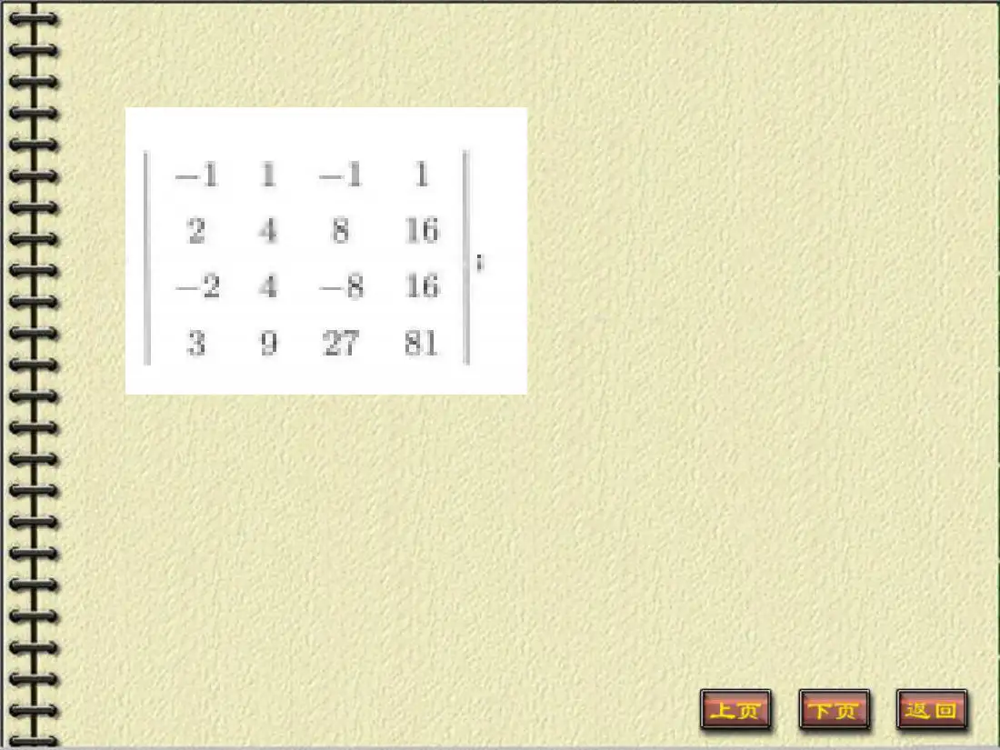

原文：

$$
\begin{array}{c c c c} - 1 & 1 & - 1 & 1 \\ 2 & 4 & 8 & 1 6 \\ - 2 & 4 & - 8 & 1 6 \\ 3 & 9 & 2 7 & 8 1 \end{array}
$$

上页 下页 返回

### 例 计算 n 阶行列式 (两道一点)

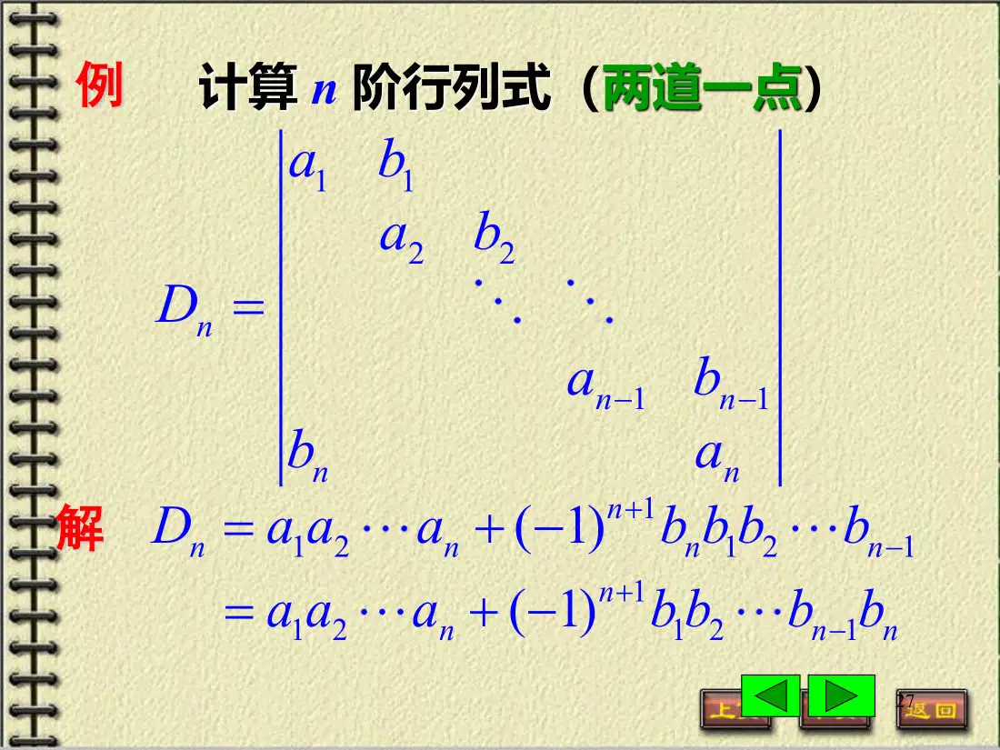

原文：

例 计算 n 阶行列式 (两道一点)

$$
D _ {n} = \left| \begin{array}{l l l l l} a _ {1} & b _ {1} & & & \\ & a _ {2} & b _ {2} & & \\ & & \ddots & \ddots & \\ & & & a _ {n - 1} & b _ {n - 1} \\ b _ {n} & & & & a _ {n} \end{array} \right|
$$

$$
\begin{array}{r} D _ {n} = a _ {1} a _ {2} \dots a _ {n} + (- 1) ^ {n + 1} b _ {n} b _ {1} b _ {2} \dots b _ {n - 1} \\ = a _ {1} a _ {2} \dots a _ {n} + (- 1) ^ {n + 1} b _ {1} b _ {2} \dots b _ {n - 1} b _ {n} \end{array}
$$

上返回

### $$

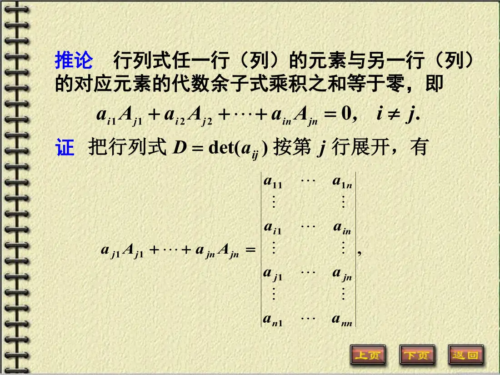

原文：

推论 行列式任一行（列）的元素与另一行（列）的对应元素的代数余子式乘积之和等于零，即

$$
a _ {i 1} A _ {j 1} + a _ {i 2} A _ {j 2} + \dots + a _ {i n} A _ {j n} = 0, i \neq j.
$$

证 把行列式 $D = \det(a_{ij})$ 按第 $j$ 行展开，有

$$
\begin{array}{r} a _ {j 1} A _ {j 1} + \dots + a _ {j n} A _ {j n} = \left| \begin{array}{l l l} a _ {1 1} & \dots & a _ {1 n} \\ \vdots & & \vdots \\ a _ {i 1} & \dots & a _ {i n} \\ \vdots & & \vdots \\ a _ {j 1} & \dots & a _ {j n} \\ \vdots & & \vdots \\ a _ {n 1} & \dots & a _ {n n} \end{array} \right|, \end{array}
$$

上页 下页 返回

### $$

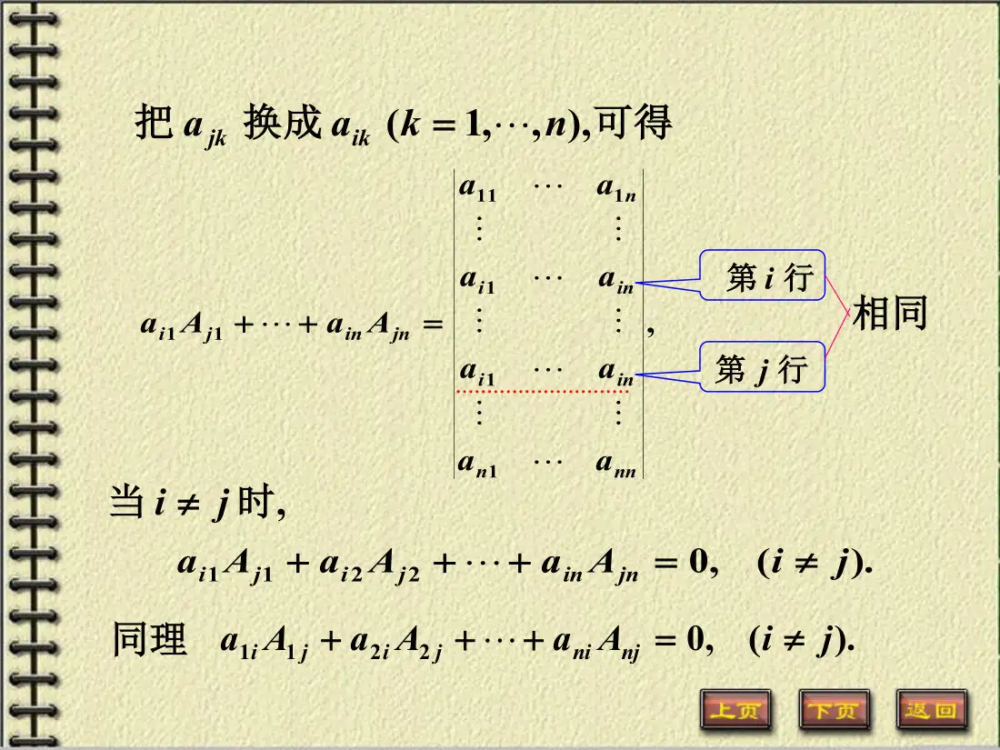

原文：

把 $a_{jk}$ 换成 $a_{ik}$ ( $k=1,\cdots,n$ ), 可得

$$
a _ {i 1} A _ {j 1} + \dots + a _ {i n} A _ {j n} = \left| \begin{array}{c c c} a _ {1 1} & \dots & a _ {1 n} \\ \vdots & & \vdots \\ a _ {i 1} & \dots & a _ {i n} \\ \vdots & & \vdots \\ a _ {i 1} & \dots & a _ {i n} \\ \vdots & & \vdots \\ a _ {n 1} & \dots & a _ {n n} \end{array} , \right. \xrightarrow {\text {第} i \text {行}} \text {相同}
$$

当 $i \neq j$ 时，

$$
a _ {i 1} A _ {j 1} + a _ {i 2} A _ {j 2} + \dots + a _ {i n} A _ {j n} = 0, (i \neq j).
$$

同理 $a_{1i}A_{1j} + a_{2i}A_{2j} + \cdots + a_{ni}A_{nj} = 0,\quad (i \neq j).$

上页 下页 返回

### $$

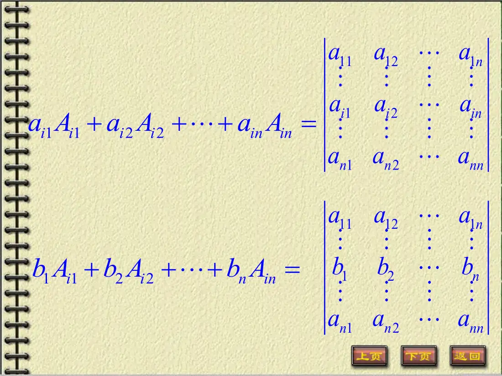

原文：

$$
\begin{array}{r l} & {a _ {i 1} A _ {i 1} + a _ {i 2} A _ {i 2} + \dots + a _ {i n} A _ {i n} = \left| \begin{array}{l l l l} a _ {1 1} & a _ {1 2} & \dots & a _ {1 n} \\ \vdots & \vdots & \vdots & \vdots \\ a _ {i 1} & a _ {i 2} & \dots & a _ {i n} \\ \vdots & \vdots & \vdots & \vdots \\ a _ {n 1} & a _ {n 2} & \dots & a _ {n n} \end{array} \right|} \\ & {b _ {1} A _ {i 1} + b _ {2} A _ {i 2} + \dots + b _ {n} A _ {i n} = \left| \begin{array}{l l l l} a _ {1 1} & a _ {1 2} & \dots & a _ {1 n} \\ \vdots & \vdots & \vdots & \vdots \\ b _ {1} & b _ {2} & \dots & b _ {n} \\ \vdots & \vdots & \vdots & \vdots \\ a _ {n 1} & a _ {n 2} & \dots & a _ {n n} \end{array} \right|} \\ & \boxed \texttt \textbf \textit \textbf \textit \textbf \textit \textbf \textit \textbf \textit \textbf \textit \textbf \textit {\textbf {\textit {\textbf {\textit {\textbf {\textit {\textbf {\textit {\textbf {\textit {\textbf {\textit {\textbf {\textit {\textbf {\textit {\textbf {\textit {\textbf {\textit {\textbf}}}}}}}}}}}}}}}}}}}}} \\ & \boxed \texttt \texttt \textbf \textit \textbf {\textit {\textbf {\textit {\textbf {\textit {\textbf {\textit {\textbf {\textit {\textbf {\textit {\textbf {\textit {\textbf {\textit {\textbf {\textit {\textbf {\textit {\textbf}}}}}}}}}}}}}}}}}}} \\ & {\boxed {\texttt {\texttt {\textbf {\textit {\textbf {\textit {\textbf {\textit {\textbf}}}}}}}}}}} \end{array}
$$

### 定理4 n阶行列式 $D=\left|a_{ij}\right|_{n}$

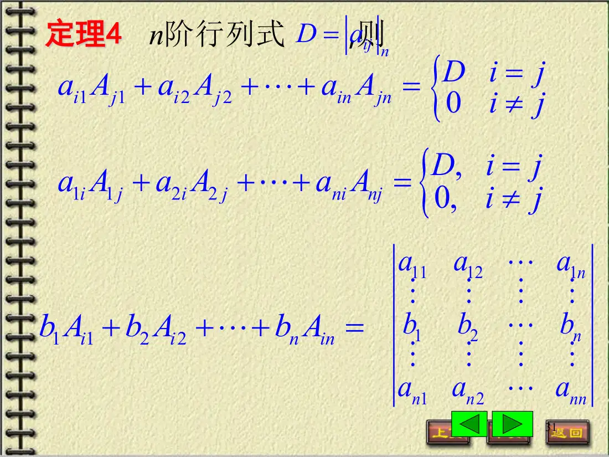

原文：

定理4 n阶行列式 $D=\left|a_{ij}\right|_{n}$

$$
a _ {i 1} A _ {j 1} + a _ {i 2} A _ {j 2} + \dots + a _ {i n} A _ {j n} = \left\{ \begin{array}{l l} D & i = j \\ 0 & i \neq j \end{array} \right.
$$

$$
a _ {1 i} A _ {1 j} + a _ {2 i} A _ {2 j} + \dots + a _ {n i} A _ {n j} = \left\{ \begin{array}{l l} D, & i = j \\ 0, & i \neq j \end{array} \right.
$$

$$
b _ {1} A _ {i 1} + b _ {2} A _ {i 2} + \dots + b _ {n} A _ {i n} = \left| \begin{array}{c c c c} a _ {1 1} & a _ {1 2} & \dots & a _ {1 n} \\ \vdots & \vdots & \vdots & \vdots \\ b _ {1} & b _ {2} & \dots & b _ {n} \\ \vdots & \vdots & \vdots & \vdots \\ a _ {n 1} & a _ {n 2} & \dots & a _ {n n} \end{array} \right|
$$

### $$

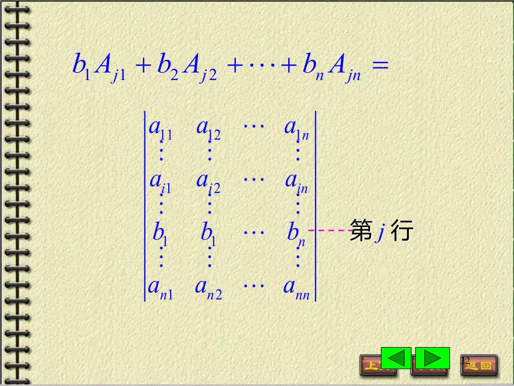

原文：

$$
b _ {1} A _ {j 1} + b _ {2} A _ {j 2} + \dots + b _ {n} A _ {j n} =
$$

$$
\left| \begin{array}{l l l l} a _ {1 1} & a _ {1 2} & \dots & a _ {1 n} \\ \vdots & \vdots & & \vdots \\ a _ {i 1} & a _ {i 2} & \dots & a _ {i n} \\ \vdots & \vdots & & \vdots \\ b _ {1} & b _ {1} & \dots & b _ {n} \\ \vdots & \vdots & & \vdots \\ a _ {n 1} & a _ {n 2} & \dots & a _ {n n} \end{array} \right|
$$

第j行

上返回

### $$

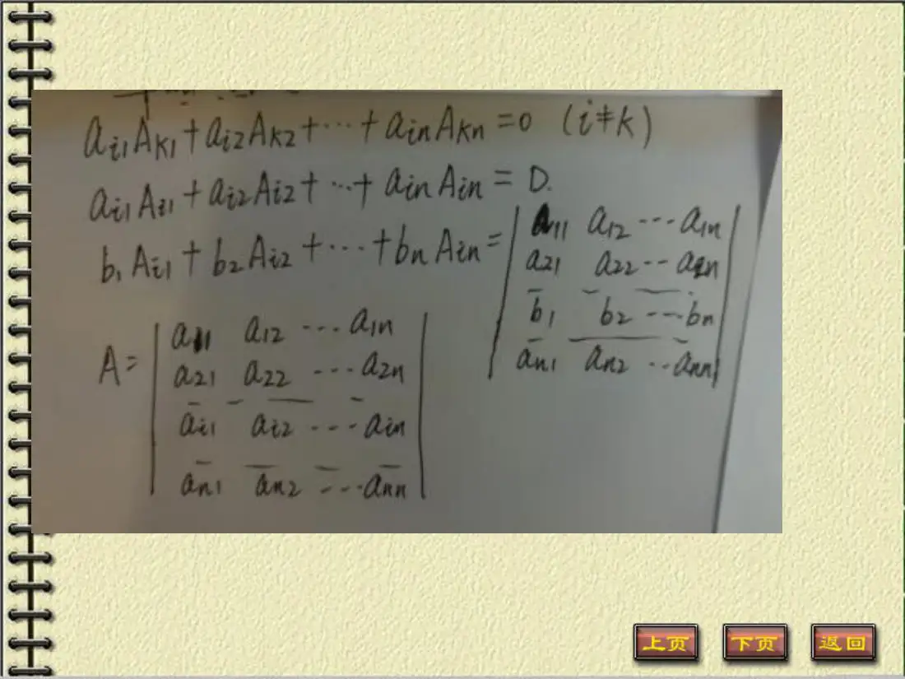

原文：

$$
a _ {i 1} A _ {k 1} + a _ {i 2} A _ {k 2} + \dots + a _ {i n} A _ {k n} = 0 (i \neq k)
$$

$$
a _ {i 1} A _ {i 1} + a _ {i 2} A _ {i 2} + \dots + a _ {i n} A _ {i n} = 0.
$$

$$
b _ {1} A _ {i 1} + b _ {2} A _ {i 2} + \dots + b _ {n} A _ {i n}
$$

$$
A = \left| \begin{array}{l l l} a _ {1 1} & a _ {1 2} & \dots a _ {1 n} \\ a _ {2 1} & a _ {2 2} & \dots a _ {2 n} \\ \overline {{a _ {i 1}}} & \overline {{a _ {i 2}}} & \dots a _ {i n} \\ \overline {{a _ {n 1}}} & \overline {{a _ {n 2}}} & \dots a _ {n n} \end{array} \right|
$$

$$
= \left| \begin{array}{l l l} a _ {1 1} & a _ {1 2} & \dots a _ {1 n} \\ a _ {2 1} & a _ {2 2} & \dots a _ {2 n} \\ \overline {{b}} _ {1} & b _ {2} & \dots b _ {n} \\ \overline {{a}} _ {n 1} & a _ {n 2} & \dots a _ {n n 1} \end{array} \right|
$$

上页 下页 返回

### 三、小结

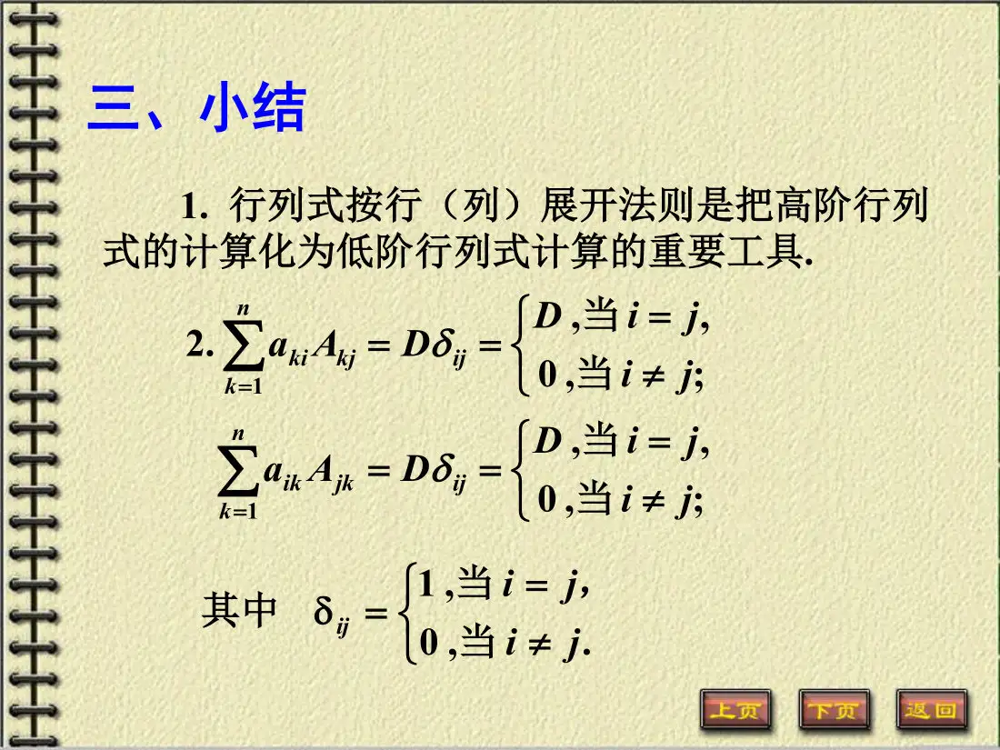

原文：

三、小结

1. 行列式按行（列）展开法则是把高阶行列式的计算化为低阶行列式计算的重要工具。

$$
\cdot \sum_ {k = 1} ^ {n} a _ {k i} A _ {k j} = D \delta_ {i j} = \left\{ \begin{array}{l l} {{D, \text {当} i = j,}} \\ {{0, \text {当} i \neq j;}} \end{array} \right.
$$

$$
\sum_ {k = 1} ^ {n} a _ {i k} A _ {j k} = D \delta_ {i j} = \left\{ \begin{array}{l l} {{D, \text {当} i = j,}} \\ {{0, \text {当} i \neq j;}} \end{array} \right.
$$

其中 $\delta_{ij}=\left\{\begin{aligned}&1, 当 i=j,\\ &0, 当 i\neq j.\end{aligned}\right.$

上页 下页 返回

### (A)-2; (B)-1; (C)0; (D)2.

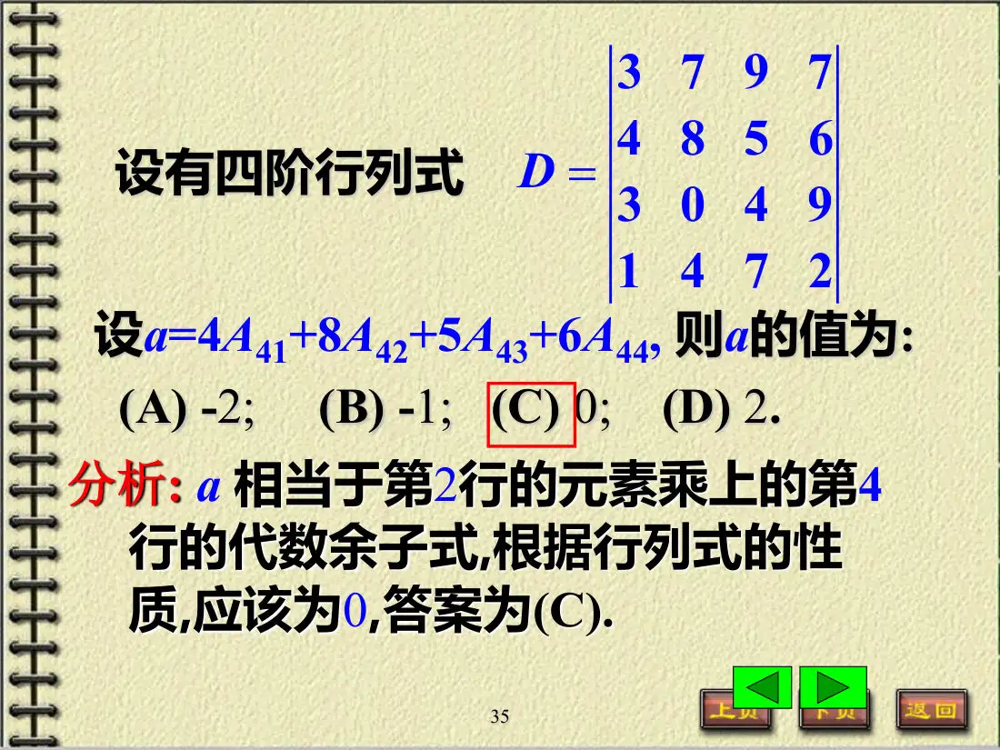

原文：

设有四阶行列式 $D = \begin{vmatrix} 3 & 7 & 9 & 7 \\ 4 & 8 & 5 & 6 \\ 3 & 0 & 4 & 9 \\ 1 & 4 & 7 & 2 \end{vmatrix}$

设 $a=4A_{41}+8A_{42}+5A_{43}+6A_{44}$ ，则a的值为：
(A)-2; (B)-1; (C)0; (D)2.

分析: $a$ 相当于第2行的元素乘上的第4行的代数余子式,根据行列式的性质,应该为0,答案为(C).

35

上页 下页 返回

### (2) $M_{31} + M_{32} + M_{33} + M_{34}$

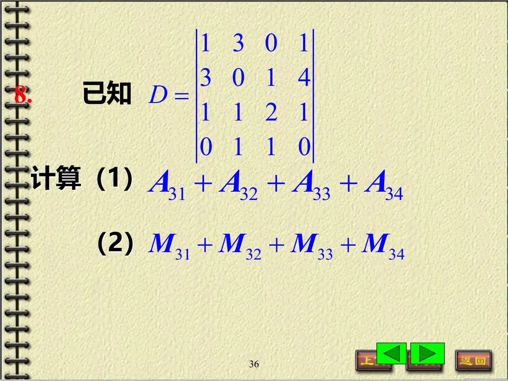

原文：

已知 $D = \begin{vmatrix} 1 & 3 & 0 & 1 \\ 3 & 0 & 1 & 4 \\ 1 & 1 & 2 & 1 \\ 0 & 1 & 1 & 0 \end{vmatrix}$

计算 (1) $A_{31} + A_{32} + A_{33} + A_{34}$

(2) $M_{31} + M_{32} + M_{33} + M_{34}$

8.

36

上返回

### $$

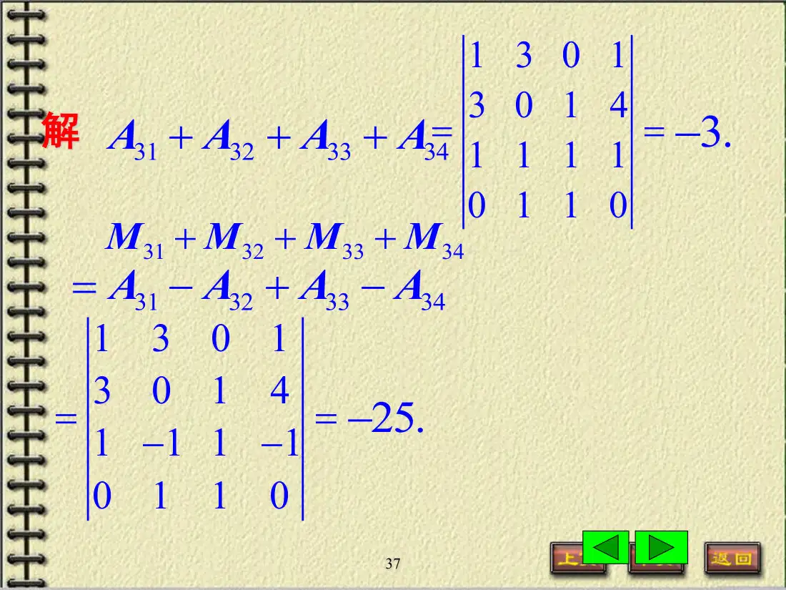

原文：

$$
A _ {3 1} + A _ {3 2} + A _ {3 3} + A _ {3 4} = \left| \begin{array}{l l l l} 1 & 3 & 0 & 1 \\ 3 & 0 & 1 & 4 \\ 1 & 1 & 1 & 1 \\ 0 & 1 & 1 & 0 \end{array} \right| = - 3.
$$

$$
\begin{array}{r l} & {\boldsymbol {M} _ {3 1} + \boldsymbol {M} _ {3 2} + \boldsymbol {M} _ {3 3} + \boldsymbol {M} _ {3 4}} \\ & {= \boldsymbol {A} _ {3 1} - \boldsymbol {A} _ {3 2} + \boldsymbol {A} _ {3 3} - \boldsymbol {A} _ {3 4}} \\ & {= \left| \begin{array}{l l l l} 1 & 3 & 0 & 1 \\ 3 & 0 & 1 & 4 \\ 1 & - 1 & 1 & - 1 \\ 0 & 1 & 1 & 0 \end{array} \right| = - 2 5.} \end{array}
$$

37

上返回

### 思考题

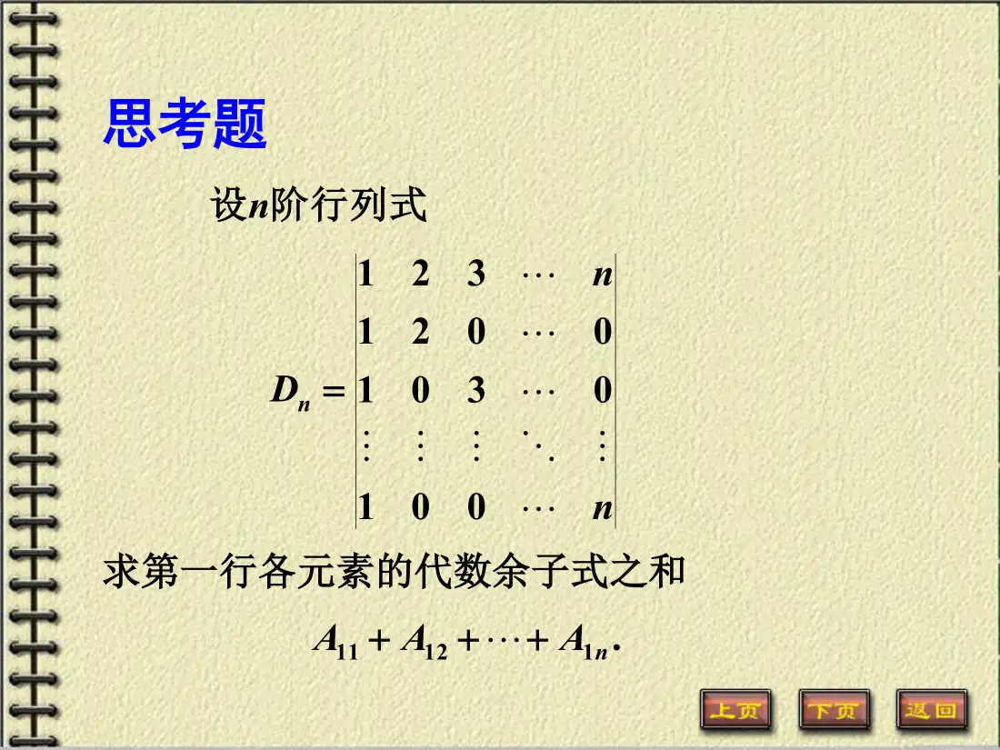

原文：

思考题

设 $n$ 阶行列式

$$
D _ {n} = \left| \begin{array}{c c c c c} 1 & 2 & 3 & \dots & n \\ 1 & 2 & 0 & \dots & 0 \\ 1 & 0 & 3 & \dots & 0 \\ \vdots & \vdots & \vdots & \ddots & \vdots \\ 1 & 0 & 0 & \dots & n \end{array} \right|
$$

求第一行各元素的代数余子式之和

$$
A _ {1 1} + A _ {1 2} + \dots + A _ {1 n}.
$$

上页 下页 返回

### 思考题解答

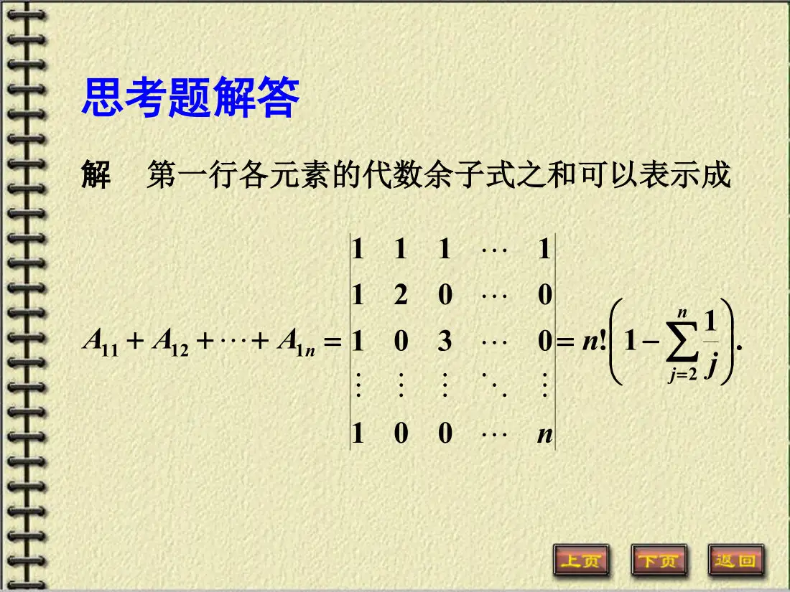

原文：

思考题解答

解 第一行各元素的代数余子式之和可以表示成

$$
A _ {1 1} + A _ {1 2} + \dots + A _ {1 n} = \left| \begin{array}{c c c c c} 1 & 1 & 1 & \dots & 1 \\ 1 & 2 & 0 & \dots & 0 \\ 1 & 0 & 3 & \dots & 0 \\ \vdots & \vdots & \vdots & \ddots & \vdots \\ 1 & 0 & 0 & \dots & n \end{array} \right| = n! \left(1 - \sum_ {j = 2} ^ {n} \frac {1}{j}\right).
$$

上页 下页 返回

### 1.3 行列式依行（列）展开

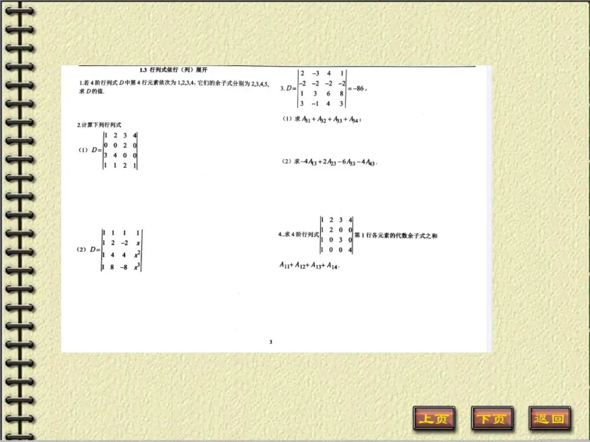

原文：

1.3 行列式依行（列）展开

1. 若 4 阶行列式 D 中第 4 行元素依次为 1,2,3,4，它们的余子式分别为 2,3,4,5，求 D 的值。

2. 计算下列行列式

(1) $D = \left| \begin{array}{lll}1 & 2 & 3 & 4\\ 0 & 0 & 2 & 0\\ 3 & 4 & 0 & 0\\ 1 & 1 & 2 & 1 \end{array} \right|$

$$
D = \left| \begin{array}{c c c c} 1 & 1 & 1 & 1 \\ 1 & 2 & - 2 & x \\ 1 & 4 & 4 & x ^ {2} \\ 1 & 8 & - 8 & x ^ {3} \end{array} \right|
$$

$$
3. D = \left| \begin{array}{c c c c} 2 & - 3 & 4 & 1 \\ - 2 & - 2 & - 2 & - 2 \\ 1 & 3 & 6 & 8 \\ 3 & - 1 & 4 & 3 \end{array} \right| = - 8 6,
$$

(1) 求 $A_{91} + A_{92} + A_{93} + A_{94}$ ;

(2) 求 $-4A_{13} + 2A_{23} - 6A_{33} - 4A_{43}$

4.求4阶行列式 $\left| \begin{array}{lll}1 & 2 & 3 & 4\\ 1 & 2 & 0 & 0\\ 1 & 0 & 3 & 0\\ 1 & 0 & 0 & 4 \end{array} \right|$ 第1行各元素的代数余子式之和 $A_{11} + A_{12} + A_{13} + A_{14}.$

3

上页 下页 返回
