# 《线性代数与解析几何》第1.4节 克莱姆法则（课件）

原件的每一页，下面附识别出的文字。

### 非齐次与齐次线性方程组的概念：

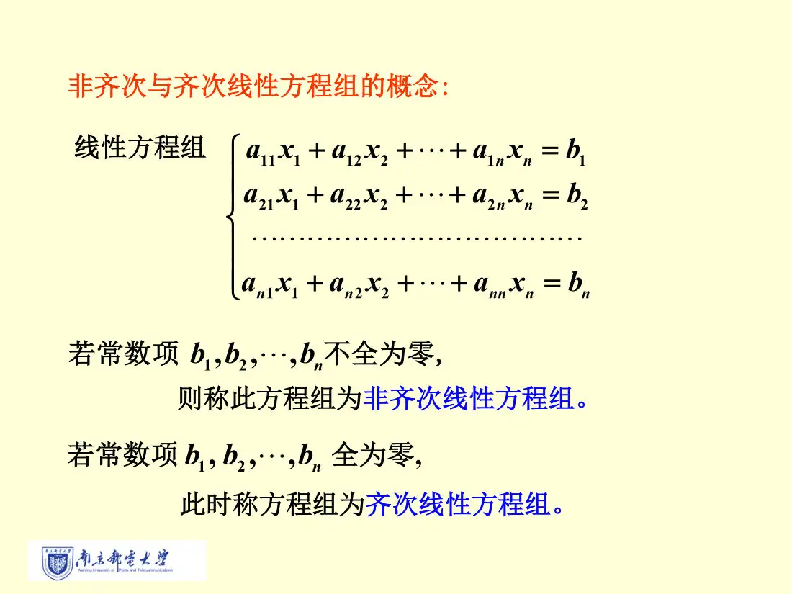

原文：

非齐次与齐次线性方程组的概念：

线性方程组

$$
\left\{ \begin{array}{l} a _ {1 1} x _ {1} + a _ {1 2} x _ {2} + \dots + a _ {1 n} x _ {n} = b _ {1} \\ a _ {2 1} x _ {1} + a _ {2 2} x _ {2} + \dots + a _ {2 n} x _ {n} = b _ {2} \\ \dots\dots\\ a _ {n 1} x _ {1} + a _ {n 2} x _ {2} + \dots + a _ {n n} x _ {n} = b _ {n} \end{array} \right.
$$

若常数项 $b_{1}, b_{2}, \cdots, b_{n}$ 不全为零，

则称此方程组为非齐次线性方程组。

若常数项 $b_{1},b_{2},\cdots,b_{n}$ 全为零，

此时称方程组为齐次线性方程组。

南京邮电大学
Nanjing University of Posts and Telecommunications

### 1.4 Cramer 法则

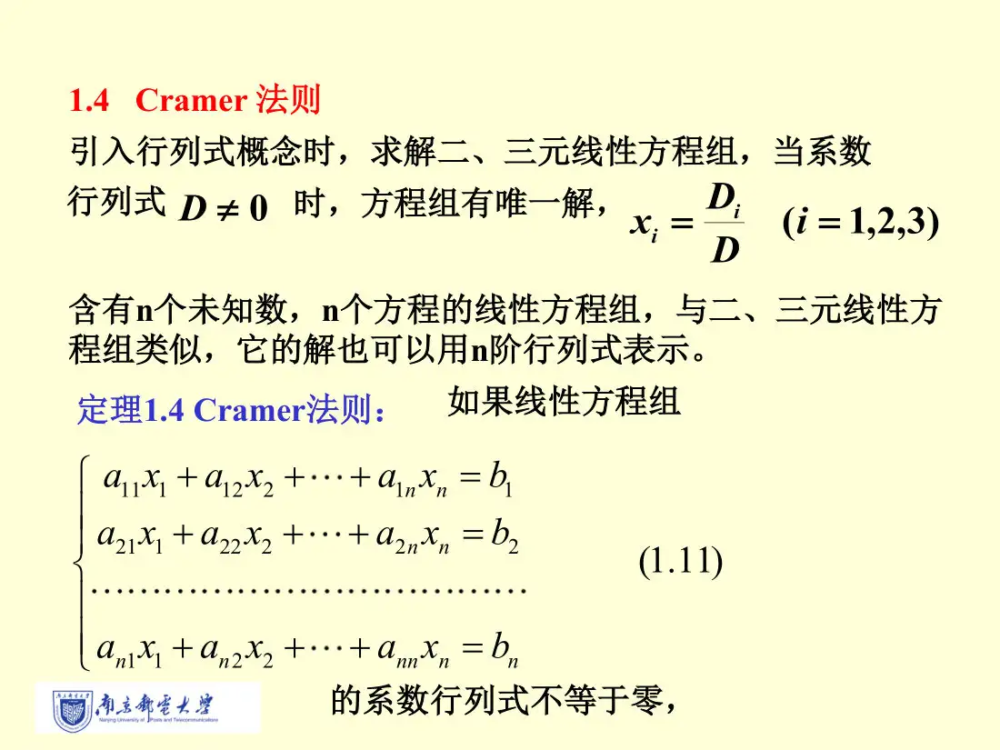

原文：

1.4 Cramer 法则

引入行列式概念时，求解二、三元线性方程组，当系数行列式 $D \neq 0$ 时，方程组有唯一解， $x_{i} = \frac{D_{i}}{D} \quad (i = 1, 2, 3)$

含有n个未知数，n个方程的线性方程组，与二、三元线性方程组类似，它的解也可以用n阶行列式表示。

定理1.4 Cramer法则：如果线性方程组

$$
\left\{ \begin{array}{l} a _ {1 1} x _ {1} + a _ {1 2} x _ {2} + \dots + a _ {1 n} x _ {n} = b _ {1} \\ a _ {2 1} x _ {1} + a _ {2 2} x _ {2} + \dots + a _ {2 n} x _ {n} = b _ {2} \\ \dots \\ a _ {n 1} x _ {1} + a _ {n 2} x _ {2} + \dots + a _ {n n} x _ {n} = b _ {n} \end{array} \right.\tag{1.11}
$$

的系数行列式不等于零，

南京邮电大学
Nanjing University of Posts and Telecommunications

### $$

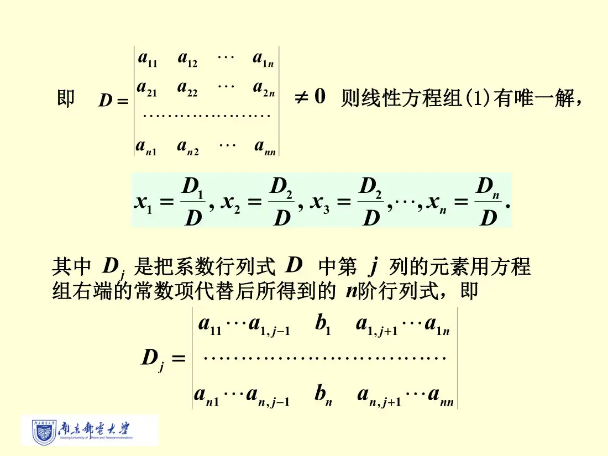

原文：

即

$$
\begin{array}{r l} & D = \left| \begin{array}{c c c c} a _ {1 1} & a _ {1 2} & \dots & a _ {1 n} \\ a _ {2 1} & a _ {2 2} & \dots & a _ {2 n} \\ \dots & \dots & \dots & \dots \\ a _ {n 1} & a _ {n 2} & \dots & a _ {n n} \end{array} \right| \neq 0 \text {则线性方程组(1)有唯一解,} \\ & x _ {1} = \frac {D _ {1}}{D}, x _ {2} = \frac {D _ {2}}{D}, x _ {3} = \frac {D _ {2}}{D}, \dots , x _ {n} = \frac {D _ {n}}{D}. \end{array}
$$

其中 $D_{j}$ 是把系数行列式 D 中第 j 列的元素用方程组右端的常数项代替后所得到的 n 阶行列式，即

$$
D _ {j} = \left| \begin{array}{c c c} a _ {1 1} \dots a _ {1, j - 1} & b _ {1} & a _ {1, j + 1} \dots a _ {1 n} \\ \dots \dots \\ a _ {n 1} \dots a _ {n, j - 1} & b _ {n} & a _ {n, j + 1} \dots a _ {n n} \end{array} \right|
$$

南京邮电大学
Nanjing University of Posts and Telecommunications

### $$

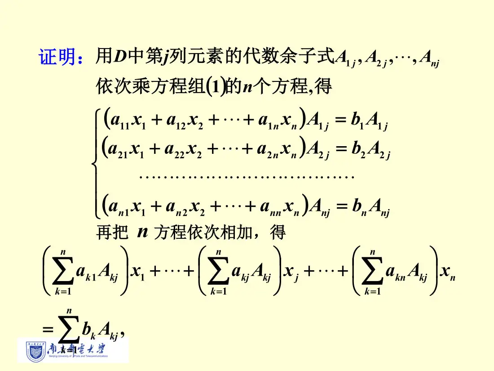

原文：

证明：用D中第j列元素的代数余子式 $A_{1j},A_{2j},\cdots,A_{nj}$ 依次乘方程组(1)的n个方程,得

$$
\left\{ \begin{array}{l} \left(a _ {1 1} x _ {1} + a _ {1 2} x _ {2} + \dots + a _ {1 n} x _ {n}\right) A _ {1 j} = b _ {1} A _ {1 j} \\ \left(a _ {2 1} x _ {1} + a _ {2 2} x _ {2} + \dots + a _ {2 n} x _ {n}\right) A _ {2 j} = b _ {2} A _ {2 j} \\ \dots\dots\\ \left(a _ {n 1} x _ {1} + a _ {n 2} x _ {2} + \dots + a _ {n n} x _ {n}\right) A _ {n j} = b _ {n} A _ {n j} \end{array} \right.
$$

再把 n 方程依次相加，得

$$
\begin{array}{l} \left(\sum_ {k = 1} ^ {n} a _ {k 1} A _ {k j}\right) x _ {1} + \dots + \left(\sum_ {k = 1} ^ {n} a _ {k j} A _ {k j}\right) x _ {j} + \dots + \left(\sum_ {k = 1} ^ {n} a _ {k n} A _ {k j}\right) x _ {n} \\ = \sum_ {\text {南京大学}} ^ {n} b _ {k} A _ {k j}, \end{array}
$$

### 由代数余子式的性质可知，上式中除了 $x_{j}$ 的系数等于D，

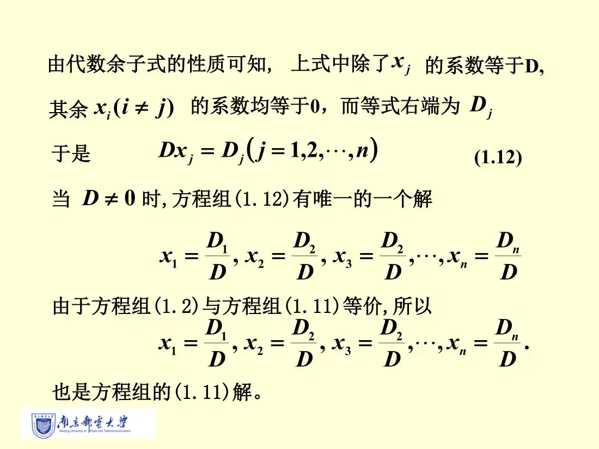

原文：

由代数余子式的性质可知，上式中除了 $x_{j}$ 的系数等于D，
其余 $x_{i}(i \neq j)$ 的系数均等于0，而等式右端为 $D_{j}$

于是

$$
D x _ {j} = D _ {j} (j = 1, 2, \dots , n)\tag{1.12}
$$

当 $D \neq 0$ 时, 方程组(1.12)有唯一的一个解

$$
x _ {1} = \frac {D _ {1}}{D}, x _ {2} = \frac {D _ {2}}{D}, x _ {3} = \frac {D _ {2}}{D}, \dots , x _ {n} = \frac {D _ {n}}{D}
$$

由于方程组(1.2)与方程组(1.11)等价,所以

$$
x _ {1} = \frac {D _ {1}}{D}, x _ {2} = \frac {D _ {2}}{D}, x _ {3} = \frac {D _ {2}}{D}, \dots , x _ {n} = \frac {D _ {n}}{D}.
$$

也是方程组的(1.11)解。

南京邮电大学
Nanjing University of Posts and Telecommunications

### 例1.16 用Cramer法则解线性方程组。

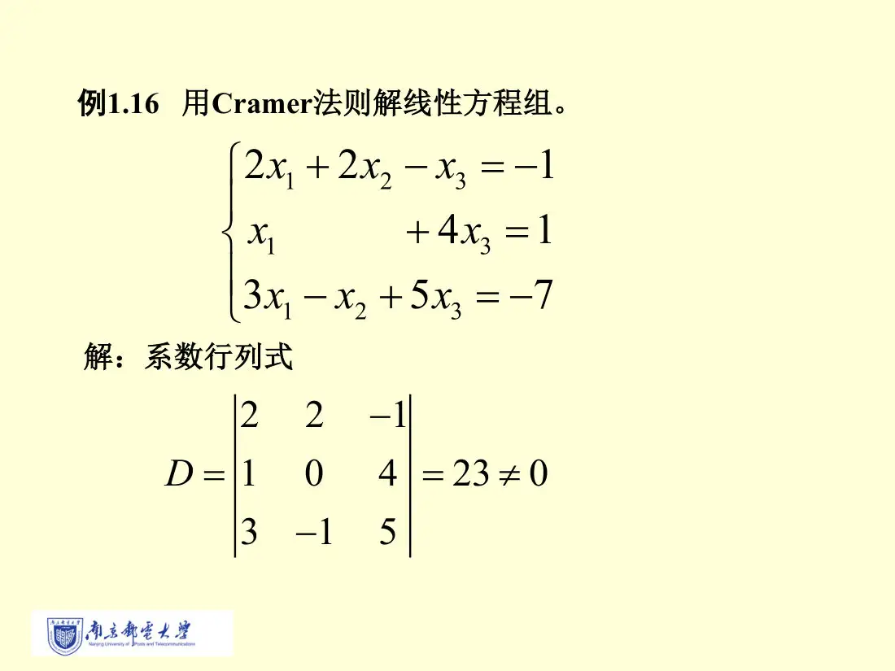

原文：

例1.16 用Cramer法则解线性方程组。

$$
\left\{ \begin{array}{l} 2 x _ {1} + 2 x _ {2} - x _ {3} = - 1 \\ x _ {1} \qquad \qquad + 4 x _ {3} = 1 \\ 3 x _ {1} - x _ {2} + 5 x _ {3} = - 7 \end{array} \right.
$$

解：系数行列式

$$
D = \left| \begin{array}{c c c} 2 & 2 & - 1 \\ 1 & 0 & 4 \\ 3 & - 1 & 5 \end{array} \right| = 2 3 \neq 0
$$

南京邮电大学
Nanjing University of Posts and Telecommunications

### $$

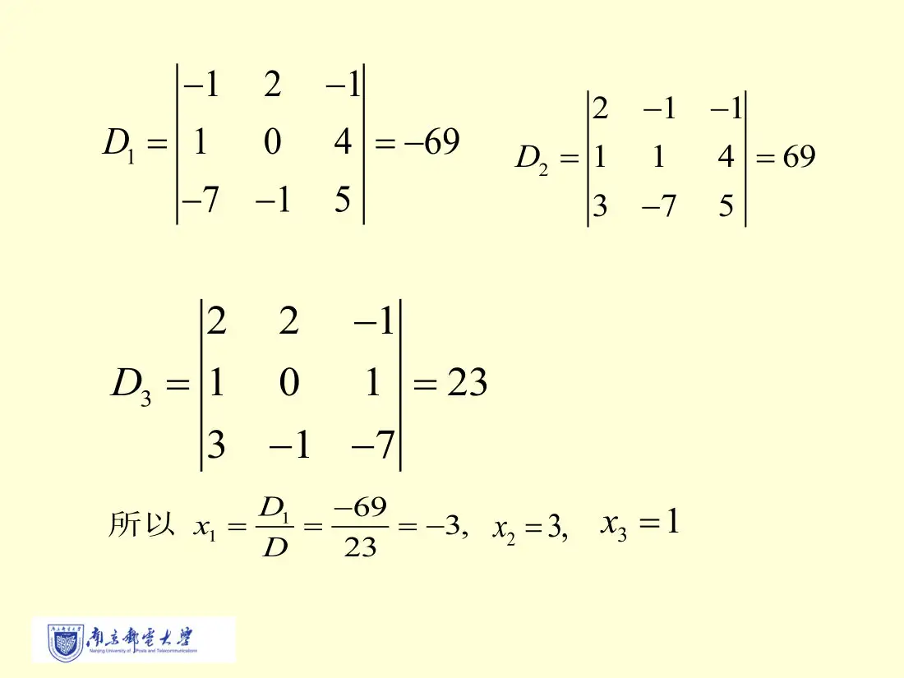

原文：

$$
D _ {1} = \left| \begin{array}{c c c} - 1 & 2 & - 1 \\ 1 & 0 & 4 \\ - 7 & - 1 & 5 \end{array} \right| = - 6 9 \qquad D _ {2} = \left| \begin{array}{c c c} 2 & - 1 & - 1 \\ 1 & 1 & 4 \\ 3 & - 7 & 5 \end{array} \right| = 6 9
$$

$$
D _ {3} = \left| \begin{array}{c c c} 2 & 2 & - 1 \\ 1 & 0 & 1 \\ 3 & - 1 & - 7 \end{array} \right| = 2 3
$$

所以 $x_{1} = \frac{D_{1}}{D} = \frac{-69}{23} = -3, x_{2} = 3, x_{3} = 1$

南京邮电大学
Nanjing University of Posts and Telecommunications

### 注:

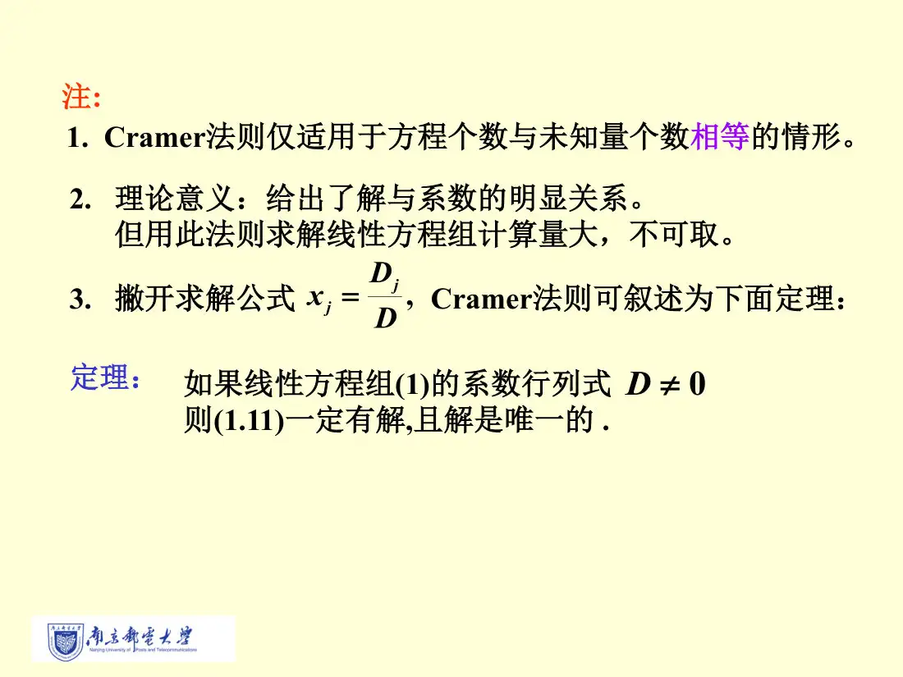

原文：

注:

1. Cramer法则仅适用于方程个数与未知量个数相等的情形。

2. 理论意义：给出了解与系数的明显关系。但用此法则求解线性方程组计算量大，不可取。

3. 撇开求解公式 $x_{j} = \frac{D_{j}}{D}$ , Cramer法则可叙述为下面定理:

定理: 如果线性方程组(1)的系数行列式 $D \neq 0$ 则(1.11)一定有解,且解是唯一的.

南京邮电大学
Nanjing University of Posts and Telecommunications

### 齐次线性方程组的相关定理

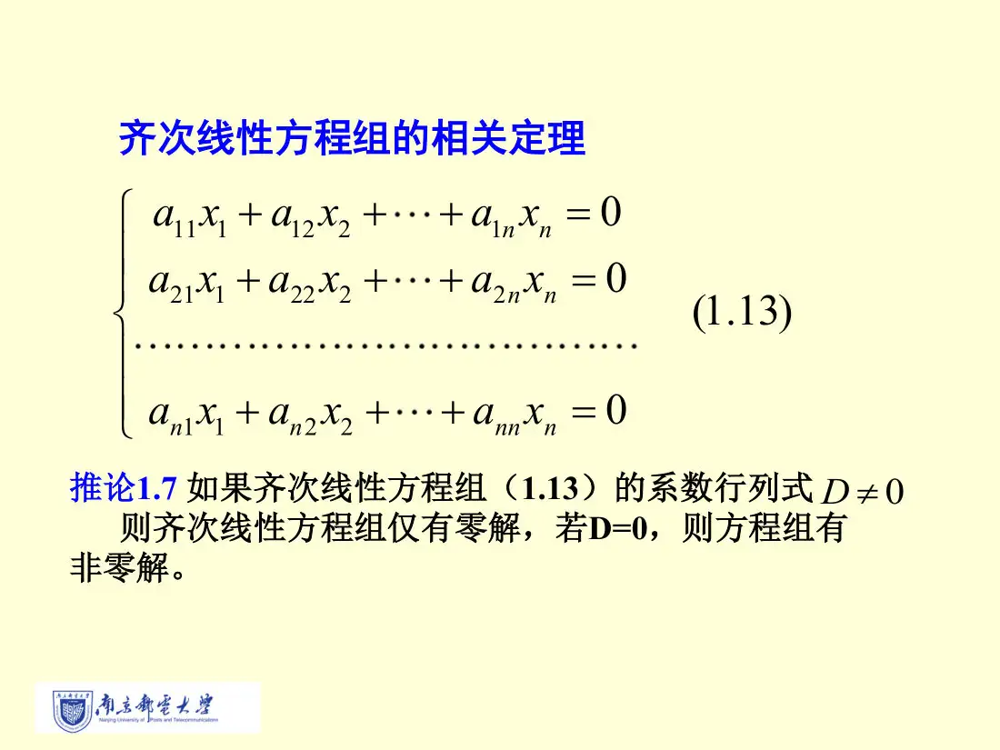

原文：

齐次线性方程组的相关定理

$$
\left\{ \begin{array}{l} a _ {1 1} x _ {1} + a _ {1 2} x _ {2} + \dots + a _ {1 n} x _ {n} = 0 \\ a _ {2 1} x _ {1} + a _ {2 2} x _ {2} + \dots + a _ {2 n} x _ {n} = 0 \\ \dots \\ a _ {n 1} x _ {1} + a _ {n 2} x _ {2} + \dots + a _ {n n} x _ {n} = 0 \end{array} \right.\tag{1.13}
$$

推论1.7 如果齐次线性方程组（1.13）的系数行列式 $D \neq 0$

则齐次线性方程组仅有零解，若 $\mathbf{D} = \mathbf{0}$ ，则方程组有非零解。

南京邮电大学
Nanjing University of Posts and Telecommunications

### 例1.17: 问 $\lambda$ 取何值时，齐次线性方程组有非零解？

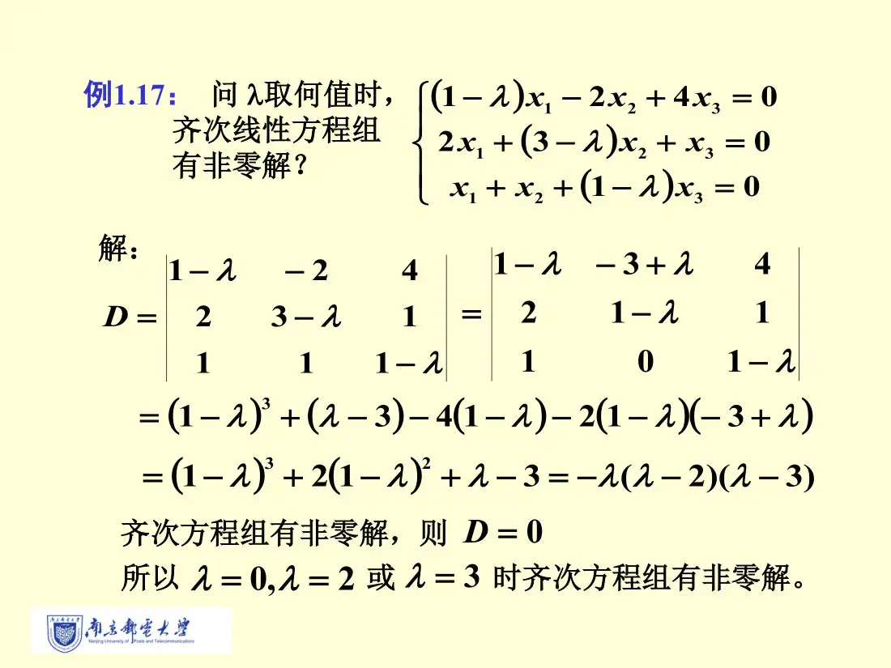

原文：

例1.17: 问 $\lambda$ 取何值时，齐次线性方程组有非零解？

$$
\left\{ \begin{array}{l} (1 - \lambda) x _ {1} - 2 x _ {2} + 4 x _ {3} = 0 \\ 2 x _ {1} + (3 - \lambda) x _ {2} + x _ {3} = 0 \\ x _ {1} + x _ {2} + (1 - \lambda) x _ {3} = 0 \end{array} \right.
$$

$$
\begin{array}{r l} & {\text {解:}} \\ & {D = \left| \begin{array}{c c c} 1 - \lambda & - 2 & 4 \\ 2 & 3 - \lambda & 1 \\ 1 & 1 & 1 - \lambda \end{array} \right| = \left| \begin{array}{c c c} 1 - \lambda & - 3 + \lambda & 4 \\ 2 & 1 - \lambda & 1 \\ 1 & 0 & 1 - \lambda \end{array} \right|} \\ & {\qquad = (1 - \lambda) ^ {3} + (\lambda - 3) - 4 (1 - \lambda) - 2 (1 - \lambda) (- 3 + \lambda)} \\ & {\qquad = (1 - \lambda) ^ {3} + 2 (1 - \lambda) ^ {2} + \lambda - 3 = - \lambda (\lambda - 2) (\lambda - 3)} \end{array}
$$

齐次方程组有非零解，则 $D = 0$

所以 $\lambda = 0, \lambda = 2$ 或 $\lambda = 3$ 时齐次方程组有非零解。

南京邮电大学
Nanjing University of Posts and Telecommunications

### 例1.18 证明平面上三条不同的直线

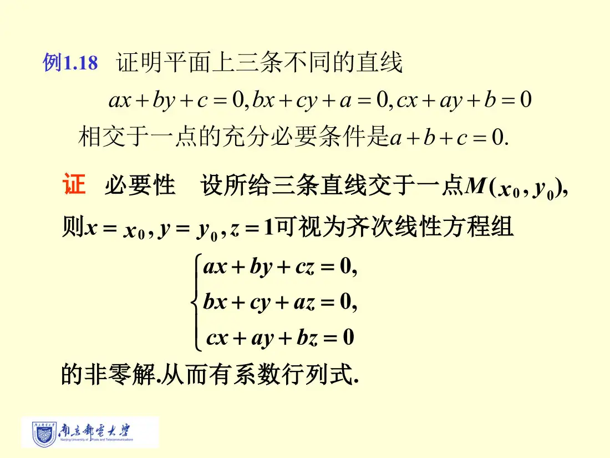

原文：

例1.18 证明平面上三条不同的直线

$$
a x + b y + c = 0, b x + c y + a = 0, c x + a y + b = 0
$$

相交于一点的充分必要条件是 $a+b+c=0$ .

证 必要性 设所给三条直线交于一点 $M(x_{0},y_{0})$ ,
则 $x=x_{0},y=y_{0},z=1$ 可视为齐次线性方程组

$$
\left\{ \begin{array}{l} a x + b y + c z = 0, \\ b x + c y + a z = 0, \\ c x + a y + b z = 0 \end{array} \right.
$$

的非零解.从而有系数行列式.

南京邮电大学
Nanjing University of Posts and Telecommunications

### $$

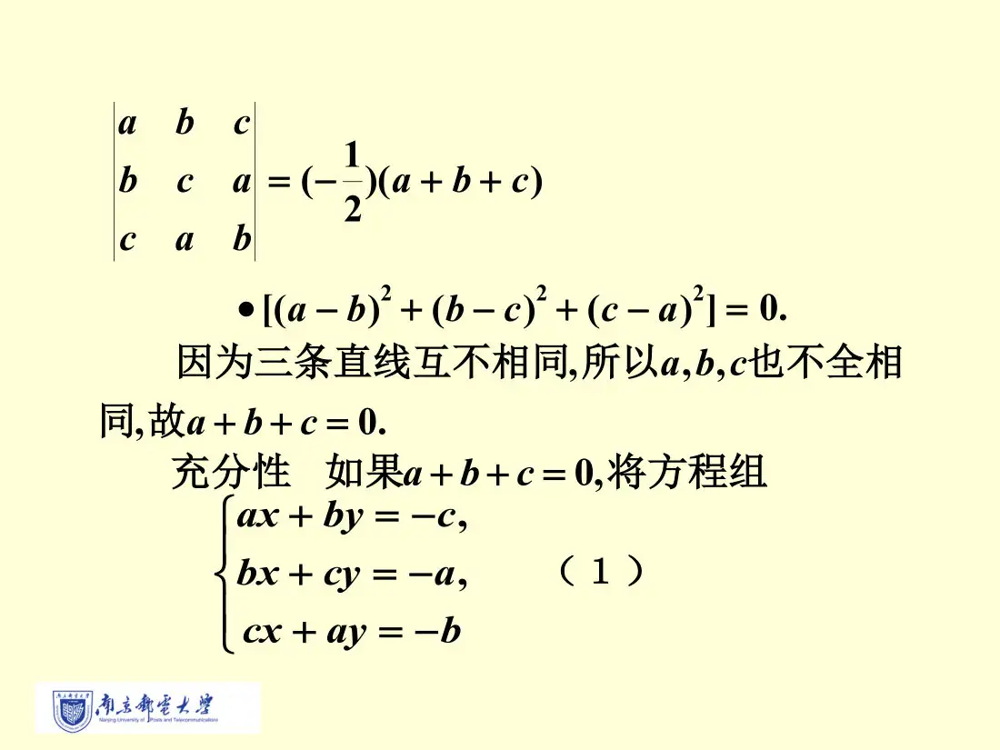

原文：

$$
\left| \begin{array}{c c c} a & b & c \\ b & c & a \\ c & a & b \end{array} \right| = (- \frac {1}{2}) (a + b + c)
$$

$$
\bullet \left[ (a - b) ^ {2} + (b - c) ^ {2} + (c - a) ^ {2} \right] = 0.
$$

因为三条直线互不相同,所以a,b,c也不全相同,故 $a+b+c=0$ .

充分性 如果 $a+b+c=0$ , 将方程组

$$
\left\{ \begin{array}{l} a x + b y = - c, \\ b x + c y = - a, \\ c x + a y = - b \end{array} \right.
$$

( 1 )

南京邮电大学
Nanjing University of Posts and Telecommunications

### 的第一、二两个方程加到第三个方程，得

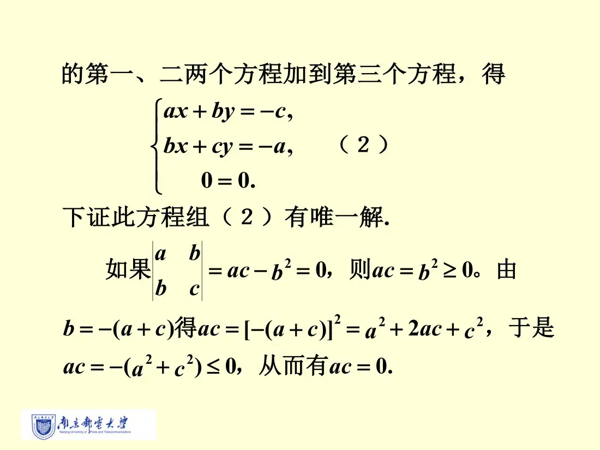

原文：

的第一、二两个方程加到第三个方程，得

$$
\left\{ \begin{array}{c} a x + b y = - c, \\ b x + c y = - a, \\ 0 = 0. \end{array} \right.\tag{2}
$$

下证此方程组（2）有唯一解.

如果 $\begin{vmatrix}a & b \\ b & c\end{vmatrix}=ac-b^{2}=0$ ，则 $ac=b^{2}\geq0$ 。由 $b = -(a + c)$ 得 $ac = [-(a + c)]^{2} = a^{2} + 2ac + c^{2}$ ，于是 $ac = -(a^{2} + c^{2}) \leq 0$ ，从而有ac = 0.

南京邮电大学
Nanjing University of Posts and Telecommunications

### $$

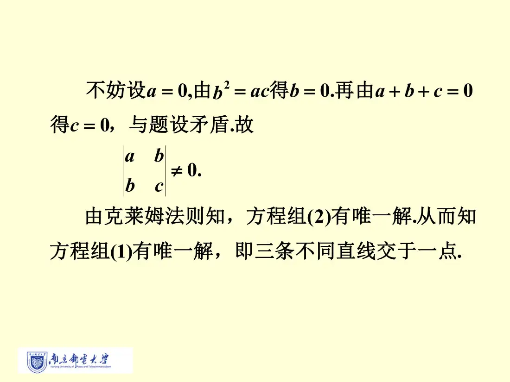

原文：

不妨设 $a = 0$ ，由 $b^{2} = ac$ 得 $b = 0$ .再由 $a + b + c = 0$ 得 $c = 0$ ，与题设矛盾.故

$$
\left| \begin{array}{c c} a & b \\ b & c \end{array} \right| \neq 0.
$$

由克莱姆法则知，方程组(2)有唯一解.从而知方程组(1)有唯一解，即三条不同直线交于一点.

南京邮电大学
Nanjing University of Posts and Telecommunications

### 小结

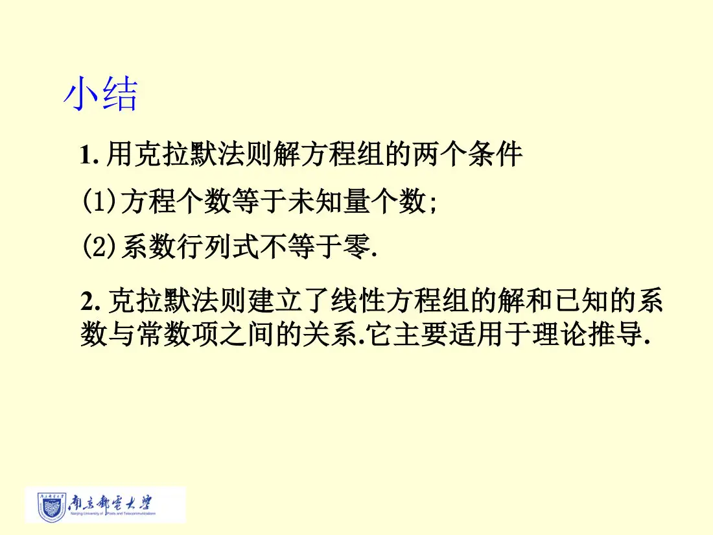

原文：

小结

1. 用克拉默法则解方程组的两个条件

(1) 方程个数等于未知量个数;

(2) 系数行列式不等于零.

2. 克拉默法则建立了线性方程组的解和已知的系数与常数项之间的关系. 它主要适用于理论推导.

南京邮电大学
Nanjing University of Posts and Telecommunications
