# 《线性代数与解析几何》第1章 行列式 1.3 行列式按行（列）展开（课件）

原件的每一页，下面附识别出的文字。

### 1.3 行列式按行（列）展开

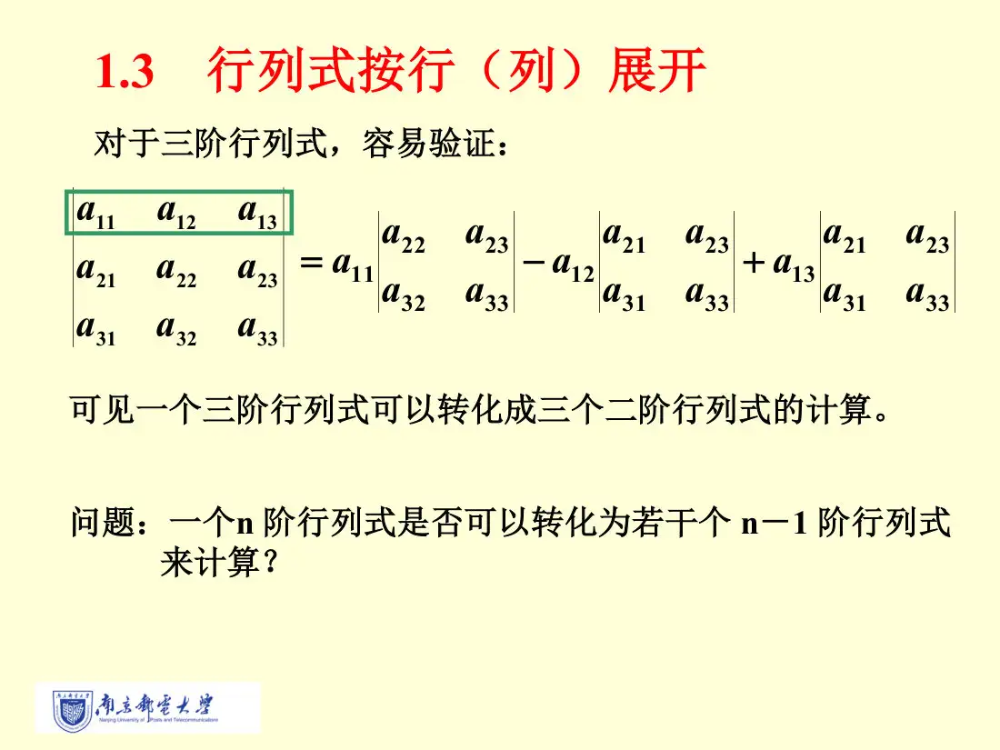

原文：

1.3 行列式按行（列）展开

对于三阶行列式，容易验证：

$$
\left| \begin{array}{c c c} a _ {1 1} & a _ {1 2} & a _ {1 3} \\ a _ {2 1} & a _ {2 2} & a _ {2 3} \\ a _ {3 1} & a _ {3 2} & a _ {3 3} \end{array} \right| = a _ {1 1} \left| \begin{array}{c c} a _ {2 2} & a _ {2 3} \\ a _ {3 2} & a _ {3 3} \end{array} \right| - a _ {1 2} \left| \begin{array}{c c} a _ {2 1} & a _ {2 3} \\ a _ {3 1} & a _ {3 3} \end{array} \right| + a _ {1 3} \left| \begin{array}{c c} a _ {2 1} & a _ {2 3} \\ a _ {3 1} & a _ {3 3} \end{array} \right|
$$

可见一个三阶行列式可以转化成三个二阶行列式的计算。

问题：一个n阶行列式是否可以转化为若干个n-1阶行列式来计算？

南京邮电大学
Nanjing University of Posts and Telecommunications

### $$

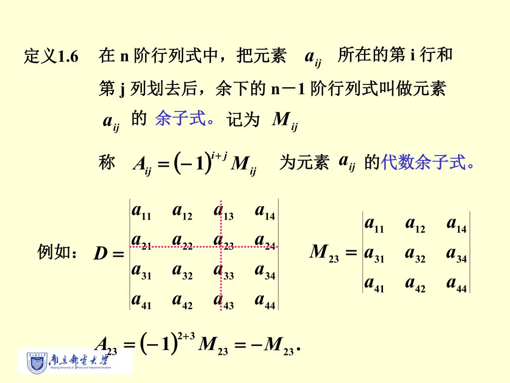

原文：

定义1.6 在 n 阶行列式中，把元素 $a_{ij}$ 所在的第 i 行和第 j 列划去后，余下的 n-1 阶行列式叫做元素 $a_{ij}$ 的余子式。记为 $M_{ij}$

称 $A_{ij} = (-1)^{i + j}M_{ij}$ 为元素 $a_{ij}$ 的代数余子式。

$$
\text {例如:} \quad D = \left| \begin{array}{c c c c} a _ {1 1} & a _ {1 2} & a _ {1 3} & a _ {1 4} \\ a _ {2 1} & a _ {2 2} & a _ {2 3} & a _ {2 4} \\ a _ {3 1} & a _ {3 2} & a _ {3 3} & a _ {3 4} \\ a _ {4 1} & a _ {4 2} & a _ {4 3} & a _ {4 4} \end{array} \right| \quad M _ {2 3} = \left| \begin{array}{c c c} a _ {1 1} & a _ {1 2} & a _ {1 4} \\ a _ {3 1} & a _ {3 2} & a _ {3 4} \\ a _ {4 1} & a _ {4 2} & a _ {4 4} \end{array} \right|
$$

$$
A _ {2 3} = (- 1) ^ {2 + 3} M _ {2 3} = - M _ {2 3}.
$$

南京邮电大学
Nanjing University of Posts and Telecommunications

### $$

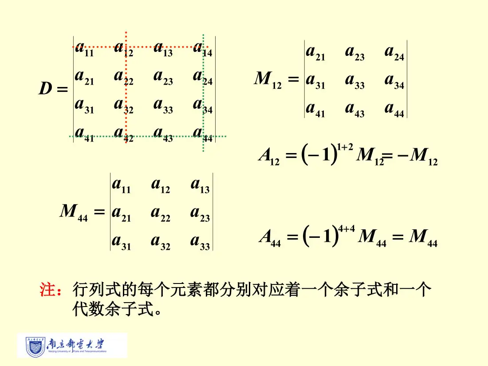

原文：

$$
D = \left| \begin{array}{c c c c} a _ {1 1} & a _ {1 2} & a _ {1 3} & a _ {1 4} \\ a _ {2 1} & a _ {2 2} & a _ {2 3} & a _ {2 4} \\ a _ {3 1} & a _ {3 2} & a _ {3 3} & a _ {3 4} \\ a _ {4 1} & a _ {4 2} & a _ {4 3} & a _ {4 4} \end{array} \right|
$$

$$
M _ {1 2} = \left| \begin{array}{c c c} a _ {2 1} & a _ {2 3} & a _ {2 4} \\ a _ {3 1} & a _ {3 3} & a _ {3 4} \\ a _ {4 1} & a _ {4 3} & a _ {4 4} \end{array} \right|
$$

$$
A _ {1 2} = (- 1) ^ {1 + 2} M _ {1 2} = - M _ {1 2}
$$

$$
M _ {4 4} = \left| \begin{array}{c c c} a _ {1 1} & a _ {1 2} & a _ {1 3} \\ a _ {2 1} & a _ {2 2} & a _ {2 3} \\ a _ {3 1} & a _ {3 2} & a _ {3 3} \end{array} \right|
$$

$$
A _ {4 4} = (- 1) ^ {4 + 4} M _ {4 4} = M _ {4 4}
$$

注：行列式的每个元素都分别对应着一个余子式和一个代数余子式。

南京邮电大学
Nanjing University of Posts and Telecommunications

### 引理1.1 假定行列式D的第一行除 $a_{11}$ 外都是0，则

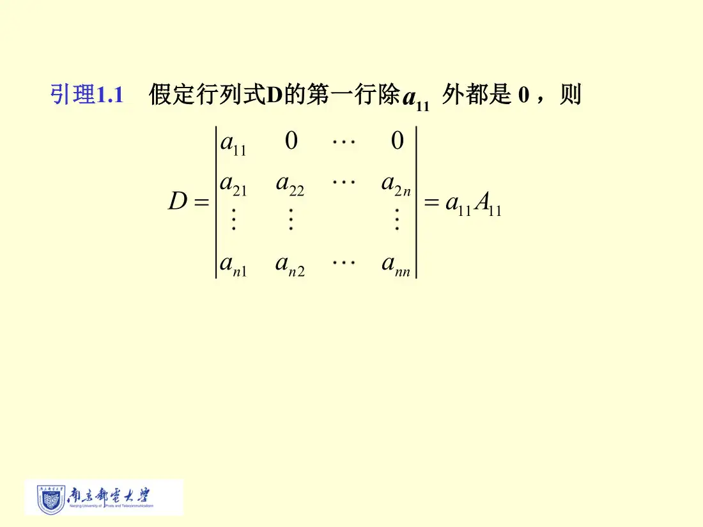

原文：

引理1.1 假定行列式D的第一行除 $a_{11}$ 外都是0，则

$$
D = \left| \begin{array}{c c c c} a _ {1 1} & 0 & \dots & 0 \\ a _ {2 1} & a _ {2 2} & \dots & a _ {2 n} \\ \vdots & \vdots & & \vdots \\ a _ {n 1} & a _ {n 2} & \dots & a _ {n n} \end{array} \right| = a _ {1 1} A _ {1 1}
$$

南京邮电大学
Nanjing University of Posts and Telecommunications

### 证明 由行列式定义，D 中仅含下面形式的项

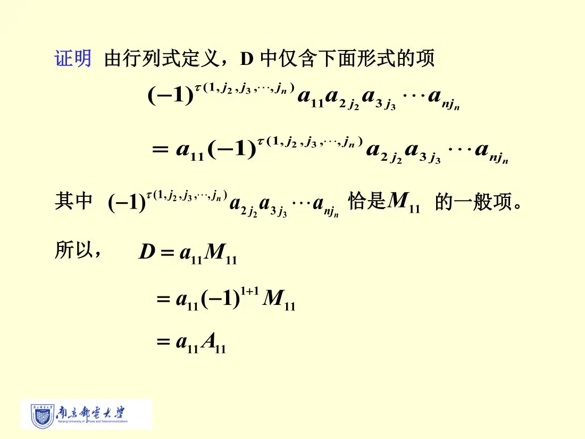

原文：

证明 由行列式定义，D 中仅含下面形式的项

$$
\begin{array}{l} (- 1) ^ {\tau (1, j _ {2}, j _ {3}, \dots , j _ {n})} a _ {1 1} a _ {2 j _ {2}} a _ {3 j _ {3}} \dots a _ {n j _ {n}} \\ = a _ {1 1} (- 1) ^ {\tau (1, j _ {2}, j _ {3}, \dots , j _ {n})} a _ {2 j _ {2}} a _ {3 j _ {3}} \dots a _ {n j _ {n}} \end{array}
$$

其中 $(-1)^{\tau(1,j_{2},j_{3},\cdots,j_{n})}a_{2j_{2}}a_{3j_{3}}\cdots a_{nj_{n}}$ 恰是 $M_{11}$ 的一般项。

所以，

$$
\begin{array}{r l} D & = a _ {1 1} M _ {1 1} \\ & = a _ {1 1} (- 1) ^ {1 + 1} M _ {1 1} \\ & = a _ {1 1} A _ {1 1} \end{array}
$$

南京邮电大学
Nanjing University of Posts and Telecommunications

### 引理1.2设 D 的第 i 行除了 $a_{ij}$ 外都是 0，则

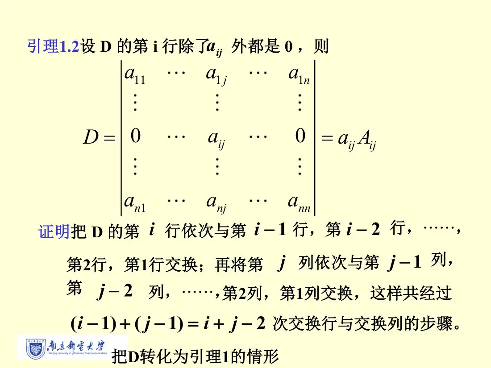

原文：

引理1.2设 D 的第 i 行除了 $a_{ij}$ 外都是 0，则

$$
D = \left| \begin{array}{c c c c c} a _ {1 1} & \dots & a _ {1 j} & \dots & a _ {1 n} \\ \vdots & & \vdots & & \vdots \\ 0 & \dots & a _ {i j} & \dots & 0 \\ \vdots & & \vdots & & \vdots \\ a _ {n 1} & \dots & a _ {n j} & \dots & a _ {n n} \end{array} \right| = a _ {i j} A _ {i j}
$$

证明把 D 的第 i 行依次与第 i-1 行，第 i-2 行，……，

第2行，第1行交换；再将第 j 列依次与第 j-1 列，

第 j-2 列，……，第2列，第1列交换，这样共经过

$(i - 1) + (j - 1) = i + j - 2$ 次交换行与交换列的步骤。

把D转化为引理1的情形

南京邮电大学
Nanjing University of Posts and Telecommunications

### 由性质1.4，行列式互换两行（列）行列式变号，

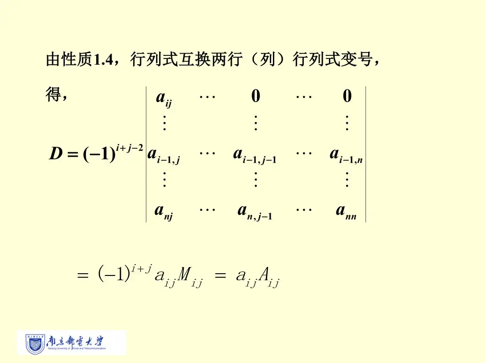

原文：

由性质1.4，行列式互换两行（列）行列式变号，

$$
\begin{array}{r l} & {\text {得}, \quad \left| \begin{array}{l l l l l} {a _ {i j}} & {\dots} & {0} & {\dots} & {0} \\ {\vdots} & & {\vdots} & & {\vdots} \\ {a _ {i - 1, j}} & {\dots} & {a _ {i - 1, j - 1}} & {\dots} & {a _ {i - 1, n}} \\ {\vdots} & & {\vdots} & & {\vdots} \\ {a _ {n j}} & {\dots} & {a _ {n, j - 1}} & {\dots} & {a _ {n n}} \end{array} \right|} \end{array}
$$

$$
= (- 1) ^ {i + j} a _ {i j} M _ {i j} = a _ {i j} A _ {i j}
$$

南京邮电大学
Nanjing University of Posts and Telecommunications

### 定理1.2 行列式D等于它的任一行（列）的各元素与其对应的代数余子式乘积之和，即

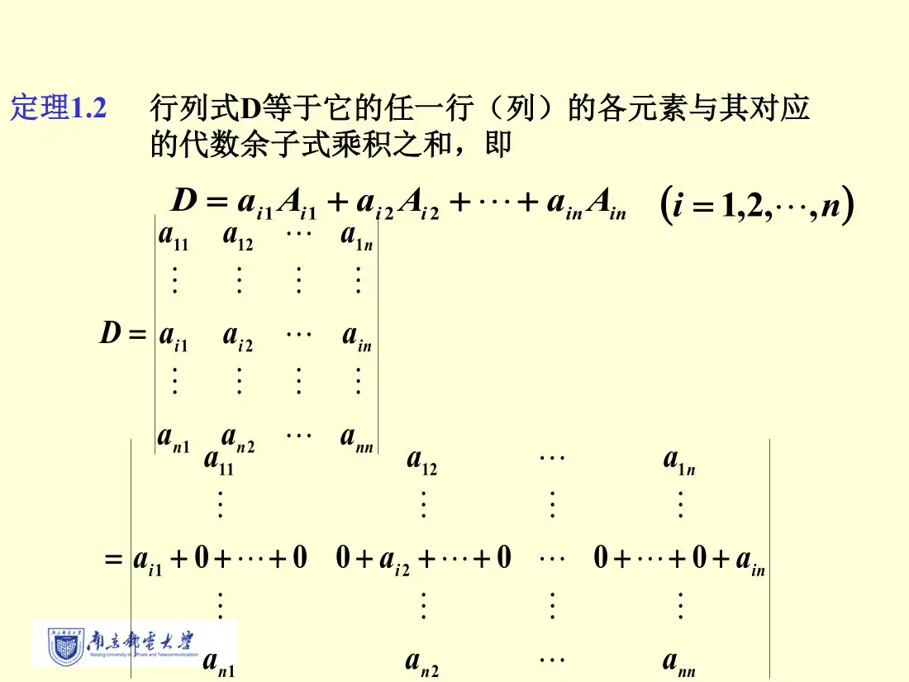

原文：

定理1.2 行列式D等于它的任一行（列）的各元素与其对应的代数余子式乘积之和，即

$$
\begin{array}{r l} & D = a _ {i 1} A _ {i 1} + a _ {i 2} A _ {i 2} + \dots + a _ {i n} A _ {i n} \quad (i = 1, 2, \dots , n) \\ & D = \left| \begin{array}{c c c c} a _ {1 1} & a _ {1 2} & \dots & a _ {1 n} \\ \vdots & \vdots & \vdots & \vdots \\ a _ {i 1} & a _ {i 2} & \dots & a _ {i n} \\ \vdots & \vdots & \vdots & \vdots \\ a _ {n 1} & a _ {n 2} & \dots & a _ {n n} \end{array} \right| \\ = & \left| \begin{array}{c c c c c} a _ {1 1} & a _ {1 2} & \dots & a _ {1 n} \\ \vdots & \vdots & \vdots & \vdots \\ a _ {i 1} + 0 + \dots + 0 & 0 + a _ {i 2} + \dots + 0 & \dots & 0 + \dots + 0 + a _ {i n} \\ \vdots & \vdots & \vdots & \vdots \\ a _ {n 1} & a _ {n 2} & \dots & a _ {n n} \end{array} \right| \end{array}
$$

南京邮电大学
Nanjing University of Posts and Telecommunications

### $$

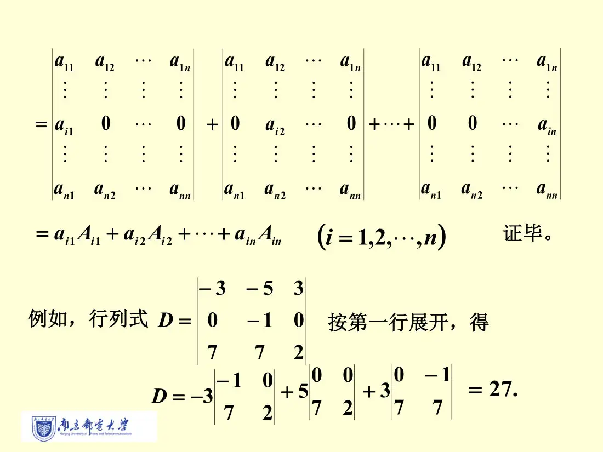

原文：

$$
\begin{array}{r l} & = \left| \begin{array}{c c c c} a _ {1 1} & a _ {1 2} & \dots & a _ {1 n} \\ \vdots & \vdots & \vdots & \vdots \\ a _ {i 1} & 0 & \dots & 0 \\ \vdots & \vdots & \vdots & \vdots \\ a _ {n 1} & a _ {n 2} & \dots & a _ {n n} \end{array} \right| + \left| \begin{array}{c c c c} a _ {1 1} & a _ {1 2} & \dots & a _ {1 n} \\ \vdots & \vdots & \vdots & \vdots \\ 0 & a _ {i 2} & \dots & 0 \\ \vdots & \vdots & \vdots & \vdots \\ a _ {n 1} & a _ {n 2} & \dots & a _ {n n} \end{array} \right| + \dots + \left| \begin{array}{c c c c} a _ {1 1} & a _ {1 2} & \dots & a _ {1 n} \\ \vdots & \vdots & \vdots & \vdots \\ 0 & 0 & \dots & a _ {i n} \\ \vdots & \vdots & \vdots & \vdots \\ a _ {n 1} & a _ {n 2} & \dots & a _ {n n} \end{array} \right| \\ = & a _ {i 1} A _ {i 1} + a _ {i 2} A _ {i 2} + \dots + a _ {i n} A _ {i n} \quad (i = 1, 2, \dots , n) \quad \text {证毕。} \end{array}
$$

例如，行列式

$$
D = \left| \begin{array}{c c c} - 3 & - 5 & 3 \\ 0 & - 1 & 0 \\ 7 & 7 & 2 \end{array} \right|
$$

按第一行展开，得

$$
D = - 3 \left| \begin{array}{c c} - 1 & 0 \\ 7 & 2 \end{array} \right| + 5 \left| \begin{array}{c c} 0 & 0 \\ 7 & 2 \end{array} \right| + 3 \left| \begin{array}{c c} 0 & - 1 \\ 7 & 7 \end{array} \right| = 2 7.
$$

南京邮电大学
Nanjing University of Posts and Telecommunications

### $$

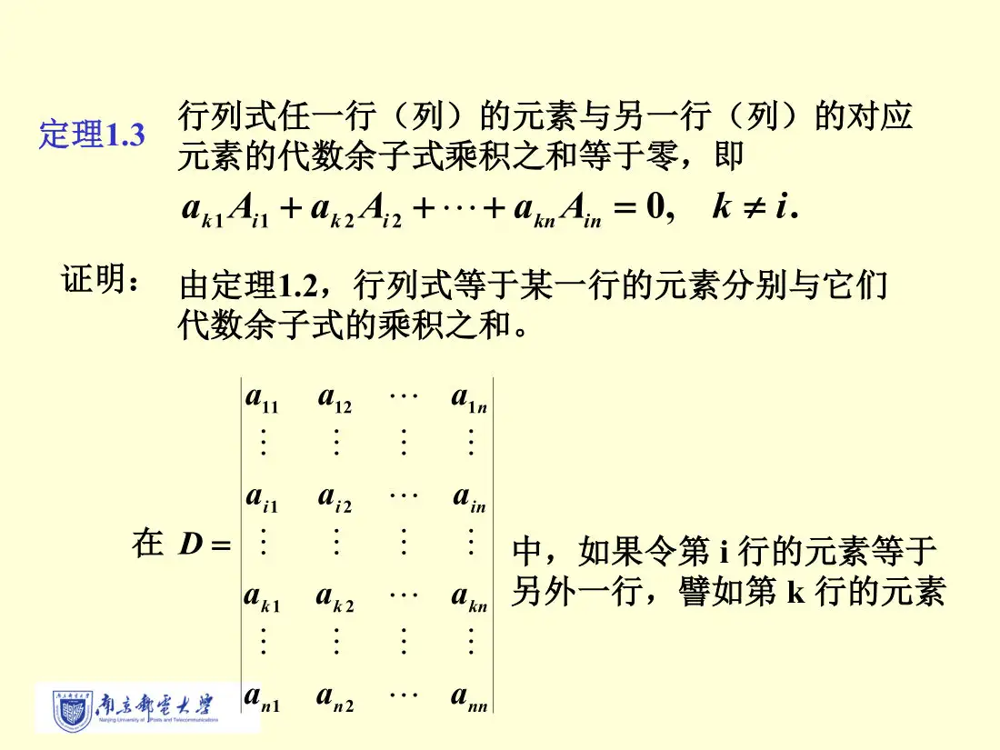

原文：

定理1.3 行列式任一行（列）的元素与另一行（列）的对应元素的代数余子式乘积之和等于零，即

$$
a _ {k 1} A _ {i 1} + a _ {k 2} A _ {i 2} + \dots + a _ {k n} A _ {i n} = 0, \quad k \neq i.
$$

证明：由定理1.2，行列式等于某一行的元素分别与它们代数余子式的乘积之和。

在

$$
D = \left| \begin{array}{c c c c} a _ {1 1} & a _ {1 2} & \dots & a _ {1 n} \\ \vdots & \vdots & \vdots & \vdots \\ a _ {i 1} & a _ {i 2} & \dots & a _ {i n} \\ \vdots & \vdots & \vdots & \vdots \\ a _ {k 1} & a _ {k 2} & \dots & a _ {k n} \\ \vdots & \vdots & \vdots & \vdots \\ a _ {n 1} & a _ {n 2} & \dots & a _ {n n} \end{array} \right|
$$

中，如果令第 i 行的元素等于另外一行，譬如第 k 行的元素

南京邮电大学
Nanjing University of Posts and Telecommunications

### $$

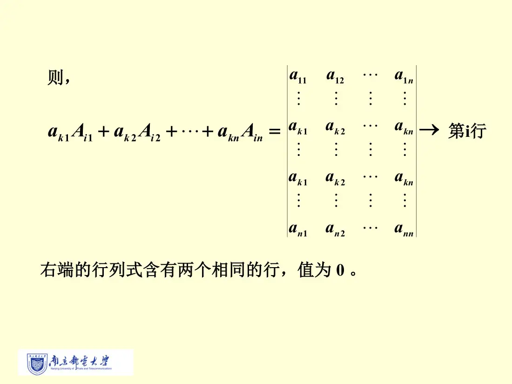

原文：

$$
\begin{array}{r l} & {\text {则},} \\ & {a _ {k 1} A _ {i 1} + a _ {k 2} A _ {i 2} + \dots + a _ {k n} A _ {i n} = \left| \begin{array}{c c c c} {a _ {1 1}} & {a _ {1 2}} & {\dots} & {a _ {1 n}} \\ {\vdots} & {\vdots} & {\vdots} & {\vdots} \\ {a _ {k 1}} & {a _ {k 2}} & {\dots} & {a _ {k n}} \\ {\vdots} & {\vdots} & {\vdots} & {\vdots} \\ {a _ {k 1}} & {a _ {k 2}} & {\dots} & {a _ {k n}} \\ {\vdots} & {\vdots} & {\vdots} & {\vdots} \\ {a _ {n 1}} & {a _ {n 2}} & {\dots} & {a _ {n n}} \end{array} \right| \to \text {第i行}} \end{array}
$$

右端的行列式含有两个相同的行，值为 0 。

南京邮电大学
Nanjing University of Posts and Telecommunications

### 综上，得公式

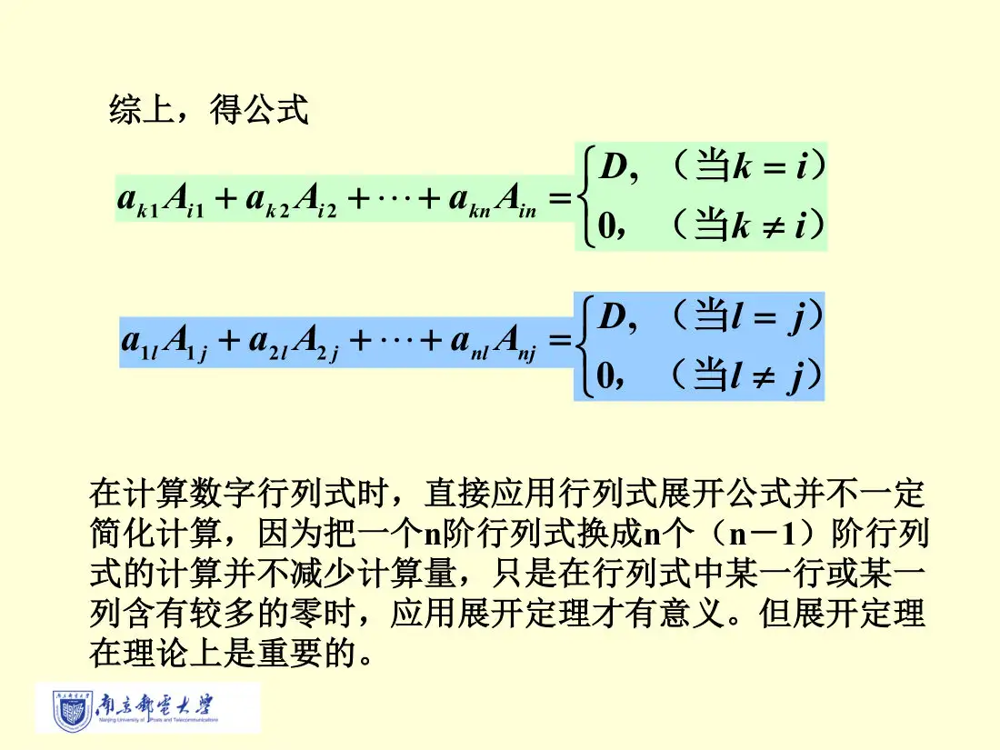

原文：

综上，得公式

$$
a _ {k 1} A _ {i 1} + a _ {k 2} A _ {i 2} + \dots + a _ {k n} A _ {i n} = \left\{ \begin{array}{l l} D, & (\text {当} k = i) \\ 0, & (\text {当} k \neq i) \end{array} \right.
$$

$$
a _ {1 l} A _ {1 j} + a _ {2 l} A _ {2 j} + \dots + a _ {n l} A _ {n j} = \left\{ \begin{array}{l l} D, & (\text {当} l = j) \\ 0, & (\text {当} l \neq j) \end{array} \right.
$$

在计算数字行列式时，直接应用行列式展开公式并不一定简化计算，因为把一个n阶行列式换成n个（n-1）阶行列式的计算并不减少计算量，只是在行列式中某一行或某一列含有较多的零时，应用展开定理才有意义。但展开定理在理论上是重要的。

南京邮电大学
Nanjing University of Posts and Telecommunications

### 南京邮电大学

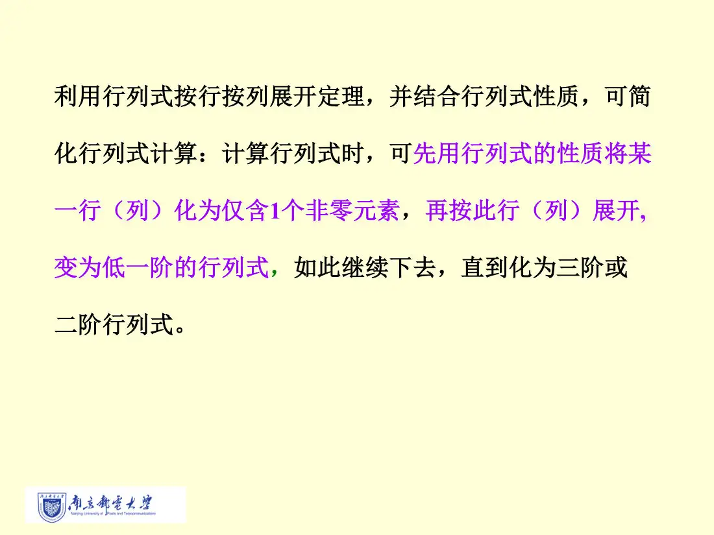

原文：

利用行列式按行按列展开定理，并结合行列式性质，可简化行列式计算：计算行列式时，可先用行列式的性质将某一行（列）化为仅含1个非零元素，再按此行（列）展开，变为低一阶的行列式，如此继续下去，直到化为三阶或二阶行列式。

南京邮电大学
Nanjing University of Posts and Telecommunications

### 例1.13 计算n阶行列式

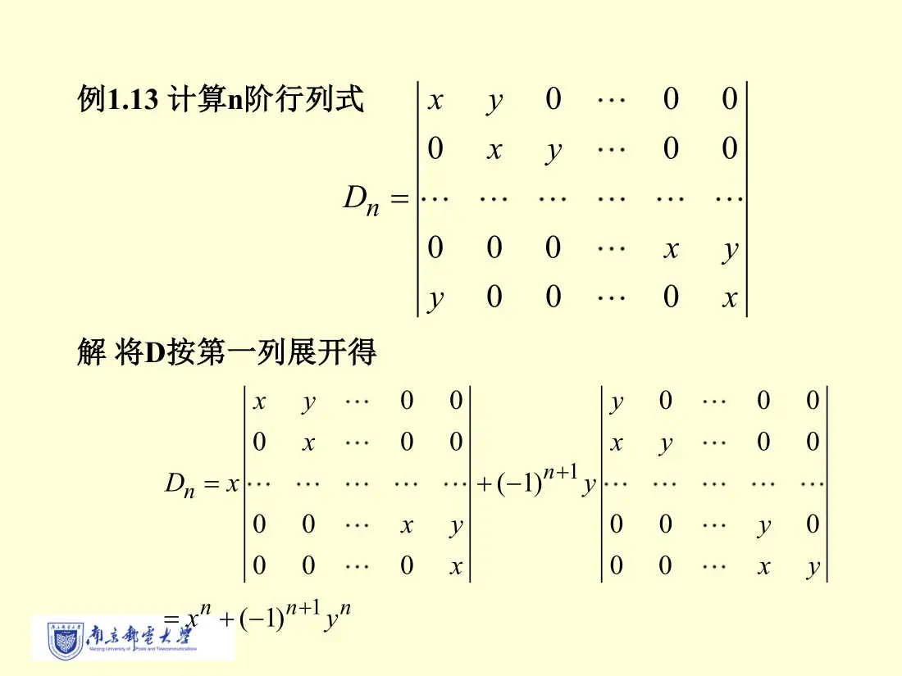

原文：

例1.13 计算n阶行列式

$$
D _ {n} = \left| \begin{array}{c c c c c c} x & y & 0 & \dots & 0 & 0 \\ 0 & x & y & \dots & 0 & 0 \\ \dots & \dots & \dots & \dots & \dots & \dots \\ 0 & 0 & 0 & \dots & x & y \\ y & 0 & 0 & \dots & 0 & x \end{array} \right|
$$

解 将D按第一列展开得

$$
D _ {n} = x \left| \begin{array}{c c c c c} x & y & \dots & 0 & 0 \\ 0 & x & \dots & 0 & 0 \\ \dots & \dots & \dots & \dots & \dots \\ 0 & 0 & \dots & x & y \\ 0 & 0 & \dots & 0 & x \end{array} \right| + (- 1) ^ {n + 1} y \left| \begin{array}{c c c c c} y & 0 & \dots & 0 & 0 \\ x & y & \dots & 0 & 0 \\ \dots & \dots & \dots & \dots & \dots \\ 0 & 0 & \dots & y & 0 \\ 0 & 0 & \dots & x & y \end{array} \right|
$$

$$
= x ^ {n} + (- 1) ^ {n + 1} y ^ {n}
$$

南京邮电大学
Nanjing University of Posts and Telecommunications

### 例1.14 设

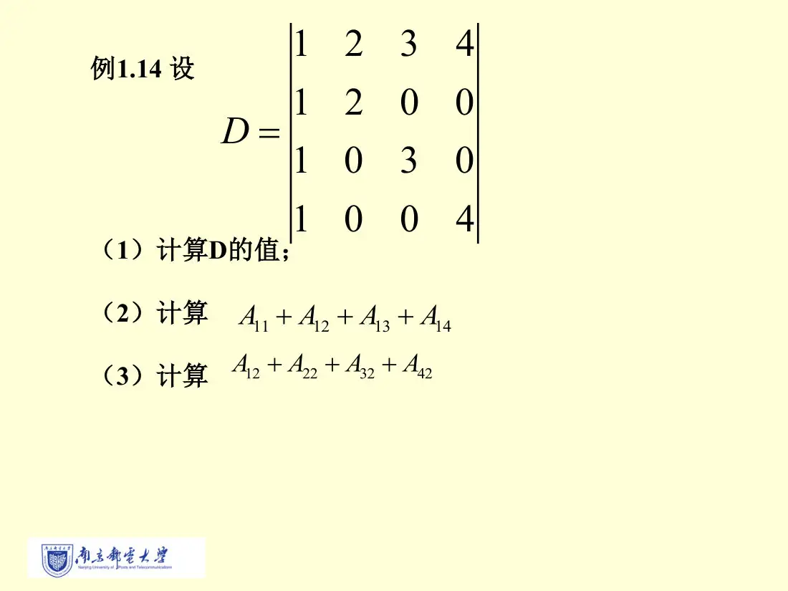

原文：

例1.14 设

$$
D = \left| \begin{array}{c c c c} 1 & 2 & 3 & 4 \\ 1 & 2 & 0 & 0 \\ 1 & 0 & 3 & 0 \\ 1 & 0 & 0 & 4 \end{array} \right|
$$

(1) 计算D的值;

(2) 计算 $A_{11} + A_{12} + A_{13} + A_{14}$

(3) 计算 $A_{12} + A_{22} + A_{32} + A_{42}$ 解（1）将行列式D的第2,3,4行分别乘以（-1）都加到第1行，则有

南京邮电大学
Nanjing University of Posts and Telecommunications

### $$

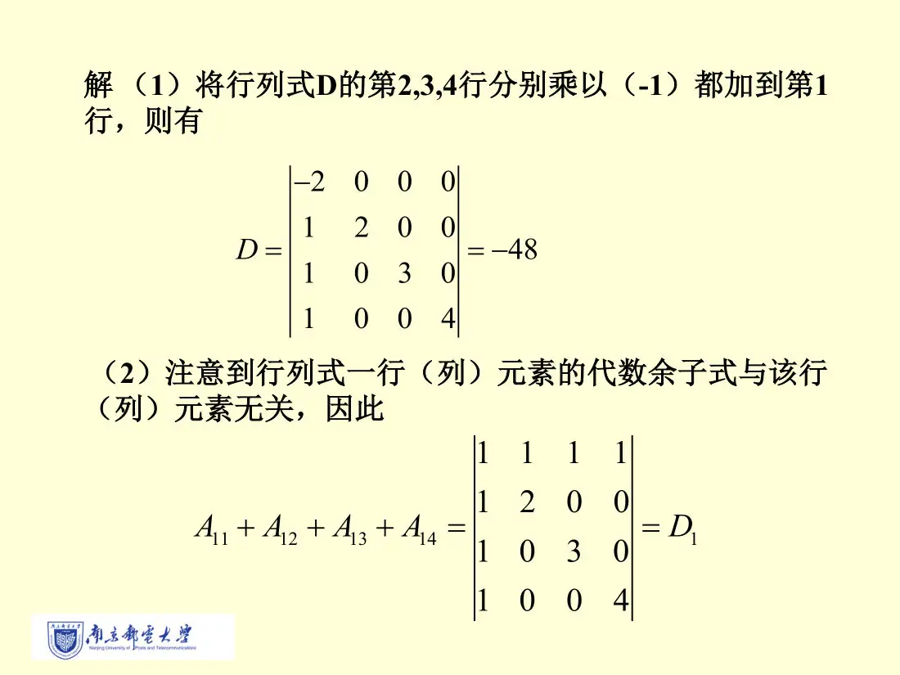

原文：

$$
D = \left| \begin{array}{c c c c} - 2 & 0 & 0 & 0 \\ 1 & 2 & 0 & 0 \\ 1 & 0 & 3 & 0 \\ 1 & 0 & 0 & 4 \end{array} \right| = - 4 8
$$

(2) 注意到行列式一行（列）元素的代数余子式与该行（列）元素无关，因此

$$
A _ {1 1} + A _ {1 2} + A _ {1 3} + A _ {1 4} = \left| \begin{array}{c c c c} 1 & 1 & 1 & 1 \\ 1 & 2 & 0 & 0 \\ 1 & 0 & 3 & 0 \\ 1 & 0 & 0 & 4 \end{array} \right| = D _ {1}
$$

南京邮电大学
Nanjing University of Posts and Telecommunications

### 将行列式 $D_{1}$ 的第i行分别乘以（-1/i）都加到第1行，则有

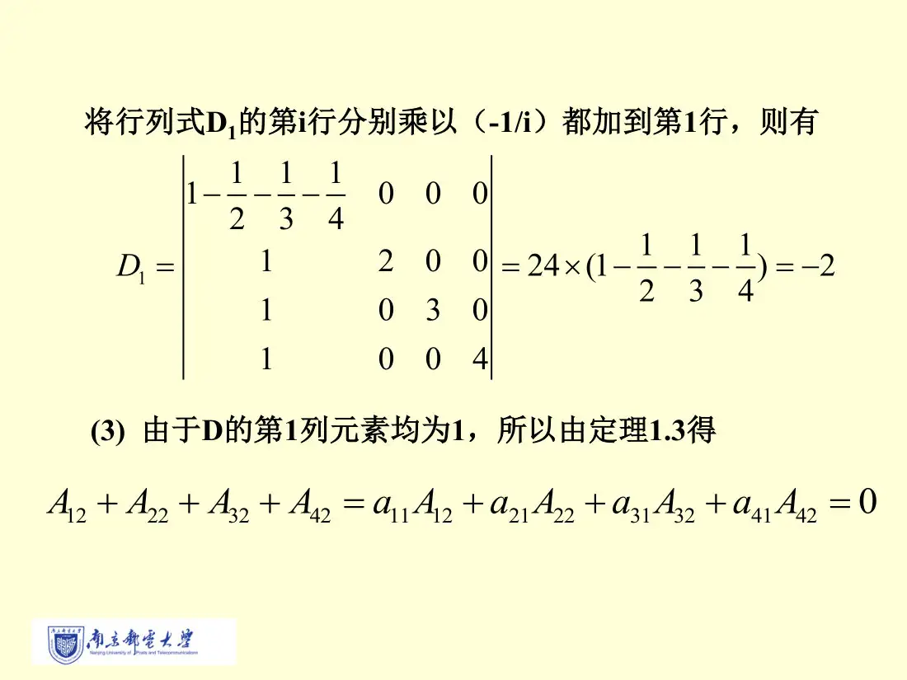

原文：

将行列式 $D_{1}$ 的第i行分别乘以（-1/i）都加到第1行，则有

$$
D _ {1} = \left| \begin{array}{c c c c} 1 - \frac {1}{2} - \frac {1}{3} - \frac {1}{4} & 0 & 0 & 0 \\ 1 & 2 & 0 & 0 \\ 1 & 0 & 3 & 0 \\ 1 & 0 & 0 & 4 \end{array} \right| = 2 4 \times (1 - \frac {1}{2} - \frac {1}{3} - \frac {1}{4}) = - 2
$$

(3) 由于D的第1列元素均为1，所以由定理1.3得

$$
A _ {1 2} + A _ {2 2} + A _ {3 2} + A _ {4 2} = a _ {1 1} A _ {1 2} + a _ {2 1} A _ {2 2} + a _ {3 1} A _ {3 2} + a _ {4 1} A _ {4 2} = 0
$$

南京邮电大学
Nanjing University of Posts and Telecommunications

### 例1.15 证明范德蒙德(Vandermonde)行列式

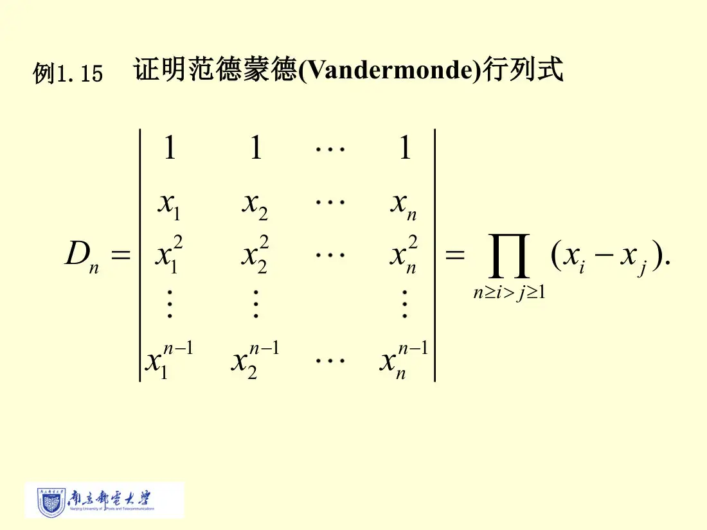

原文：

例1.15 证明范德蒙德(Vandermonde)行列式

$$
D _ {n} = \left| \begin{array}{c c c c} 1 & 1 & \dots & 1 \\ x _ {1} & x _ {2} & \dots & x _ {n} \\ x _ {1} ^ {2} & x _ {2} ^ {2} & \dots & x _ {n} ^ {2} \\ \vdots & \vdots & & \vdots \\ x _ {1} ^ {n - 1} & x _ {2} ^ {n - 1} & \dots & x _ {n} ^ {n - 1} \end{array} \right| = \prod_ {n \geq i > j \geq 1} (x _ {i} - x _ {j}).
$$

南京邮电大学
Nanjing University of Posts and Telecommunications

### 证明：用数学归纳法

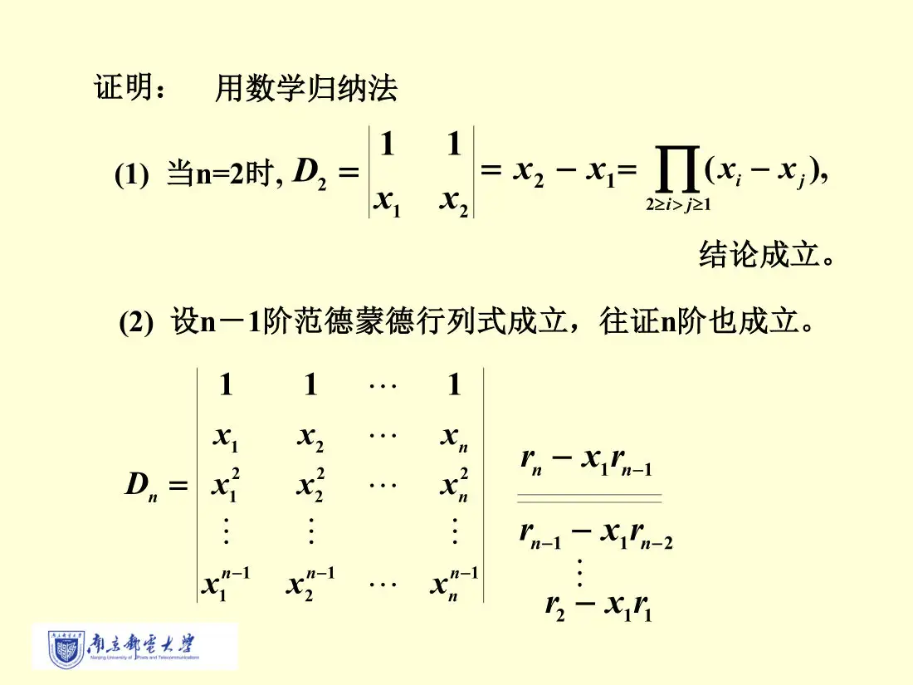

原文：

证明：用数学归纳法

(1) 当n=2时, $D_{2}=\left|\begin{matrix}1 & 1 \\ x_{1} & x_{2}\end{matrix}\right|=x_{2}-x_{1}=\prod_{2\geq i>j\geq1}(x_{i}-x_{j})$ ,

结论成立。

(2) 设n-1阶范德蒙德行列式成立，往证n阶也成立。

$$
D _ {n} = \left| \begin{array}{c c c c} 1 & 1 & \dots & 1 \\ x _ {1} & x _ {2} & \dots & x _ {n} \\ x _ {1} ^ {2} & x _ {2} ^ {2} & \dots & x _ {n} ^ {2} \\ \vdots & \vdots & & \vdots \\ x _ {1} ^ {n - 1} & x _ {2} ^ {n - 1} & \dots & x _ {n} ^ {n - 1} \end{array} \right| \begin{array}{c} r _ {n} - x _ {1} r _ {n - 1} \\ \hline r _ {n - 1} - x _ {1} r _ {n - 2} \\ \vdots \\ r _ {2} - x _ {1} r _ {1} \end{array}
$$

南京邮电大学
Nanjing University of Posts and Telecommunications

### $$

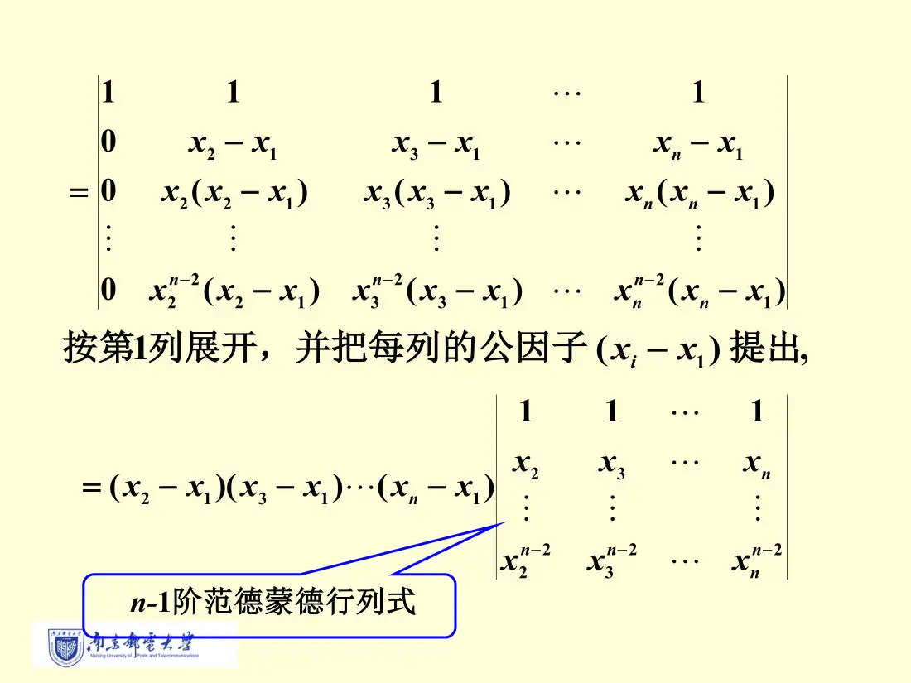

原文：

$$
= \left| \begin{array}{c c c c c} 1 & 1 & 1 & \dots & 1 \\ 0 & x _ {2} - x _ {1} & x _ {3} - x _ {1} & \dots & x _ {n} - x _ {1} \\ 0 & x _ {2} (x _ {2} - x _ {1}) & x _ {3} (x _ {3} - x _ {1}) & \dots & x _ {n} (x _ {n} - x _ {1}) \\ \vdots & \vdots & \vdots & & \vdots \\ 0 & x _ {2} ^ {n - 2} (x _ {2} - x _ {1}) & x _ {3} ^ {n - 2} (x _ {3} - x _ {1}) & \dots & x _ {n} ^ {n - 2} (x _ {n} - x _ {1}) \end{array} \right|
$$

按第1列展开，并把每列的公因子 $(x_{i}-x_{1})$ 提出，

$$
= (x _ {2} - x _ {1}) (x _ {3} - x _ {1}) \dots (x _ {n} - x _ {1}) \left| \begin{array}{c c c c} 1 & 1 & \dots & 1 \\ x _ {2} & x _ {3} & \dots & x _ {n} \\ \vdots & \vdots & & \vdots \\ x _ {2} ^ {n - 2} & x _ {3} ^ {n - 2} & \dots & x _ {n} ^ {n - 2} \end{array} \right|
$$

南京邮电大学
Nanjing University of Posts and Telecommunications

### $$

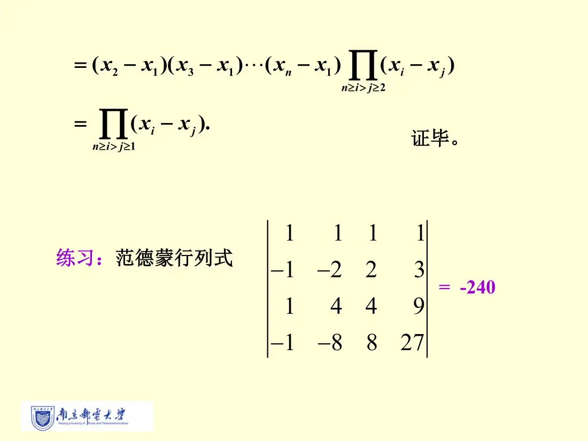

原文：

$$
\begin{array}{l} = (x _ {2} - x _ {1}) (x _ {3} - x _ {1}) \dots (x _ {n} - x _ {1}) \prod_ {n \geq i > j \geq 2} (x _ {i} - x _ {j}) \\ = \prod_ {n \geq i > j \geq 1} (x _ {i} - x _ {j}). \quad \text {证毕。} \end{array}
$$

练习：范德蒙行列式

$$
\left| \begin{array}{r r r r} 1 & 1 & 1 & 1 \\ - 1 & - 2 & 2 & 3 \\ 1 & 4 & 4 & 9 \\ - 1 & - 8 & 8 & 2 7 \end{array} \right| = - 2 4 0
$$

南京邮电大学
Nanjing University of Posts and Telecommunications
