# 《线性代数与解析几何》第1章 行列式与克莱姆法则（课件）

原件的每一页，下面附识别出的文字。

### 1.4 克莱姆法则

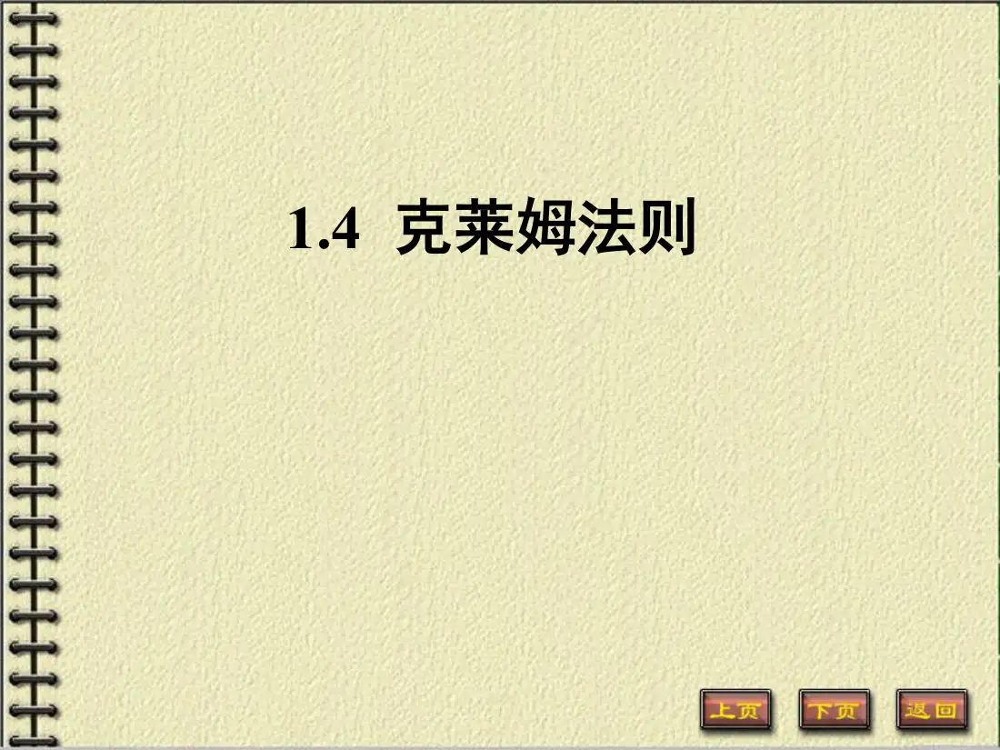

原文：

1.4 克莱姆法则

上页 下页 返回

### 第一章的知识网络图

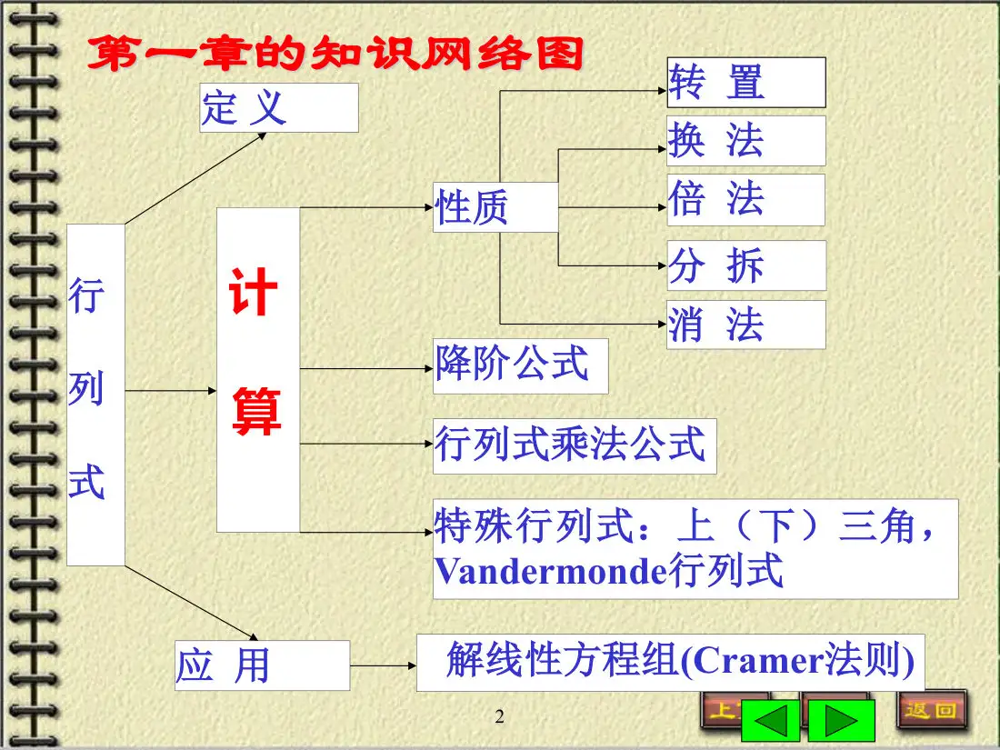

原文：

第一章的知识网络图

定义

行
列
式计算

应用

性质

转置

换法

倍法

分拆

消法

降阶公式

行列式乘法公式

特殊行列式：上（下）三角，Vandermonde行列式

解线性方程组(Cramer法则)

2

上 返回

### 非齐次与齐次线性方程组的概念

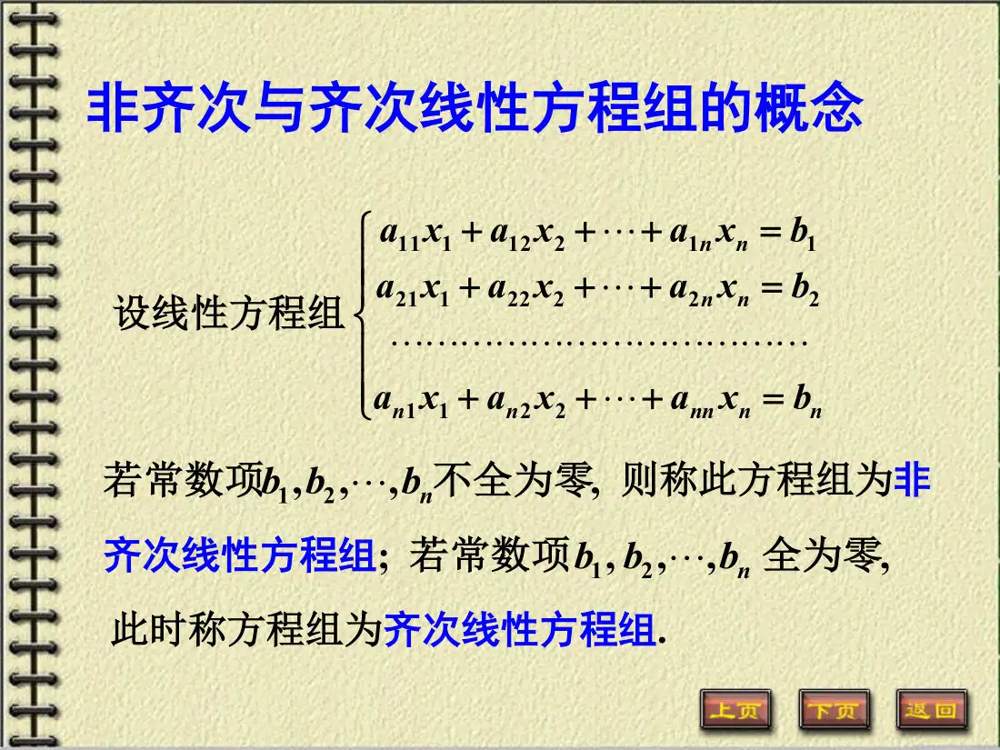

原文：

非齐次与齐次线性方程组的概念

设线性方程组

$$
\left\{ \begin{array}{l} a _ {1 1} x _ {1} + a _ {1 2} x _ {2} + \dots + a _ {1 n} x _ {n} = b _ {1} \\ a _ {2 1} x _ {1} + a _ {2 2} x _ {2} + \dots + a _ {2 n} x _ {n} = b _ {2} \\ \dots \dots \\ a _ {n 1} x _ {1} + a _ {n 2} x _ {2} + \dots + a _ {n n} x _ {n} = b _ {n} \end{array} \right.
$$

若常数项 $b_{1},b_{2},\cdots,b_{n}$ 不全为零, 则称此方程组为非齐次线性方程组; 若常数项 $b_{1},b_{2},\cdots,b_{n}$ 全为零,此时称方程组为齐次线性方程组.

上页 下页 返回

### 齐次线性方程组的相关定理

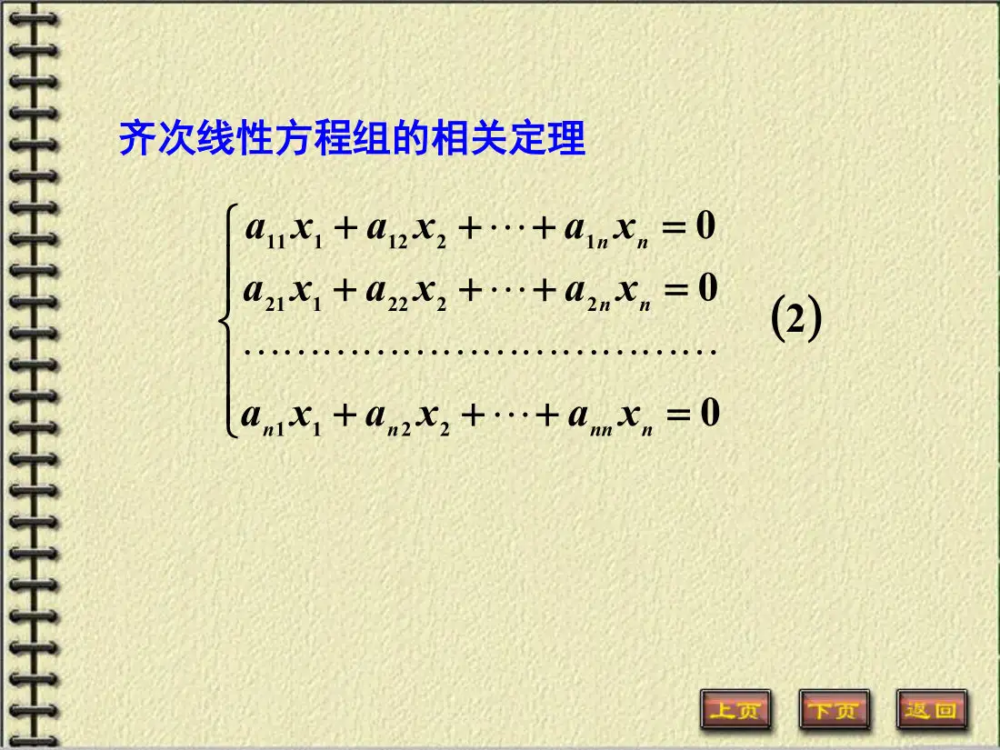

原文：

齐次线性方程组的相关定理

$$
\left\{ \begin{array} {l}a _ {1 1} x _ {1} + a _ {1 2} x _ {2} + \dots + a _ {1 n} x _ {n} = 0 \\ a _ {2 1} x _ {1} + a _ {2 2} x _ {2} + \dots + a _ {2 n} x _ {n} = 0 \\ \cdots \\ a _ {n 1} x _ {1} + a _ {n 2} x _ {2} + \dots + a _ {n n} x _ {n} = 0 \end{array} \right.\tag{2}
$$

上页 下页 返回

### 一、克拉默法则

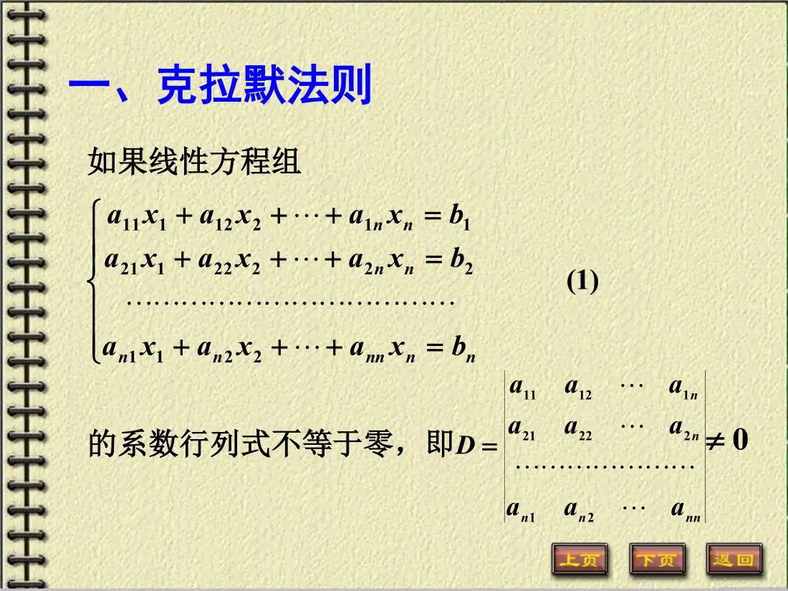

原文：

一、克拉默法则

如果线性方程组

$$
\left\{ \begin{array}{l} a _ {1 1} x _ {1} + a _ {1 2} x _ {2} + \dots + a _ {1 n} x _ {n} = b _ {1} \\ a _ {2 1} x _ {1} + a _ {2 2} x _ {2} + \dots + a _ {2 n} x _ {n} = b _ {2} \\ \dots\dots\\ a _ {n 1} x _ {1} + a _ {n 2} x _ {2} + \dots + a _ {n n} x _ {n} = b _ {n} \end{array} \right.\tag{1}
$$

的系数行列式不等于零，即 $D=\begin{vmatrix}a_{21}&a_{22}&\cdots&a_{2n}\\ \cdots\end{vmatrix}\neq0$

$$
D = \left| \begin{array}{c c c c} a _ {1 1} & a _ {1 2} & \dots & a _ {1 n} \\ a _ {2 1} & a _ {2 2} & \dots & a _ {2 n} \\ \dots & \dots & \dots & \dots \\ a _ {n 1} & a _ {n 2} & \dots & a _ {n n} \end{array} \right| \neq 0
$$

上页 下页 返回

### 那么线性方程组(1)有解, 并且解是唯一的, 解可以表为

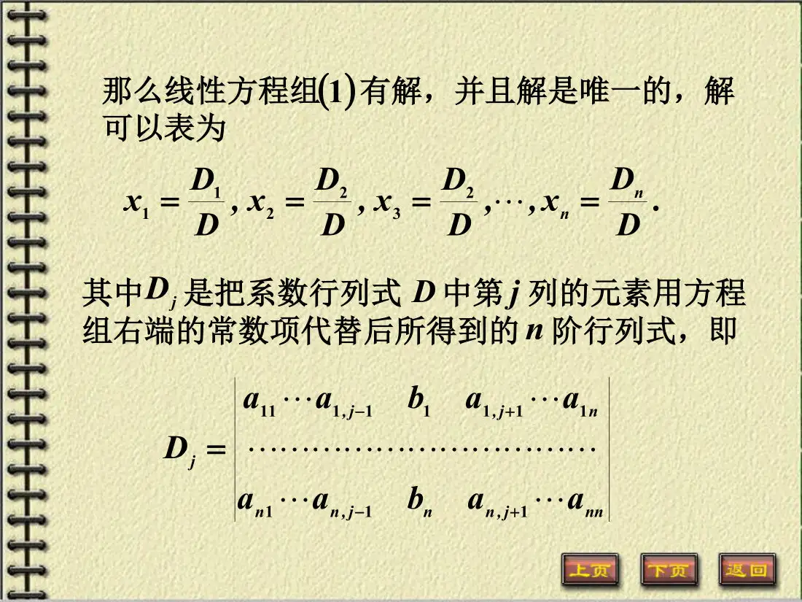

原文：

那么线性方程组(1)有解, 并且解是唯一的, 解可以表为

$$
x _ {1} = \frac {D _ {1}}{D}, x _ {2} = \frac {D _ {2}}{D}, x _ {3} = \frac {D _ {2}}{D}, \dots , x _ {n} = \frac {D _ {n}}{D}.
$$

其中 $D_{j}$ 是把系数行列式 $D$ 中第 $j$ 列的元素用方程组右端的常数项代替后所得到的 $n$ 阶行列式，即

$$
D _ {j} = \left| \begin{array}{c c c} a _ {1 1} \dots a _ {1, j - 1} & b _ {1} & a _ {1, j + 1} \dots a _ {1 n} \\ \dots \dots \\ a _ {n 1} \dots a _ {n, j - 1} & b _ {n} & a _ {n, j + 1} \dots a _ {n n} \end{array} \right|
$$

上页 下页 返回

### 证明

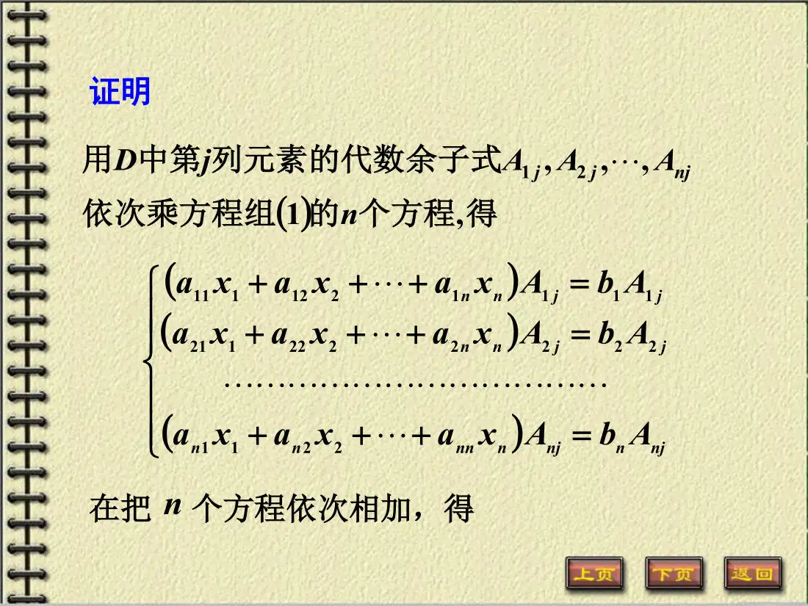

原文：

证明

用D中第j列元素的代数余子式 $A_{1j},A_{2j},\cdots,A_{nj}$ 依次乘方程组(1)的n个方程,得

$$
\left\{ \begin{array}{l} \big (a _ {1 1} x _ {1} + a _ {1 2} x _ {2} + \dots + a _ {1 n} x _ {n} \big) A _ {1 j} = b _ {1} A _ {1 j} \\ \big (a _ {2 1} x _ {1} + a _ {2 2} x _ {2} + \dots + a _ {2 n} x _ {n} \big) A _ {2 j} = b _ {2} A _ {2 j} \\ \dots\dots\\ \big (a _ {n 1} x _ {1} + a _ {n 2} x _ {2} + \dots + a _ {n n} x _ {n} \big) A _ {n j} = b _ {n} A _ {n j} \end{array} \right.
$$

在把 $n$ 个方程依次相加，得

上页 下页 返回

### $$

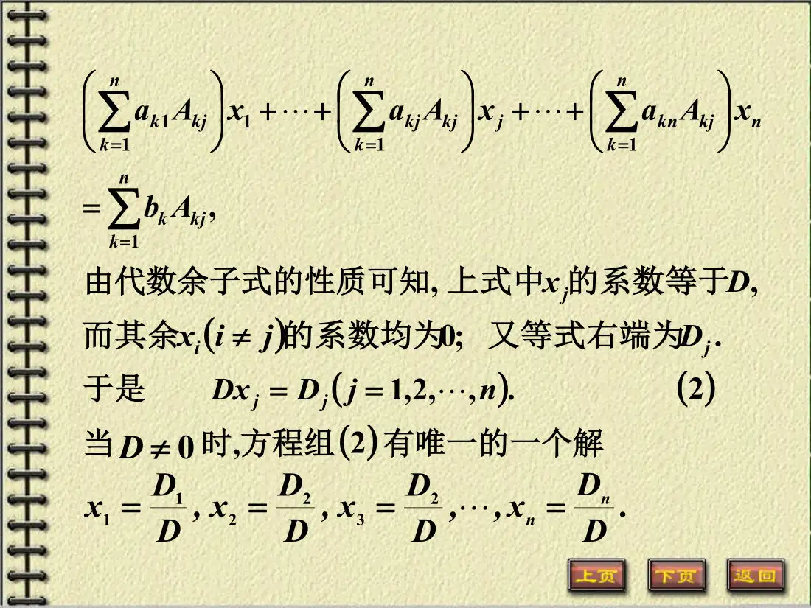

原文：

$$
\begin{array}{l} \left(\sum_ {k = 1} ^ {n} a _ {k 1} A _ {k j}\right) x _ {1} + \dots + \left(\sum_ {k = 1} ^ {n} a _ {k j} A _ {k j}\right) x _ {j} + \dots + \left(\sum_ {k = 1} ^ {n} a _ {k n} A _ {k j}\right) x _ {n} \\ = \sum_ {k = 1} ^ {n} b _ {k} A _ {k j}, \end{array}
$$

由代数余子式的性质可知, 上式中 $x_{j}$ 的系数等于 $D$ , 而其余 $x_{i} (i \neq j)$ 的系数均为 0; 又等式右端为 $D_{j}$ .

$$
D x _ {j} = D _ {j} (j = 1, 2, \dots , n).\tag{2}
$$

当 $D \neq 0$ 时, 方程组(2)有唯一的一个解

$$
x _ {1} = \frac {D _ {1}}{D}, x _ {2} = \frac {D _ {2}}{D}, x _ {3} = \frac {D _ {2}}{D}, \dots , x _ {n} = \frac {D _ {n}}{D}.
$$

上页 下页 返回

### 由于方程组(2)与方程组(1)等价, 故

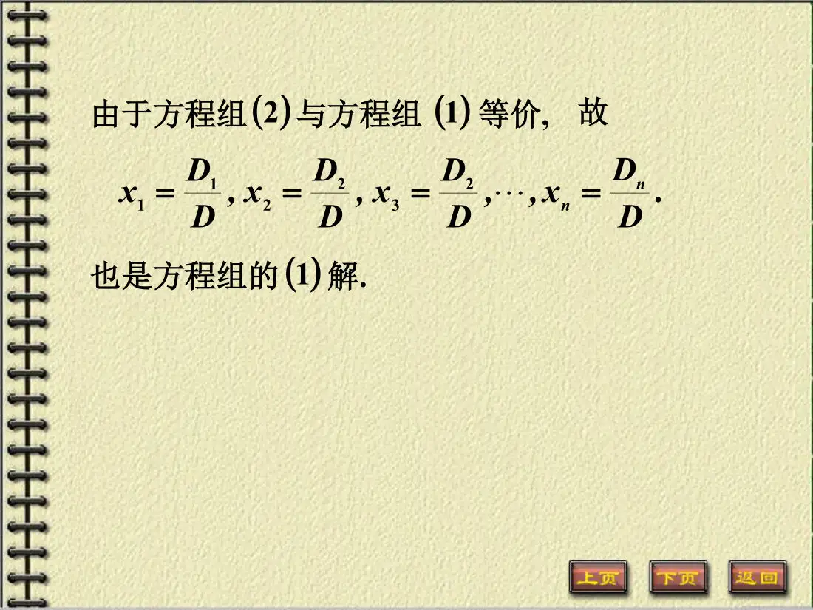

原文：

由于方程组(2)与方程组(1)等价, 故

$$
x _ {1} = \frac {D _ {1}}{D}, x _ {2} = \frac {D _ {2}}{D}, x _ {3} = \frac {D _ {2}}{D}, \dots , x _ {n} = \frac {D _ {n}}{D}.
$$

也是方程组的(1)解.

上页 下页 返回

### 二、重要定理

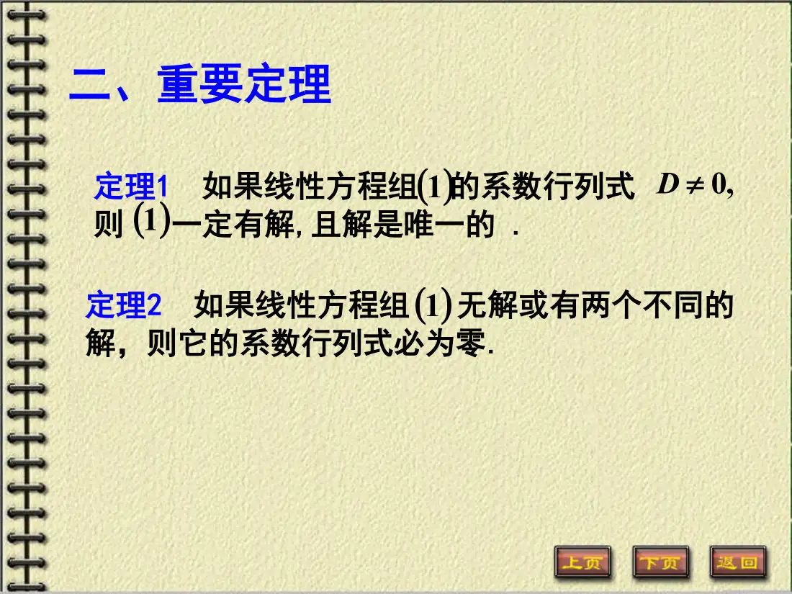

原文：

二、重要定理

定理1 如果线性方程组(1)的系数行列式 $D \neq 0$ , 则 (1)一定有解, 且解是唯一的.

定理2 如果线性方程组(1)无解或有两个不同的解, 则它的系数行列式必为零.

上页 下页 返回

### 齐次线性方程组的相关定理

原文：

齐次线性方程组的相关定理

$$
\left\{ \begin{array} {l}a _ {1 1} x _ {1} + a _ {1 2} x _ {2} + \dots + a _ {1 n} x _ {n} = 0 \\ a _ {2 1} x _ {1} + a _ {2 2} x _ {2} + \dots + a _ {2 n} x _ {n} = 0 \\ \cdots \\ a _ {n 1} x _ {1} + a _ {n 2} x _ {2} + \dots + a _ {n n} x _ {n} = 0 \end{array} \right.\tag{2}
$$

上页 下页 返回

### 推论1

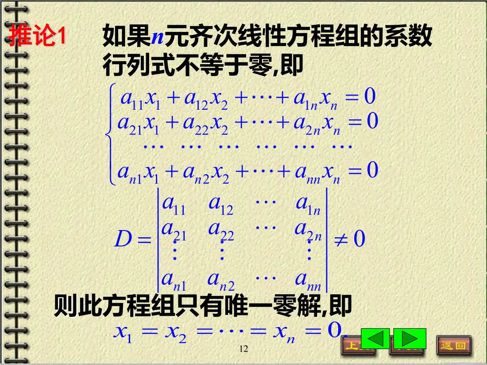

原文：

推论1

如果n元齐次线性方程组的系数行列式不等于零,即

$$
\left\{ \begin{array}{l} a _ {1 1} x _ {1} + a _ {1 2} x _ {2} + \dots + a _ {1 n} x _ {n} = 0 \\ a _ {2 1} x _ {1} + a _ {2 2} x _ {2} + \dots + a _ {2 n} x _ {n} = 0 \\ \dots \dots \\ a _ {n 1} x _ {1} + a _ {n 2} x _ {2} + \dots + a _ {n n} x _ {n} = 0 \\ D = \left| \begin{array}{c c c c} a _ {1 1} & a _ {1 2} & \dots & a _ {1 n} \\ a _ {2 1} & a _ {2 2} & \dots & a _ {2 n} \\ \vdots & \vdots & & \vdots \\ a _ {n 1} & a _ {n 2} & \dots & a _ {n n} \end{array} \right| \neq 0 \end{array} \right.
$$

则此方程组只有唯一零解,即

$$
x _ {1} = x _ {2} = \dots = x _ {n} = 0
$$

推

12

返回

### 推论2 如果n元齐次线性方程组

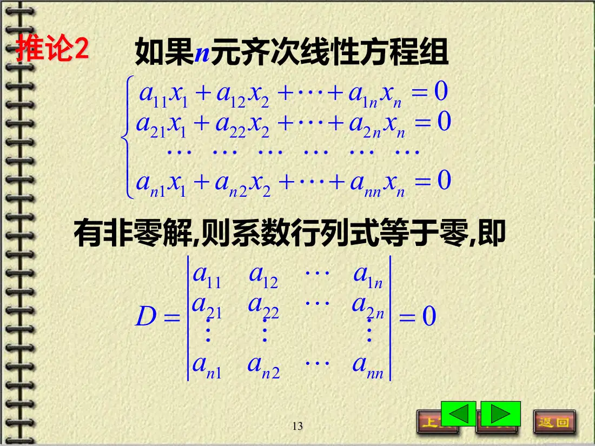

原文：

推论2 如果n元齐次线性方程组

$$
\left\{ \begin{array}{l} a _ {1 1} x _ {1} + a _ {1 2} x _ {2} + \dots + a _ {1 n} x _ {n} = 0 \\ a _ {2 1} x _ {1} + a _ {2 2} x _ {2} + \dots + a _ {2 n} x _ {n} = 0 \\ \dots \dots \\ a _ {n 1} x _ {1} + a _ {n 2} x _ {2} + \dots + a _ {n n} x _ {n} = 0 \end{array} \right.
$$

有非零解,则系数行列式等于零,即

$$
D = \left| \begin{array}{c c c c} a _ {1 1} & a _ {1 2} & \dots & a _ {1 n} \\ a _ {2 1} & a _ {2 2} & \dots & a _ {2 n} \\ \vdots & \vdots & & \vdots \\ a _ {n 1} & a _ {n 2} & \dots & a _ {n n} \end{array} \right| = 0
$$

推

13

上返回

### 例1 用克拉默则解方程组

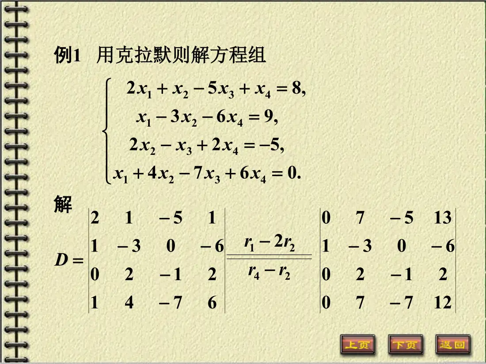

原文：

例1 用克拉默则解方程组

$$
\left\{ \begin{array}{l l} 2 x _ {1} + x _ {2} - 5 x _ {3} + x _ {4} = 8, \\ x _ {1} - 3 x _ {2} - 6 x _ {4} = 9, \\ 2 x _ {2} - x _ {3} + 2 x _ {4} = - 5, \\ x _ {1} + 4 x _ {2} - 7 x _ {3} + 6 x _ {4} = 0. \end{array} \right.
$$

解

$$
D = \left| \begin{array}{r r r r} 2 & 1 & - 5 & 1 \\ 1 & - 3 & 0 & - 6 \\ 0 & 2 & - 1 & 2 \\ 1 & 4 & - 7 & 6 \end{array} \right| \frac {r _ {1} - 2 r _ {2}}{r _ {4} - r _ {2}} \left| \begin{array}{r r r r} 0 & 7 & - 5 & 1 3 \\ 1 & - 3 & 0 & - 6 \\ 0 & 2 & - 1 & 2 \\ 0 & 7 & - 7 & 1 2 \end{array} \right|
$$

上页 下页 返回

### $$

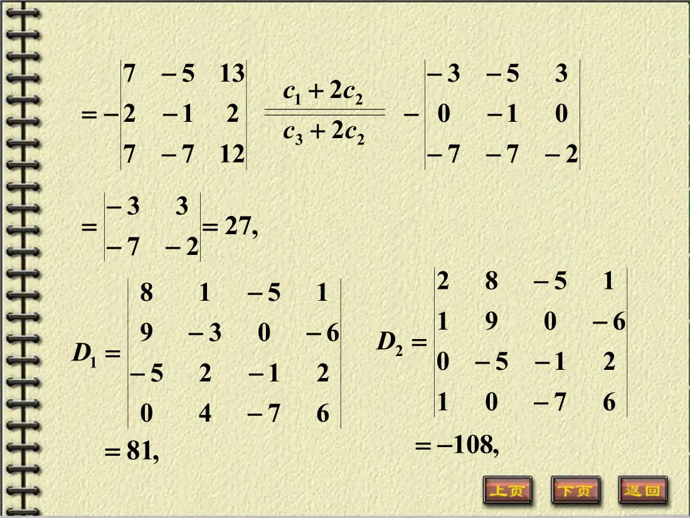

原文：

$$
= - \left| \begin{array}{c c c} 7 & - 5 & 1 3 \\ 2 & - 1 & 2 \\ 7 & - 7 & 1 2 \end{array} \right| \frac {c _ {1} + 2 c _ {2}}{c _ {3} + 2 c _ {2}} - \left| \begin{array}{c c c} - 3 & - 5 & 3 \\ 0 & - 1 & 0 \\ - 7 & - 7 & - 2 \end{array} \right|
$$

$$
= \left| \begin{array}{c c} - 3 & 3 \\ - 7 & - 2 \end{array} \right| = 2 7,
$$

$$
\begin{array}{r l r} & {D _ {1} = \left| \begin{array}{l l l l} 8 & 1 & - 5 & 1 \\ 9 & - 3 & 0 & - 6 \\ - 5 & 2 & - 1 & 2 \\ 0 & 4 & - 7 & 6 \end{array} \right|} & {D _ {2} = \left| \begin{array}{l l l l} 2 & 8 & - 5 & 1 \\ 1 & 9 & 0 & - 6 \\ 0 & - 5 & - 1 & 2 \\ 1 & 0 & - 7 & 6 \end{array} \right|} \\ & {= 8 1,} & {= - 1 0 8,} \end{array}
$$

上页 下页 返回

### $$

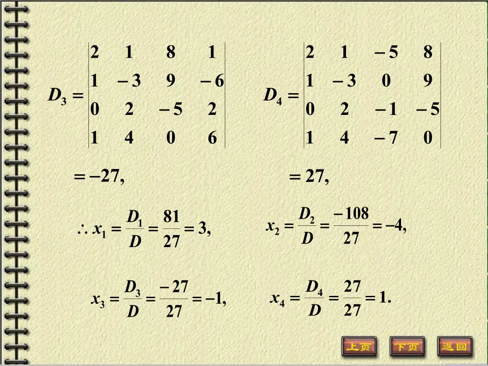

原文：

$$
\begin{array}{r l} & D _ {3} = \left| \begin{array}{c c c c} 2 & 1 & 8 & 1 \\ 1 & - 3 & 9 & - 6 \\ 0 & 2 & - 5 & 2 \\ 1 & 4 & 0 & 6 \end{array} \right| \\ & = - 2 7, \end{array}
$$

$$
\begin{array}{r l} & D _ {4} = \left| \begin{array}{c c c c} 2 & 1 & - 5 & 8 \\ 1 & - 3 & 0 & 9 \\ 0 & 2 & - 1 & - 5 \\ 1 & 4 & - 7 & 0 \end{array} \right| \\ & = 2 7, \end{array}
$$

$$
\therefore x _ {1} = \frac {D _ {1}}{D} = \frac {8 1}{2 7} = 3,
$$

$$
x _ {2} = \frac {D _ {2}}{D} = \frac {- 1 0 8}{2 7} = - 4,
$$

$$
x _ {3} = \frac {D _ {3}}{D} = \frac {- 2 7}{2 7} = - 1,
$$

$$
x _ {4} = \frac {D _ {4}}{D} = \frac {2 7}{2 7} = 1.
$$

上页 下页 返回

### 例2 用克拉默法则解方程组

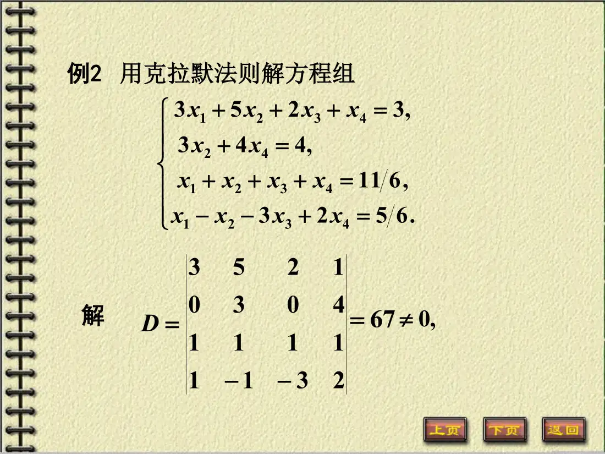

原文：

例2 用克拉默法则解方程组

$$
\left\{ \begin{array}{l} 3 x _ {1} + 5 x _ {2} + 2 x _ {3} + x _ {4} = 3, \\ 3 x _ {2} + 4 x _ {4} = 4, \\ x _ {1} + x _ {2} + x _ {3} + x _ {4} = 1 1 / 6, \\ x _ {1} - x _ {2} - 3 x _ {3} + 2 x _ {4} = 5 / 6. \end{array} \right.
$$

解

$$
D = \left| \begin{array}{c c c c} 3 & 5 & 2 & 1 \\ 0 & 3 & 0 & 4 \\ 1 & 1 & 1 & 1 \\ 1 & - 1 & - 3 & 2 \end{array} \right| = 6 7 \neq 0,
$$

上页 下页 返回

### $$

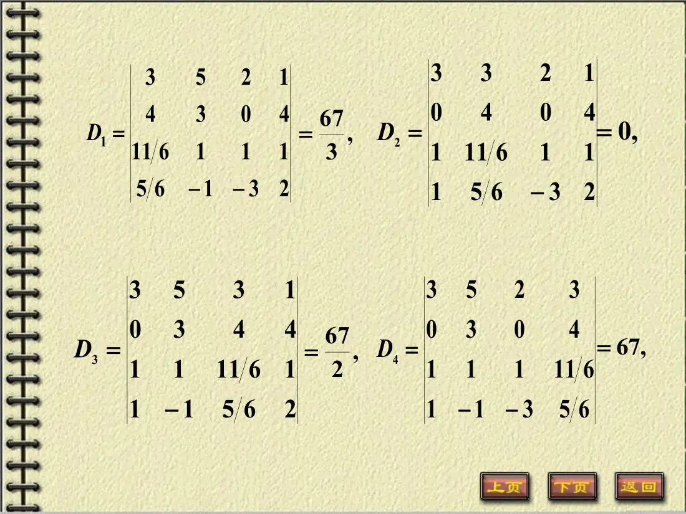

原文：

$$
D _ {1} = \left| \begin{array}{c c c c} 3 & 5 & 2 & 1 \\ 4 & 3 & 0 & 4 \\ 1 1 / 6 & 1 & 1 & 1 \\ 5 / 6 & - 1 & - 3 & 2 \end{array} \right| = \frac {6 7}{3}, \quad D _ {2} = \left| \begin{array}{c c c c} 3 & 3 & 2 & 1 \\ 0 & 4 & 0 & 4 \\ 1 & 1 1 / 6 & 1 & 1 \\ 1 & 5 / 6 & - 3 & 2 \end{array} \right| = 0,
$$

$$
D _ {3} = \left| \begin{array}{c c c c} 3 & 5 & 3 & 1 \\ 0 & 3 & 4 & 4 \\ 1 & 1 & 1 1 / 6 & 1 \\ 1 & - 1 & 5 / 6 & 2 \end{array} \right| = \frac {6 7}{2}, D _ {4} = \left| \begin{array}{c c c c} 3 & 5 & 2 & 3 \\ 0 & 3 & 0 & 4 \\ 1 & 1 & 1 & 1 1 / 6 \\ 1 & - 1 & - 3 & 5 / 6 \end{array} \right| = 6 7,
$$

上页 下页 返回

### $$

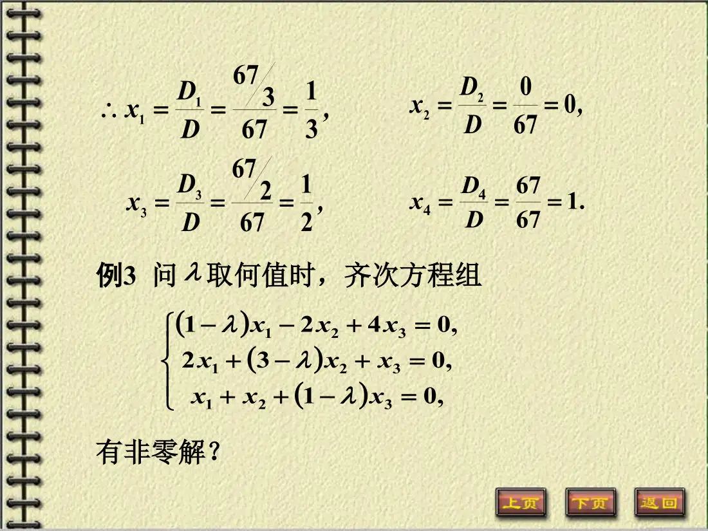

原文：

$$
\therefore x _ {1} = \frac {D _ {1}}{D} = \frac {\frac {6 7}{3}}{6 7} = \frac {1}{3},
$$

$$
x _ {2} = \frac {D _ {2}}{D} = \frac {0}{6 7} = 0,
$$

$$
x _ {3} = \frac {D _ {3}}{D} = \frac {\frac {6 7}{2}}{6 7} = \frac {1}{2},
$$

$$
x _ {4} = \frac {D _ {4}}{D} = \frac {6 7}{6 7} = 1.
$$

例3 问 $\lambda$ 取何值时，齐次方程组

$$
\left\{ \begin{array}{l} (1 - \lambda) x _ {1} - 2 x _ {2} + 4 x _ {3} = 0, \\ 2 x _ {1} + (3 - \lambda) x _ {2} + x _ {3} = 0, \\ x _ {1} + x _ {2} + (1 - \lambda) x _ {3} = 0, \end{array} \right.
$$

有非零解？

上页 下页 返回

### $$

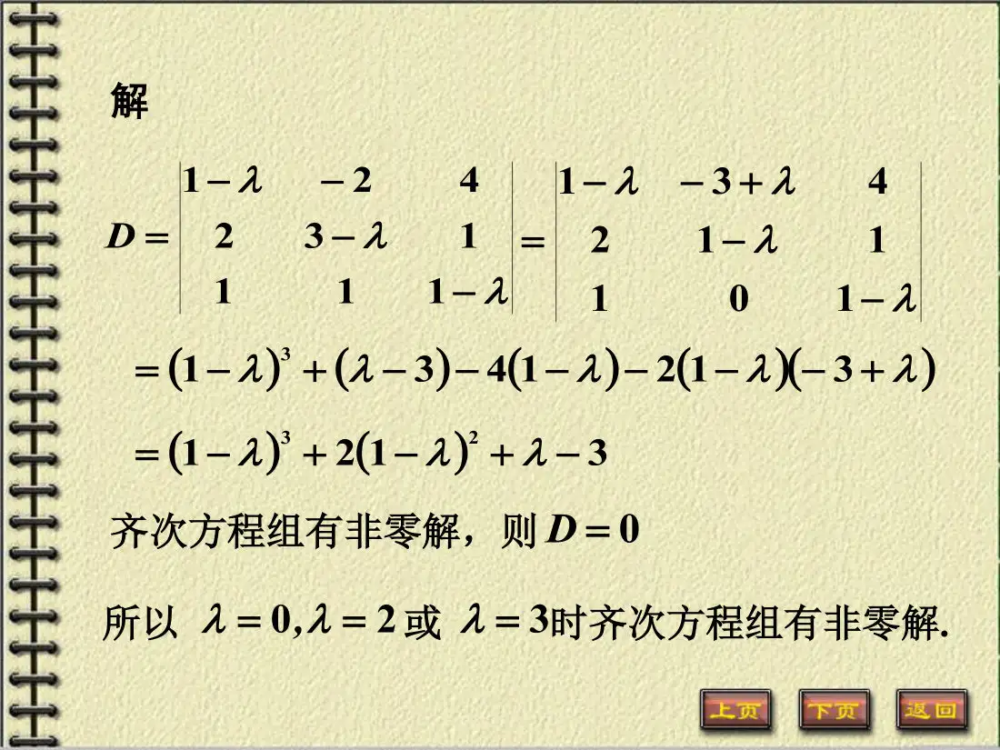

原文：

解

$$
D = \left| \begin{array}{c c c} 1 - \lambda & - 2 & 4 \\ 2 & 3 - \lambda & 1 \\ 1 & 1 & 1 - \lambda \end{array} \right| = \left| \begin{array}{c c c} 1 - \lambda & - 3 + \lambda & 4 \\ 2 & 1 - \lambda & 1 \\ 1 & 0 & 1 - \lambda \end{array} \right|
$$

$$
= (1 - \lambda) ^ {3} + (\lambda - 3) - 4 (1 - \lambda) - 2 (1 - \lambda) (- 3 + \lambda)
$$

$$
= (1 - \lambda) ^ {3} + 2 (1 - \lambda) ^ {2} + \lambda - 3
$$

齐次方程组有非零解，则 $D = 0$

所以 $\lambda = 0, \lambda = 2$ 或 $\lambda = 3$ 时齐次方程组有非零解.

上页 下页 返回

### 1. 用克莱姆法则解线性方程组

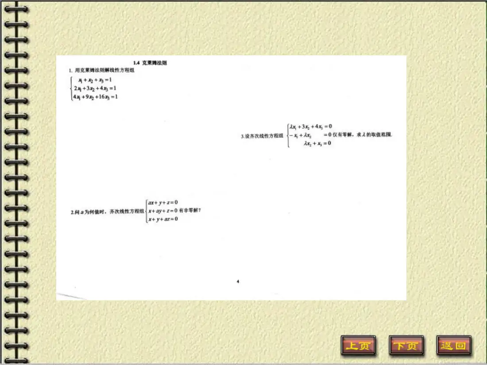

原文：

1. 用克莱姆法则解线性方程组

1.4 克莱姆法则

$$
\left\{ \begin{array}{c} x _ {1} + x _ {2} + x _ {3} = 1 \\ 2 x _ {1} + 3 x _ {2} + 4 x _ {3} = 1 \\ 4 x _ {1} + 9 x _ {2} + 1 6 x _ {3} = 1 \end{array} \right.
$$

2.问 $a$ 为何值时，齐次线性方程组 $\left\{ \begin{array}{l}ax + y + z = 0\\ x + ay + z = 0\text{有非零解？}\\ x + y + az = 0 \end{array} \right.$

3.设齐次线性方程组 $\left\{ \begin{array}{l}\lambda x_{1} + 3x_{2} + 4x_{3} = 0\\ -x_{1} + \lambda x_{2} = 0\text{仅有零解，求}\lambda \text{的取值范围}.\\ \lambda x_{2} + x_{3} = 0 \end{array} \right.$

上页 下页 返回

### 总结 n 行列式的计算方法

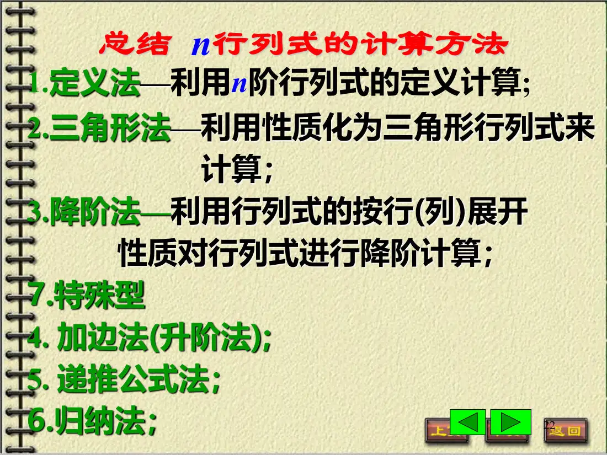

原文：

总结 n 行列式的计算方法
. 定义法——利用 n 阶行列式的定义计算;
. 三角形法——利用性质化为三角形行列式来计算;

.降阶法—利用行列式的按行(列)展开性质对行列式进行降阶计算;

特殊型

4. 加边法(升阶法);

5. 递推公式法;

6.归纳法;

上返回

### 2.三角形法—利用性质化为三角形行列式来

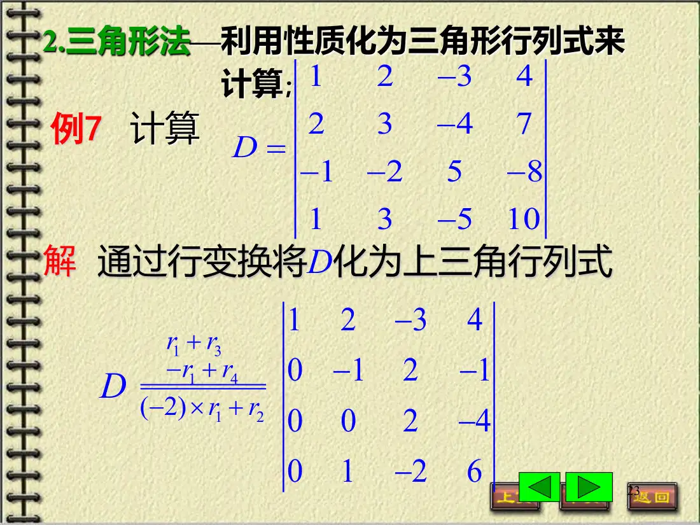

原文：

2.三角形法—利用性质化为三角形行列式来

例7 计算

$$
D = \begin{array}{c c c c} 1 & 2 & - 3 & 4 \\ 2 & 3 & - 4 & 7 \\ - 1 & - 2 & 5 & - 8 \\ 1 & 3 & - 5 & 1 0 \end{array}
$$

解 通过行变换将 $D$ 化为上三角行列式

$$
D \frac {r _ {1} + r _ {3}}{(- 2) \times r _ {1} + r _ {2}} \left| \begin{array}{c c c c} 1 & 2 & - 3 & 4 \\ 0 & - 1 & 2 & - 1 \\ 0 & 0 & 2 & - 4 \\ 0 & 1 & - 2 & 6 \end{array} \right|
$$

上返回

### $$

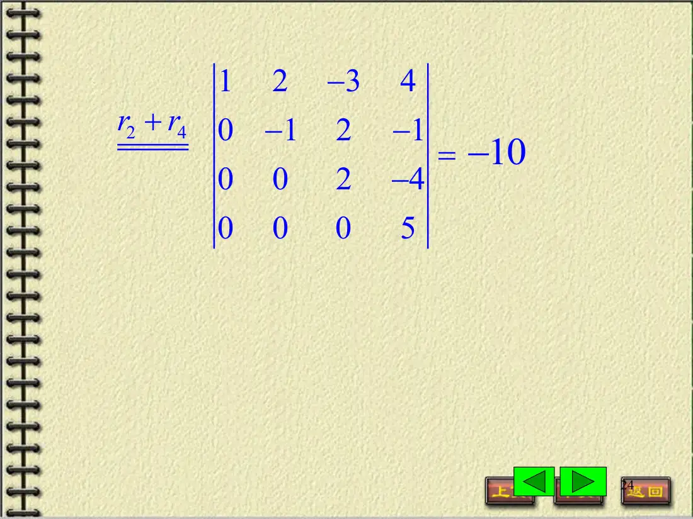

原文：

$$
\underline {{\underline {{r _ {2} + r _ {4}}}}} \left| \begin{array}{c c c c} 1 & 2 & - 3 & 4 \\ 0 & - 1 & 2 & - 1 \\ 0 & 0 & 2 & - 4 \\ 0 & 0 & 0 & 5 \end{array} \right| = - 1 0
$$

上返回

### 例 计算 n 阶行列式(行和相同)

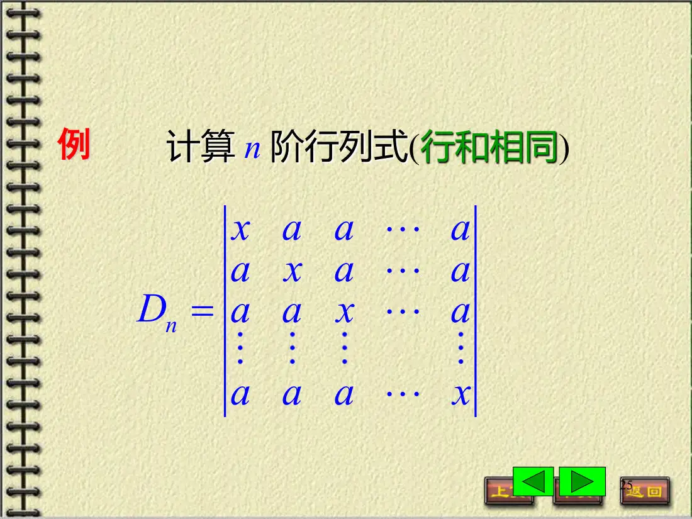

原文：

例 计算 n 阶行列式(行和相同)

$$
D _ {n} = \left| \begin{array}{l l l l l} x & a & a & \dots & a \\ a & x & a & \dots & a \\ a & a & x & \dots & a \\ \vdots & \vdots & \vdots & & \vdots \\ a & a & a & \dots & x \end{array} \right|
$$

25

### $$

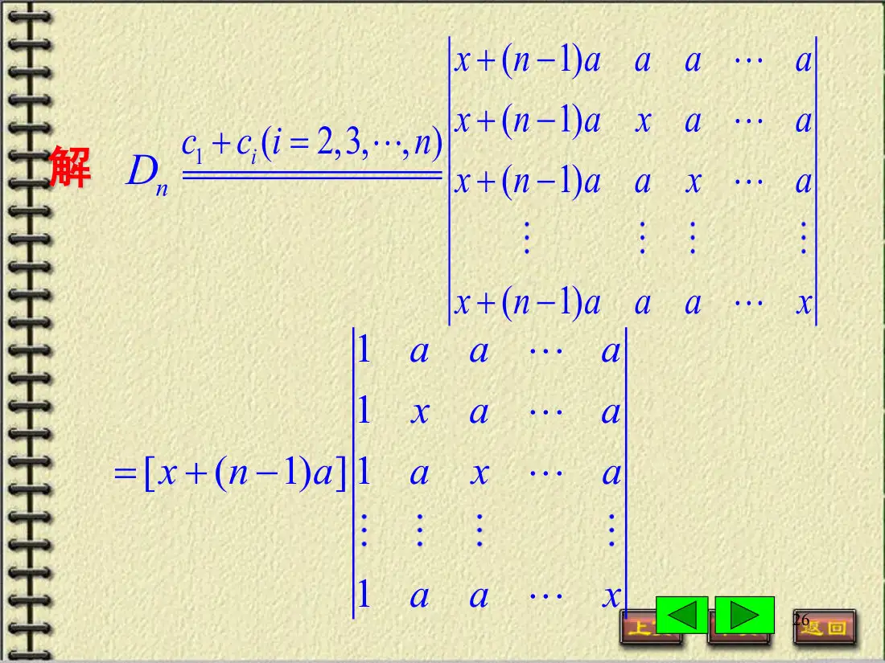

原文：

$$
\begin{array}{r l} & D _ {n} \xlongequal {c _ {1} + c _ {i} (i = 2, 3, \dots , n)} \left| \begin{array}{l l l l l} x + (n - 1) a & a & a & \dots & a \\ x + (n - 1) a & x & a & \dots & a \\ x + (n - 1) a & a & x & \dots & a \\ \vdots & \vdots & \vdots & & \vdots \\ x + (n - 1) a & a & a & \dots & x \end{array} \right| \\ = [ x + (n - 1) a ] \left| \begin{array}{l l l l l} 1 & a & a & \dots & a \\ 1 & x & a & \dots & a \\ 1 & a & x & \dots & a \\ \vdots & \vdots & \vdots & & \vdots \\ 1 & a & a & \dots & x \end{array} \right| \end{array}
$$

### $$

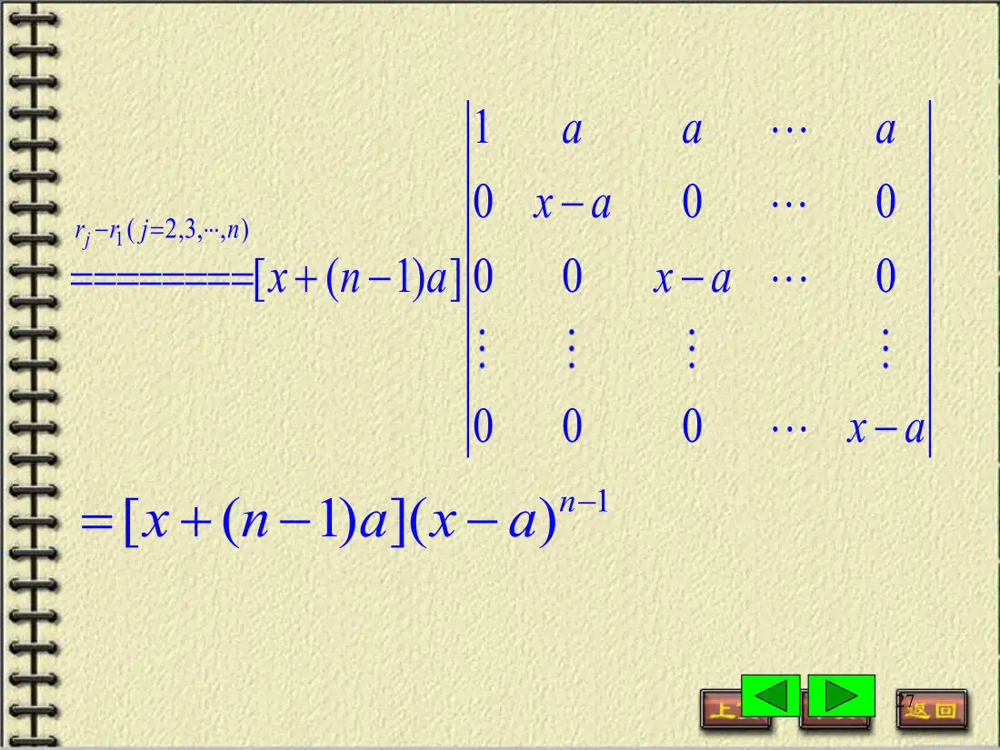

原文：

$$
\begin{array}{c c c c c} & 1 & a & a & \dots & a \\ r _ {j} - r _ {1} (j = 2, 3, \dots , n) & 0 & x - a & 0 & \dots & 0 \\ = = = = [ x + (n - 1) a ] & 0 & 0 & x - a & \dots & 0 \\ & \vdots & \vdots & \vdots & & \vdots \\ & 0 & 0 & 0 & \dots & x - a \end{array}
$$

$$
= [ x + (n - 1) a ] (x - a) ^ {n - 1}
$$

上返回

### 上页 下页 返回

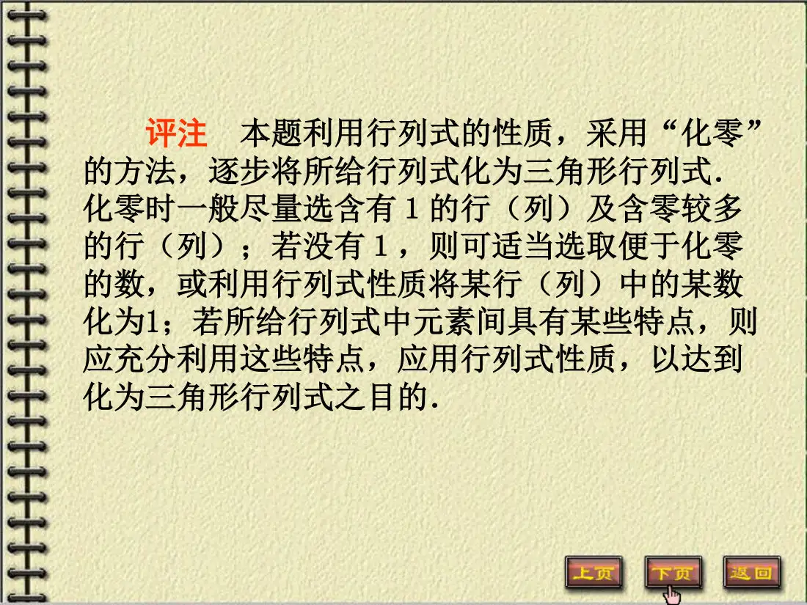

原文：

评注 本题利用行列式的性质，采用“化零”的方法，逐步将所给行列式化为三角形行列式。化零时一般尽量选含有1的行（列）及含零较多的行（列）；若没有1，则可适当选取便于化零的数，或利用行列式性质将某行（列）中的某数化为1；若所给行列式中元素间具有某些特点，则应充分利用这些特点，应用行列式性质，以达到化为三角形行列式之目的。

上页 下页 返回

### 3 用降阶法计算——有多零或者容易化零的情况

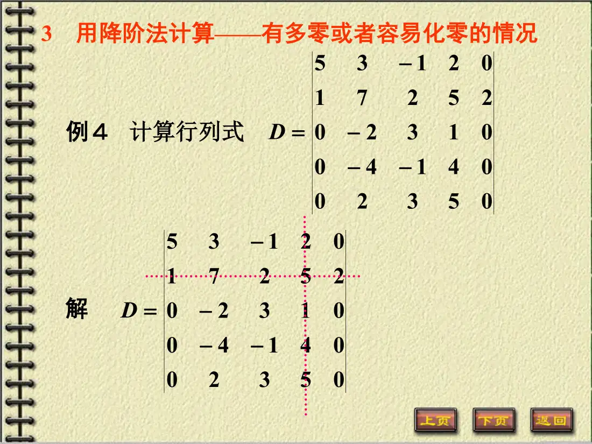

原文：

3 用降阶法计算——有多零或者容易化零的情况

例4 计算行列式

$$
D = \left| \begin{array}{r r r r r} 5 & 3 & - 1 & 2 & 0 \\ 1 & 7 & 2 & 5 & 2 \\ 0 & - 2 & 3 & 1 & 0 \\ 0 & - 4 & - 1 & 4 & 0 \\ 0 & 2 & 3 & 5 & 0 \end{array} \right|
$$

解

$$
D = \left| \begin{array}{r r r r r} 5 & 3 & - 1 & 2 & 0 \\ 1 & 7 & 2 & 5 & 2 \\ 0 & - 2 & 3 & 1 & 0 \\ 0 & - 4 & - 1 & 4 & 0 \\ 0 & 2 & 3 & 5 & 0 \end{array} \right|
$$

上页 下页 返回

### $$

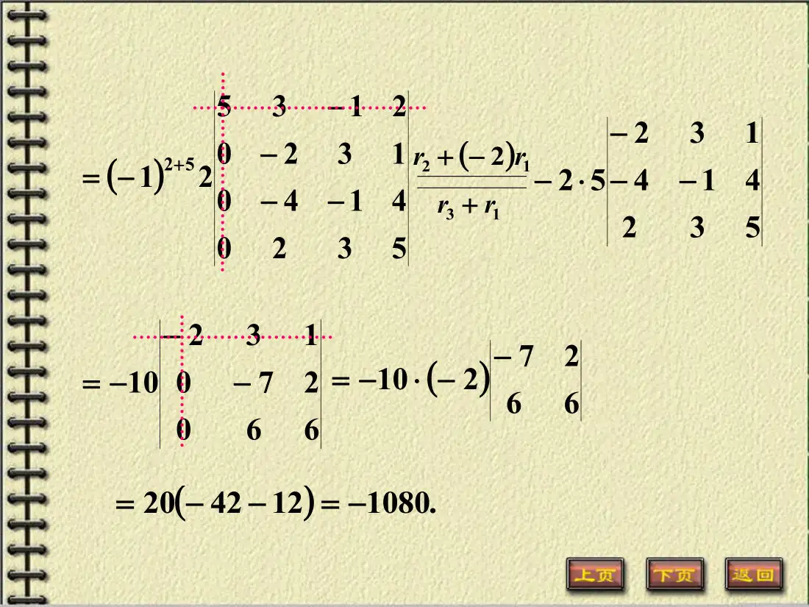

原文：

$$
= (- 1) ^ {2 + 5} 2 \left| \begin{array}{c c c c} 5 & 3 & - 1 & 2 \\ 0 & - 2 & 3 & 1 \\ 0 & - 4 & - 1 & 4 \\ 0 & 2 & 3 & 5 \end{array} \right| \frac {r _ {2} + (- 2) r _ {1}}{\overline {{r _ {3} + r _ {1}}}} - 2 \cdot 5 \left| \begin{array}{c c c} - 2 & 3 & 1 \\ - 4 & - 1 & 4 \\ 2 & 3 & 5 \end{array} \right|
$$

$$
= - 1 0 \left| \begin{array}{c c c} - 2 & 3 & 1 \\ 0 & - 7 & 2 \\ 0 & 6 & 6 \end{array} \right| = - 1 0 \cdot (- 2) \left| \begin{array}{c c} - 7 & 2 \\ 6 & 6 \end{array} \right|
$$

$$
= 2 0 (- 4 2 - 1 2) = - 1 0 8 0.
$$

上页 下页 返回

### 上页 下页 返回

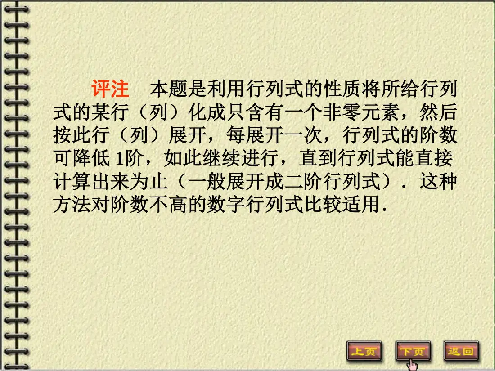

原文：

评注 本题是利用行列式的性质将所给行列式的某行（列）化成只含有一个非零元素，然后按此行（列）展开，每展开一次，行列式的阶数可降低1阶，如此继续进行，直到行列式能直接计算出来为止（一般展开成二阶行列式）。这种方法对阶数不高的数字行列式比较适用。

上页 下页 返回

### 7.特殊型

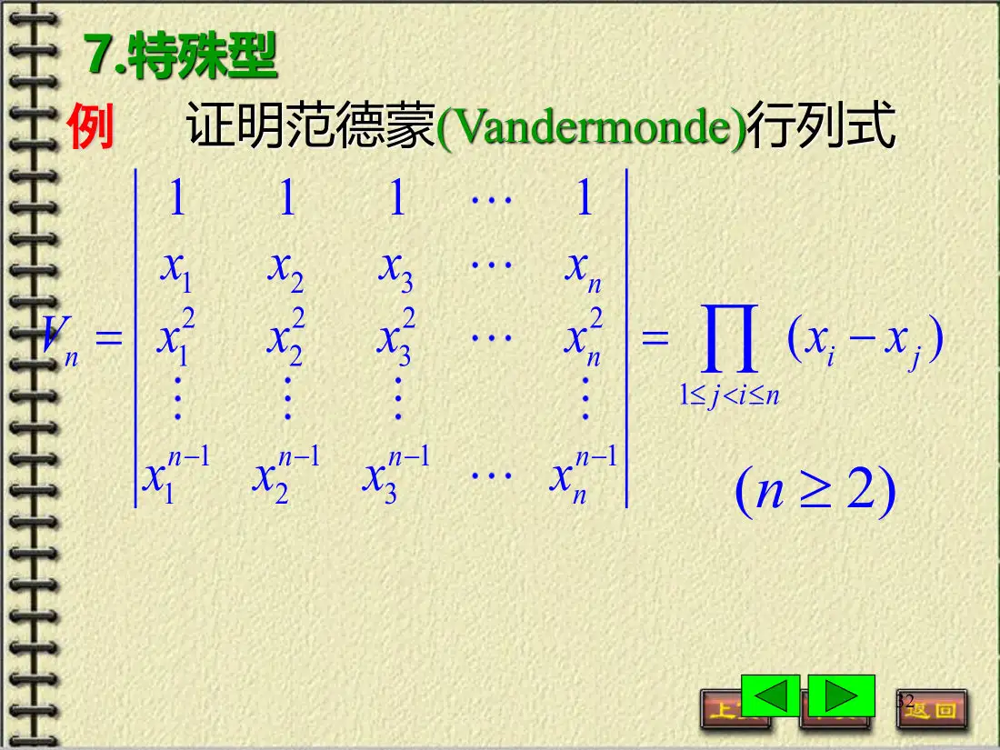

原文：

7.特殊型

例 证明范德蒙(Vandermonde)行列式

$$
= \left| \begin{array}{c c c c c} 1 & 1 & 1 & \dots & 1 \\ x _ {1} & x _ {2} & x _ {3} & \dots & x _ {n} \\ x _ {1} ^ {2} & x _ {2} ^ {2} & x _ {3} ^ {2} & \dots & x _ {n} ^ {2} \\ \vdots & \vdots & \vdots & & \vdots \\ x _ {1} ^ {n - 1} & x _ {2} ^ {n - 1} & x _ {3} ^ {n - 1} & \dots & x _ {n} ^ {n - 1} \end{array} \right| = \prod_ {1 \leq j <   i \leq n} (x _ {i} - x _ {j}) \quad (n \geq 2)
$$

V

上返回

### $$

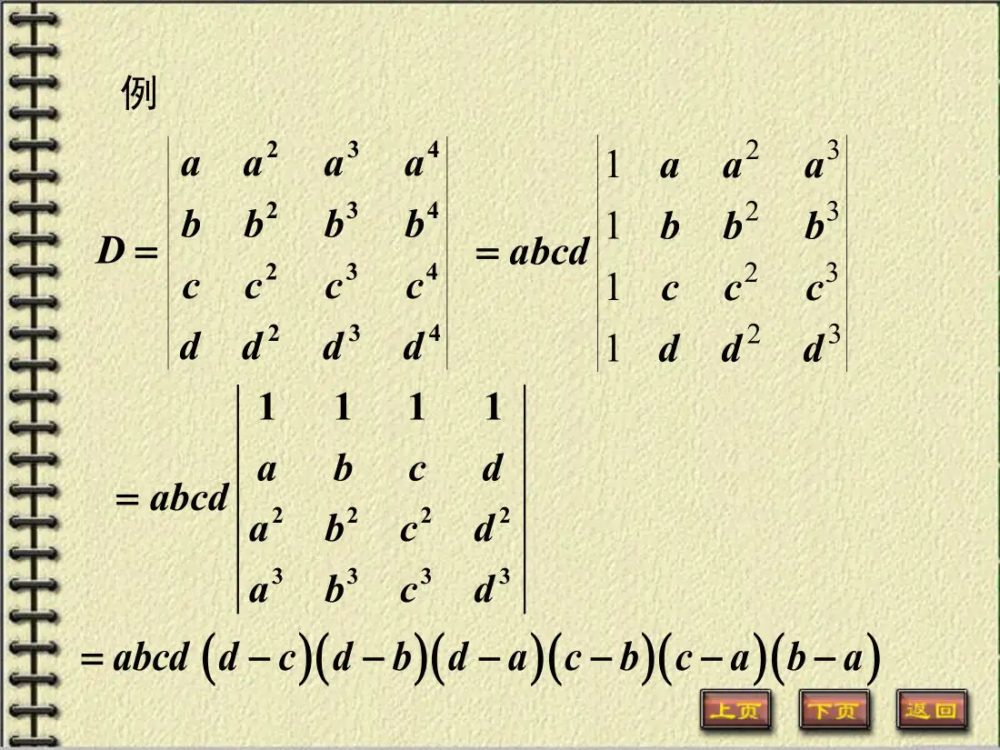

原文：

例

$$
\begin{array}{r l} & D = \left| \begin{array}{l l l l} a & a ^ {2} & a ^ {3} & a ^ {4} \\ b & b ^ {2} & b ^ {3} & b ^ {4} \\ c & c ^ {2} & c ^ {3} & c ^ {4} \\ d & d ^ {2} & d ^ {3} & d ^ {4} \end{array} \right| = a b c d \left| \begin{array}{l l l l} 1 & a & a ^ {2} & a ^ {3} \\ 1 & b & b ^ {2} & b ^ {3} \\ 1 & c & c ^ {2} & c ^ {3} \\ 1 & d & d ^ {2} & d ^ {3} \end{array} \right| \\ & = a b c d \left| \begin{array}{l l l l} 1 & 1 & 1 & 1 \\ a & b & c & d \\ a ^ {2} & b ^ {2} & c ^ {2} & d ^ {2} \\ a ^ {3} & b ^ {3} & c ^ {3} & d ^ {3} \end{array} \right| \end{array}
$$

$$
= a b c d (d - c) (d - b) (d - a) (c - b) (c - a) (b - a)
$$

上页 下页 返回

### 上页 下页 返回

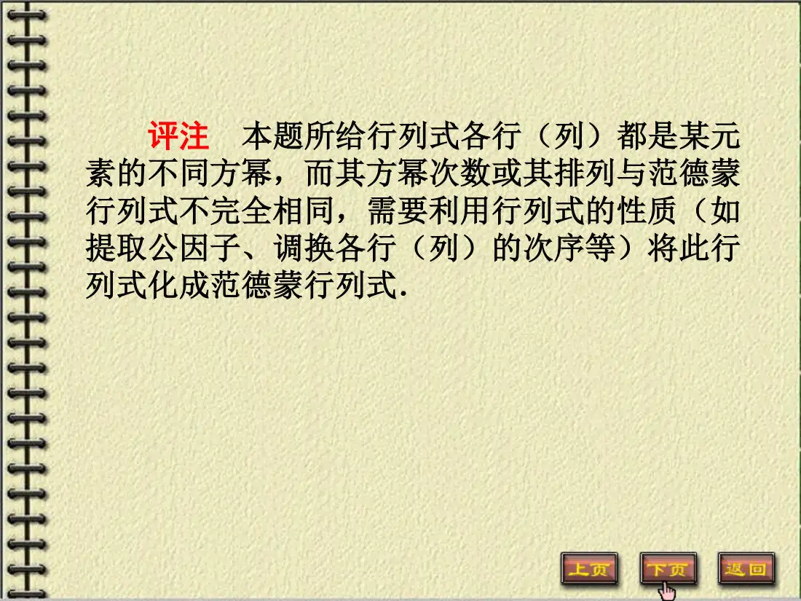

原文：

评注 本题所给行列式各行（列）都是某元素的不同方幂，而其方幂次数或其排列与范德蒙行列式不完全相同，需要利用行列式的性质（如提取公因子、调换各行（列）的次序等）将此行列式化成范德蒙行列式。

上页 下页 返回

### 例 计算 n 阶行列式（两道一点）

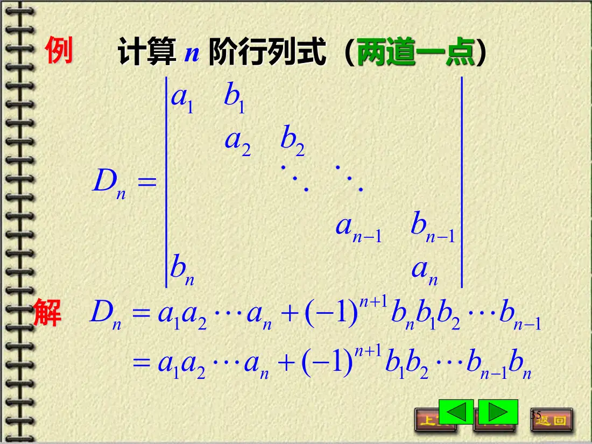

原文：

例 计算 n 阶行列式（两道一点）

$$
D _ {n} = \left| \begin{array}{l l l l l} a _ {1} & b _ {1} & & & \\ & a _ {2} & b _ {2} & & \\ & & \ddots & \ddots & \\ & & & a _ {n - 1} & b _ {n - 1} \\ b _ {n} & & & & a _ {n} \end{array} \right|
$$

$$
\begin{array}{r} D _ {n} = a _ {1} a _ {2} \dots a _ {n} + (- 1) ^ {n + 1} b _ {n} b _ {1} b _ {2} \dots b _ {n - 1} \\ = a _ {1} a _ {2} \dots a _ {n} + (- 1) ^ {n + 1} b _ {1} b _ {2} \dots b _ {n - 1} b _ {n} \end{array}
$$

上返回

### 例 计算 $n + 1$ 阶行列式(爪形)

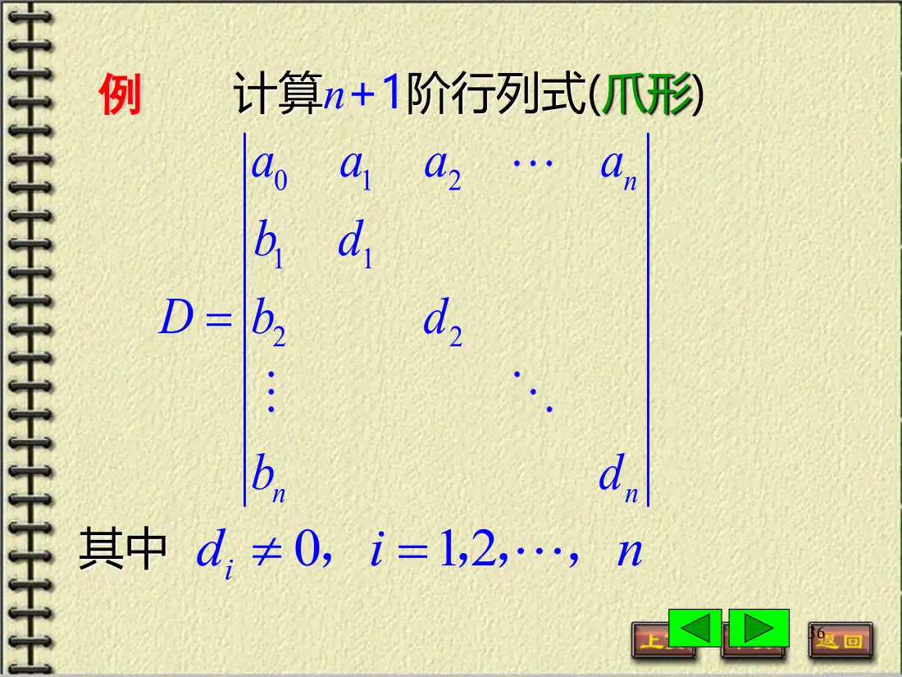

原文：

例 计算 $n + 1$ 阶行列式(爪形)

$$
D = \left| \begin{array}{l l l l l} a _ {0} & a _ {1} & a _ {2} & \dots & a _ {n} \\ b _ {1} & d _ {1} & & & \\ b _ {2} & & d _ {2} & & \\ \vdots & & & \ddots & \\ b _ {n} & & & & d _ {n} \end{array} \right|
$$

其中 $d_{i} \neq 0,\quad i = 1,2,\cdots,\quad n$

上返回

### $$

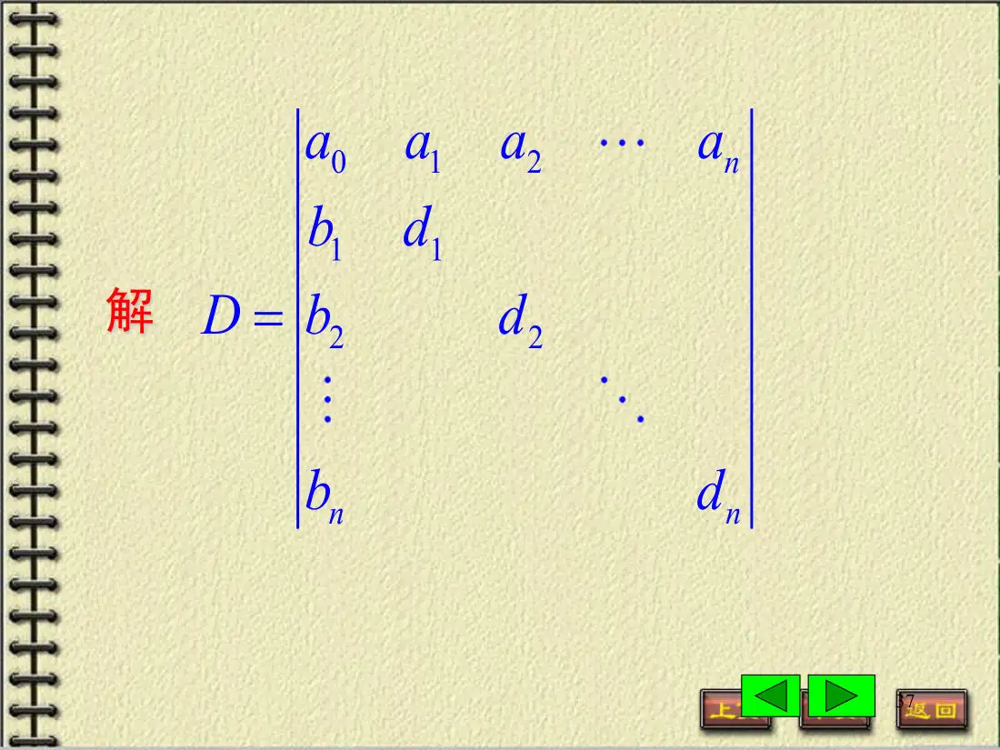

原文：

$$
\text {解} \quad D = \left| \begin{array}{l l l l l} a _ {0} & a _ {1} & a _ {2} & \dots & a _ {n} \\ b _ {1} & d _ {1} & & & \\ b _ {2} & & d _ {2} & & \\ \vdots & & & \ddots & \\ b _ {n} & & & & d _ {n} \end{array} \right|
$$

上返回

### 当 $d_{1}, d_{2}, \cdots, d_{n}$ 全不为零时

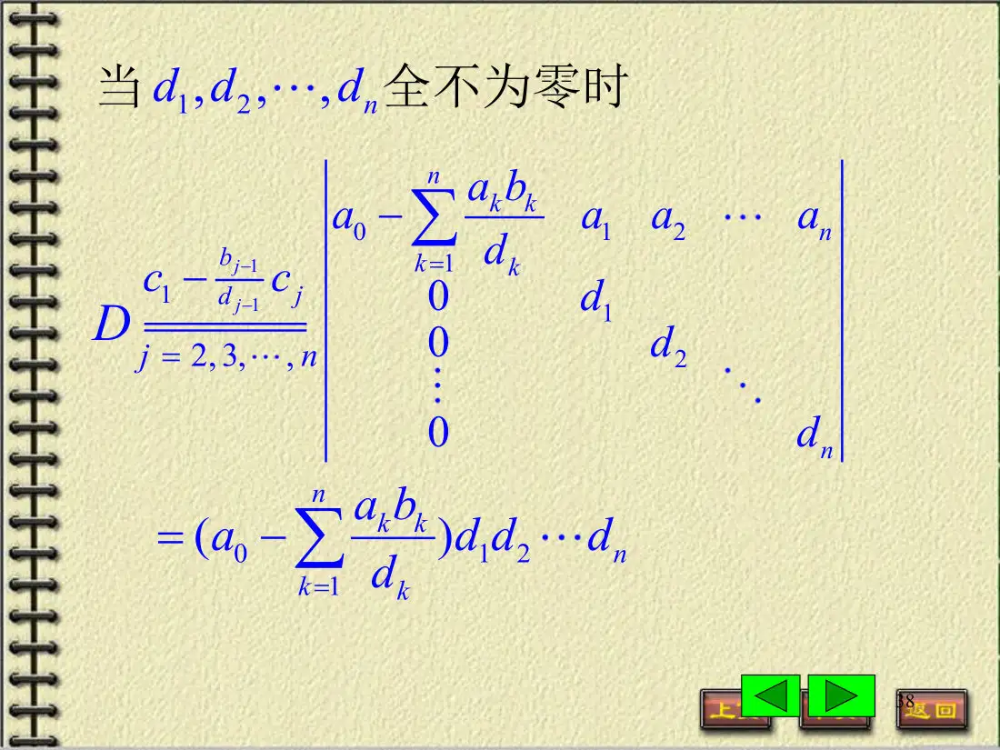

原文：

当 $d_{1}, d_{2}, \cdots, d_{n}$ 全不为零时

$$
D \frac {c _ {1} - \frac {b _ {j - 1}}{d _ {j - 1}} c _ {j}}{j = 2 , 3 , \cdots , n} \left| \begin{array}{c c c c c} a _ {0} - \sum_ {k = 1} ^ {n} \frac {a _ {k} b _ {k}}{d _ {k}} & a _ {1} & a _ {2} & \dots & a _ {n} \\ 0 & d _ {1} & & & \\ 0 & & d _ {2} & & \\ \vdots & & & \ddots & \\ 0 & & & & d _ {n} \end{array} \right|
$$

$$
= (a _ {0} - \sum_ {k = 1} ^ {n} \frac {a _ {k} b _ {k}}{d _ {k}}) d _ {1} d _ {2} \dots d _ {n}
$$

上返回

### $$

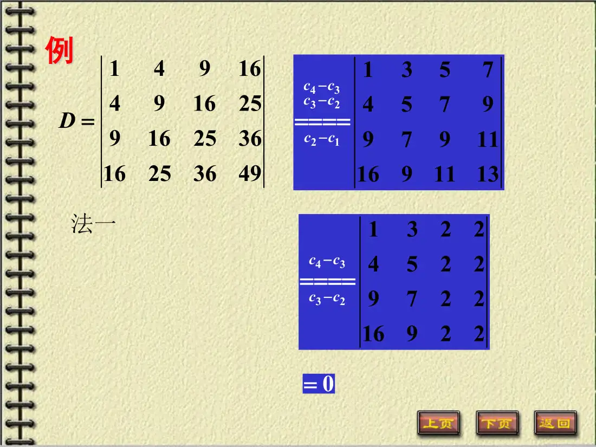

原文：

例

$$
D = \left| \begin{array}{l l l l} 1 & 4 & 9 & 1 6 \\ 4 & 9 & 1 6 & 2 5 \\ 9 & 1 6 & 2 5 & 3 6 \\ 1 6 & 2 5 & 3 6 & 4 9 \end{array} \right|
$$

法一

$$
\begin{array}{c c c c c} & 1 & 3 & 5 & 7 \\ \hline c _ {4} - c _ {3} & 4 & 5 & 7 & 9 \\ \hline c _ {3} - c _ {2} & 9 & 7 & 9 & 1 1 \\ \hline c _ {2} - c _ {1} & 1 6 & 9 & 1 1 & 1 3 \end{array}
$$

$$
\begin{array}{c c c c c} & 1 & 3 & 2 & 2 \\ \hline c _ {4} - c _ {3} & 4 & 5 & 2 & 2 \\ \hline c _ {3} - c _ {2} & 9 & 7 & 2 & 2 \\ & 1 6 & 9 & 2 & 2 \end{array}
$$

$$
= 0
$$

上页 下页 返回

### 法二

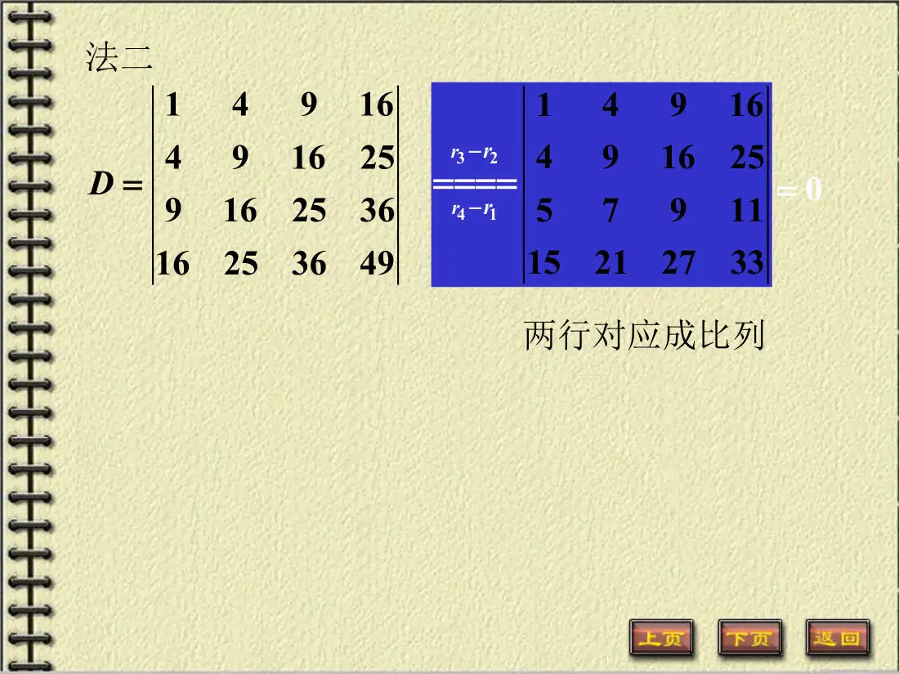

原文：

法二

$$
D = \left| \begin{array}{c c c c} 1 & 4 & 9 & 1 6 \\ 4 & 9 & 1 6 & 2 5 \\ 9 & 1 6 & 2 5 & 3 6 \\ 1 6 & 2 5 & 3 6 & 4 9 \end{array} \right| \quad \begin{array}{c c c c c} r _ {3} - r _ {2} & 1 & 4 & 9 & 1 6 \\ \overline \overline \overline \overline \overline \overline \overline \overline \overline {{\overline {{\overline {{\overline {{\overline {{\overline {{\overline {{\overline {{\overline {{\overline {{\overline {{\overline {{\overline {{\overline {{\overline {{\overline {{\overline {{\overline {{}}}}}}}}}}}}}}}}}}}}}}}}}}}}}}}}}}}} & r _ {4} - r _ {1} & 5 & 7 & 9 & 1 1 \\ & & 1 5 & 2 1 & 2 7 & 3 3 \end{array}
$$

两行对应成比列

上页 下页 返回

### 推广

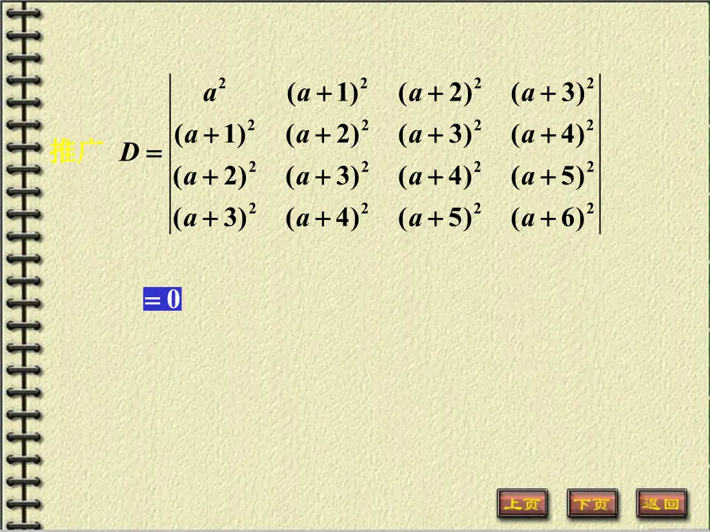

原文：

推广

$$
D = \left| \begin{array}{l l l l} a ^ {2} & (a + 1) ^ {2} & (a + 2) ^ {2} & (a + 3) ^ {2} \\ (a + 1) ^ {2} & (a + 2) ^ {2} & (a + 3) ^ {2} & (a + 4) ^ {2} \\ (a + 2) ^ {2} & (a + 3) ^ {2} & (a + 4) ^ {2} & (a + 5) ^ {2} \\ (a + 3) ^ {2} & (a + 4) ^ {2} & (a + 5) ^ {2} & (a + 6) ^ {2} \end{array} \right|
$$

$$
= 0
$$

上页 下页 返回

### $$

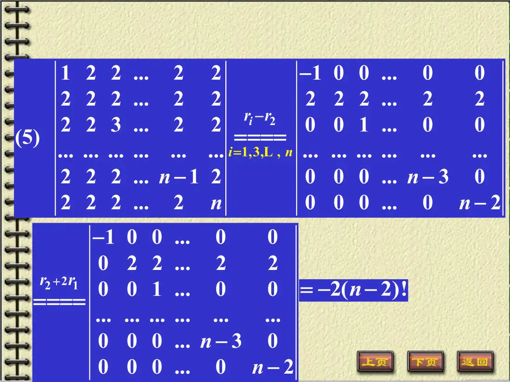

原文：

$$
\left| \begin{array}{c c c c c c} 1 & 2 & 2 & \dots & 2 & 2 \\ 2 & 2 & 2 & \dots & 2 & 2 \\ 2 & 2 & 3 & \dots & 2 & 2 \\ \dots & \dots & \dots & \dots & \dots & \dots \\ 2 & 2 & 2 & \dots & n - 1 & 2 \\ 2 & 2 & 2 & \dots & 2 & n \end{array} \right| \overset {r _ {i} - r _ {2}} {\underset {i = 1, 3, L , n} {=}} \left| \begin{array}{c c c c c c} - 1 & 0 & 0 & \dots & 0 & 0 \\ 2 & 2 & 2 & \dots & 2 & 2 \\ 0 & 0 & 1 & \dots & 0 & 0 \\ \dots & \dots & \dots & \dots & \dots & \dots \\ 0 & 0 & 0 & \dots & n - 3 & 0 \\ 0 & 0 & 0 & \dots & 0 & n - 2 \end{array} \right|
$$

$$
\begin{array}{r l} & \underline {{\underline {{r _ {2} + 2 r _ {1}}}}} \left| \begin{array}{c c c c c c} - 1 & 0 & 0 & \dots & 0 & 0 \\ 0 & 2 & 2 & \dots & 2 & 2 \\ 0 & 0 & 1 & \dots & 0 & 0 \\ \dots & \dots & \dots & \dots & \dots & \dots \\ 0 & 0 & 0 & \dots & n - 3 & 0 \\ 0 & 0 & 0 & \dots & 0 & n - 2 \end{array} \right| = - 2 (n - 2)! \\ & \text {   上页   } \end{array}
$$

上页 下页 返回

### 4 用加边法计算

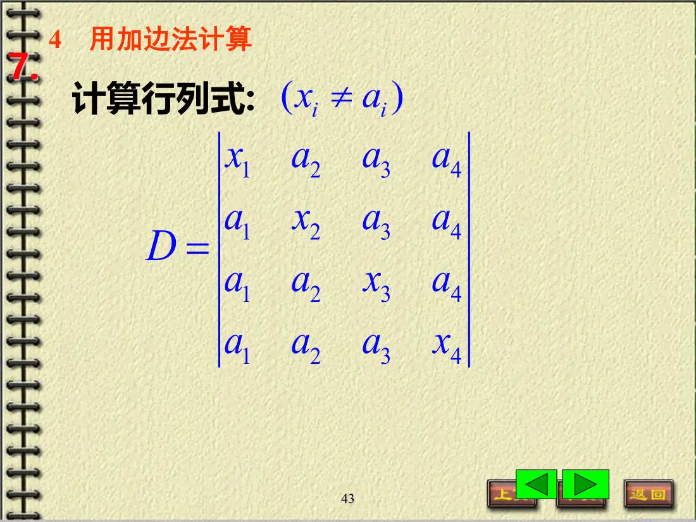

原文：

4 用加边法计算

计算行列式: $(x_{i} \neq a_{i})$

$$
D = \left| \begin{array}{l l l l} x _ {1} & a _ {2} & a _ {3} & a _ {4} \\ a _ {1} & x _ {2} & a _ {3} & a _ {4} \\ a _ {1} & a _ {2} & x _ {3} & a _ {4} \\ a _ {1} & a _ {2} & a _ {3} & x _ {4} \end{array} \right|
$$

7.

43

上返回

### 解 用加边法

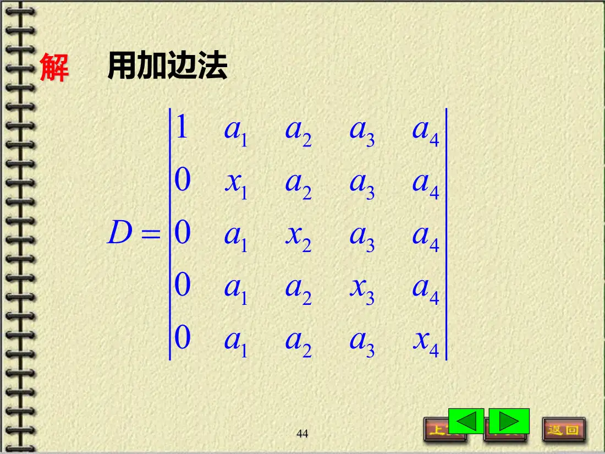

原文：

解 用加边法

$$
D = \left| \begin{array}{l l l l l} 1 & a _ {1} & a _ {2} & a _ {3} & a _ {4} \\ 0 & x _ {1} & a _ {2} & a _ {3} & a _ {4} \\ 0 & a _ {1} & x _ {2} & a _ {3} & a _ {4} \\ 0 & a _ {1} & a _ {2} & x _ {3} & a _ {4} \\ 0 & a _ {1} & a _ {2} & a _ {3} & x _ {4} \end{array} \right|
$$

44

上返回

### $$

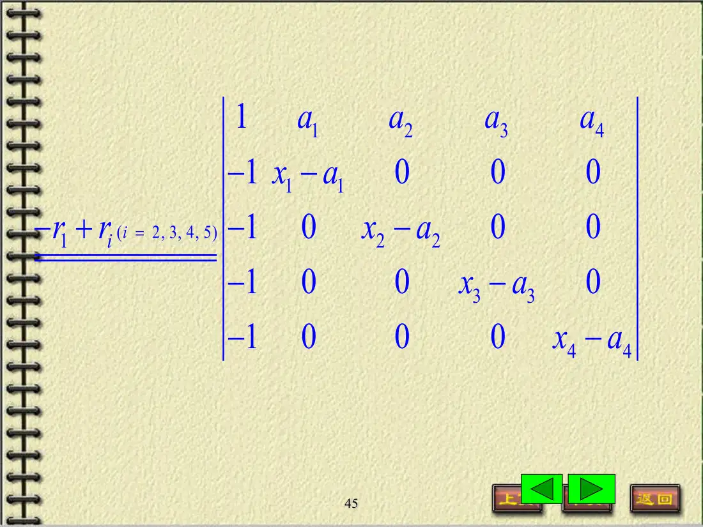

原文：

$$
\frac {r _ {1} + r _ {i} (i = 2 , 3 , 4 , 5)}{} \left| \begin{array}{c c c c c} 1 & a _ {1} & a _ {2} & a _ {3} & a _ {4} \\ - 1 & x _ {1} - a _ {1} & 0 & 0 & 0 \\ - 1 & 0 & x _ {2} - a _ {2} & 0 & 0 \\ - 1 & 0 & 0 & x _ {3} - a _ {3} & 0 \\ - 1 & 0 & 0 & 0 & x _ {4} - a _ {4} \end{array} \right|
$$

45

上返回

### $$

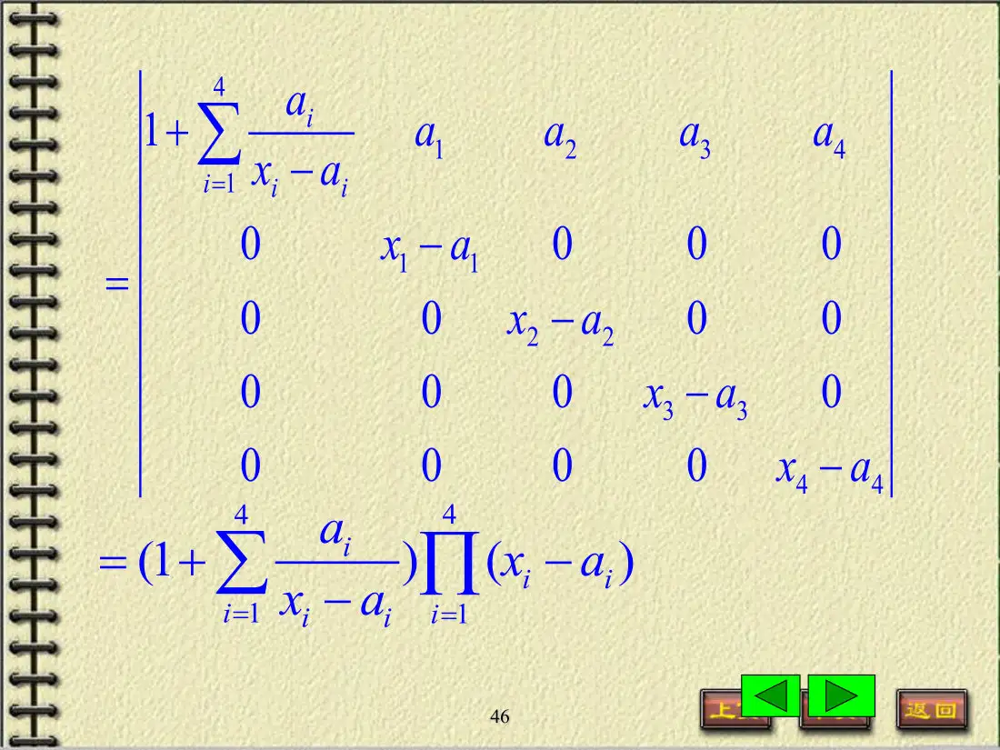

原文：

$$
= \left| \begin{array}{c c c c c} 1 + \sum_ {i = 1} ^ {4} \frac {a _ {i}}{x _ {i} - a _ {i}} & a _ {1} & a _ {2} & a _ {3} & a _ {4} \\ 0 & x _ {1} - a _ {1} & 0 & 0 & 0 \\ 0 & 0 & x _ {2} - a _ {2} & 0 & 0 \\ 0 & 0 & 0 & x _ {3} - a _ {3} & 0 \\ 0 & 0 & 0 & 0 & x _ {4} - a _ {4} \end{array} \right|
$$

$$
= (1 + \sum_ {i = 1} ^ {4} \frac {a _ {i}}{x _ {i} - a _ {i}}) \prod_ {i = 1} ^ {4} (x _ {i} - a _ {i})
$$

46

上返回

### 5 用递推法计算

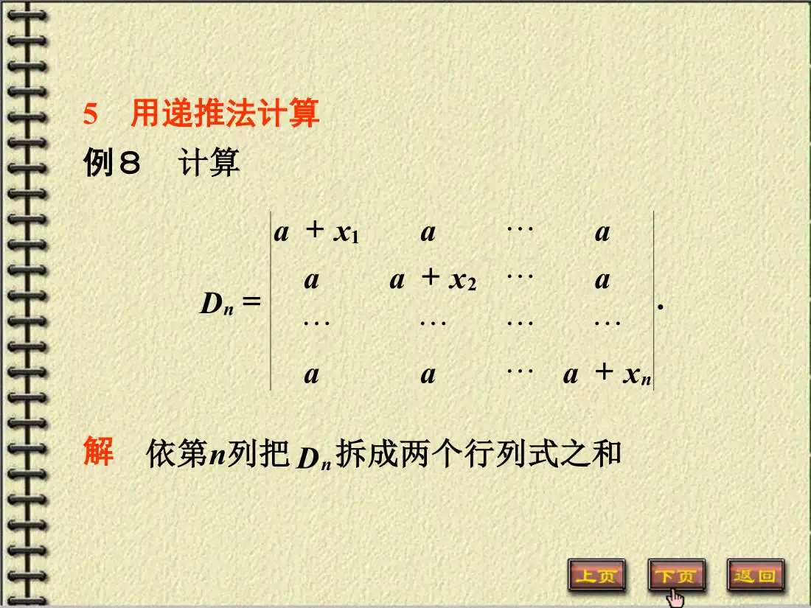

原文：

5 用递推法计算

例8 计算

$$
D _ {n} = \left| \begin{array}{c c c c c} a + x _ {1} & a & \dots & a \\ a & a + x _ {2} & \dots & a \\ \dots & \dots & \dots & \dots \\ a & a & \dots & a + x _ {n} \end{array} \right|.
$$

解 依第 $n$ 列把 $D_{n}$ 拆成两个行列式之和

上页 下页 返回

### $$

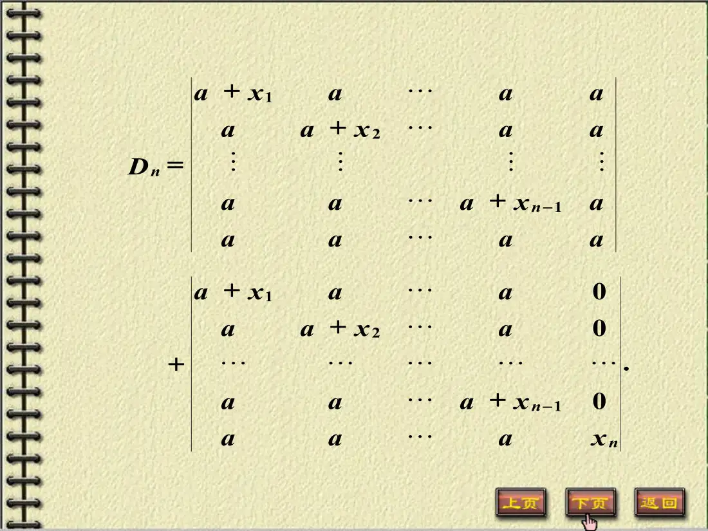

原文：

$$
\begin{array}{r l} & D _ {n} = \left| \begin{array}{c c c c c c} a + x _ {1} & a & \dots & a & a \\ a & a + x _ {2} & \dots & a & a \\ \vdots & \vdots & & \vdots & \vdots \\ a & a & \dots & a + x _ {n - 1} & a \\ a & a & \dots & a & a \end{array} \right| \\ & + \left| \begin{array}{c c c c c} a + x _ {1} & a & \dots & a & 0 \\ a & a + x _ {2} & \dots & a & 0 \\ \dots & \dots & \dots & \dots & \dots \\ a & a & \dots & a + x _ {n - 1} & 0 \\ a & a & \dots & a & x _ {n} \end{array} \right|. \end{array}
$$

上页 下页 返回

### $$

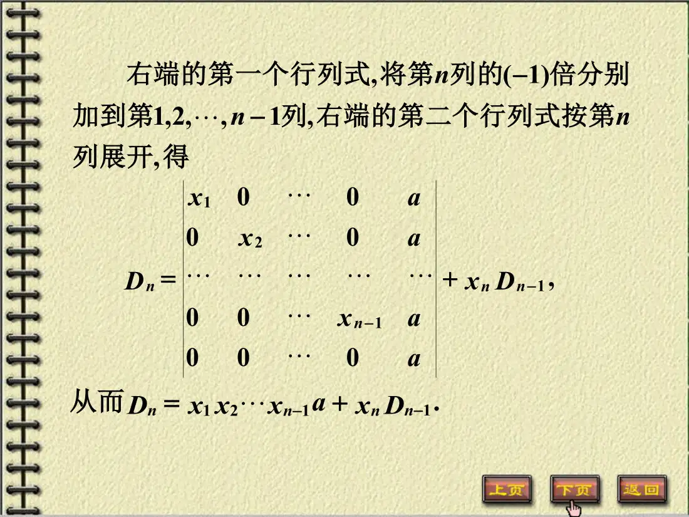

原文：

右端的第一个行列式,将第n列的(-1)倍分别加到第1,2,…,n-1列,右端的第二个行列式按第n列展开,得

$$
D _ {n} = \left| \begin{array}{c c c c c} x _ {1} & 0 & \dots & 0 & a \\ 0 & x _ {2} & \dots & 0 & a \\ \dots & \dots & \dots & \dots & \dots \\ 0 & 0 & \dots & x _ {n - 1} & a \\ 0 & 0 & \dots & 0 & a \end{array} \right| + x _ {n} D _ {n - 1},
$$

从而 $D_{n}=x_{1}x_{2}\cdots x_{n-1}a+x_{n}D_{n-1}$

上页 下页 返回

### 由此递推，得

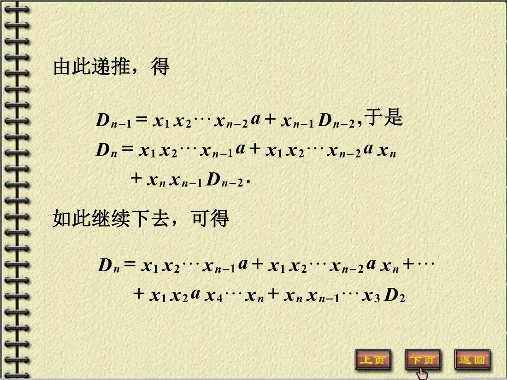

原文：

由此递推，得

$$
\begin{array}{r l} & {D _ {n - 1} = x _ {1} x _ {2} \dots x _ {n - 2} a + x _ {n - 1} D _ {n - 2}, \text {于是}} \\ & {D _ {n} = x _ {1} x _ {2} \dots x _ {n - 1} a + x _ {1} x _ {2} \dots x _ {n - 2} a x _ {n}} \\ & {\qquad + x _ {n} x _ {n - 1} D _ {n - 2}.} \end{array}
$$

如此继续下去，可得

$$
\begin{array}{r} D _ {n} = x _ {1} x _ {2} \dots x _ {n - 1} a + x _ {1} x _ {2} \dots x _ {n - 2} a x _ {n} + \dots \\ + x _ {1} x _ {2} a x _ {4} \dots x _ {n} + x _ {n} x _ {n - 1} \dots x _ {3} D _ {2} \end{array}
$$

上页 下页 返回

### $$

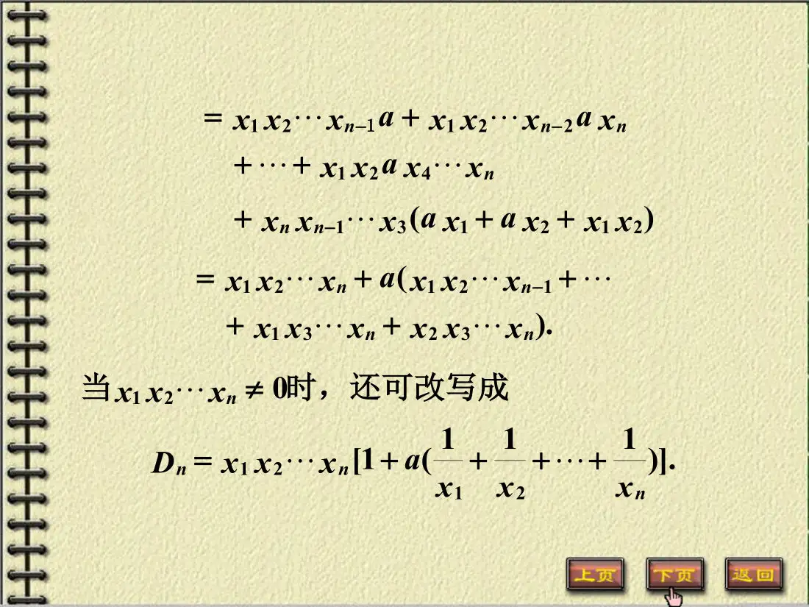

原文：

$$
\begin{array}{r l} & {= x _ {1} x _ {2} \dots x _ {n - 1} a + x _ {1} x _ {2} \dots x _ {n - 2} a x _ {n}} \\ & {\quad + \dots + x _ {1} x _ {2} a x _ {4} \dots x _ {n}} \\ & {\quad + x _ {n} x _ {n - 1} \dots x _ {3} (a x _ {1} + a x _ {2} + x _ {1} x _ {2})} \\ & {= x _ {1} x _ {2} \dots x _ {n} + a (x _ {1} x _ {2} \dots x _ {n - 1} + \dots} \\ & {\quad + x _ {1} x _ {3} \dots x _ {n} + x _ {2} x _ {3} \dots x _ {n}).} \end{array}
$$

当 $x_{1}x_{2}\cdots x_{n}\neq0$ 时，还可改写成

$$
D _ {n} = x _ {1} x _ {2} \dots x _ {n} [ 1 + a (\frac {1}{x _ {1}} + \frac {1}{x _ {2}} + \dots + \frac {1}{x _ {n}}) ].
$$

上页 下页 返回

### 上页 下页 返回

原文：

评注 本题是利用行列式的性质把所给的n阶行列式 $D_{n}$ 用同样形式的n-1阶行列式表示出来,建立了 $D_{n}$ 与n-1阶行列式 $D_{n-1}$ 之间的递推关系.有时,还可以把给定的n阶行列式 $D_{n}$ 用同样形式的比n-1阶更低阶的行列式表示,建立比n-1阶行列式更低阶行列式之间的递推关系.

上页 下页 返回

### 6 用数学归纳法

原文：

例

6 用数学归纳法

证明n阶(三对角)行列式

$$
D _ {n} = \left| \begin{array}{c c c c c c c c} \alpha + \beta & \alpha \beta & & & & & \\ 1 & \alpha + \beta & \alpha \beta & & & & \\ & 1 & \alpha + \beta & \alpha \beta & & & \\ & & \ddots & \ddots & \ddots & & \\ & & & 1 & \alpha + \beta & \alpha \beta \\ & & & & 1 & \alpha + \beta \end{array} \right|
$$

$$
= \frac {\beta^ {n + 1} - \alpha^ {n + 1}}{\beta - \alpha}
$$

其中 $\alpha \neq \beta$

上返回

### 证 对行列式阶数n用数学归纳法证明

原文：

证 对行列式阶数n用数学归纳法证明
1° n=1 时， $D_{1}=\left|\alpha+\beta\right|=\alpha+\beta=\frac{\beta^{2}-\alpha^{2}}{\beta-\alpha}$ 结论成立.
n=2 时， $D_{2}=\begin{vmatrix}\alpha+\beta&\alpha\beta\\1&\alpha+\beta\end{vmatrix}$ $=(\alpha+\beta)^{2}-\alpha\beta=\frac{\beta^{3}-\alpha^{3}}{\beta-\alpha}$ 结论成立.

54

### $2^{\circ}$ 设 $n-1, n-2$ 时结论成立,

原文：

$2^{\circ}$ 设 $n-1, n-2$ 时结论成立,

则对于 $n$ 阶行列式 $\mathbf{D}_n$ 按第一行展开有

$$
\begin{array}{l} D _ {n} = (\alpha + \beta) D _ {n - 1} - \alpha \beta D _ {n - 2} \\ = (\alpha + \beta) \frac {\beta^ {n} - \alpha^ {n}}{\beta - \alpha} - \alpha \beta \frac {\beta^ {n - 1} - \alpha^ {n - 1}}{\beta - \alpha} \\ = \frac {\beta^ {n + 1} - a ^ {n + 1}}{\beta - \alpha} \end{array}
$$

55

### 上页 下页 返回

原文：

评注 为了将 $D_{n}$ 展开成能用其同型的 $D_{n-1}$ , $D_{n-2}$ 表示,本例必须按第 $n$ 行(或第 $n$ 列)展开,不能按第1行(或第1列)展开,否则所得的低阶行列式不是与 $D_{n}$ 同型的行列式.

一般来讲,当行列式已告诉其结果,而要我们证明是与自然数有关的结论时,可考虑用数学归纳法来证明.如果未告诉结果,也可先猜想其结果,然后用数学归纳法证明其猜想结果成立.

上页 下页 返回

### 小结

原文：

小结

计算行列式的方法比较灵活，同一行列式可以有多种计算方法；有的行列式计算需要几种方法综合应用。在计算时，首先要仔细考察行列式在构造上的特点，利用行列式的性质对它进行变换后，再考察它是否能用常用的几种方法。

上页 下页 返回
