# 《线性代数与解析几何》第1章 行列式（课件）

原件的每一页，下面附识别出的文字。

### 线性代数与解析几何

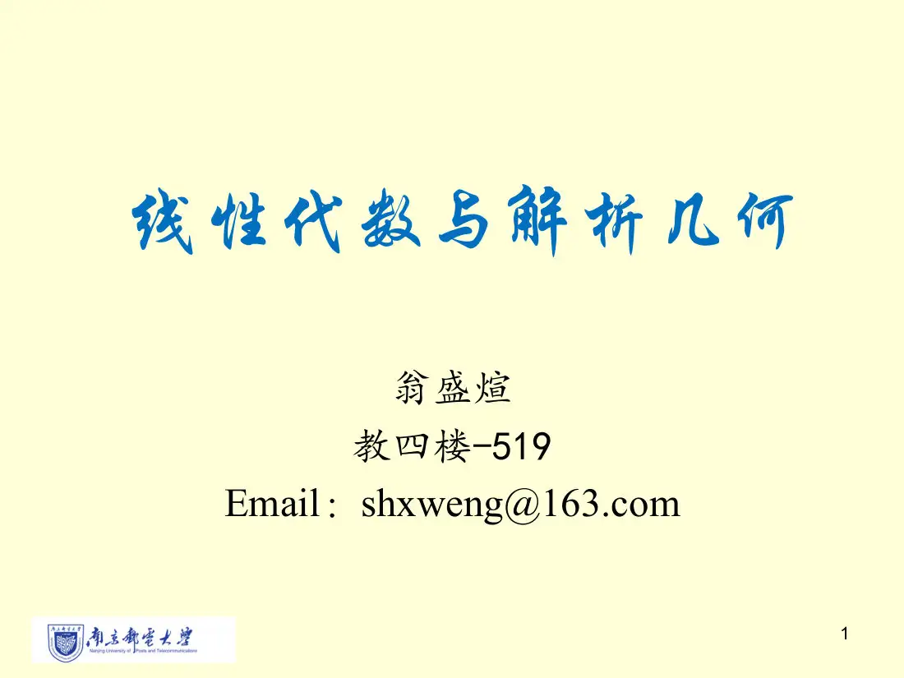

原文：

线性代数与解析几何

翁盛煊

教四楼-519

Email：shxweng@163.com

南京郵電大学 Nanjing University ofPosts and Telecommunications

1

### 课程简介

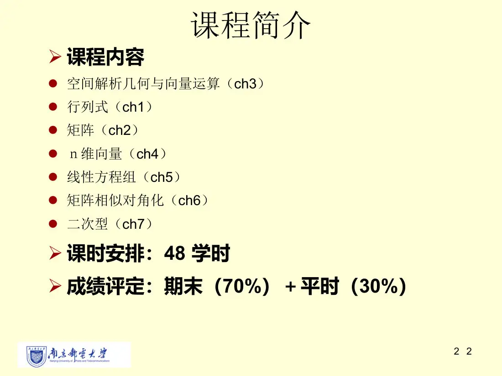

原文：

课程简介

➢ 课程内容

⚫ 空间解析几何与向量运算（ch3）

⚫ 行列式（ch1）

⚫ 矩阵（ch2）

⚫ n维向量（ch4）

⚫ 线性方程组（ch5）

⚫ 矩阵相似对角化（ch6）

⚫ 二次型（ch7）

➢ 课时安排：48 学时

➢ 成绩评定：期末（70%）＋平时（30%）

南京郵電大學 Nanjing University ofPosts and Telecommunications

22

### • 学科特点

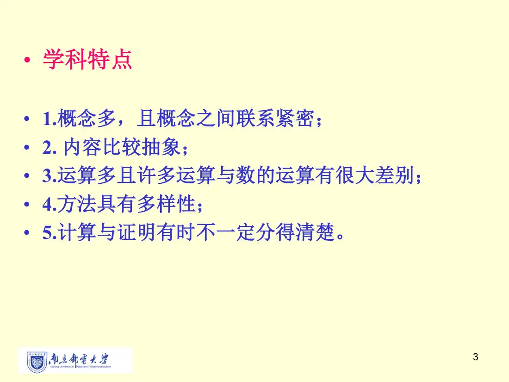

原文：

• 学科特点

• 1.概念多，且概念之间联系紧密；

• 2. 内容比较抽象；

• 3.运算多且许多运算与数的运算有很大差别；

• 4.方法具有多样性；

• 5.计算与证明有时不一定分得清楚。

南京郵電大學 Nanjing University ofPosts and Telecommunications

3

### 本学期的作业使用练习册。

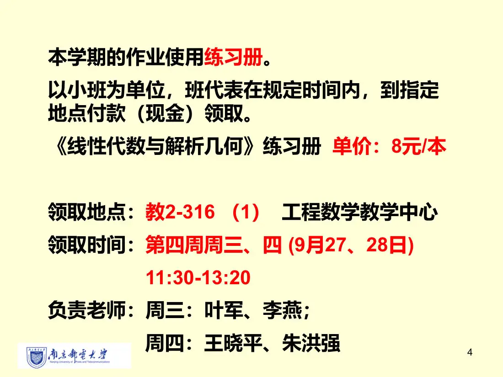

原文：

本学期的作业使用练习册。

以小班为单位，班代表在规定时间内，到指定地点付款（现金）领取。

《线性代数与解析几何》练习册 单价：8元/本

领取地点：教2-316 （1） 工程数学教学中心

领取时间：第四周周三、四 (9月27、28日)11:30-13:20

负责老师：周三：叶军、李燕；

周四：王晓平、朱洪强

南京郵電大學 Nanjing University ofPosts and Telecommunications

4

### 第1章 行列式

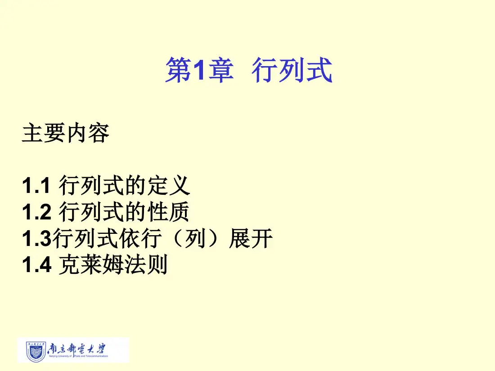

原文：

第1章 行列式

主要内容

1.1 行列式的定义

1.2 行列式的性质

1.3行列式依行（列）展开

1.4 克莱姆法则

南京郵電大學 Nanjing University ofPosts and Telecommunications

### 第一章 行列式

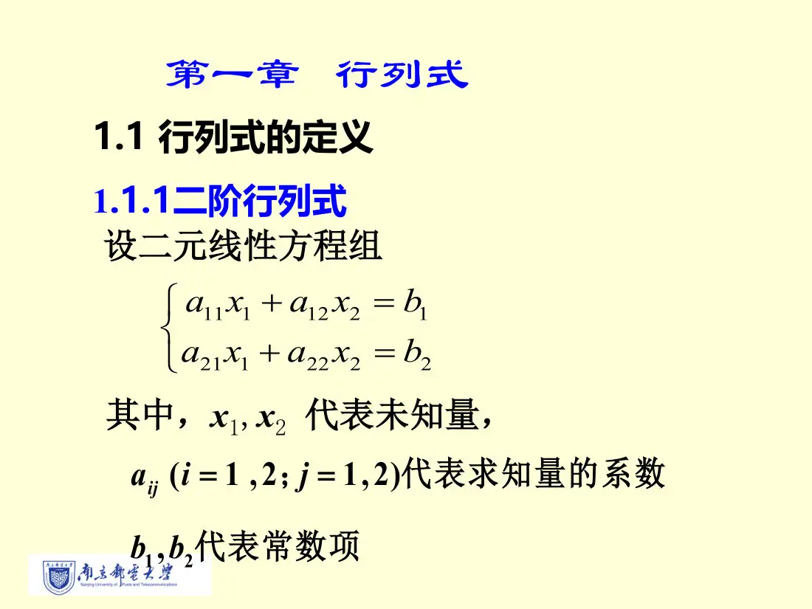

原文：

第一章 行列式

1.1 行列式的定义

1.1.1二阶行列式

设二元线性方程组

$$
\left\{ \begin{array}{l} a _ {1 1} x _ {1} + a _ {1 2} x _ {2} = b _ {1} \\ a _ {2 1} x _ {1} + a _ {2 2} x _ {2} = b _ {2} \end{array} \right.
$$

其中， $x _ { 1 } , x _ { 2 }$ 代表未知量，

$a _ { i j } ( i = 1 , 2 ; j = 1 , 2 )$ 代表求知量的系数

$b _ { 1 } , b _ { 2 }$ 代表常数项

南京郵電大学 Nanjing University ofPosts and Telecommunications

### 用消元法从上式中消去 $x _ { 2 }$ ，得

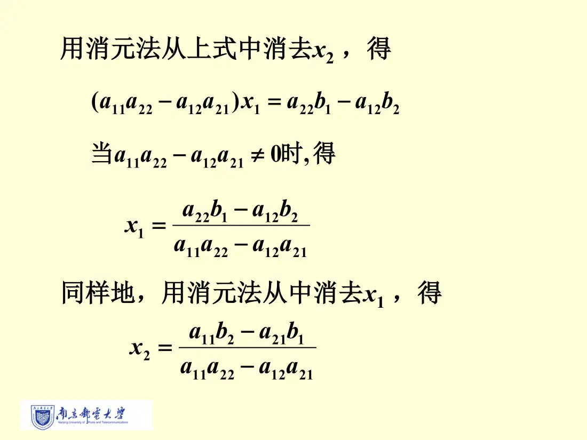

原文：

用消元法从上式中消去 $x _ { 2 }$ ，得

$$
(a _ {1 1} a _ {2 2} - a _ {1 2} a _ {2 1}) x _ {1} = a _ {2 2} b _ {1} - a _ {1 2} b _ {2}
$$

当 $a _ { 1 1 } a _ { 2 2 } - a _ { 1 2 } a _ { 2 1 } \neq 0$ 时,得

$$
x _ {1} = \frac {a _ {2 2} b _ {1} - a _ {1 2} b _ {2}}{a _ {1 1} a _ {2 2} - a _ {1 2} a _ {2 1}}
$$

同样地，用消元法从中消去 $x _ { 1 }$ ，得

$$
x _ {2} = \frac {a _ {1 1} b _ {2} - a _ {2 1} b _ {1}}{a _ {1 1} a _ {2 2} - a _ {1 2} a _ {2 1}}
$$

南京郵電大學 Nanjing University ofPosts and Telecommunications

### 为便于叙述和记忆，引入记号

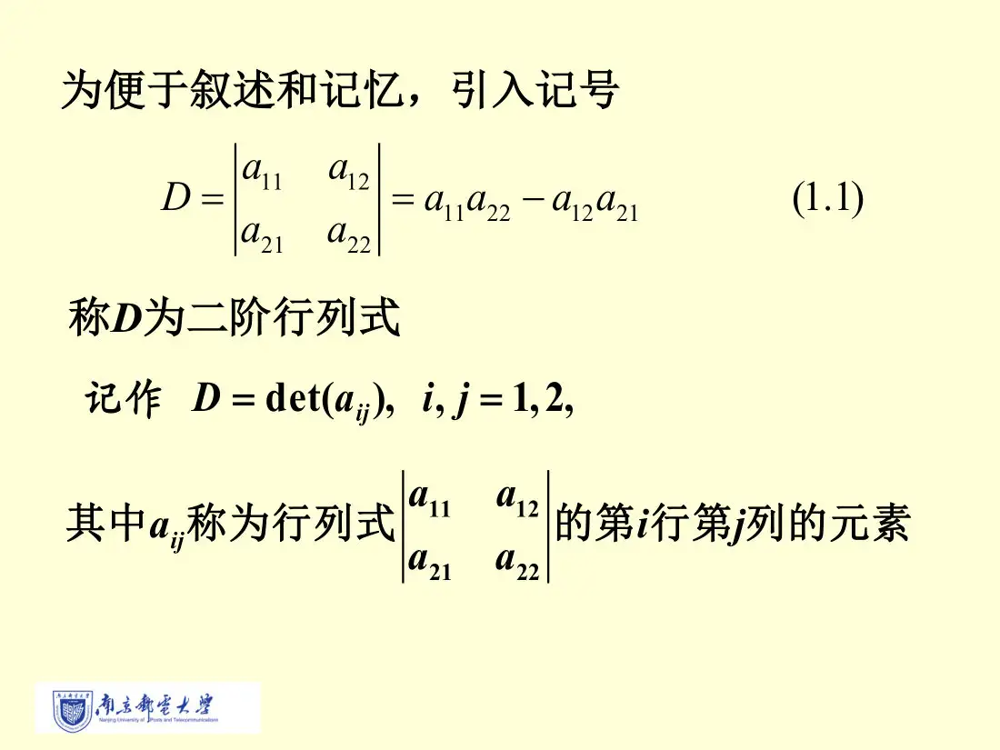

原文：

为便于叙述和记忆，引入记号

$$
D = \left| \begin{array}{c c} a _ {1 1} & a _ {1 2} \\ a _ {2 1} & a _ {2 2} \end{array} \right| = a _ {1 1} a _ {2 2} - a _ {1 2} a _ {2 1}\tag{1.1}
$$

称D为二阶行列式

记作 $D = \mathrm { d e t } ( a _ { i j } ) , i , j = 1 , 2 ,$

其中 $\pmb { a } _ { i j }$ 称为行列式 $\begin{array} { r } { \left| a _ { 1 1 } \quad a _ { 1 2 } \right| } \\ { \left| a _ { 2 1 } \quad a _ { 2 2 } \right| } \end{array}$ 的第i行第j列的元素

南立都生大学 南京郵電大学 Nanjing University ofPosts and Telecommunications

### $$

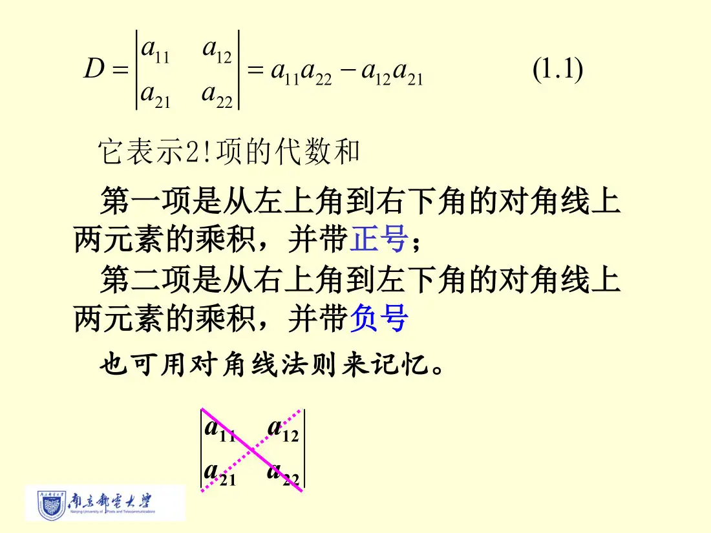

原文：

$$
D = \left| \begin{array}{c c} a _ {1 1} & a _ {1 2} \\ a _ {2 1} & a _ {2 2} \end{array} \right| = a _ {1 1} a _ {2 2} - a _ {1 2} a _ {2 1}\tag{1.1}
$$

它表示2!项的代数和

第一项是从左上角到右下角的对角线上两元素的乘积，并带正号；

第二项是从右上角到左下角的对角线上两元素的乘积，并带负号。

也可用对角线法则来记忆。

$$
\left| \begin{array}{c c} a _ {1 1} & a _ {1 2} \\ a _ {2 1} & a _ {2 2} \end{array} \right|
$$

南京郵電大學 Nanjing University ofPosts and Telecommunications

### $$

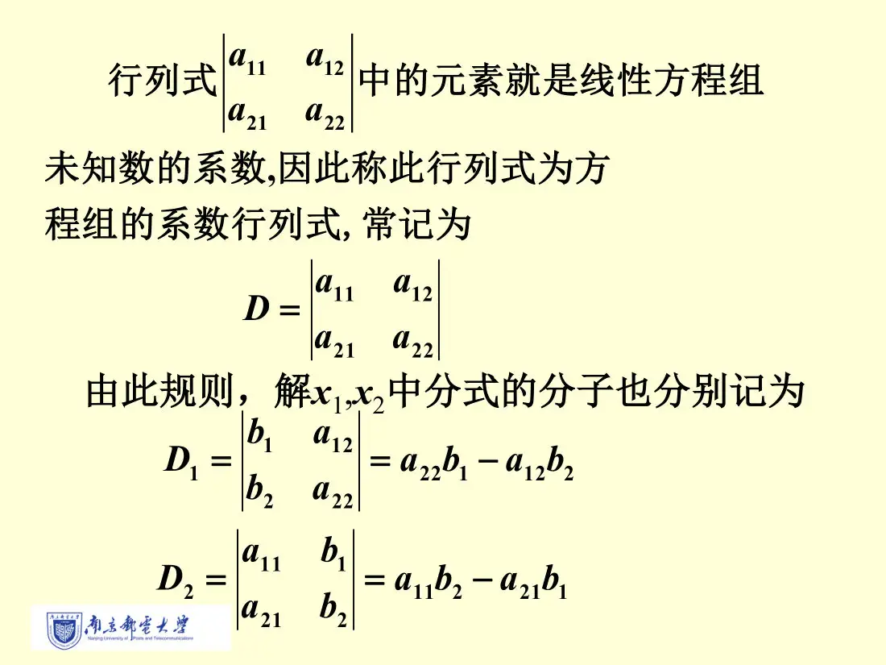

原文：

行列式 $\begin{array} { r l } { a _ { 1 1 } } & { { } a _ { 1 2 } } \\ { a _ { 2 1 } } & { { } a _ { 2 2 } } \end{array}$ 中的元素就是线性方程组未知数的系数,因此称此行列式为方程组的系数行列式，常记为

$$
\boldsymbol {D} = \left| \begin{array}{c c} a _ {1 1} & a _ {1 2} \\ a _ {2 1} & a _ {2 2} \end{array} \right|
$$

由此规则，解 $x _ { 1 } , x _ { 2 }$ 中分式的分子也分别记为

$$
D _ {1} = \left| \begin{array}{c c} b _ {1} & a _ {1 2} \\ b _ {2} & a _ {2 2} \end{array} \right| = a _ {2 2} b _ {1} - a _ {1 2} b _ {2}
$$

$$
D _ {2} = \left| \begin{array}{l l} a _ {1 1} & b _ {1} \\ a _ {2 1} & b _ {2} \end{array} \right| = a _ {1 1} b _ {2} - a _ {2 1} b _ {1}
$$

南立部生大学 南京郵電大学 Nanjing University ofPosts and Telecommunications

### 于是，当 $D { \neq } 0$ 时，二元线性方程组的解

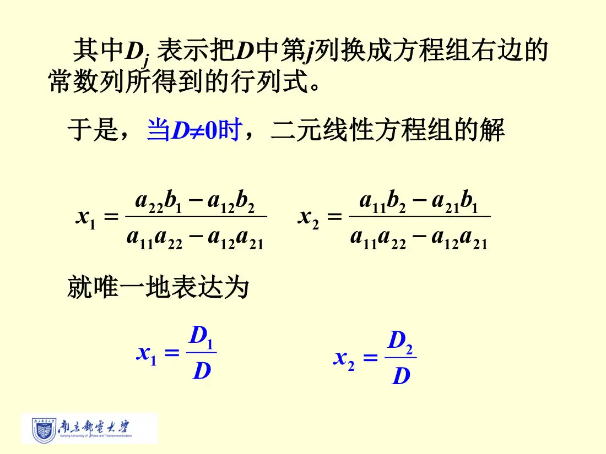

原文：

其中 $D _ { j }$ 表示把D中第j列换成方程组右边的常数列所得到的行列式。

于是，当 $D { \neq } 0$ 时，二元线性方程组的解

$$
x _ {1} = \frac {a _ {2 2} b _ {1} - a _ {1 2} b _ {2}}{a _ {1 1} a _ {2 2} - a _ {1 2} a _ {2 1}} x _ {2} = \frac {a _ {1 1} b _ {2} - a _ {2 1} b _ {1}}{a _ {1 1} a _ {2 2} - a _ {1 2} a _ {2 1}}
$$

就唯一地表达为

$$
x _ {1} = \frac {D _ {1}}{D}
$$

$$
x _ {2} = \frac {D _ {2}}{D}
$$

南京郵電大學 Nanjing University ofPosts and Telecommunications

### 例1.1 求解二元线性方程组

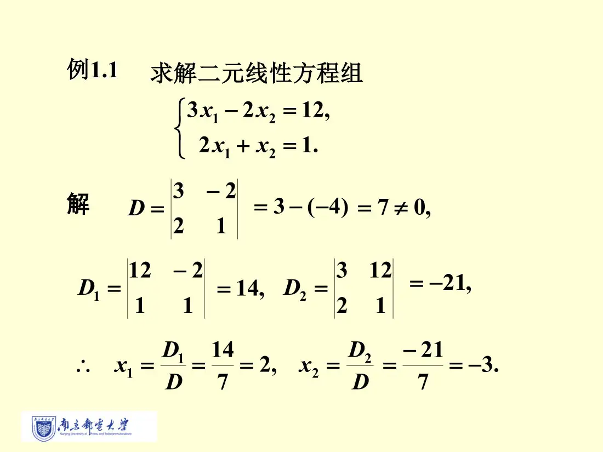

原文：

例1.1 求解二元线性方程组

$$
\left\{ \begin{array}{c} 3 x _ {1} - 2 x _ {2} = 1 2, \\ 2 x _ {1} + x _ {2} = 1. \end{array} \right.
$$

解 $D = { \left| \begin{array} { l l } { 3 } & { - 2 } \\ { 2 } & { 1 } \end{array} \right| } \ = \ 3 - ( - 4 ) = 7 \neq 0 ,$

$$
D _ {1} = \left| \begin{array}{c c} 1 2 & - 2 \\ 1 & 1 \end{array} \right| = 1 4, D _ {2} = \left| \begin{array}{c c} 3 & 1 2 \\ 2 & 1 \end{array} \right| = - 2 1,
$$

$$
\therefore x _ {1} = \frac {D _ {1}}{D} = \frac {1 4}{7} = 2, x _ {2} = \frac {D _ {2}}{D} = \frac {- 2 1}{7} = - 3.
$$

南立都生大学 南京郵電大学 Nanjing University ofPosts and Telecommunications

### 1.1.2 三阶行列式

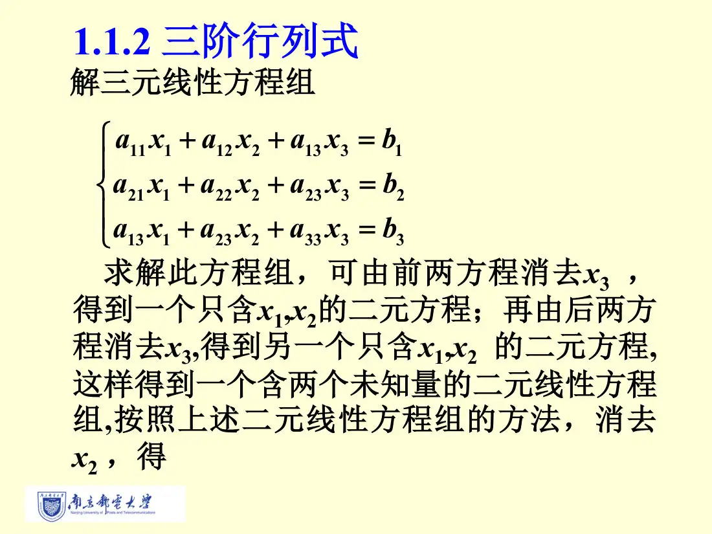

原文：

1.1.2 三阶行列式

解三元线性方程组

$$
\left\{ \begin{array}{l} a _ {1 1} x _ {1} + a _ {1 2} x _ {2} + a _ {1 3} x _ {3} = b _ {1} \\ a _ {2 1} x _ {1} + a _ {2 2} x _ {2} + a _ {2 3} x _ {3} = b _ {2} \\ a _ {1 3} x _ {1} + a _ {2 3} x _ {2} + a _ {3 3} x _ {3} = b _ {3} \end{array} \right.
$$

求解此方程组，可由前两方程消去 $x _ { 3 }$ ，得到一个只含 $x _ { 1 } , x _ { 2 }$ 的二元方程；再由后两方程消去 $x _ { 3 } ,$ 得到另一个只含 $x _ { 1 } , x _ { 2 }$ 的二元方程,这样得到一个含两个未知量的二元线性方程组,按照上述二元线性方程组的方法，消去$x _ { 2 }$ ，得

南立都生大学 南京郵電大学 Nanjing University ofPosts and Telecommunications

### $$

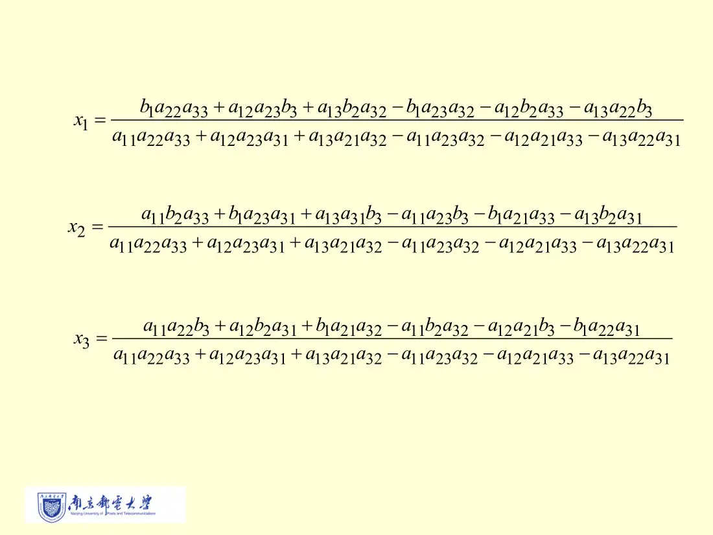

原文：

$$
x _ {1} = \frac {b _ {1} a _ {2 2} a _ {3 3} + a _ {1 2} a _ {2 3} b _ {3} + a _ {1 3} b _ {2} a _ {3 2} - b _ {1} a _ {2 3} a _ {3 2} - a _ {1 2} b _ {2} a _ {3 3} - a _ {1 3} a _ {2 2} b _ {3}}{a _ {1 1} a _ {2 2} a _ {3 3} + a _ {1 2} a _ {2 3} a _ {3 1} + a _ {1 3} a _ {2 1} a _ {3 2} - a _ {1 1} a _ {2 3} a _ {3 2} - a _ {1 2} a _ {2 1} a _ {3 3} - a _ {1 3} a _ {2 2} a _ {3 1}}
$$

$$
x _ {2} = \frac {a _ {1 1} b _ {2} a _ {3 3} + b _ {1} a _ {2 3} a _ {3 1} + a _ {1 3} a _ {3 1} b _ {3} - a _ {1 1} a _ {2 3} b _ {3} - b _ {1} a _ {2 1} a _ {3 3} - a _ {1 3} b _ {2} a _ {3 1}}{a _ {1 1} a _ {2 2} a _ {3 3} + a _ {1 2} a _ {2 3} a _ {3 1} + a _ {1 3} a _ {2 1} a _ {3 2} - a _ {1 1} a _ {2 3} a _ {3 2} - a _ {1 2} a _ {2 1} a _ {3 3} - a _ {1 3} a _ {2 2} a _ {3 1}}
$$

$$
x _ {3} = \frac {a _ {1 1} a _ {2 2} b _ {3} + a _ {1 2} b _ {2} a _ {3 1} + b _ {1} a _ {2 1} a _ {3 2} - a _ {1 1} b _ {2} a _ {3 2} - a _ {1 2} a _ {2 1} b _ {3} - b _ {1} a _ {2 2} a _ {3 1}}{a _ {1 1} a _ {2 2} a _ {3 3} + a _ {1 2} a _ {2 3} a _ {3 1} + a _ {1 3} a _ {2 1} a _ {3 2} - a _ {1 1} a _ {2 3} a _ {3 2} - a _ {1 2} a _ {2 1} a _ {3 3} - a _ {1 3} a _ {2 2} a _ {3 1}}
$$

南京郵電大學 Nanjing University ofPosts and Telecommunications

### 若令

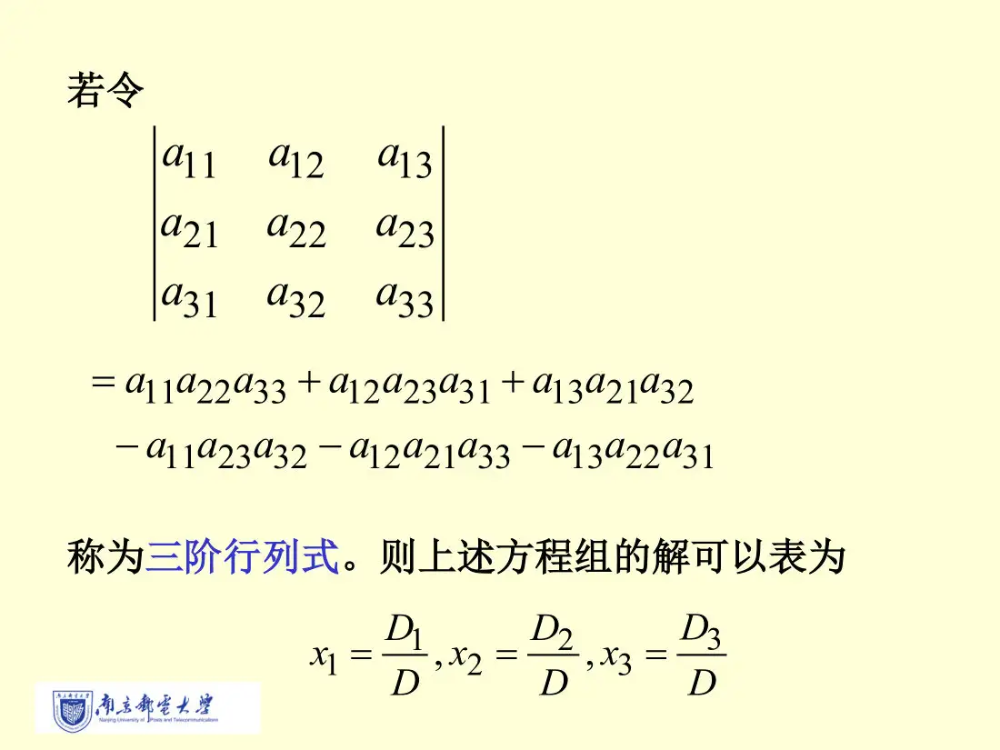

原文：

若令

$$
\begin{array}{r l} & {\left| \begin{array}{l l l} a _ {1 1} & a _ {1 2} & a _ {1 3} \\ a _ {2 1} & a _ {2 2} & a _ {2 3} \\ a _ {3 1} & a _ {3 2} & a _ {3 3} \end{array} \right|} \\ & {= a _ {1 1} a _ {2 2} a _ {3 3} + a _ {1 2} a _ {2 3} a _ {3 1} + a _ {1 3} a _ {2 1} a _ {3 2}} \\ & {- a _ {1 1} a _ {2 3} a _ {3 2} - a _ {1 2} a _ {2 1} a _ {3 3} - a _ {1 3} a _ {2 2} a _ {3 1}} \end{array}
$$

称为三阶行列式。则上述方程组的解可以表为

$$
x _ {1} = \frac {D _ {1}}{D}, x _ {2} = \frac {D _ {2}}{D}, x _ {3} = \frac {D _ {3}}{D}
$$

南京郵電大學 Nanjing University ofPosts and Telecommunications

### 其中

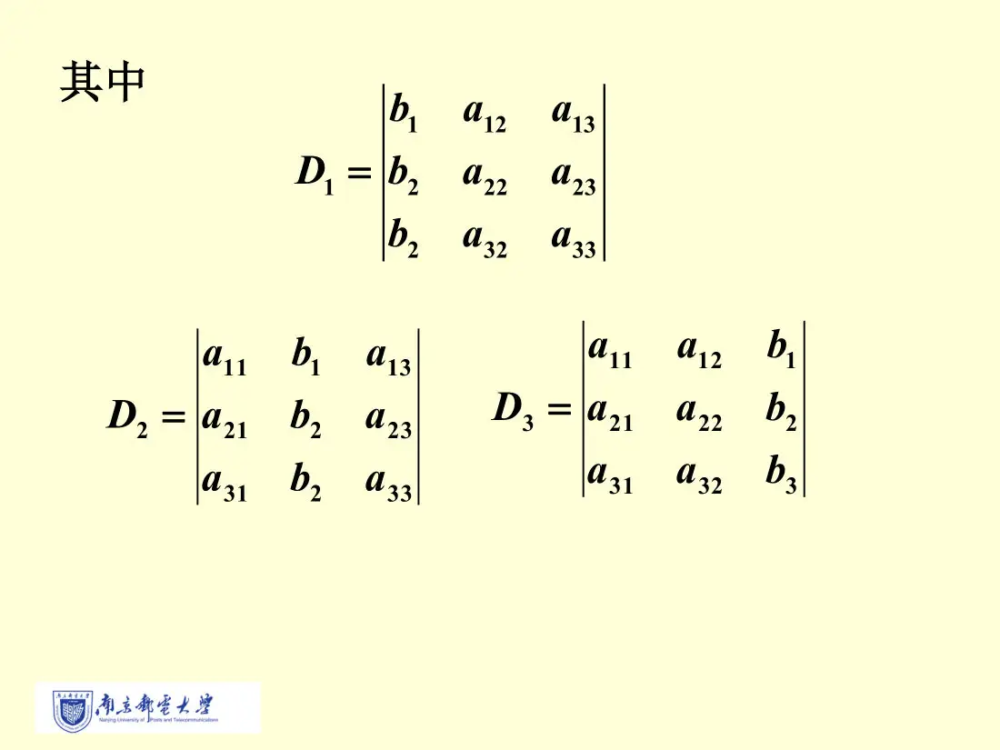

原文：

其中

$$
D _ {1} = \left| \begin{array}{c c c} b _ {1} & a _ {1 2} & a _ {1 3} \\ b _ {2} & a _ {2 2} & a _ {2 3} \\ b _ {2} & a _ {3 2} & a _ {3 3} \end{array} \right|
$$

$$
D _ {2} = \left| \begin{array}{c c c} a _ {1 1} & b _ {1} & a _ {1 3} \\ a _ {2 1} & b _ {2} & a _ {2 3} \\ a _ {3 1} & b _ {2} & a _ {3 3} \end{array} \right| \quad D _ {3} = \left| \begin{array}{c c c} a _ {1 1} & a _ {1 2} & b _ {1} \\ a _ {2 1} & a _ {2 2} & b _ {2} \\ a _ {3 1} & a _ {3 2} & b _ {3} \end{array} \right|
$$

南京郵電大學 Nanjing University ofPosts and Telecommunications

### 三阶行列式的定义,也可用对角线法则来记忆

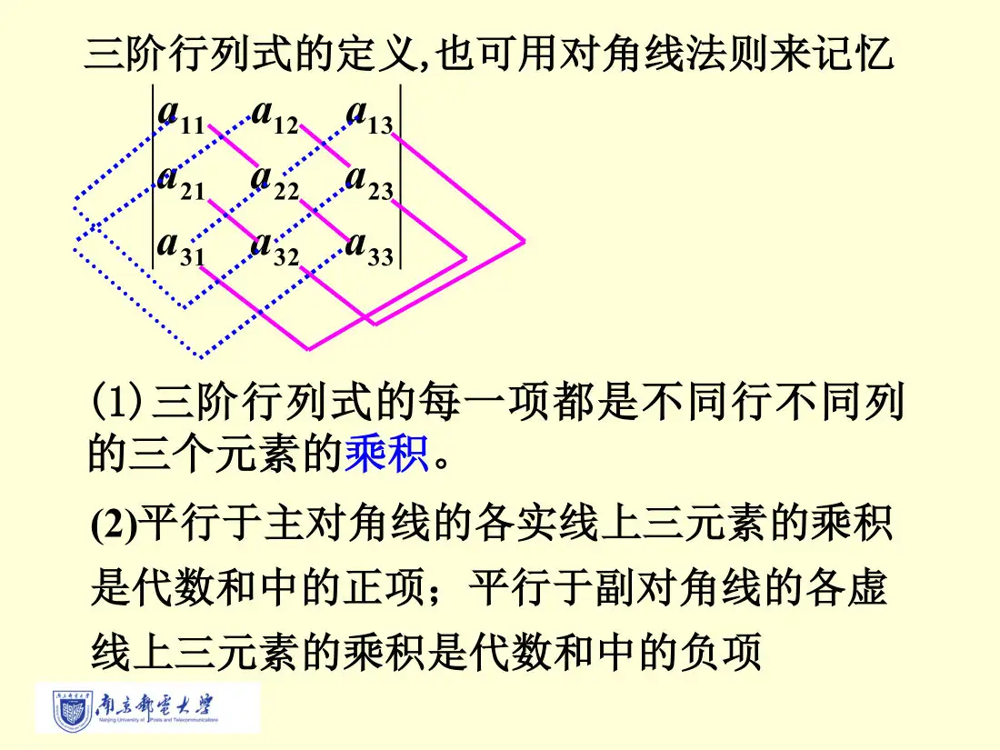

原文：

三阶行列式的定义,也可用对角线法则来记忆

(1)三阶行列式的每一项都是不同行不同列的三个元素的乘积。

(2)平行于主对角线的各实线上三元素的乘积是代数和中的正项；平行于副对角线的各虚线上三元素的乘积是代数和中的负项

南志都生大学 南京郵電大学 Nanjing University ofPosts and Telecommunications

### 三元排列的每一排列都对应着三阶行列式的一项 ，故三阶行列式共有3！= 6项。

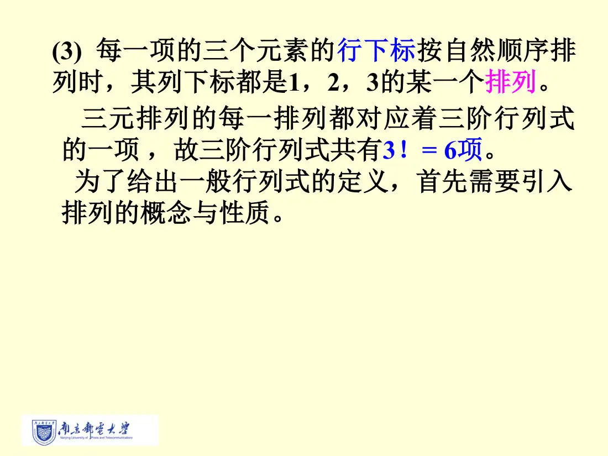

原文：

(3) 每一项的三个元素的行下标按自然顺序排列时，其列下标都是1，2，3的某一个排列。

三元排列的每一排列都对应着三阶行列式的一项 ，故三阶行列式共有3！= 6项。

为了给出一般行列式的定义，首先需要引入排列的概念与性质。

南京郵電大學 Nanjing University ofPosts and Telecommunications

### 3.全排列及其逆序数

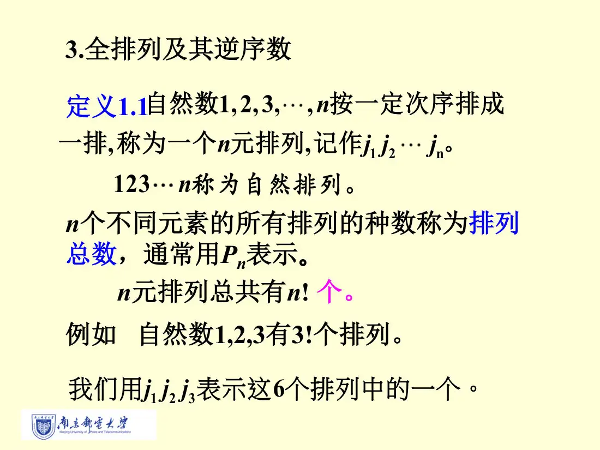

原文：

3.全排列及其逆序数

定义1.1自然数1,2,3,…,n按一定次序排成 一排,称为一个n元排列,记作j ${ } _ { i } \ldots { } _ { j _ { \mathrm { { n } } } }$ o

123…n称为自然排列。

n个不同元素的所有排列的种数称为排列总数，通常用 $P _ { n }$ 表示。

n元排列总共有 $\hbar !$ 个。

例如 自然数1,2,3有3!个排列。

我们用 $j _ { 1 } j _ { 2 } j _ { 3 }$ 表示这6个排列中的一个。

南京郵電大學 Nanjing University ofPosts and Telecommunications

### 第 20 页

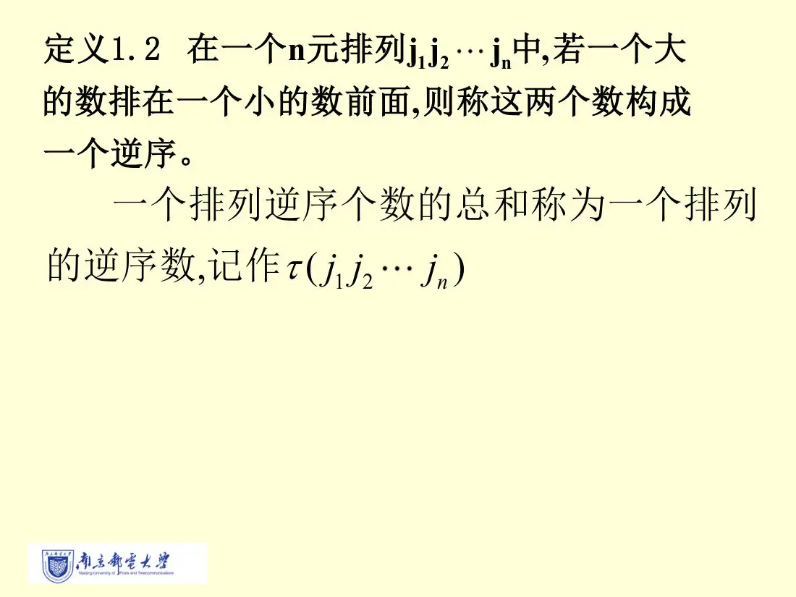

原文：

定义1.2 在一个n元排列 ${ \bf j _ { 1 } j _ { 2 } } \cdots { \bf j _ { n } }$ 中,若一个大的数排在一个小的数前面,则称这两个数构成一个逆序。

一个排列逆序个数的总和称为一个排列的逆序数,记作 $\tau ( j _ { 1 } j _ { 2 } \cdots j _ { n } )$

南京郵電大學 Nanjing University ofPosts and Telecommunications

### 例1.2 求5阶31542排列的逆序数

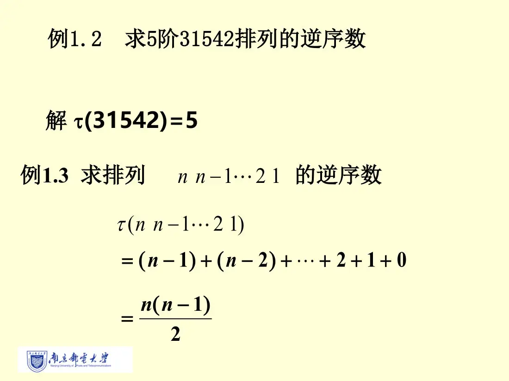

原文：

例1.2 求5阶31542排列的逆序数

解 $\tau ( 3 1 5 4 2 ) = 5$

例1.3 求排列 $n \ n - 1 \cdots 2 \ 1$ 的逆序数

$$
\begin{array}{l} \tau (n n - 1 \dots 2 1) \\ = (n - 1) + (n - 2) + \dots + 2 + 1 + 0 \\ = \frac {n (n - 1)}{2} \end{array}
$$

南京郵電大學 Nanjing University ofPosts and Telecommunications

### 定义1.3 若排列的逆序数为奇（偶）数，则称此排列为奇（偶）排列。

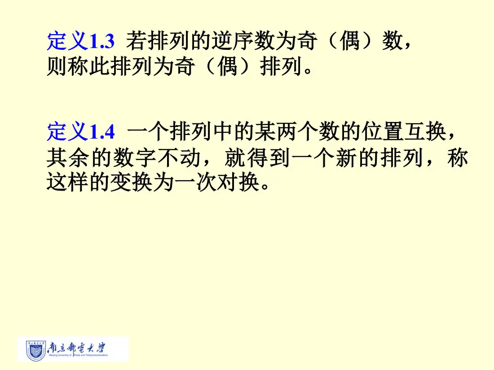

原文：

定义1.3 若排列的逆序数为奇（偶）数，则称此排列为奇（偶）排列。

定义1.4 一个排列中的某两个数的位置互换，其余的数字不动，就得到一个新的排列，称这样的变换为一次对换。

南京郵電大學 Nanjing University ofPosts and Telecommunications

### 排列的性质

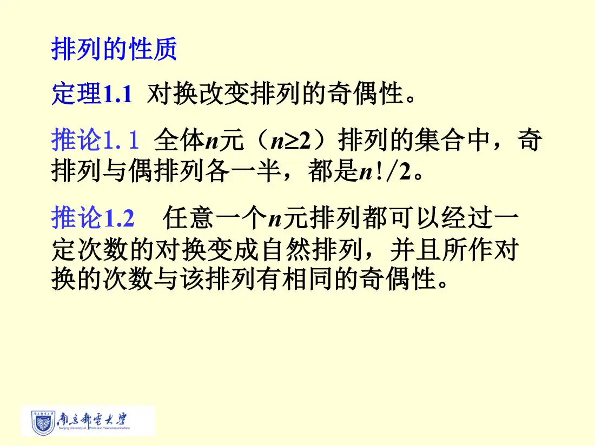

原文：

排列的性质

定理1.1 对换改变排列的奇偶性。

推论1.1 全体n元（n2）排列的集合中，奇排列与偶排列各一半，都是n!/2。

推论1.2 任意一个n元排列都可以经过一定次数的对换变成自然排列，并且所作对换的次数与该排列有相同的奇偶性。

南京郵電大學 Nanjing University ofPosts and Telecommunications

### $$

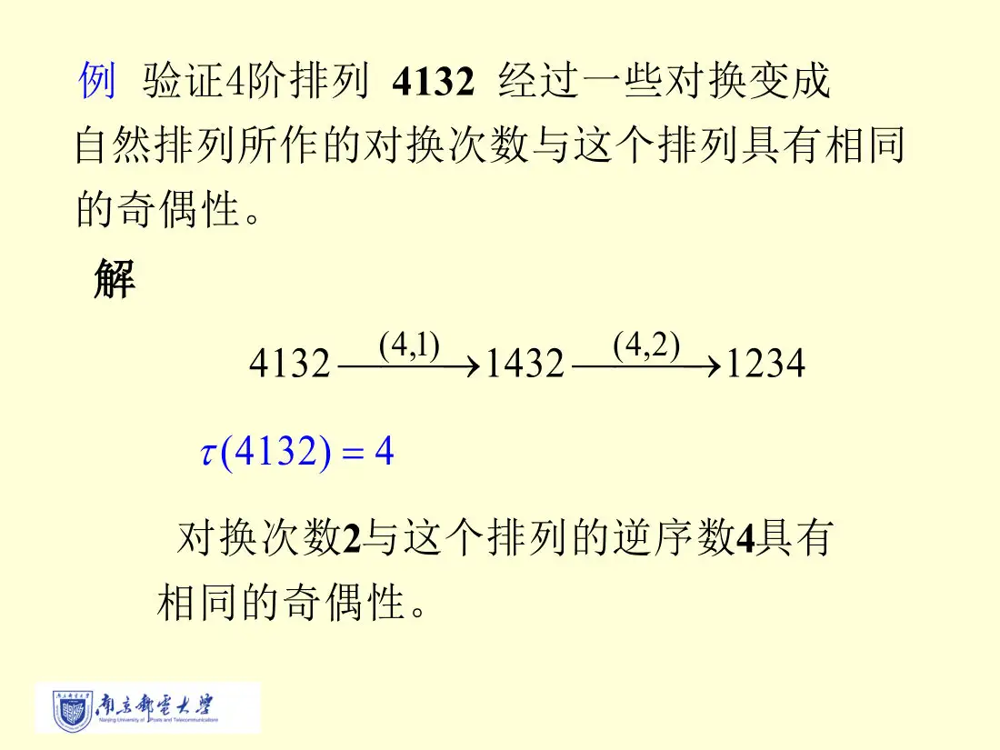

原文：

例 验证4阶排列 4132 经过一些对换变成自然排列所作的对换次数与这个排列具有相同的奇偶性。

解

$$
\begin{array}{c} 4 1 3 2 \xrightarrow {(4 , 1)} 1 4 3 2 \xrightarrow {(4 , 2)} 1 2 3 4 \\ \tau (4 1 3 2) = 4 \end{array}
$$

对换次数2与这个排列的逆序数4具有相同的奇偶性。

南京郵電大學 Nanjing University ofPosts and Telecommunications

### 4、n 阶行列式的定义

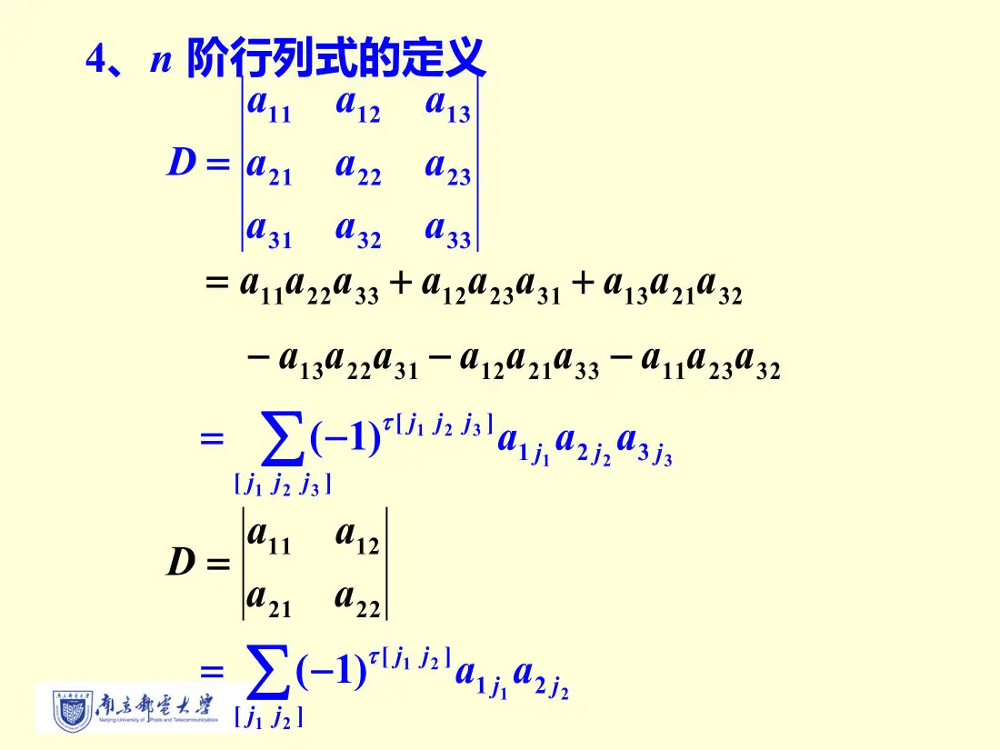

原文：

4、n 阶行列式的定义

$$
\begin{array}{r l} & D = \left| \begin{array}{c c c} a _ {1 1} & a _ {1 2} & a _ {1 3} \\ a _ {2 1} & a _ {2 2} & a _ {2 3} \\ a _ {3 1} & a _ {3 2} & a _ {3 3} \end{array} \right| \\ & \quad = a _ {1 1} a _ {2 2} a _ {3 3} + a _ {1 2} a _ {2 3} a _ {3 1} + a _ {1 3} a _ {2 1} a _ {3 2} \\ & \quad - a _ {1 3} a _ {2 2} a _ {3 1} - a _ {1 2} a _ {2 1} a _ {3 3} - a _ {1 1} a _ {2 3} a _ {3 2} \\ & \quad = \sum_ {[ j _ {1} j _ {2} j _ {3} ]} (- 1) ^ {\tau [ j _ {1} j _ {2} j _ {3} ]} a _ {1 j _ {1}} a _ {2 j _ {2}} a _ {3 j _ {3}} \end{array}
$$

$$
\begin{array}{r l} D & = \left| \begin{array}{l l} a _ {1 1} & a _ {1 2} \\ a _ {2 1} & a _ {2 2} \end{array} \right| \\ & = \sum_ {[ j _ {1} j _ {2} ]} (- 1) ^ {\tau [ j _ {1} j _ {2} ]} a _ {1 j _ {1}} a _ {2 j _ {2}} \end{array}
$$

南京郵電大學 Nanjing University ofPosts and Telecommunications

### $$

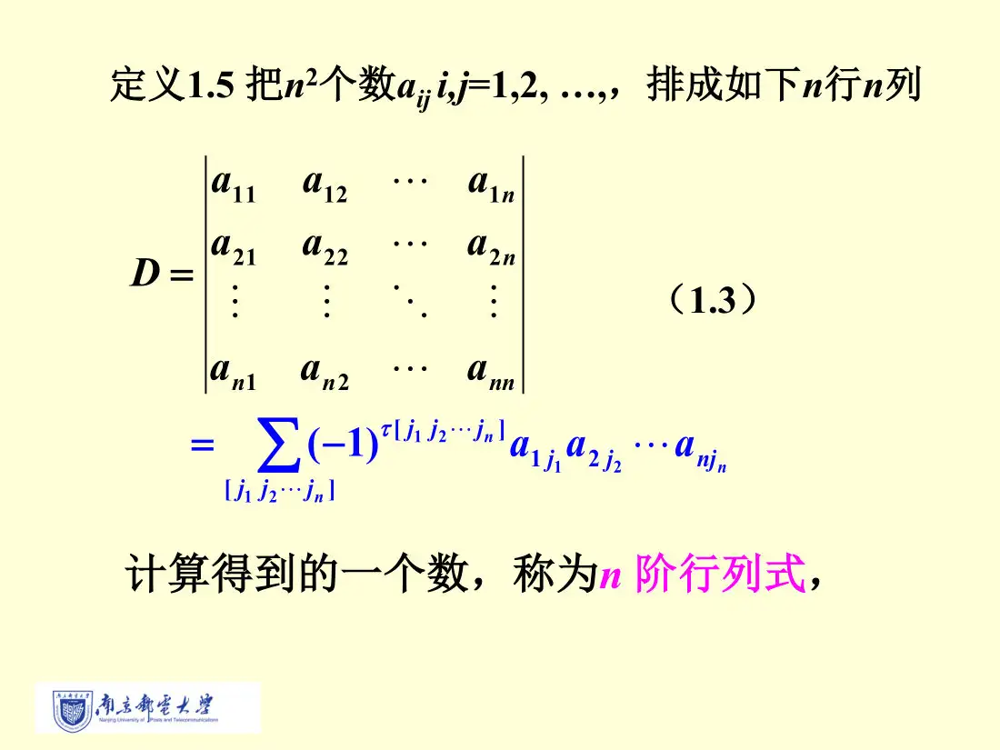

原文：

定义1.5 把 $\scriptstyle n ^ { 2 . }$ 个数 $\alpha _ { i j } i , j { = } 1 , 2 , . . . ,$ 排成如下n行n列

$$
\begin{array}{l} D = \left| \begin{array}{c c c c} a _ {1 1} & a _ {1 2} & \dots & a _ {1 n} \\ a _ {2 1} & a _ {2 2} & \dots & a _ {2 n} \\ \vdots & \vdots & \ddots & \vdots \\ a _ {n 1} & a _ {n 2} & \dots & a _ {n n} \end{array} \right| \\ = \sum_ {[ j _ {1} j _ {2} \dots j _ {n} ]} (- 1) ^ {\tau [ j _ {1} j _ {2} \dots j _ {n} ]} a _ {1 j _ {1}} a _ {2 j _ {2}} \dots a _ {n j _ {n}} \end{array} \tag {1.3}
$$

计算得到的一个数，称为n 阶行列式，

南立都生大学 南京郵電大学 Nanjing University ofPosts and Telecommunications

### 第 27 页

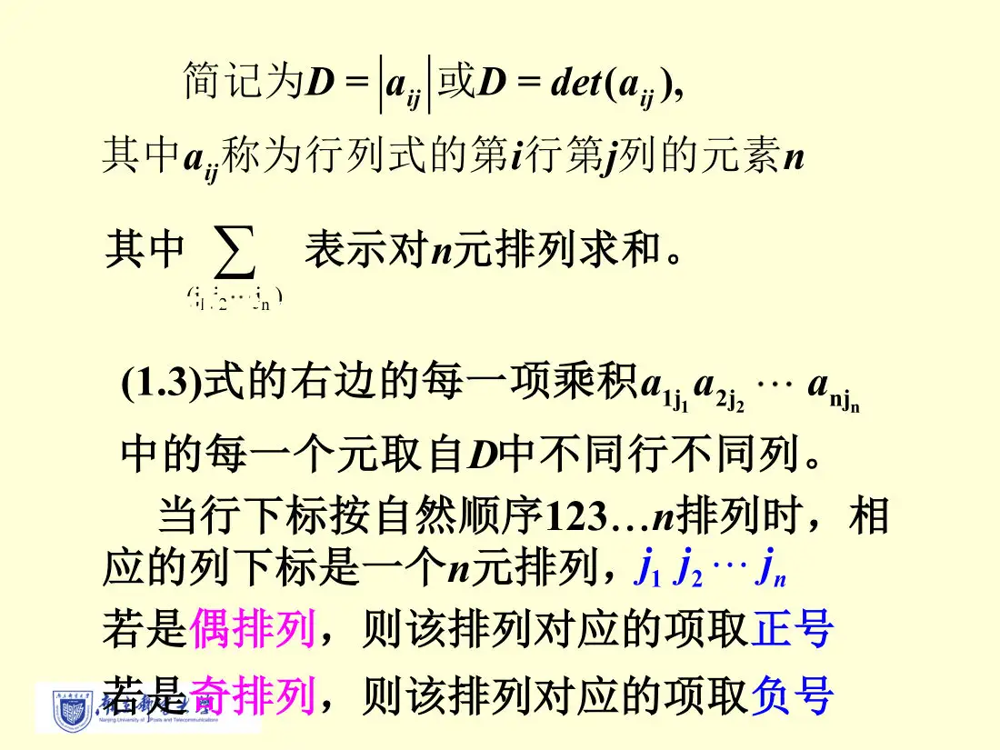

原文：

简记为 $D = \left| a _ { i j } \right|$ 或 $D = d e t ( a _ { i j } )$ 其中 $\pmb { a } _ { i j }$ ,称为行列式的第i行第j列的元素n其中 $\sum \limits _ { i = 1 } ^ { n }$ 表示对n元排列求和。

(1.3)式的右边的每一项乘积 $\boldsymbol { a } _ { 1 \mathrm { j } _ { 1 } } \boldsymbol { a } _ { 2 \mathrm { j } _ { 2 } } \cdots \boldsymbol { a } _ { \mathrm { n j } _ { \mathrm { n } } }$ 中的每一个元取自D中不同行不同列。

当行下标按自然顺序123n排列时，相应的列下标是一个n元排列， $j _ { 1 } ^ { \phantom { \dagger } } j _ { 2 } ^ { \dots \phantom { \dagger } } j _ { n } ^ { \phantom { \dagger } }$ 若是偶排列，则该排列对应的项取正号若是奇排列，则该排列对应的项取负号

圆

### 例 在6阶行列式中,下列两项

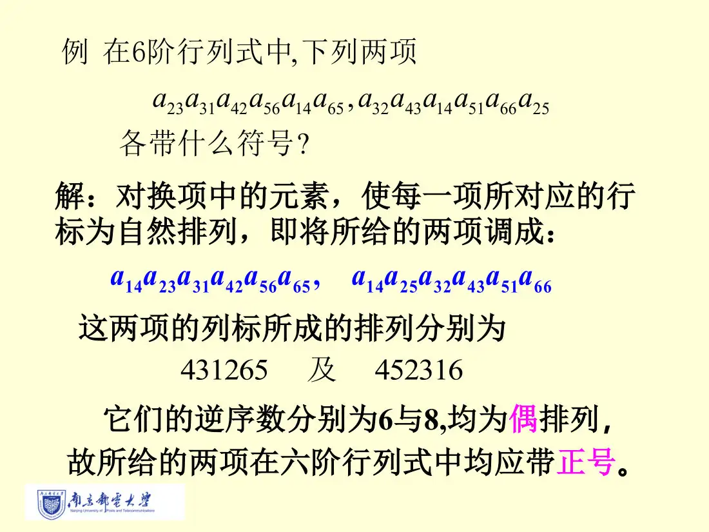

原文：

例 在6阶行列式中,下列两项

$$
a _ {2 3} a _ {3 1} a _ {4 2} a _ {5 6} a _ {1 4} a _ {6 5}, a _ {3 2} a _ {4 3} a _ {1 4} a _ {5 1} a _ {6 6} a _ {2 5}
$$

各带什么符号？

解：对换项中的元素，使每一项所对应的行标为自然排列，即将所给的两项调成：

$$
a _ {1 4} a _ {2 3} a _ {3 1} a _ {4 2} a _ {5 6} a _ {6 5}, \quad a _ {1 4} a _ {2 5} a _ {3 2} a _ {4 3} a _ {5 1} a _ {6 6}
$$

这两项的列标所成的排列分别为

$$
4 3 1 2 6 5 \quad \text {及} \quad 4 5 2 3 1 6
$$

它们的逆序数分别为6与8,均为偶排列， 故所给的两项在六阶行列式中均应带正号。

南京郵電大學 Nanjing University ofPosts and Telecommunications

### 例1.4 计算n 阶行列式

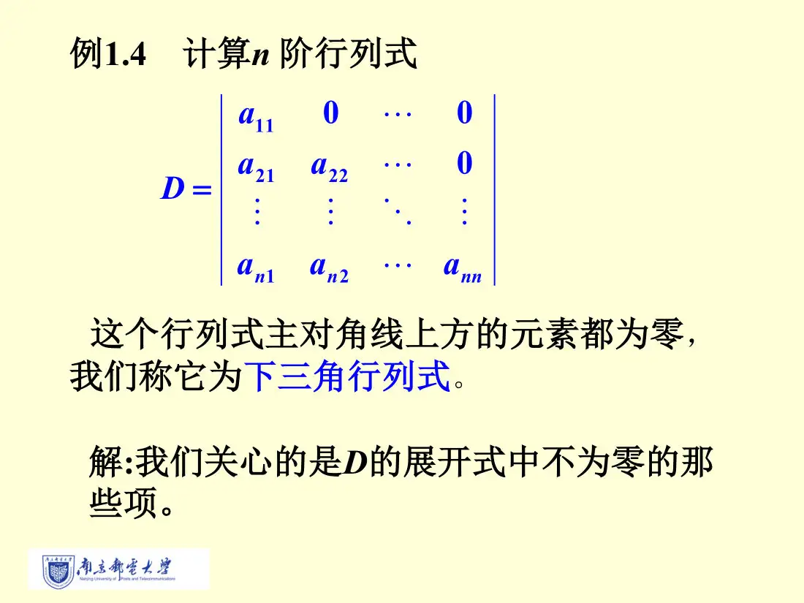

原文：

例1.4 计算n 阶行列式

$$
D = \left| \begin{array}{c c c c} a _ {1 1} & 0 & \dots & 0 \\ a _ {2 1} & a _ {2 2} & \dots & 0 \\ \vdots & \vdots & \ddots & \vdots \\ a _ {n 1} & a _ {n 2} & \dots & a _ {n n} \end{array} \right|
$$

这个行列式主对角线上方的元素都为零，我们称它为下三角行列式。

解:我们关心的是D的展开式中不为零的那些项。

南立都生大学 南京郵電大学 Nanjing University ofPosts and Telecommunications

### $$

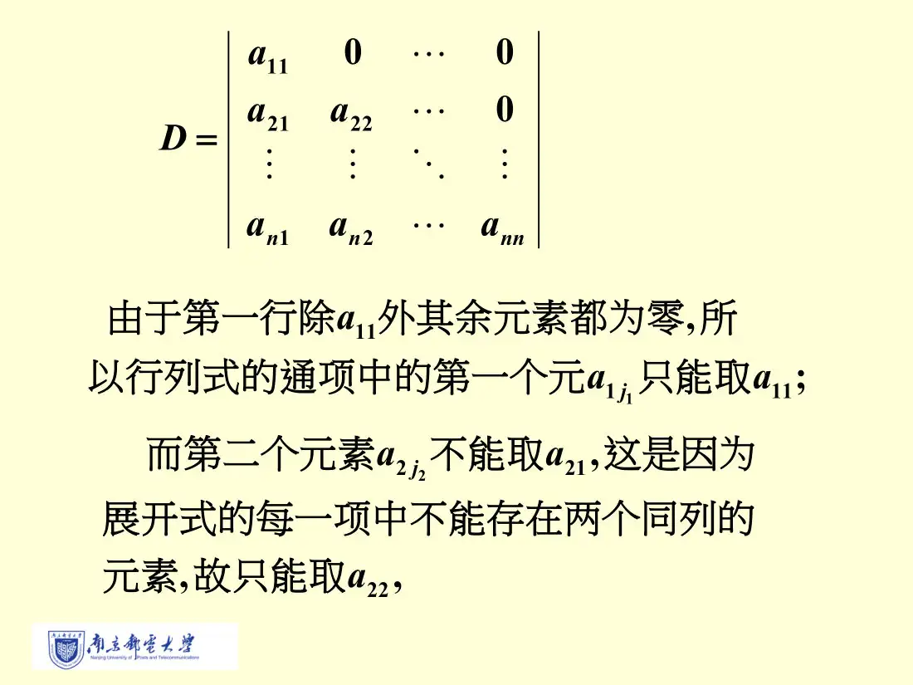

原文：

$$
D = \left| \begin{array}{c c c c} a _ {1 1} & \mathbf {0} & \dots & \mathbf {0} \\ a _ {2 1} & a _ {2 2} & \dots & \mathbf {0} \\ \vdots & \vdots & \ddots & \vdots \\ a _ {n 1} & a _ {n 2} & \dots & a _ {n n} \end{array} \right|
$$

由于第一行除 $a _ { 1 1 }$ 外其余元素都为零,所以行列式的通项中的第一个元 $a _ { 1 j _ { 1 } }$ 只能取 $a _ { 1 1 } ;$

而第二个元素 ${ { a } _ { 2 } } _ { j _ { 2 } }$ 不能取 ${ \pmb a } _ { 2 1 }$ ,这是因为展开式的每一项中不能存在两个同列的元素,故只能取 ${ { a } _ { 2 2 } }$

南立都生大学 南京郵電大学 Nanjing University ofPosts and Telecommunications

### $$

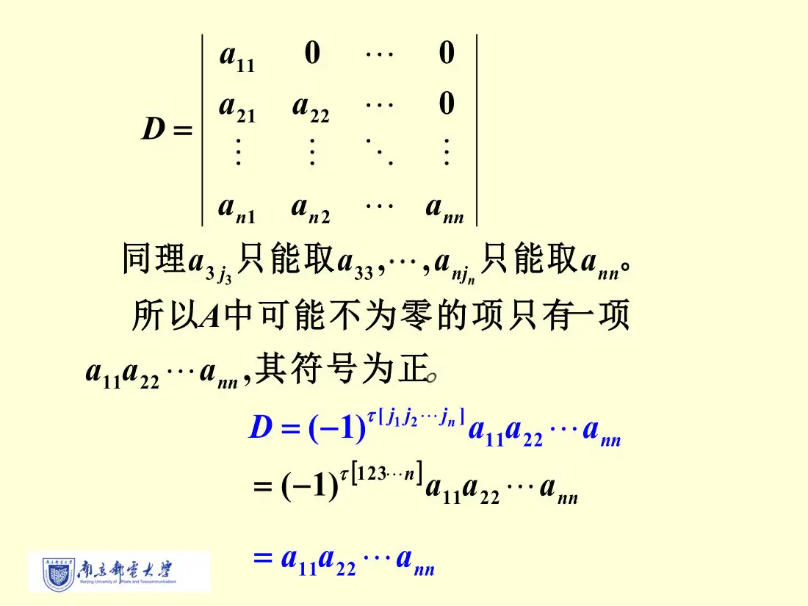

原文：

$$
D = \left| \begin{array}{c c c c} a _ {1 1} & 0 & \dots & 0 \\ a _ {2 1} & a _ {2 2} & \dots & 0 \\ \vdots & \vdots & \ddots & \vdots \\ a _ {n 1} & a _ {n 2} & \dots & a _ {n n} \end{array} \right|
$$

同理 $a _ { 3 j _ { 3 } }$ 只能取 ${ a } _ { 3 3 } , \cdots , { a } _ { n j _ { n } }$ 只能取 ${ { a } _ { n n } } ^ { \mathrm { ~ ~ } } \mathrm { ~ }$ 所以A中可能不为零的项只有一项${ { a } _ { 1 1 } } { { a } _ { 2 2 } } \cdots { { a } _ { n n } }$ ,其符号为正。

$$
\begin{array}{l} D = (- 1) ^ {\tau [ j _ {1} j _ {2} \dots j _ {n} ]} a _ {1 1} a _ {2 2} \dots a _ {n n} \\ = (- 1) ^ {\tau [ 1 2 3 \dots n ]} a _ {1 1} a _ {2 2} \dots a _ {n n} \\ = a _ {1 1} a _ {2 2} \dots a _ {n n} \end{array}
$$

南立都生大学 南京郵電大学 Nanjing University ofPosts and Telecommunications

### 例1.5 计算次上三角行列式

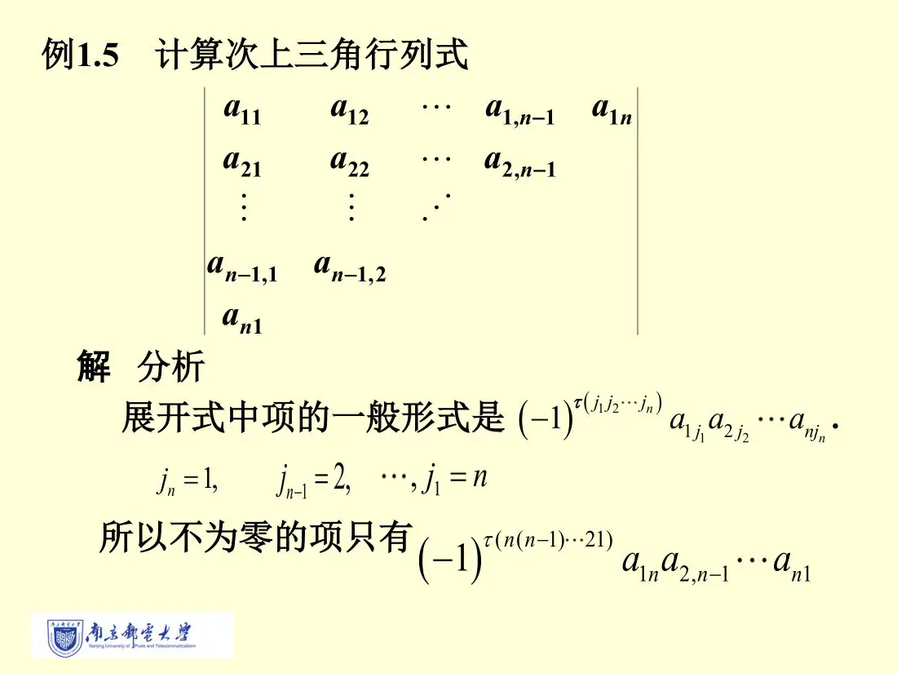

原文：

例1.5 计算次上三角行列式

$$
\left| \begin{array}{c c c c c} a _ {1 1} & a _ {1 2} & \dots & a _ {1, n - 1} & a _ {1 n} \\ a _ {2 1} & a _ {2 2} & \dots & a _ {2, n - 1} \\ \vdots & \vdots & \ddots & \\ a _ {n - 1, 1} & a _ {n - 1, 2} & & \\ a _ {n 1} & & & \end{array} \right|
$$

分析解

展开式中项的一般形式是 $\left( - 1 \right) ^ { \tau \left( j _ { 1 } j _ { 2 } \cdots j _ { n } \right) } a _ { 1 j _ { 1 } } a _ { 2 j _ { 2 } } \cdots a _ { n j _ { n } } .$

$$
j _ {n} = 1, \qquad j _ {n - 1} = 2, \quad \dots , j _ {1} = n
$$

所以不为零的项只有 $\left( - 1 \right) ^ { \tau ( n ( n - 1 ) \cdots 2 1 ) } a _ { 1 n } a _ { 2 , n - 1 } \cdots a _ { n 1 }$

南京郵電大學

### $$

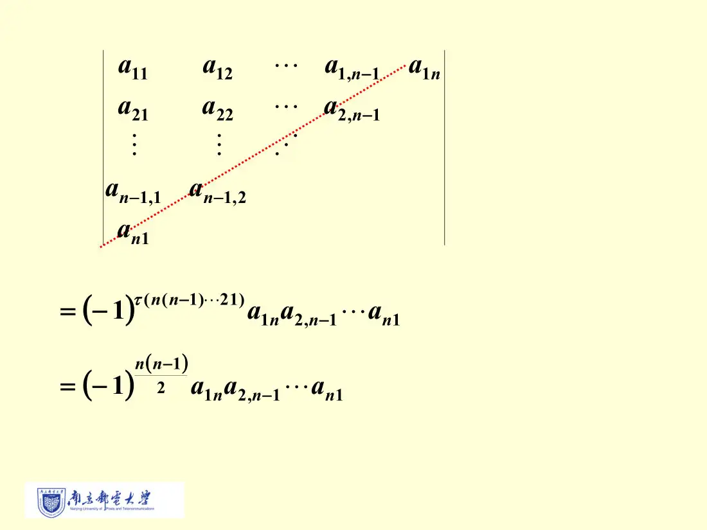

原文：

$$
\left| \begin{array}{c c c c c} a _ {1 1} & a _ {1 2} & \dots & a _ {1, n - 1} & a _ {1 n} \\ a _ {2 1} & a _ {2 2} & \dots & a _ {2, n - 1} \\ \vdots & \vdots & \ddots & \\ a _ {n - 1, 1} & a _ {n - 1, 2} & & \\ a _ {n 1} & & & \end{array} \right|
$$

$$
\begin{array}{l} = (- 1) ^ {\tau (n (n - 1) \dots 2 1)} a _ {1 n} a _ {2, n - 1} \dots a _ {n 1} \\ = (- 1) ^ {\frac {n (n - 1)}{2}} a _ {1 n} a _ {2, n - 1} \dots a _ {n 1} \end{array}
$$

南京郵電大學 Nanjing University ofPosts and Telecommunications

### 类似可得次下三角行列式

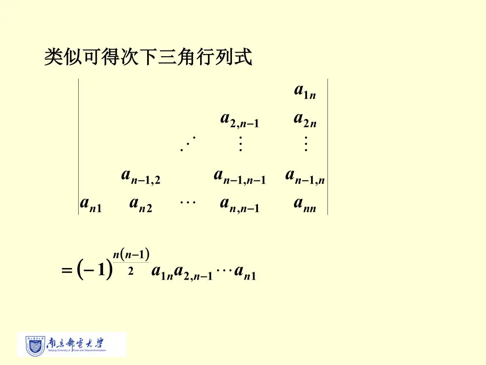

原文：

类似可得次下三角行列式

$$
\left| \begin{array}{cccc}  &  &  & a _ {1 n} \\  &  & a _ {2, n - 1} & a _ {2 n} \\  & \ddots & \vdots & \vdots \\ a _ {n - 1, 2} &  & a _ {n - 1, n - 1} & a _ {n - 1, n} \\ a _ {n 1} & a _ {n 2} & \dots & a _ {n, n - 1} & a _ {n n} \\ \end{array} \right|
$$

$$
= (- 1) ^ {\frac {n (n - 1)}{2}} a _ {1 n} a _ {2, n - 1} \dots a _ {n 1}
$$

南京郵電大學 Nanjing University ofPosts and Telecommunications

### 作为上（下）三角行列式和次上（下）三角行列式的特例，有

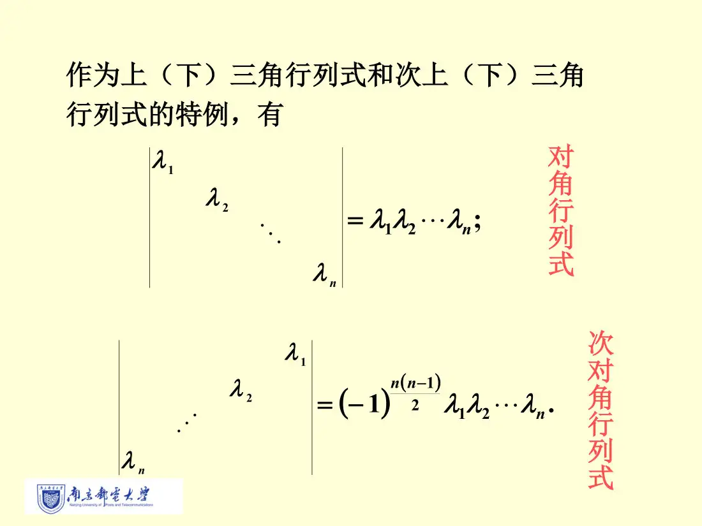

原文：

作为上（下）三角行列式和次上（下）三角行列式的特例，有

角
行
列
式

$$
\left| \begin{array}{c c c c} \lambda_ {1} & & & \\ & \lambda_ {2} & & \\ & & \ddots & \\ & & & \lambda_ {n} \end{array} \right| = \lambda_ {1} \lambda_ {2} \dots \lambda_ {n};
$$

次
对
角
行
列
式

$$
\left| \begin{array}{c c c c} & & & \lambda_ {1} \\ & & \lambda_ {2} \\ \lambda_ {n} & \ddots & & \end{array} \right| = (- 1) ^ {\frac {n (n - 1)}{2}} \lambda_ {1} \lambda_ {2} \dots \lambda_ {n}.
$$

南立都生大学 南京郵電大学 Nanjing University ofPosts and Telecommunications

### 小结

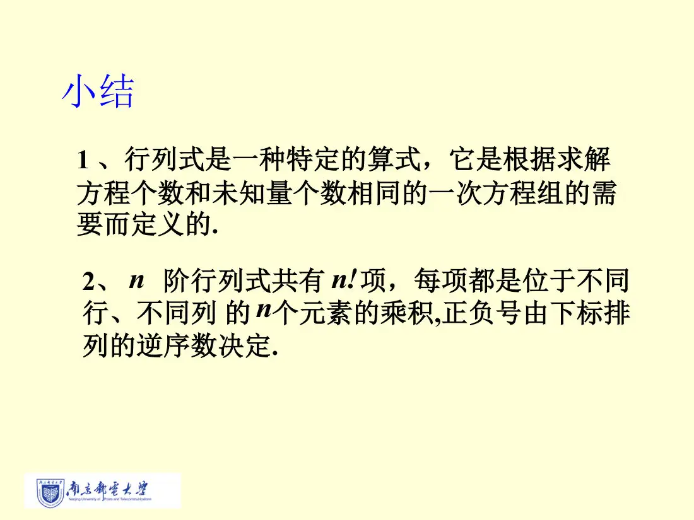

原文：

小结

1 、行列式是一种特定的算式，它是根据求解方程个数和未知量个数相同的一次方程组的需要而定义的.

2、 阶行列式共有 项，每项都是位于不同行、不同列 的 个元素的乘积,正负号由下标排列的逆序数决定.

南京郵電大學 Nanjing University ofPosts and Telecommunications
