# 《线性代数与解析几何》第2.3节 分块矩阵的概念及运算（课件）

原件的每一页，下面附识别出的文字。

### 2.3 分块矩阵

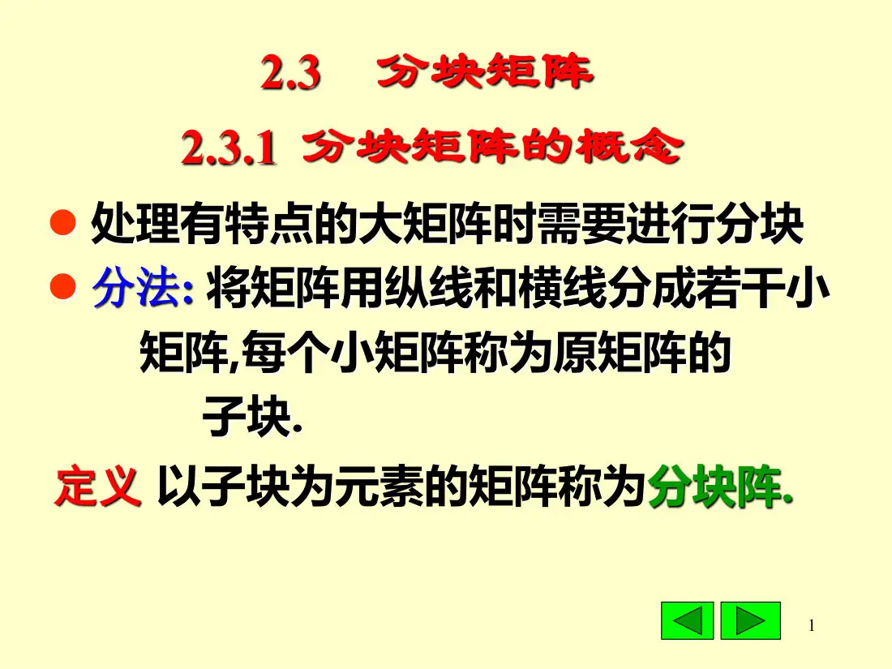

原文：

2.3 分块矩阵

2.3.1 分块矩阵的概念

处理有特点的大矩阵时需要进行分块

\- 分法: 将矩阵用纵线和横线分成若干小矩阵,每个小矩阵称为原矩阵的子块.

定义 以子块为元素的矩阵称为分块阵.

◀ ▶

1

### 常用分块方式

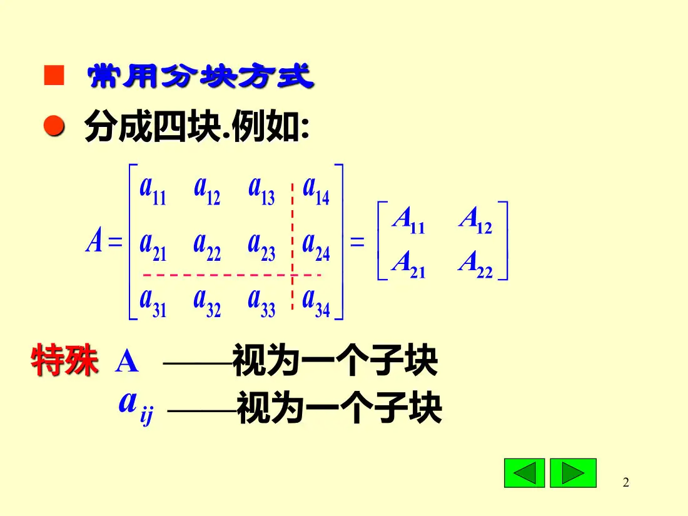

原文：

常用分块方式

\- 分成四块.例如:

$$
A = \left[ \begin{array}{c c c c} a _ {1 1} & a _ {1 2} & a _ {1 3} & a _ {1 4} \\ a _ {2 1} & a _ {2 2} & a _ {2 3} & a _ {2 4} \\ \hdashline a _ {3 1} & a _ {3 2} & a _ {3 3} & a _ {3 4} \end{array} \right] = \left[ \begin{array}{c c} A _ {1 1} & A _ {1 2} \\ A _ {2 1} & A _ {2 2} \end{array} \right]
$$

特殊 A ——视为一个子块

$a_{ij}$ ——视为一个子块

◀ ▶

2

### \- 按列分块.例如:

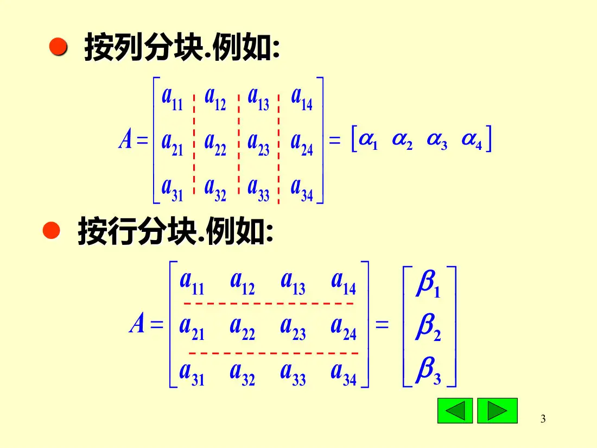

原文：

\- 按列分块.例如:

$$
A = \left[ \begin{array}{c c c c} a _ {1 1} & a _ {1 2} & a _ {1 3} & a _ {1 4} \\ a _ {2 1} & a _ {2 2} & a _ {2 3} & a _ {2 4} \\ a _ {3 1} & a _ {3 2} & a _ {3 3} & a _ {3 4} \end{array} \right] = \left[ \begin{array}{l l l l} \alpha_ {1} & \alpha_ {2} & \alpha_ {3} & \alpha_ {4} \end{array} \right]
$$

\- 按行分块.例如:

$$
A = \left[ \begin{array}{c c c c} a _ {1 1} & a _ {1 2} & a _ {1 3} & a _ {1 4} \\ \hdashline a _ {2 1} & a _ {2 2} & a _ {2 3} & a _ {2 4} \\ \hdashline a _ {3 1} & a _ {3 2} & a _ {3 3} & a _ {3 4} \end{array} \right] = \left[ \begin{array}{c} \beta_ {1} \\ \beta_ {2} \\ \beta_ {3} \end{array} \right]
$$

◀ ▶

3

### 分块对角矩阵

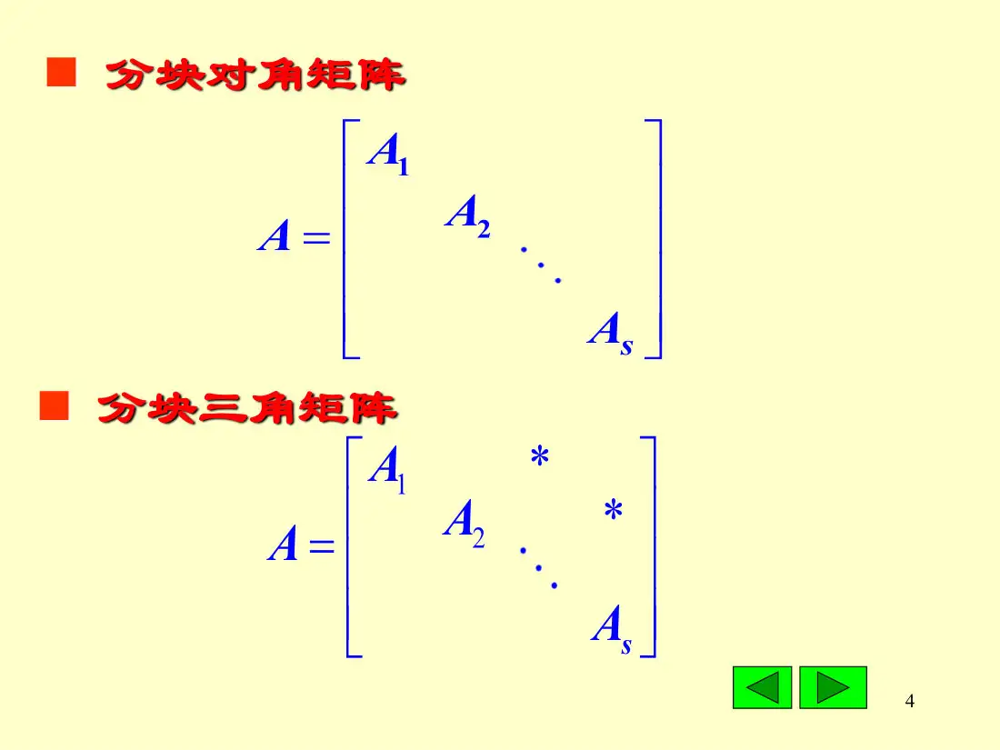

原文：

分块对角矩阵

$$
A = \left[ \begin{array}{l l l l} A _ {1} & & & \\ & A _ {2} & & \\ & & \ddots & \\ & & & A _ {s} \end{array} \right]
$$

分块三角矩阵

$$
A = \left[ \begin{array}{l l l l} A _ {1} & & * & \\ & A _ {2} & & * \\ & & \ddots & \\ & & & A _ {s} \end{array} \right]
$$

◀ ▶

4

### 2.3.2 分块矩阵的运算

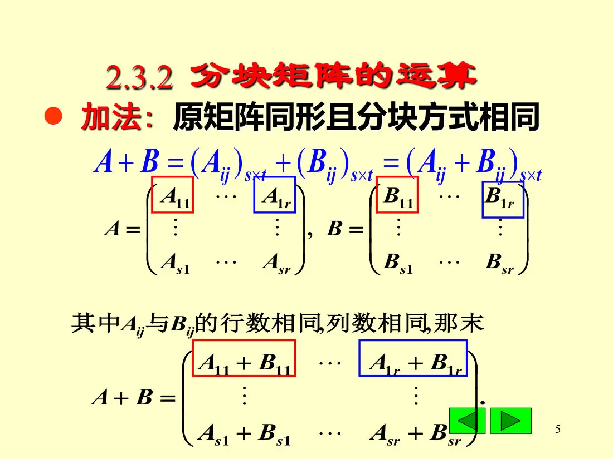

原文：

2.3.2 分块矩阵的运算

\- 加法：原矩阵同形且分块方式相同

$$
\begin{array}{l} A + B = (A _ {i j}) _ {s \times t} + (B _ {i j}) _ {s \times t} = (A _ {i j} + B _ {i j}) _ {s \times t} \\ A = \left( \begin{array}{c c c} A _ {1 1} & \dots & A _ {1 r} \\ \vdots & & \vdots \\ A _ {s 1} & \dots & A _ {s r} \end{array} \right), B = \left( \begin{array}{c c c} B _ {1 1} & \dots & B _ {1 r} \\ \vdots & & \vdots \\ B _ {s 1} & \dots & B _ {s r} \end{array} \right) \end{array}
$$

其中 $A_{ij}$ 与 $B_{ij}$ 的行数相同,列数相同,那末

$$
A + B = \left( \begin{array}{c c c} \boxed {A _ {1 1} + B _ {1 1}} & \dots & \boxed {A _ {1 r} + B _ {1 r}} \\ \vdots & & \vdots \\ A _ {s 1} + B _ {s 1} & \dots & A _ {s r} + B _ {s r} \end{array} \right).
$$

5

### 2.3.2 分块矩阵的运算

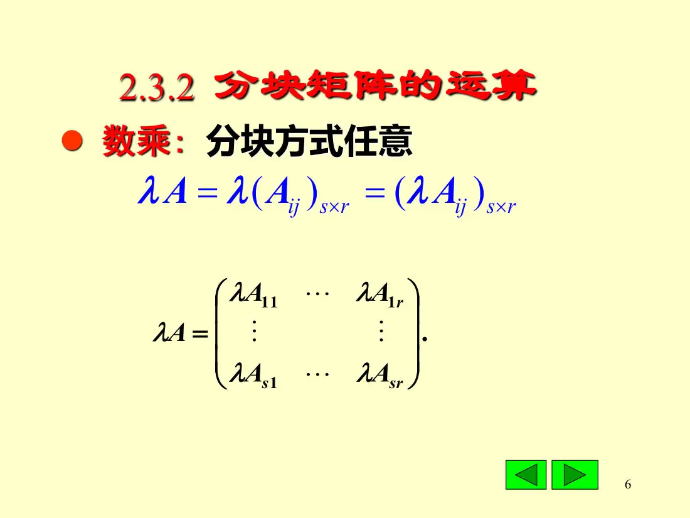

原文：

2.3.2 分块矩阵的运算

\- 数乘：分块方式任意

$$
\lambda A = \lambda (A _ {i j}) _ {s \times r} = (\lambda A _ {i j}) _ {s \times r}
$$

$$
\lambda A = \left( \begin{array}{c c c} \lambda A _ {1 1} & \dots & \lambda A _ {1 r} \\ \vdots & & \vdots \\ \lambda A _ {s 1} & \dots & \lambda A _ {s r} \end{array} \right).
$$

◀ ▶

6

### \- $A$ 的列数 $= B$ 的行数

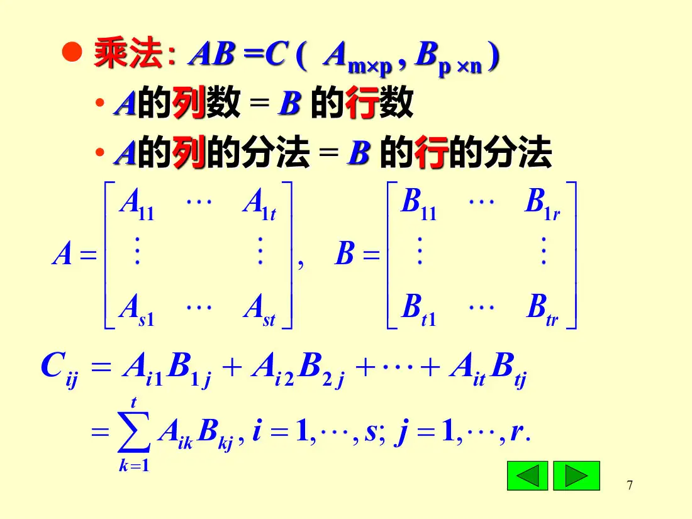

原文：

\- 乘法: $AB = C(A_{\mathrm{m} \times \mathrm{p}}, B_{\mathrm{p} \times \mathrm{n}})$

\- $A$ 的列数 $= B$ 的行数

\- $A$ 的列的分法 = $B$ 的行的分法

$$
A = \left[ \begin{array}{c c c} A _ {1 1} & \dots & A _ {1 t} \\ \vdots & & \vdots \\ A _ {s 1} & \dots & A _ {s t} \end{array} \right], \quad B = \left[ \begin{array}{c c c} B _ {1 1} & \dots & B _ {1 r} \\ \vdots & & \vdots \\ B _ {t 1} & \dots & B _ {t r} \end{array} \right]
$$

$$
\begin{array}{r l} & C _ {i j} = A _ {i 1} B _ {1 j} + A _ {i 2} B _ {2 j} + \dots + A _ {i t} B _ {t j} \\ & = \sum_ {k = 1} ^ {t} A _ {i k} B _ {k j}, i = 1, \dots , s; j = 1, \dots , r. \end{array}
$$

◀ ▶

7

### 例1

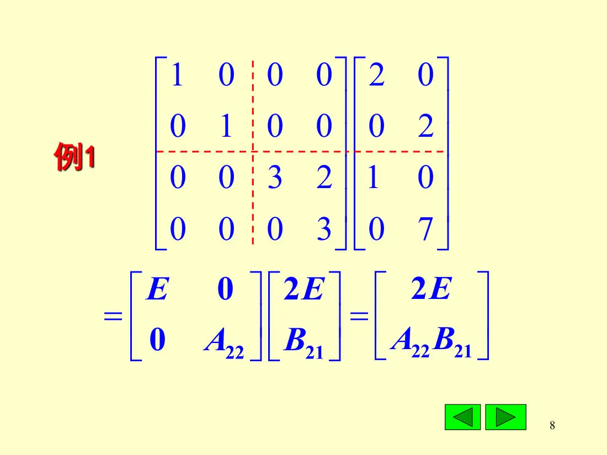

原文：

例1

$$
\left[ \begin{array}{cc:cc} 1 & 0 &  & 0 & 0 \\ 0 & 1 &  & 0 & 0 \\ \hline 0 & 0 &  & 3 & 2 \\ 0 & 0 &  & 0 & 3 \\ \end{array} \right]\left[ \begin{array}{cc} 2 & 0 \\ 0 & 2 \\ 1 & 0 \\ 0 & 7 \\ \end{array} \right]
$$

$$
= \left[ \begin{array}{c c} E & 0 \\ 0 & A _ {2 2} \end{array} \right] \left[ \begin{array}{l} 2 E \\ B _ {2 1} \end{array} \right] = \left[ \begin{array}{c} 2 E \\ A _ {2 2} B _ {2 1} \end{array} \right]
$$

◀ ▶

8

### 第 9 页

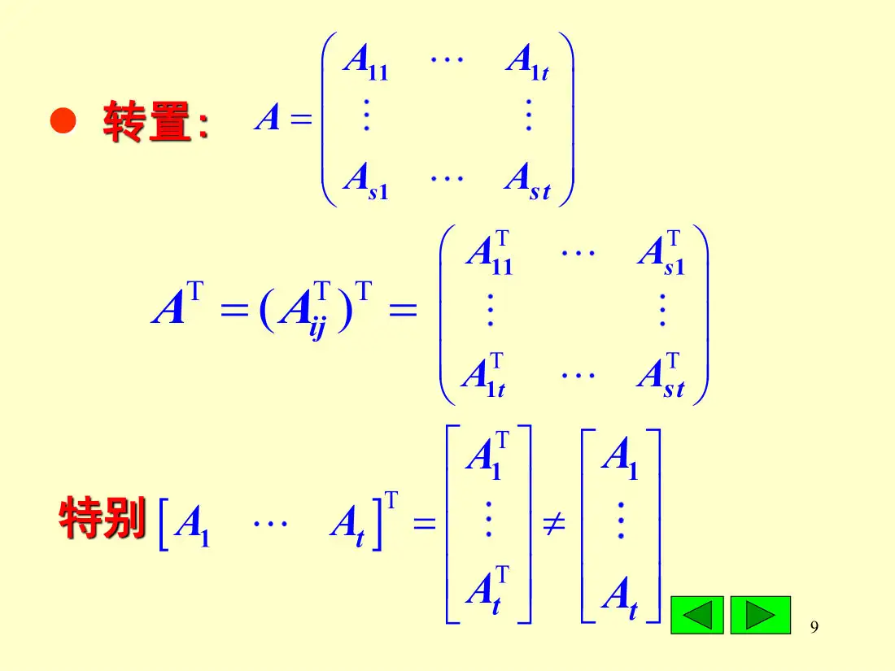

原文：

\- 转置: $A = \begin{pmatrix} A_{11} & \cdots & A_{1t} \\ \vdots & & \vdots \\ A_{s1} & \cdots & A_{st} \end{pmatrix}$ $A^{\mathrm{T}} = (A_{ij}^{\mathrm{T}})^{\mathrm{T}} = \begin{pmatrix} A_{11}^{\mathrm{T}} & \cdots & A_{s1}^{\mathrm{T}} \\ \vdots & & \vdots \\ A_{1t}^{\mathrm{T}} & \cdots & A_{st}^{\mathrm{T}} \end{pmatrix}$ 特别 $\left[A_1, \cdots, A_t\right]^{\mathrm{T}} = \begin{bmatrix} A_1^{\mathrm{T}} \\ \vdots \\ A_t^{\mathrm{T}} \end{bmatrix} \neq \begin{bmatrix} A_1 \\ \vdots \\ A_t \end{bmatrix}$

### $$

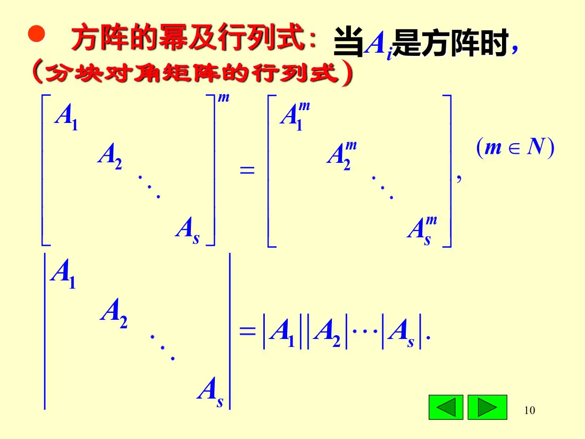

原文：

\- 方阵的幂及行列式: 当 $A_{i}$ 是方阵时, (分块对角矩阵的行列式)

$$
\left[ \begin{array}{c c c c} A _ {1} & & & \\ & A _ {2} & & \\ & & \ddots & \\ & & & A _ {s} \end{array} \right] ^ {m} = \left[ \begin{array}{c c c c} A _ {1} ^ {m} & & & \\ & A _ {2} ^ {m} & & \\ & & \ddots & \\ & & & A _ {s} ^ {m} \end{array} \right], (m \in N)
$$

$A_{1}$

$$
\begin{array}{c c c} A _ {2} & \ddots & \\ & & A _ {s} \end{array} \Bigg | = | A _ {1} | | A _ {2} | \dots | A _ {s} |.
$$

◀ ▶

10

### 分块三角阵的行列式：

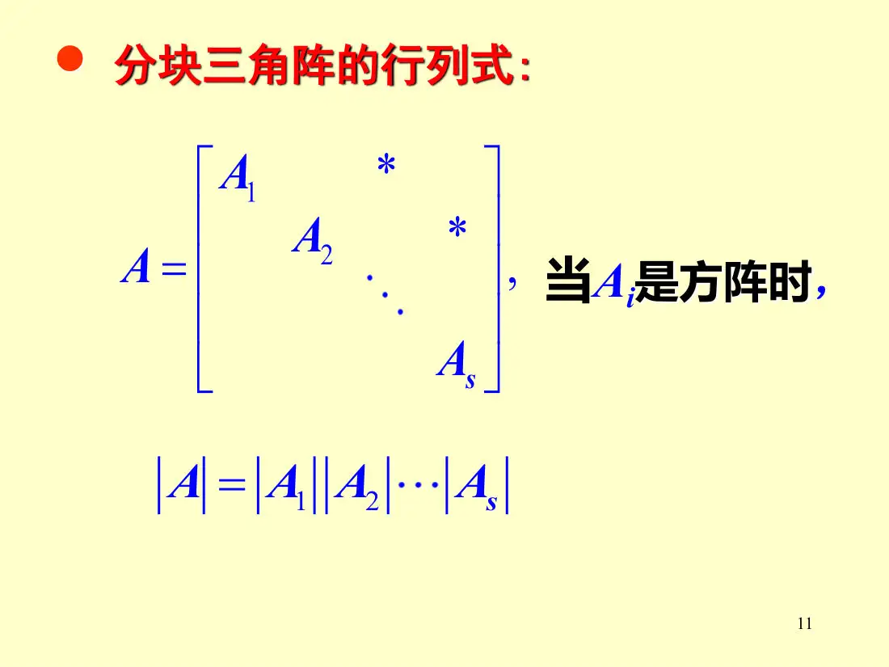

原文：

分块三角阵的行列式：

$$
A = \left[ \begin{array}{c c c c} A _ {1} & & * & \\ & A _ {2} & & * \\ & & \ddots & \\ & & & A _ {s} \end{array} \right], \text {当} A _ {i} \text {是方阵时，}
$$

$$
\left| \boldsymbol {A} \right| = \left| \boldsymbol {A} _ {1} \right| \left| \boldsymbol {A} _ {2} \right| \dots \left| \boldsymbol {A} _ {s} \right|
$$

11

### \- 对角阵的逆矩阵:

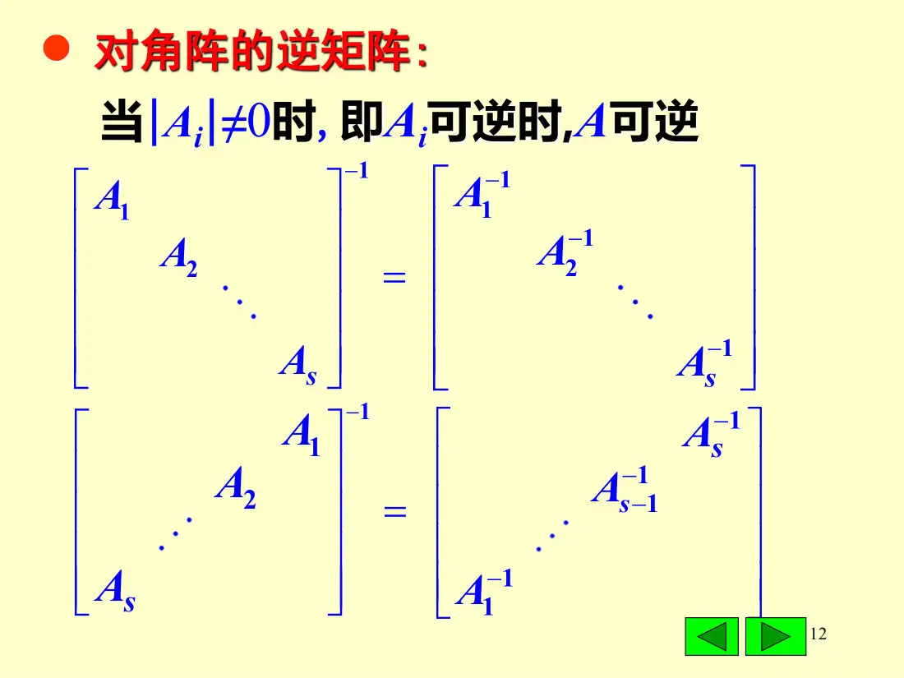

原文：

\- 对角阵的逆矩阵:

当 $|A_{i}|\neq0$ 时, 即 $A_{i}$ 可逆时,A可逆

$$
\left[ \begin{array}{c c c c} A _ {1} & & & \\ & A _ {2} & & \\ & & \ddots & \\ & & & A _ {s} \end{array} \right] ^ {- 1} = \left[ \begin{array}{c c c c} A _ {1} ^ {- 1} & & & \\ & A _ {2} ^ {- 1} & & \\ & & \ddots & \\ & & & A _ {s} ^ {- 1} \end{array} \right]
$$

$$
\left[ \begin{array}{c c c} & & A _ {1} \\ & \ddots & A _ {2} \\ A _ {s} & & \end{array} \right] ^ {- 1} = \left[ \begin{array}{c c c} & & A _ {s} ^ {- 1} \\ & A _ {s - 1} ^ {- 1} \\ A _ {1} ^ {- 1} & & \end{array} \right]
$$

◀ △

12

### ◀ ▶

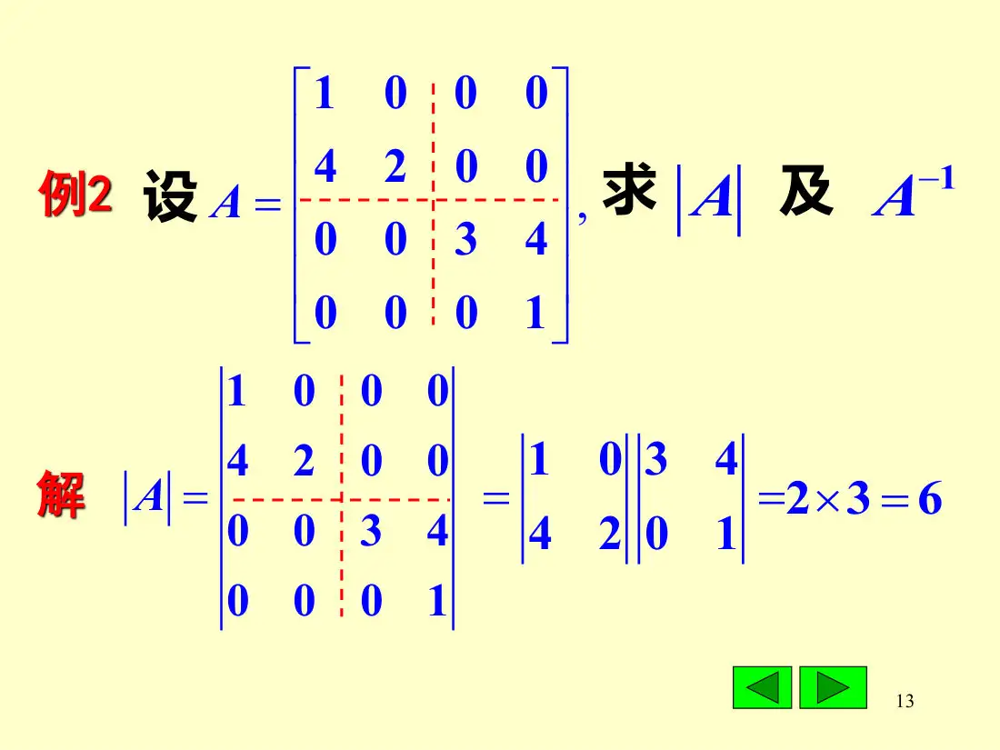

原文：

例2 设 $A=\begin{bmatrix}1&0&0&0\\ 4&2&0&0\\ 0&0&3&4\\ 0&0&0&1\end{bmatrix}$ ，求 $|A|$ 及 $A^{-1}$ 解 $|A|=\begin{vmatrix}1 & 0 & 0 & 0 \\ 4 & 2 & 0 & 0 \\ 0 & 0 & 3 & 4 \\ 0 & 0 & 0 & 1\end{vmatrix}=\begin{vmatrix}1 & 0 & 3 & 4 \\ 4 & 2 & 0 & 1\end{vmatrix}=2\times3=6$

◀ ▶

13

### $$

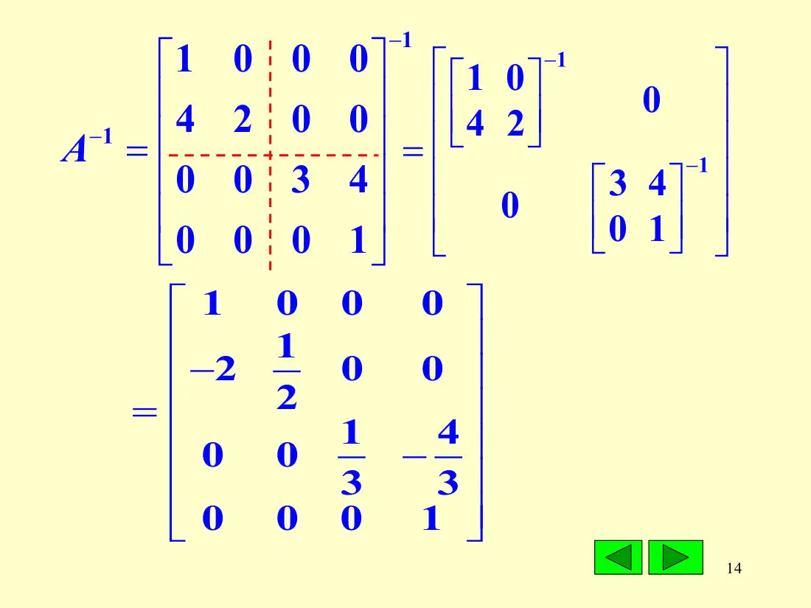

原文：

$$
\begin{array}{r l} A ^ {- 1} & = \left[ \begin{array}{c c c c} 1 & 0 & 0 & 0 \\ 4 & 2 & 0 & 0 \\ \hline 0 & 0 & 3 & 4 \\ 0 & 0 & 0 & 1 \end{array} \right] ^ {- 1} = \left[ \begin{array}{c c} \left[ \begin{array}{c c} 1 & 0 \\ 4 & 2 \end{array} \right] ^ {- 1} & 0 \\ 0 & \left[ \begin{array}{c c} 3 & 4 \\ 0 & 1 \end{array} \right] ^ {- 1} \end{array} \right] \\ & = \left[ \begin{array}{c c c c} 1 & 0 & 0 & 0 \\ - 2 & \frac {1}{2} & 0 & 0 \\ 0 & 0 & \frac {1}{3} & - \frac {4}{3} \\ 0 & 0 & 0 & 1 \end{array} \right] \end{array}
$$

◀ ▶

14

### 例 设 $A, B, |A| = 3, |B| = -2$ . 求

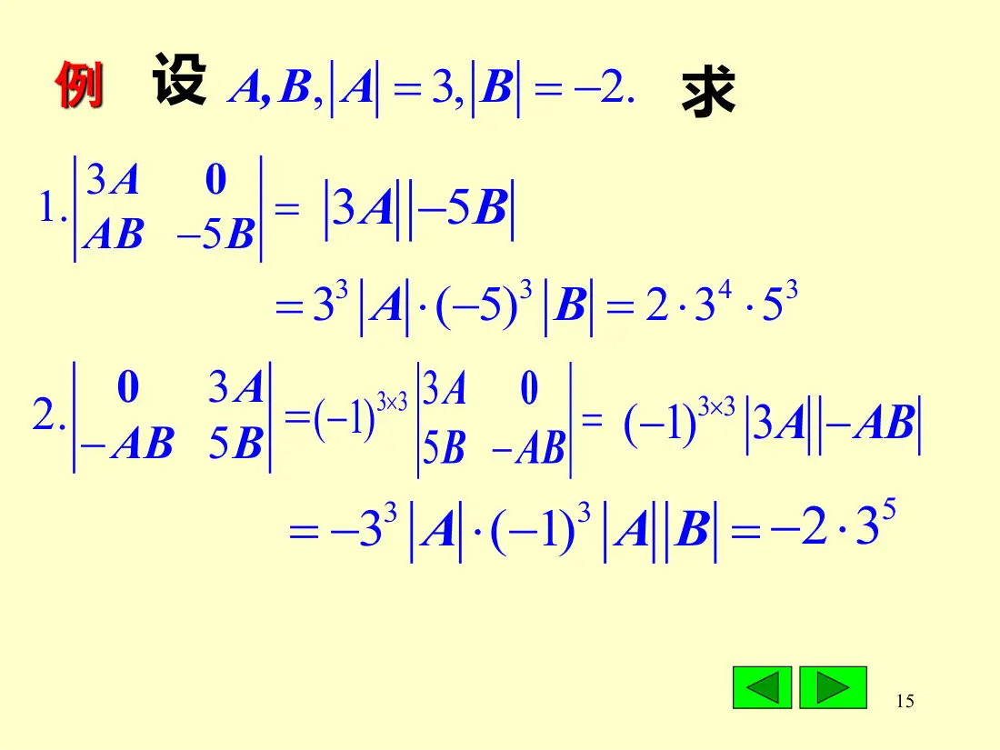

原文：

例 设 $A, B, |A| = 3, |B| = -2$ . 求

1. $\left|\begin{matrix}3A&0\\ AB&-5B\end{matrix}\right|=\left|3A\right|\left|-5B\right|$ $=3^{3}|A|\cdot(-5)^{3}|B|=2\cdot3^{4}\cdot5^{3}$ 2. $\left|\begin{matrix}0&3A\\ -AB&5B\end{matrix}\right|=(-1)^{3\times3}\left|\begin{matrix}3A&0\\ 5B&-AB\end{matrix}\right|=(-1)^{3\times3}|3A||-AB|$ $=-3^{3}|A|\cdot(-1)^{3}|A||B|=-2\cdot3^{5}$ 例 设 $A=\begin{pmatrix}5&0&0\\0&3&1\\0&2&1\end{pmatrix}$ ，求 $A^{-1}$ .
解 $A=\begin{pmatrix}5&0&0\\0&3&1\\0&2&1\end{pmatrix}=\begin{pmatrix}A_{1}&O\\O&A_{2}\end{pmatrix},$ $A_{1}=(5),\quad A_{1}^{-1}=\left(\frac{1}{5}\right);\quad A_{2}=\left(\begin{matrix}3&1\\2&1\end{matrix}\right),$

◀

15

### 第 16 页

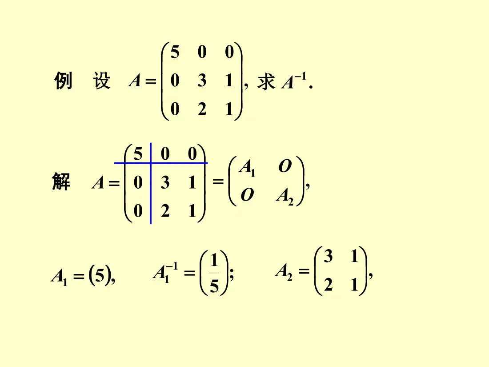

### $$

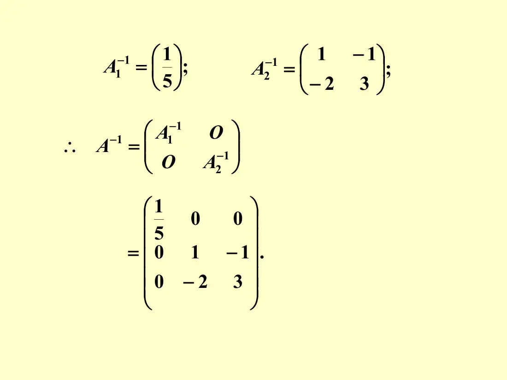

原文：

$$
A _ {1} ^ {- 1} = \left(\frac {1}{5}\right);
$$

$$
A _ {2} ^ {- 1} = \left( \begin{array}{c c} 1 & - 1 \\ - 2 & 3 \end{array} \right);
$$

$$
\boldsymbol {A} ^ {- 1} = \left( \begin{array}{c c} \boldsymbol {A} _ {1} ^ {- 1} & \boldsymbol {O} \\ \boldsymbol {O} & \boldsymbol {A} _ {2} ^ {- 1} \end{array} \right)
$$

$$
= \left( \begin{array}{c c c} \frac {1}{5} & 0 & 0 \\ 0 & 1 & - 1 \\ 0 & - 2 & 3 \end{array} \right).
$$

### 说明B 的每一列都是齐次线性方程组

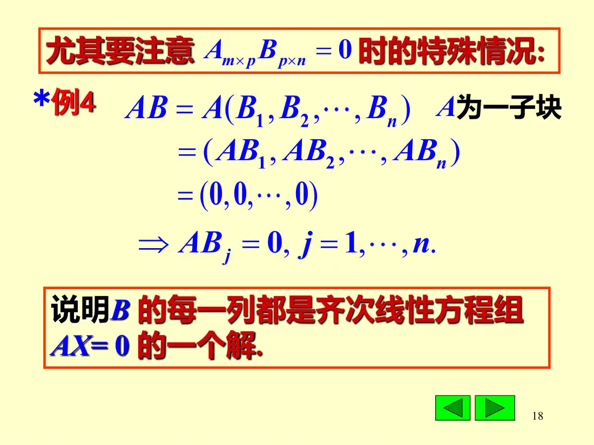

原文：

尤其要注意 $A_{m \times p} B_{p \times n} = 0$ 时的特殊情况:

\*例4 $AB = A(B_{1}, B_{2}, \cdots, B_{n})$ $A$ 为一子块 $= (AB_{1}, AB_{2}, \cdots, AB_{n})$ $= (0, 0, \cdots, 0)$ $\Rightarrow AB_{j} = 0, j = 1, \cdots, n.$

说明B 的每一列都是齐次线性方程组
AX=0 的一个解.

◀ ▶

18

### $$

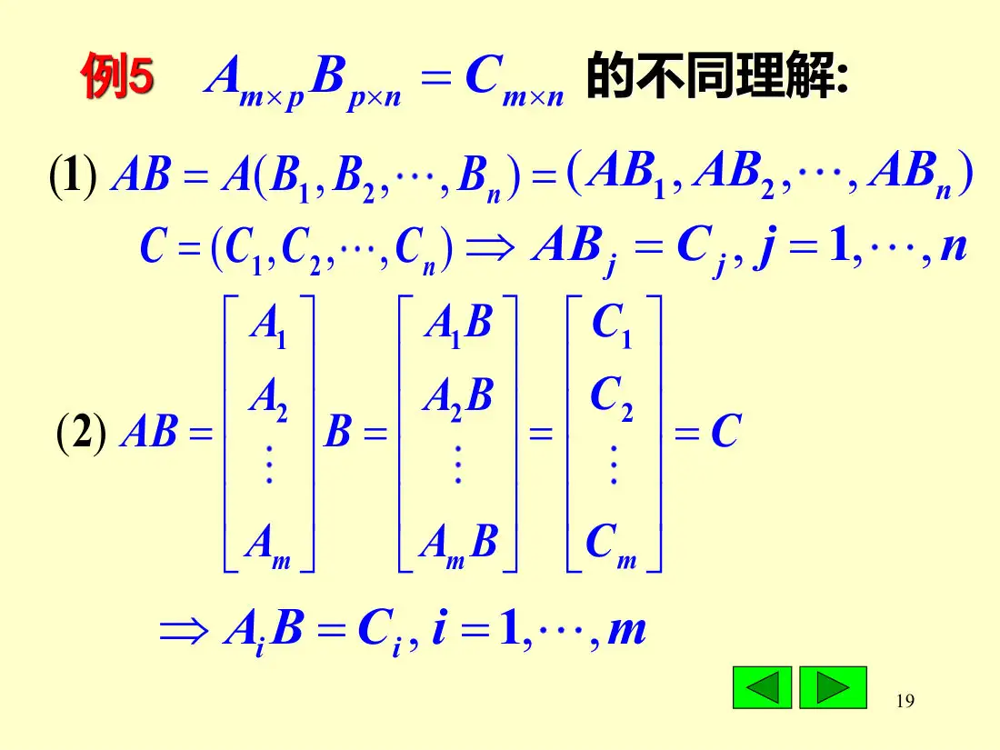

原文：

例5 $A_{m \times p} B_{p \times n} = C_{m \times n}$ 的不同理解:

(1) $AB = A(B_{1}, B_{2}, \cdots, B_{n}) = (AB_{1}, AB_{2}, \cdots, AB_{n})$

$$
C = \left(C _ {1}, C _ {2}, \dots , C _ {n}\right) \Rightarrow A B _ {j} = C _ {j}, j = 1, \dots , n
$$

$$
\boldsymbol {A} \boldsymbol {B} = \left[ \begin{array}{c} A _ {1} \\ A _ {2} \\ \vdots \\ A _ {m} \end{array} \right] \boldsymbol {B} = \left[ \begin{array}{c} A _ {1} \boldsymbol {B} \\ A _ {2} \boldsymbol {B} \\ \vdots \\ A _ {m} \boldsymbol {B} \end{array} \right] = \left[ \begin{array}{c} C _ {1} \\ C _ {2} \\ \vdots \\ C _ {m} \end{array} \right] = \boldsymbol {C}
$$

$$
\Rightarrow A _ {i} B = C _ {i}, i = 1, \dots , m
$$

◀ ▶

19

### 2.3.3 分块矩阵的初等变换

原文：

2.3.3 分块矩阵的初等变换

本节内容提要

分块矩阵的初等变换

分块初等阵

利用分块矩阵的初等变换求秩

◀ ▶

20

### 2.3.3 分块矩阵的初等变换

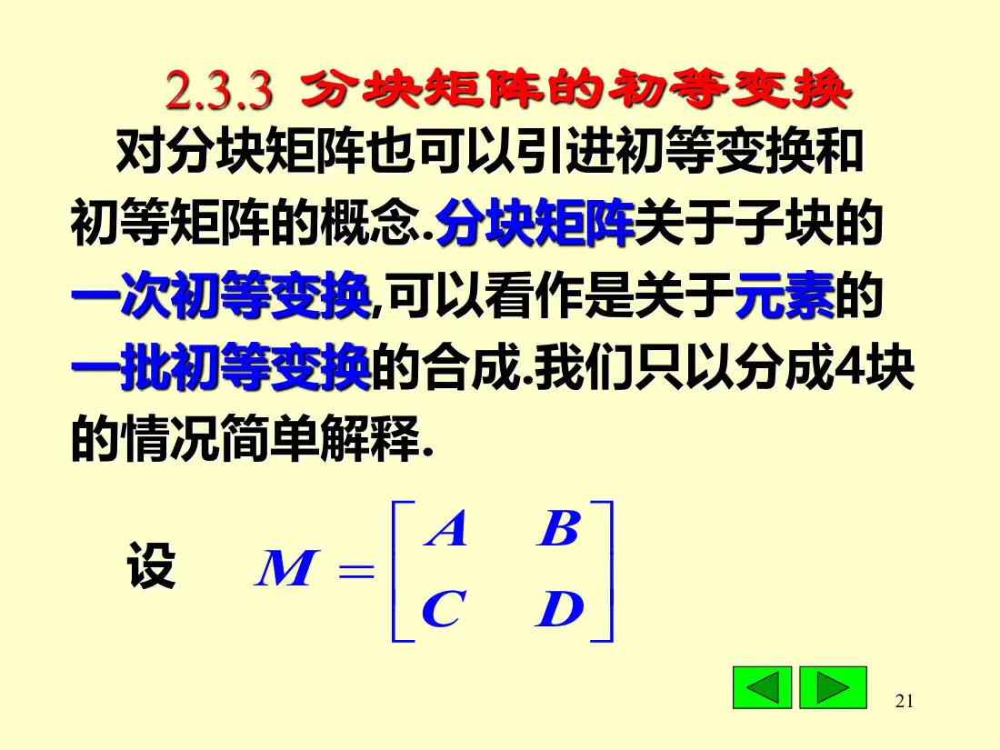

原文：

2.3.3 分块矩阵的初等变换
对分块矩阵也可以引进初等变换和初等矩阵的概念。分块矩阵关于子块的一次初等变换，可以看作是关于元素的一批初等变换的合成。我们只以分成4块的情况简单解释。

设

$$
\boldsymbol {M} = \left[ \begin{array}{c c} \boldsymbol {A} & \boldsymbol {B} \\ \boldsymbol {C} & \boldsymbol {D} \end{array} \right]
$$

◀ ▶

21

### 定义 下面三种针对分块矩阵M的变形,统称为分块矩阵的初等变换:

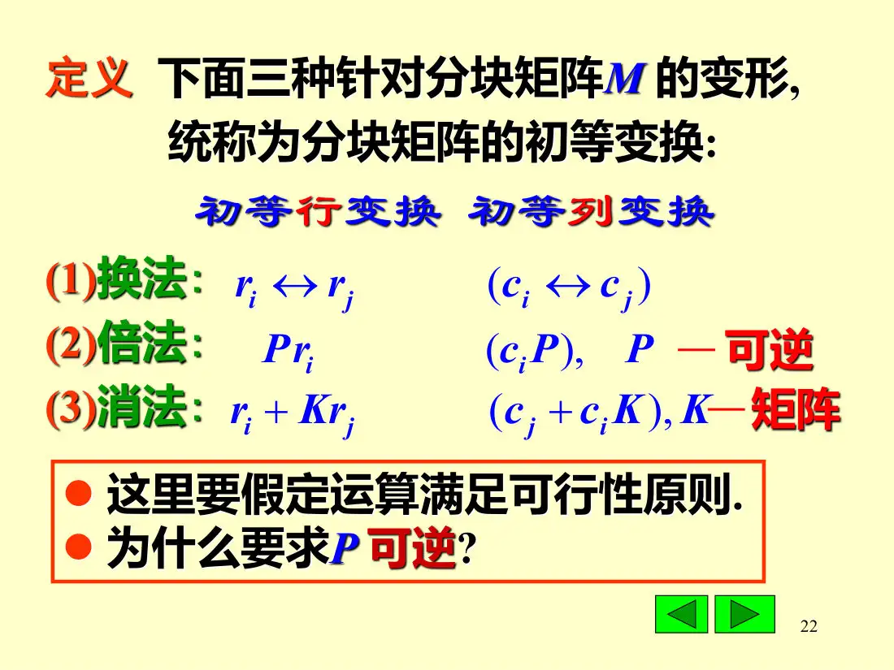

原文：

定义 下面三种针对分块矩阵M的变形,统称为分块矩阵的初等变换:

初等行变换 初等列变换

(1)换法: $r_{i} \leftrightarrow r_{j}$ $(c_{i} \leftrightarrow c_{j})$

(2)倍法: $Pr_{i}$

(3)消法: $r_{i} + Kr_{j}$

$(c_{i}P)$ , P — 可逆

$(c_{j}+c_{i}K)$ , K—矩阵

\- 这里要假定运算满足可行性原则.

\- 为什么要求 $P$ 可逆?

◀ ▶

22

### 2.3.3 分块初等阵

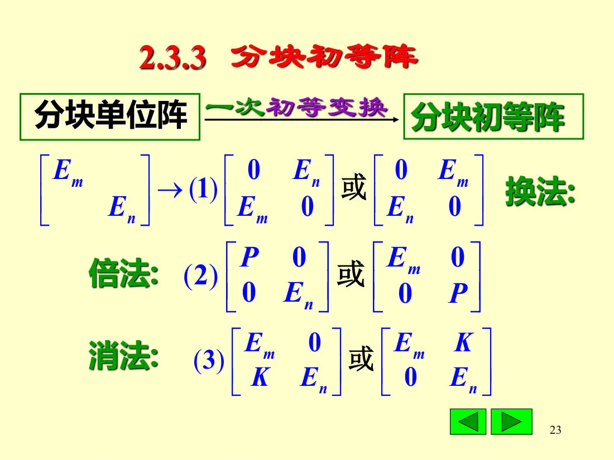

原文：

2.3.3 分块初等阵

分块单位阵 一次初等变换 分块初等阵

$\left[ \begin{array}{ll}E_{m} & \\ & E_{n} \end{array} \right]\rightarrow (1)\left[ \begin{array}{ll}0 & E_{n}\\ E_{m} & 0 \end{array} \right]$ 或 $\left[ \begin{array}{ll}0 & E_m\\ E_n & 0 \end{array} \right]$ 换法：

倍法: (2) $\left[ \begin{array}{cc} P & 0 \\ 0 & E_n \end{array} \right]$ 或 $\left[ \begin{array}{cc} E_m & 0 \\ 0 & P \end{array} \right]$

消法: (3) $\begin{bmatrix} E_m & 0 \\ K & E_n \end{bmatrix}$ 或 $\begin{bmatrix} E_m & K \\ 0 & E_n \end{bmatrix}$ - 对分块矩阵进行一次初等行(列)变换,相当于给它左(右)乘以一个相应的分块初等矩阵:

◀ ▶

23

### 换法:

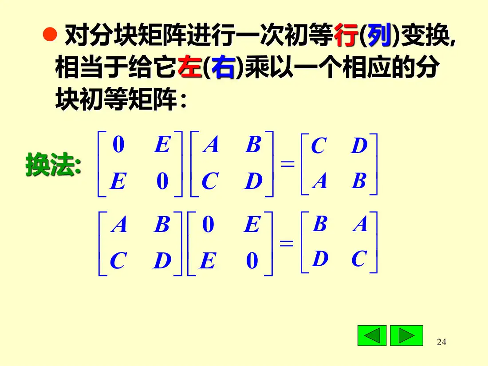

原文：

换法:

$$
\left[ \begin{array}{c c} \mathbf {0} & \mathbf {E} \\ \mathbf {E} & \mathbf {0} \end{array} \right] \left[ \begin{array}{c c} \mathbf {A} & \mathbf {B} \\ \mathbf {C} & \mathbf {D} \end{array} \right] = \left[ \begin{array}{c c} \mathbf {C} & \mathbf {D} \\ \mathbf {A} & \mathbf {B} \end{array} \right]
$$

$$
\left[ \begin{array}{c c} A & B \\ C & D \end{array} \right] \left[ \begin{array}{c c} 0 & E \\ E & 0 \end{array} \right] = \left[ \begin{array}{c c} B & A \\ D & C \end{array} \right]
$$

◀ ▶

24

### 倍法:

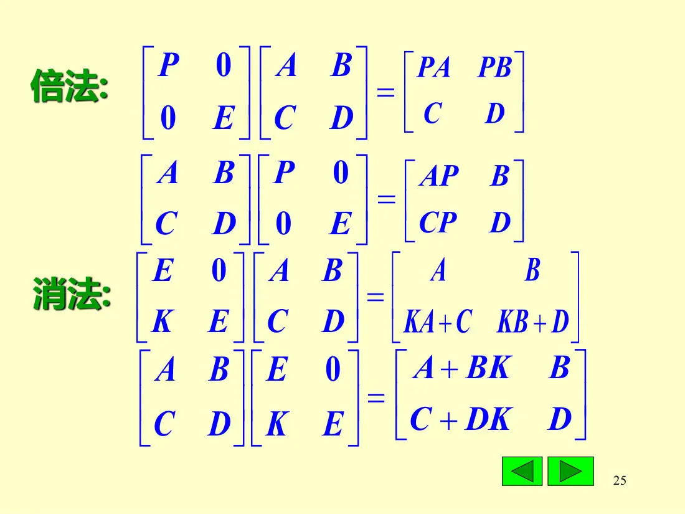

原文：

倍法:

消法:

$$
\left[ \begin{array}{c c} \boldsymbol {P} & \boldsymbol {0} \\ \boldsymbol {0} & \boldsymbol {E} \end{array} \right] \left[ \begin{array}{c c} \boldsymbol {A} & \boldsymbol {B} \\ \boldsymbol {C} & \boldsymbol {D} \end{array} \right] = \left[ \begin{array}{c c} \boldsymbol {P A} & \boldsymbol {P B} \\ \boldsymbol {C} & \boldsymbol {D} \end{array} \right]
$$

$$
\left[ \begin{array}{l l} A & B \\ C & D \end{array} \right] \left[ \begin{array}{l l} P & 0 \\ 0 & E \end{array} \right] = \left[ \begin{array}{l l} A P & B \\ C P & D \end{array} \right]
$$

$$
\left[ \begin{array}{c c} \boldsymbol {E} & \boldsymbol {0} \\ \boldsymbol {K} & \boldsymbol {E} \end{array} \right] \left[ \begin{array}{c c} \boldsymbol {A} & \boldsymbol {B} \\ \boldsymbol {C} & \boldsymbol {D} \end{array} \right] = \left[ \begin{array}{c c} \boldsymbol {A} & \boldsymbol {B} \\ \boldsymbol {K A + C} & \boldsymbol {K B + D} \end{array} \right]
$$

$$
\left[ \begin{array}{l l} A & B \\ C & D \end{array} \right] \left[ \begin{array}{l l} E & 0 \\ K & E \end{array} \right] = \left[ \begin{array}{l l} A + B K & B \\ C + D K & D \end{array} \right]
$$

◀ ▶

25

### \- 分块初等变换不改变分块阵的秩。

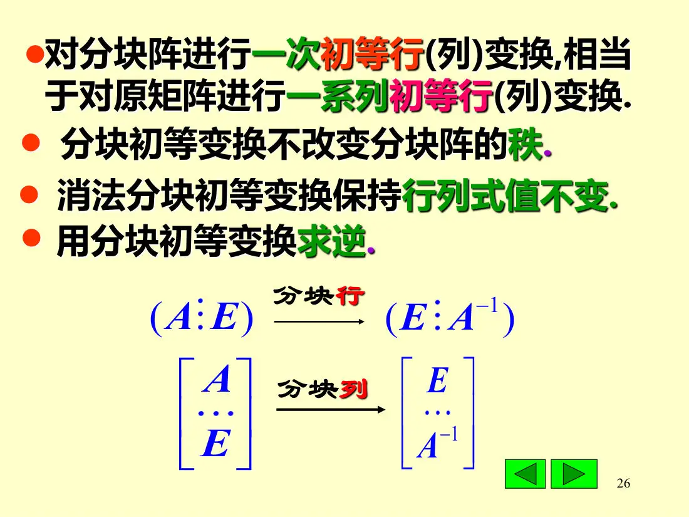

原文：

\- 对分块阵进行一次初等行(列)变换,相当于对原矩阵进行一系列初等行(列)变换.

\- 分块初等变换不改变分块阵的秩。

\- 消法分块初等变换保持行列式值不变.

\- 用分块初等变换求逆。

$$
\begin{array}{r l} & {(A: E) \xrightarrow {\text {分块行}} (E: A ^ {- 1})} \\ & {\left[ \begin{array}{l} {A} \\ {\dots} \\ {E} \end{array} \right] \xrightarrow {\text {分块列}} \left[ \begin{array}{l} {E} \\ {\dots} \\ {A ^ {- 1}} \end{array} \right]} \end{array}
$$

26

### 第 27 页

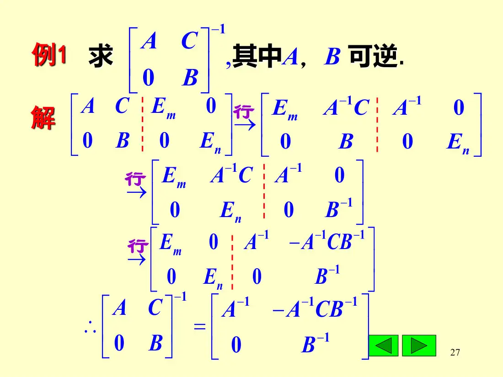

原文：

例1 求 $\begin{bmatrix} A & C \\ 0 & B \end{bmatrix}^{-1}$ ，其中 A, B 可逆.
解 $\begin{bmatrix}A&C:E_{m}&0\\ 0&B&0&E_{n}\end{bmatrix}\xrightarrow{行}\begin{bmatrix}E_{m}&A^{-1}C&A^{-1}&0\\ 0&B&0&E_{n}\end{bmatrix}$ $\xrightarrow{行}\begin{bmatrix}E_{m}&A^{-1}C&A^{-1}&0\\ 0&E_{n}&0&B^{-1}\end{bmatrix}$ $\xrightarrow{行}\begin{bmatrix}E_{m}&0&A^{-1}&-A^{-1}CB^{-1}\\ 0&E_{n}&0&B^{-1}\end{bmatrix}$ $\therefore\begin{bmatrix}A&C\\ 0&B\end{bmatrix}^{-1}=\begin{bmatrix}A^{-1}&-A^{-1}CB^{-1}\\ 0&B^{-1}\end{bmatrix}$

### 总结: 常用的分块矩阵求逆公式设 $A, B$ 都是可逆方阵, 则有下列公式.

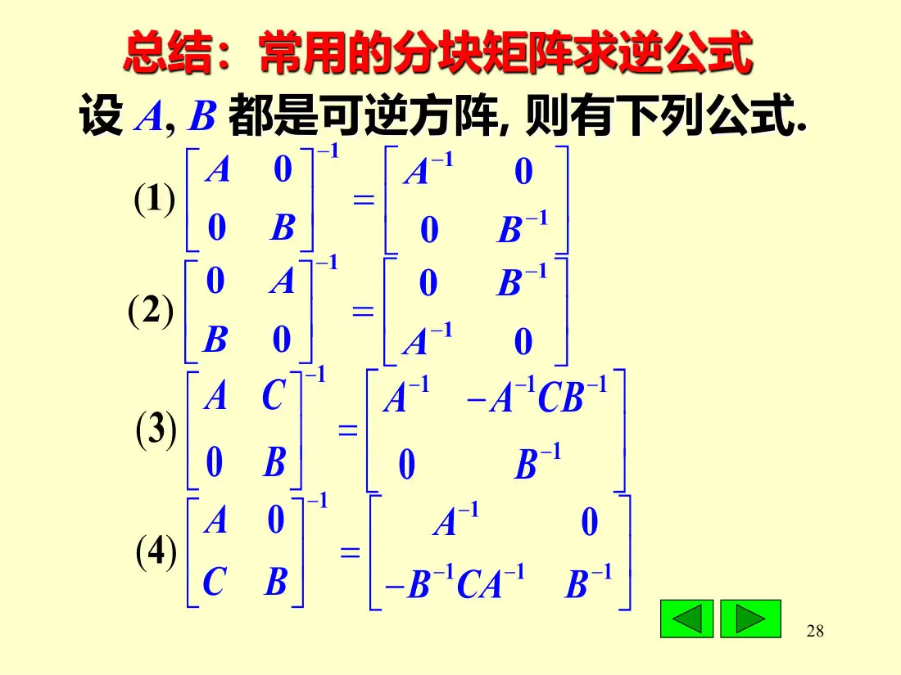

原文：

总结: 常用的分块矩阵求逆公式设 $A, B$ 都是可逆方阵, 则有下列公式.

$$
\left[ \begin{array}{c c} A & 0 \\ 0 & B \end{array} \right] ^ {- 1} = \left[ \begin{array}{c c} A ^ {- 1} & 0 \\ 0 & B ^ {- 1} \end{array} \right]\tag{1}
$$

$$
(2) \left[ \begin{array}{l l} 0 & A \\ B & 0 \end{array} \right] ^ {- 1} = \left[ \begin{array}{c c} 0 & B ^ {- 1} \\ A ^ {- 1} & 0 \end{array} \right]
$$

(3) $\begin{bmatrix} A & C \\ 0 & B \end{bmatrix}^{-1} = \begin{bmatrix} A^{-1} & -A^{-1}\overline{CB}^{-1} \\ 0 & B^{-1} \end{bmatrix}$

(4) $\left[ \begin{array}{cc}A & 0\\ C & B \end{array} \right]^{-1} = \left[ \begin{array}{cc}A^{-1} & 0\\ -B^{-1}CA^{-1} & B^{-1} \end{array} \right]$ 例2 用分块方法证明 $|AB| = |A||B|$ , 其中 $A$ 、 $B$ 为 $n$ 阶方阵.

◀ ▶

28

### 第 29 页

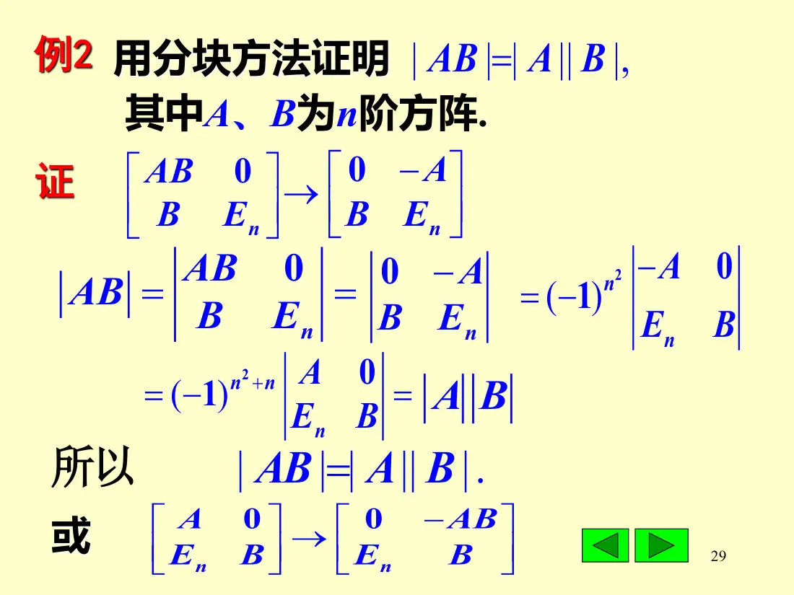

原文：

证 $\left[ \begin{array}{ll}AB & 0\\ B & E_n \end{array} \right]\rightarrow \left[ \begin{array}{ll}0 & -A\\ B & E_n \end{array} \right]$ $|AB| = \left| \begin{array}{ll}AB & 0\\ B & E_n \end{array} \right| = \left| \begin{array}{ll}0 & -A\\ B & E_n \end{array} \right| = (-1)^{n^2}\left| \begin{array}{ll} - A & 0\\ E_n & B \end{array} \right|$ $= (-1)^{n^2 + n}\left| \begin{array}{ll}A & 0\\ E_n & B \end{array} \right| = |A||B|$ 所以 $|AB| = |A||B|$ . 或 $\left[ \begin{array}{ll}A & 0\\ E_n & B \end{array} \right]\to \left[ \begin{array}{ll}0 & -AB\\ E_n & B \end{array} \right]$ 例3 证明 $\left| \begin{array}{cc} A & C \\ D & B \end{array} \right| = |A||B - DA^{-1}C|$ (行列式第一降阶定理) 其中 $A$ 为 $n$ 阶可逆矩阵, $B$ 为 $m$ 阶方阵.

### $$

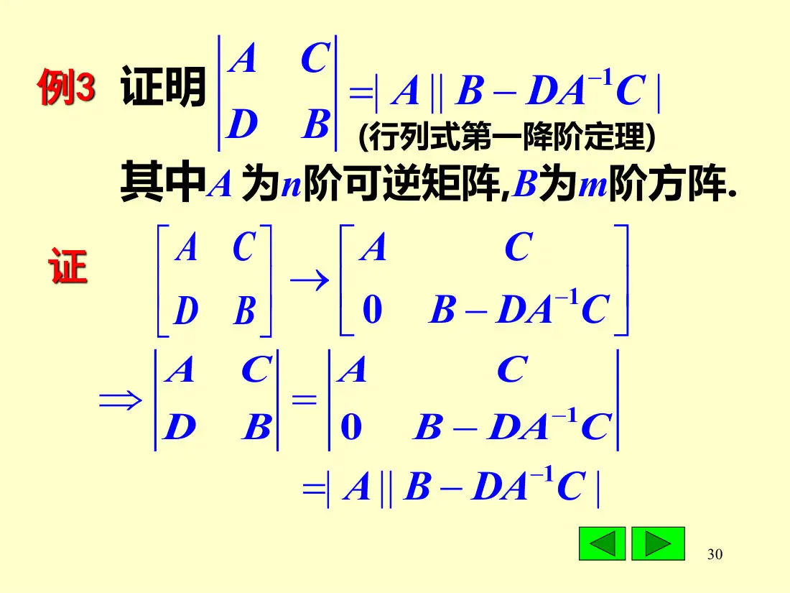

原文：

证

$$
\begin{array}{r l}&{\left[\begin{array}{l l}A&C\\D&B\end{array}\right]\rightarrow \left[\begin{array}{c c}A&C\\0&B - D A ^ {- 1} C\end{array}\right]}\\&{\Rightarrow \left|\begin{array}{l l}A&C\\D&B\end{array}\right| = \left|\begin{array}{c c}A&C\\0&B - D A ^ {- 1} C\end{array}\right|}\\&{\qquad = | A | | B - D A ^ {- 1} C |}\end{array}
$$

◀ ▶

30

### $$

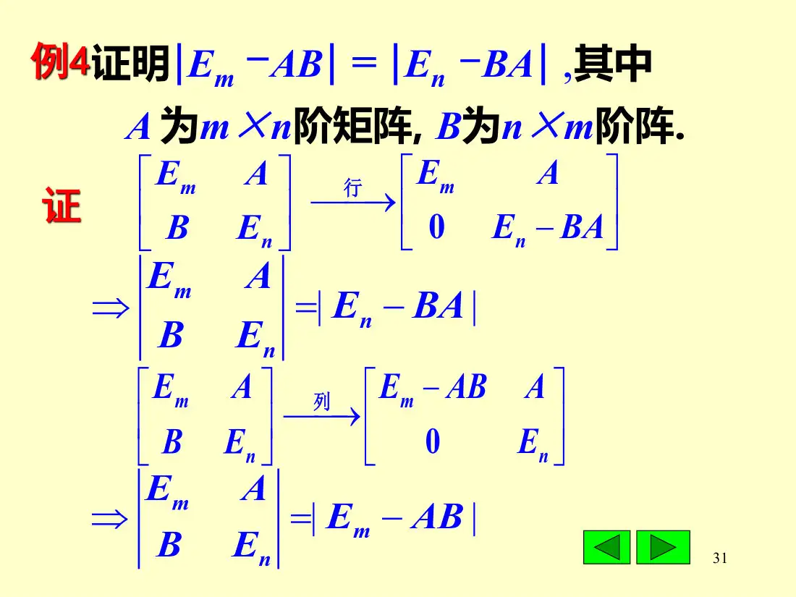

原文：

例4证明 $|E_{m}-AB|=|E_{n}-BA|$ ，其中A为 $m\times n$ 阶矩阵，B为 $n\times m$ 阶阵。

证

$$
\begin{array}{r l} & {\left[ \begin{array}{l l} {E _ {m}} & {A} \\ {B} & {E _ {n}} \end{array} \right] \xrightarrow {\text {行}} \left[ \begin{array}{l l} {E _ {m}} & {A} \\ {0} & {E _ {n} - B A} \end{array} \right]} \\ & {\Rightarrow \left| \begin{array}{l l} {E _ {m}} & {A} \\ {B} & {E _ {n}} \end{array} \right| = | E _ {n} - B A |} \\ & {\left[ \begin{array}{l l} {E _ {m}} & {A} \\ {B} & {E _ {n}} \end{array} \right] \xrightarrow {\text {列}} \left[ \begin{array}{l l} {E _ {m} - A B} & {A} \\ {0} & {E _ {n}} \end{array} \right]} \\ & {\Rightarrow \left| \begin{array}{l l} {E _ {m}} & {A} \\ {B} & {E _ {n}} \end{array} \right| = | E _ {m} - A B |} \end{array}
$$

◀ ▶

31

### 利用上式可得

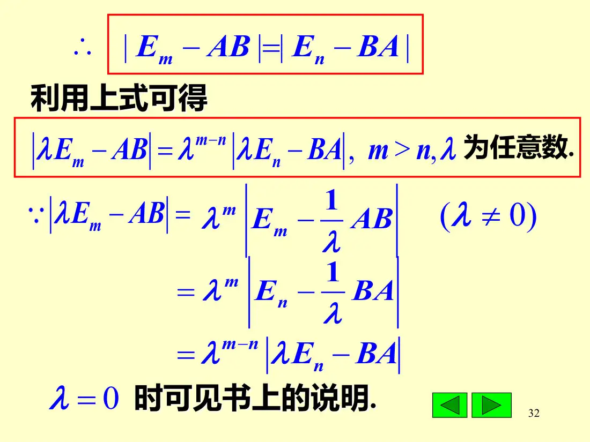

原文：

∴ $\left|E_{m}-AB\right|=\left|E_{n}-BA\right|$

利用上式可得

$\left|\lambda E_{m} - AB\right| = \lambda^{m - n}\left|\lambda E_{n} - BA\right|,\ m > n,\lambda$ 为任意数.

$$
\begin{array}{r l} \because | \lambda E _ {m} - A B | = & \lambda^ {m} \left| E _ {m} - \frac {1}{\lambda} A B \right| \\ = & \lambda^ {m} \left| E _ {n} - \frac {1}{\lambda} B A \right| \\ = & \lambda^ {m - n} | \lambda E _ {n} - B A | \end{array}
$$

$$
(\lambda \neq 0)
$$

$\lambda = 0$ 时可见书上的说明.

◀

32

### 33

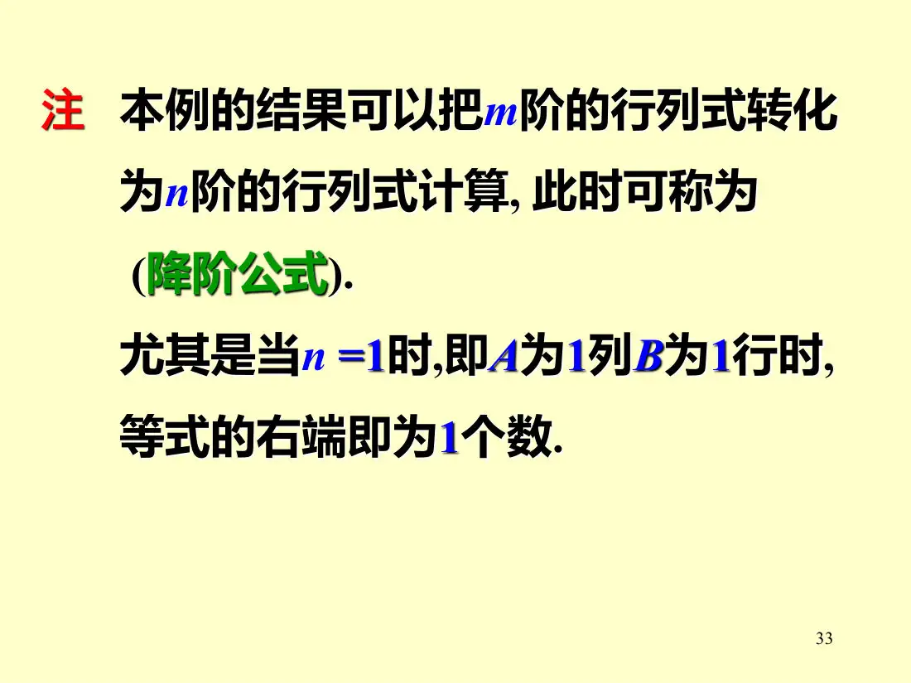

原文：

注 本例的结果可以把m阶的行列式转化为n阶的行列式计算, 此时可称为(降阶公式).

尤其是当 $n = 1$ 时, 即 $A$ 为 1 列 $B$ 为 1 行时, 等式的右端即为 1 个数.

33

### 例5 计算

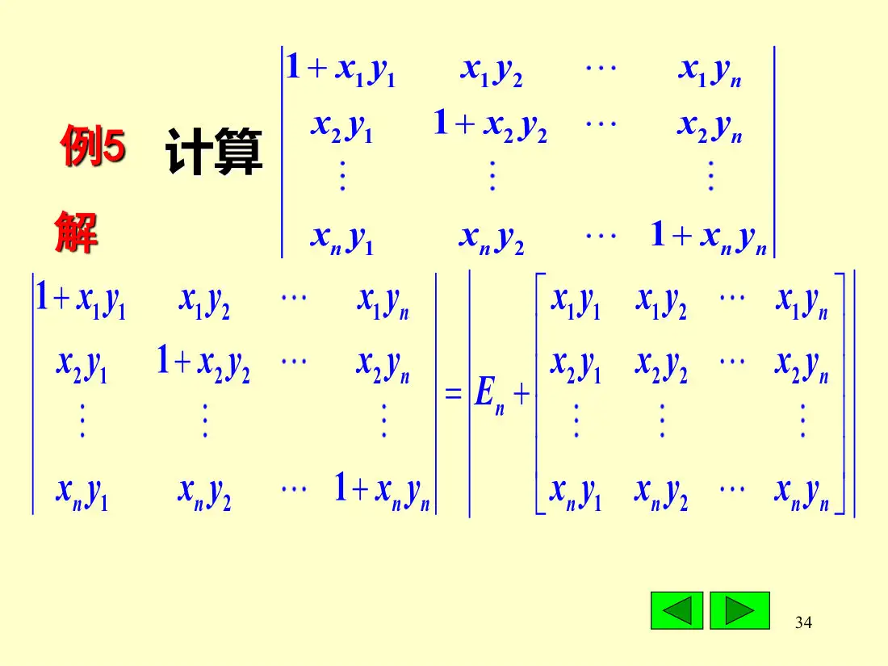

原文：

例5 计算

解

$$
\left| \begin{array}{c c c c} 1 + x _ {1} y _ {1} & x _ {1} y _ {2} & \dots & x _ {1} y _ {n} \\ x _ {2} y _ {1} & 1 + x _ {2} y _ {2} & \dots & x _ {2} y _ {n} \\ \vdots & \vdots & & \vdots \\ x _ {n} y _ {1} & x _ {n} y _ {2} & \dots & 1 + x _ {n} y _ {n} \end{array} \right|
$$

$$
\left| \begin{array}{c c c c} \mathbf {1} + x _ {1} y _ {1} & x _ {1} y _ {2} & \dots & x _ {1} y _ {n} \\ x _ {2} y _ {1} & \mathbf {1} + x _ {2} y _ {2} & \dots & x _ {2} y _ {n} \\ \vdots & \vdots & & \vdots \\ x _ {n} y _ {1} & x _ {n} y _ {2} & \dots & \mathbf {1} + x _ {n} y _ {n} \end{array} \right| = \left| E _ {n} + \left[ \begin{array}{c c c c} x _ {1} y _ {1} & x _ {1} y _ {2} & \dots & x _ {1} y _ {n} \\ x _ {2} y _ {1} & x _ {2} y _ {2} & \dots & x _ {2} y _ {n} \\ \vdots & \vdots & & \vdots \\ x _ {n} y _ {1} & x _ {n} y _ {2} & \dots & x _ {n} y _ {n} \end{array} \right] \right|
$$

◀ ▶

34

### $$

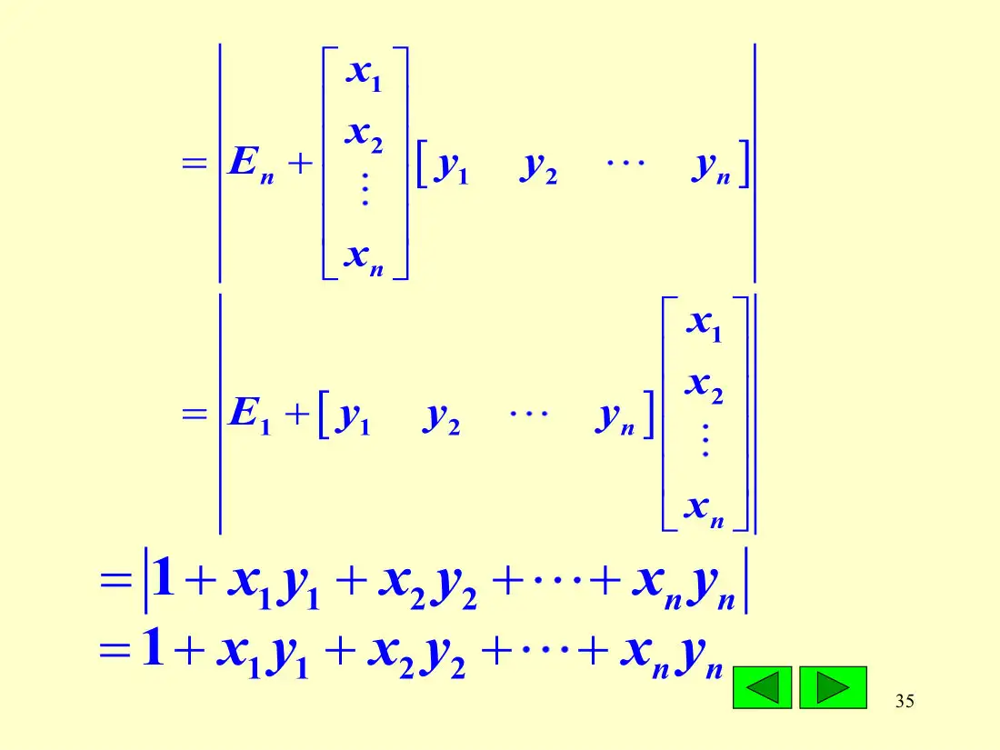

原文：

$$
= \left| E _ {n} + \left[ \begin{array}{c} x _ {1} \\ x _ {2} \\ \vdots \\ x _ {n} \end{array} \right] \left[ \begin{array}{c c c c} y _ {1} & y _ {2} & \dots & y _ {n} \end{array} \right] \right|
$$

$$
\begin{array}{l} = \left| E _ {1} + \left[ \begin{array}{c c c c} y _ {1} & y _ {2} & \dots & y _ {n} \end{array} \right] \left[ \begin{array}{c} x _ {1} \\ x _ {2} \\ \vdots \\ x _ {n} \end{array} \right] \right| \\ = \left| 1 + x _ {1} y _ {1} + x _ {2} y _ {2} + \dots + x _ {n} y _ {n} \right| \\ = 1 + x _ {1} y _ {1} + x _ {2} y _ {2} + \dots + x _ {n} y _ {n} \end{array}
$$

◀ ▶

35
