# 《线性代数与解析几何》第2章 2.4节 矩阵的初等变换与矩阵的秩（课件）

原件的每一页，下面附识别出的文字。

### 2.4 矩阵的初等变换与矩阵的秩

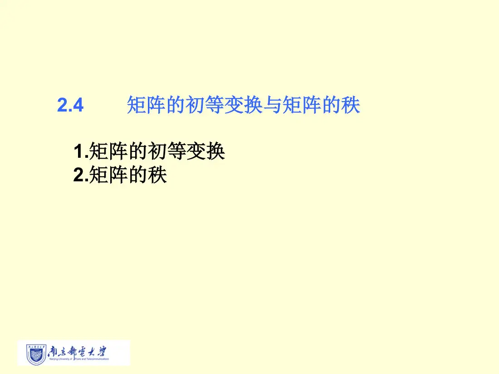

原文：

2.4 矩阵的初等变换与矩阵的秩

1. 矩阵的初等变换

2. 矩阵的秩

南京邮电大学
Nanjing University of Posts and Telecommunications

### 2.4.1 矩阵的初等变换

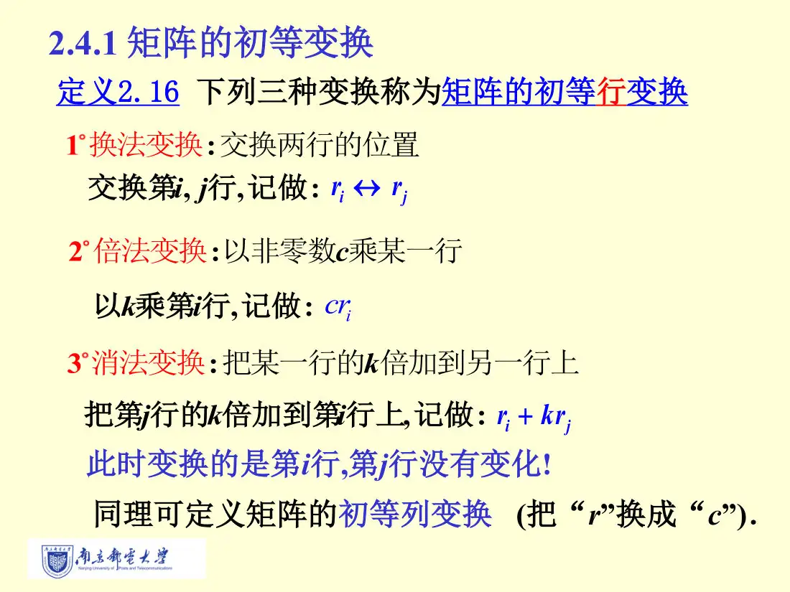

原文：

2.4.1 矩阵的初等变换

定义2.16 下列三种变换称为矩阵的初等行变换

1°换法变换:交换两行的位置

交换第i,j行,记做: $r_{i} \leftrightarrow r_{j}$

2°倍法变换:以非零数c乘某一行

以k乘第i行,记做: $cr_{i}$

$3^{\circ}$ 消法变换: 把某一行的 $k$ 倍加到另一行上

把第j行的k倍加到第i行上,记做: $r_{i}+kr_{j}$

此时变换的是第i行,第j行没有变化!

同理可定义矩阵的初等列变换 (把 “r”换成 “c”).

南京邮电大学
Nanjing University of Posts and Telecommunications

### 通常称 (1) 换法变换 (2) 倍法变换 (3) 消法变换

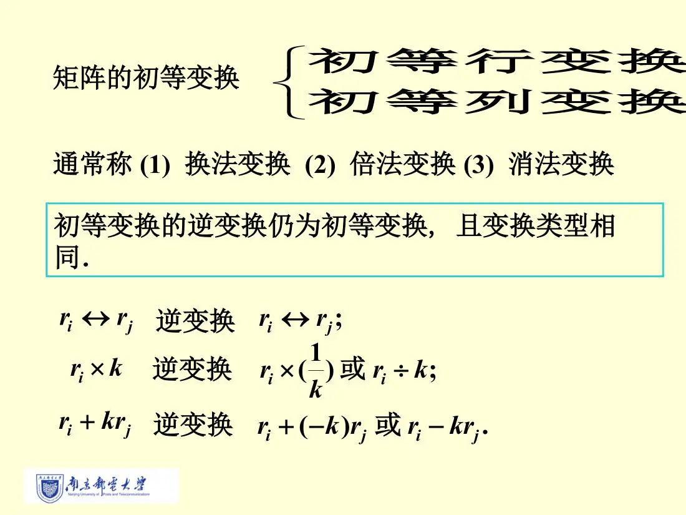

原文：

矩阵的初等变换 $\left\{\begin{array}{l} 初等行变换  \\  初等列变换 \end{array}\right.$

通常称 (1) 换法变换 (2) 倍法变换 (3) 消法变换

初等变换的逆变换仍为初等变换，且变换类型相同.

$r_{i} \leftrightarrow r_{j}$ 逆变换 $r_{i} \leftrightarrow r_{j};$

$r_{i} \times k$ 逆变换 $r_{i} \times \left(\frac{1}{k}\right)$ 或 $r_{i} \div k;$

$r_i + kr_j$ 逆变换 $r_i + (-k)r_j$ 或 $r_i - kr_j$ .

南京邮电大学
Nanjing University of Posts and Telecommunications

### 2.4.2 初等矩阵

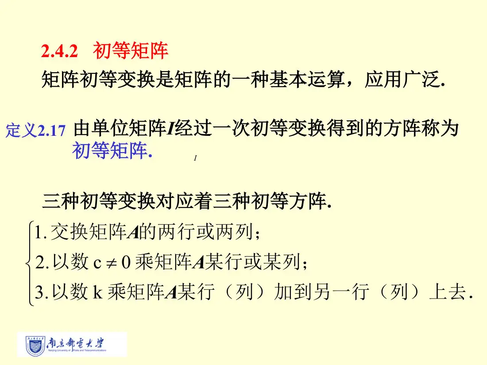

原文：

2.4.2 初等矩阵

矩阵初等变换是矩阵的一种基本运算，应用广泛。

定义2.17 由单位矩阵 $I$ 经过一次初等变换得到的方阵称为初等矩阵.

三种初等变换对应着三种初等方阵.

1. 交换矩阵 $A$ 的两行或两列;

2. 以数 c ≠ 0 乘矩阵 A 某行或某列;

3. 以数 k 乘矩阵 A 某行（列）加到另一行（列）上去.

南京邮电大学
Nanjing University of Posts and Telecommunications

### (1) 交换 $I$ 的两行或两列，得初等对换矩阵。

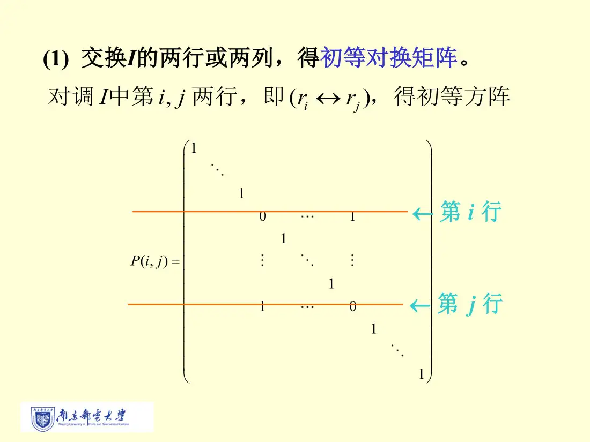

原文：

(1) 交换 $I$ 的两行或两列，得初等对换矩阵。

对调 $I$ 中第 $i, j$ 两行，即 $(r_i \leftrightarrow r_j)$ ，得初等方阵

南京邮电大学
Nanjing University of Posts and Telecommunications

### (2) 以数 $c \neq 0$ 乘 $I$ 某行或某列，得初等倍乘矩阵。

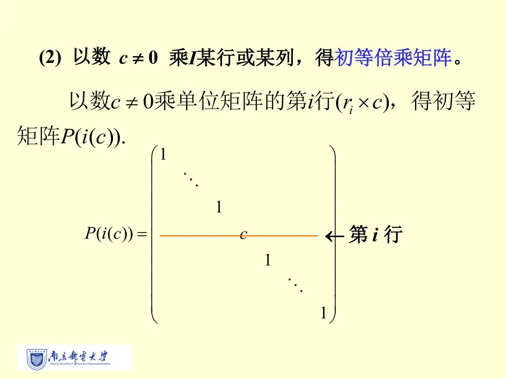

原文：

(2) 以数 $c \neq 0$ 乘 $I$ 某行或某列，得初等倍乘矩阵。

以数 $c \neq 0$ 乘单位矩阵的第 $i$ 行 $(r_i \times c)$ ，得初等矩阵 $P(i(c))$ .

$$
P (i (c)) = \left( \begin{array}{c c c c c c} 1 & & & & & \\ & \ddots & & & & \\ & & 1 & & & \\ & & & c & & \\ & & & & 1 & \\ & & & & & \ddots \\ & & & & & 1 \end{array} \right) \text {第} i \text {行}
$$

南京邮电大学
Nanjing University of Posts and Telecommunications

### $$

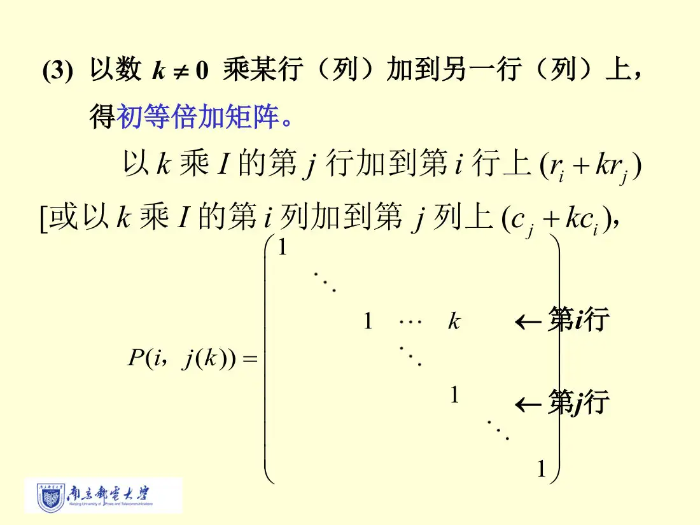

原文：

(3) 以数 $k \neq 0$ 乘某行（列）加到另一行（列）上，得初等倍加矩阵。

以 k 乘 I 的第 j 行加到第 i 行上 $(r_{i} + kr_{j})$ [或以 k 乘 I 的第 i 列加到第 j 列上 $(c_{j} + kc_{i})$ ,

$$
P (i, j (k)) = \left( \begin{array}{c c c c c c} 1 & & & & & \\ & \ddots & & & & \\ & & 1 & \dots & k & \leftarrow \text {第} i \text {行} \\ & & & \ddots & & \\ & & & 1 & \leftarrow \text {第} j \text {行} \\ & & & & \ddots & \\ & & & & 1 \end{array} \right)
$$

南京邮电大学
Nanjing University of Posts and Telecommunications

### 初等矩阵是可逆的，逆矩阵仍为初等矩阵。

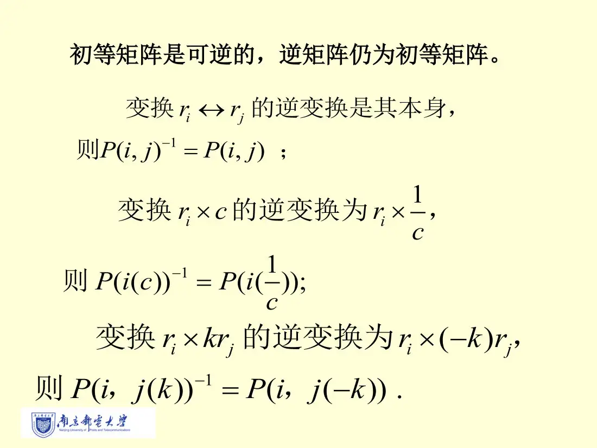

原文：

初等矩阵是可逆的，逆矩阵仍为初等矩阵。

变换 $r_i \leftrightarrow r_j$ 的逆变换是其本身，则 $P(i,j)^{-1} = P(i,j)$ ；

变换 $r_i \times c$ 的逆变换为 $r_i \times \frac{1}{c}$ , 则 $P(i(c))^{-1} = P(i\left(\frac{1}{c}\right))$ ;

变换 $r_i \times kr_j$ 的逆变换为 $r_i \times (-k)r_j$ , 则 $P(i, j(k))^{-1} = P(i, j(-k))$ .

南京邮电大学
Nanjing University of Posts and Telecommunications

### 定理2.3

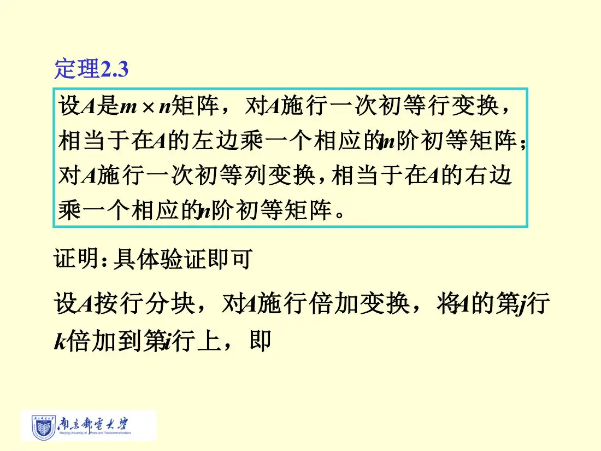

原文：

定理2.3

设A是 $m \times n$ 矩阵，对A施行一次初等行变换，相当于在A的左边乘一个相应的n阶初等矩阵；对A施行一次初等列变换，相当于在A的右边乘一个相应的n阶初等矩阵。

证明: 具体验证即可

设A按行分块，对A施行倍加变换，将A的第j行k倍加到第i行上，即

南京邮电大学
Nanjing University of Posts and Telecommunications

### $$

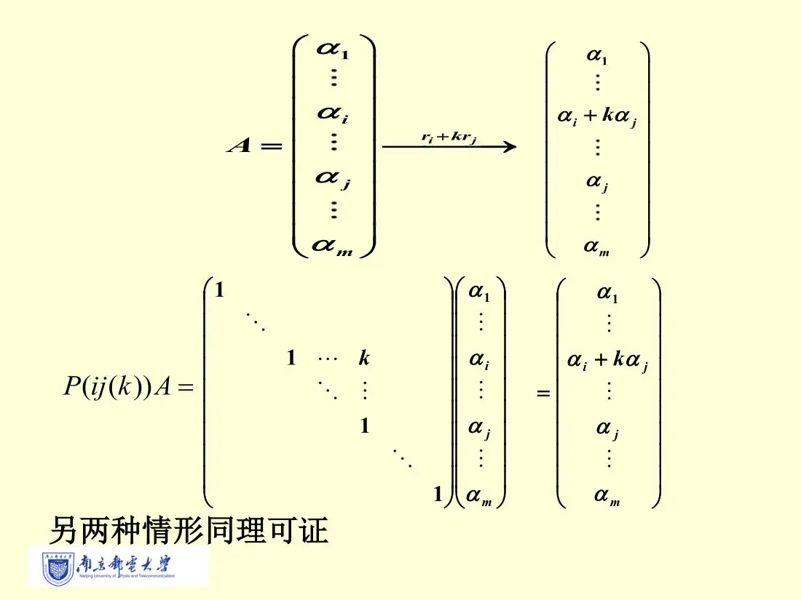

原文：

$$
A = \left( \begin{array}{c} \alpha_ {1} \\ \vdots \\ \alpha_ {i} \\ \vdots \\ \alpha_ {j} \\ \vdots \\ \alpha_ {m} \end{array} \right) \xrightarrow {r _ {i} + k r _ {j}} \left( \begin{array}{c} \alpha_ {1} \\ \vdots \\ \alpha_ {i} + k \alpha_ {j} \\ \vdots \\ \alpha_ {j} \\ \vdots \\ \alpha_ {m} \end{array} \right)
$$

$$
P (i j (k)) A = \left( \begin{array}{c c c c c c c} 1 & & & & & & \\ & \ddots & & & & & \\ & & 1 & \dots & k & & \\ & & & \ddots & \vdots & & \\ & & & & 1 & & \\ & & & & & \ddots & \\ & & & & & & 1 \end{array} \right) \left( \begin{array}{c} \alpha_ {1} \\ \vdots \\ \alpha_ {i} \\ \vdots \\ \alpha_ {j} \\ \vdots \\ \alpha_ {m} \end{array} \right) = \left( \begin{array}{c} \alpha_ {1} \\ \vdots \\ \alpha_ {i} + k \alpha_ {j} \\ \vdots \\ \alpha_ {j} \\ \vdots \\ \alpha_ {m} \end{array} \right)
$$

另两种情形同理可证

南京邮电大学
Nanjing University of Posts and Telecommunications

### 一般记法:

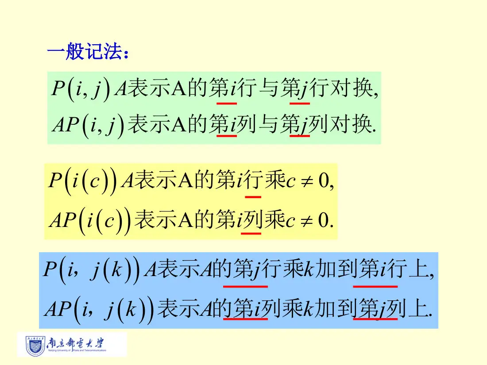

原文：

一般记法:

$P(i,j)$ A表示A的第i行与第j行对换, $AP(i,j)$ 表示A的第i列与第j列对换.

$P(i(c))$ A表示A的第i行乘 $c\neq0$ , $AP(i(c))$ 表示A的第i列乘 $c\neq0$ .

$P(i, j(k))$ A表示A的第j行乘k加到第i行上, $AP(i, j(k))$ 表示A的第i列乘k加到第j列上.

南京邮电大学
Nanjing University of Posts and Telecommunications

### 2、行阶梯形矩阵、行最简矩阵、标准形

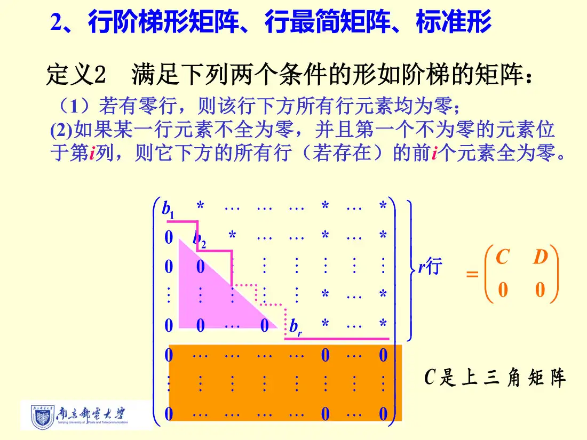

原文：

2、行阶梯形矩阵、行最简矩阵、标准形

定义2 满足下列两个条件的形如阶梯的矩阵:

(1) 若有零行，则该行下方所有行元素均为零;

(2)如果某一行元素不全为零，并且第一个不为零的元素位于第i列，则它下方的所有行（若存在）的前i个元素全为零。

$$
\left. \begin{array}{l} \left( \begin{array}{c c c c c c c c} b _ {1} & * & \dots & \dots & \dots & * & \dots & * \\ 0 & b _ {2} & * & \dots & \dots & * & \dots & * \\ 0 & 0 & \vdots & \vdots & \vdots & \vdots & \vdots & \vdots \\ \vdots & \vdots & \vdots & \vdots & \vdots & * & \dots & * \\ 0 & 0 & \dots & 0 & b _ {r} & * & \dots & * \\ \hline 0 & \dots & \dots & \dots & \dots & 0 & \dots & 0 \\ \vdots & \vdots & \vdots & \vdots & \vdots & \vdots & \vdots \\ 0 & \dots & \dots & \dots & \dots & 0 & \dots & 0 \end{array} \right) \end{array} \right\} r \text {行} = \left( \begin{array}{c c} C & D \\ 0 & 0 \end{array} \right)
$$

南京邮电大学
Nanjing University of Posts and Telecommunications

### 定义 行最简矩阵是指在阶梯形中

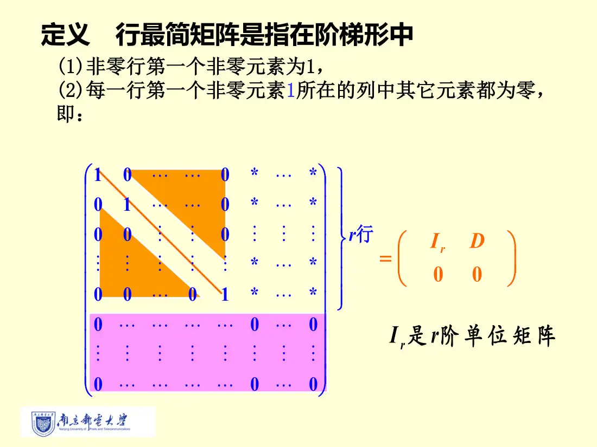

原文：

定义 行最简矩阵是指在阶梯形中

(1)非零行第一个非零元素为1,

(2) 每一行第一个非零元素1所在的列中其它元素都为零, 即:

$$
\left. \begin{array}{c} {\left( \begin{array}{c c c c c c c c} {1} & {0} & {\dots} & {\dots} & {0} & {*} & {\dots} & {*} \\ {0} & {1} & {\dots} & {\dots} & {0} & {*} & {\dots} & {*} \\ {0} & {0} & {\vdots} & {\vdots} & {0} & {\vdots} & {\vdots} & {\vdots} \\ {\vdots} & {\vdots} & {\vdots} & {\vdots} & {\vdots} & {*} & {\dots} & {*} \\ {0} & {0} & {\dots} & {0} & {1} & {*} & {\dots} & {*} \end{array} \right)} \\ {\left( \begin{array}{c c c c c c c c} {0} & {\dots} & {\dots} & {\dots} & {\dots} & {0} & {\dots} & {0} \\ {\vdots} & {\vdots} & {\vdots} & {\vdots} & {\vdots} & {\vdots} & {\vdots} \\ {0} & {\dots} & {\dots} & {\dots} & {\dots} & {0} & {\dots} & {0} \end{array} \right)} \end{array} \right\} r \text {行} = \left( \begin{array}{c c c c c c c c} {I _ {r}} & {D} \\ {0} & {0} \end{array} \right) I _ {r} \text {是} r \text {阶单位矩阵}
$$

南京邮电大学
Nanjing University of Posts and Telecommunications

### 南京邮电大学

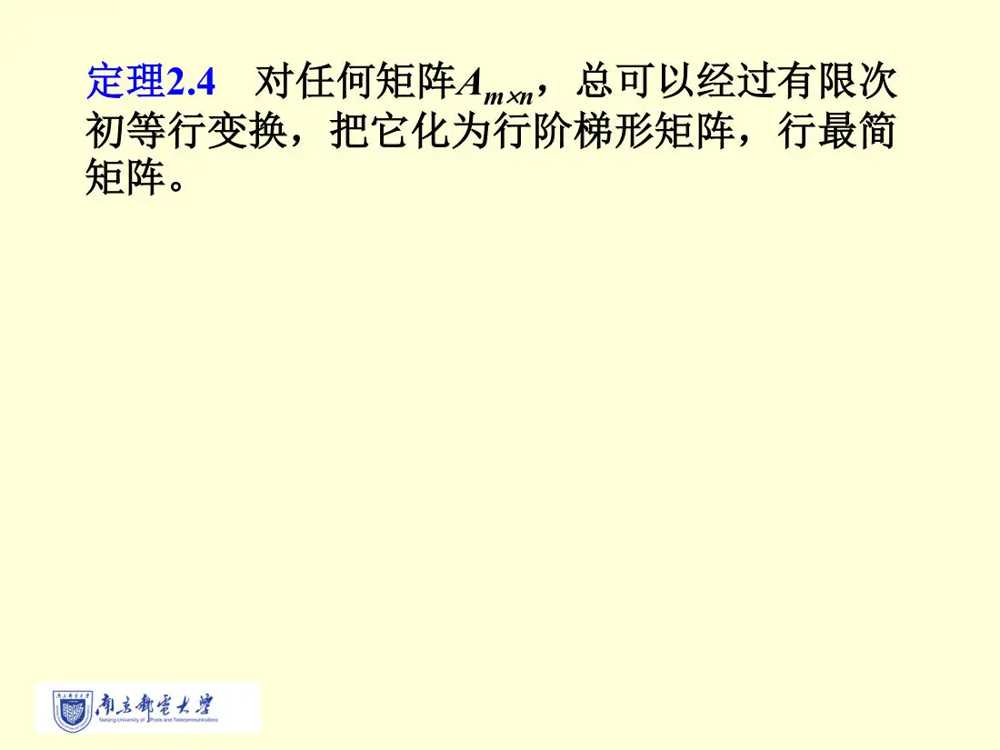

原文：

定理2.4 对任何矩阵 $A_{m \times n}$ ，总可以经过有限次初等行变换，把它化为行阶梯形矩阵，行最简矩阵。

南京邮电大学
Nanjing University of Posts and Telecommunications

### 定理2.5 任何一个 $m \times n$ 矩阵A都与一个形式为

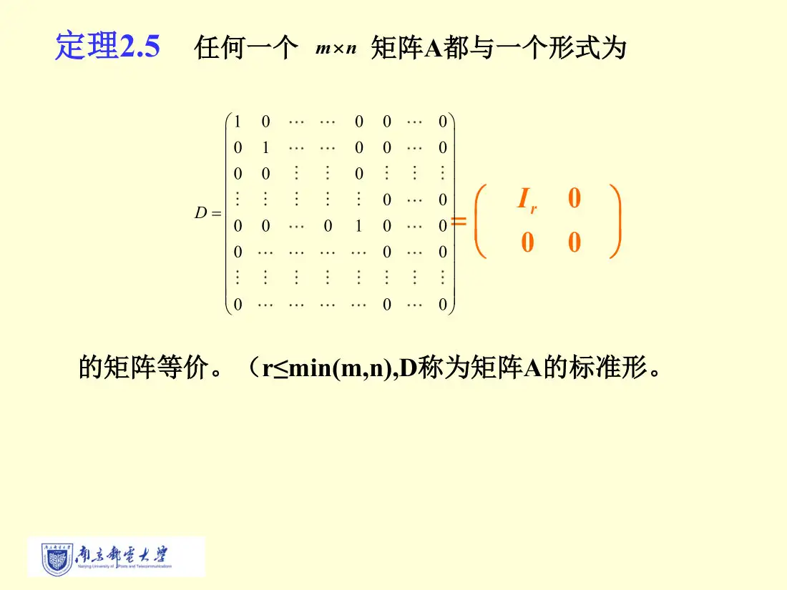

原文：

定理2.5 任何一个 $m \times n$ 矩阵A都与一个形式为

$$
D = \left( \begin{array}{c c c c c c c c} 1 & 0 & \dots & \dots & 0 & 0 & \dots & 0 \\ 0 & 1 & \dots & \dots & 0 & 0 & \dots & 0 \\ 0 & 0 & \vdots & \vdots & 0 & \vdots & \vdots & \vdots \\ \vdots & \vdots & \vdots & \vdots & \vdots & 0 & \dots & 0 \\ 0 & 0 & \dots & 0 & 1 & 0 & \dots & 0 \\ 0 & \dots & \dots & \dots & \dots & 0 & \dots & 0 \\ \vdots & \vdots & \vdots & \vdots & \vdots & \vdots & \vdots & \vdots \\ 0 & \dots & \dots & \dots & \dots & 0 & \dots & 0 \end{array} \right) = \left( \begin{array}{c c c c} I _ {r} & 0 \\ 0 & 0 \end{array} \right)
$$

的矩阵等价。（r≤min(m,n),D称为矩阵A的标准形。

南京邮电大学
Nanjing University of Posts and Telecommunications

### 2.4.3 初等变换求逆矩阵

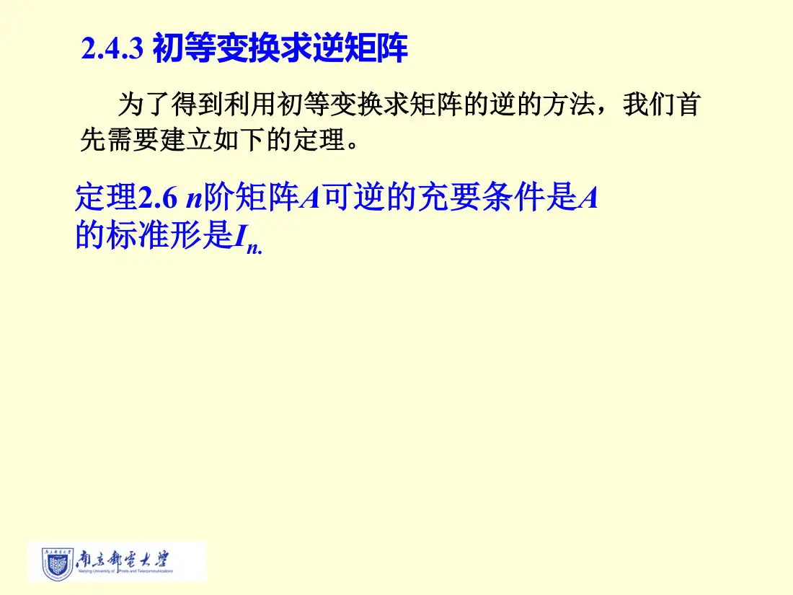

原文：

2.4.3 初等变换求逆矩阵

为了得到利用初等变换求矩阵的逆的方法，我们首先需要建立如下的定理。

定理2.6 n阶矩阵A可逆的充要条件是A的标准形是 $I_{n}$ .

南京邮电大学
Nanjing University of Posts and Telecommunications

### 由定理2.6知道

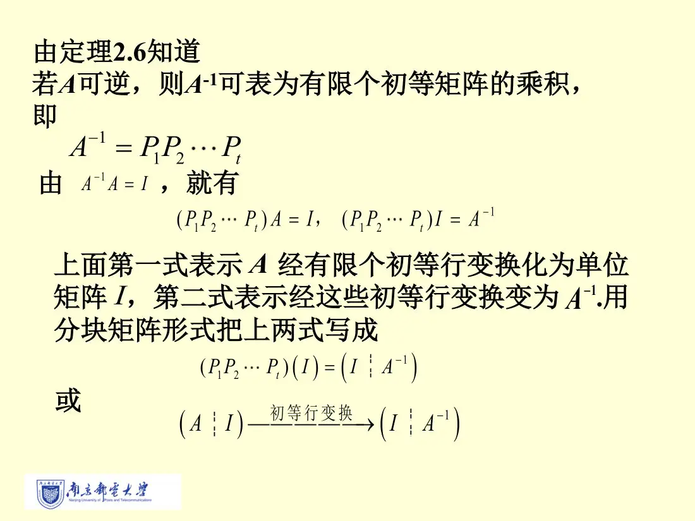

原文：

由定理2.6知道

若 $A$ 可逆，则 $A^{-1}$ 可表为有限个初等矩阵的乘积，即

$$
A ^ {- 1} = P _ {1} P _ {2} \dots P _ {t}
$$

由 $A^{-1}A = I$ ，就有

$$
(P _ {1} P _ {2} \dots P _ {t}) A = I, (P _ {1} P _ {2} \dots P _ {t}) I = A ^ {- 1}
$$

上面第一式表示 A 经有限个初等行变换化为单位矩阵 I，第二式表示经这些初等行变换变为 $A^{-1}$ .用分块矩阵形式把上两式写成

$$
\left(P _ {1} P _ {2} \dots P _ {t}\right) (I) = \left(I \mid A ^ {- 1}\right)
$$

或

$$
(A \mid I) \xrightarrow {\text {初等行变换}} (I \mid A ^ {- 1})
$$

南京邮电大学
Nanjing University of Posts and Telecommunications

### 利用初等行变换求逆阵的方法，还可用于求矩阵 $A^{-1}B$ .

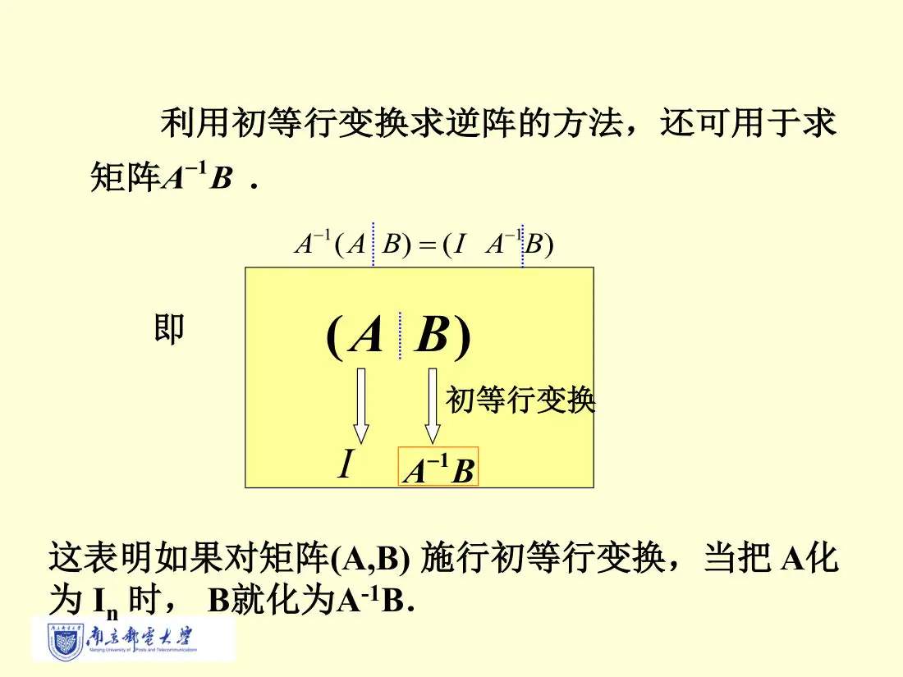

原文：

利用初等行变换求逆阵的方法，还可用于求矩阵 $A^{-1}B$ .

即

$$
\begin{array}{c} A ^ {- 1} (A \mid B) = (I A ^ {- 1} B) \\ (A \mid B) \\ \Biggl \downarrow \quad \Biggl \downarrow \text { 初等行变换 } \\ I \quad A ^ {- 1} B \end{array}
$$

这表明如果对矩阵(A,B)施行初等行变换，当把 A化为 $I_{n}$ 时，B就化为 $A^{-1}B$ .

南京邮电大学
Nanjing University of Posts and Telecommunications

### 例10 求矩阵X，使 AX=B，其中

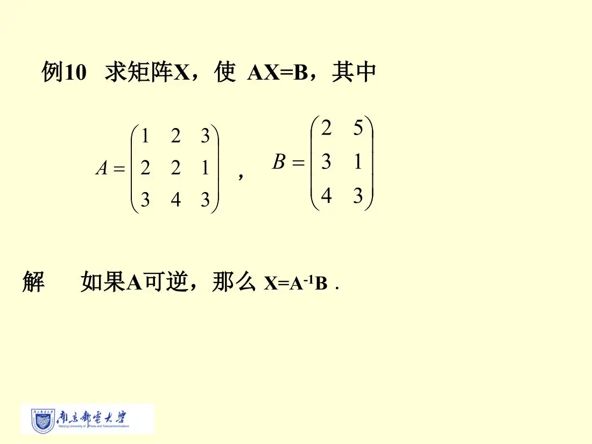

原文：

例10 求矩阵X，使 AX=B，其中

$$
A = \left( \begin{array}{l l l} 1 & 2 & 3 \\ 2 & 2 & 1 \\ 3 & 4 & 3 \end{array} \right), \quad B = \left( \begin{array}{l l} 2 & 5 \\ 3 & 1 \\ 4 & 3 \end{array} \right)
$$

解 如果A可逆，那么 $X=A^{-1}B$

南京邮电大学
Nanjing University of Posts and Telecommunications

### $$

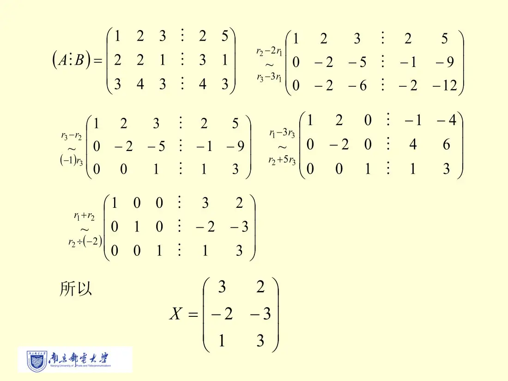

原文：

$$
(A \vdots B) = \left( \begin{array}{c c c c c c} 1 & 2 & 3 & \vdots & 2 & 5 \\ 2 & 2 & 1 & \vdots & 3 & 1 \\ 3 & 4 & 3 & \vdots & 4 & 3 \end{array} \right) \quad \underset {r _ {3} - 3 r _ {1}} {\sim} \left( \begin{array}{c c c c c c} 1 & 2 & 3 & \vdots & 2 & 5 \\ 0 & - 2 & - 5 & \vdots & - 1 & - 9 \\ 0 & - 2 & - 6 & \vdots & - 2 & - 1 2 \end{array} \right)
$$

$$
\underset {(- 1) r _ {3}} {\overset {r _ {3} - r _ {2}} {\sim}} \left( \begin{array}{c c c c c c} 1 & 2 & 3 & \vdots & 2 & 5 \\ 0 & - 2 & - 5 & \vdots & - 1 & - 9 \\ 0 & 0 & 1 & \vdots & 1 & 3 \end{array} \right) \quad \underset {r _ {2} + 5 r _ {3}} {\overset {r _ {1} - 3 r _ {3}} {\sim}} \left( \begin{array}{c c c c c c} 1 & 2 & 0 & \vdots & - 1 & - 4 \\ 0 & - 2 & 0 & \vdots & 4 & 6 \\ 0 & 0 & 1 & \vdots & 1 & 3 \end{array} \right)
$$

$$
\underset {r _ {2} \div (- 2)} {\overset {r _ {1} + r _ {2}} {\sim}} \left( \begin{array}{c c c c c c} 1 & 0 & 0 & \vdots & 3 & 2 \\ 0 & 1 & 0 & \vdots & - 2 & - 3 \\ 0 & 0 & 1 & \vdots & 1 & 3 \end{array} \right)
$$

所以

$$
X = \left( \begin{array}{c c} 3 & 2 \\ - 2 & - 3 \\ 1 & 3 \end{array} \right)
$$

南京邮电大学
Nanjing University of Posts and Telecommunications

### 南京邮电大学

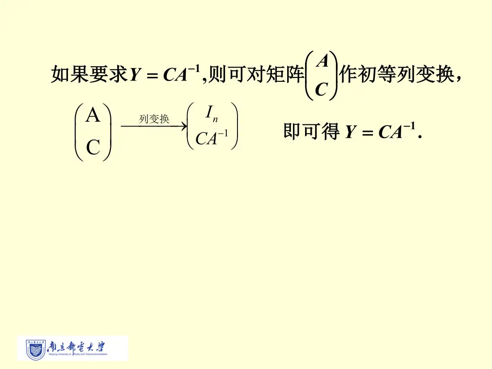

原文：

如果要求 $Y = CA^{-1}$ ，则可对矩阵 $\left( \begin{array}{c}A\\ C \end{array} \right)$ 作初等列变换， $\left( \begin{array}{c}\mathrm{A}\\ \mathrm{C} \end{array} \right)\xrightarrow{\text{列变换}} \left( \begin{array}{c}I_n\\ CA^{-1} \end{array} \right)$ 即可得 $Y = CA^{-1}$ 例2.18求解矩阵方程 AX=A+X,其中 $A=\begin{pmatrix}2&2&0\\2&1&3\\0&1&0\end{pmatrix}$ 解 把所给方程变形为 $(A-I)X=A$

南京邮电大学
Nanjing University of Posts and Telecommunications

### $$

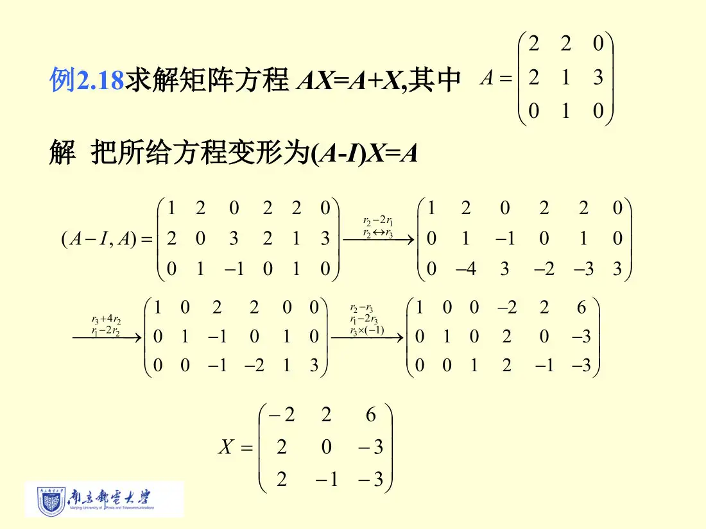

原文：

$$
(A - I, A) = \left( \begin{array}{c c c c c c} 1 & 2 & 0 & 2 & 2 & 0 \\ 2 & 0 & 3 & 2 & 1 & 3 \\ 0 & 1 & - 1 & 0 & 1 & 0 \end{array} \right) \xrightarrow {r _ {2} - 2 r _ {1}} \left( \begin{array}{c c c c c c} 1 & 2 & 0 & 2 & 2 & 0 \\ 0 & 1 & - 1 & 0 & 1 & 0 \\ 0 & - 4 & 3 & - 2 & - 3 & 3 \end{array} \right)
$$

$$
\xrightarrow { \begin{array}{c} r _ {3} + 4 r _ {2} \\ r _ {1} - 2 r _ {2} \end{array} } \left( \begin{array}{c c c c c c} 1 & 0 & 2 & 2 & 0 & 0 \\ 0 & 1 & - 1 & 0 & 1 & 0 \\ 0 & 0 & - 1 & - 2 & 1 & 3 \end{array} \right) \xrightarrow { \begin{array}{c} r _ {2} - r _ {3} \\ r _ {1} - 2 r _ {3} \\ r _ {3} \times (- 1) \end{array} } \left( \begin{array}{c c c c c c} 1 & 0 & 0 & - 2 & 2 & 6 \\ 0 & 1 & 0 & 2 & 0 & - 3 \\ 0 & 0 & 1 & 2 & - 1 & - 3 \end{array} \right)
$$

$$
X = \left( \begin{array}{c c c} - 2 & 2 & 6 \\ 2 & 0 & - 3 \\ 2 & - 1 & - 3 \end{array} \right)
$$

南京邮电大学
Nanjing University of Posts and Telecommunications

### 2.4.2 矩阵的秩

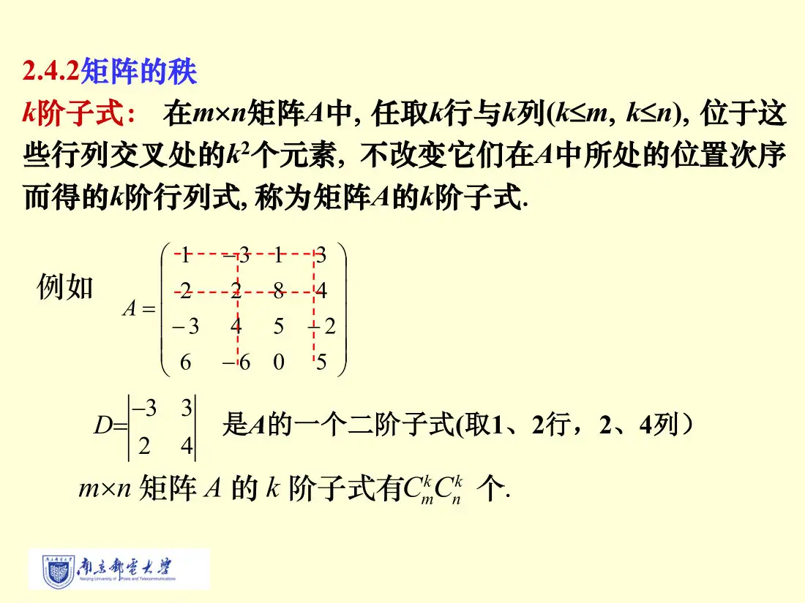

原文：

2.4.2 矩阵的秩

k阶子式：在 $m \times n$ 矩阵A中，任取k行与k列 $(k \leq m, k \leq n)$ ，位于这些行列交叉处的 $k^{2}$ 个元素，不改变它们在A中所处的位置次序而得的k阶行列式，称为矩阵A的k阶子式.

例如

$$
A = \left( \begin{array}{c c c c} - 1 & - 3 & - 1 & - 3 \\ - 2 & - 2 & - 8 & - 4 \\ - 3 & 4 & 5 & - 2 \\ 6 & - 6 & 0 & 5 \end{array} \right)
$$

$D=\begin{vmatrix}-3&3\\2&4\end{vmatrix}$ 是A的一个二阶子式(取1、2行，2、4列) $m \times n$ 矩阵 A 的 k 阶子式有 $C_{m}^{k}C_{n}^{k}$ 个.

南京邮电大学
Nanjing University of Posts and Telecommunications

### 规定：零矩阵的秩是0，从而

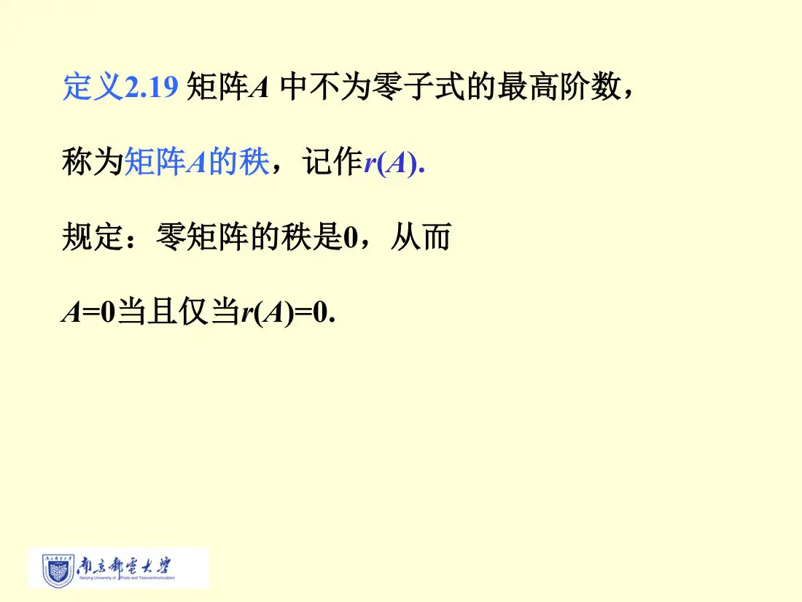

原文：

定义2.19 矩阵A 中不为零子式的最高阶数，称为矩阵A的秩，记作 $r(A)$ .

规定：零矩阵的秩是0，从而
A=0 当且仅当 $r(A)=0$ .

南京邮电大学
Nanjing University of Posts and Telecommunications

### 由定义不难得到:

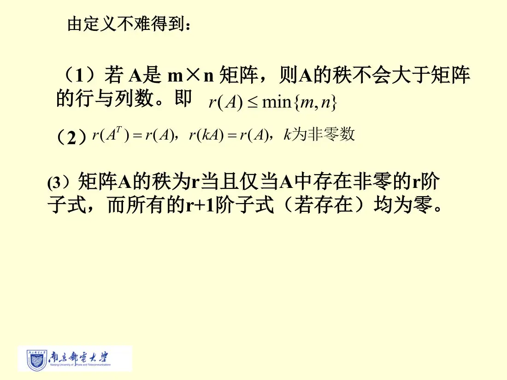

原文：

由定义不难得到:

(1) 若 $\mathbf{A}$ 是 $\mathbf{m} \times \mathbf{n}$ 矩阵, 则 $\mathbf{A}$ 的秩不会大于矩阵的行与列数。即 $r(A) \leq \min \{m, n\}$

(2) $r(A^{T}) = r(A), r(kA) = r(A), k$ 为非零数

(3) 矩阵A的秩为r当且仅当A中存在非零的r阶子式，而所有的 $r+1$ 阶子式（若存在）均为零。

南京邮电大学
Nanjing University of Posts and Telecommunications

### 南京邮电大学

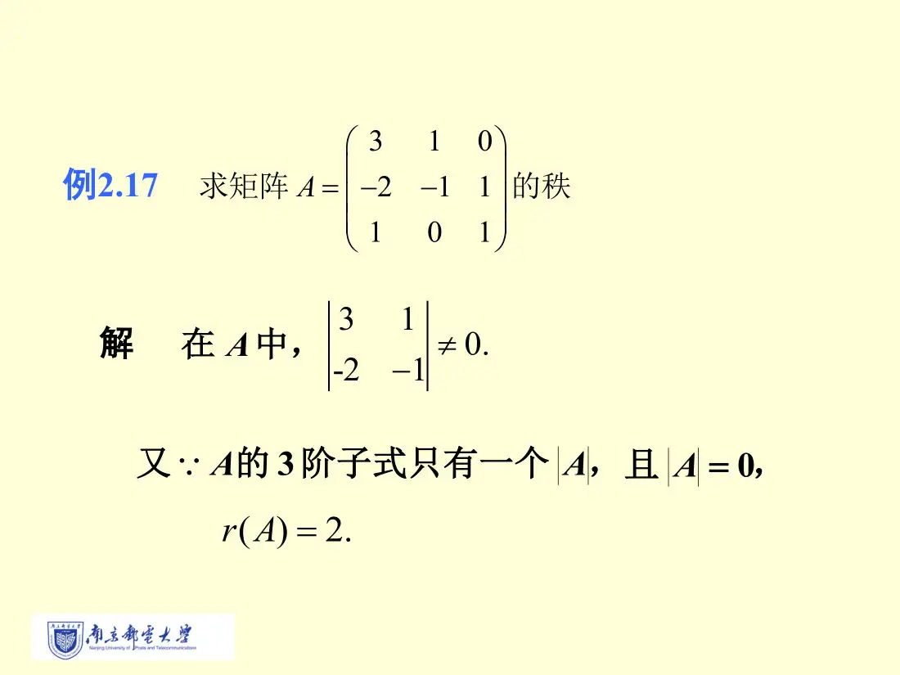

原文：

例2.17 求矩阵 $A=\begin{pmatrix}3&1&0\\-2&-1&1\\1&0&1\end{pmatrix}$ 的秩
解 在 A 中， $\begin{vmatrix}3 & 1 \\ -2 & -1\end{vmatrix}\neq0.$ 又∵A的3阶子式只有一个|A|，且|A|=0， $r(A)=2.$

南京邮电大学
Nanjing University of Posts and Telecommunications

### 例2.18

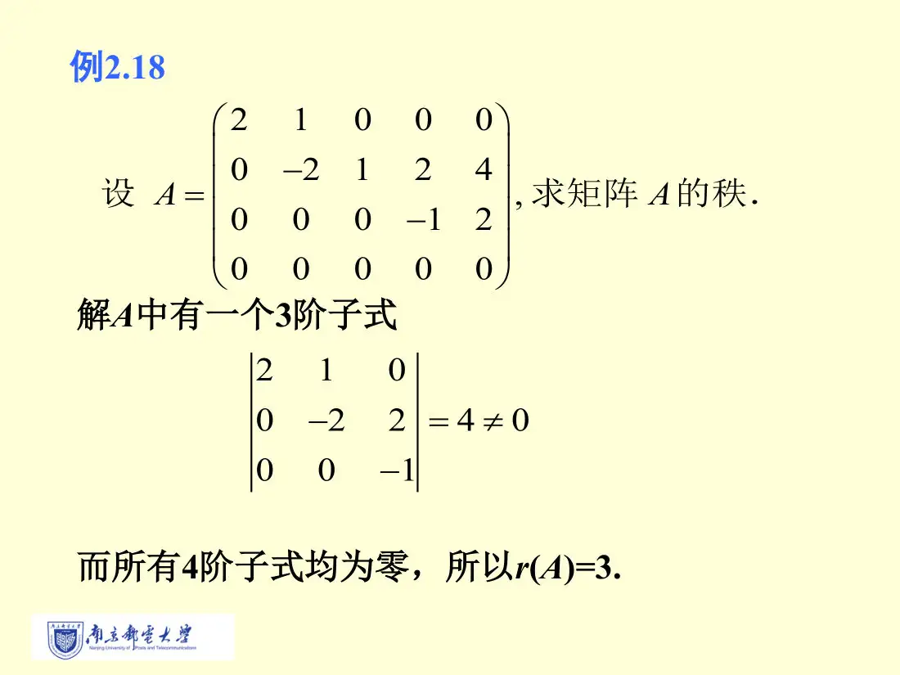

原文：

例2.18

设 $A = \begin{pmatrix} 2 & 1 & 0 & 0 & 0 \\ 0 & -2 & 1 & 2 & 4 \\ 0 & 0 & 0 & -1 & 2 \\ 0 & 0 & 0 & 0 & 0 \end{pmatrix}$ , 求矩阵 $A$ 的秩.

解 $A$ 中有一个3阶子式

$$
\left| \begin{array}{c c c} 2 & 1 & 0 \\ 0 & - 2 & 2 \\ 0 & 0 & - 1 \end{array} \right| = 4 \neq 0
$$

而所有4阶子式均为零，所以 $r(A)=3$ .

南京邮电大学
Nanjing University of Posts and Telecommunications

### 矩阵秩的计算

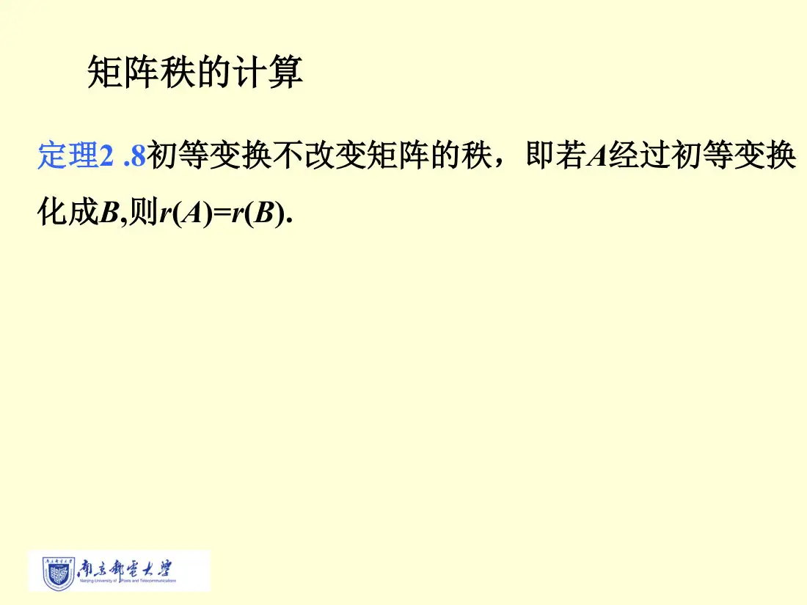

原文：

矩阵秩的计算

定理2.8初等变换不改变矩阵的秩，即若A经过初等变换化成B,则 $r(A)=r(B)$ .

南京邮电大学
Nanjing University of Posts and Telecommunications

### $$

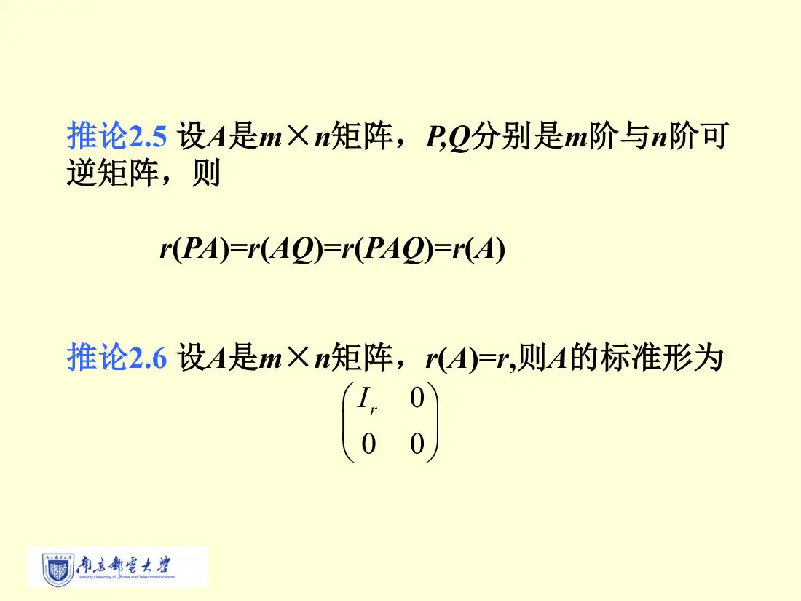

原文：

推论2.5 设 $A$ 是 $m \times n$ 矩阵， $P, Q$ 分别是 $m$ 阶与 $n$ 阶可逆矩阵，则

$$
r (P A) = r (A Q) = r (P A Q) = r (A)
$$

推论2.6 设A是 $m \times n$ 矩阵， $r(A)=r$ ，则A的标准形为

$$
\left( \begin{array}{c c} I _ {r} & 0 \\ 0 & 0 \end{array} \right)
$$

南京邮电大学
Nanjing University of Posts and Telecommunications

### 求矩阵秩的方法：

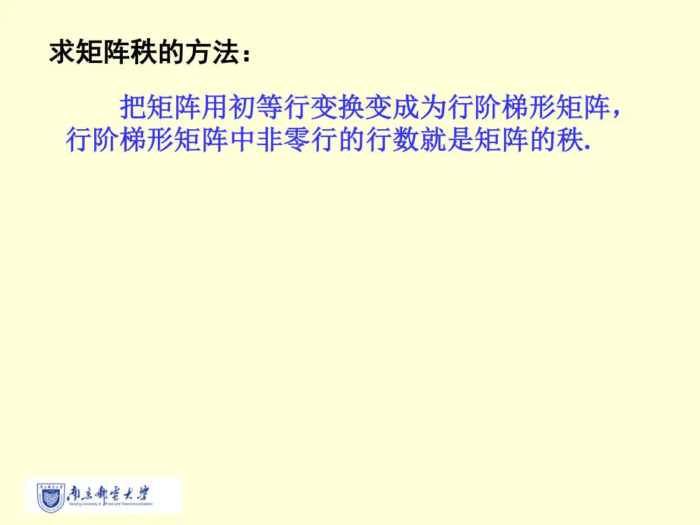

原文：

求矩阵秩的方法：

把矩阵用初等行变换变成为行阶梯形矩阵，行阶梯形矩阵中非零行的行数就是矩阵的秩.

南京邮电大学
Nanjing University of Posts and Telecommunications

### 例2.20 问t为何值时,矩阵A有最小秩,并求这个秩.其中

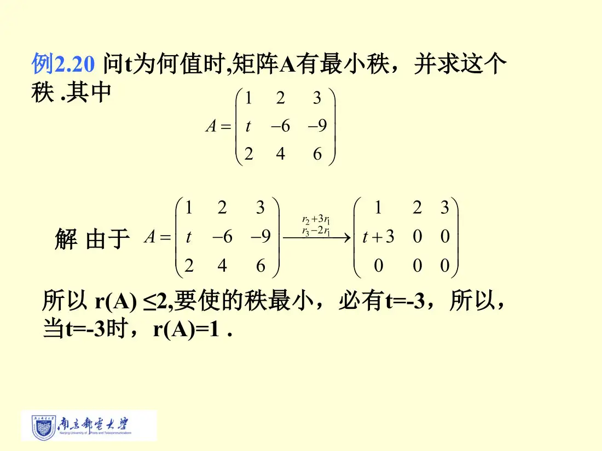

原文：

例2.20 问t为何值时,矩阵A有最小秩,并求这个秩.其中
(1 2 3 )

$$
A = \left( \begin{array}{c c c} 1 & 2 & 3 \\ t & - 6 & - 9 \\ 2 & 4 & 6 \end{array} \right)
$$

解 由于

$$
A = \left( \begin{array}{c c c} 1 & 2 & 3 \\ t & - 6 & - 9 \\ 2 & 4 & 6 \end{array} \right) \xrightarrow {r _ {2} + 3 r _ {1}} \left( \begin{array}{c c c} 1 & 2 & 3 \\ t + 3 & 0 & 0 \\ 0 & 0 & 0 \end{array} \right)
$$

所以 $r(A) \leq 2$ , 要使的秩最小，必有 t = -3，所以，当 t = -3 时， $r(A) = 1$ .

南京邮电大学
Nanjing University of Posts and Telecommunications
