# 《线性代数与解析几何》第2章 矩阵（2.2 矩阵的行列式与逆）课件

原件的每一页，下面附识别出的文字。

### 2.2.1 方阵的行列式

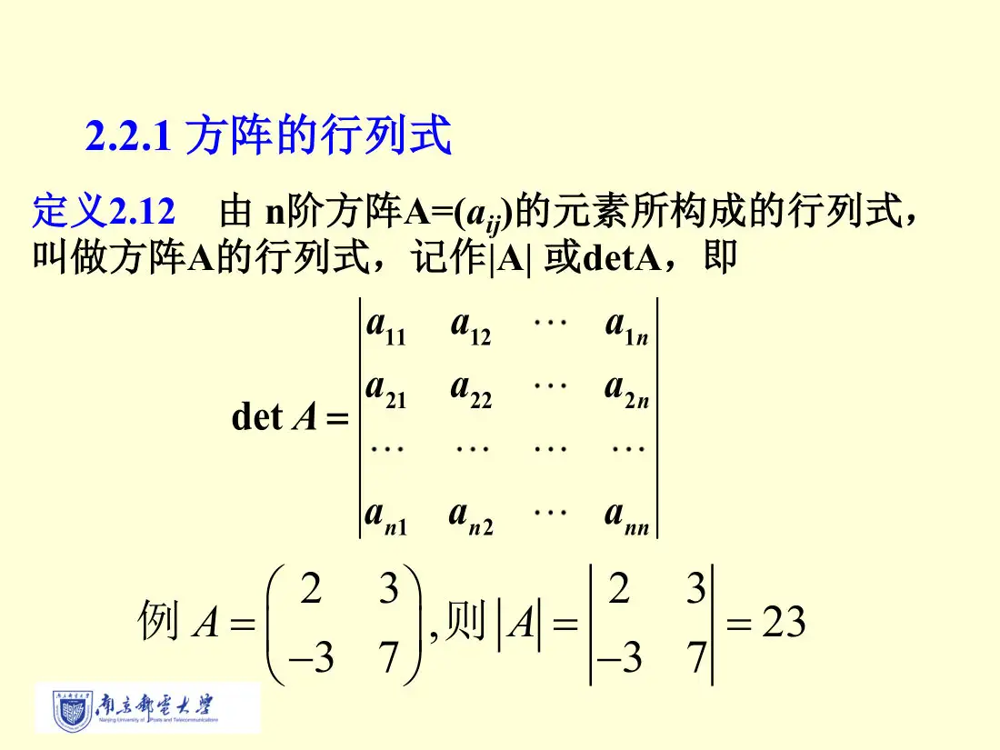

原文：

2.2.1 方阵的行列式

定义2.12 由 n阶方阵 $A=(a_{ij})$ 的元素所构成的行列式，叫做方阵A的行列式，记作 $|A|$ 或detA，即

$$
\det A = \left| \begin{array}{l l l l} a _ {1 1} & a _ {1 2} & \dots & a _ {1 n} \\ a _ {2 1} & a _ {2 2} & \dots & a _ {2 n} \\ \dots & \dots & \dots & \dots \\ a _ {n 1} & a _ {n 2} & \dots & a _ {n n} \end{array} \right|
$$

例 $A=\begin{pmatrix}2&3\\-3&7\end{pmatrix}$ ，则 $\left|A\right|=\begin{vmatrix}2&3\\-3&7\end{vmatrix}=23$

南京邮电大学
Nanjing University of Posts and Telecommunications

### n阶方阵的行列式运算满足下列运算律

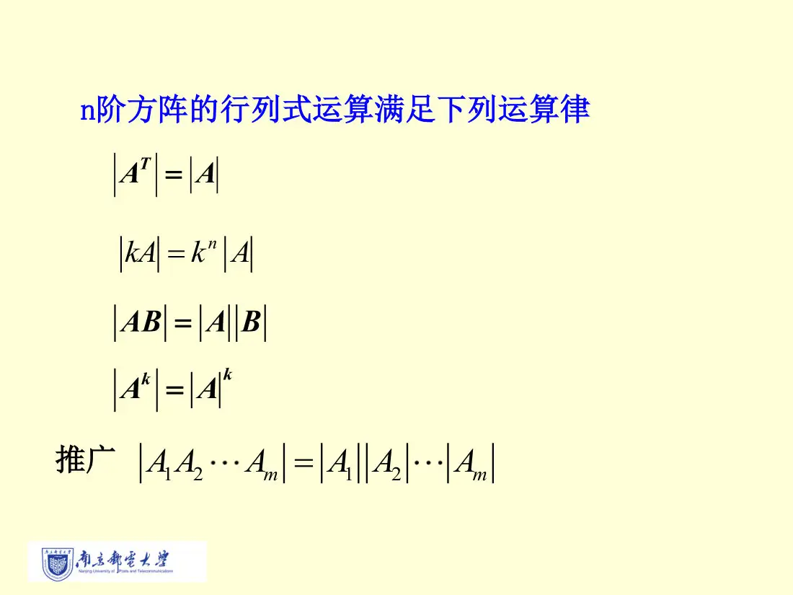

原文：

n阶方阵的行列式运算满足下列运算律

$$
\left| \boldsymbol {A} ^ {T} \right| = \left| \boldsymbol {A} \right|
$$

$$
\left| k A \right| = k ^ {n} \left| A \right|
$$

$$
\left| \boldsymbol {A} \boldsymbol {B} \right| = \left| \boldsymbol {A} \right| \left| \boldsymbol {B} \right|
$$

$$
\left| \boldsymbol {A} ^ {k} \right| = \left| \boldsymbol {A} \right| ^ {k}
$$

推广 $\left|A_{1}A_{2}\cdots A_{m}\right|=\left|A_{1}\right|\left|A_{2}\right|\cdots\left|A_{m}\right|$

南京邮电大学
Nanjing University of Posts and Telecommunications

### 奇异矩阵与非奇异矩阵

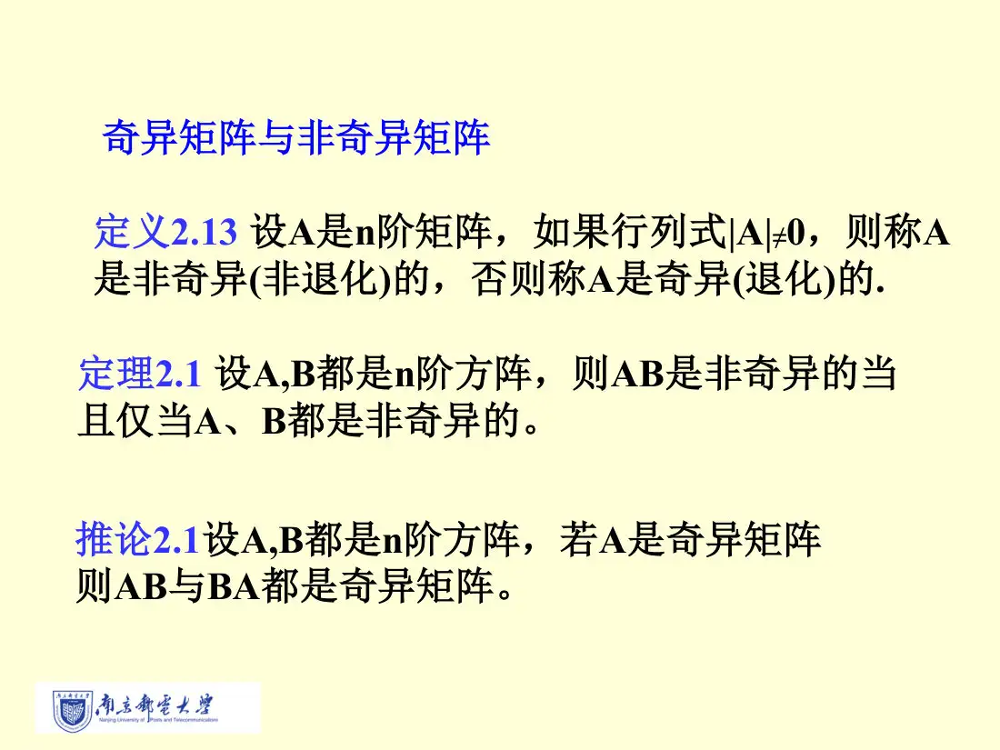

原文：

奇异矩阵与非奇异矩阵

定义2.13 设A是n阶矩阵，如果行列式 $|A|\neq0$ ，则称A是非奇异(非退化)的，否则称A是奇异(退化)的。

定理2.1 设A,B都是n阶方阵，则AB是非奇异的当且仅当A、B都是非奇异的。

推论2.1设A,B都是n阶方阵，若A是奇异矩阵则AB与BA都是奇异矩阵。

南京邮电大学
Nanjing University of Posts and Telecommunications

### 2.1.2 逆矩阵的定义及性质

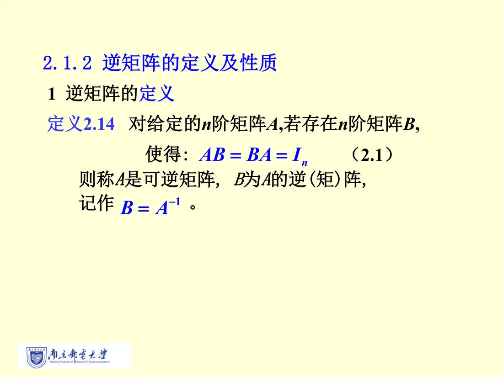

原文：

2.1.2 逆矩阵的定义及性质

1 逆矩阵的定义

定义2.14 对给定的n阶矩阵A,若存在n阶矩阵B,

使得： $AB = BA = I_{n}$

(2.1)

则称A是可逆矩阵，B为A的逆(矩)阵，

记作 $B = A^{-1}$ 。

南京邮电大学
Nanjing University of Posts and Telecommunications

### 由定义可知:

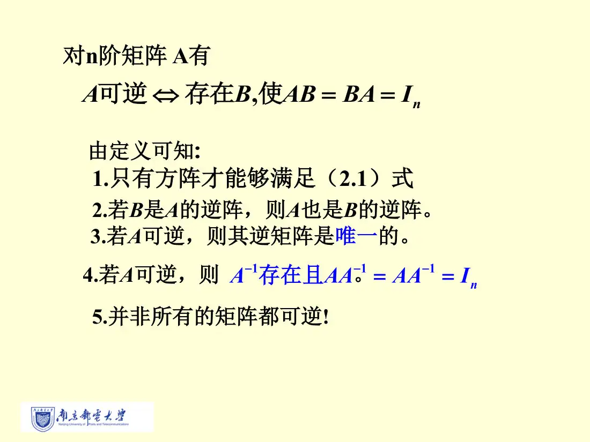

原文：

对n阶矩阵 A有 A可逆 $\Leftrightarrow$ 存在B,使AB = BA = $I_{n}$

由定义可知:

1. 只有方阵才能够满足（2.1）式

2. 若 B 是 A 的逆阵，则 A 也是 B 的逆阵。

3. 若 $A$ 可逆，则其逆矩阵是唯一的。

4. 若 A 可逆，则 $A^{-1}$ 存在且 $AA^{\circ}=AA^{-1}=I_{n}$

5.并非所有的矩阵都可逆!

南京邮电大学
Nanjing University of Posts and Telecommunications

### 第 6 页

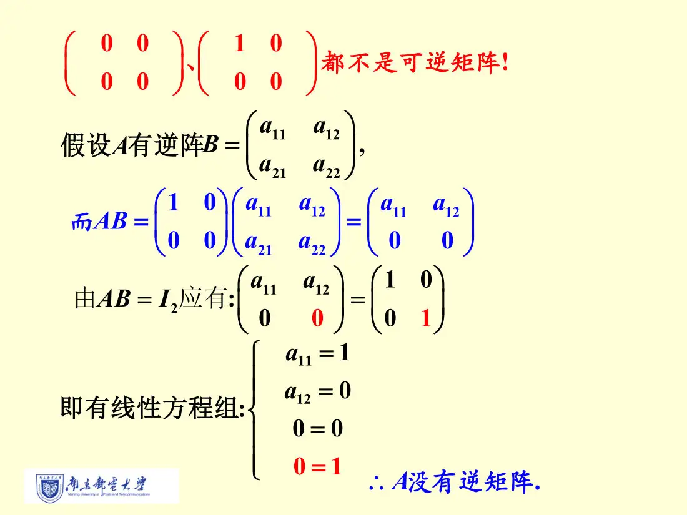

原文：

$\left( \begin{array}{ll}0 & 0\\ 0 & 0 \end{array} \right),\left( \begin{array}{ll}1 & 0\\ 0 & 0 \end{array} \right)$ 都不是可逆矩阵！假设 $A$ 有逆阵 $B = \left( \begin{array}{ll}a_{11} & a_{12}\\ a_{21} & a_{22} \end{array} \right),$ 而 $AB = \left( \begin{array}{ll}1 & 0\\ 0 & 0 \end{array} \right)\left( \begin{array}{ll}a_{11} & a_{12}\\ a_{21} & a_{22} \end{array} \right) = \left( \begin{array}{ll}a_{11} & a_{12}\\ 0 & 0 \end{array} \right)$ 由 $AB = I_2$ 应有： $\left( \begin{array}{ll}a_{11} & a_{12}\\ 0 & 0 \end{array} \right) = \left( \begin{array}{ll}1 & 0\\ 0 & 1 \end{array} \right)$ 即有线性方程组： $\left\{ \begin{array}{l}a_{11} = 1\\ a_{12} = 0\\ 0 = 0\\ 0 = 1 \end{array} \right.$ ∴ $A$ 没有逆矩阵。

### 逆矩阵的运算性质

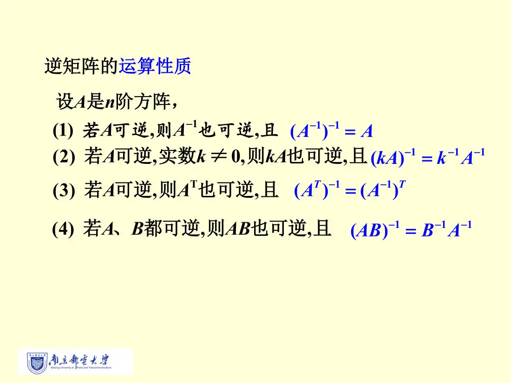

原文：

逆矩阵的运算性质

设A是n阶方阵，

(1) 若 $A$ 可逆, 则 $A^{-1}$ 也可逆, 且 $(A^{-1})^{-1} = A$

(2) 若 $A$ 可逆, 实数 $k \neq 0$ , 则 $kA$ 也可逆, 且 $(kA)^{-1} = k^{-1}A^{-1}$

(3) 若 $A$ 可逆, 则 $A^{\mathrm{T}}$ 也可逆, 且 $(A^{T})^{-1} = (A^{-1})^{T}$

(4) 若 $A$ 、 $B$ 都可逆, 则 $AB$ 也可逆, 且 $(AB)^{-1} = B^{-1}A^{-1}$

南京邮电大学
Nanjing University of Posts and Telecommunications

### 注: $(A + B)^{-1} \neq A^{-1} + B^{-1}$

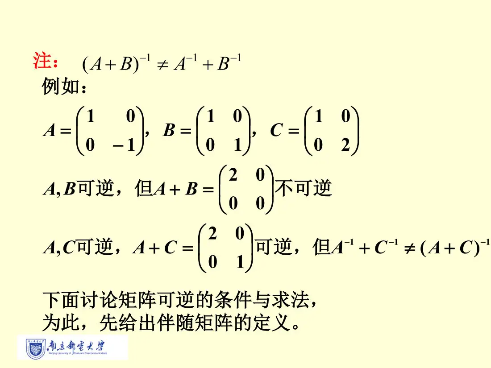

原文：

注: $(A + B)^{-1} \neq A^{-1} + B^{-1}$

例如:

$$
A = \left( \begin{array}{c c} 1 & 0 \\ 0 & - 1 \end{array} \right), B = \left( \begin{array}{c c} 1 & 0 \\ 0 & 1 \end{array} \right), C = \left( \begin{array}{c c} 1 & 0 \\ 0 & 2 \end{array} \right)
$$

$A, B$ 可逆，但 $A + B = \begin{pmatrix} 2 & 0 \\ 0 & 0 \end{pmatrix}$ 不可逆

$A,C$ 可逆， $A + C = \left( \begin{array}{ll}2 & 0\\ 0 & 1 \end{array} \right)$ 可逆，但 $A^{-1} + C^{-1}\neq (A + C)^{-1}$

下面讨论矩阵可逆的条件与求法，

为此，先给出伴随矩阵的定义。

南京邮电大学
Nanjing University of Posts and Telecommunications

### $$

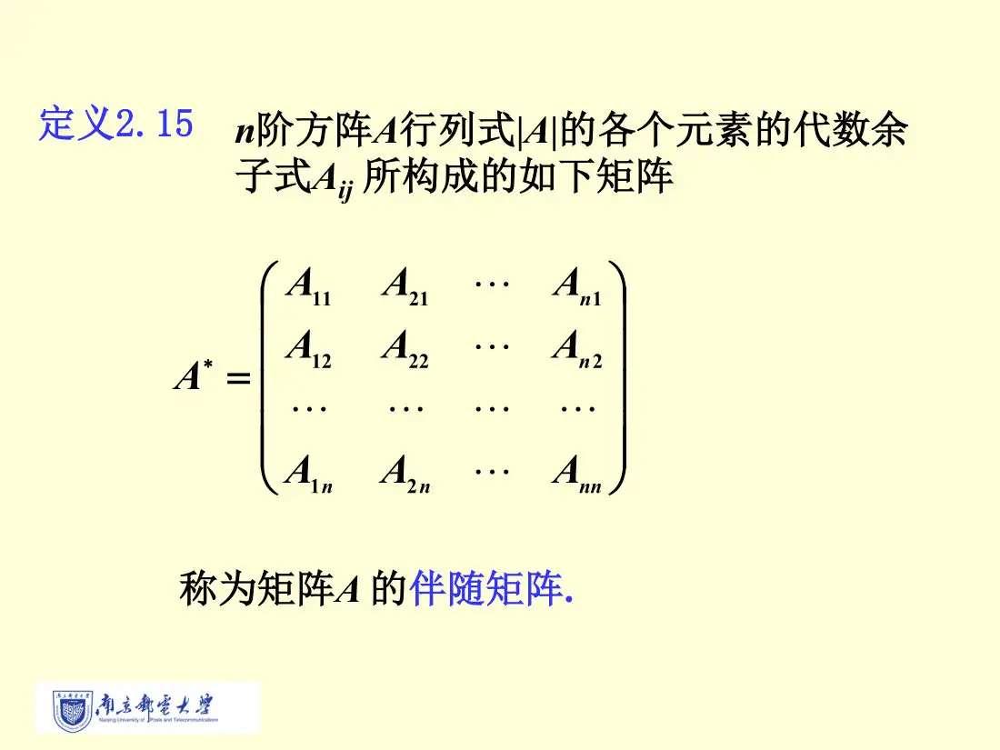

原文：

定义2.15 $n$ 阶方阵 $A$ 行列式 $|A|$ 的各个元素的代数余子式 $A_{ij}$ 所构成的如下矩阵

$$
A ^ {*} = \left( \begin{array}{l l l l} A _ {1 1} & A _ {2 1} & \dots & A _ {n 1} \\ A _ {1 2} & A _ {2 2} & \dots & A _ {n 2} \\ \dots & \dots & \dots & \dots \\ A _ {1 n} & A _ {2 n} & \dots & A _ {n n} \end{array} \right)
$$

称为矩阵A的伴随矩阵.

南京邮电大学
Nanjing University of Posts and Telecommunications

### 性质 $AA^{*}=A^{*}A=\left|A\right|I$

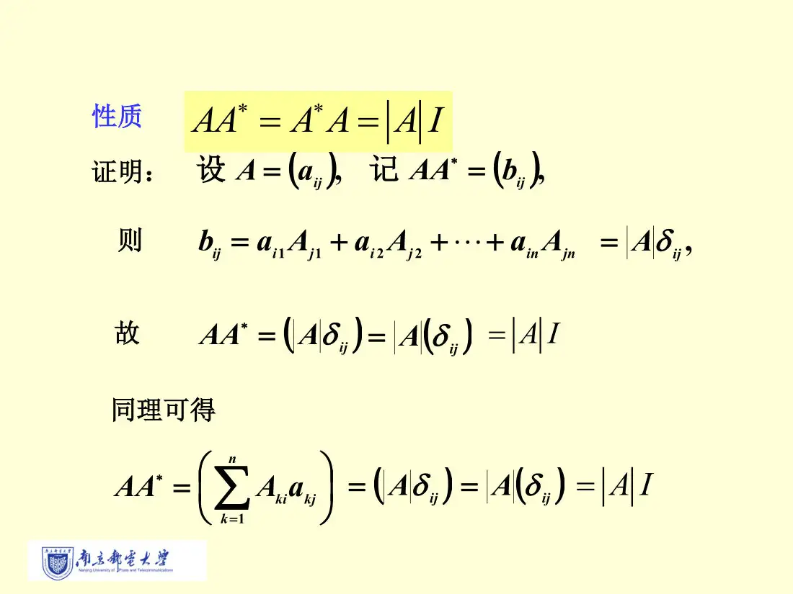

原文：

性质 $AA^{*}=A^{*}A=\left|A\right|I$

证明：设 $A = (a_{ij})$ ，记 $AA^{*} = (b_{ij})$ ,

则 $b_{ij}=a_{i1}A_{j1}+a_{i2}A_{j2}+\cdots+a_{in}A_{jn}=|A|\delta_{ij},$

故 $AA^{*} = (|A|\delta_{ij}) = |A|(\delta_{ij}) = |A|I$

同理可得

$$
A A ^ {*} = \left(\sum_ {k = 1} ^ {n} A _ {k i} a _ {k j}\right) = (| A | \delta_ {i j}) = | A | (\delta_ {i j}) = | A | I
$$

南京邮电大学
Nanjing University of Posts and Telecommunications

### 2. 矩阵可逆的判别定理及求法

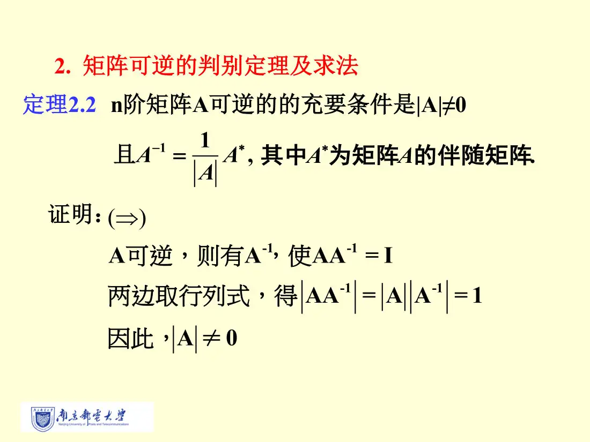

原文：

2. 矩阵可逆的判别定理及求法

定理2.2 n阶矩阵A可逆的的充要条件是|A|≠0

且 $A^{-1}=\frac{1}{|A|}A^{*}$ ，其中 $A^{*}$ 为矩阵A的伴随矩阵.

证明: ( $\Rightarrow$ )

A可逆，则有 $A^{-1}$ ，使 $AA^{-1}=I$

两边取行列式，得 $|\mathbf{A}\mathbf{A}^{-1}| = |\mathbf{A}||\mathbf{A}^{-1}| = \mathbf{1}$

因此， $|\mathbf{A}| \neq \mathbf{0}$

南京邮电大学
Nanjing University of Posts and Telecommunications

### (⇐)

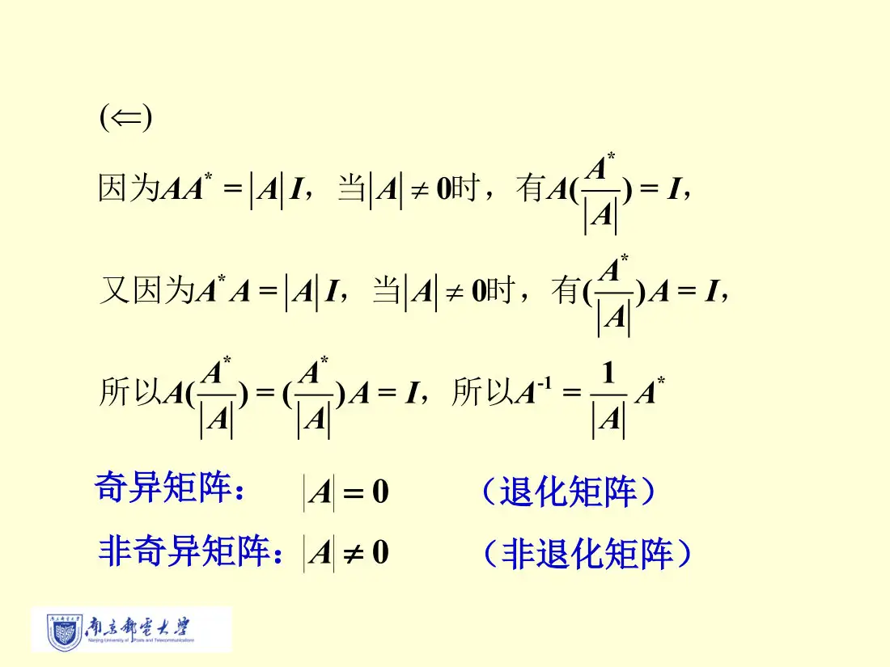

原文：

(⇐)

因为 $AA^{*}=|A|I$ ，当 $|A|\neq0$ 时，有 $A(\frac{A^{*}}{|A|})=I$ ，
又因为 $A^{*}A=|A|I$ ，当 $|A|\neq0$ 时，有 $(\frac{A^{*}}{|A|})A=I$ ，
所以 $A(\frac{A^{*}}{|A|})=(\frac{A^{*}}{|A|})A=I$ ，所以 $A^{-1}=\frac{1}{|A|}A^{*}$ 奇异矩阵： $|A|=0$ （退化矩阵）
非奇异矩阵： $|A|\neq0$ （非退化矩阵）

南京邮电大学
Nanjing University of Posts and Telecommunications

### 证明：若 $|AB|=I$ ，则 $|AB|=|A||B|=1$

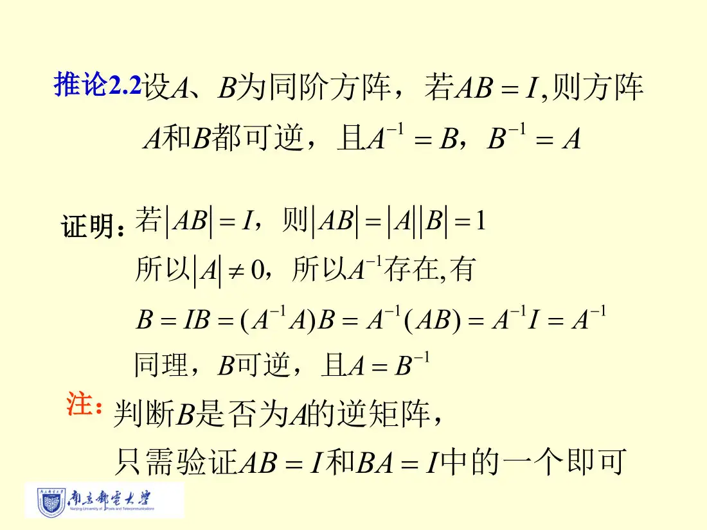

原文：

推论2.2设A、B为同阶方阵，若AB=I,则方阵A和B都可逆，且 $A^{-1}=B,\ B^{-1}=A$

证明：若 $|AB|=I$ ，则 $|AB|=|A||B|=1$

所以 $|A|\neq0$ ，所以 $A^{-1}$ 存在,有

$$
B = I B = (A ^ {- 1} A) B = A ^ {- 1} (A B) = A ^ {- 1} I = A ^ {- 1}
$$

同理，B可逆，且 $A=B^{-1}$

注: 判断B是否为A的逆矩阵,

只需验证 $AB = I$ 和 $BA = I$ 中的一个即可推论2.3 若n阶方阵A可逆，则有 $\left|A^{-1}\right|=\frac{1}{\left|A\right|}=\left|A\right|^{-1}$ .
证明： $AA^{-1}=I$ $\therefore |A||A^{-1}|=1$ 因此 $\left|A^{-1}\right|=\frac{1}{\left|A\right|}=\left|A\right|^{-1}$

南京邮电大学
Nanjing University of Posts and Telecommunications

### 南京邮电大学

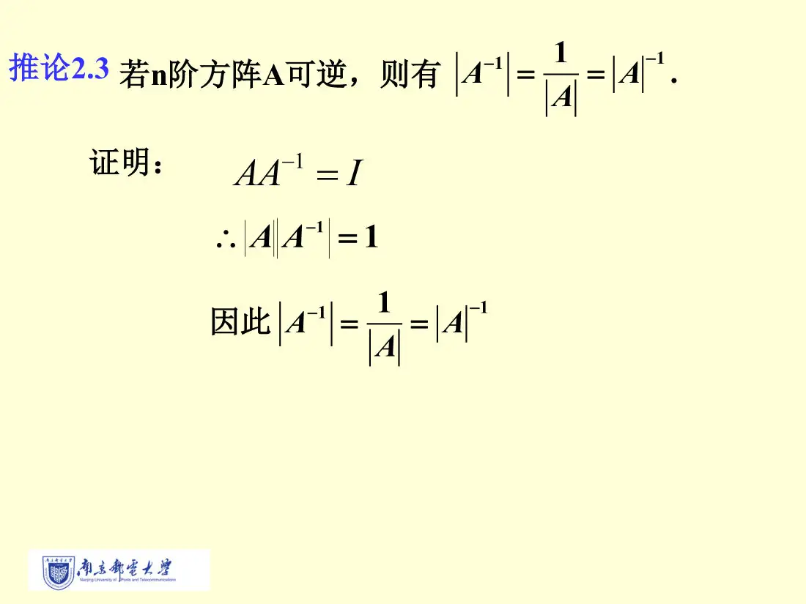

原文：

南京邮电大学
Nanjing University of Posts and Telecommunications

### 逆矩阵的求法:伴随矩阵法

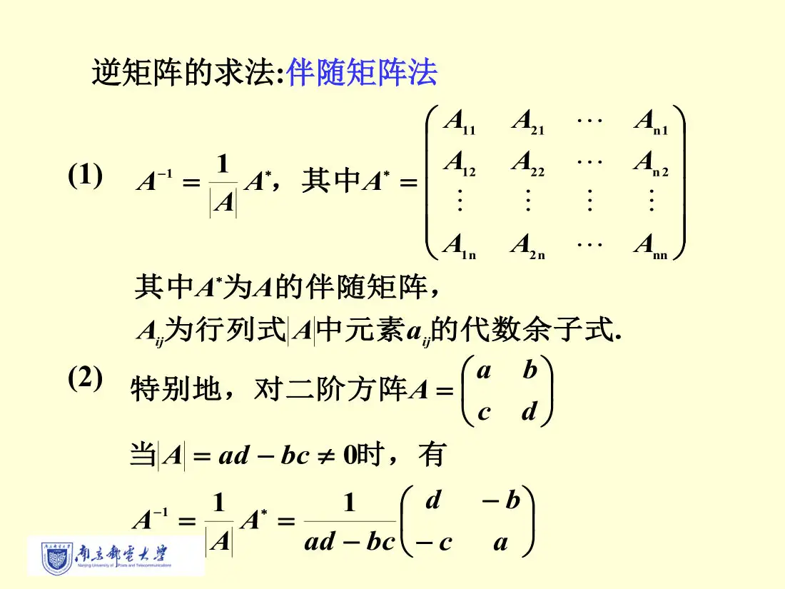

原文：

逆矩阵的求法:伴随矩阵法

(1) $A^{-1} = \frac{1}{|A|} A^*$ ，其中 $A^{*} = \left( \begin{array}{cccc}A_{11} & A_{21} & \dots & A_{n1}\\ A_{12} & A_{22} & \dots & A_{n2}\\ \vdots & \vdots & \vdots & \vdots \\ A_{1n} & A_{2n} & \dots & A_{nn} \end{array} \right)$ 其中 $A^{*}$ 为 $A$ 的伴随矩阵， $A_{ij}$ 为行列式 $|A|$ 中元素 $a_{ij}$ 的代数余子式.

(2) 特别地，对二阶方阵 $A = \begin{pmatrix} a & b \\ c & d \end{pmatrix}$ 当 $|A| = ad - bc \neq 0$ 时，有 $A^{-1} = \frac{1}{|A|} A^{*} = \frac{1}{ad - bc} \begin{pmatrix} d & -b \\ -c & a \end{pmatrix}$

### $$

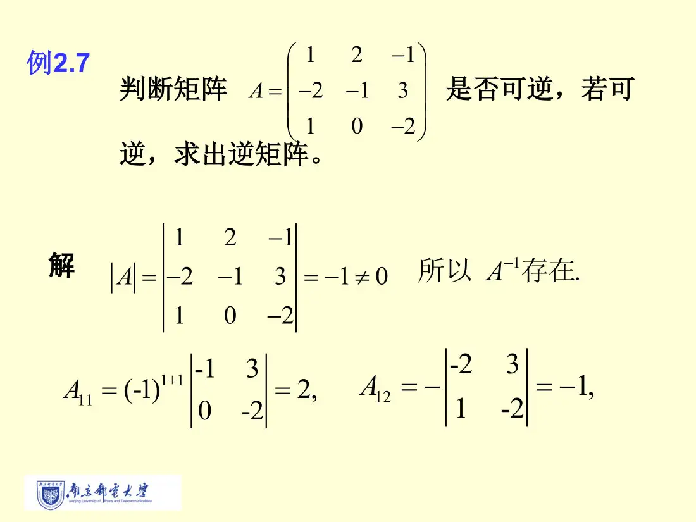

原文：

例2.7 判断矩阵 $A=\begin{pmatrix}1&2&-1\\-2&-1&3\\1&0&-2\end{pmatrix}$ 是否可逆，若可逆，求出逆矩阵。

解 $|A| = \begin{vmatrix} 1 & 2 & -1 \\ -2 & -1 & 3 \\ 1 & 0 & -2 \end{vmatrix} = -1 \neq 0$ 所以 $A^{-1}$ 存在.

$$
A _ {1 1} = (- 1) ^ {1 + 1} \left| \begin{array}{c c} - 1 & 3 \\ 0 & - 2 \end{array} \right| = 2, \quad A _ {1 2} = - \left| \begin{array}{c c} - 2 & 3 \\ 1 & - 2 \end{array} \right| = - 1,
$$

南京邮电大学
Nanjing University of Posts and Telecommunications

### $$

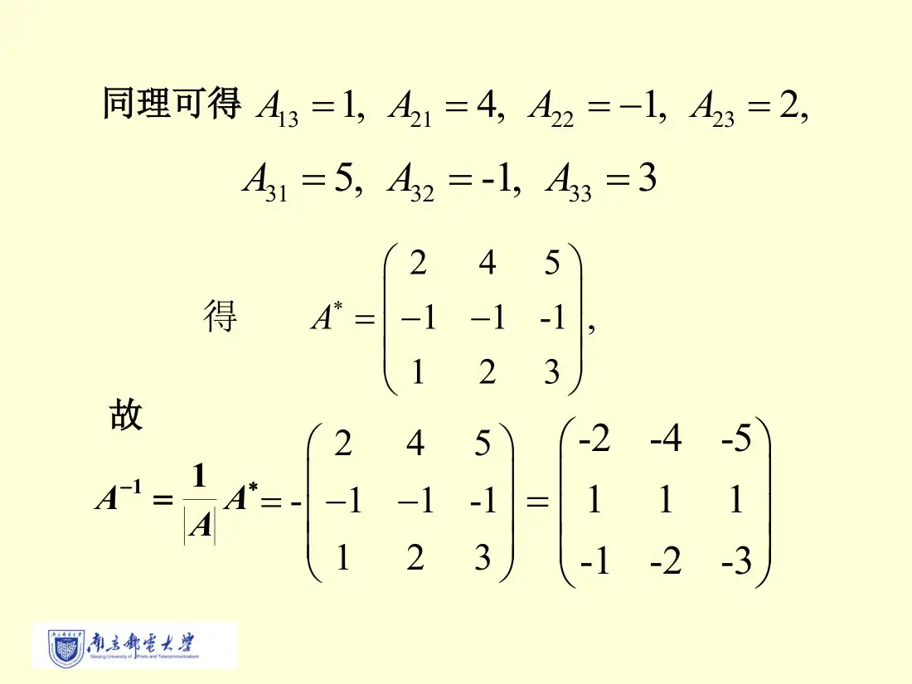

原文：

同理可得 $A_{13}=1,\ A_{21}=4,\ A_{22}=-1,\ A_{23}=2,$

$$
A _ {3 1} = 5, A _ {3 2} = - 1, A _ {3 3} = 3
$$

得

$$
A ^ {*} = \left( \begin{array}{c c c} 2 & 4 & 5 \\ - 1 & - 1 & - 1 \\ 1 & 2 & 3 \end{array} \right),
$$

故

$$
A ^ {- 1} = \frac {1}{| A |} A ^ {*} = - \left( \begin{array}{c c c} 2 & 4 & 5 \\ - 1 & - 1 & - 1 \\ 1 & 2 & 3 \end{array} \right) = \left( \begin{array}{c c c} - 2 & - 4 & - 5 \\ 1 & 1 & 1 \\ - 1 & - 2 & - 3 \end{array} \right)
$$

南京邮电大学
Nanjing University of Posts and Telecommunications

### 例2.8

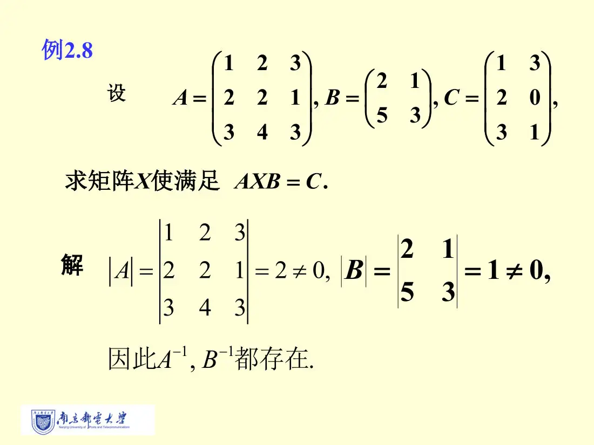

原文：

例2.8

设

$$
A = \left( \begin{array}{c c c} 1 & 2 & 3 \\ 2 & 2 & 1 \\ 3 & 4 & 3 \end{array} \right), B = \left( \begin{array}{c c} 2 & 1 \\ 5 & 3 \end{array} \right), C = \left( \begin{array}{c c} 1 & 3 \\ 2 & 0 \\ 3 & 1 \end{array} \right),
$$

求矩阵X使满足 AXB = C.

解

$$
| A | = \left| \begin{array}{c c c} 1 & 2 & 3 \\ 2 & 2 & 1 \\ 3 & 4 & 3 \end{array} \right| = 2 \neq 0, | B | = \left| \begin{array}{c c} 2 & 1 \\ 5 & 3 \end{array} \right| = 1 \neq 0,
$$

因此 $A^{-1}, B^{-1}$ 都存在.

南京邮电大学
Nanjing University of Posts and Telecommunications

### $$

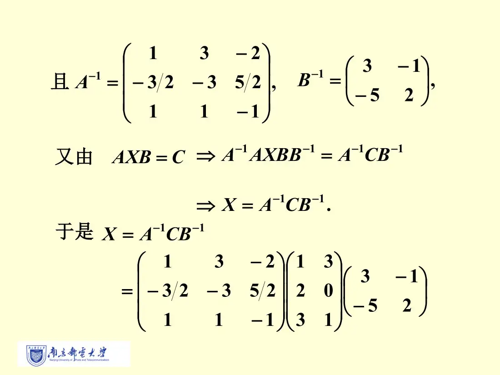

原文：

$$
A ^ {- 1} = \left( \begin{array}{c c c} 1 & 3 & - 2 \\ - 3 / 2 & - 3 & 5 / 2 \\ 1 & 1 & - 1 \end{array} \right), \quad B ^ {- 1} = \left( \begin{array}{c c} 3 & - 1 \\ - 5 & 2 \end{array} \right),
$$

又由 $AXB = C \Rightarrow A^{-1}AXBB^{-1} = A^{-1}CB^{-1}$

$$
\Rightarrow X = A ^ {- 1} C B ^ {- 1}.
$$

于是 $X = A^{-1}CB^{-1}$

$$
= \left( \begin{array}{r r r} 1 & 3 & - 2 \\ - 3 / 2 & - 3 & 5 / 2 \\ 1 & 1 & - 1 \end{array} \right) \left( \begin{array}{l l} 1 & 3 \\ 2 & 0 \\ 3 & 1 \end{array} \right) \left( \begin{array}{r r} 3 & - 1 \\ - 5 & 2 \end{array} \right)
$$

南京邮电大学
Nanjing University of Posts and Telecommunications

### $$

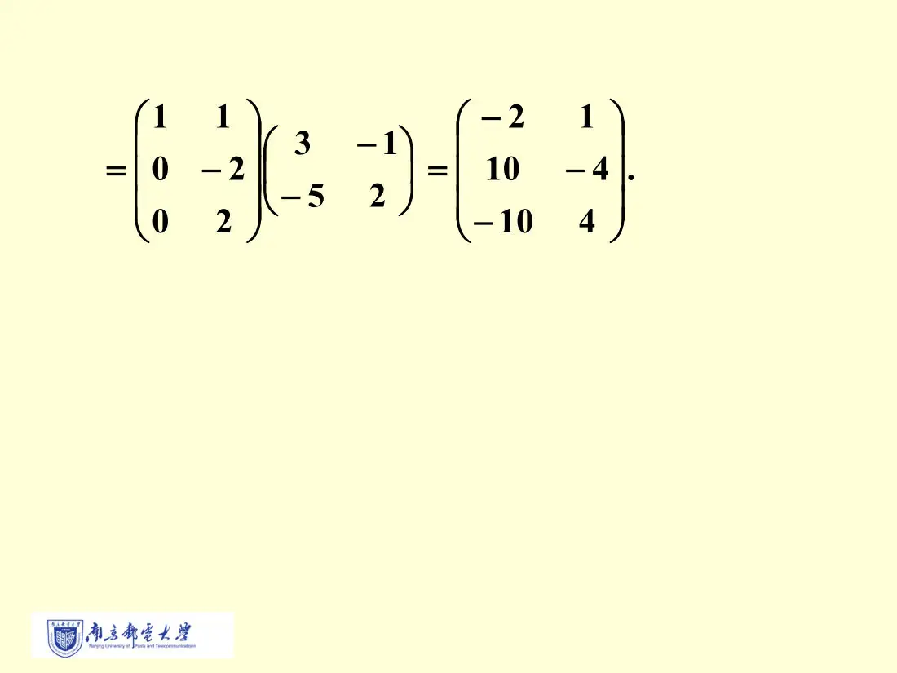

原文：

$$
= \left( \begin{array}{c c} 1 & 1 \\ 0 & - 2 \\ 0 & 2 \end{array} \right) \left( \begin{array}{c c} 3 & - 1 \\ - 5 & 2 \end{array} \right) = \left( \begin{array}{c c} - 2 & 1 \\ 1 0 & - 4 \\ - 1 0 & 4 \end{array} \right).
$$

南京邮电大学
Nanjing University of Posts and Telecommunications

### $$

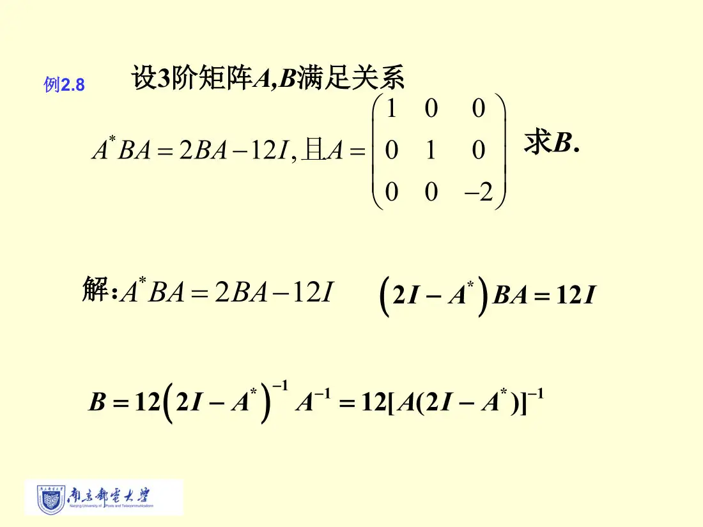

原文：

例2.8 设3阶矩阵A,B满足关系 $A^{*}BA=2BA-12I,$ 且 $A=\begin{pmatrix}1&0&0\\0&1&0\\0&0&-2\end{pmatrix}$ 求 B.

解: $A^{*}BA=2BA-12I\quad(2I-A^{*})BA=12I$

$$
B = 1 2 \left(2 I - A ^ {*}\right) ^ {- 1} A ^ {- 1} = 1 2 \left[ A \left(2 I - A ^ {*}\right) \right] ^ {- 1}
$$

南京邮电大学
Nanjing University of Posts and Telecommunications

### $$

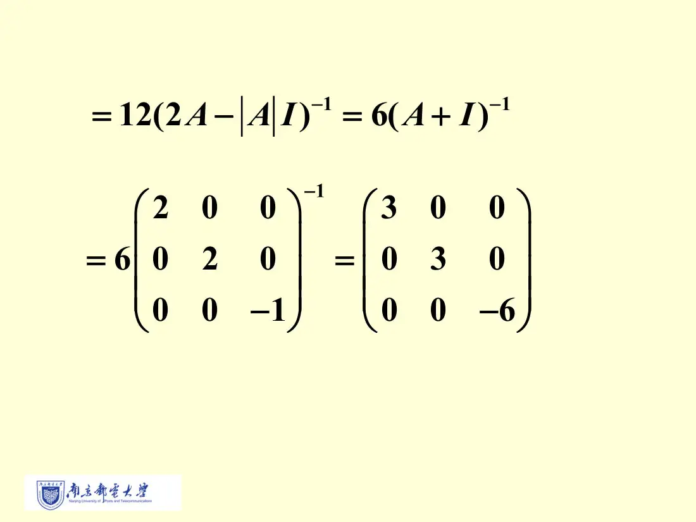

原文：

$$
= 1 2 (2 A - | A | I) ^ {- 1} = 6 (A + I) ^ {- 1}
$$

$$
= 6 \left( \begin{array}{c c c} 2 & 0 & 0 \\ 0 & 2 & 0 \\ 0 & 0 & - 1 \end{array} \right) ^ {- 1} = \left( \begin{array}{c c c} 3 & 0 & 0 \\ 0 & 3 & 0 \\ 0 & 0 & - 6 \end{array} \right)
$$

南京邮电大学
Nanjing University of Posts and Telecommunications

### 例2.9 设方阵满足方程 $A^{2}-4A+6I=0$

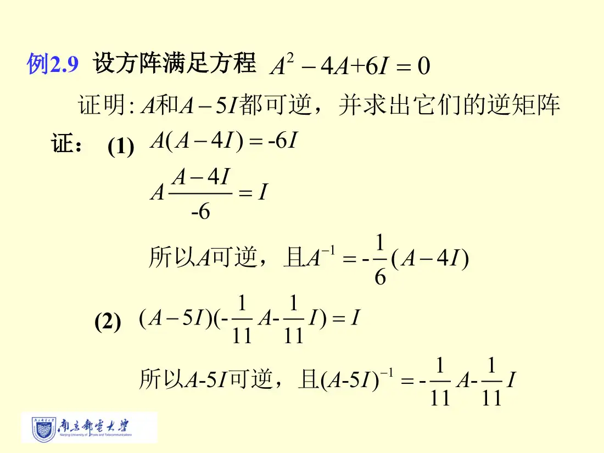

原文：

例2.9 设方阵满足方程 $A^{2}-4A+6I=0$

证明: A和A-5I都可逆, 并求出它们的逆矩阵证: (1) $A(A-4I) = -6I$ $A \frac{A-4I}{-6} = I$ 所以A可逆, 且 $A^{-1} = -\frac{1}{6}(A-4I)$ (2) $(A-5I)(-\frac{1}{11}A-\frac{1}{11}I) = I$ 所以A-5I可逆, 且 $(A-5I)^{-1} = -\frac{1}{11}A-\frac{1}{11}I$

### 南京邮电大学

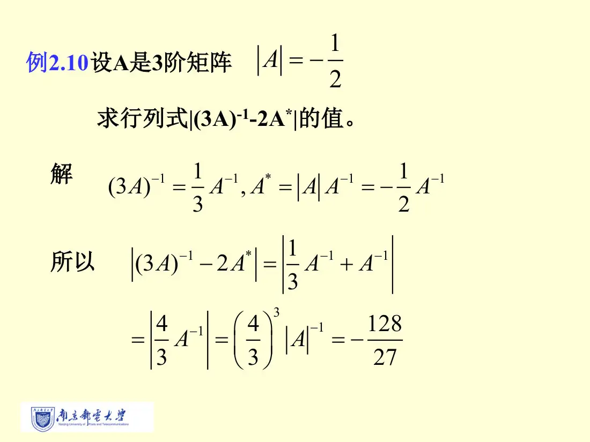

原文：

例2.10设A是3阶矩阵 $\left|A\right|=-\frac{1}{2}$ 求行列式 $|(3A)^{-1}-2A^{*}|$ 的值。
解 $(3A)^{-1}=\frac{1}{3}A^{-1}, A^{*}=|A|A^{-1}=-\frac{1}{2}A^{-1}$ 所以 $\left|(3A)^{-1}-2A^{*}\right|=\left|\frac{1}{3}A^{-1}+A^{-1}\right|$ $=\left|\frac{4}{3}A^{-1}\right|=\left(\frac{4}{3}\right)^{3}\left|A\right|^{-1}=-\frac{128}{27}$

南京邮电大学
Nanjing University of Posts and Telecommunications
