# 《线性代数与解析几何》第2章 矩阵的分块（课件）

原件的每一页，下面附识别出的文字。

### 2.3矩阵的分块

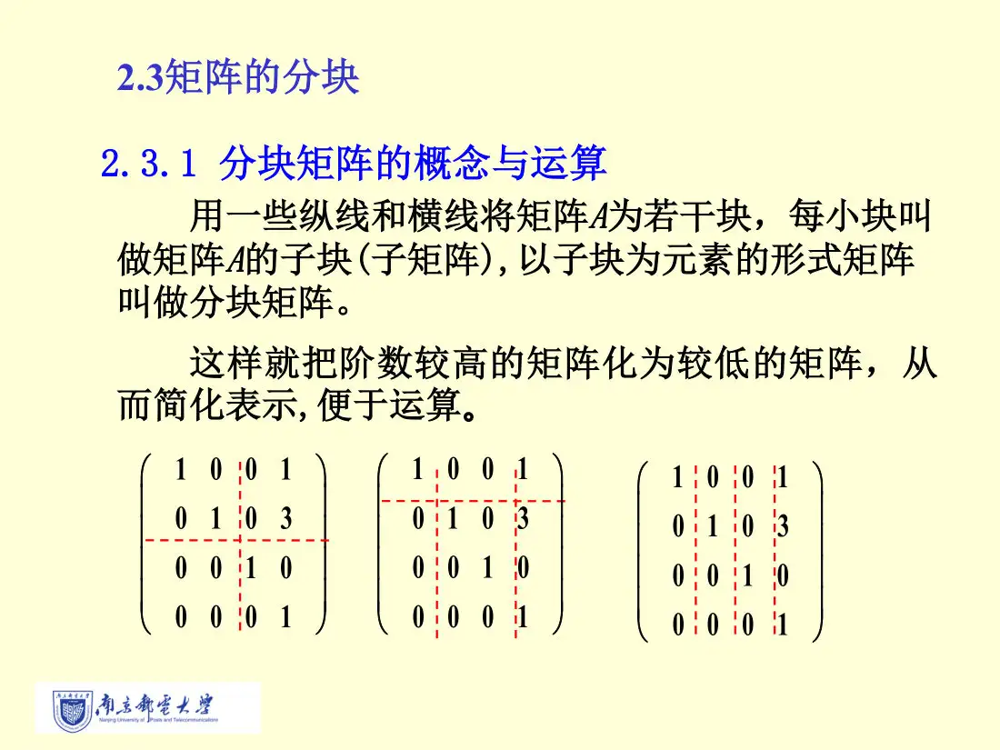

原文：

2.3矩阵的分块

2.3.1 分块矩阵的概念与运算

用一些纵线和横线将矩阵A为若干块，每小块叫做矩阵A的子块(子矩阵)，以子块为元素的形式矩阵叫做分块矩阵。

这样就把阶数较高的矩阵化为较低的矩阵，从而简化表示,便于运算。

$$
\left( \begin{array}{c c c c} 1 & 0 & 0 & 1 \\ 0 & 1 & 0 & 3 \\ 0 & 0 & 1 & 0 \\ 0 & 0 & 0 & 1 \end{array} \right)
$$

$$
\left( \begin{array}{c c c c} 1 & 0 & 0 & 1 \\ \hline 0 & 1 & 0 & 3 \\ 0 & 0 & 1 & 0 \\ 0 & 0 & 0 & 1 \end{array} \right)
$$

$$
\left( \begin{array}{c c c c c} 1 & 0 & 0 & 1 \\ 0 & 1 & 0 & 3 \\ 0 & 0 & 1 & 0 \\ 0 & 0 & 0 & 1 \end{array} \right)
$$

南京邮电大学
Nanjing University of Posts and Telecommunications

### 某些矩阵经过恰当分块，可使其结构简洁明了，易抓住所要研究问题的特征。

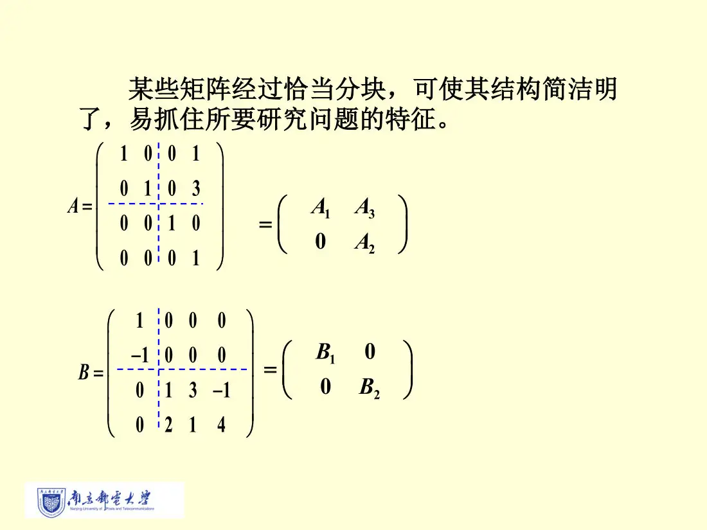

原文：

某些矩阵经过恰当分块，可使其结构简洁明了，易抓住所要研究问题的特征。

$$
A = \left( \begin{array}{c c c c} 1 & 0 & 0 & 1 \\ 0 & 1 & 0 & 3 \\ \hdashline 0 & 0 & 1 & 0 \\ 0 & 0 & 0 & 1 \end{array} \right) \quad = \left( \begin{array}{c c c c} & A _ {1} & A _ {3} \\ & 0 & A _ {2} \end{array} \right)
$$

$$
B = \left( \begin{array}{c c c c} 1 & 0 & 0 & 0 \\ - 1 & 0 & 0 & 0 \\ \hdashline 0 & 1 & 3 & - 1 \\ 0 & 2 & 1 & 4 \end{array} \right) = \left( \begin{array}{c c c c} & B _ {1} & 0 \\ & 0 & B _ {2} \end{array} \right)
$$

南京邮电大学
Nanjing University of Posts and Telecommunications

### 分块矩阵的运算

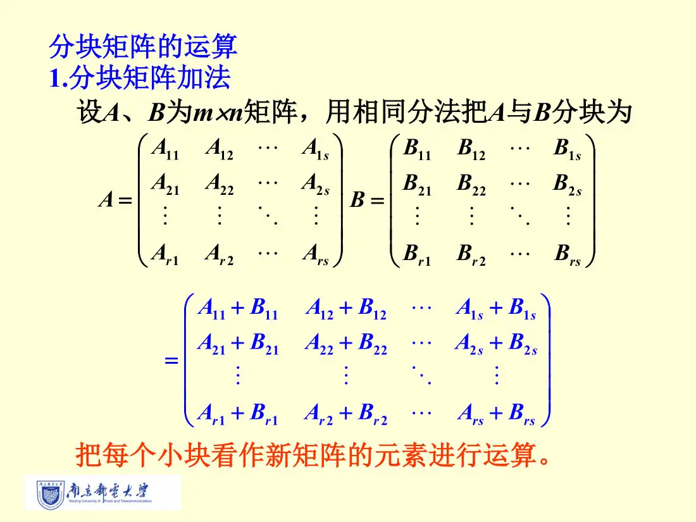

原文：

分块矩阵的运算

1. 分块矩阵加法

设A、B为 $m \times n$ 矩阵，用相同分法把A与B分块为

$$
A = \left( \begin{array}{c c c c} A _ {1 1} & A _ {1 2} & \dots & A _ {1 s} \\ A _ {2 1} & A _ {2 2} & \dots & A _ {2 s} \\ \vdots & \vdots & \ddots & \vdots \\ A _ {r 1} & A _ {r 2} & \dots & A _ {r s} \end{array} \right) B = \left( \begin{array}{c c c c} B _ {1 1} & B _ {1 2} & \dots & B _ {1 s} \\ B _ {2 1} & B _ {2 2} & \dots & B _ {2 s} \\ \vdots & \vdots & \ddots & \vdots \\ B _ {r 1} & B _ {r 2} & \dots & B _ {r s} \end{array} \right)
$$

$$
= \left( \begin{array}{c c c c} A _ {1 1} + B _ {1 1} & A _ {1 2} + B _ {1 2} & \dots & A _ {1 s} + B _ {1 s} \\ A _ {2 1} + B _ {2 1} & A _ {2 2} + B _ {2 2} & \dots & A _ {2 s} + B _ {2 s} \\ \vdots & \vdots & \ddots & \vdots \\ A _ {r 1} + B _ {r 1} & A _ {r 2} + B _ {r 2} & \dots & A _ {r s} + B _ {r s} \end{array} \right)
$$

把每个小块看作新矩阵的元素进行运算。

南京邮电大学
Nanjing University of Posts and Telecommunications

### $$

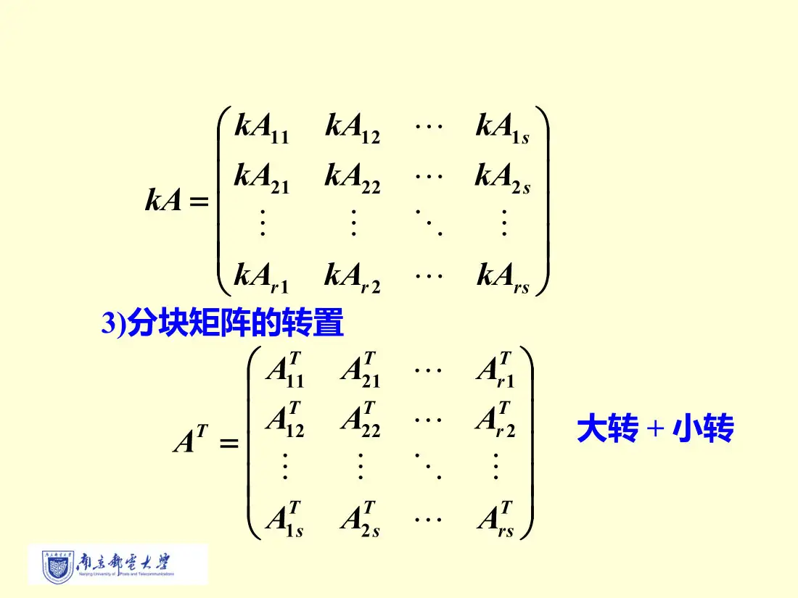

原文：

$$
k A = \left( \begin{array}{c c c c} k A _ {1 1} & k A _ {1 2} & \dots & k A _ {1 s} \\ k A _ {2 1} & k A _ {2 2} & \dots & k A _ {2 s} \\ \vdots & \vdots & \ddots & \vdots \\ k A _ {r 1} & k A _ {r 2} & \dots & k A _ {r s} \end{array} \right)
$$

3)分块矩阵的转置

$$
A ^ {T} = \left( \begin{array}{c c c c} A _ {1 1} ^ {T} & A _ {2 1} ^ {T} & \dots & A _ {r 1} ^ {T} \\ A _ {1 2} ^ {T} & A _ {2 2} ^ {T} & \dots & A _ {r 2} ^ {T} \\ \vdots & \vdots & \ddots & \vdots \\ A _ {1 s} ^ {T} & A _ {2 s} ^ {T} & \dots & A _ {r s} ^ {T} \end{array} \right) \quad \text {大转 + 小转}
$$

南京邮电大学
Nanjing University of Posts and Telecommunications

### 2. 分块矩阵数乘

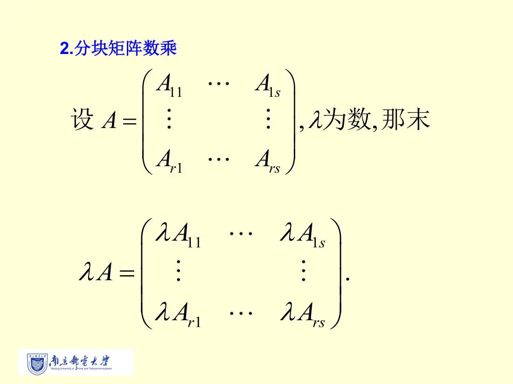

原文：

2. 分块矩阵数乘

设 $A=\begin{pmatrix}A_{11}&\cdots&A_{1s}\\ \vdots&&\vdots\\ A_{r1}&\cdots&A_{rs}\end{pmatrix},\lambda$ 为数,那末

$$
\lambda A = \left( \begin{array}{c c c} \lambda A _ {1 1} & \dots & \lambda A _ {1 s} \\ \vdots & & \vdots \\ \lambda A _ {r 1} & \dots & \lambda A _ {r s} \end{array} \right).
$$

南京邮电大学
Nanjing University of Posts and Telecommunications

### 3 分块矩阵乘法

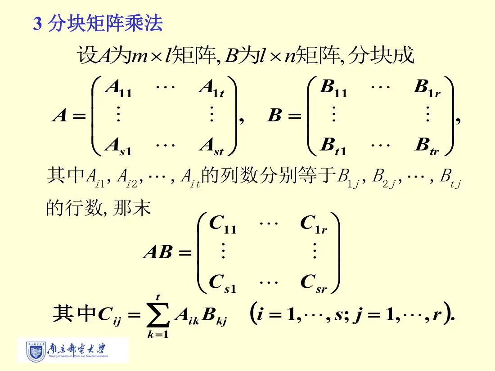

原文：

3 分块矩阵乘法

设A为 $m \times l$ 矩阵, B为 $l \times n$ 矩阵, 分块成

$$
\boldsymbol {A} = \left( \begin{array}{c c c} A _ {1 1} & \dots & A _ {1 t} \\ \vdots & & \vdots \\ A _ {s 1} & \dots & A _ {s t} \end{array} \right), \quad \boldsymbol {B} = \left( \begin{array}{c c c} B _ {1 1} & \dots & B _ {1 r} \\ \vdots & & \vdots \\ B _ {t 1} & \dots & B _ {t r} \end{array} \right),
$$

其中 $A_{i1}, A_{i2}, \cdots, A_{it}$ 的列数分别等于 $B_{1j}, B_{2j}, \cdots, B_{tj}$ 的行数, 那末

$$
A B = \left( \begin{array}{c c c} C _ {1 1} & \dots & C _ {1 r} \\ \vdots & & \vdots \\ C _ {s 1} & \dots & C _ {s r} \end{array} \right)
$$

其中 $C_{ij}=\sum_{k=1}^{t}A_{ik}B_{kj}\quad(i=1,\cdots,s;j=1,\cdots,r)$ .

南京邮电大学
Nanjing University of Posts and Telecommunications

### 常见的分块形式

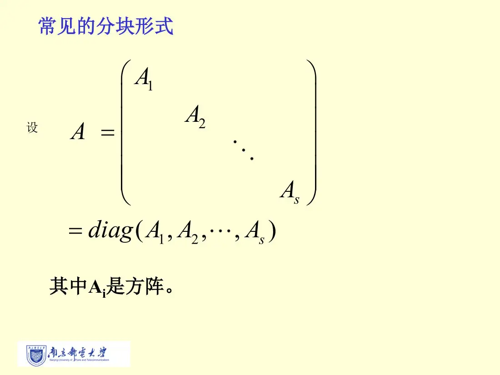

原文：

常见的分块形式

设

$$
\begin{array}{r l} & A = \left( \begin{array}{l l l l} A _ {1} & & & \\ & & A _ {2} & \\ & & & \ddots & \\ & & & & A _ {s} \end{array} \right) \\ & = d i a g (A _ {1}, A _ {2}, \dots , A _ {s}) \end{array}
$$

其中 $A_{i}$ 是方阵。

南京邮电大学
Nanjing University of Posts and Telecommunications

### $$

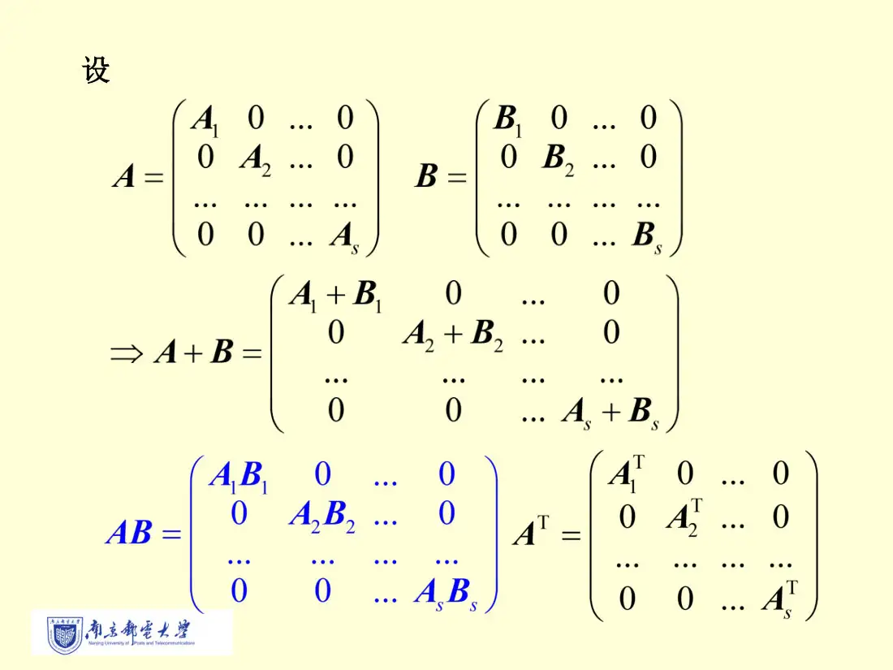

原文：

设

$$
\boldsymbol {A} = \left( \begin{array}{c c c c} \boldsymbol {A} _ {1} & 0 & \dots & 0 \\ 0 & \boldsymbol {A} _ {2} & \dots & 0 \\ \dots & \dots & \dots & \dots \\ 0 & 0 & \dots & \boldsymbol {A} _ {s} \end{array} \right) \quad \boldsymbol {B} = \left( \begin{array}{c c c c} \boldsymbol {B} _ {1} & 0 & \dots & 0 \\ 0 & \boldsymbol {B} _ {2} & \dots & 0 \\ \dots & \dots & \dots & \dots \\ 0 & 0 & \dots & \boldsymbol {B} _ {s} \end{array} \right)
$$

$$
\Rightarrow \boldsymbol {A} + \boldsymbol {B} = \left( \begin{array}{c c c c} \boldsymbol {A} _ {1} + \boldsymbol {B} _ {1} & 0 & \dots & 0 \\ 0 & \boldsymbol {A} _ {2} + \boldsymbol {B} _ {2} & \dots & 0 \\ \dots & \dots & \dots & \dots \\ 0 & 0 & \dots & \boldsymbol {A} _ {s} + \boldsymbol {B} _ {s} \end{array} \right)
$$

$$
\boldsymbol {A} \boldsymbol {B} = \left( \begin{array}{c c c c} \boldsymbol {A} _ {1} \boldsymbol {B} _ {1} & 0 & \dots & 0 \\ 0 & \boldsymbol {A} _ {2} \boldsymbol {B} _ {2} & \dots & 0 \\ \dots & \dots & \dots & \dots \\ 0 & 0 & \dots & \boldsymbol {A} _ {s} \boldsymbol {B} _ {s} \end{array} \right) \boldsymbol {A} ^ {\mathrm{T}} = \left( \begin{array}{c c c c} \boldsymbol {A} _ {1} ^ {\mathrm{T}} & 0 & \dots & 0 \\ 0 & \boldsymbol {A} _ {2} ^ {\mathrm{T}} & \dots & 0 \\ \dots & \dots & \dots & \dots \\ 0 & 0 & \dots & \boldsymbol {A} _ {s} ^ {\mathrm{T}} \end{array} \right)
$$

南京邮电大学
Nanjing University of Posts and Telecommunications

### $$

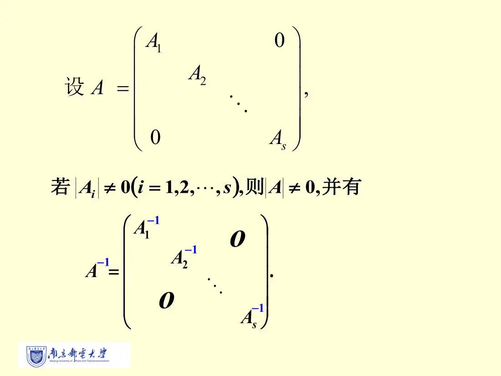

原文：

$$
\text {之} A = \left( \begin{array}{c c c c} A _ {1} & & & 0 \\ & A _ {2} & & \\ & & \ddots & \\ 0 & & & A _ {s} \end{array} \right),
$$

若 $|A_i| \neq 0 (i = 1,2,\cdots,s)$ , 则 $|A| \neq 0$ , 并有

$$
A ^ {- 1} = \left( \begin{array}{c c c c} A _ {1} ^ {- 1} & & & \boldsymbol {0} \\ & A _ {2} ^ {- 1} & & \\ & & \ddots & \\ \boldsymbol {0} & & & A _ {s} ^ {- 1} \end{array} \right).
$$

南京邮电大学
Nanjing University of Posts and Telecommunications

### 2. 按行分块:

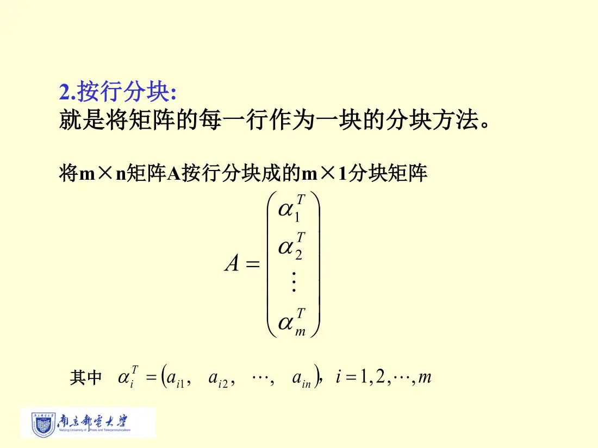

原文：

2. 按行分块:

就是将矩阵的每一行作为一块的分块方法。

将 $\mathbf{m} \times \mathbf{n}$ 矩阵A按行分块成的 $\mathbf{m} \times 1$ 分块矩阵

$$
A = \left( \begin{array}{c} \alpha_ {1} ^ {T} \\ \alpha_ {2} ^ {T} \\ \vdots \\ \alpha_ {m} ^ {T} \end{array} \right)
$$

其中 $\alpha_{i}^{T}=(a_{i1},\quad a_{i2},\quad\cdots,\quad a_{in}),\quad i=1,2,\cdots,m$

南京邮电大学
Nanjing University of Posts and Telecommunications

### 3. 按列分块

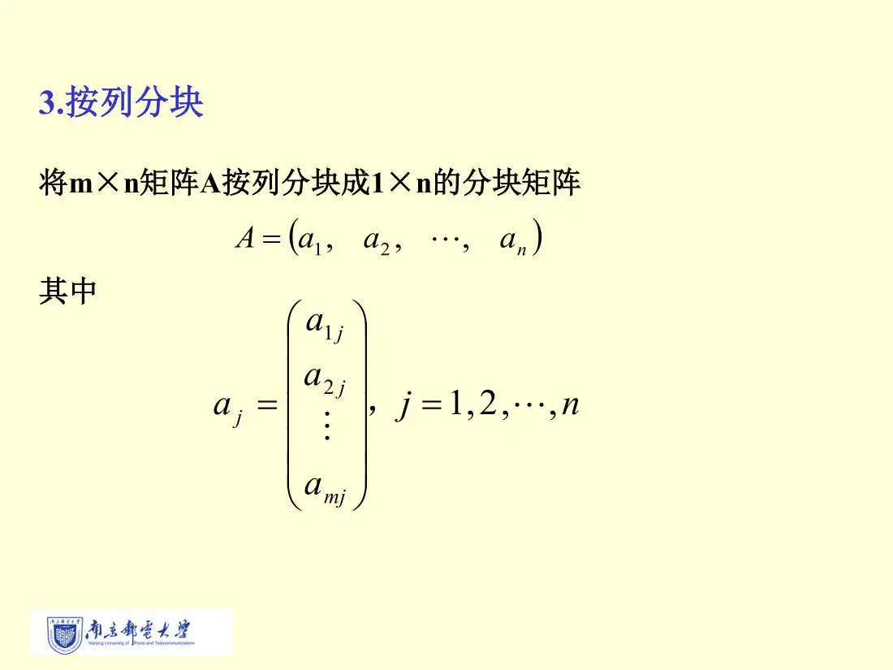

原文：

3. 按列分块

将 $\mathbf{m} \times \mathbf{n}$ 矩阵A按列分块成 $1 \times \mathbf{n}$ 的分块矩阵

$$
A = \left(a _ {1}, a _ {2}, \dots , a _ {n}\right)
$$

其中

$$
a _ {j} = \left( \begin{array}{c} a _ {1 j} \\ a _ {2 j} \\ \vdots \\ a _ {m j} \end{array} \right), j = 1, 2, \dots , n
$$

南京邮电大学
Nanjing University of Posts and Telecommunications

### 例2.12

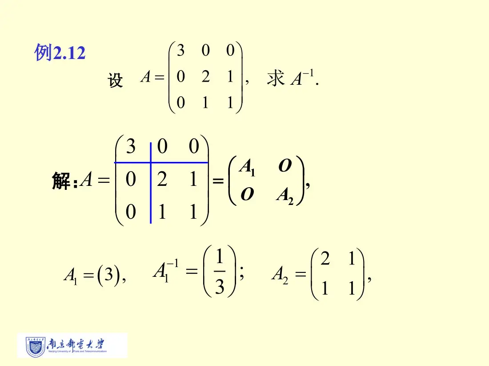

原文：

例2.12

设 $A = \begin{pmatrix} 3 & 0 & 0 \\ 0 & 2 & 1 \\ 0 & 1 & 1 \end{pmatrix}$ , 求 $A^{-1}$ .

解: $A=\begin{pmatrix}3&0&0\\0&2&1\\0&1&1\end{pmatrix}=\begin{pmatrix}A_{1}&O\\O&A_{2}\end{pmatrix},$

$$
A _ {1} = (3),
$$

$$
A _ {1} ^ {- 1} = \left(\frac {1}{3}\right); \quad A _ {2} = \left( \begin{array}{c c} 2 & 1 \\ 1 & 1 \end{array} \right),
$$

南京邮电大学
Nanjing University of Posts and Telecommunications

### $$

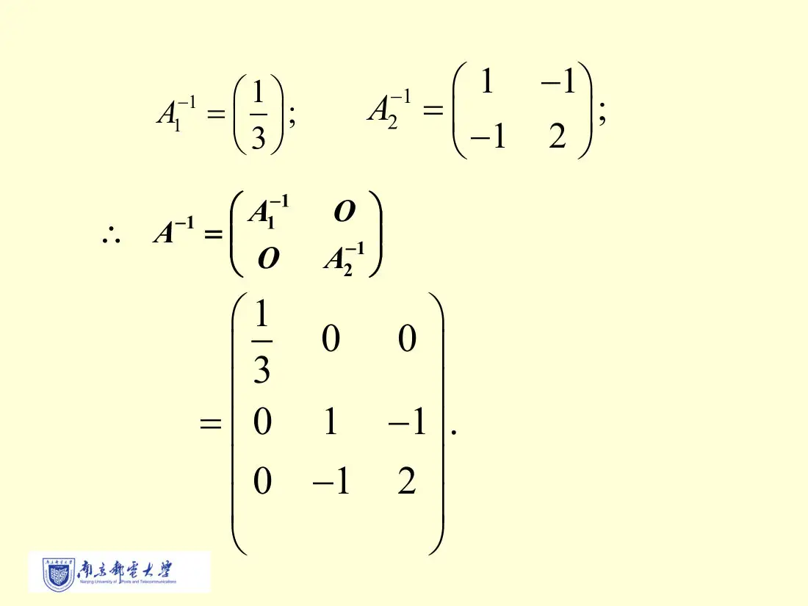

原文：

$$
A _ {1} ^ {- 1} = \left(\frac {1}{3}\right); \qquad A _ {2} ^ {- 1} = \left( \begin{array}{c c} 1 & - 1 \\ - 1 & 2 \end{array} \right);
$$

$$
\boldsymbol {A} ^ {- 1} = \left( \begin{array}{c c} \boldsymbol {A} _ {1} ^ {- 1} & \boldsymbol {O} \\ \boldsymbol {O} & \boldsymbol {A} _ {2} ^ {- 1} \end{array} \right)
$$

南京邮电大学
Nanjing University of Posts and Telecommunications

### 证明：A可逆，并求 $A^{-1}$ .

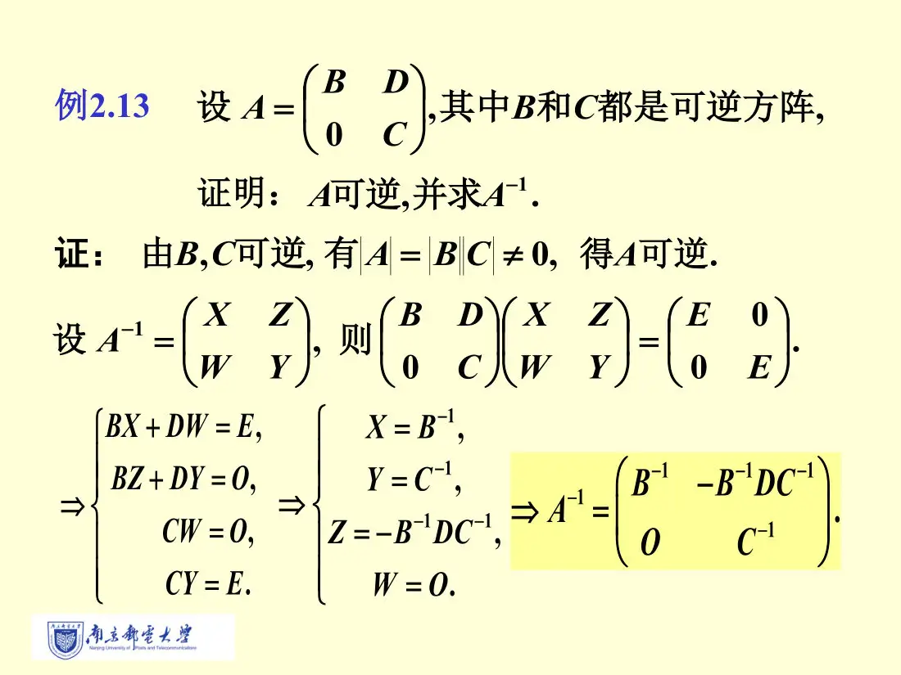

原文：

例2.13 设 $A=\begin{pmatrix}B & D \\ 0 & C\end{pmatrix}$ ，其中 B 和 C 都是可逆方阵，
证明：A可逆，并求 $A^{-1}$ .

证：由B,C可逆,有 $|A|=|B||C|\neq0$ ，得A可逆.
设 $A^{-1}=\begin{pmatrix}X&Z\\W&Y\end{pmatrix}$ ，则 $\begin{pmatrix}B&D\\0&C\end{pmatrix}\begin{pmatrix}X&Z\\W&Y\end{pmatrix}=\begin{pmatrix}E&0\\0&E\end{pmatrix}.$ $\Rightarrow\left\{\begin{aligned}&BX+DW=E,\\ &BZ+DY=O,\\ &CW=O,\\ &CY=E.\end{aligned}\right.\Rightarrow\left\{\begin{aligned}&X=B^{-1},\\ &Y=C^{-1},\\ &Z=-B^{-1}DC^{-1},\\ &W=O.\end{aligned}\right.\Rightarrow A^{-1}=\begin{pmatrix}B^{-1}&-B^{-1}DC^{-1}\\0&C^{-1}\end{pmatrix}.$

南京邮电大学
Nanjing University of Posts and Telecommunications
