# 《线性代数与解析几何》第3.2节 向量的乘积（课件）

原件的每一页，下面附识别出的文字。

### 3.2 向量的乘积

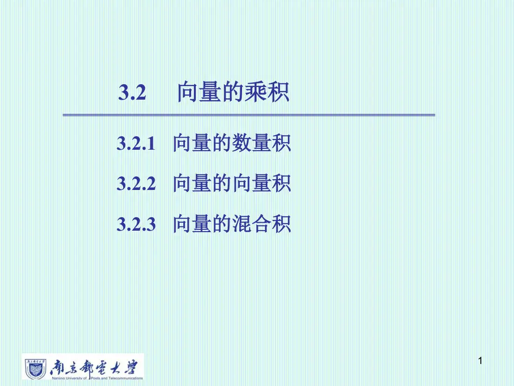

原文：

3.2 向量的乘积
3.2.1 向量的数量积
3.2.2 向量的向量积
3.2.3 向量的混合积

南京邮电大学
Nanjing University of Posts and Telecommunications

1

### 3.2 向量的乘积

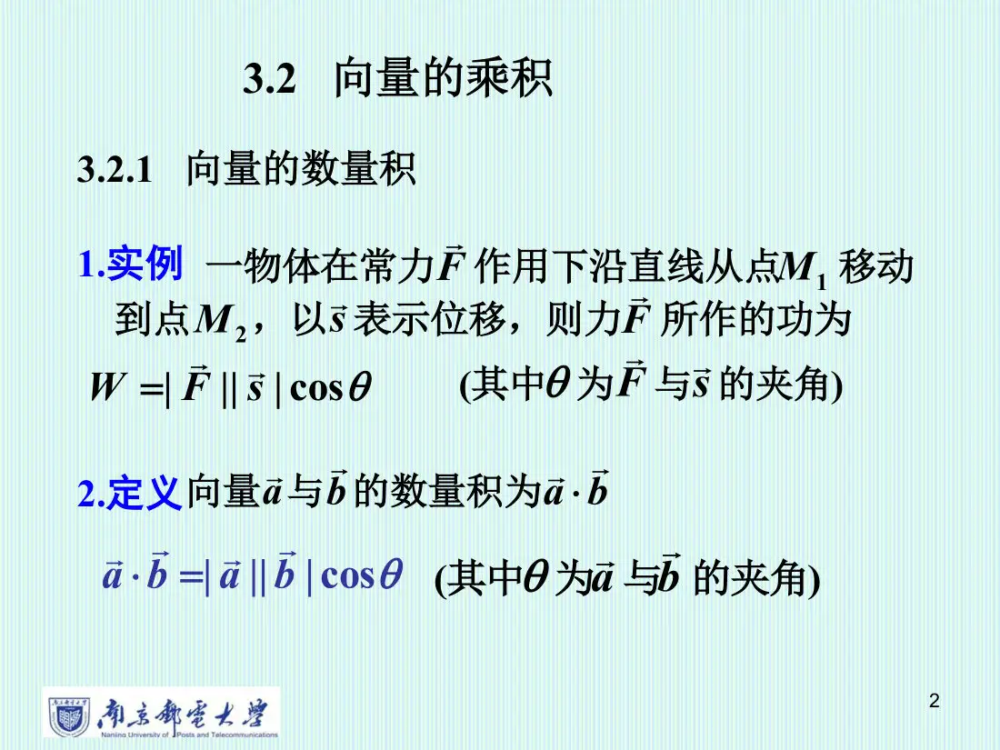

原文：

3.2 向量的乘积

3.2.1 向量的数量积

1. 实例 一物体在常力 $\vec{F}$ 作用下沿直线从点 $M_{1}$ 移动到点 $M_{2}$ ，以 $\vec{s}$ 表示位移，则力 $\vec{F}$ 所作的功为 $W = |\vec{F}| |\vec{s}| \cos \theta$ (其中 $\theta$ 为 $\vec{F}$ 与 $\vec{s}$ 的夹角)

2. 定义向量 $\vec{a}$ 与 $\vec{b}$ 的数量积为 $\vec{a} \cdot \vec{b}$

$\vec{a}\cdot\vec{b}=|\vec{a}||\vec{b}|\cos\theta$ (其中 $\theta$ 为 $\vec{a}$ 与 $\vec{b}$ 的夹角)

南京邮电大学
Nanjing University of Posts and Telecommunications

2

### $$

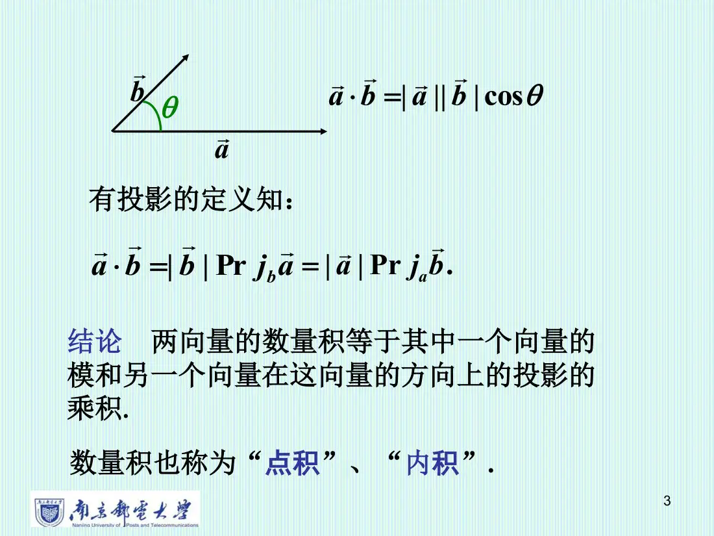

原文：

$$
\vec {a} \cdot \vec {b} = | \vec {a} | | \vec {b} | \cos \theta
$$

有投影的定义知:

$$
\vec {a} \cdot \vec {b} = | \vec {b} | \operatorname * {P r} j _ {b} \vec {a} = | \vec {a} | \operatorname * {P r} j _ {a} \vec {b}.
$$

结论 两向量的数量积等于其中一个向量的模和另一个向量在这向量的方向上的投影的乘积.

数量积也称为“点积”、“内积”。

南京邮电大学
Nanjing University of Posts and Telecommunications

3

### 3. 数量积的性质

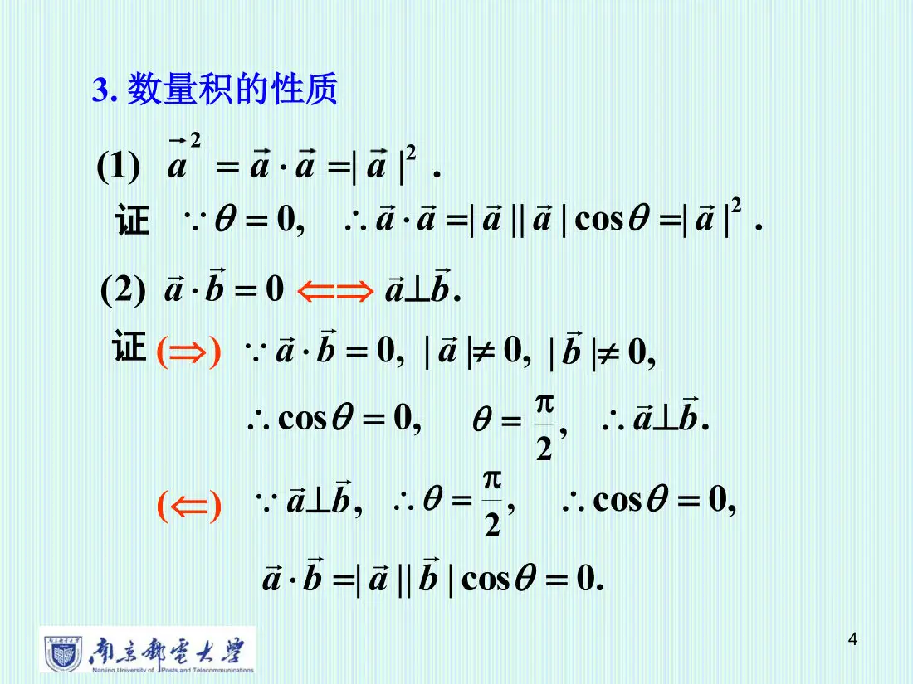

原文：

3. 数量积的性质

(1) $\vec{a}^2 = \vec{a} \cdot \vec{a} = |\vec{a}|^2$ . 证 $\because \theta = 0, \therefore \vec{a} \cdot \vec{a} = |\vec{a}||\vec{a}|\cos \theta = |\vec{a}|^2$ .

(2) $\vec{a} \cdot \vec{b} = 0 \Longleftrightarrow \vec{a} \perp \vec{b}.$

证 $(\Rightarrow)$ $\because \vec{a} \cdot \vec{b} = 0, |\vec{a}| \neq 0, |\vec{b}| \neq 0,$ $\therefore \cos \theta = 0, \quad \theta = \frac{\pi}{2}, \quad \therefore \vec{a} \perp \vec{b}.$

(⇐) ∵ $\vec{a} \perp \vec{b}, \quad \therefore \theta = \frac{\pi}{2}, \quad \therefore \cos \theta = 0,$ $\vec{a} \cdot \vec{b} = |\vec{a}| |\vec{b}| \cos \theta = 0.$

南京邮电大学
Nanjing University of Posts and Telecommunications

4

### 4. 数量积符合下列运算规律

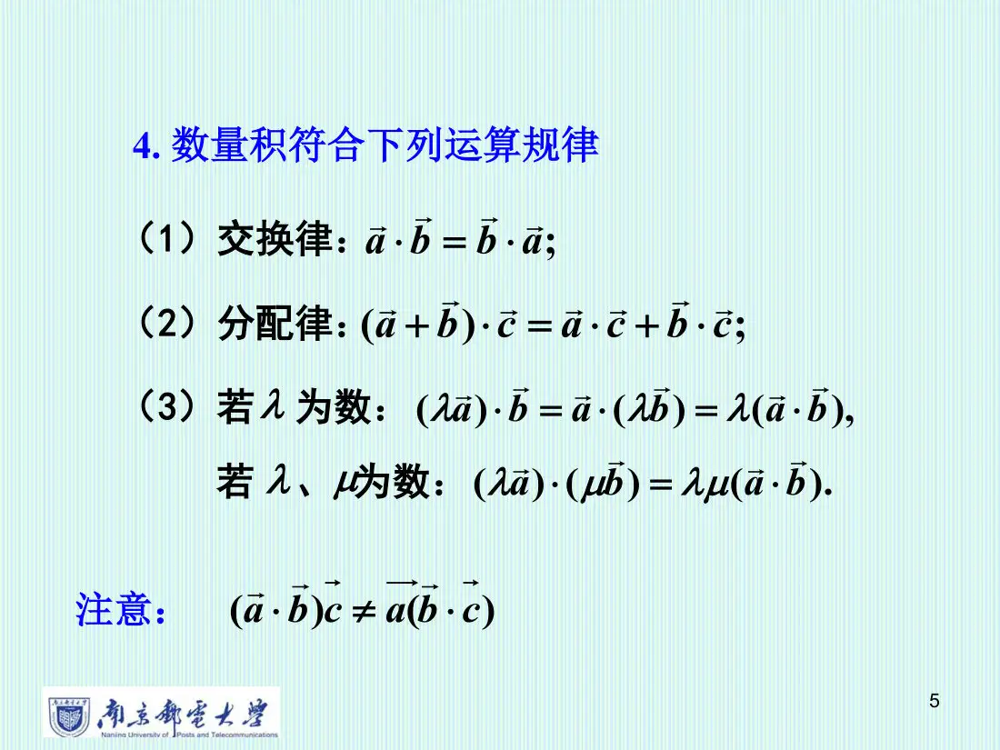

原文：

4. 数量积符合下列运算规律

(1) 交换律: $\vec{a} \cdot \vec{b} = \vec{b} \cdot \vec{a}$ ;

(2) 分配律: $(\vec{a} + \vec{b}) \cdot \vec{c} = \vec{a} \cdot \vec{c} + \vec{b} \cdot \vec{c}$ ;

(3) 若 $\lambda$ 为数: $(\lambda \vec{a}) \cdot \vec{b} = \vec{a} \cdot (\lambda \vec{b}) = \lambda (\vec{a} \cdot \vec{b})$ , 若 $\lambda$ 、 $\mu$ 为数: $(\lambda \vec{a}) \cdot (\mu \vec{b}) = \lambda \mu (\vec{a} \cdot \vec{b})$ .

注意: $(\vec{a} \cdot \vec{b}) \vec{c} \neq \vec{a} (\vec{b} \cdot \vec{c})$

南京邮电大学 Nanjing University of Posts and Telecommunications

5

### 例1 用向量法证明三角形的余弦定理

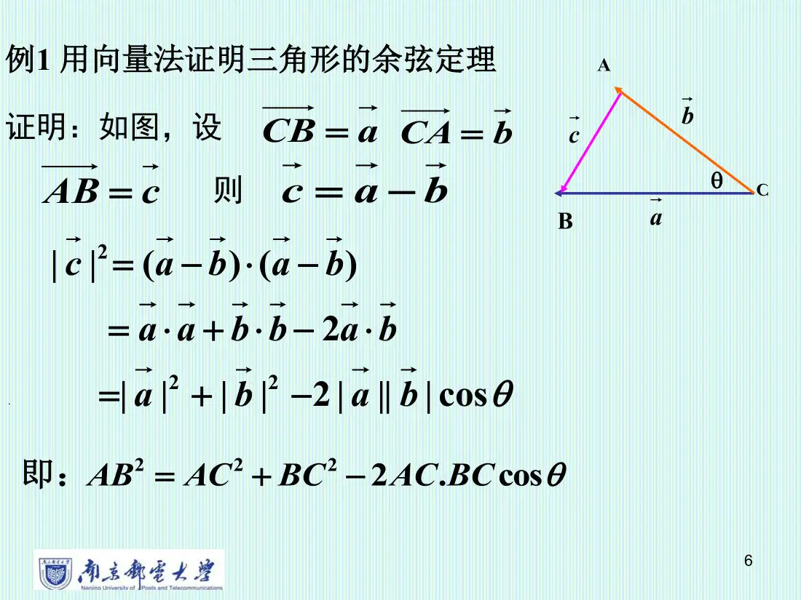

原文：

例1 用向量法证明三角形的余弦定理

证明：如图，设 $\overrightarrow{CB} = \overrightarrow{a}, \overrightarrow{CA} = \overrightarrow{b}$

$$
\overrightarrow {A B} = \overrightarrow {c}
$$

$$
\vec {c} = \vec {a} - \vec {b}
$$

$$
\begin{array}{r l} & {| \vec {c} | ^ {2} = (\vec {a} - \vec {b}) \cdot (\vec {a} - \vec {b})} \\ & {\qquad = \vec {a} \cdot \vec {a} + \vec {b} \cdot \vec {b} - 2 \vec {a} \cdot \vec {b}} \\ & {\qquad = | \vec {a} | ^ {2} + | \vec {b} | ^ {2} - 2 | \vec {a} | | \vec {b} | \cos \theta} \end{array}
$$

即: $AB^{2} = AC^{2} + BC^{2} - 2AC.BC\cos \theta$

南京邮电大学
Nanjing University of Posts and Telecommunications

6

### 解: 因为

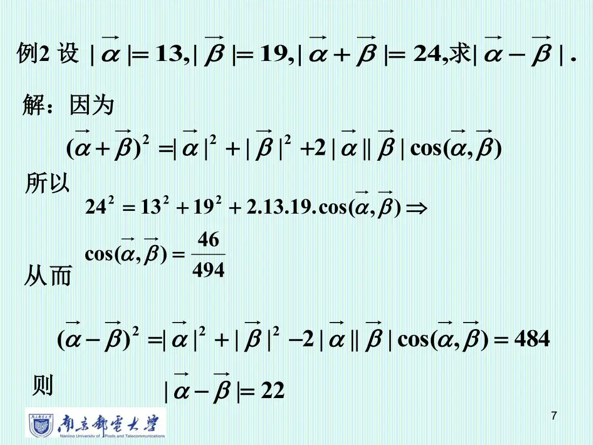

原文：

例2 设 $|\vec{\alpha}| = 13, |\vec{\beta}| = 19, |\vec{\alpha} + \vec{\beta}| = 24$ , 求 $|\vec{\alpha} - \vec{\beta}|$ .

解: 因为

$$
(\vec {\alpha} + \vec {\beta}) ^ {2} = | \vec {\alpha} | ^ {2} + | \vec {\beta} | ^ {2} + 2 | \vec {\alpha} | | \vec {\beta} | \cos (\vec {\alpha}, \vec {\beta})
$$

所以

$$
2 4 ^ {2} = 1 3 ^ {2} + 1 9 ^ {2} + 2. 1 3. 1 9. \cos (\vec {\alpha}, \vec {\beta}) \Rightarrow
$$

从而

$$
\cos (\vec {\alpha}, \vec {\beta}) = \frac {4 6}{4 9 4}
$$

$$
\begin{array}{r l} & {(\vec {\alpha} - \vec {\beta}) ^ {2} = | \vec {\alpha} | ^ {2} + | \vec {\beta} | ^ {2} - 2 | \vec {\alpha} | | \vec {\beta} | \cos (\vec {\alpha}, \vec {\beta}) = 4 8 4} \\ {\text {则}} & {| \vec {\alpha} - \vec {\beta} | = 2 2} \end{array}
$$

南京邮电大学
Nanjing University of Posts and Telecommunications

7

### $$

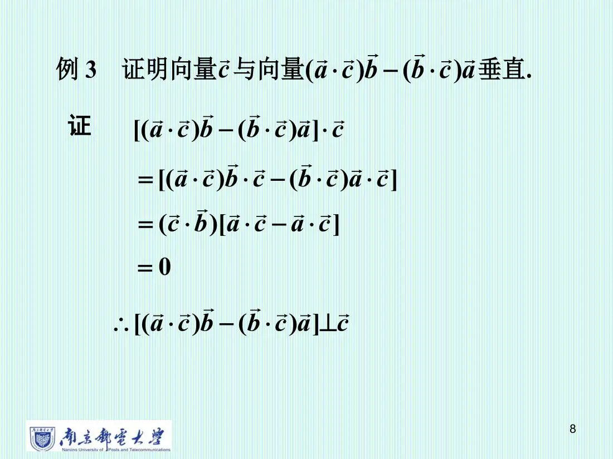

原文：

例 3 证明向量 $\vec{c}$ 与向量 $(\vec{a}\cdot\vec{c})\vec{b}-(\vec{b}\cdot\vec{c})\vec{a}$ 垂直.

证

$$
\begin{array}{r l} & [ (\vec {a} \cdot \vec {c}) \vec {b} - (\vec {b} \cdot \vec {c}) \vec {a} ] \cdot \vec {c} \\ & = [ (\vec {a} \cdot \vec {c}) \vec {b} \cdot \vec {c} - (\vec {b} \cdot \vec {c}) \vec {a} \cdot \vec {c} ] \\ & = (\vec {c} \cdot \vec {b}) [ \vec {a} \cdot \vec {c} - \vec {a} \cdot \vec {c} ] \\ & = 0 \end{array}
$$

$$
\therefore [ (\vec {a} \cdot \vec {c}) \vec {b} - (\vec {b} \cdot \vec {c}) \vec {a} ] \bot \vec {c}
$$

南京邮电大学
Nanjing University of Posts and Telecommunications

8

### 5.数量积的坐标表达式

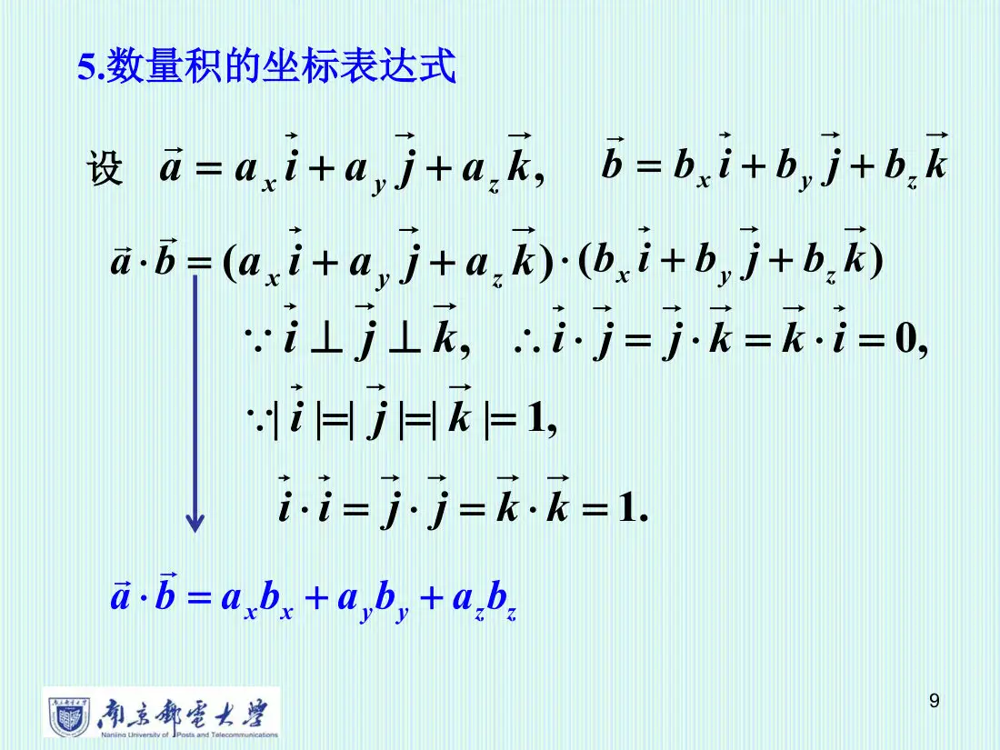

原文：

5.数量积的坐标表达式

$$
\begin{array}{r l} & {\text {设} \quad \vec {a} = a _ {x} \vec {i} + a _ {y} \vec {j} + a _ {z} \vec {k}, \quad \vec {b} = b _ {x} \vec {i} + b _ {y} \vec {j} + b _ {z} \vec {k}} \\ & {\vec {a} \cdot \vec {b} = (a _ {x} \vec {i} + a _ {y} \vec {j} + a _ {z} \vec {k}) \cdot (b _ {x} \vec {i} + b _ {y} \vec {j} + b _ {z} \vec {k})} \\ & {\quad \because \vec {i} \perp \vec {j} \perp \vec {k}, \quad \therefore \vec {i} \cdot \vec {j} = \vec {j} \cdot \vec {k} = \vec {k} \cdot \vec {i} = 0,} \\ & {\quad \because | \vec {i} | = | \vec {j} | = | \vec {k} | = 1,} \\ & {\quad \vec {i} \cdot \vec {i} = \vec {j} \cdot \vec {j} = \vec {k} \cdot \vec {k} = 1.} \end{array}
$$

$$
\vec {a} \cdot \vec {b} = a _ {x} b _ {x} + a _ {y} b _ {y} + a _ {z} b _ {z}
$$

南京邮电大学
Nanjing University of Posts and Telecommunications

9

### $$

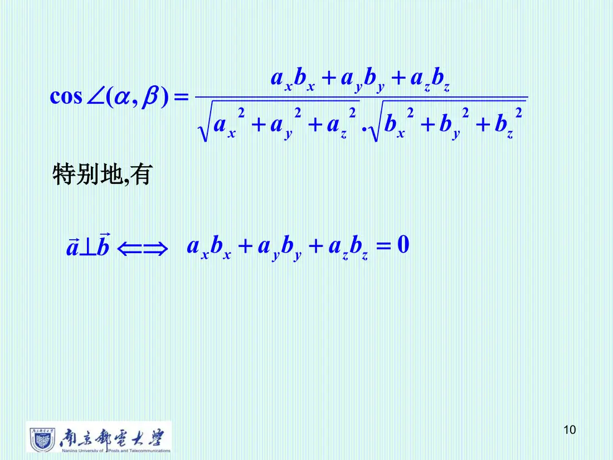

原文：

$$
\cos \angle (\alpha , \beta) = \frac {a _ {x} b _ {x} + a _ {y} b _ {y} + a _ {z} b _ {z}}{\sqrt {a _ {x} ^ {2} + a _ {y} ^ {2} + a _ {z} ^ {2}} \cdot \sqrt {b _ {x} ^ {2} + b _ {y} ^ {2} + b _ {z} ^ {2}}}
$$

特别地,有

$$
\vec {a} \bot \vec {b} \Longleftrightarrow a _ {x} b _ {x} + a _ {y} b _ {y} + a _ {z} b _ {z} = 0
$$

南京邮电大学
Nanjing University of Posts and Telecommunications

10

### $$

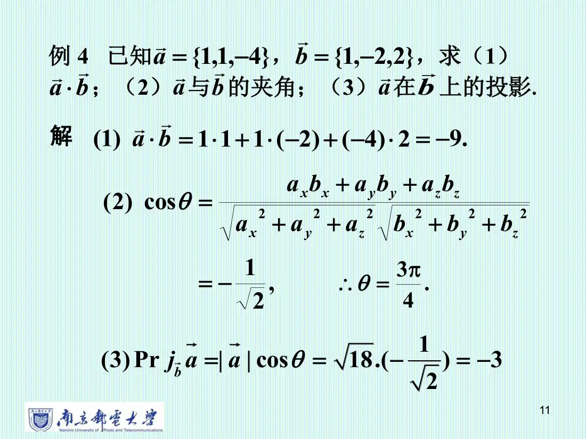

原文：

例 4 已知 $\vec{a}=\{1,1,-4\}$ ， $\vec{b}=\{1,-2,2\}$ ，求（1） $\vec{a}\cdot\vec{b}$ ; （2） $\vec{a}$ 与 $\vec{b}$ 的夹角；（3） $\vec{a}$ 在 $\vec{b}$ 上的投影.

解 (1) $\vec{a} \cdot \vec{b} = 1 \cdot 1 + 1 \cdot (-2) + (-4) \cdot 2 = -9$ .

(2) $\cos\theta=\frac{a_{x}b_{x}+a_{y}b_{y}+a_{z}b_{z}}{\sqrt{a_{x}^{2}+a_{y}^{2}+a_{z}^{2}}\sqrt{b_{x}^{2}+b_{y}^{2}+b_{z}^{2}}}$ $=-\frac{1}{\sqrt{2}},\quad\therefore\theta=\frac{3\pi}{4}.$

$$
\operatorname * {P r} j _ {\vec {b}} \vec {a} = | \vec {a} | \cos \theta = \sqrt {1 8}. (- \frac {1}{\sqrt {2}}) = - 3
$$

南京邮电大学
Nanjing University of Posts and Telecommunications

11

### 3.2.2 向量的向量积

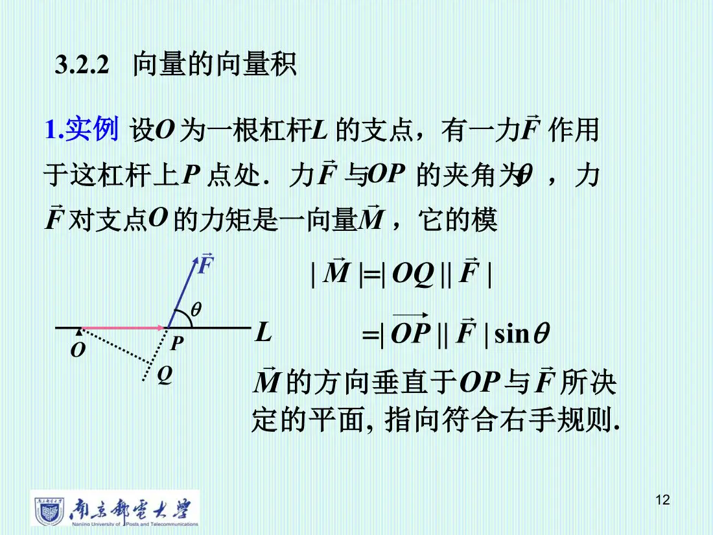

原文：

3.2.2 向量的向量积

1. 实例 设O为一根杠杆L的支点，有一力 $\vec{F}$ 作用于这杠杆上P点处。力 $\vec{F}$ 与OP的夹角为 $\theta$ ，力 $\vec{F}$ 对支点O的力矩是一向量 $\vec{M}$ ，它的模

$$
\begin{array}{r l} {| \vec {M} | = | O Q | | \vec {F} |} & \\ {= | \overrightarrow {O P} | | \vec {F} | \sin \theta} & \end{array}
$$

$\vec{M}$ 的方向垂直于OP与 $\vec{F}$ 所决定的平面, 指向符合右手规则.

南京邮电大学
Nanjing University of Posts and Telecommunications

12

### 3. 向量积的性质

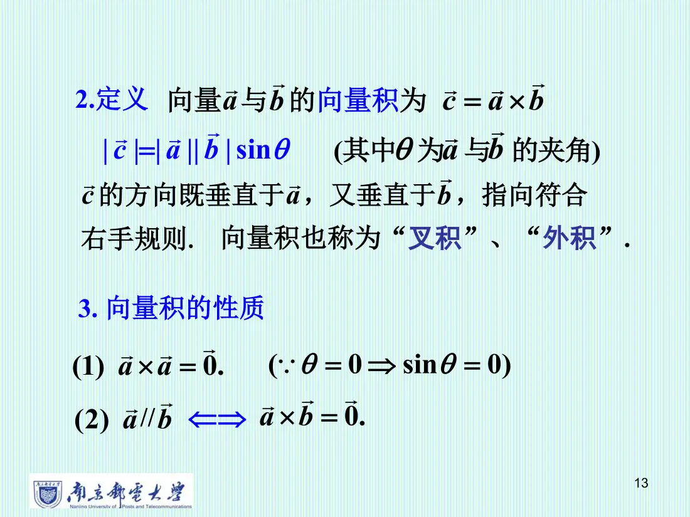

原文：

2. 定义 向量 $\vec{a}$ 与 $\vec{b}$ 的向量积为 $\vec{c} = \vec{a} \times \vec{b}$ $|\vec{c}| = |\vec{a}||\vec{b}| \sin \theta$ （其中 $\theta$ 为 $\vec{a}$ 与 $\vec{b}$ 的夹角） $\vec{c}$ 的方向既垂直于 $\vec{a}$ ，又垂直于 $\vec{b}$ ，指向符合右手规则。向量积也称为 “叉积”、“外积”。

3. 向量积的性质

(1) $\vec{a} \times \vec{a} = \vec{0}.$ $(\because \theta = 0 \Rightarrow \sin \theta = 0)$

(2) $\vec{a} // \vec{b} \iff \vec{a} \times \vec{b} = \vec{0}.$

南京邮电大学
Nanjing University of Posts and Telecommunications

13

### 4. 向量积符合下列运算规律

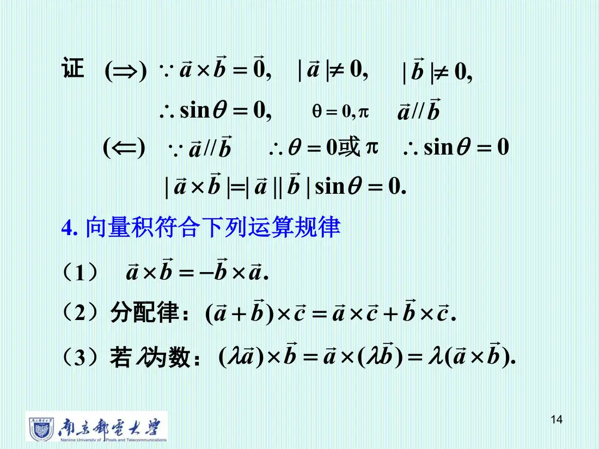

原文：

证 $(\Rightarrow)$ $\because \vec{a} \times \vec{b} = \vec{0},$ $|\vec{a}| \neq 0,$ $|\vec{b}| \neq 0,$ $\therefore \sin \theta = 0,$ $\theta = 0,\pi$ $\vec{a} // \vec{b}$

(⇐) ∵ $\vec{a} // \vec{b}$ ∴ $\theta = 0$ 或 $\pi$ ∴ $\sin\theta = 0$ $|\vec{a}\times\vec{b}|=|\vec{a}||\vec{b}|\sin\theta=0.$

4. 向量积符合下列运算规律

(1) $\vec{a} \times \vec{b} = -\vec{b} \times \vec{a}$ .

(2) 分配律: $(\vec{a} + \vec{b}) \times \vec{c} = \vec{a} \times \vec{c} + \vec{b} \times \vec{c}$ .

(3) 若 $\lambda$ 为数： $(\lambda\vec{a})\times\vec{b}=\vec{a}\times(\lambda\vec{b})=\lambda(\vec{a}\times\vec{b})$ .

南京邮电大学
Nanjing University of Posts and Telecommunications

14

### 5. 几何意义

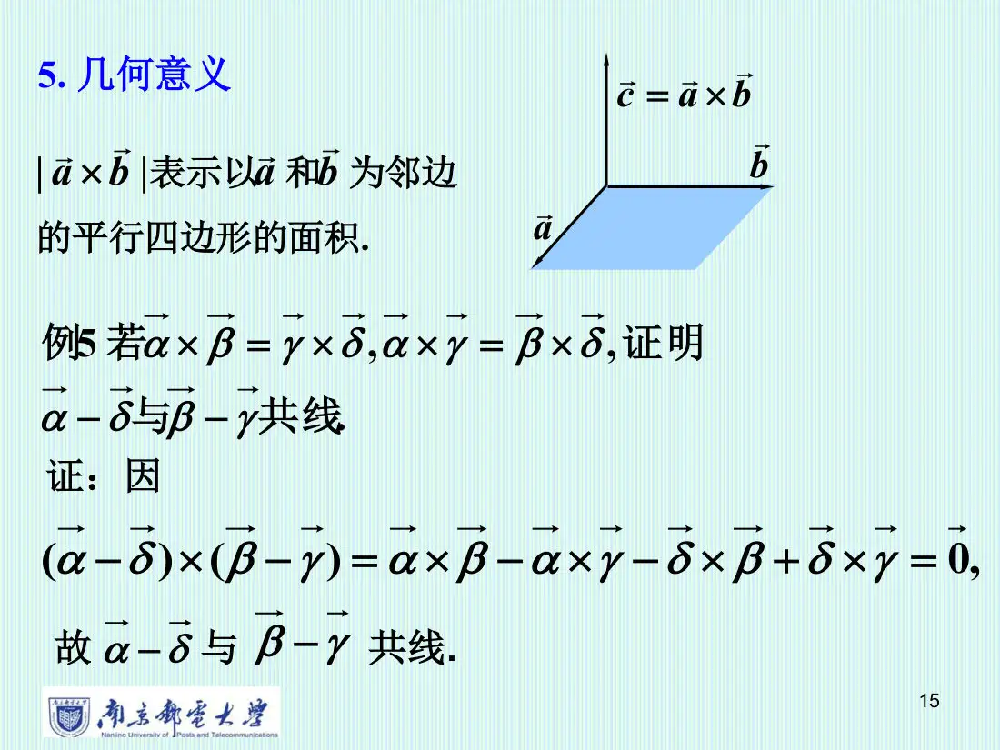

原文：

5. 几何意义

$|\vec{a}\times\vec{b}|$ 表示以 $\vec{a}$ 和 $\vec{b}$ 为邻边的平行四边形的面积.

例5 若 $\vec{\alpha} \times \vec{\beta} = \vec{\gamma} \times \vec{\delta}, \vec{\alpha} \times \vec{\gamma} = \vec{\beta} \times \vec{\delta}$ , 证明 $\vec{\alpha} - \vec{\delta}$ 与 $\vec{\beta} - \vec{\gamma}$ 共线

证：因

$(\vec{\alpha} - \vec{\delta}) \times (\vec{\beta} - \vec{\gamma}) = \vec{\alpha} \times \vec{\beta} - \vec{\alpha} \times \vec{\gamma} - \vec{\delta} \times \vec{\beta} + \vec{\delta} \times \vec{\gamma} = \vec{0},$ 故 $\vec{\alpha} - \vec{\delta}$ 与 $\vec{\beta} - \vec{\gamma}$ 共线.

南京邮电大学
Nanjing University of Posts and Telecommunications

15

### 6. 向量积的坐标表达式

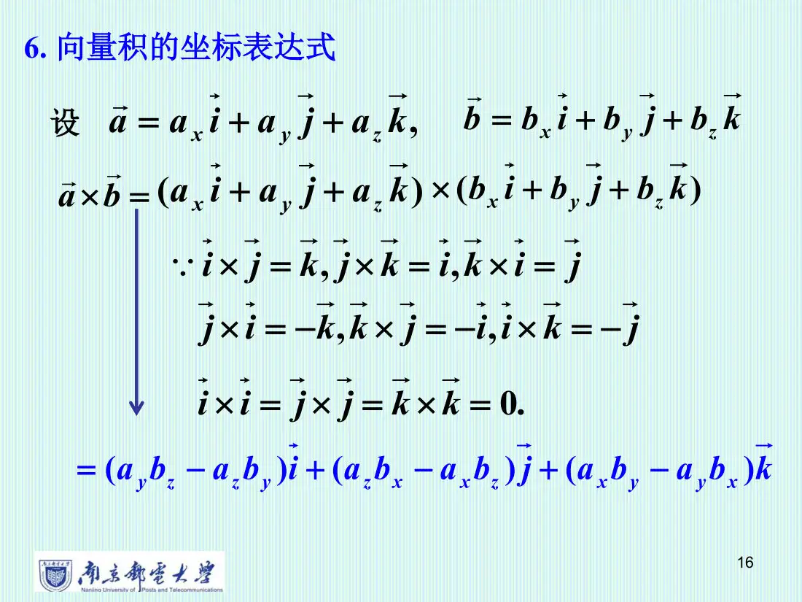

原文：

6. 向量积的坐标表达式

$$
\begin{array}{r l}&{\text {设} \vec {a} = a _ {x} \vec {i} + a _ {y} \vec {j} + a _ {z} \vec {k}, \quad \vec {b} = b _ {x} \vec {i} + b _ {y} \vec {j} + b _ {z} \vec {k}}\\&{\vec {a} \times \vec {b} = (a _ {x} \vec {i} + a _ {y} \vec {j} + a _ {z} \vec {k}) \times (b _ {x} \vec {i} + b _ {y} \vec {j} + b _ {z} \vec {k})}\\&{\quad \left\downarrow\begin{array}{l l}{\because \vec {i} \times \vec {j} = \vec {k}, \vec {j} \times \vec {k} = \vec {i}, \vec {k} \times \vec {i} = \vec {j}}\\{\vec {j} \times \vec {i} = - \vec {k}, \vec {k} \times \vec {j} = - \vec {i}, \vec {i} \times \vec {k} = - \vec {j}}\\{\vec {i} \times \vec {i} = \vec {j} \times \vec {j} = \vec {k} \times \vec {k} = 0.}\end{array}\left. \right.}\\&{\quad = (a _ {y} b _ {z} - a _ {z} b _ {y}) \vec {i} + (a _ {z} b _ {x} - a _ {x} b _ {z}) \vec {j} + (a _ {x} b _ {y} - a _ {y} b _ {x}) \vec {k}}\end{array}
$$

南京邮电大学
Nanjing University of Posts and Telecommunications

16

### 向量积还可用三阶行列式表示

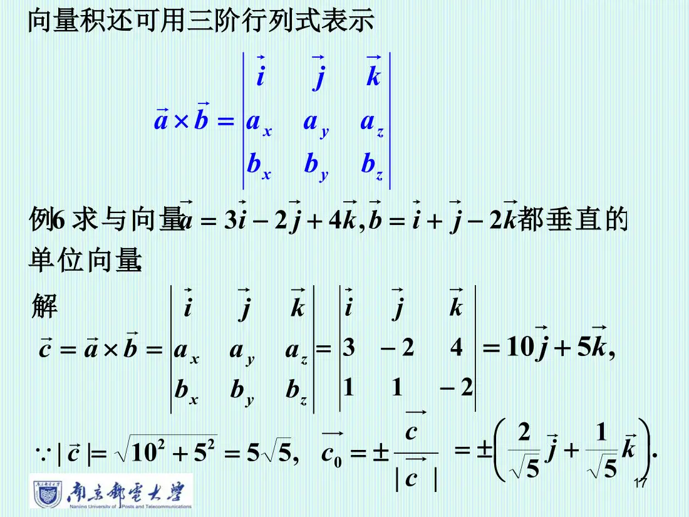

原文：

向量积还可用三阶行列式表示

$$
\vec {a} \times \vec {b} = \left| \begin{array}{c c c} \vec {i} & \vec {j} & \vec {k} \\ a _ {x} & a _ {y} & a _ {z} \\ b _ {x} & b _ {y} & b _ {z} \end{array} \right|
$$

例6 求与向量 $\vec{a}=3\vec{i}-2\vec{j}+4\vec{k},\vec{b}=\vec{i}+\vec{j}-2\vec{k}$ 都垂直的单位向量

$$
\vec {c} = \vec {a} \times \vec {b} = \left| \begin{array}{l l l} \vec {i} & \vec {j} & \vec {k} \\ a _ {x} & a _ {y} & a _ {z} \\ b _ {x} & b _ {y} & b _ {z} \end{array} \right| = \left| \begin{array}{l l l} \vec {i} & \vec {j} & \vec {k} \\ 3 & - 2 & 4 \\ 1 & 1 & - 2 \end{array} \right| = 1 0 \vec {j} + 5 \vec {k},
$$

$$
\because | \vec {c} | = \sqrt {1 0 ^ {2} + 5 ^ {2}} = 5 \sqrt {5}, \quad \overrightarrow {c _ {0}} = \pm \frac {c}{| \overrightarrow {c} |} = \pm \left(\frac {2}{\sqrt {5}} \vec {j} + \frac {1}{\sqrt {5}} \vec {k}\right).
$$

### $$

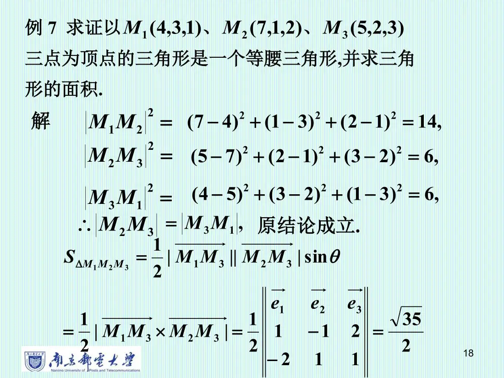

原文：

例 7 求证以 $M_{1}(4,3,1)$ 、 $M_{2}(7,1,2)$ 、 $M_{3}(5,2,3)$ 三点为顶点的三角形是一个等腰三角形,并求三角形的面积.

解

$$
\begin{array}{r l} {\left| M _ {1} M _ {2} \right| ^ {2} =} & {(7 - 4) ^ {2} + (1 - 3) ^ {2} + (2 - 1) ^ {2} = 1 4,} \\ {\left| M _ {2} M _ {3} \right| ^ {2} =} & {(5 - 7) ^ {2} + (2 - 1) ^ {2} + (3 - 2) ^ {2} = 6,} \\ {\left| M _ {3} M _ {1} \right| ^ {2} =} & {(4 - 5) ^ {2} + (3 - 2) ^ {2} + (1 - 3) ^ {2} = 6,} \\ {\therefore \left| M _ {2} M _ {3} \right| = \left| M _ {3} M _ {1} \right|, \text {原结论成立}.} \end{array}
$$

$$
S _ {\Delta M _ {1} M _ {2} M _ {3}} = \frac {1}{2} | \overrightarrow {M _ {1} M _ {3}} \| \overrightarrow {M _ {2} M _ {3}} | \sin \theta
$$

$$
= \frac {1}{2} | \overrightarrow {M _ {1} M _ {3}} \times \overrightarrow {M _ {2} M _ {3}} | = \frac {1}{2} \left\| \begin{array}{c c c} \overrightarrow {e _ {1}} & \overrightarrow {e _ {2}} & \overrightarrow {e _ {3}} \\ 1 & - 1 & 2 \\ - 2 & 1 & 1 \end{array} \right\| = \frac {\sqrt {3 5}}{2}
$$

18

### 3.2.3 向量的混合积

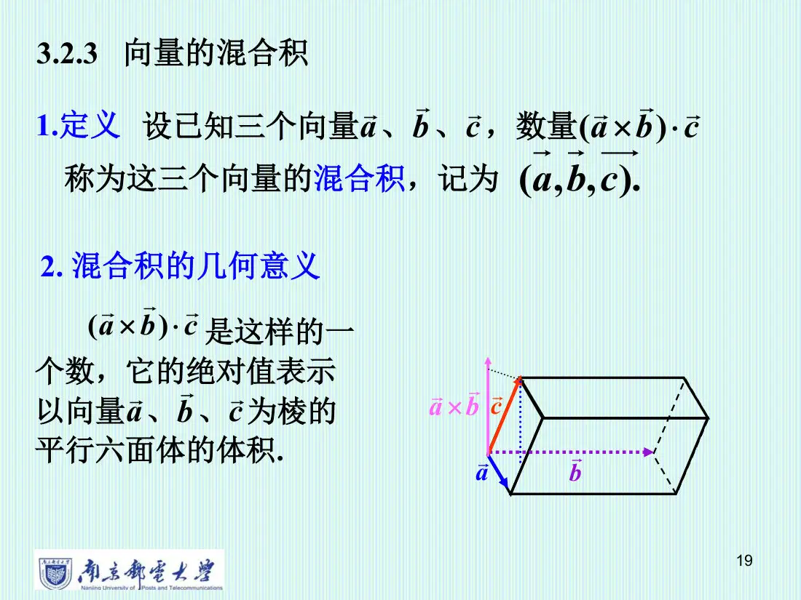

原文：

3.2.3 向量的混合积

1. 定义 设已知三个向量 $\vec{a}$ 、 $\vec{b}$ 、 $\vec{c}$ ，数量 $(\vec{a} \times \vec{b}) \cdot \vec{c}$ 称为这三个向量的混合积，记为 $(\vec{a}, \vec{b}, \vec{c})$ .

2. 混合积的几何意义

$(\vec{a} \times \vec{b}) \cdot \vec{c}$ 是这样的一个数，它的绝对值表示以向量 $\vec{a}$ 、 $\vec{b}$ 、 $\vec{c}$ 为棱的平行六面体的体积.

南京邮电大学
Nanjing University of Posts and Telecommunications

19

### 3. 混合积的坐标表达式

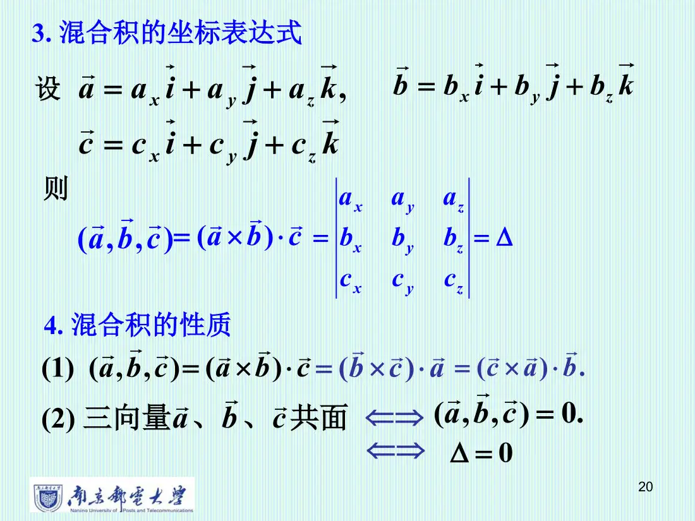

原文：

3. 混合积的坐标表达式

$$
\begin{array}{r l} & {\text {设} \vec {a} = a _ {x} \vec {i} + a _ {y} \vec {j} + a _ {z} \vec {k}, \quad \vec {b} = b _ {x} \vec {i} + b _ {y} \vec {j} + b _ {z} \vec {k}} \\ & {\vec {c} = c _ {x} \vec {i} + c _ {y} \vec {j} + c _ {z} \vec {k}} \\ & {\text {则}} \\ & {(\vec {a}, \vec {b}, \vec {c}) = (\vec {a} \times \vec {b}) \cdot \vec {c} = \left| \begin{array}{l l l} a _ {x} & a _ {y} & a _ {z} \\ b _ {x} & b _ {y} & b _ {z} \\ c _ {x} & c _ {y} & c _ {z} \end{array} \right| = \Delta} \end{array}
$$

4. 混合积的性质

(1) $(\vec{a},\vec{b},\vec{c})=(\vec{a}\times\vec{b})\cdot\vec{c}=(\vec{b}\times\vec{c})\cdot\vec{a}=(\vec{c}\times\vec{a})\cdot\vec{b}.$

(2) 三向量 $\vec{a}$ 、 $\vec{b}$ 、 $\vec{c}$ 共面 $\Longleftrightarrow (\vec{a}, \vec{b}, \vec{c}) = 0$ . $\Longleftrightarrow \Delta = 0$

南京邮电大学 Nanjing University of Posts and Telecommunications

20

### 例8 已知 $[\vec{a}\vec{b}\vec{c}]=2$ ，

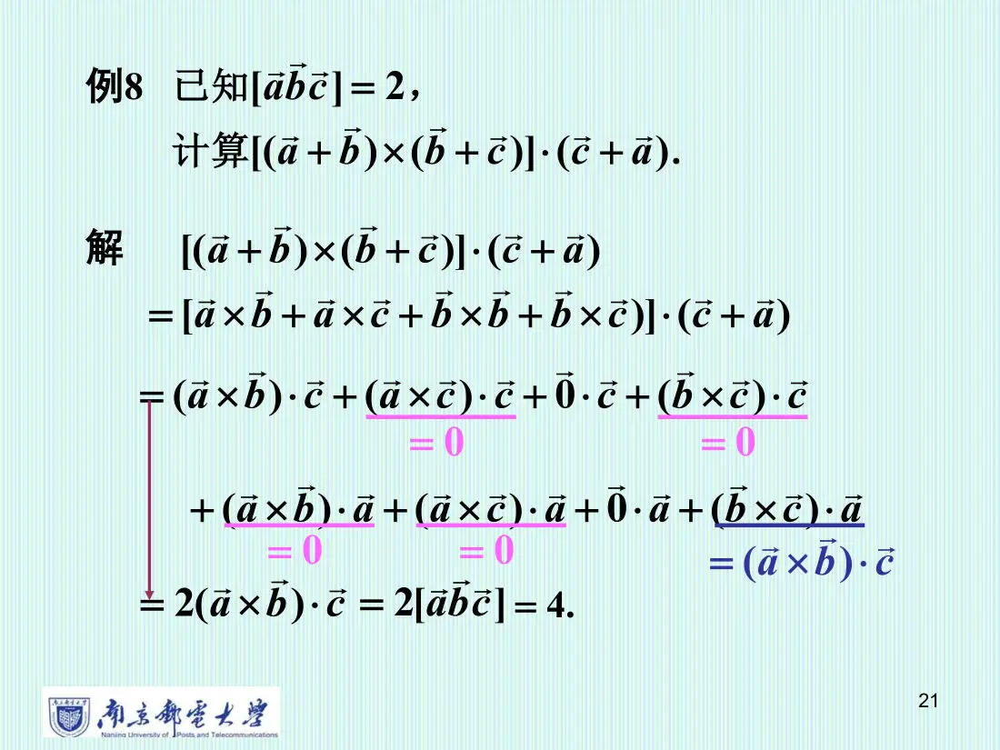

原文：

例8 已知 $[\vec{a}\vec{b}\vec{c}]=2$ ，

计算 $[( \vec{a} +\vec{b})\times (\vec{b} +\vec{c})]\cdot (\vec{c} +\vec{a}).$

解

$$
\begin{array}{r l} & [ (\vec {a} + \vec {b}) \times (\vec {b} + \vec {c}) ] \cdot (\vec {c} + \vec {a}) \\ & = [ \vec {a} \times \vec {b} + \vec {a} \times \vec {c} + \vec {b} \times \vec {b} + \vec {b} \times \vec {c}) ] \cdot (\vec {c} + \vec {a}) \\ & = (\vec {a} \times \vec {b}) \cdot \vec {c} + \underbrace {(\vec {a} \times \vec {c}) \cdot \vec {c}} _ {= 0} + \vec {0} \cdot \vec {c} + \underbrace {(\vec {b} \times \vec {c}) \cdot \vec {c}} _ {= 0} \\ & + (\vec {a} \times \vec {b}) \cdot \vec {a} + \underbrace {(\vec {a} \times \vec {c}) \cdot \vec {a}} _ {= 0} + \vec {0} \cdot \vec {a} + \underbrace {(\vec {b} \times \vec {c}) \cdot \vec {a}} _ {= (\vec {a} \times \vec {b}) \cdot \vec {c}} \\ & = 2 (\vec {a} \times \vec {b}) \cdot \vec {c} = 2 [ \vec {a} \vec {b} \vec {c} ] = 4. \end{array}
$$

南京邮电大学
Nanjing University of Posts and Telecommunications

21

### 南京邮电大学

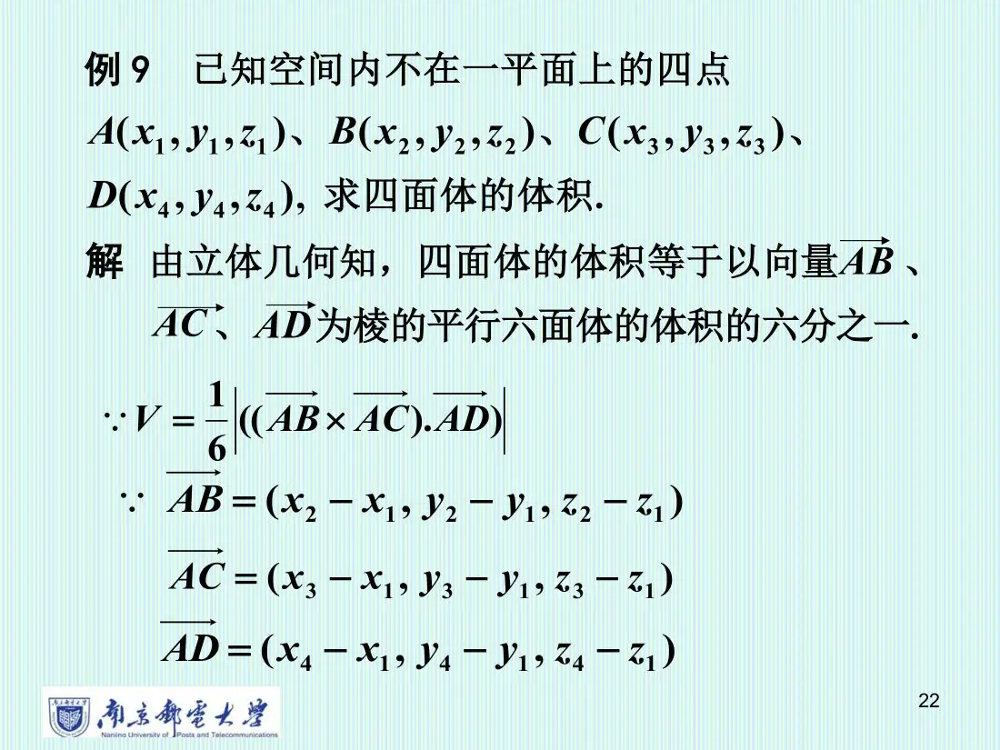

原文：

例 9 已知空间内不在一平面上的四点 $A(x_{1},y_{1},z_{1})$ 、 $B(x_{2},y_{2},z_{2})$ 、 $C(x_{3},y_{3},z_{3})$ 、 $D(x_{4},y_{4},z_{4})$ ，求四面体的体积.

解 由立体几何知, 四面体的体积等于以向量 $\overrightarrow{AB}$ 、 $\overrightarrow{AC}$ 、 $\overrightarrow{AD}$ 为棱的平行六面体的体积的六分之一.

$\because V = \frac{1}{6}\left|((\overrightarrow{AB} \times \overrightarrow{AC}).\overrightarrow{AD})\right|$ $\because \overrightarrow{AB} = (x_2 - x_1, y_2 - y_1, z_2 - z_1)$ $\overrightarrow{AC} = (x_3 - x_1, y_3 - y_1, z_3 - z_1)$ $\overrightarrow{AD} = (x_4 - x_1, y_4 - y_1, z_4 - z_1)$

南京邮电大学
Nanjing University of Posts and Telecommunications

22

### $$

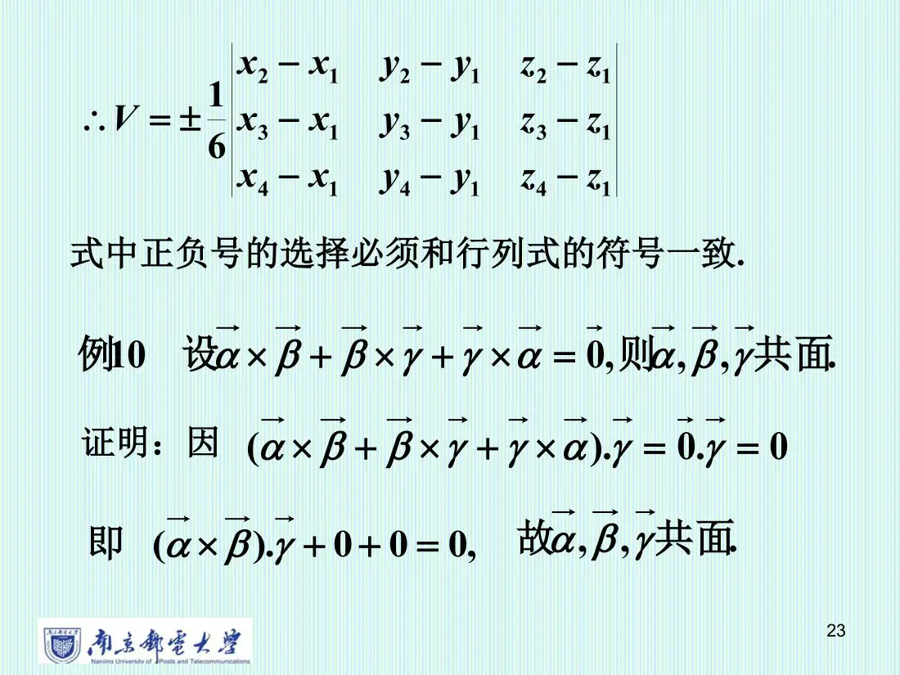

原文：

$$
\therefore V = \pm \frac {1}{6} \left| \begin{array}{c c c} x _ {2} - x _ {1} & y _ {2} - y _ {1} & z _ {2} - z _ {1} \\ x _ {3} - x _ {1} & y _ {3} - y _ {1} & z _ {3} - z _ {1} \\ x _ {4} - x _ {1} & y _ {4} - y _ {1} & z _ {4} - z _ {1} \end{array} \right|
$$

式中正负号的选择必须和行列式的符号一致.

例10 设 $\vec{\alpha} \times \vec{\beta} + \vec{\beta} \times \vec{\gamma} + \vec{\gamma} \times \vec{\alpha} = \vec{0}$ , 则 $\vec{\alpha}, \vec{\beta}, \vec{\gamma}$ 共面.

证明：因 $(\vec{\alpha} \times \vec{\beta} + \vec{\beta} \times \vec{\gamma} + \vec{\gamma} \times \vec{\alpha})\cdot \vec{\gamma} = \vec{0}\cdot \vec{\gamma} = 0$

即 $(\vec{\alpha} \times \vec{\beta}).\vec{\gamma} + 0 + 0 = 0,$ 故 $\vec{\alpha}, \vec{\beta}, \vec{\gamma}$ 共面.

南京邮电大学
Nanjing University of Posts and Telecommunications

23

### 解：

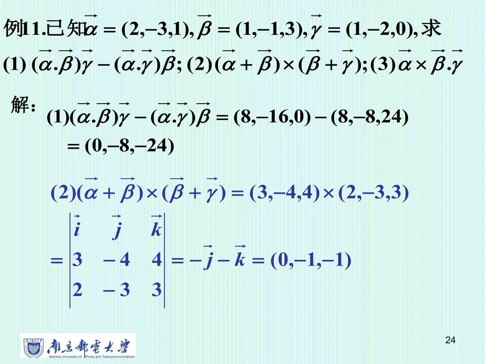

原文：

例1.已知 $\vec{\alpha} = (2, - 3,1),\vec{\beta} = (1, - 1,3),\vec{\gamma} = (1, - 2,0)$ ，求

(1) $(\vec{\alpha}.\vec{\beta})\vec{\gamma} - (\vec{\alpha}.\vec{\gamma})\vec{\beta}; (2)(\vec{\alpha} + \vec{\beta}) \times (\vec{\beta} + \vec{\gamma}); (3)\vec{\alpha} \times \vec{\beta}.\vec{\gamma}$

解：

$$
\begin{array}{r l} & {(1) (\vec {\alpha}. \vec {\beta}) \vec {\gamma} - (\vec {\alpha}. \vec {\gamma}) \vec {\beta} = (8, - 1 6, 0) - (8, - 8, 2 4)} \\ & {\qquad = (0, - 8, - 2 4)} \end{array}
$$

$$
\begin{array}{l} (2) (\vec {\alpha} + \vec {\beta}) \times (\vec {\beta} + \vec {\gamma}) = (3, - 4, 4) \times (2, - 3, 3) \\ = \left| \begin{array}{c c c} \vec {i} & \vec {j} & \vec {k} \\ 3 & - 4 & 4 \\ 2 & - 3 & 3 \end{array} \right| = - \vec {j} - \vec {k} = (0, - 1, - 1) \end{array}
$$

南京邮电大学
Nanjing University of Posts and Telecommunications

24

### $$

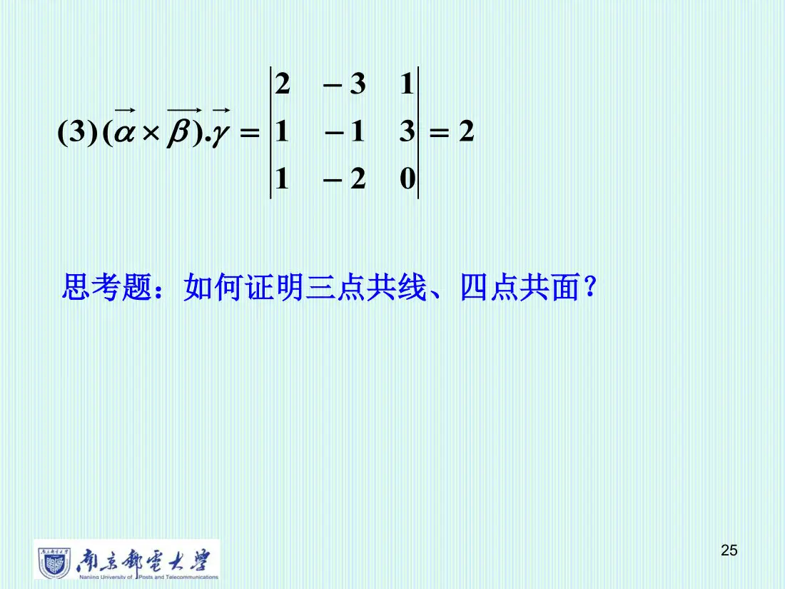

原文：

$$
(\overrightarrow {\alpha} \times \overrightarrow {\beta}). \overrightarrow {\gamma} = \left| \begin{array}{c c c} 2 & - 3 & 1 \\ 1 & - 1 & 3 \\ 1 & - 2 & 0 \end{array} \right| = 2\tag{3}
$$

思考题：如何证明三点共线、四点共面？

南京邮电大学
Nanjing University of Posts and Telecommunications

25
