# 《线性代数与解析几何》第3章 3.4 空间直线（课件）

原件的每一页，下面附识别出的文字。

### 3.4 空间直线

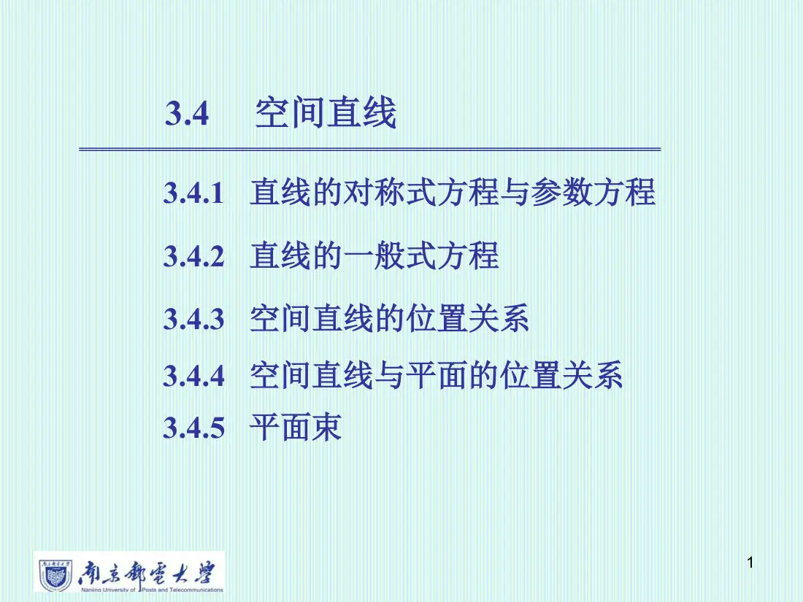

原文：

3.4 空间直线
3.4.1 直线的对称式方程与参数方程
3.4.2 直线的一般式方程
3.4.3 空间直线的位置关系
3.4.4 空间直线与平面的位置关系
3.4.5 平面束

南京邮电大学
Nanjing University of Posts and Telecommunications

1

### 3.4 空间直线

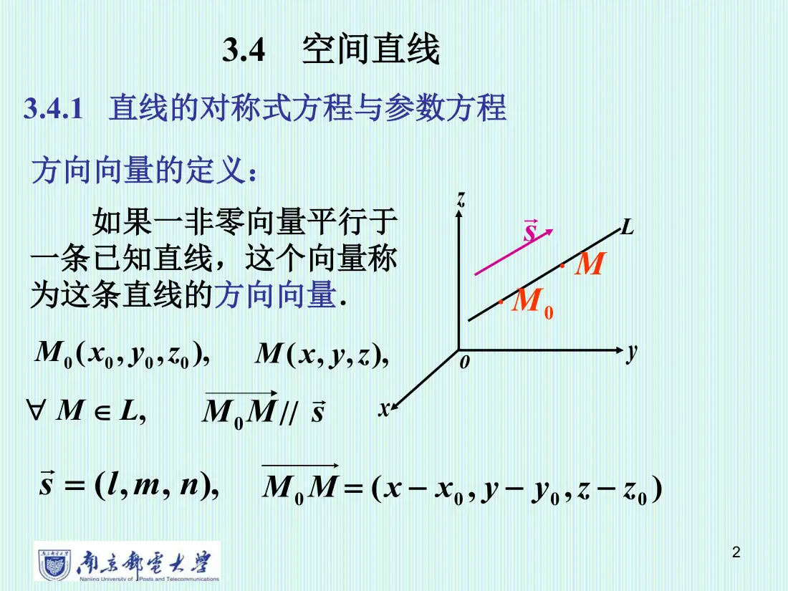

原文：

3.4 空间直线

3.4.1 直线的对称式方程与参数方程

方向向量的定义:

如果一非零向量平行于一条已知直线，这个向量称为这条直线的方向向量。

$$
\begin{array}{l} M _ {0} (x _ {0}, y _ {0}, z _ {0}), \quad M (x, y, z), \\ \forall M \in L, \quad \overrightarrow {M _ {0} M} / / \vec {s} \quad x \end{array}
$$

$$
\vec {s} = (l, m, n), \quad \overrightarrow {M _ {0} M} = (x - x _ {0}, y - y _ {0}, z - z _ {0})
$$

南京邮电大学
Nanjing University of Posts and Telecommunications

2

### $$

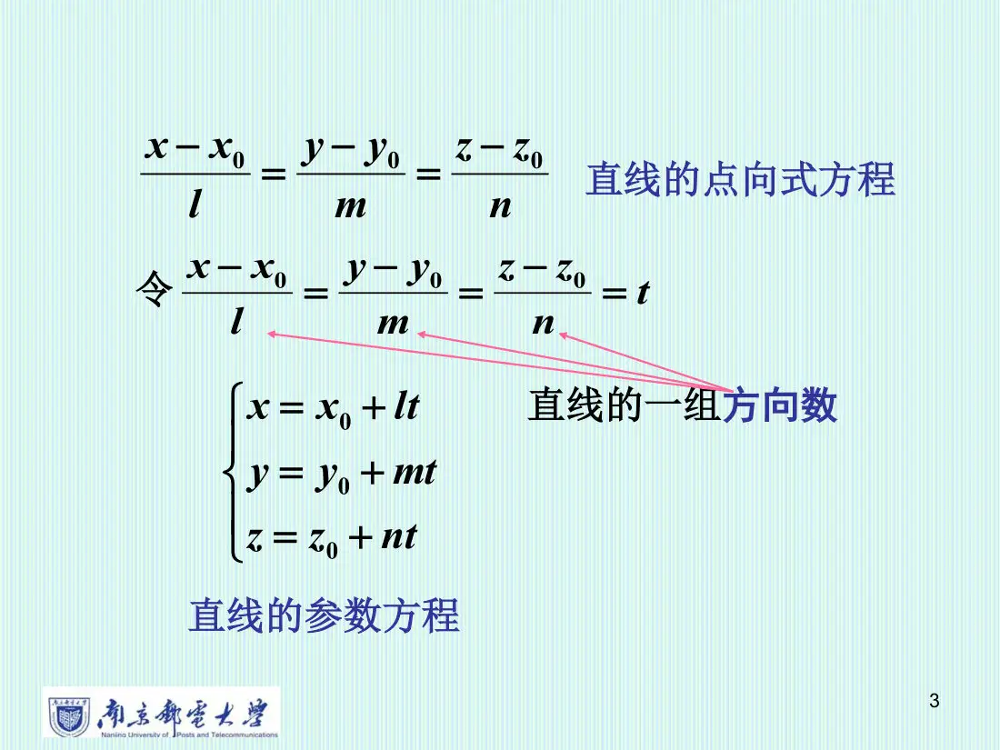

原文：

$\frac{x - x_0}{l} = \frac{y - y_0}{m} = \frac{z - z_0}{n}$ 直线的点向式方程

$$
\text {令} \frac {x - x _ {0}}{l} = \frac {y - y _ {0}}{m} = \frac {z - z _ {0}}{n} = t
$$

$$
\left\{ \begin{array}{l} x = x _ {0} + l t \\ y = y _ {0} + m t \\ z = z _ {0} + n t \end{array} \right.
$$

直线的一组方向数

直线的参数方程

南京邮电大学
Nanjing University of Posts and Telecommunications

3

### $$

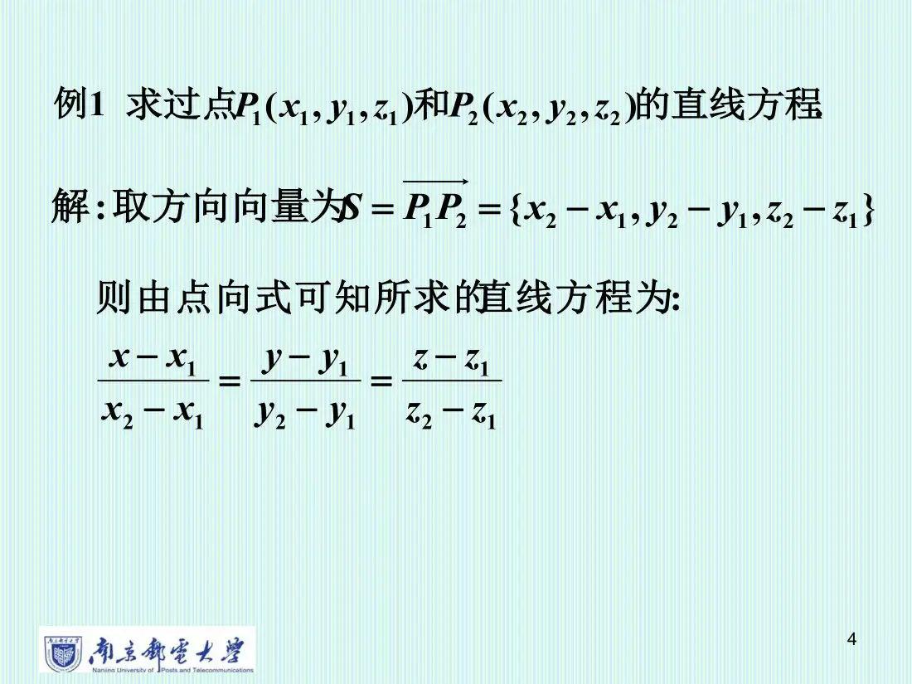

原文：

例1 求过点 $P_{1}(x_{1},y_{1},z_{1})$ 和 $P_{2}(x_{2},y_{2},z_{2})$ 的直线方程解: 取方向向量为 $S = \overrightarrow{P_1P_2} = \{x_2 - x_1,y_2 - y_1,z_2 - z_1\}$ 则由点向式可知所求的直线方程为:

$$
\frac {x - x _ {1}}{x _ {2} - x _ {1}} = \frac {y - y _ {1}}{y _ {2} - y _ {1}} = \frac {z - z _ {1}}{z _ {2} - z _ {1}}
$$

南京邮电大学
Nanjing University of Posts and Telecommunications

4

### 解: 将直线的参数方程代入到平面方程中

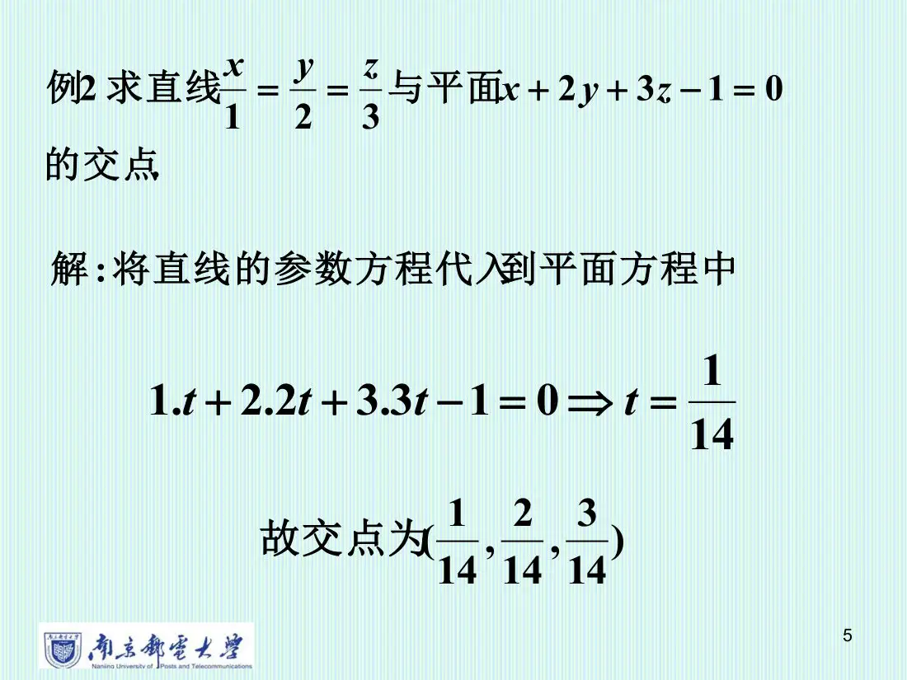

原文：

例2 求直线 $\frac{x}{1} = \frac{y}{2} = \frac{z}{3}$ 与平面 $x + 2y + 3z - 1 = 0$ 的交点

解: 将直线的参数方程代入到平面方程中

$$
1. t + 2. 2 t + 3. 3 t - 1 = 0 \Rightarrow t = \frac {1}{1 4}
$$

故交点为 $\left(\frac{1}{14},\frac{2}{14},\frac{3}{14}\right)$

南京邮电大学
Nanjing University of Posts and Telecommunications

5

### 3.4.2 直线的一般式方程

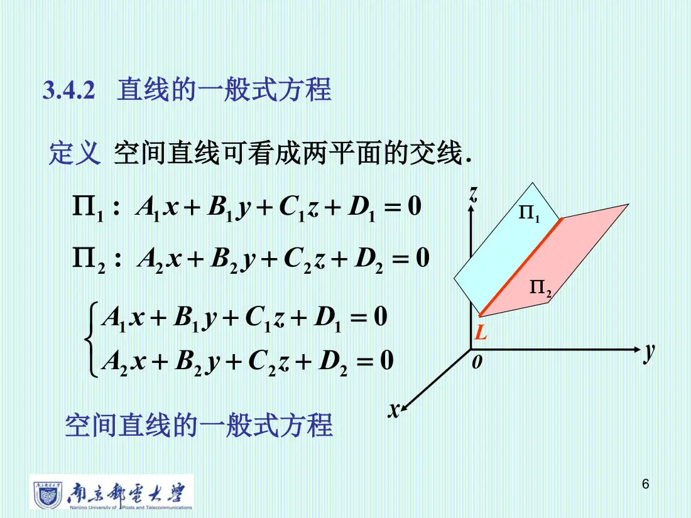

原文：

3.4.2 直线的一般式方程

定义 空间直线可看成两平面的交线.

$$
\Pi_ {1}: A _ {1} x + B _ {1} y + C _ {1} z + D _ {1} = 0
$$

$$
\Pi_ {2}: A _ {2} x + B _ {2} y + C _ {2} z + D _ {2} = 0
$$

$$
\left\{ \begin{array}{l} A _ {1} x + B _ {1} y + C _ {1} z + D _ {1} = 0 \\ A _ {2} x + B _ {2} y + C _ {2} z + D _ {2} = 0 \end{array} \right.
$$

空间直线的一般式方程

南京邮电大学
Nanjing University of Posts and Telecommunications

6

### 例3 用对称式方程及参数方程表示直线

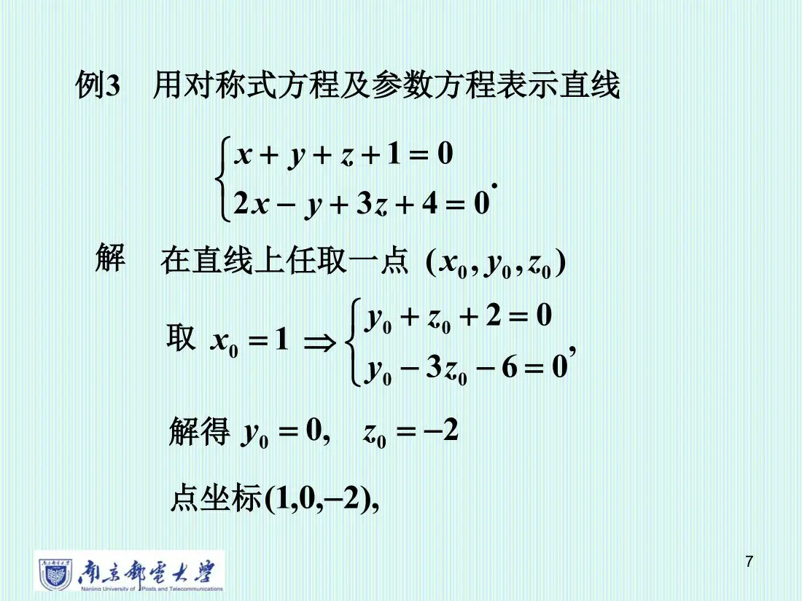

原文：

例3 用对称式方程及参数方程表示直线

$$
\left\{ \begin{array}{l} x + y + z + 1 = 0 \\ 2 x - y + 3 z + 4 = 0 \end{array} \right..
$$

解 在直线上任取一点 $(x_0, y_0, z_0)$

取 $x_0 = 1 \Rightarrow \left\{ \begin{array}{l} y_0 + z_0 + 2 = 0 \\ y_0 - 3z_0 - 6 = 0 \end{array} \right.$ ,

解得 $y_{0} = 0, z_{0} = -2$

点坐标(1,0,-2),

南京邮电大学
Nanjing University of Posts and Telecommunications

7

### 因所求直线与两平面的法向量都垂直

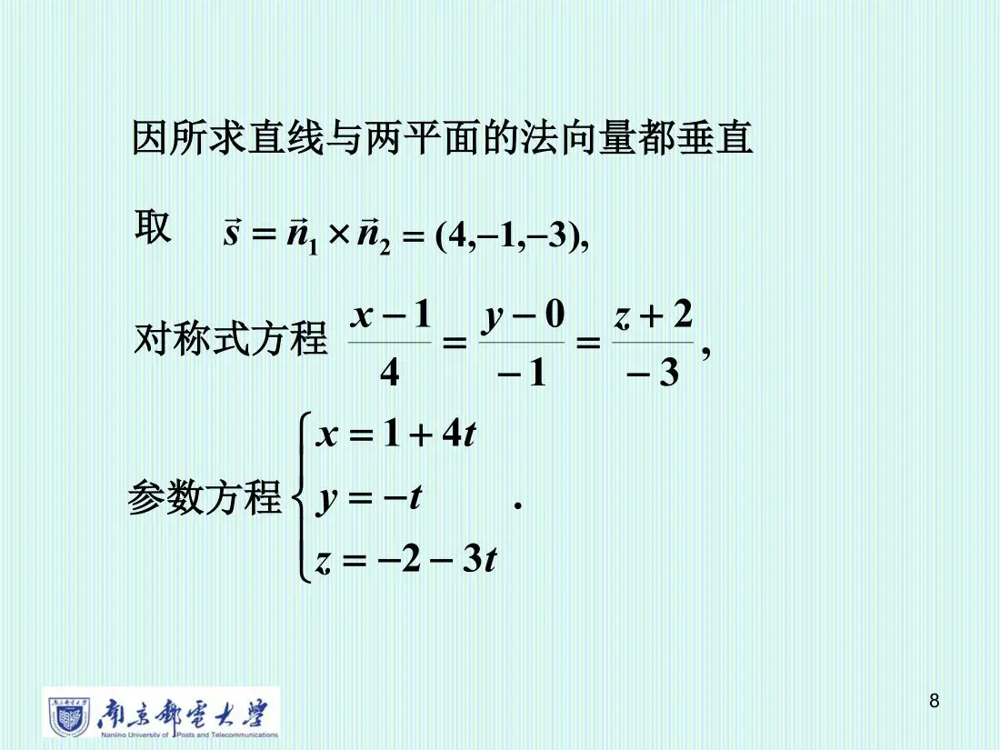

原文：

因所求直线与两平面的法向量都垂直
取 $\vec{s} = \vec{n}_{1} \times \vec{n}_{2} = (4, -1, -3)$ ,
对称式方程 $\frac{x-1}{4}=\frac{y-0}{-1}=\frac{z+2}{-3}$ ,
参数方程 $\left\{\begin{aligned}x&=1+4t\\ y&=-t\\ z&=-2-3t\end{aligned}\right.$

南京邮电大学
Nanjing University of Posts and Telecommunications

8

### 3.4.3 空间直线的位置关系

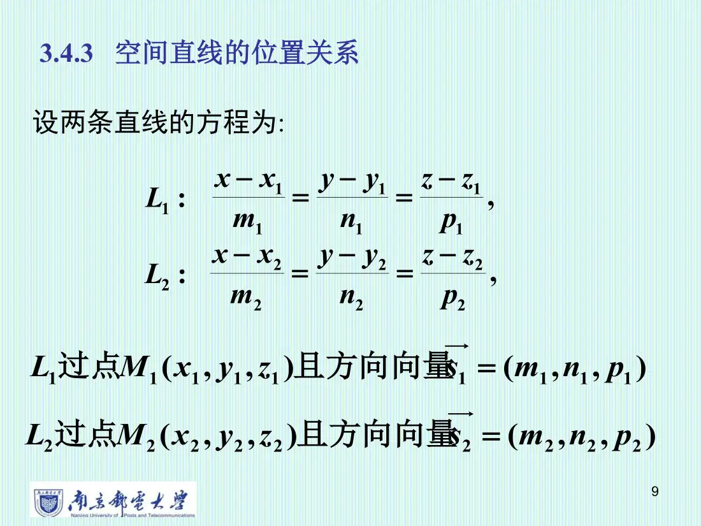

原文：

3.4.3 空间直线的位置关系

设两条直线的方程为:

$$
\begin{array}{l l} L _ {1}: & \frac {x - x _ {1}}{m _ {1}} = \frac {y - y _ {1}}{n _ {1}} = \frac {z - z _ {1}}{p _ {1}}, \\ L _ {2}: & \frac {x - x _ {2}}{m _ {2}} = \frac {y - y _ {2}}{n _ {2}} = \frac {z - z _ {2}}{p _ {2}}, \end{array}
$$

$L_{1}$ 过点 $M_{1}(x_{1},y_{1},z_{1})$ 且方向向量 $s_{1}^{2}=(m_{1},n_{1},p_{1})$ $L_{2}$ 过点 $M_{2}(x_{2},y_{2},z_{2})$ 且方向向量 $s_{2}^{2}=(m_{2},n_{2},p_{2})$

### 则 $L_{1},L_{2}$ 可能平行,重合,相交,异面.

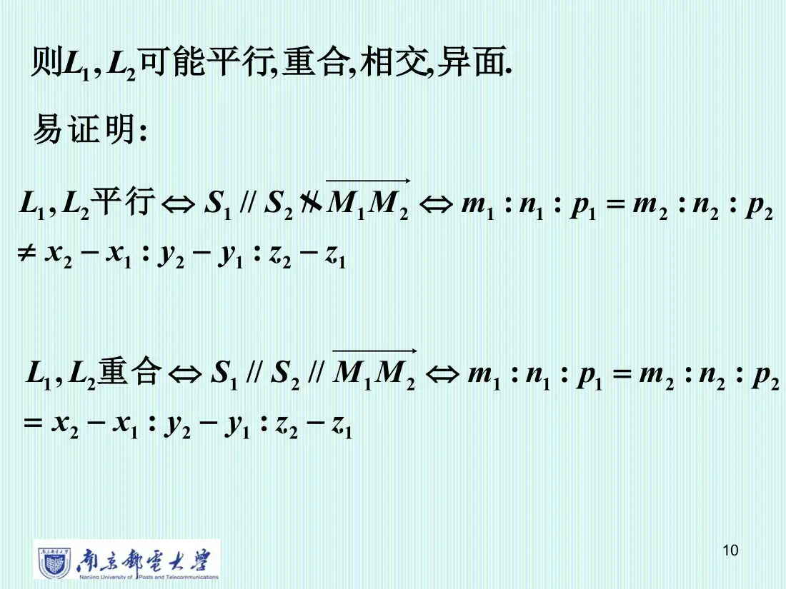

原文：

则 $L_{1},L_{2}$ 可能平行,重合,相交,异面.

易证明:

$L_{1}, L_{2}$ 平行 $\Leftrightarrow S_{1} // S_{2} \nparallel \overrightarrow{M_{1} M_{2}} \Leftrightarrow m_{1}: n_{1}: p_{1} = m_{2}: n_{2}: p_{2}$ $\neq x_{2} - x_{1}: y_{2} - y_{1}: z_{2} - z_{1}$

$$
\begin{array}{l} {L _ {1}, L _ {2} \text {重合} \Leftrightarrow S _ {1} / / S _ {2} / / \overrightarrow {M _ {1} M _ {2}} \Leftrightarrow m _ {1}: n _ {1}: p _ {1} = m _ {2}: n _ {2}: p _ {2}} \\ {= x _ {2} - x _ {1}: y _ {2} - y _ {1}: z _ {2} - z _ {1}} \end{array}
$$

南京邮电大学
Nanjing University of Posts and Telecommunications

10

### $$

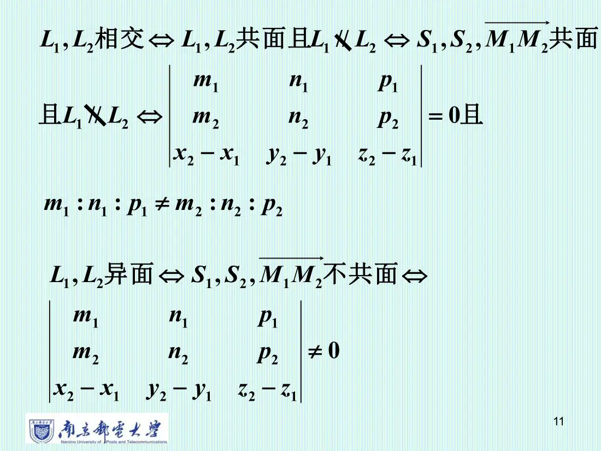

原文：

$L_{1}, L_{2}$ 相交 $\Leftrightarrow L_{1}, L_{2}$ 共面且 $L_{1} \nless L_{2} \Leftrightarrow S_{1}, S_{2}, \overrightarrow{M_{1} M_{2}}$ 共面

$$
\text {且} L _ {1} \times L _ {2} \Leftrightarrow \left| \begin{array}{c c c} m _ {1} & n _ {1} & p _ {1} \\ m _ {2} & n _ {2} & p _ {2} \\ x _ {2} - x _ {1} & y _ {2} - y _ {1} & z _ {2} - z _ {1} \end{array} \right| = 0 \text {且}
$$

$$
m _ {1}: n _ {1}: p _ {1} \neq m _ {2}: n _ {2}: p _ {2}
$$

$L_{1}, L_{2}$ 异面 $\Leftrightarrow S_{1}, S_{2}, \overrightarrow{M_{1}M_{2}}$ 不共面 $\Leftrightarrow$

$$
\left| \begin{array}{ccc} m _ {1} & n _ {1} & p _ {1} \\ m _ {2} & n _ {2} & p _ {2} \\ x _ {2} - x _ {1} & y _ {2} - y _ {1} & z _ {2} - z _ {1} \end{array} \right| \neq 0
$$

南京邮电大学
Nanjing University of Posts and Telecommunications

11

### 两直线的方向向量的夹角称为直线的夹角。（锐角）

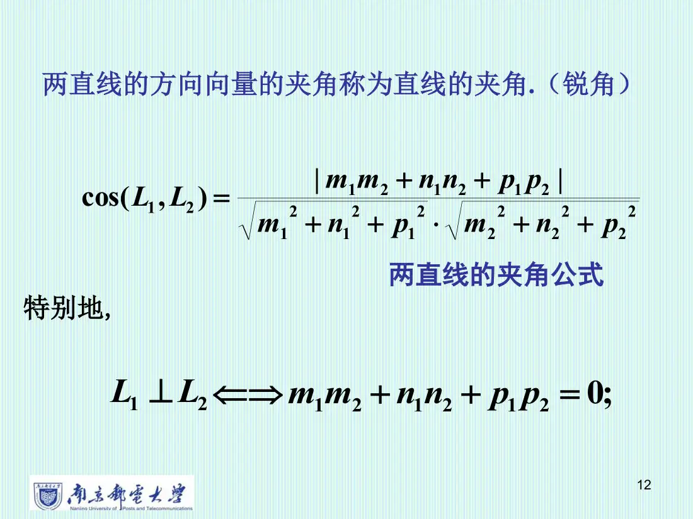

原文：

两直线的方向向量的夹角称为直线的夹角。（锐角）

$$
\cos \left(L _ {1}, L _ {2}\right) = \frac {\left| m _ {1} m _ {2} + n _ {1} n _ {2} + p _ {1} p _ {2} \right|}{\sqrt {m _ {1} ^ {2} + n _ {1} ^ {2} + p _ {1} ^ {2}} \cdot \sqrt {m _ {2} ^ {2} + n _ {2} ^ {2} + p _ {2} ^ {2}}}
$$

两直线的夹角公式

特别地，

$$
L _ {1} \perp L _ {2} \Longleftrightarrow m _ {1} m _ {2} + n _ {1} n _ {2} + p _ {1} p _ {2} = 0;
$$

南京邮电大学
Nanjing University of Posts and Telecommunications

12

### 求点M到L的距离

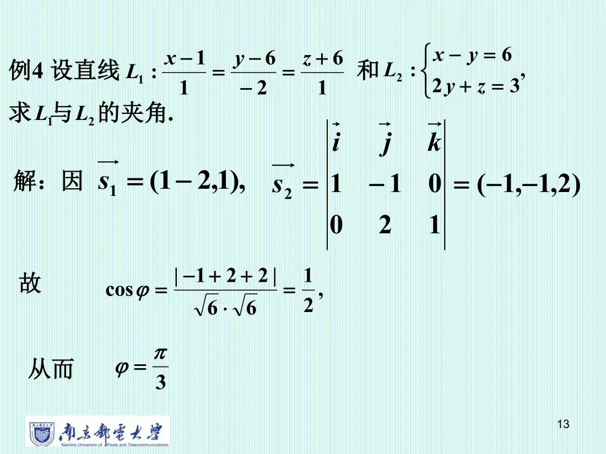

原文：

例4 设直线 $L_{1}:\frac{x-1}{1}=\frac{y-6}{-2}=\frac{z+6}{1}$ 和 $L_{2}:\left\{\begin{aligned}x-y=6\\ 2y+z=3\end{aligned}\right.$ 求 $L_{1}$ 与 $L_{2}$ 的夹角.
解：因 $\overrightarrow{s_{1}}=(1-2,1),\quad\overrightarrow{s_{2}}=\left|\begin{matrix}\vec{i}&\vec{j}&\vec{k}\\ 1&-1&0\\ 0&2&1\end{matrix}\right|=(-1,-1,2)$ 故 $\cos\varphi=\frac{|-1+2+2|}{\sqrt{6}\cdot\sqrt{6}}=\frac{1}{2},$ 从而 $\varphi=\frac{\pi}{3}$ 例5 设点 $M(x_{1},y_{1},z_{1})$ ，直线 $L:\frac{x-x_{0}}{l}=\frac{y-y_{0}}{m}=\frac{z-z_{0}}{n}$ ，
求点M到L的距离

### $$

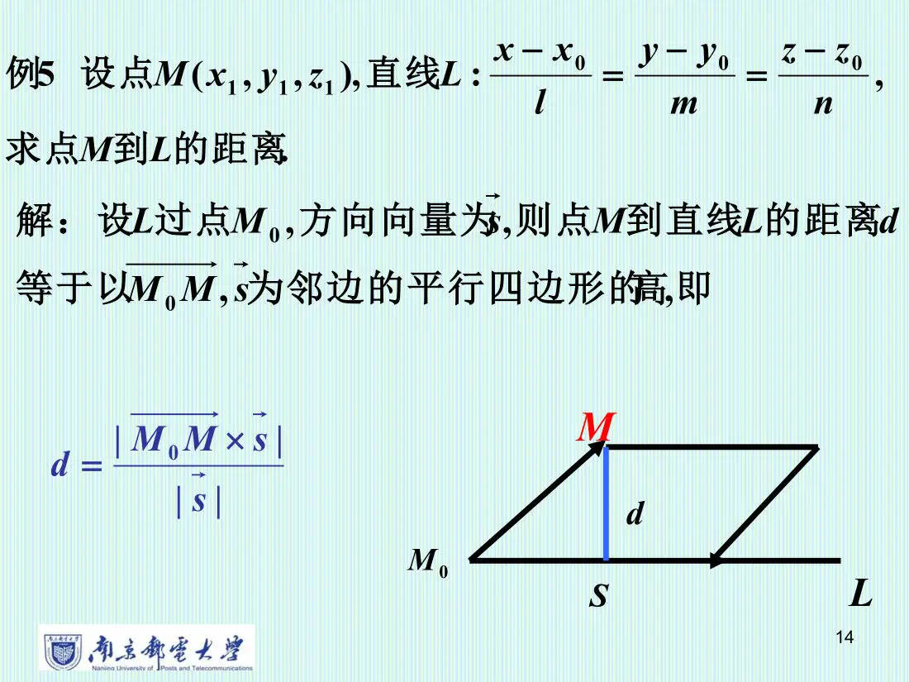

原文：

解: 设 $L$ 过点 $M_{0}$ , 方向向量为 $\vec{s}$ , 则点 $M$ 到直线 $L$ 的距离 $d$ 等于以 $\overrightarrow{M_{0}M}$ , $\vec{s}$ 为邻边的平行四边形的高, 即

$$
d = \frac {| \overrightarrow {M _ {0} M} \times \overrightarrow {s} |}{| \overrightarrow {s} |}
$$

南京邮电大学
Nanjing University of Posts and Telecommunications

14

### 3.4.4 空间直线与平面的位置关系

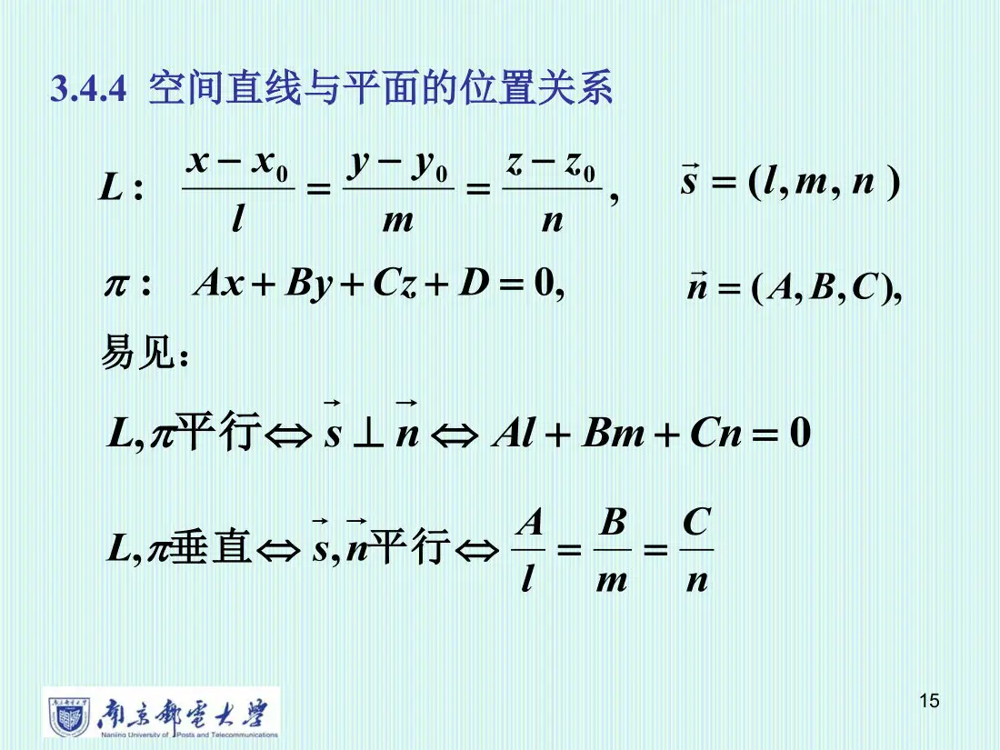

原文：

3.4.4 空间直线与平面的位置关系

$$
L: \frac {x - x _ {0}}{l} = \frac {y - y _ {0}}{m} = \frac {z - z _ {0}}{n}, \vec {s} = (l, m, n)
$$

$\pi : Ax + By + Cz + D = 0,$ $\vec{n} = (A,B,C),$

易见:

$L, \pi$ 平行 $\Leftrightarrow \vec{s} \perp \vec{n} \Leftrightarrow Al + Bm + Cn = 0$

$L, \pi$ 垂直 $\Leftrightarrow \vec{s}, \vec{n}$ 平行 $\Leftrightarrow \frac{A}{l} = \frac{B}{m} = \frac{C}{n}$ 直线和它在平面上的投影直线的夹角 $\varphi$ 称为直线与平面的夹角.

南京邮电大学
Nanjing University of Posts and Telecommunications

15

### $$

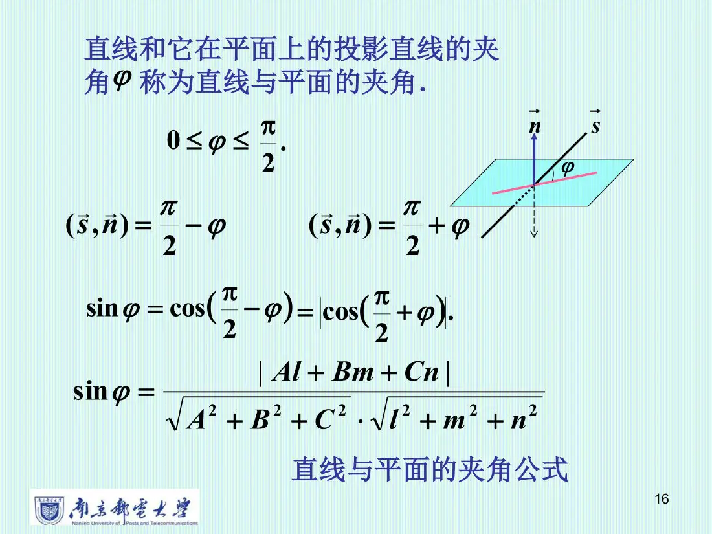

原文：

$$
0 \leq \varphi \leq \frac {\pi}{2}.
$$

$$
(\vec {s}, \vec {n}) = \frac {\pi}{2} - \varphi
$$

$$
\sin \varphi = \cos \left(\frac {\pi}{2} - \varphi\right) = | \cos \left(\frac {\pi}{2} + \varphi\right) |.
$$

$$
\sin \varphi = \frac {\mid A l + B m + C n \mid}{\sqrt {A ^ {2} + B ^ {2} + C ^ {2}} \cdot \sqrt {l ^ {2} + m ^ {2} + n ^ {2}}}
$$

直线与平面的夹角公式例6设直线 $L: \frac{x - 1}{2} = \frac{y}{-1} = \frac{z + 1}{2}$ , 平面 $\Pi: x - y + 2z = 3$ , 求直线与平面的夹角.
解 $\vec{n} = (1, -1, 2), \vec{s} = (2, -1, 2)$ , $\sin \varphi = \frac{|A l + B m + C n|}{\sqrt{A^2 + B^2 + C^2} \cdot \sqrt{l^2 + m^2 + n^2}} = \frac{|1 \times 2 + (-1) \times (-1) + 2 \times 2|}{\sqrt{6} \cdot \sqrt{9}} = \frac{7}{3\sqrt{6}}$ . $\therefore \varphi = \arcsin \frac{7}{3\sqrt{6}}$ 为所求夹角.

南京邮电大学
Nanjing University of Posts and Telecommunications

16

### 南京邮电大学

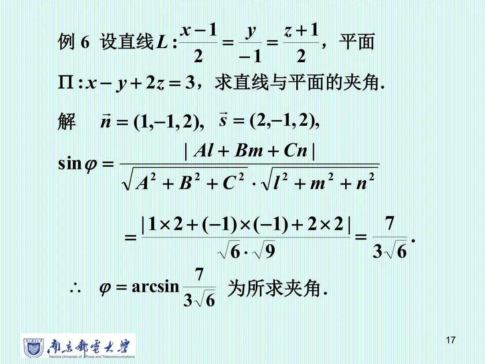

原文：

南京邮电大学
Nanjing University of Posts and Telecommunications

17

### 解 设平面为 $6x + y + 6z - D = 0$ , 即

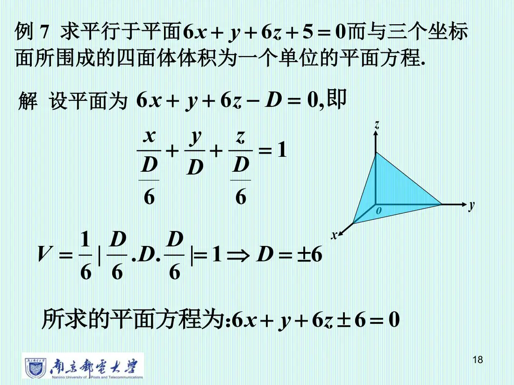

原文：

例 7 求平行于平面 $6x + y + 6z + 5 = 0$ 而与三个坐标面所围成的四面体体积为一个单位的平面方程.

解 设平面为 $6x + y + 6z - D = 0$ , 即

$$
\frac {\frac {x}{D}}{\frac {6}{}} + \frac {y}{D} + \frac {z}{\frac {D}{6}} = 1
$$

$$
V = \frac {1}{6} | \frac {D}{6}. D. \frac {D}{6} | = 1 \Rightarrow D = \pm 6
$$

所求的平面方程为: $6x + y + 6z \pm 6 = 0$ 例 8 求过点 $(-3,2,5)$ 且与两平面x-4z=3和 $2x-y-5z=1$ 的交线平行的直线方程.

南京邮电大学 Nanjing University of Posts and Telecommunications

18

### 解 设所求直线的方向向量为 $\vec{s} = (m, n, p)$ ,

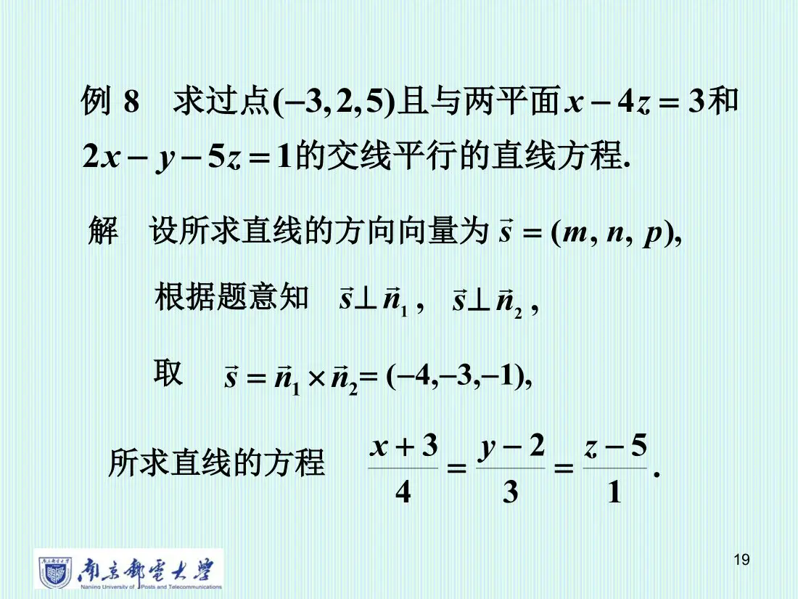

原文：

解 设所求直线的方向向量为 $\vec{s} = (m, n, p)$ ,

根据题意知 $\vec{s} \perp \vec{n}_1, \vec{s} \perp \vec{n}_2,$

取 $\vec{s} = \vec{n}_1\times \vec{n}_2 = (-4, - 3, - 1),$

所求直线的方程 $\frac{x + 3}{4} = \frac{y - 2}{3} = \frac{z - 5}{1}$ .

南京邮电大学
Nanjing University of Posts and Telecommunications

19

### 3.4.5 平面束

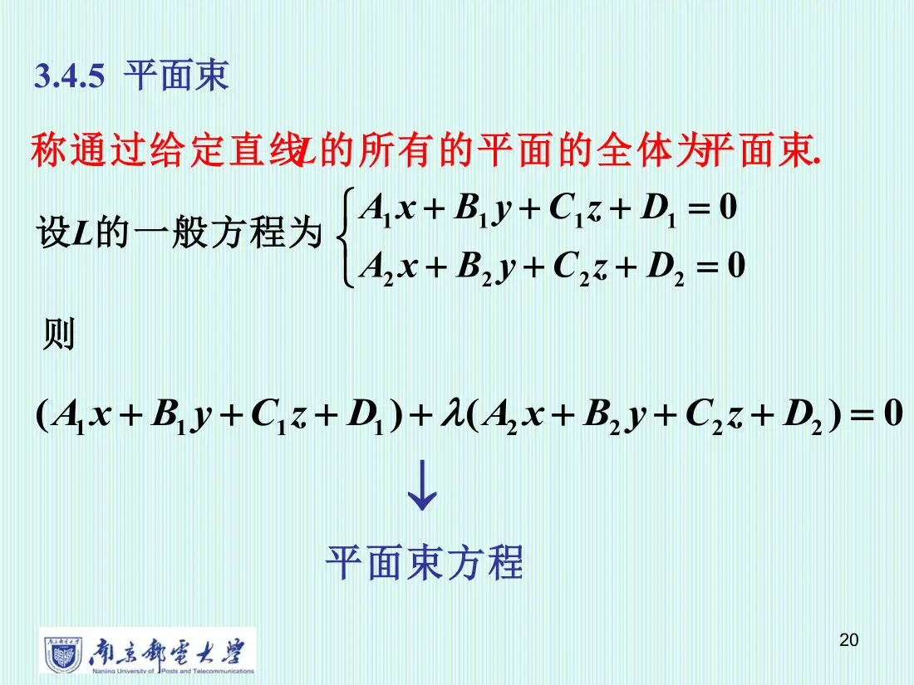

原文：

3.4.5 平面束

称通过给定直线L的所有的平面的全体为平面束.

设 $L$ 的一般方程为 $\left\{ \begin{array}{l}A_{1}x + B_{1}y + C_{1}z + D_{1} = 0\\ A_{2}x + B_{2}y + C_{2}z + D_{2} = 0 \end{array} \right.$

则

平面束方程

南京邮电大学
Nanjing University of Posts and Telecommunications

20

### 平行的平面方程

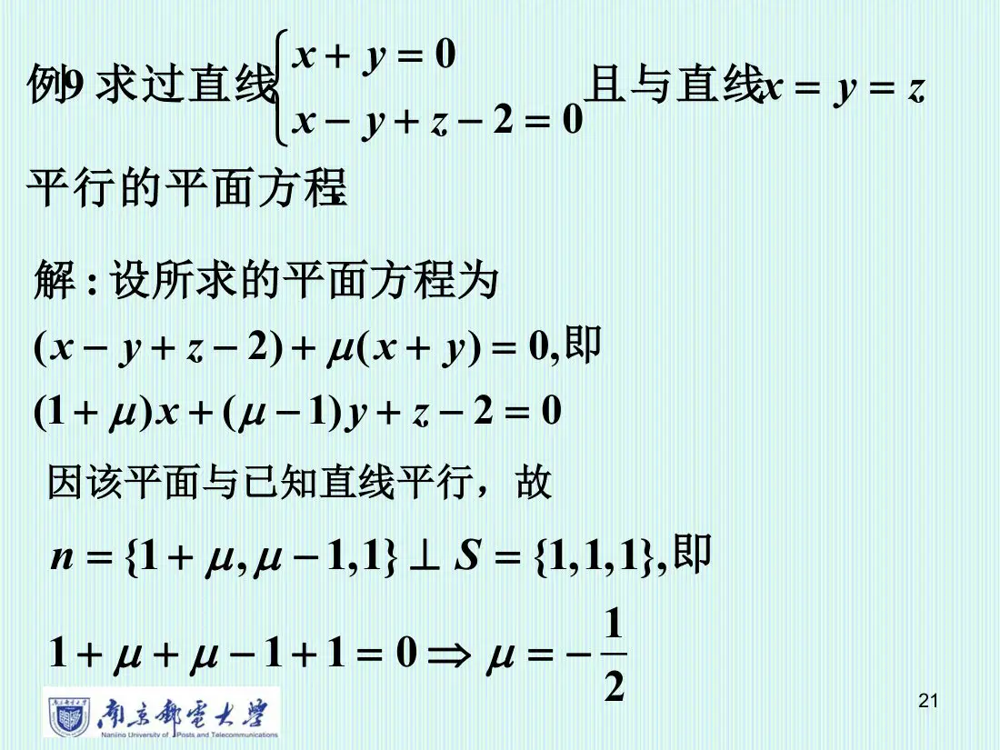

原文：

例9 求过直线 $\left\{\begin{aligned}x+y=0\\ x-y+z-2=0\end{aligned}\right.$ 且与直线 x=y=z
平行的平面方程

解: 设所求的平面方程为

$(x - y + z - 2) + \mu (x + y) = 0$ ，即

$$
(1 + \mu) x + (\mu - 1) y + z - 2 = 0
$$

因该平面与已知直线平行，故

$n=\{1+\mu,\mu-1,1\}\perp S=\{1,1,1\}$ ，即

$$
1 + \mu + \mu - 1 + 1 = 0 \Rightarrow \mu = - \frac {1}{2}
$$

南京邮电大学
Nanjing University of Posts and Telecommunications

21

### 将上式代入到所设的方程中有

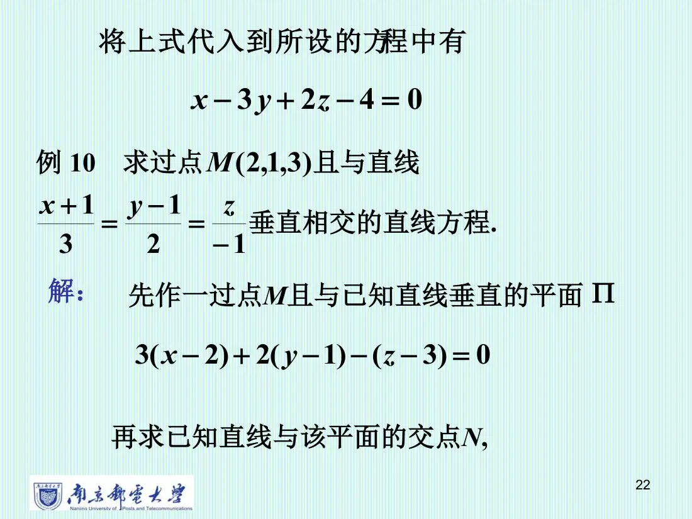

原文：

将上式代入到所设的方程中有

$$
x - 3 y + 2 z - 4 = 0
$$

例 10 求过点 $M(2,1,3)$ 且与直线

$\frac{x + 1}{3} = \frac{y - 1}{2} = \frac{z}{-1}$ 垂直相交的直线方程.

解: 先作一过点 $M$ 且与已知直线垂直的平面 $\Pi$

$$
3 (x - 2) + 2 (y - 1) - (z - 3) = 0
$$

再求已知直线与该平面的交点N,令 $\frac{x+1}{3}=\frac{y-1}{2}=\frac{z}{-1}=t$ $\Rightarrow\left\{\begin{aligned}x&=3t-1\\ y&=2t+1.\\ z&=-t\end{aligned}\right.$ 代入平面方程得 $t=\frac{3}{7}$ ，交点 $N(\frac{2}{7},\frac{13}{7},-\frac{3}{7})$ 取所求直线的方向向量为 $\overrightarrow{MN}$ $\overrightarrow{MN}=\left\{\frac{2}{7}-2,\frac{13}{7}-1,-\frac{3}{7}-3\right\}=\left\{-\frac{12}{7},\frac{6}{7},-\frac{24}{7}\right\}$ ,
所求直线方程为 $\frac{x-2}{2}=\frac{y-1}{-1}=\frac{z-3}{4}$ .

南京邮电大学
Nanjing University of Posts and Telecommunications

22

### 23

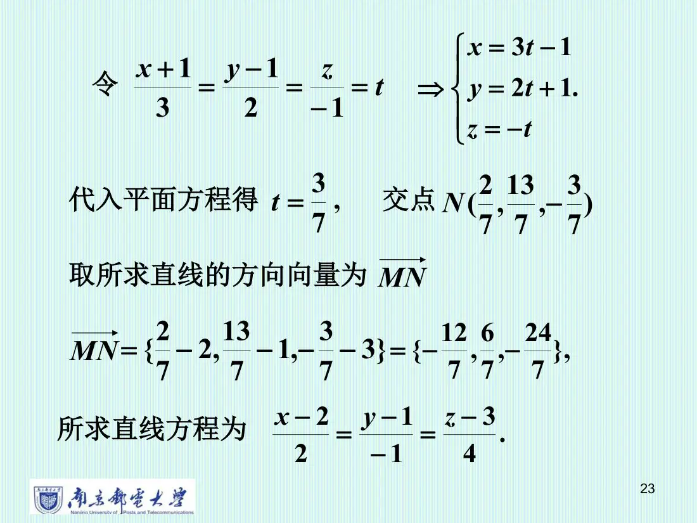

原文：

南京邮电大学 Nanjing University of Posts and Telecommunications

23
