# 《线性代数与解析几何》第3章 向量的乘积（课件）

原件的每一页，下面附识别出的文字。

### 4.2 向量的乘法

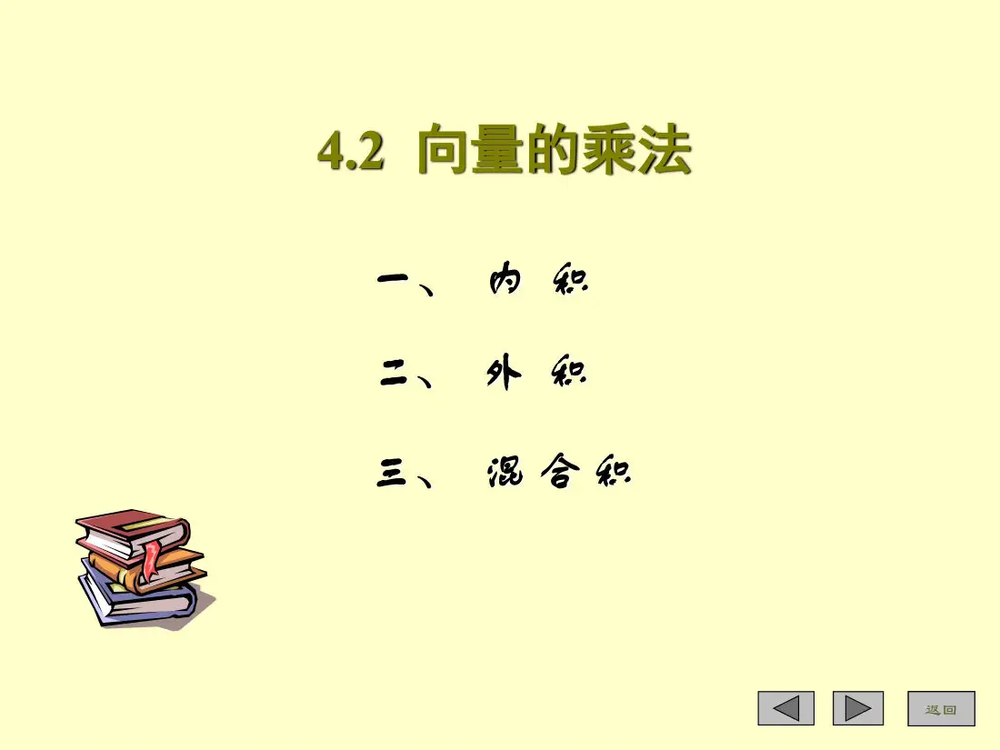

原文：

4.2 向量的乘法

一、内积

二、外积

三、混合积

返回

### 一、数量积(内积, 点积)

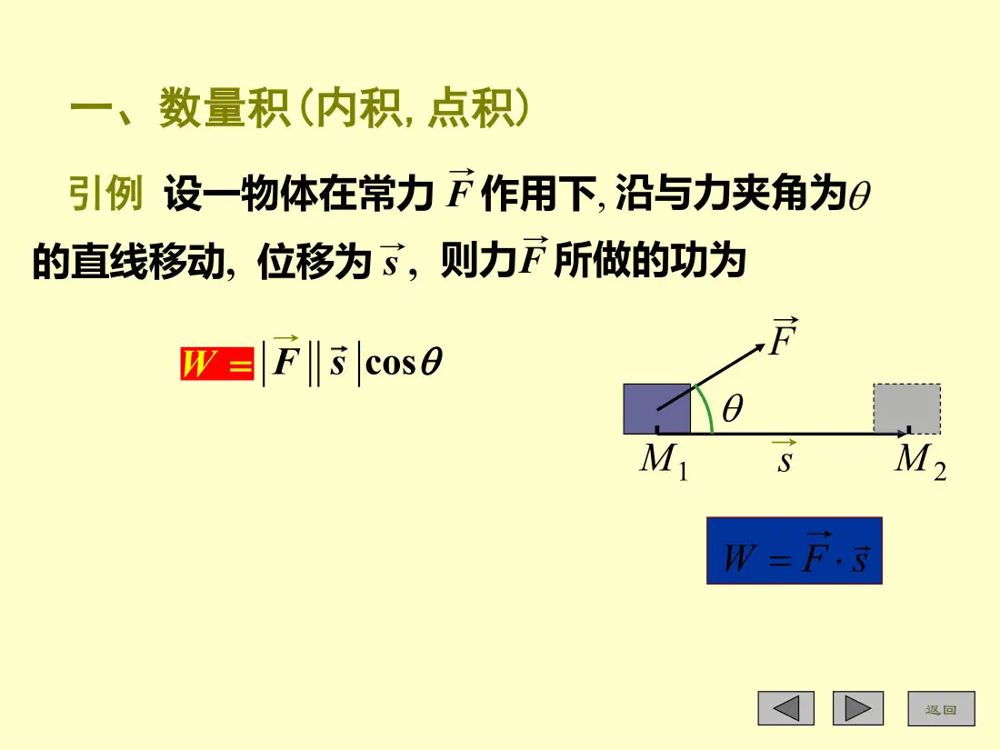

原文：

一、数量积(内积, 点积)

引例 设一物体在常力 $\vec{F}$ 作用下, 沿与力夹角为 $\theta$ 的直线移动, 位移为 $\vec{s}$ , 则力 $\vec{F}$ 所做的功为

$$
W = | \vec {F} | | \vec {s} | \cos \theta
$$

返回

◀ ▶

### $$

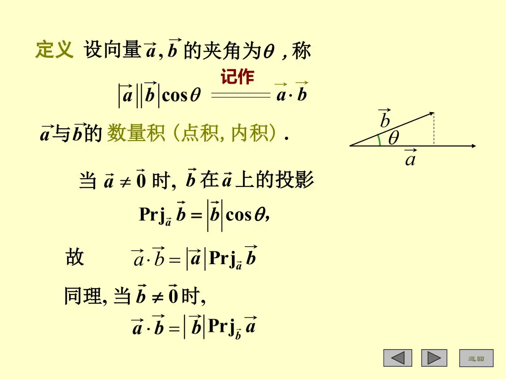

原文：

定义 设向量 $\vec{a}, \vec{b}$ 的夹角为 $\theta$ ，称

$$
| \vec {a} | | \vec {b} | \cos \theta \stackrel {\text {记作}} {=} \vec {a} \cdot \vec {b}
$$

$\vec{a}$ 与 $\vec{b}$ 的数量积（点积，内积）.

当 $\vec{a} \neq \vec{0}$ 时, $\vec{b}$ 在 $\vec{a}$ 上的投影

$$
\operatorname * {P r} \mathbf {j} _ {\vec {a}} \vec {b} = | \vec {b} | \cos \theta ,
$$

故 $\vec{a} \cdot \vec{b} = |\vec{a}| \operatorname{Prj}_{\vec{a}} \vec{b}$

同理, 当 $\vec{b} \neq \vec{0}$ 时,

$$
\vec {a} \cdot \vec {b} = | \vec {b} | \operatorname * {P r} \mathbf {j} _ {\vec {b}} \vec {a}
$$

返回

◀ ▶

### 运算律

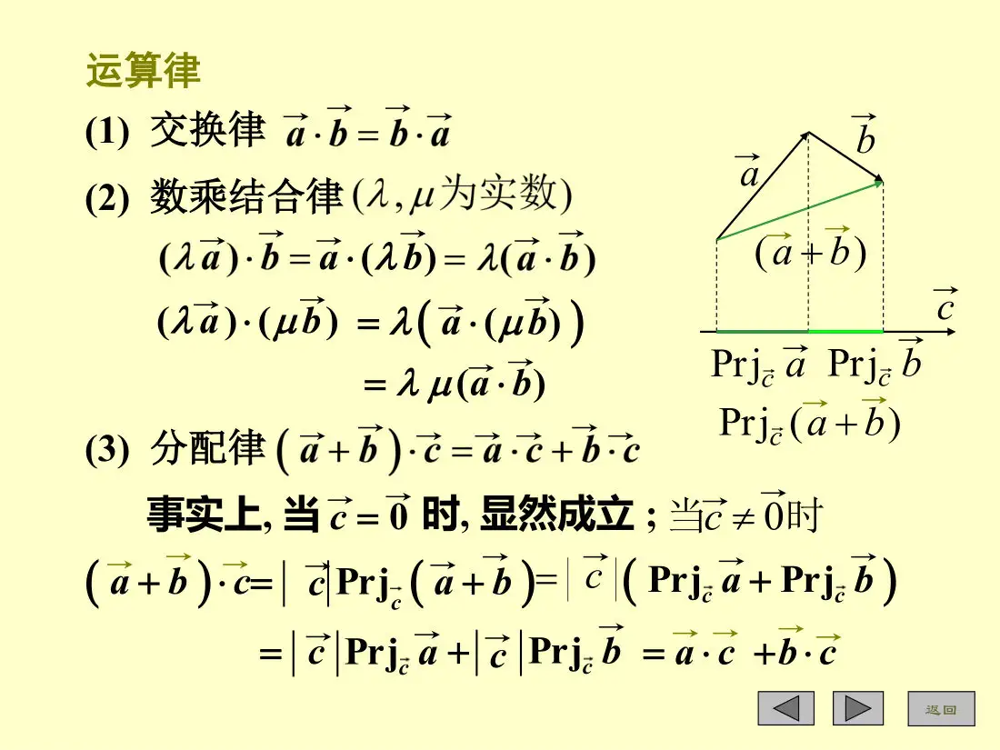

原文：

运算律

(1) 交换律 $\vec{a} \cdot \vec{b} = \vec{b} \cdot \vec{a}$

(2) 数乘结合律 $(\lambda, \mu$ 为实数)

$$
(\lambda \vec {a}) \cdot \vec {b} = \vec {a} \cdot (\lambda \vec {b}) = \lambda (\vec {a} \cdot \vec {b})
$$

$$
\begin{array}{r l} (\lambda \vec {a}) \cdot (\mu \vec {b}) & = \lambda (\vec {a} \cdot (\mu \vec {b})) \\ & = \lambda \mu (\vec {a} \cdot \vec {b}) \end{array}
$$

(3) 分配律 $\left(\vec{a} +\vec{b}\right)\cdot \vec{c} = \vec{a}\cdot \vec{c} +\vec{b}\cdot \vec{c}$

$$
\operatorname * {P r} \mathrm{j} _ {\vec {c}} (\vec {a} + \vec {b})
$$

事实上, 当 $\vec{c} = \vec{0}$ 时, 显然成立; 当 $\vec{c} \neq \vec{0}$ 时

$$
\begin{array}{r l} \big (\vec {a} + \vec {b} \big) \cdot \vec {c} = & \big | \vec {c} \big | \operatorname * {P r} \mathbf {j} _ {\vec {c}} \big (\vec {a} + \vec {b} \big) = \big | \vec {c} \big | \big (\operatorname * {P r} \mathbf {j} _ {\vec {c}} \vec {a} + \operatorname * {P r} \mathbf {j} _ {\vec {c}} \vec {b} \big) \\ = & \big | \vec {c} \big | \operatorname * {P r} \mathbf {j} _ {\vec {c}} \vec {a} + \big | \vec {c} \big | \operatorname * {P r} \mathbf {j} _ {\vec {c}} \vec {b} = \vec {a} \cdot \vec {c} + \vec {b} \cdot \vec {c} \end{array}
$$

◀ ▶

### 不满足的运算律

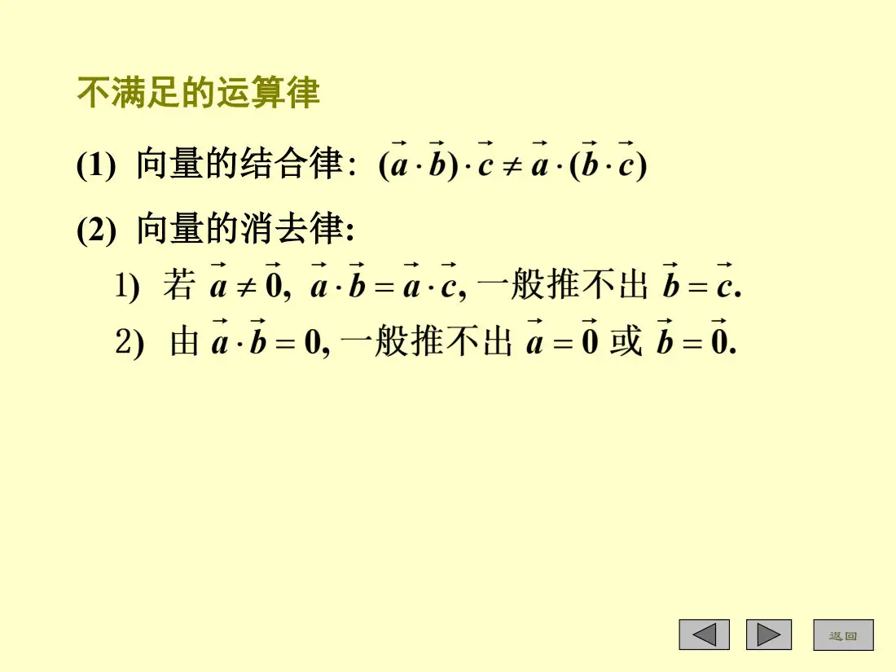

原文：

不满足的运算律

(1) 向量的结合律: $(\vec{a} \cdot \vec{b}) \cdot \vec{c} \neq \vec{a} \cdot (\vec{b} \cdot \vec{c})$

(2) 向量的消去律:

1) 若 $\vec{a} \neq \vec{0}$ , $\vec{a} \cdot \vec{b} = \vec{a} \cdot \vec{c}$ , 一般推不出 $\vec{b} = \vec{c}$ .

2) 由 $\vec{a} \cdot \vec{b} = 0$ , 一般推不出 $\vec{a} = \vec{0}$ 或 $\vec{b} = \vec{0}$ .

返回

### $$

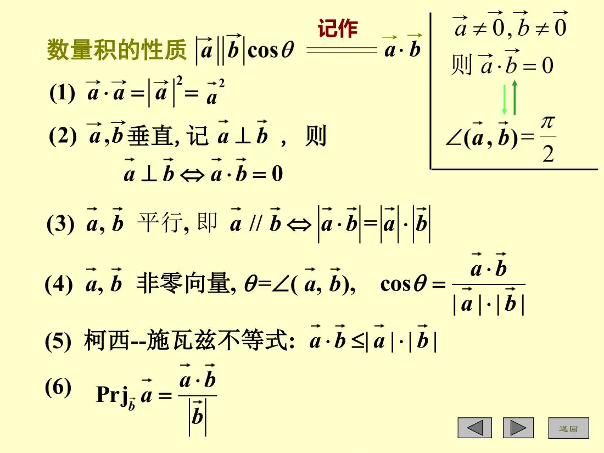

原文：

数量积的性质 $\left|\vec{a}\right|\left|\vec{b}\right|\cos\theta$ 记作 $\vec{a}\cdot\vec{b}$ $\left|\vec{a}\neq\vec{0},\vec{b}\neq\vec{0}\right|$ 则 $\vec{a}\cdot\vec{b}=0$

(1) $\vec{a} \cdot \vec{a} = |\vec{a}|^2 = \vec{a}^2$

(2) $\vec{a},\vec{b}$ 垂直, 记 $\vec{a} \perp \vec{b}$ , 则 $\vec{a} \perp \vec{b} \Leftrightarrow \vec{a} \cdot \vec{b} = 0$

$$
\bigcup_ {\substack {\vec {a}, \vec {b}) = \frac {\pi}{2}}} ^ {\uparrow}
$$

(3) $\vec{a},\vec{b}$ 平行, 即 $\vec{a} // \vec{b} \Leftrightarrow |\vec{a} \cdot \vec{b}| = |\vec{a}| \cdot |\vec{b}|$

(4) $\vec{a}, \vec{b}$ 非零向量, $\theta = \angle (\vec{a}, \vec{b})$ , $\cos \theta = \frac{\vec{a} \cdot \vec{b}}{|\vec{a}| \cdot |\vec{b}|}$

(5) 柯西--施瓦兹不等式: $\vec{a} \cdot \vec{b} \leq |\vec{a}| \cdot |\vec{b}|$

(6) $\Pr j_{\vec{b}} \vec{a} = \frac{\vec{a} \cdot \vec{b}}{|\vec{b}|}$

返回

### 例1 判断下列各式是否正确,为什么?

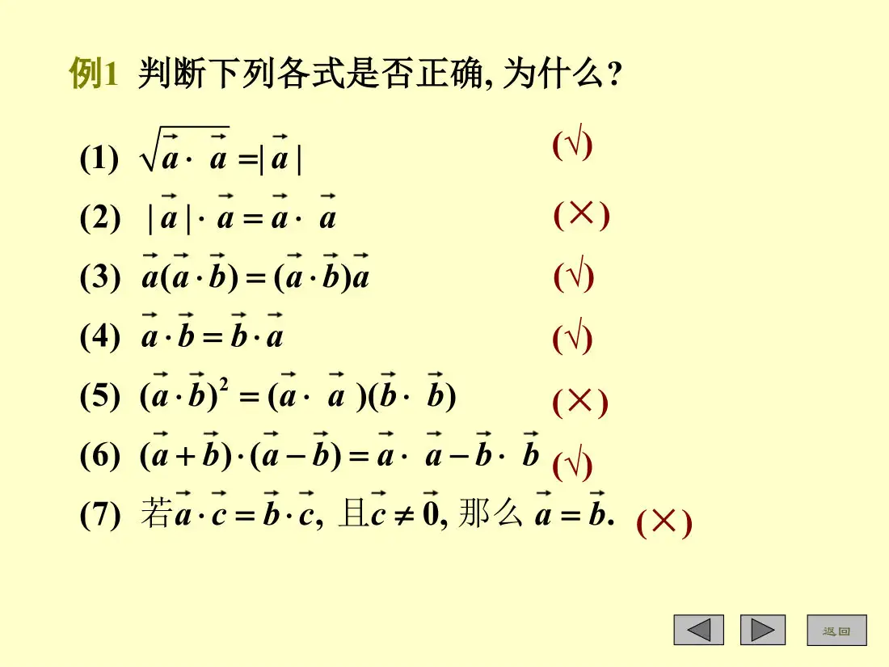

原文：

例1 判断下列各式是否正确,为什么?

(1) $\sqrt{\vec{a} \cdot \vec{a}} = |\vec{a}|$ (√)

(2) $|\vec{a}|\cdot \vec{a} = \vec{a}\cdot \vec{a}$ (×)

(3) $\vec{a}(\vec{a} \cdot \vec{b}) = (\vec{a} \cdot \vec{b})\vec{a}$ (√)

(4) $\vec{a} \cdot \vec{b} = \vec{b} \cdot \vec{a}$ (√)

(5) $(\vec{a} \cdot \vec{b})^2 = (\vec{a} \cdot \vec{a})(\vec{b} \cdot \vec{b})$ (×)

(6) $(\vec{a} + \vec{b}) \cdot (\vec{a} - \vec{b}) = \vec{a} \cdot \vec{a} - \vec{b} \cdot \vec{b}$ (√)

(7) 若 $\vec{a} \cdot \vec{c} = \vec{b} \cdot \vec{c}$ ，且 $\vec{c} \neq \vec{0}$ ，那么 $\vec{a} = \vec{b}$ . (×)

返回

### 第 8 页

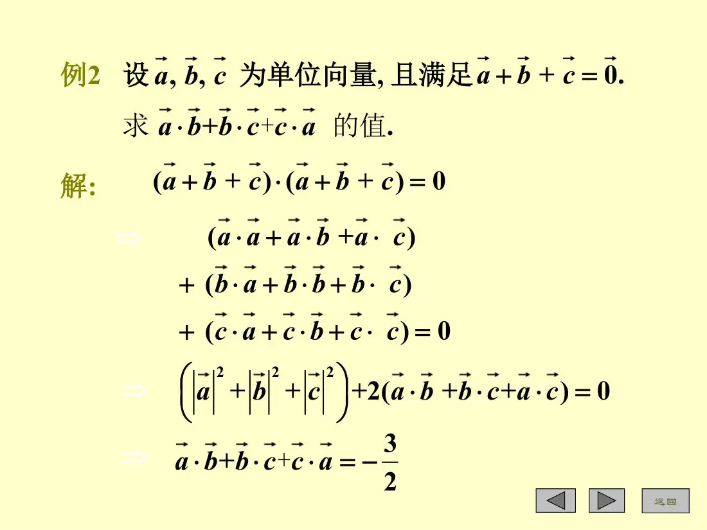

原文：

例2 设 $\vec{a}, \vec{b}, \vec{c}$ 为单位向量, 且满足 $\vec{a} + \vec{b} + \vec{c} = \vec{0}$ .
求 $\vec{a}\cdot\vec{b}+\vec{b}\cdot\vec{c}+\vec{c}\cdot\vec{a}$ 的值.

解: $(\vec{a} + \vec{b} + \vec{c}) \cdot (\vec{a} + \vec{b} + \vec{c}) = 0$ $\Rightarrow (\vec{a} \cdot \vec{a} + \vec{a} \cdot \vec{b} + \vec{a} \cdot \vec{c})$ $+ (\vec{b} \cdot \vec{a} + \vec{b} \cdot \vec{b} + \vec{b} \cdot \vec{c})$ $+ (\vec{c} \cdot \vec{a} + \vec{c} \cdot \vec{b} + \vec{c} \cdot \vec{c}) = 0$ $\Rightarrow \left(|\vec{a}|^2 + |\vec{b}|^2 + |\vec{c}|^2\right) + 2(\vec{a} \cdot \vec{b} + \vec{b} \cdot \vec{c} + \vec{a} \cdot \vec{c}) = 0$ $\Rightarrow \vec{a} \cdot \vec{b} + \vec{b} \cdot \vec{c} + \vec{c} \cdot \vec{a} = -\frac{3}{2}$

### 返回

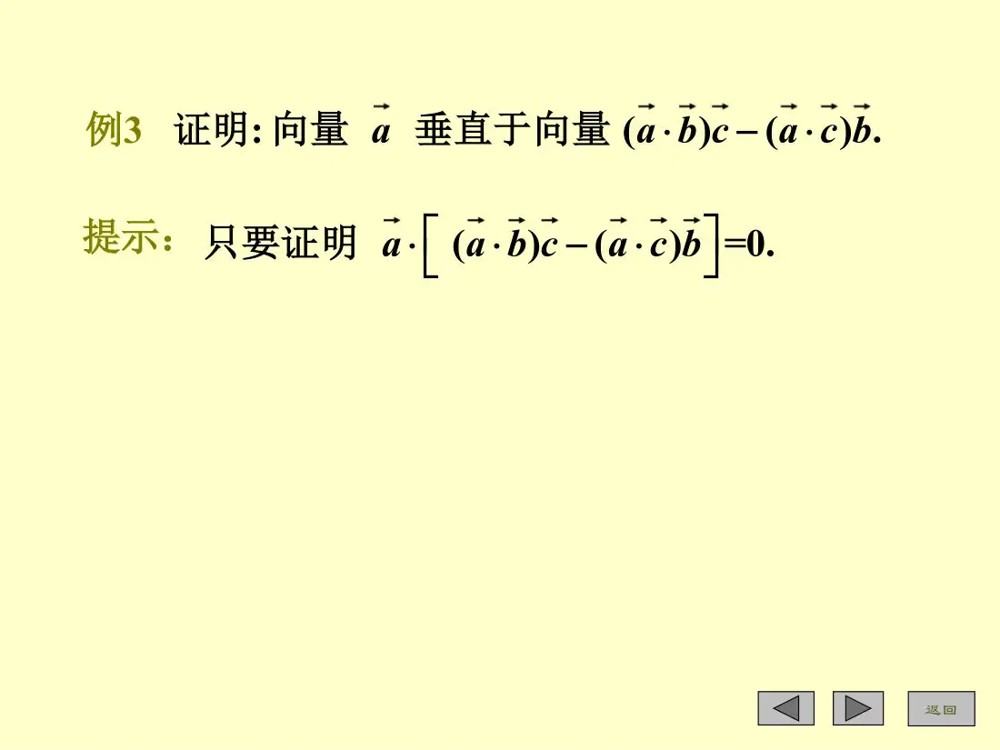

原文：

例3 证明: 向量 $\vec{a}$ 垂直于向量 $(\vec{a} \cdot \vec{b})\vec{c} - (\vec{a} \cdot \vec{c})\vec{b}$ .

提示: 只要证明 $\vec{a} \cdot \left[ (\vec{a} \cdot \vec{b}) \vec{c} - (\vec{a} \cdot \vec{c}) \vec{b} \right] = 0$ .

返回

### 例4 用向量证明三角形余弦定理.

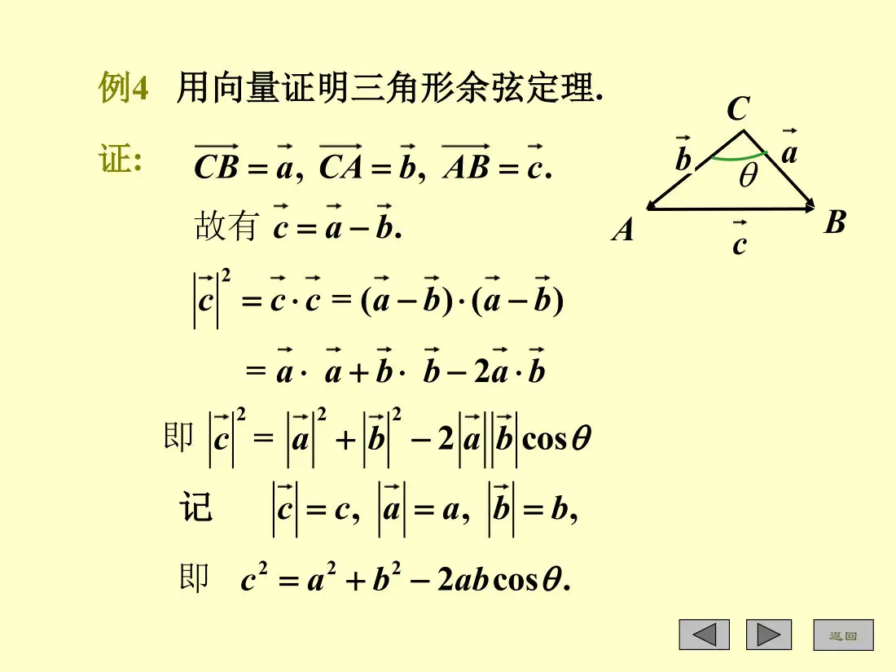

原文：

例4 用向量证明三角形余弦定理.

证: $\overrightarrow{CB}=\vec{a},\overrightarrow{CA}=\vec{b},\overrightarrow{AB}=\vec{c}.$

故有 $\vec{c}=\vec{a}-\vec{b}.$

$$
\begin{array}{r l} \left| \vec {c} \right| ^ {2} & = \vec {c} \cdot \vec {c} = (\vec {a} - \vec {b}) \cdot (\vec {a} - \vec {b}) \\ & = \vec {a} \cdot \vec {a} + \vec {b} \cdot \vec {b} - 2 \vec {a} \cdot \vec {b} \end{array}
$$

即 $|\vec{c}|^2 = |\vec{a}|^2 +|\vec{b}|^2 -2|\vec{a} ||\vec{b} |\cos \theta$

记 $\left|\vec{c}\right|=c,\left|\vec{a}\right|=a,\left|\vec{b}\right|=b,$

即 $c^2 = a^2 + b^2 - 2ab\cos \theta.$

◀ ▶

返回

### 数量积的坐标运算

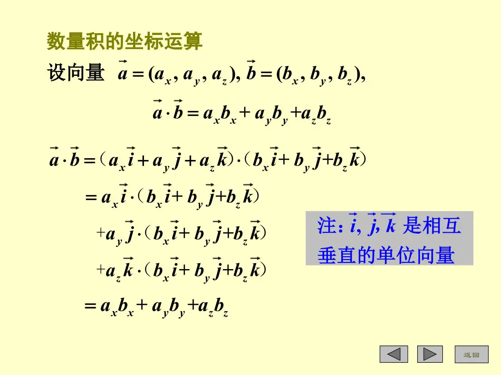

原文：

数量积的坐标运算

设向量 $\vec{a} = (a_x, a_y, a_z), \vec{b} = (b_x, b_y, b_z),$ $\vec{a} \cdot \vec{b} = a_x b_x + a_y b_y + a_z b_z$

$$
\begin{array}{r l} \vec {a} \cdot \vec {b} & = (a _ {x} \vec {i} + a _ {y} \vec {j} + a _ {z} \vec {k}) \cdot (b _ {x} \vec {i} + b _ {y} \vec {j} + b _ {z} \vec {k}) \\ & = a _ {x} \vec {i} \cdot (b _ {x} \vec {i} + b _ {y} \vec {j} + b _ {z} \vec {k}) \\ & + a _ {y} \vec {j} \cdot (b _ {x} \vec {i} + b _ {y} \vec {j} + b _ {z} \vec {k}) \\ & + a _ {z} \vec {k} \cdot (b _ {x} \vec {i} + b _ {y} \vec {j} + b _ {z} \vec {k}) \\ & = a _ {x} b _ {x} + a _ {y} b _ {y} + a _ {z} b _ {z} \end{array}
$$

注: $\vec{i}, \vec{j}, \vec{k}$ 是相互垂直的单位向量

◀ ▶

返回

### 数量积的坐标运算

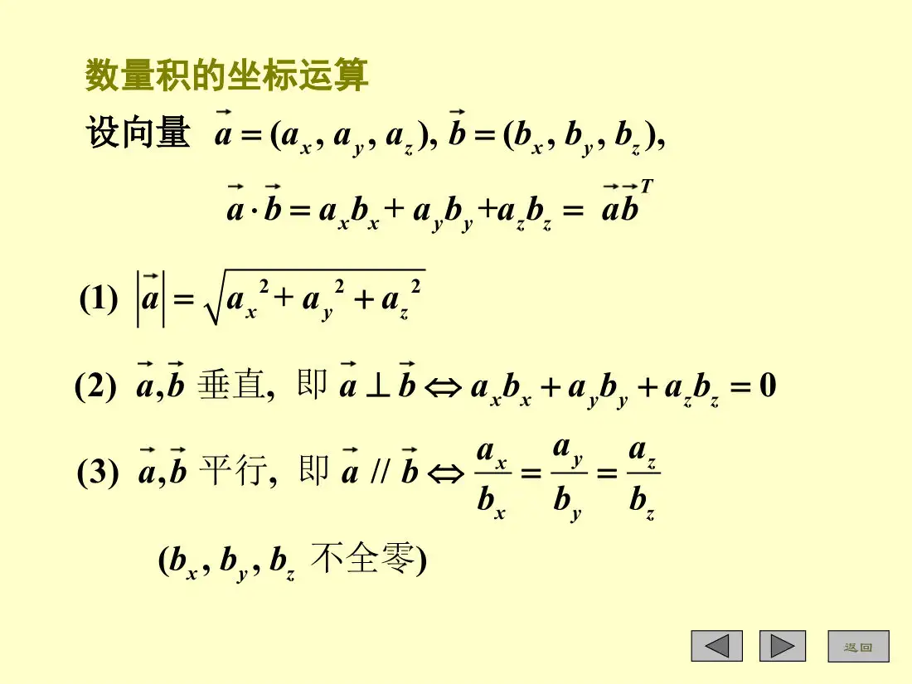

原文：

数量积的坐标运算

设向量 $\vec{a} = (a_x, a_y, a_z), \vec{b} = (b_x, b_y, b_z)$ ,

$$
\vec {a} \cdot \vec {b} = a _ {x} b _ {x} + a _ {y} b _ {y} + a _ {z} b _ {z} = \vec {a} \vec {b} ^ {T}
$$

(1) $\left|\vec{a}\right|=\sqrt{a_{x}^{2}+a_{y}^{2}+a_{z}^{2}}$

(2) $\vec{a},\vec{b}$ 垂直，即 $\vec{a} \perp \vec{b} \Leftrightarrow a_x b_x + a_y b_y + a_z b_z = 0$

(3) $\vec{a},\vec{b}$ 平行，即 $\vec{a} // \vec{b} \Leftrightarrow \frac{a_x}{b_x} = \frac{a_y}{b_y} = \frac{a_z}{b_z}$

$(b_x, b_y, b_z$ 不全零)

返回

### (5) 柯西--施瓦兹不等式:

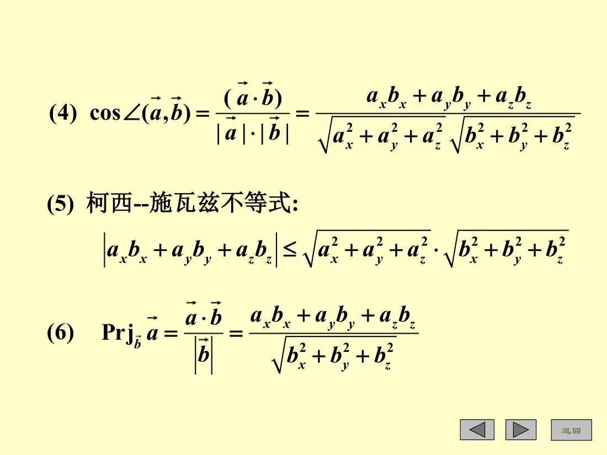

原文：

(4) $\cos \angle (\vec{a},\vec{b}) = \frac{(\vec{a}\cdot\vec{b})}{|\vec{a}|\cdot|\vec{b}|} = \frac{a_x b_x + a_y b_y + a_z b_z}{\sqrt{a_x^2 + a_y^2 + a_z^2}\sqrt{b_x^2 + b_y^2 + b_z^2}}$

(5) 柯西--施瓦兹不等式:

$$
\left| a _ {x} b _ {x} + a _ {y} b _ {y} + a _ {z} b _ {z} \right| \leq \sqrt {a _ {x} ^ {2} + a _ {y} ^ {2} + a _ {z} ^ {2}} \cdot \sqrt {b _ {x} ^ {2} + b _ {y} ^ {2} + b _ {z} ^ {2}}
$$

(6) $\Pr j_{\vec{b}}\vec{a}=\frac{\vec{a}\cdot\vec{b}}{\left|\vec{b}\right|}=\frac{a_{x}b_{x}+a_{y}b_{y}+a_{z}b_{z}}{\sqrt{b_{x}^{2}+b_{y}^{2}+b_{z}^{2}}}$

◀ ▶

返回

### 返回

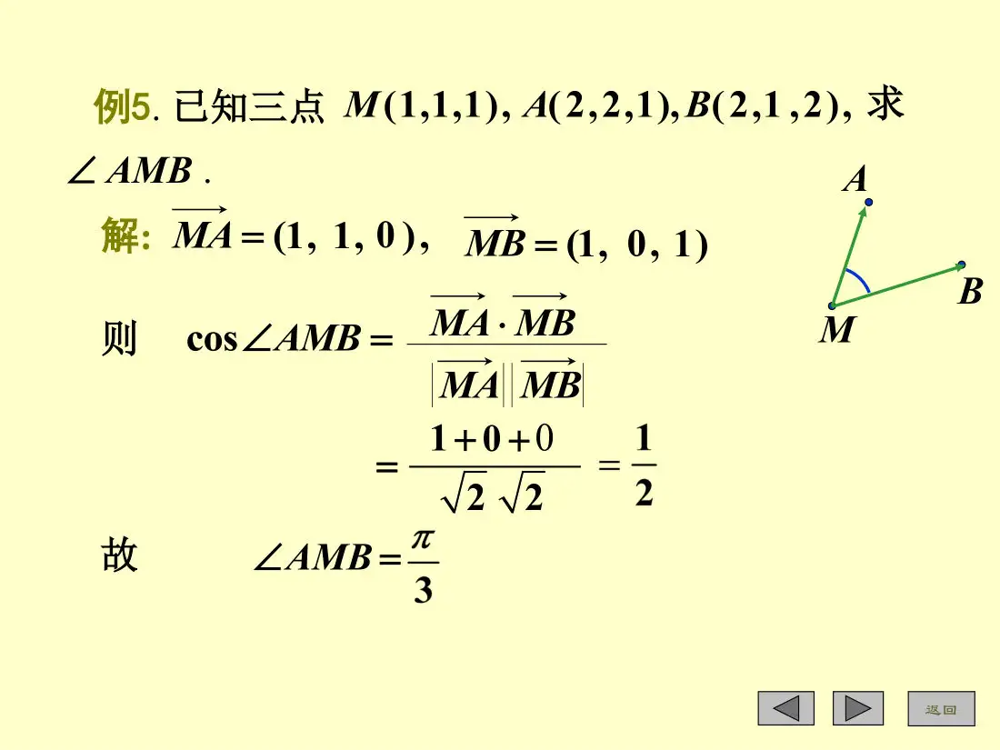

原文：

例5. 已知三点 $M(1,1,1), A(2,2,1), B(2,1,2)$ , 求 $\angle AMB$ .

解: $\overrightarrow{MA} = (1, 1, 0)$ , $\overrightarrow{MB} = (1, 0, 1)$

则 $\cos\angle AMB=\frac{\overrightarrow{MA}\cdot\overrightarrow{MB}}{|\overrightarrow{MA}||\overrightarrow{MB}|}=\frac{1+0+0}{\sqrt{2}\sqrt{2}}=\frac{1}{2}$ 故 $\angle AMB=\frac{\pi}{3}$

返回

### 二、向量的向量积(外积, 叉积)

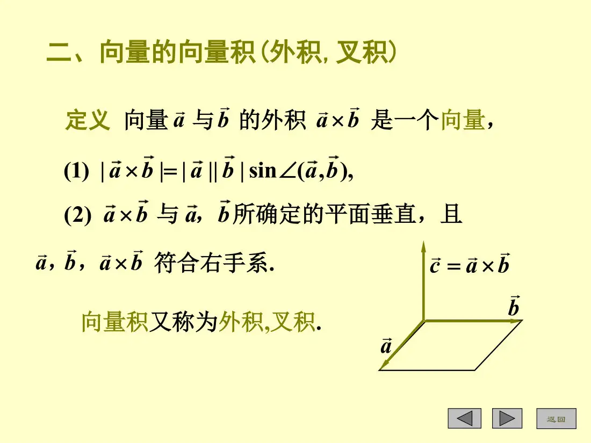

原文：

二、向量的向量积(外积, 叉积)

定义 向量 $\vec{a}$ 与 $\vec{b}$ 的外积 $\vec{a} \times \vec{b}$ 是一个向量，

(1) $|\vec{a} \times \vec{b}| = |\vec{a}||\vec{b}|\sin \angle (\vec{a},\vec{b}),$

(2) $\vec{a} \times \vec{b}$ 与 $\vec{a}, \vec{b}$ 所确定的平面垂直，且

$\vec{a},\vec{b},\vec{a}\times\vec{b}$ 符合右手系.

向量积又称为外积,叉积.

返回

◀ ▶

### 注意:

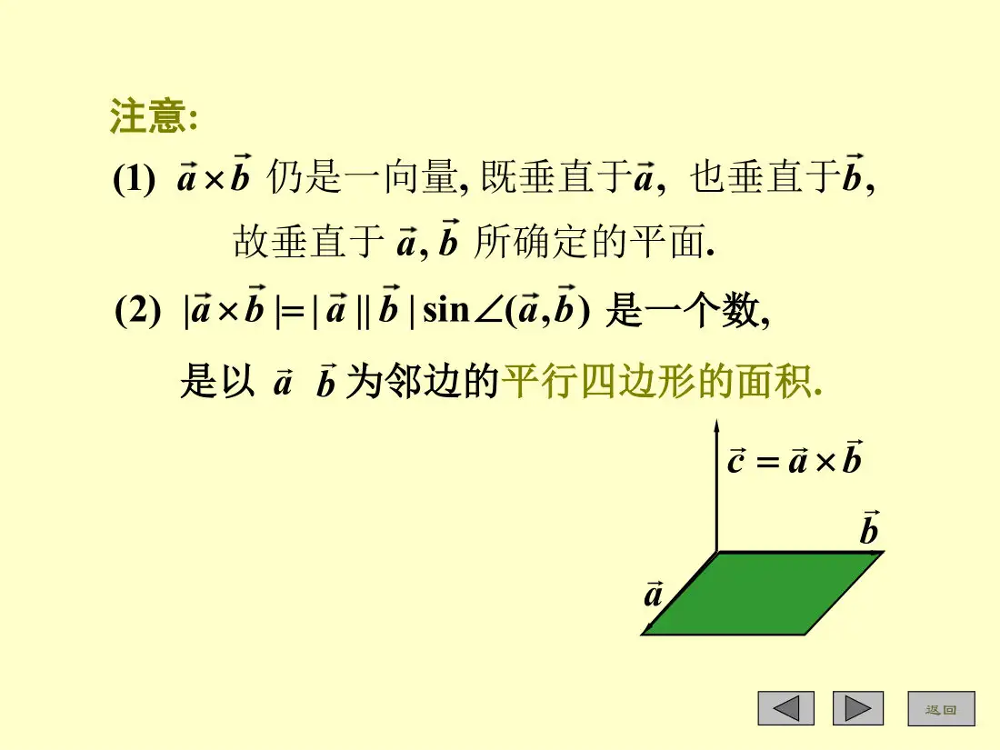

原文：

注意:

(1) $\vec{a} \times \vec{b}$ 仍是一向量, 既垂直于 $\vec{a}$ , 也垂直于 $\vec{b}$ , 故垂直于 $\vec{a}, \vec{b}$ 所确定的平面.

(2) $|\vec{a} \times \vec{b}| = |\vec{a}||\vec{b}|\sin \angle (\vec{a},\vec{b})$ 是一个数，

是以 $\vec{a}$ $\vec{b}$ 为邻边的平行四边形的面积.

◀ ▶

### 外积的性质及运算规律

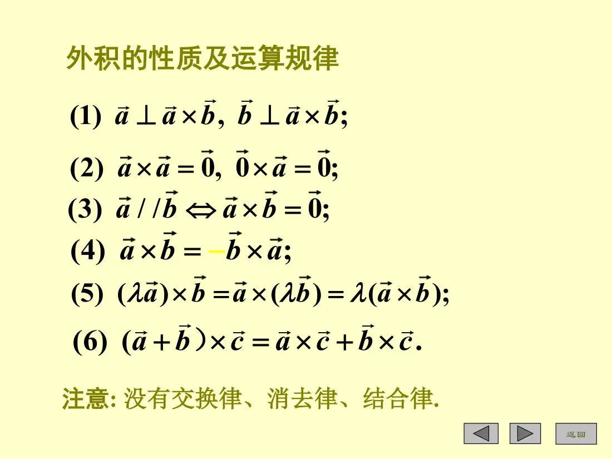

原文：

外积的性质及运算规律

(1) $\vec{a} \perp \vec{a} \times \vec{b}, \vec{b} \perp \vec{a} \times \vec{b};$

(2) $\vec{a} \times \vec{a} = \vec{0}, \vec{0} \times \vec{a} = \vec{0};$

(3) $\vec{a} // \vec{b} \Leftrightarrow \vec{a} \times \vec{b} = \vec{0};$

(4) $\vec{a} \times \vec{b} = -\vec{b} \times \vec{a};$

(5) $(\lambda\vec{a})\times\vec{b}=\vec{a}\times(\lambda\vec{b})=\lambda(\vec{a}\times\vec{b});$

(6) $(\vec{a} + \vec{b}) \times \vec{c} = \vec{a} \times \vec{c} + \vec{b} \times \vec{c}.$

注意: 没有交换律、消去律、结合律.

返回

### 向量积的坐标运算

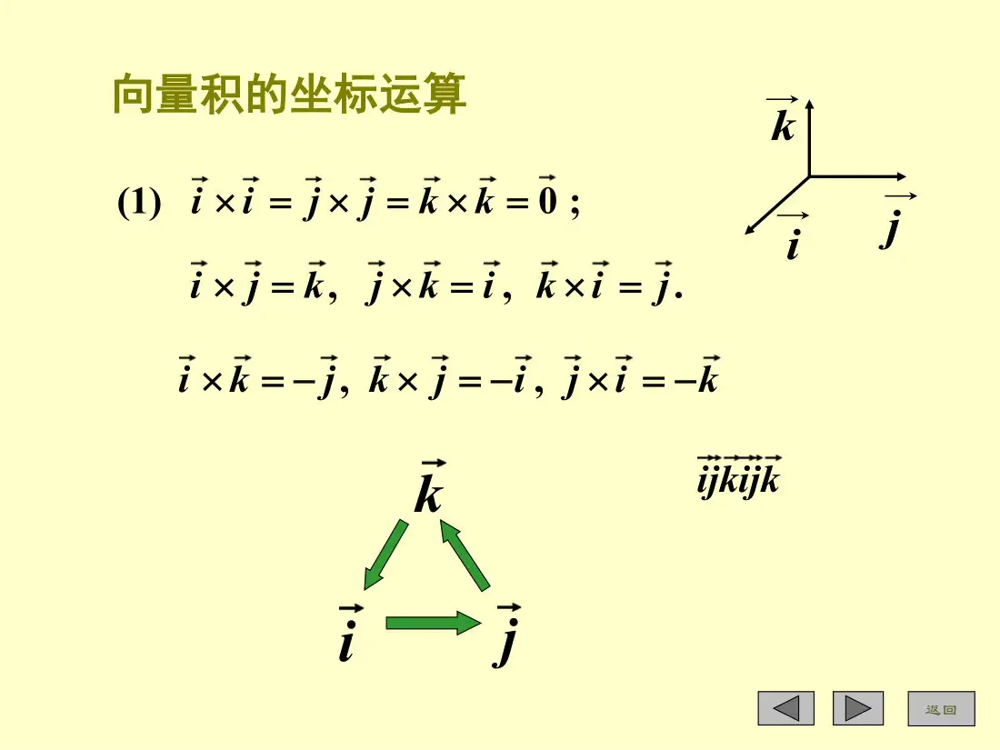

原文：

向量积的坐标运算

$$
\vec {i} \times \vec {i} = \vec {j} \times \vec {j} = \vec {k} \times \vec {k} = \vec {0}\tag{1}
$$

$$
\vec {i} \times \vec {j} = \vec {k}, \vec {j} \times \vec {k} = \vec {i}, \vec {k} \times \vec {i} = \vec {j}.
$$

$$
\vec {i} \times \vec {k} = - \vec {j}, \vec {k} \times \vec {j} = - \vec {i}, \vec {j} \times \vec {i} = - \vec {k}
$$

ijkijk

◀ ▶

返回

### $$

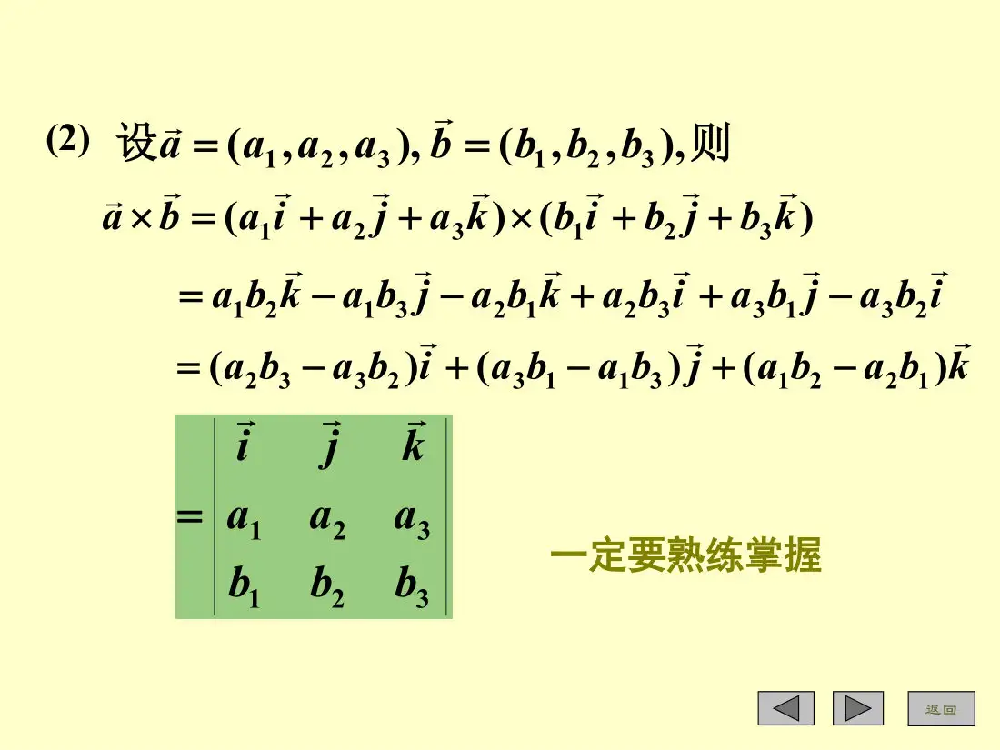

原文：

(2) 设 $\vec{a} = (a_{1}, a_{2}, a_{3}), \vec{b} = (b_{1}, b_{2}, b_{3})$ , 则

$$
\begin{array}{r l}&{\vec {a} \times \vec {b} = (a _ {1} \vec {i} + a _ {2} \vec {j} + a _ {3} \vec {k}) \times (b _ {1} \vec {i} + b _ {2} \vec {j} + b _ {3} \vec {k})}\\&{\qquad = a _ {1} b _ {2} \vec {k} - a _ {1} b _ {3} \vec {j} - a _ {2} b _ {1} \vec {k} + a _ {2} b _ {3} \vec {i} + a _ {3} b _ {1} \vec {j} - a _ {3} b _ {2} \vec {i}}\\&{\qquad = (a _ {2} b _ {3} - a _ {3} b _ {2}) \vec {i} + (a _ {3} b _ {1} - a _ {1} b _ {3}) \vec {j} + (a _ {1} b _ {2} - a _ {2} b _ {1}) \vec {k}}\\&\qquad = \left|\begin{array}{l l l}{\vec {i}}&{\vec {j}}&{\vec {k}}\\{a _ {1}}&{a _ {2}}&{a _ {3}}\\{b _ {1}}&{b _ {2}}&{b _ {3}}\end{array}\right| \textbf \textit \textit \textit \textit \textit \textit \textit \textit \textit \textit \textit \textit \textit \textit \textit \textit \textit \textit \textit \textit \textit \textit \textit \textit \textit \textit \textit \textit \textit \textit \textit \textit \textit \textit\textit \textit \textit \textit \textit \textit \textit \textit \textit \textit \textit \textit \textit \textit \textit \textit \textit {\textit {\textit {\textit {\textit {\textit {\textit {\textit {\textit {\textit {\textit {\textit {\textit {\textit {\textit {\textit {\textit {\xint}}}}}}}}}}}\\}}}}}}\\&= \left|\begin{array}{l l l}\vec {i}&\vec {j}&\vec {k}\\a _ {1}&a _ {2}&a _ {3}\\b _ {1}&b _ {2}&b _ {3}\end{array}\right|\end{array}\left. \right. \qquad \qquad \qquad \qquad \qquad \qquad \qquad \qquad \qquad \qquad \qquad \qquad \qquad \qquad \qquad \qquad \qquad \qquad \qquad \qquad \qquad \qquad \qquad \qquad \qquad \qquad \qquad \qquad \qquad \qquad \qquad \qquad \qquad \qquad
$$

◀ ▶

返回

### $$

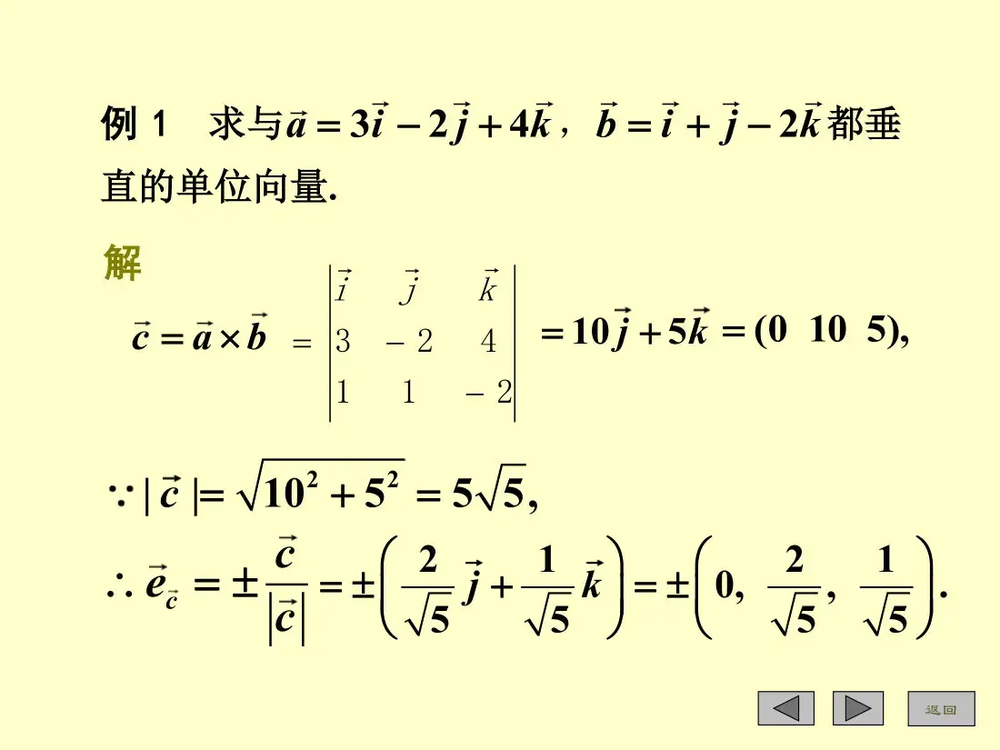

原文：

例 1 求与 $\vec{a}=3\vec{i}-2\vec{j}+4\vec{k}$ ， $\vec{b}=\vec{i}+\vec{j}-2\vec{k}$ 都垂直的单位向量.

解

$$
\vec {c} = \vec {a} \times \vec {b} = \left| \begin{array}{c c c} \vec {i} & \vec {j} & \vec {k} \\ 3 & - 2 & 4 \\ 1 & 1 & - 2 \end{array} \right| = 1 0 \vec {j} + 5 \vec {k} = (0 1 0 5),
$$

$\because |\vec{c}| = \sqrt{10^2 + 5^2} = 5\sqrt{5},$

$$
\therefore \vec {e} _ {\vec {c}} = \pm \frac {\vec {c}}{| \vec {c} |} = \pm \left(\frac {2}{\sqrt {5}} \vec {j} + \frac {1}{\sqrt {5}} \vec {k}\right) = \pm \left(0, \frac {2}{\sqrt {5}}, \frac {1}{\sqrt {5}}\right).
$$

返回

◀ ▶

### $$

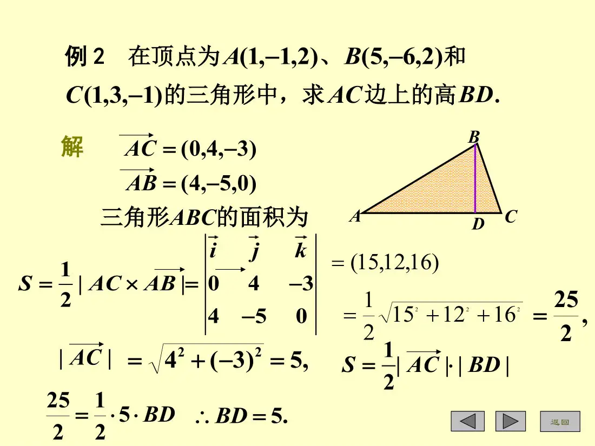

原文：

例 2 在顶点为 $A(1, -1, 2)$ 、 $B(5, -6, 2)$ 和 $C(1, 3, -1)$ 的三角形中，求 $AC$ 边上的高 $BD$ .

解

$$
\begin{array}{l} \overrightarrow {A C} = (0, 4, - 3) \\ \overrightarrow {A B} = (4, - 5, 0) \end{array}
$$

三角形ABC的面积为

$$
\begin{array}{r l} S = \frac {1}{2} | A C \times \overrightarrow {A B} | = & \left| \begin{array}{c c c} \vec {i} & \vec {j} & \vec {k} \\ 0 & 4 & - 3 \\ 4 & - 5 & 0 \end{array} \right| = (1 5, 1 2, 1 6) \\ & = \frac {1}{2} \sqrt {1 5 ^ {2} + 1 2 ^ {2} + 1 6 ^ {2}} = \frac {2 5}{2}, \\ | \overrightarrow {A C} | = & \sqrt {4 ^ {2} + (- 3) ^ {2}} = 5, \\ S = & \frac {1}{2} | \overrightarrow {A C} | \cdot | B D | \\ \frac {2 5}{2} = & \frac {1}{2} \cdot 5 \cdot B D \quad \therefore B D = 5. \end{array}
$$

### 例4 外积的物理意义

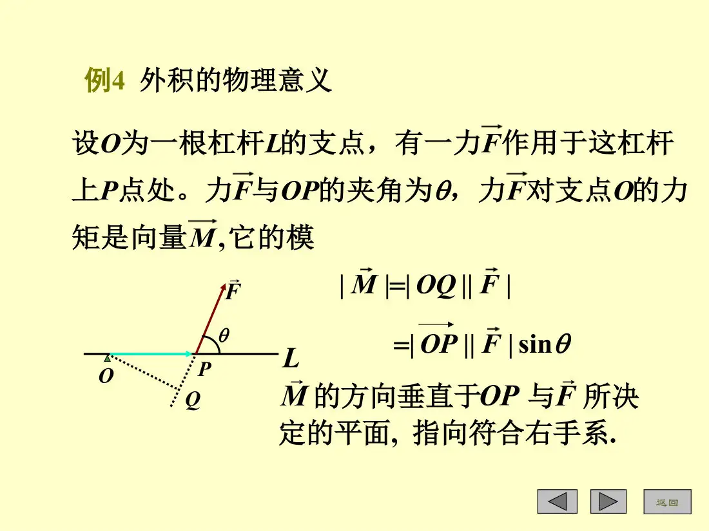

原文：

例4 外积的物理意义

设O为一根杠杆L的支点，有一力 $\overrightarrow{F}$ 作用于这杠杆上P点处。力 $\overrightarrow{F}$ 与OP的夹角为 $\theta$ ，力 $\overrightarrow{F}$ 对支点O的力矩是向量 $\overrightarrow{M}$ ，它的模

$$
\begin{array}{r l} {| \vec {M} | = | O Q | | \vec {F} |} & \\ {= | \overrightarrow {O P} | | \vec {F} | \sin \theta} & \end{array}
$$

$\vec{M}$ 的方向垂直于 OP 与 $\vec{F}$ 所决定的平面，指向符合右手系.

返回

◀ ▶

### 三、混合积

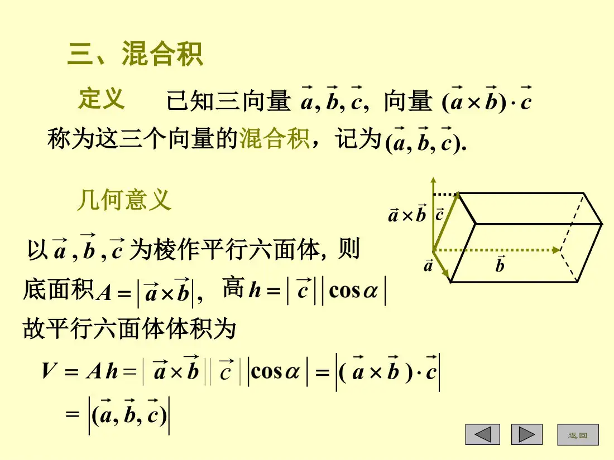

原文：

三、混合积

定义 已知三向量 $\vec{a}, \vec{b}, \vec{c}$ ，向量 $(\vec{a} \times \vec{b}) \cdot \vec{c}$ 称为这三个向量的混合积，记为 $(\vec{a}, \vec{b}, \vec{c})$ .

几何意义
以 $\vec{a},\vec{b},\vec{c}$ 为棱作平行六面体，则底面积 $A=\left|\vec{a}\times\vec{b}\right|$ ，高 $h=\left|\vec{c}\right|\left|\cos\alpha\right|$ 故平行六面体体积为

$$
\begin{array}{r l} & V = A h = | \vec {a} \times \vec {b} | | \vec {c} | | \cos \alpha | = | (\vec {a} \times \vec {b}) \cdot \vec {c} | \\ & \quad = | (\vec {a}, \vec {b}, \vec {c}) | \end{array}
$$

返回

### 混合积的坐标运算

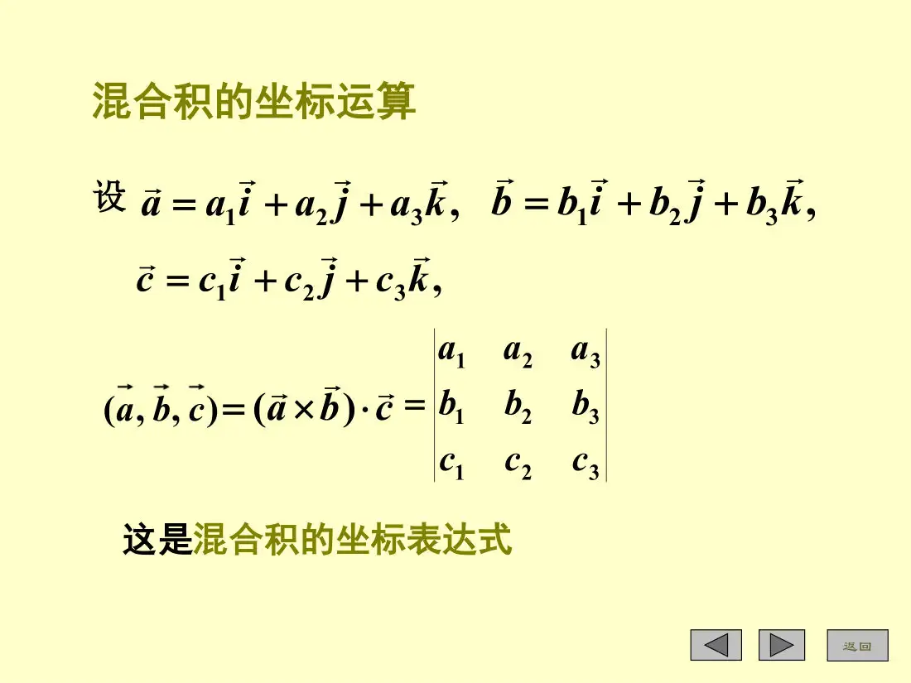

原文：

混合积的坐标运算

$$
\vec {a} = a _ {1} \vec {i} + a _ {2} \vec {j} + a _ {3} \vec {k}, \quad \vec {b} = b _ {1} \vec {i} + b _ {2} \vec {j} + b _ {3} \vec {k},
$$

$$
\vec {c} = c _ {1} \vec {i} + c _ {2} \vec {j} + c _ {3} \vec {k},
$$

$$
(\vec {a}, \vec {b}, \vec {c}) = (\vec {a} \times \vec {b}) \cdot \vec {c} = \left| \begin{array}{l l l} a _ {1} & a _ {2} & a _ {3} \\ b _ {1} & b _ {2} & b _ {3} \\ c _ {1} & c _ {2} & c _ {3} \end{array} \right|
$$

这是混合积的坐标表达式

返回

◀ ▶

### $$

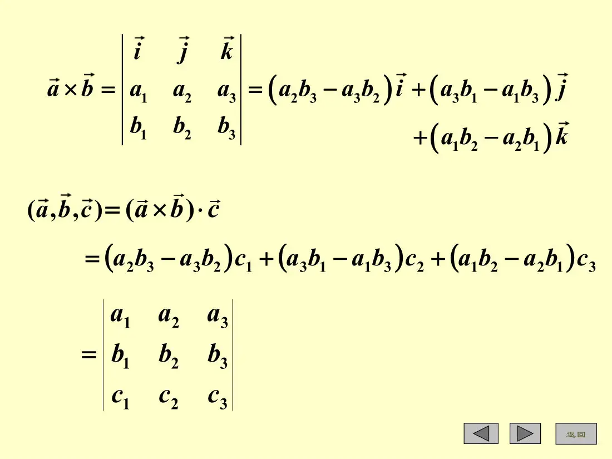

原文：

$$
\vec {a} \times \vec {b} = \left| \begin{array}{c c c} \vec {i} & \vec {j} & \vec {k} \\ a _ {1} & a _ {2} & a _ {3} \\ b _ {1} & b _ {2} & b _ {3} \end{array} \right| = (a _ {2} b _ {3} - a _ {3} b _ {2}) \vec {i} + (a _ {3} b _ {1} - a _ {1} b _ {3}) \vec {j} + (a _ {1} b _ {2} - a _ {2} b _ {1}) \vec {k}
$$

$$
\begin{array}{r l} & {(\vec {a}, \vec {b}, \vec {c}) = (\vec {a} \times \vec {b}) \cdot \vec {c}} \\ & {\qquad = (a _ {2} b _ {3} - a _ {3} b _ {2}) c _ {1} + (a _ {3} b _ {1} - a _ {1} b _ {3}) c _ {2} + (a _ {1} b _ {2} - a _ {2} b _ {1}) c _ {3}} \\ & {\qquad = \left| \begin{array}{l l l} a _ {1} & a _ {2} & a _ {3} \\ b _ {1} & b _ {2} & b _ {3} \\ c _ {1} & c _ {2} & c _ {3} \end{array} \right|} \end{array}
$$

返回

◀ ▶

### 混合积的性质:

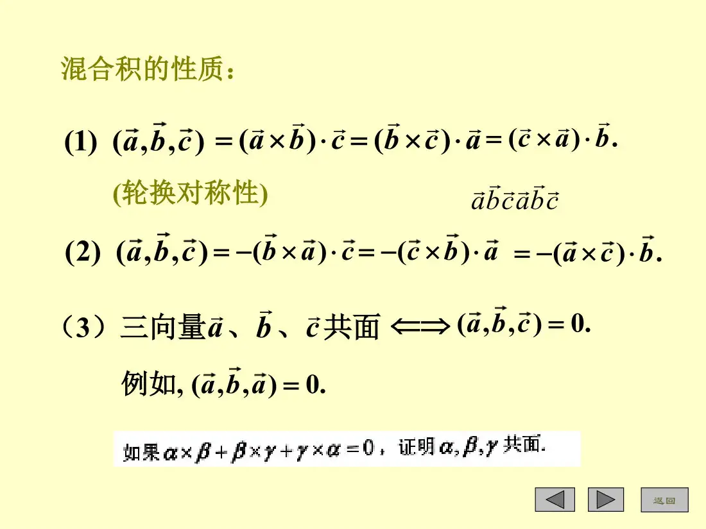

原文：

混合积的性质:

(1) $(\vec{a},\vec{b},\vec{c}) = (\vec{a}\times \vec{b})\cdot \vec{c} = (\vec{b}\times \vec{c})\cdot \vec{a} = (\vec{c}\times \vec{a})\cdot \vec{b}.$ (轮换对称性) $\vec{a}\vec{b}\vec{c}\vec{a}\vec{b}\vec{c}$

(2) $(\vec{a},\vec{b},\vec{c}) = -(\vec{b}\times \vec{a})\cdot \vec{c} = -(\vec{c}\times \vec{b})\cdot \vec{a} = -(\vec{a}\times \vec{c})\cdot \vec{b}.$

(3) 三向量 $\vec{a}$ 、 $\vec{b}$ 、 $\vec{c}$ 共面 $\Longleftrightarrow (\vec{a}, \vec{b}, \vec{c}) = 0$ .

例如, $(\vec{a}, \vec{b}, \vec{a}) = 0$ .

如果 $\alpha \times \beta + \beta \times \gamma + \gamma \times \alpha = 0$ ，证明 $\alpha, \beta, \gamma$ 共面.

◀ ▶

### 例5 已知 $(\vec{a},\vec{b},\vec{c})=2$ ,

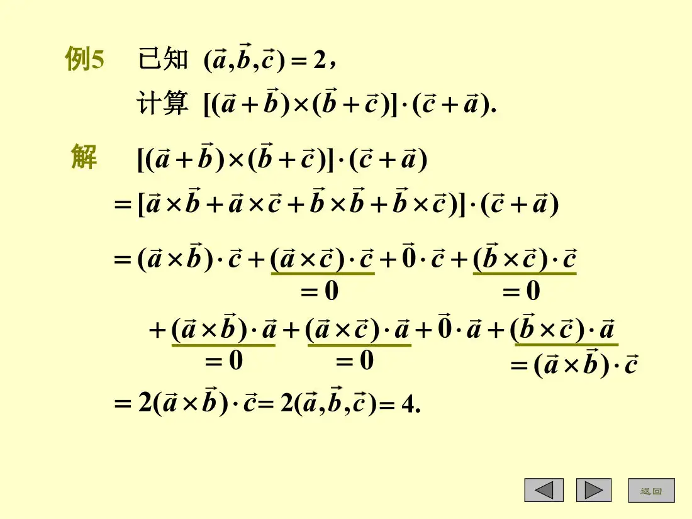

原文：

例5 已知 $(\vec{a},\vec{b},\vec{c})=2$ ,

计算 $\left[(\vec{a} +\vec{b})\times (\vec{b} +\vec{c})\right]\cdot (\vec{c} +\vec{a}).$

解

$$
\begin{array}{r l} & {\text {解} \quad [ (\vec {a} + \vec {b}) \times (\vec {b} + \vec {c}) ] \cdot (\vec {c} + \vec {a})} \\ & {= [ \vec {a} \times \vec {b} + \vec {a} \times \vec {c} + \vec {b} \times \vec {b} + \vec {b} \times \vec {c}) ] \cdot (\vec {c} + \vec {a})} \\ & {= (\vec {a} \times \vec {b}) \cdot \vec {c} + \underbrace {(\vec {a} \times \vec {c}) \cdot \vec {c}} _ {= 0} + \vec {0} \cdot \vec {c} + \underbrace {(\vec {b} \times \vec {c}) \cdot \vec {c}} _ {= 0}} \\ & {\qquad + (\vec {a} \times \vec {b}) \cdot \vec {a} + (\vec {a} \times \vec {c}) \cdot \vec {a} + \vec {0} \cdot \vec {a} + (\vec {b} \times \vec {c}) \cdot \vec {a}} \\ & {\qquad = 0, 0, 0, 0, 0, 0, 0, 0, 0, 0, 0, 0, 0, 0, 0, 0, 0, 0, 0, 0, 0, 0, 0, 0, 0, 0, 0, 0, 0, 0, 0, 0, 0, 0,} \\ & {= 2 (\vec {a} \times \vec {b}) \cdot \vec {c} = 2 (\vec {a}, \vec {b}, \vec {c}) = 4.} \end{array}
$$

◀ ▶

返回

### 返回

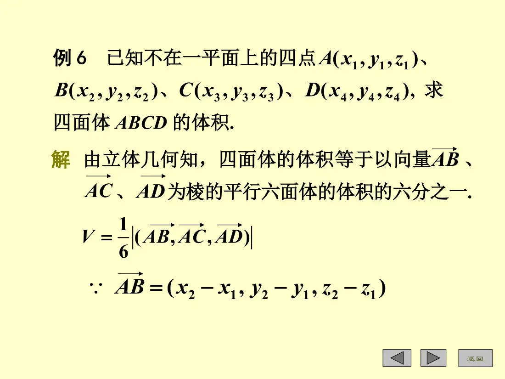

原文：

例 6 已知不在一平面上的四点 $A(x_{1}, y_{1}, z_{1})$ 、 $B(x_{2}, y_{2}, z_{2})$ 、 $C(x_{3}, y_{3}, z_{3})$ 、 $D(x_{4}, y_{4}, z_{4})$ ，求四面体 ABCD 的体积.

解 由立体几何知，四面体的体积等于以向量 $\overrightarrow{AB}$ 、 $\overrightarrow{AC}$ 、 $\overrightarrow{AD}$ 为棱的平行六面体的体积的六分之一. $V = \frac{1}{6} |(\overrightarrow{AB}, \overrightarrow{AC}, \overrightarrow{AD})|$ $\because \overrightarrow{AB} = (x_2 - x_1, y_2 - y_1, z_2 - z_1)$

返回

◀ ▶

### $$

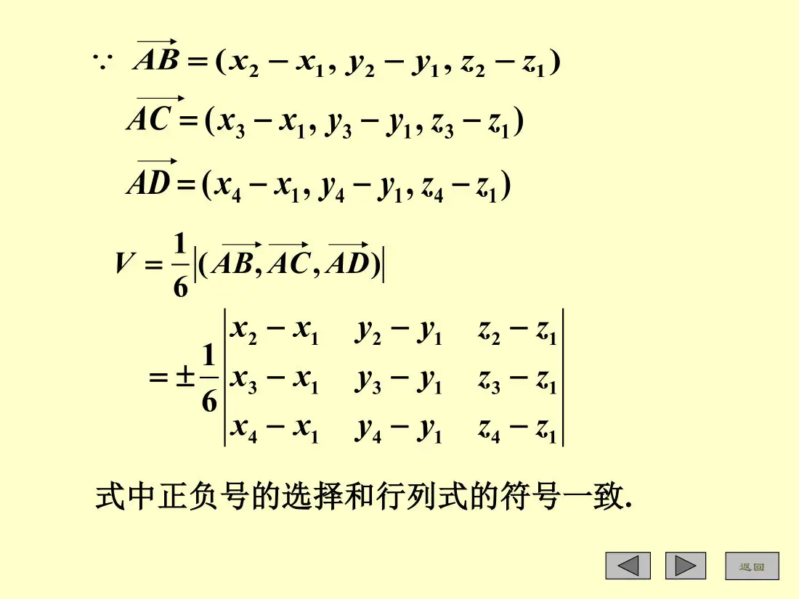

原文：

$$
\begin{array}{r l} & {\because \overrightarrow {A B} = (x _ {2} - x _ {1}, y _ {2} - y _ {1}, z _ {2} - z _ {1})} \\ & {\overrightarrow {A C} = (x _ {3} - x _ {1}, y _ {3} - y _ {1}, z _ {3} - z _ {1})} \\ & {\overrightarrow {A D} = (x _ {4} - x _ {1}, y _ {4} - y _ {1}, z _ {4} - z _ {1})} \end{array}
$$

$$
\begin{array}{r l} & V = \frac {1}{6} \big | (\overrightarrow {A B}, \overrightarrow {A C}, \overrightarrow {A D}) \big | \\ & = \pm \frac {1}{6} \left| \begin{array}{l l l} x _ {2} - x _ {1} & y _ {2} - y _ {1} & z _ {2} - z _ {1} \\ x _ {3} - x _ {1} & y _ {3} - y _ {1} & z _ {3} - z _ {1} \\ x _ {4} - x _ {1} & y _ {4} - y _ {1} & z _ {4} - z _ {1} \end{array} \right| \end{array}
$$

式中正负号的选择和行列式的符号一致.

返回

◀ ▶

### 解:

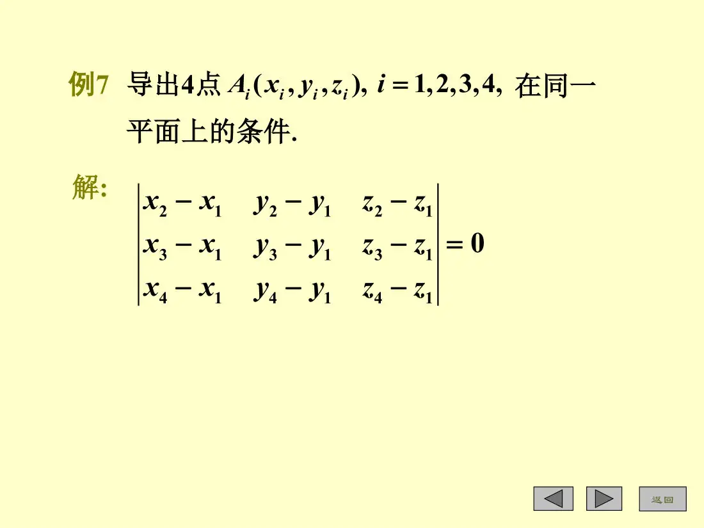

原文：

例7 导出4点 $A_{i}(x_{i},y_{i},z_{i})$ , i=1,2,3,4，在同一平面上的条件.

解:

$$
\left| \begin{array}{c c c} x _ {2} - x _ {1} & y _ {2} - y _ {1} & z _ {2} - z _ {1} \\ x _ {3} - x _ {1} & y _ {3} - y _ {1} & z _ {3} - z _ {1} \\ x _ {4} - x _ {1} & y _ {4} - y _ {1} & z _ {4} - z _ {1} \end{array} \right| = 0
$$

返回

◀ ▶
