# 《线性代数与解析几何》第3章 曲面与空间曲线（课件）

原件的每一页，下面附识别出的文字。

### 3.5 曲面与空间曲线

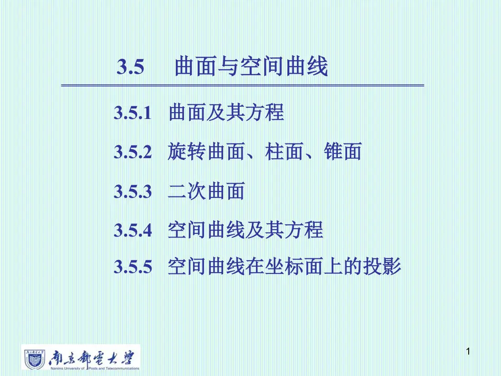

原文：

3.5 曲面与空间曲线
3.5.1 曲面及其方程
3.5.2 旋转曲面、柱面、锥面
3.5.3 二次曲面
3.5.4 空间曲线及其方程
3.5.5 空间曲线在坐标面上的投影

南京郵電大学 Nanjing University of Posts and Telecommunication

1

### 3.5 曲面与空间曲线

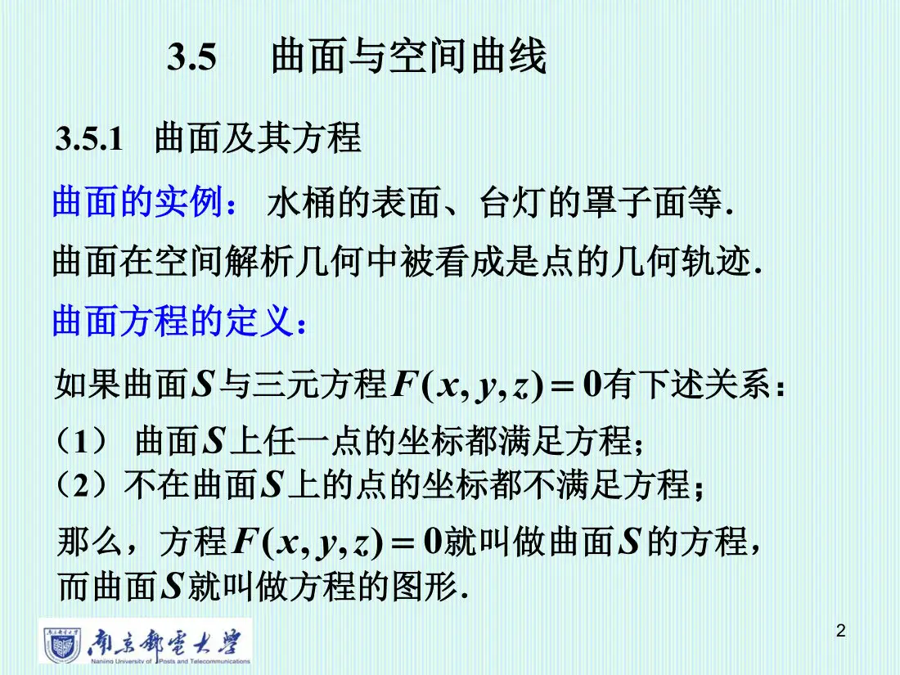

原文：

3.5 曲面与空间曲线

3.5.1 曲面及其方程

水桶的表面、台灯的罩子面等曲面的实例：曲面在空间解析几何中被看成是点的几何轨迹曲面方程的定义：

如果曲面S与三元方程 $F ( x , y , z ) = 0$ 有下述关系：

（1）曲面S上任一点的坐标都满足方程；

（2）不在曲面S上的点的坐标都不满足方程；

那么，方程 $F ( x , y , z ) = 0$ 就叫做曲面S的方程，而曲面S就叫做方程的图形.

南京郵電大学Nanjir communications

2

### 解设 $M ( x , y , z )$ 是球面上任一点，

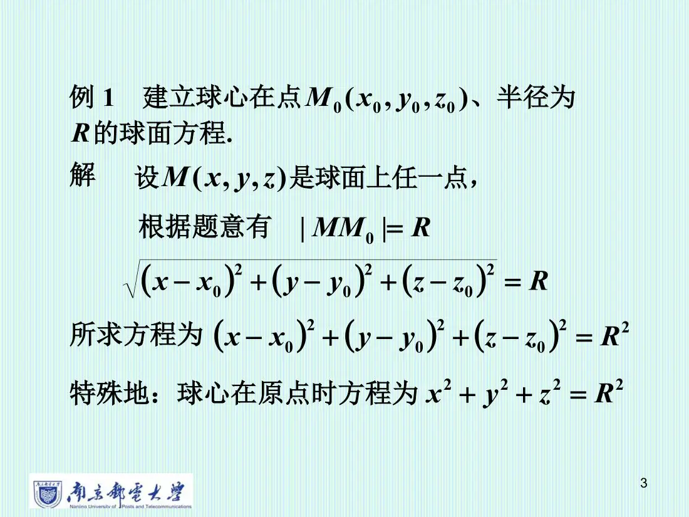

原文：

例1 建立球心在点 $M _ { 0 } ( x _ { 0 } , y _ { 0 } , z _ { 0 } )$ 、半径为R的球面方程.

解设 $M ( x , y , z )$ 是球面上任一点，

根据题意有 $M M _ { 0 } \Vdash R$

$$
\sqrt {(x - x _ {0}) ^ {2} + (y - y _ {0}) ^ {2} + (z - z _ {0}) ^ {2}} = R
$$

所求方程为 $( x - x _ { 0 } ) ^ { 2 } + ( y - y _ { 0 } ) ^ { 2 } + ( z - z _ { 0 } ) ^ { 2 } = R ^ { 2 }$

特殊地：球心在原点时方程为 $x ^ { 2 } + y ^ { 2 } + z ^ { 2 } = R ^ { 2 }$ 例2求与原点0及 $M _ { \mathrm { 0 } } ( 2 , 3 , 4 )$ 的距离之比为1:2的 点的全体所组成的曲面方程.

南京郵電大学 Nanjing University of Posts and Telecommunications

3

### 解设 $M ( x , y , z )$ 是曲面上任一点，

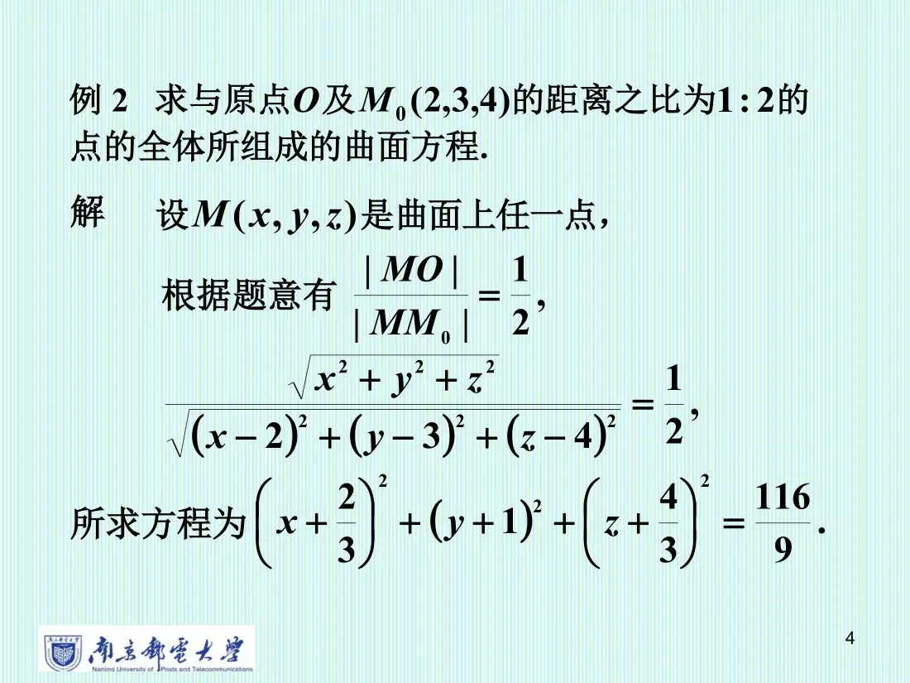

原文：

解设 $M ( x , y , z )$ 是曲面上任一点，

根据题意有 $\frac { \mid M O \mid } { M M _ { 0 } } = \frac { 1 } { 2 } ,$

$$
\frac {\sqrt {x ^ {2} + y ^ {2} + z ^ {2}}}{\sqrt {(x - 2) ^ {2} + (y - 3) ^ {2} + (z - 4) ^ {2}}} = \frac {1}{2},
$$

所求方程为 $( x + { \frac { 2 } { 3 } } ) ^ { 2 } + ( y + 1 ) ^ { 2 } + ( z + { \frac { 4 } { 3 } } ) ^ { 2 } = { \frac { 1 1 6 } { 9 } }$ 例 3 已知 A(1,2,3)，B(2,—1,4)，求线段AB的垂直平分面的方程.

南京郵電大学 Nanjing University of Posts and Telecommunications

4

### 解设 $M ( x , y , z )$ 是所求平面上任一点，

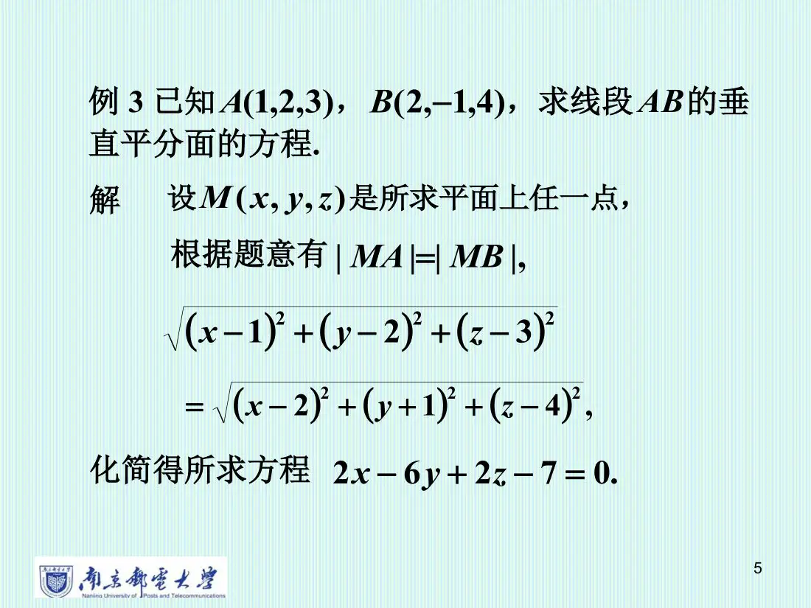

原文：

解设 $M ( x , y , z )$ 是所求平面上任一点，

根据题意有 $\ M A \models \ M B \ .$

$$
\begin{array}{r l} & {\sqrt {(x - 1) ^ {2} + (y - 2) ^ {2} + (z - 3) ^ {2}}} \\ & {= \sqrt {(x - 2) ^ {2} + (y + 1) ^ {2} + (z - 4) ^ {2}},} \end{array}
$$

化简得所求方程 $2 x - 6 y + 2 z - 7 = 0 .$

南京郵電大学 Nanjing University of Posts and Telecommunications

5

### 第 6 页

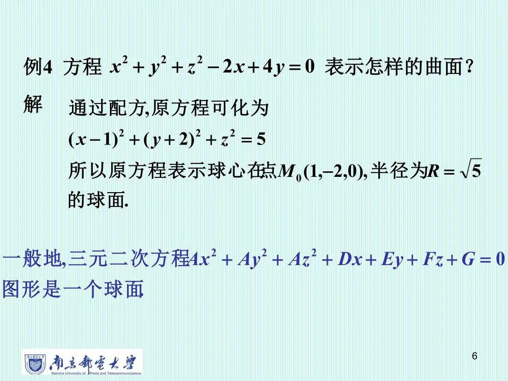

原文：

例4 方程 $x ^ { 2 } + y ^ { 2 } + z ^ { 2 } - 2 x + 4 y = 0$ 表示怎样的曲面？解 通过配方,原方程可化为$\left( x - 1 \right) ^ { 2 } + \left( y + 2 \right) ^ { 2 } + z ^ { 2 } = 5$ 所以原方程表示球心在点 $M _ { 0 } ( 1 , - 2 , 0 ) ,$ 半径为 $R = \sqrt { 5 }$ 的球面.

,一般地 三元二次方程 $4 x ^ { 2 } + A y ^ { 2 } + A z ^ { 2 } + D x + E y + F z + G = 0$ .图形是一个球面

南京郵電大学 Nanjing University of Posts and Telecommunications

6

### 以上几例表明研究空间曲面有两个基本问题：

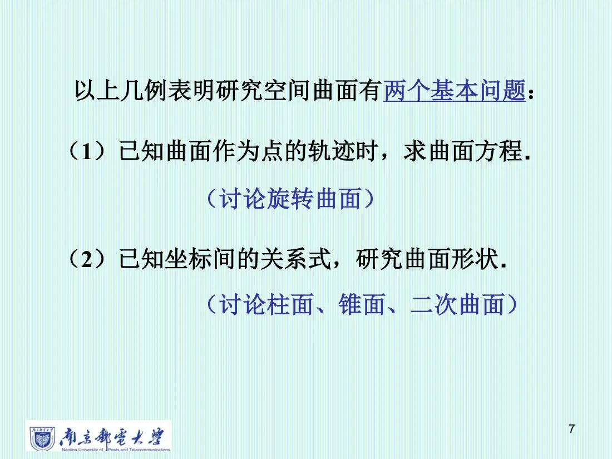

原文：

以上几例表明研究空间曲面有两个基本问题：

（1）已知曲面作为点的轨迹时，求曲面方程（讨论旋转曲面）

（2）已知坐标间的关系式，研究曲面形状（讨论柱面、锥面、二次曲面）

南京郵電大学 Nanjing University of Posts and Telecommunications

7

### 3.5.2 旋转曲面、柱面、锥面

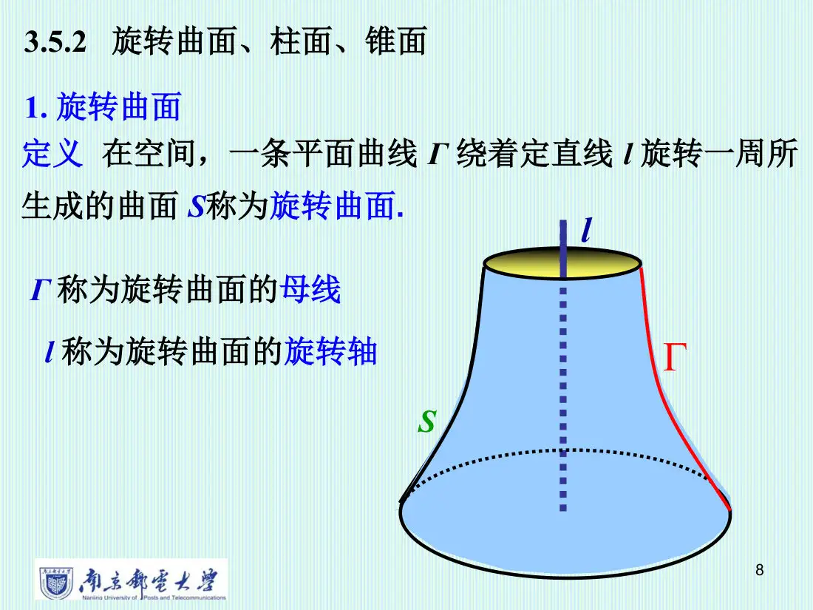

原文：

3.5.2 旋转曲面、柱面、锥面

1.旋转曲面

定义 在空间，一条平面曲线 Γ绕着定直线 l 旋转一周所生成的曲面 S称为旋转曲面.

.Γ称为旋转曲面的母线

l 称为旋转曲面的旋转轴

南京郵電大学 Nanjing University of Posts and Telecommunications

8

### 旋转过程中的特征：

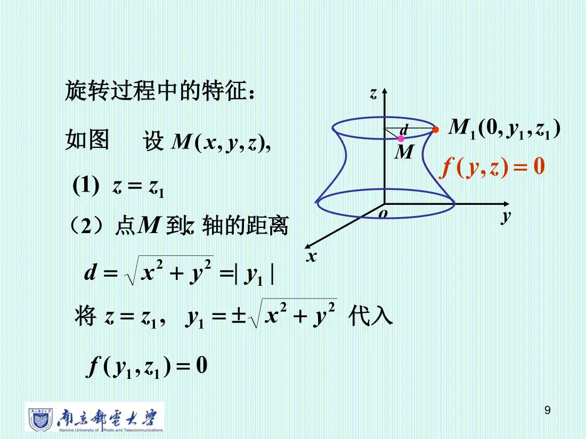

原文：

旋转过程中的特征：

如图 $M ( x , y , z )$ 2

(1) $z = 7$

(2)点M到 轴的距离

$$
d = \sqrt {x ^ {2} + y ^ {2}} = | y _ {1} |
$$

将 $z = z _ { 1 }$ $y _ { 1 } = \pm \sqrt { x ^ { 2 } + y ^ { 2 } }$ 代入

$$
f (y _ {1}, z _ {1}) = 0
$$

南京郵電大学 Nanjing University of Posts and Telecommunications

9

### $$

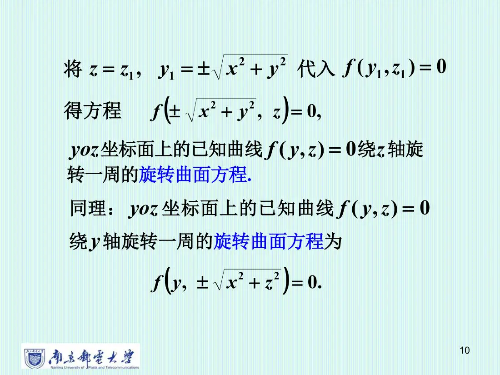

原文：

将 $z = 7$ 9 $y _ { 1 } = \pm \sqrt { x ^ { 2 } + y ^ { 2 } }$ 代入 $f ( y _ { 1 } , z _ { 1 } ) = 0$ 得方程 $f ( \pm \sqrt { x ^ { 2 } + y ^ { 2 } } , z ) = 0 .$

yoz坐标面上的已知曲线 $f ( y , z ) = 0$ 绕z轴旋转一周的旋转曲面方程.

同理：yoz坐标面上的已知曲线 $f ( y , z ) = 0$ 绕y轴旋转一周的旋转曲面方程为

$$
f (y, \pm \sqrt {x ^ {2} + z ^ {2}}) = 0.
$$

南京郵電大学 Nanjing University of Posts and Telecommunications

10

### 例5 将下列各曲线绕对应的轴旋转一周，求生成的旋转曲面的方程

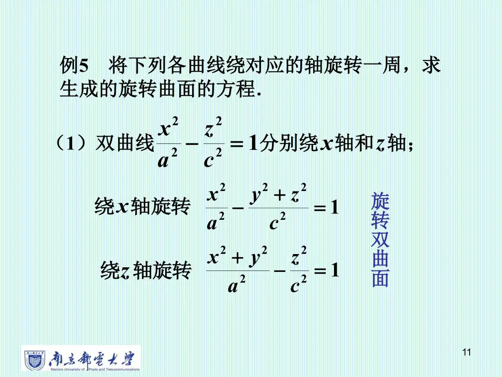

原文：

例5 将下列各曲线绕对应的轴旋转一周，求生成的旋转曲面的方程

（1）双曲线 ${ \frac { x ^ { 2 } } { a ^ { 2 } } } - { \frac { z ^ { 2 } } { c ^ { 2 } } } = 1$ 分别绕x轴和z轴；绕x轴旋转 ${ \frac { x ^ { 2 } } { a ^ { 2 } } } - { \frac { y ^ { 2 } + z ^ { 2 } } { c ^ { 2 } } } = 1$ 旋

转

双

曲

面绕z轴旋转 $\frac { x ^ { 2 } + y ^ { 2 } } { a ^ { 2 } } - \frac { z ^ { 2 } } { c ^ { 2 } } = 1$

南京郵電大学 Nanjing University of Posts and Telecommunications

11

### 12

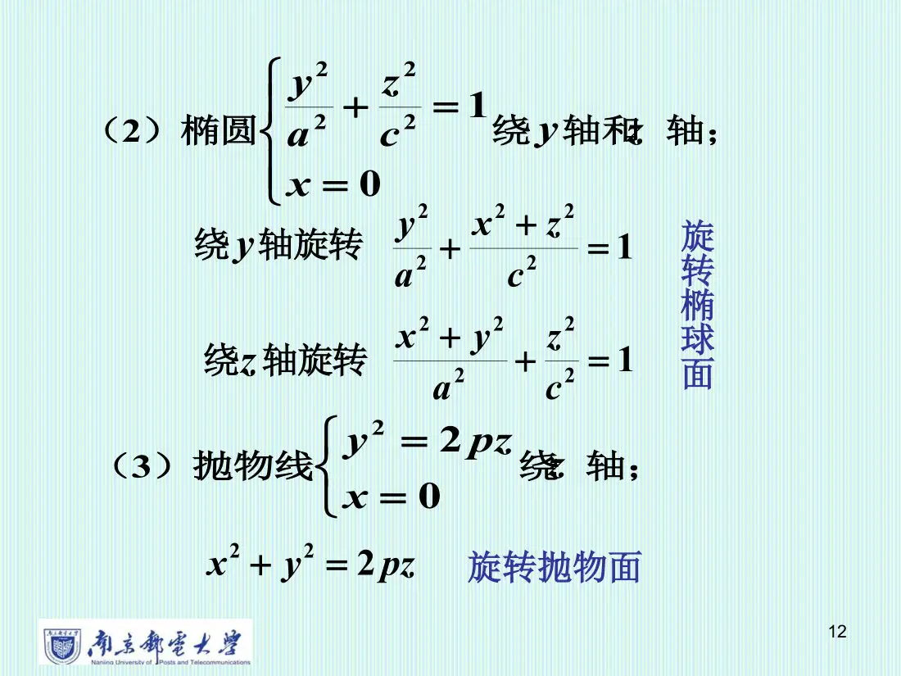

原文：

（ 2 ） 椭 圆 $\displaystyle \int _ { a ^ { 2 } } ^ { \smash { \boldsymbol { y } } ^ { 2 } } + \frac { \varepsilon ^ { 2 } } { c ^ { 2 } } = 1$ 绕轴和轴；x = 0绕y轴旋转 $\frac { y ^ { 2 } } { a ^ { 2 } } + \frac { x ^ { 2 } + z ^ { 2 } } { c ^ { 2 } } = 1$ 旋

转

椭

球

面绕z轴旋转 $\frac { x ^ { 2 } + y ^ { 2 } } { a ^ { 2 } } + \frac { z ^ { 2 } } { c ^ { 2 } } = 1$ （3）抛物线 $\left\{ { \begin{array} { l } { y ^ { 2 } = 2 p z } \\ { x = 0 } \end{array} } \right.$ 绕轴；$x ^ { 2 } + y ^ { 2 } = 2 p z$ 旋转抛物面

南京郵電大学 Nanjing University of Posts and Telecommunications

12

### 13

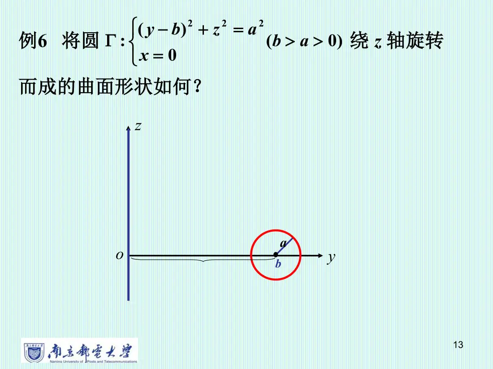

原文：

例6 将圆 $\left\{ \begin{array} { l l } { ( y - b ) ^ { 2 } + z ^ { 2 } = a ^ { 2 } } \\ { x = 0 } \end{array} \right. ( b > a > 0 )$ 绕 z 轴旋转而成的曲面形状如何？

南京郵電大学 Nanjing University of Posts and Telecommunications

13

### 14

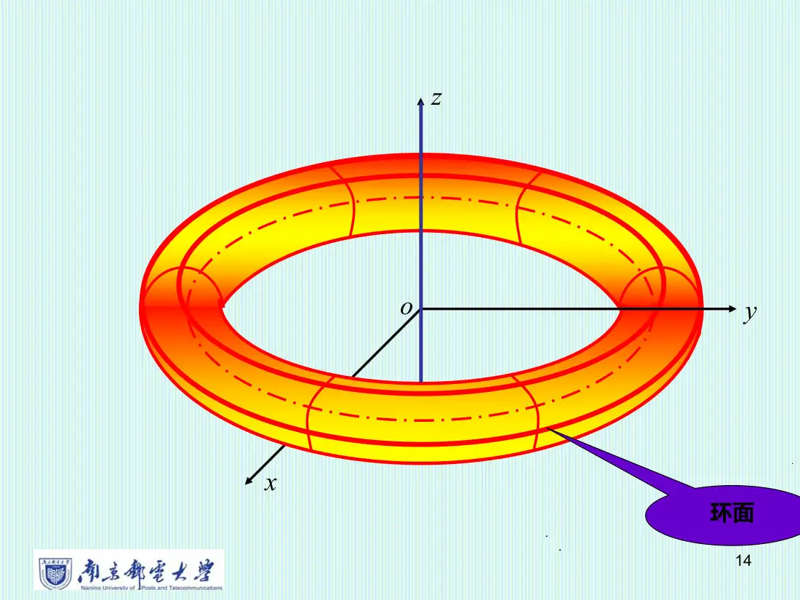

原文：

南京郵電大学 Nanjing University of Posts and Telecommunications

14

### 2. 柱面

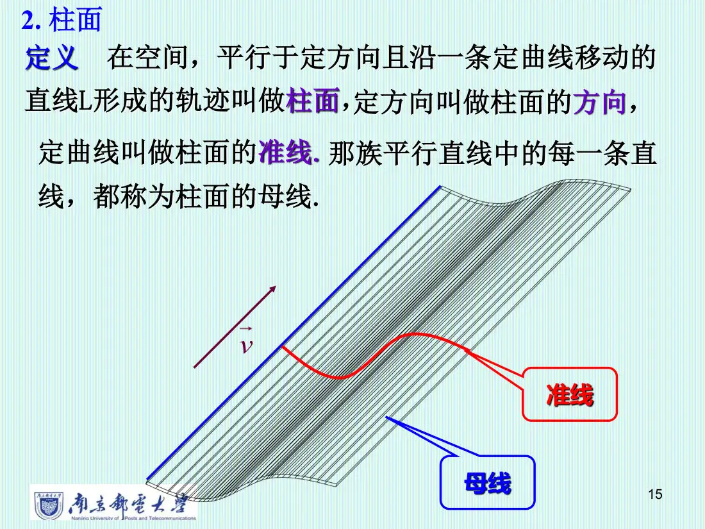

原文：

2. 柱面

定义 在空间，平行于定方向且沿一条定曲线移动的直线L形成的轨迹叫做柱面，定方向叫做柱面的方向，那族平行直线中的每一条直定曲线叫做柱面的准线.线，都称为柱面的母线.

南京郵電大学 Nanjing University of Posts and Telecommunications

15

### 南京郵電

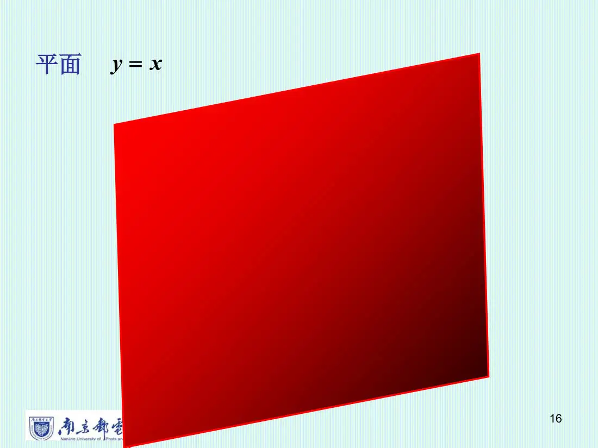

原文：

南京郵電

16

### 圆柱面

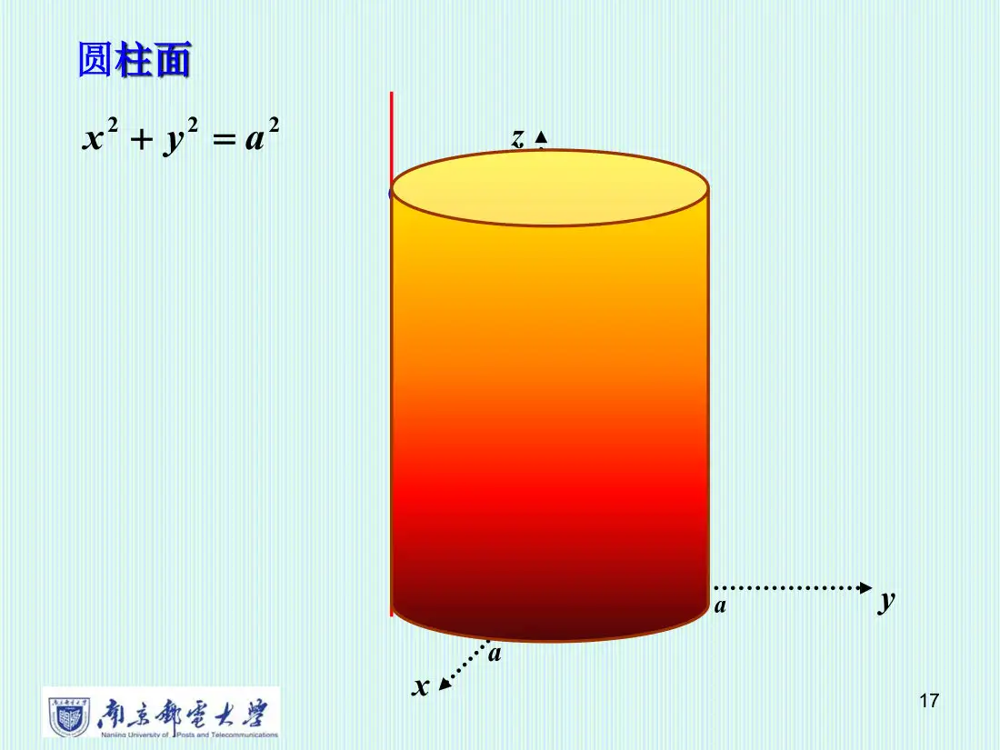

原文：

圆柱面

$$
x ^ {2} + y ^ {2} = a ^ {2}
$$

南京郵電大学Nani communication

17

### 准线

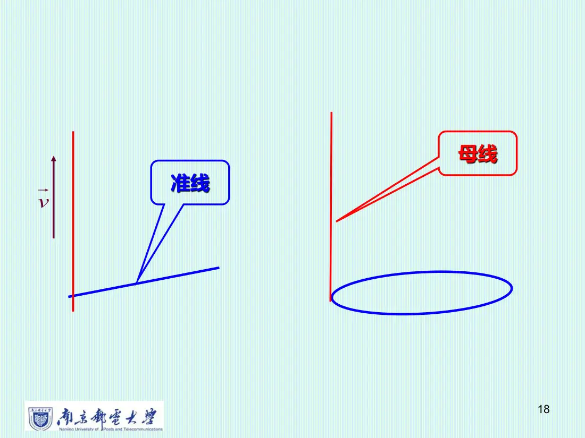

原文：

准线

母线

南京郵電大学 Nanjing University of Posts and Telecommunications

18

### 从柱面方程看柱面的特征：

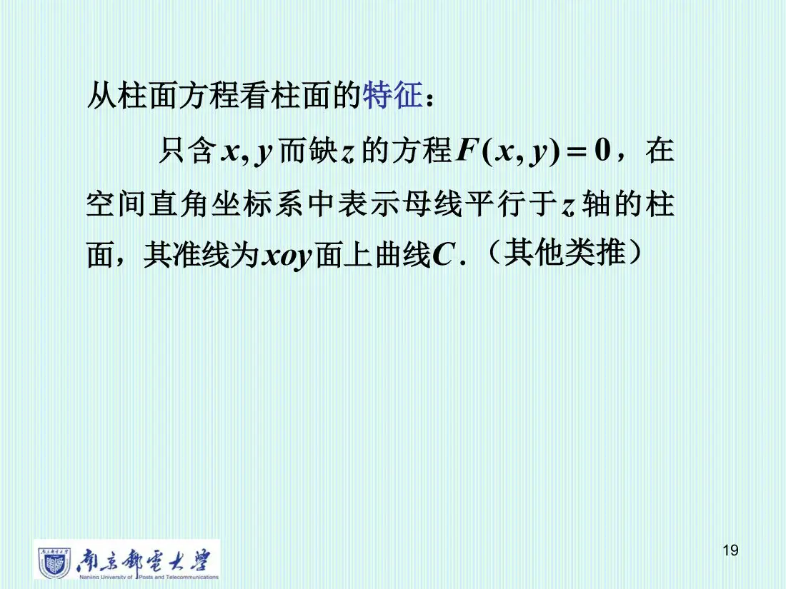

原文：

从柱面方程看柱面的特征：

只含x,y而缺z的方程 $F ( x , y ) = 0$ ，在空间直角坐标系中表示母线平行于z轴的柱面，其准线为xoy面上曲线C.（其他类推）

南京郵電大学 Nanjing University of Posts and Telecommunications

19

### 椭圆柱面

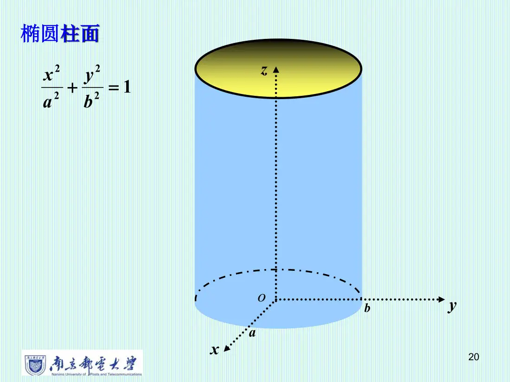

原文：

椭圆柱面

$$
\frac {x ^ {2}}{a ^ {2}} + \frac {y ^ {2}}{b ^ {2}} = 1
$$

南京郵電大学 Nanjing University of Posts and Telecommunications

20

### 双曲柱面

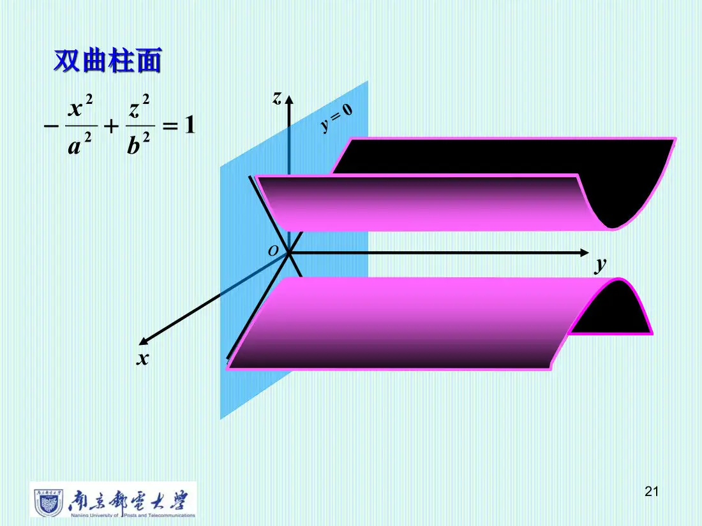

原文：

双曲柱面

$$
- \frac {x ^ {2}}{a ^ {2}} + \frac {z ^ {2}}{b ^ {2}} = 1
$$

南京郵電大学 Nanjing University of Posts and Telecommunications

21

### 抛物柱面

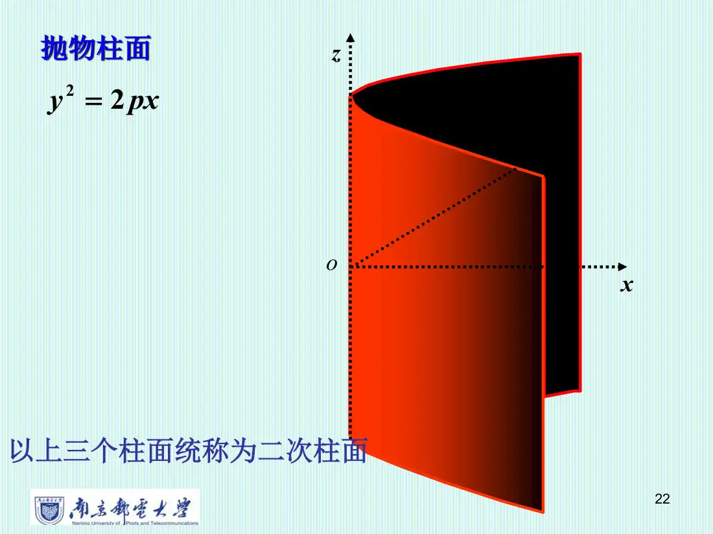

原文：

抛物柱面

以上三个柱面统称为二次柱面

南京郵電大学Nanjing Univer nd Telecommunications

22

### 3. 锥面

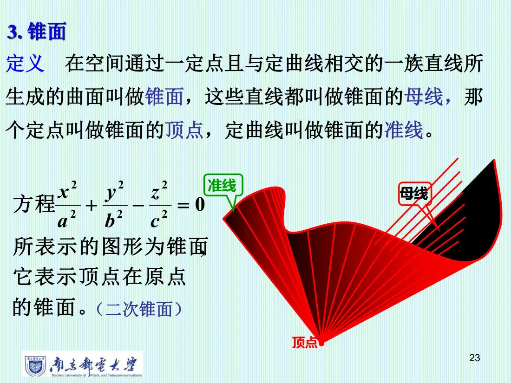

原文：

3. 锥面

定义 在空间通过一定点且与定曲线相交的一族直线所生成的曲面叫做锥面，这些直线都叫做锥面的母线，那个定点叫做锥面的顶点，定曲线叫做锥面的准线。

方程 $\frac { x ^ { 2 } } { a ^ { 2 } } + \frac { y ^ { 2 } } { b ^ { 2 } } - \frac { z ^ { 2 } } { c ^ { 2 } } = 0$ 所表示的图形为锥面,它表示顶点在原点的锥面。（二次锥面）

南京郵電大学Nanjing Univer nd Telecommunications

23

### 3.5.3 二次曲面

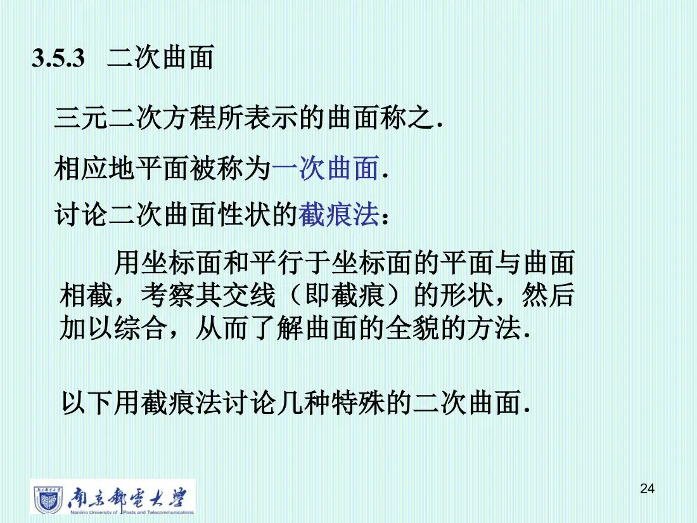

原文：

3.5.3 二次曲面

三元二次方程所表示的曲面称之

相应地平面被称为一次曲面

讨论二次曲面性状的截痕法：

用坐标面和平行于坐标面的平面与曲面相截，考察其交线（即截痕）的形状，然后加以综合，从而了解曲面的全貌的方法

以下用截痕法讨论几种特殊的二次曲面

南京郵電大学 Nanjing University of Posts and Telecommunications

24

### 1. 椭球面

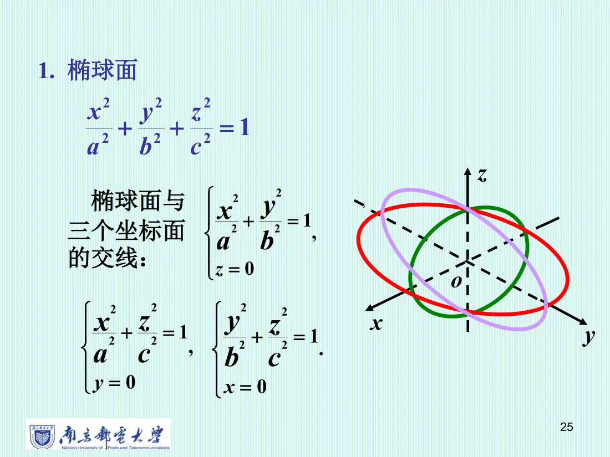

原文：

1. 椭球面

$$
\frac {x ^ {2}}{a ^ {2}} + \frac {y ^ {2}}{b ^ {2}} + \frac {z ^ {2}}{c ^ {2}} = 1
$$

椭球面与三个坐标面的交线：

$$
\left\{ \begin{array}{l} \frac {\boldsymbol {x} ^ {2}}{\boldsymbol {a} ^ {2}} + \frac {\boldsymbol {y} ^ {2}}{\boldsymbol {b} ^ {2}} = 1, \\ z = 0 \end{array} , \right.
$$

$$
\left\{ \begin{array}{l} \frac {\boldsymbol {x} ^ {2}}{a ^ {2}} + \frac {\boldsymbol {z} ^ {2}}{c ^ {2}} = 1 \\ y = 0 \end{array} , \quad \left\{ \begin{array}{l} \frac {\boldsymbol {y} ^ {2}}{b ^ {2}} + \frac {\boldsymbol {z} ^ {2}}{c ^ {2}} = 1 \\ x = 0 \end{array} . \right. \right.
$$

南京郵電大学 Nanjing University of Posts and Telecommunications

25

### $$

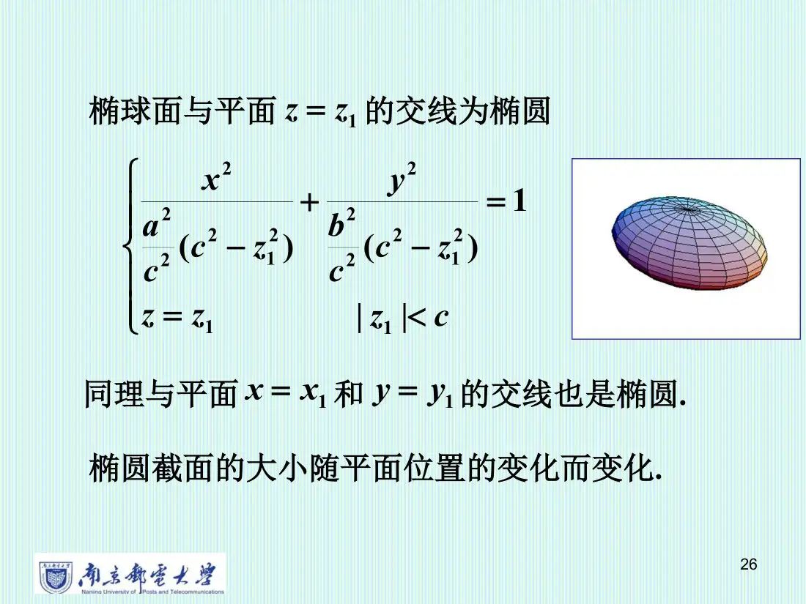

原文：

椭球面与平面 $z = { \bar { \mathbf { \omega } } } _ { 1 }$ 的交线为椭圆

$$
\left\{ \begin{array}{l} \frac {x ^ {2}}{\frac {a ^ {2}}{c ^ {2}} (c ^ {2} - z _ {1} ^ {2})} + \frac {y ^ {2}}{\frac {b ^ {2}}{c ^ {2}} (c ^ {2} - z _ {1} ^ {2})} = 1 \\ z = z _ {1} \quad | z _ {1} | <   c \end{array} \right.
$$

同理与平面 $x = x _ { 1 }$ 和 $y = y _ { 1 }$ 的交线也是椭圆.

椭圆截面的大小随平面位置的变化而变化.

南京郵電大学 Nanjing University of Posts and Telecommunications

26

### 椭球面的几种特殊情况：

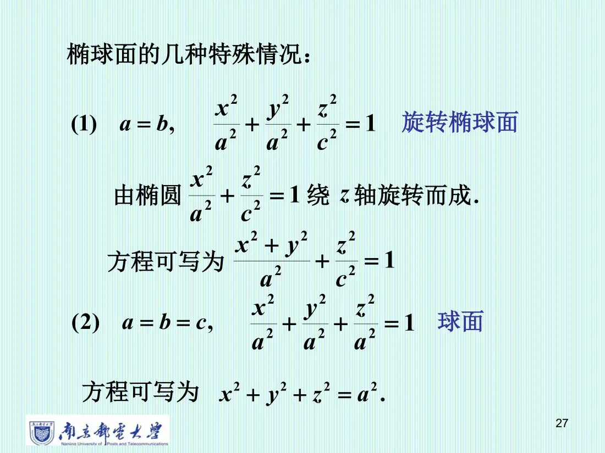

原文：

椭球面的几种特殊情况：

) a = b, $\frac { x ^ { 2 } } { a ^ { 2 } } + \frac { y ^ { 2 } } { a ^ { 2 } } + \frac { z ^ { 2 } } { c ^ { 2 } } = 1$ 旋转椭球面由椭圆 $\frac { x ^ { 2 } } { a ^ { 2 } } + \frac { z ^ { 2 } } { c ^ { 2 } } = 1$ 绕 z轴旋转而成方程可写为 $\frac { x ^ { 2 } + y ^ { 2 } } { a ^ { 2 } } + \frac { z ^ { 2 } } { c ^ { 2 } } = 1$ (2) $a = b = c$ $\frac { x ^ { 2 } } { a ^ { 2 } } + \frac { y ^ { 2 } } { a ^ { 2 } } + \frac { z ^ { 2 } } { a ^ { 2 } } = 1$ 球面方程可写为 $x ^ { 2 } + y ^ { 2 } + z ^ { 2 } = a ^ { 2 }$

南京郵電大学 Nanjing University of Posts and Telecommunications

27

### 2. 双曲面

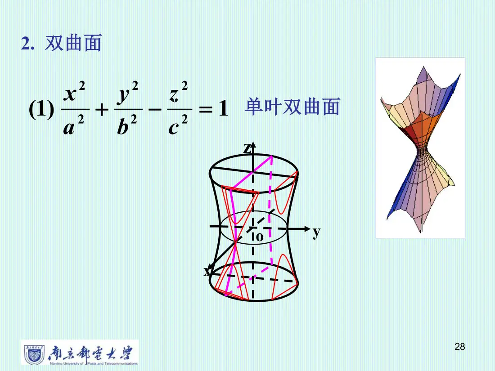

原文：

2. 双曲面

(1) $\frac { x ^ { 2 } } { a ^ { 2 } } + \frac { y ^ { 2 } } { b ^ { 2 } } - \frac { z ^ { 2 } } { c ^ { 2 } } = 1$ 单叶双曲面

南京郵電大学 Nanjing University of Posts and Telecommunications

28

### $$

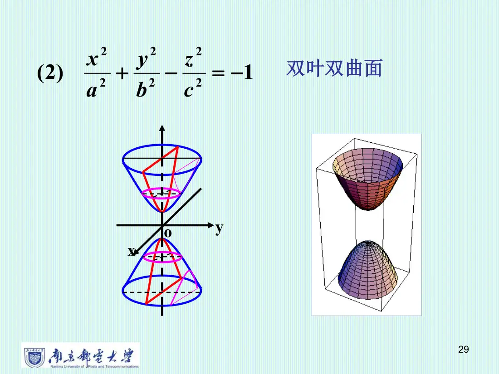

原文：

$$
\frac {x ^ {2}}{a ^ {2}} + \frac {y ^ {2}}{b ^ {2}} - \frac {z ^ {2}}{c ^ {2}} = - 1\tag{2}
$$

双叶双曲面

南京郵電大学 Nanjing University of Posts and Telecommunications

29

### 3. 抛物面

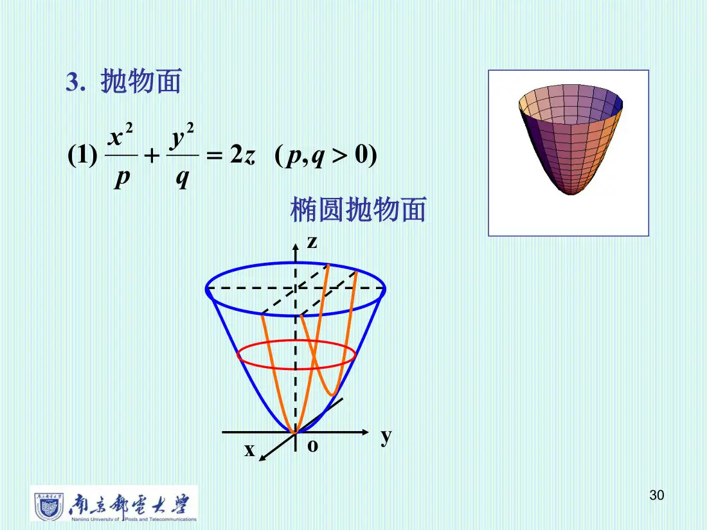

原文：

3. 抛物面

(1) $\frac { x ^ { 2 } } { p } + \frac { y ^ { 2 } } { q } = 2 z ( p , q > 0 )$

椭圆抛物面

南京郵電大学 Nanjing University of Posts and Telecommunications

30

### 特殊地：当 $p = q$ 时，方程变为

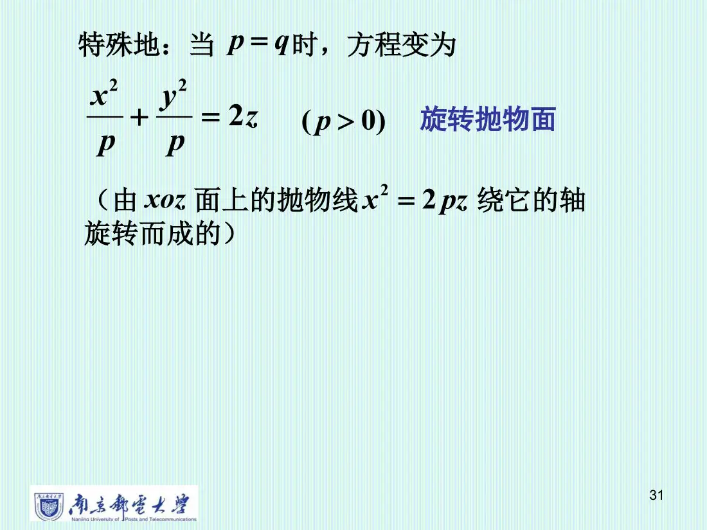

原文：

特殊地：当 $p = q$ 时，方程变为

$$
\frac {x ^ {2}}{p} + \frac {y ^ {2}}{p} = 2 z \quad (p > 0) \quad \text {旋转抛物面}
$$

（由 面上的抛物线 $x ^ { 2 } = 2 p z$ 绕它的轴旋转而成的）

南京郵電大学 Nanjing University of Posts and Telecommunications

31

### $$

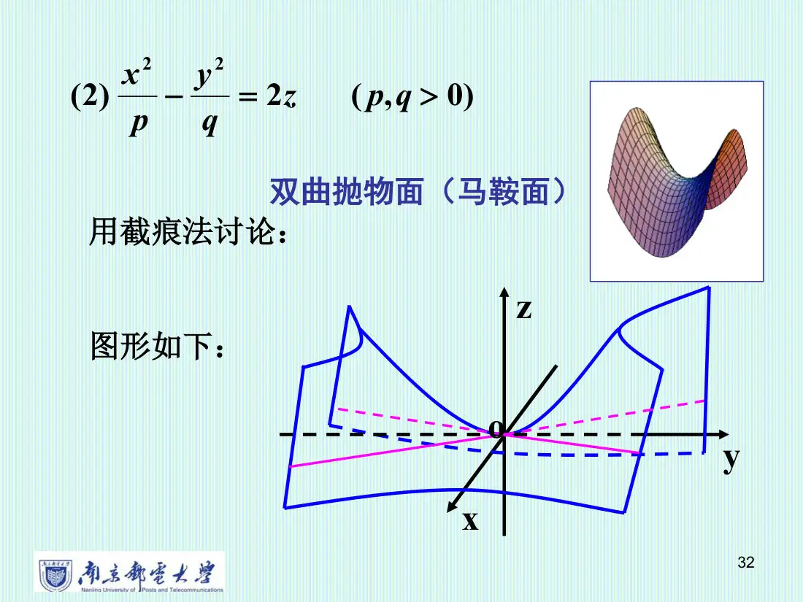

原文：

$$
\frac {x ^ {2}}{p} - \frac {y ^ {2}}{q} = 2 z \quad (p, q > 0)\tag{2}
$$

双曲抛物面（马鞍面）用截痕法讨论：

图形如下：

南京郵電大学 Nanjing University of Posts and Telecommunications

32

### 3.5.4 空间曲线及其方程

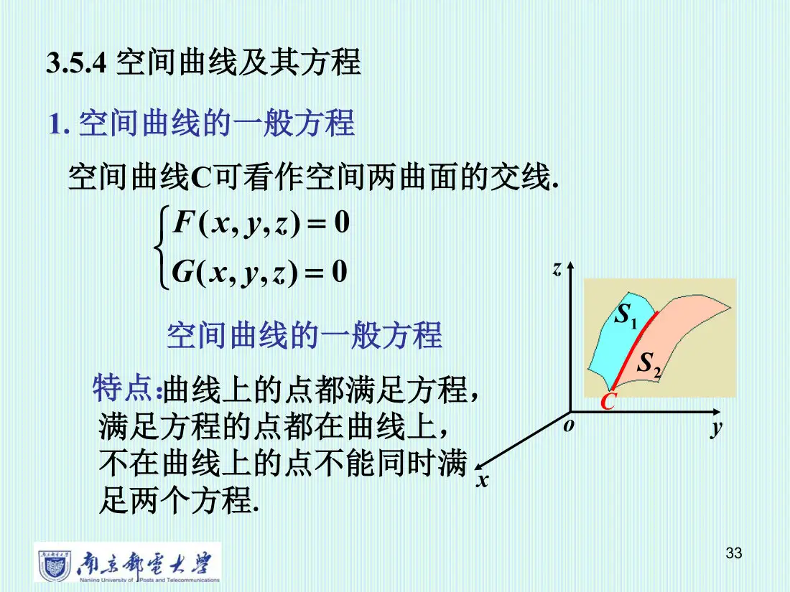

原文：

3.5.4 空间曲线及其方程

1. 空间曲线的一般方程

空间曲线C可看作空间两曲面的交线.

$$
\left\{ \begin{array}{l} F (x, y, z) = 0 \\ G (x, y, z) = 0 \end{array} \right.
$$

空间曲线的一般方程

曲线上的点都满足方程，特点：满足方程的点都在曲线上，不在曲线上的点不能同时满足两个方程.

南京郵電大学 Nanjing University of Posts and Telecommunications

33

### 34

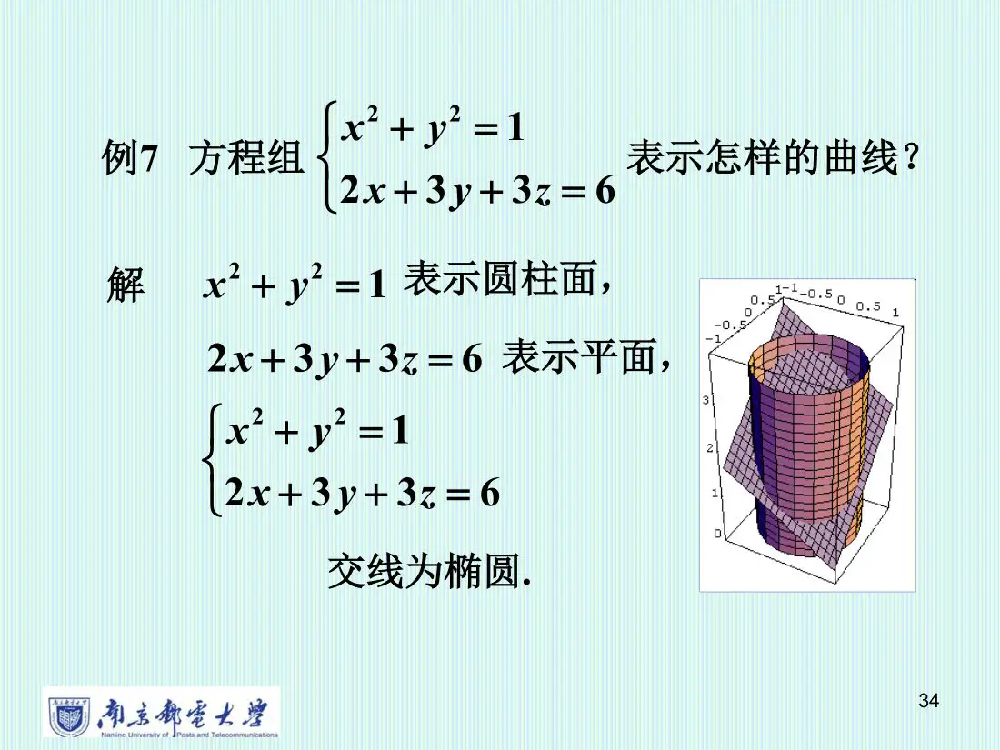

原文：

例7 方程组 $\left\{ { \begin{array} { l } { x ^ { 2 } + y ^ { 2 } = 1 } \\ { 2 x + 3 y + 3 z = 6 } \end{array} } \right.$ 表解 $x ^ { 2 } + y ^ { 2 } = 1$ 表示圆柱面，$2 x + 3 y + 3 z = 6$ 表示平面，$\left\{ { \begin{array} { l } { x ^ { 2 } + y ^ { 2 } = 1 } \\ { 2 x + 3 y + 3 z = 6 } \end{array} } \right.$ 交线为椭圆.

南京郵電大学 Nanjing University of Posts and Telecommunications

34

### 35

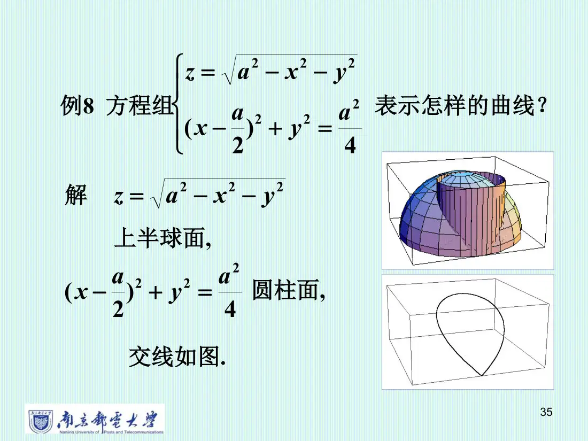

原文：

例8 方程组 $\left\{ z = { \sqrt { a ^ { 2 } - x ^ { 2 } - y ^ { 2 } } } \right.$ 解 $z = \sqrt { a ^ { 2 } - x ^ { 2 } } - y ^ { 2 }$ 上半球面,$( x - \frac { a } { 2 } ) ^ { 2 } + y ^ { 2 } = \frac { a ^ { 2 } } { 4 }$ 圆柱面,交线如图.

南京郵電大学 Nanjing University of Posts and Telecommunications

35

### 2. 空间曲线的参数方程

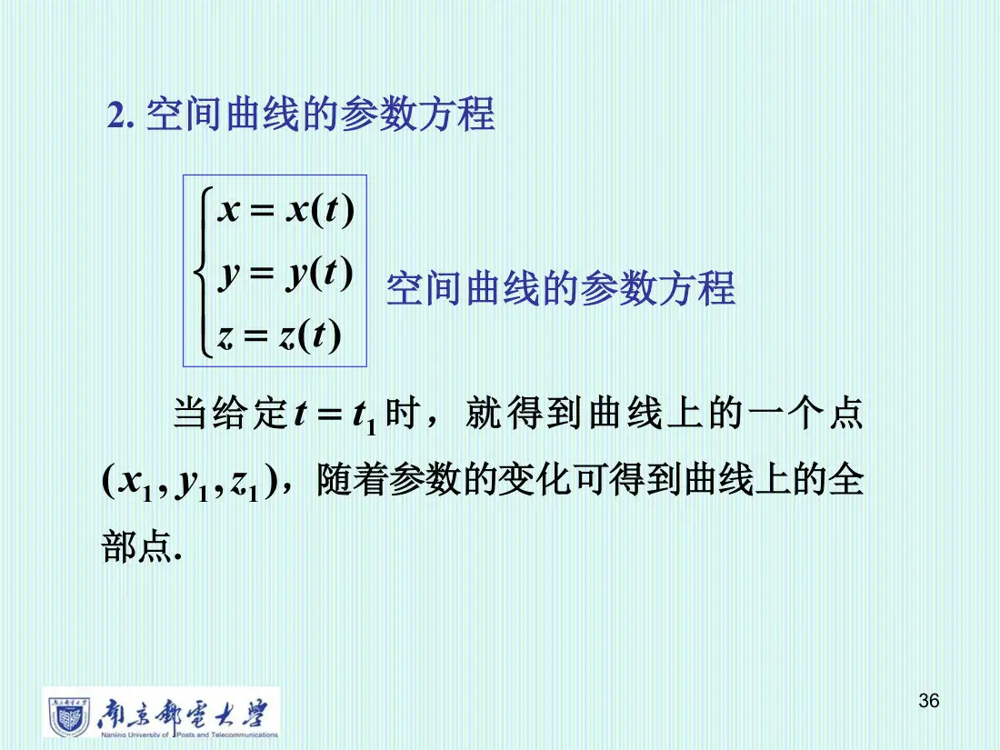

原文：

2. 空间曲线的参数方程

$$
\left\{ \begin{array}{l} x = x (t) \\ y = y (t) \\ z = z (t) \end{array} \right.
$$

空间曲线的参数方程

当给定 $t = t _ { 1 }$ 时，就得到曲线上的一个点$( x _ { 1 } , y _ { 1 } , z _ { 1 } )$ ，随着参数的变化可得到曲线上的全部点.

南京郵電大学 Nanjing University of Posts and Telecommunications

36

### $$

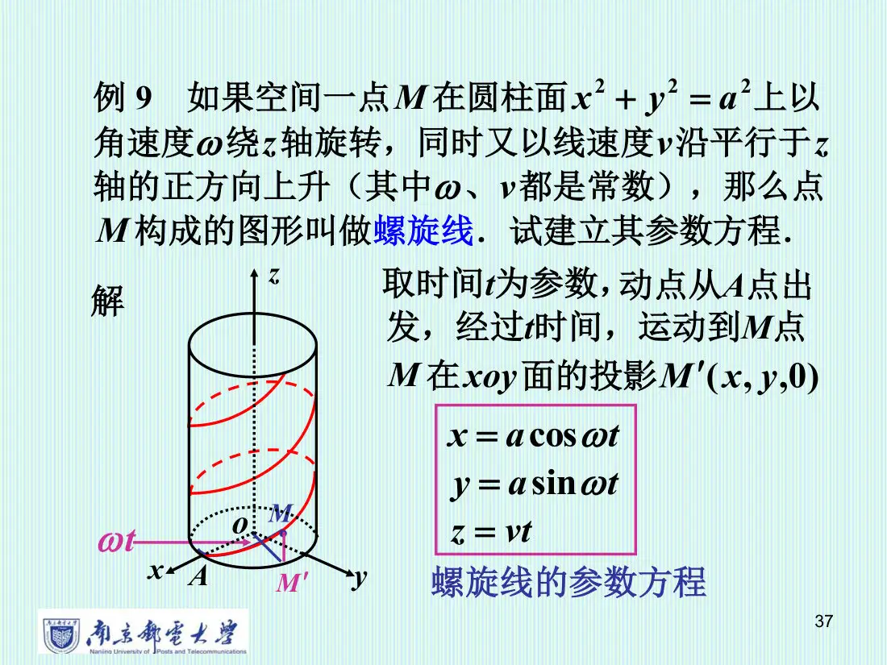

原文：

例9 如果空间一点M在圆柱面 $x ^ { 2 } + y ^ { 2 } = a ^ { 2 }$ 上以角速度ω绕z轴旋转，同时又以线速度ν沿平行于z轴的正方向上升（其中ω、ν都是常数），那么点M构成的图形叫做螺旋线．试建立其参数方程.

解

动点从A点出取时间t为参数，发，经过t时间，运动到M点M在xoy面的投影 $M ^ { \prime } ( x , y , \mathbf { 0 } )$

$$
\begin{array}{l} x = a \cos \omega t \\ y = a \sin \omega t \\ z = v t \end{array}
$$

螺旋线的参数方程

南京郵電大学 Nanjing University of Posts and Telecommunications

37

### 例10 将曲线的一般方程化为参数方程

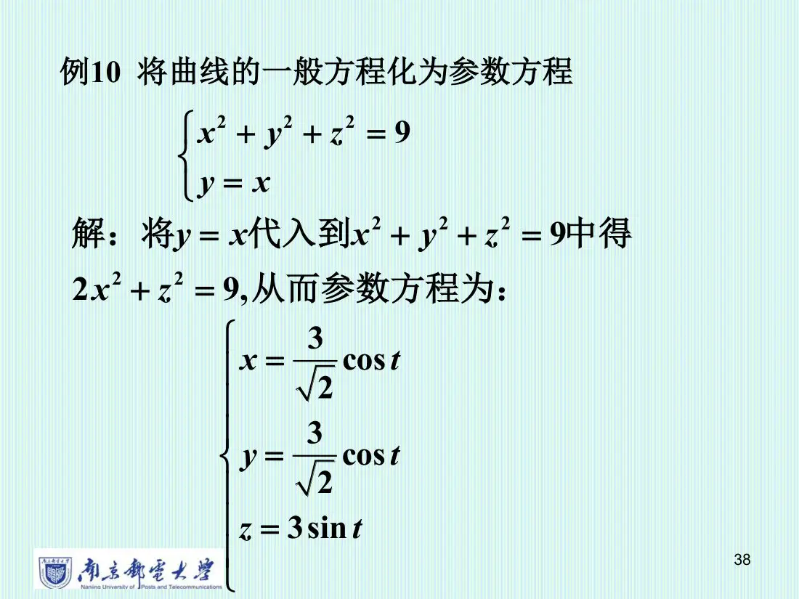

原文：

例10 将曲线的一般方程化为参数方程

$$
\left\{ \begin{array}{l} x ^ {2} + y ^ {2} + z ^ {2} = 9 \\ y = x \end{array} \right.
$$

解：将y= x代入到 $x ^ { 2 } + y ^ { 2 } + z ^ { 2 } = 9$ 中得$2 x ^ { 2 } + z ^ { 2 } = 9$ ,从而参数方程为：

$$
\left\{ \begin{array}{l} x = \frac {3}{\sqrt {2}} \cos t \\ y = \frac {3}{\sqrt {2}} \cos t \\ z = 3 \sin t \end{array} \right.
$$

南京郵電大学 Nanjing University of Posts and Telecommunications

38

### 3.5.5 空间曲线在坐标面上的投影

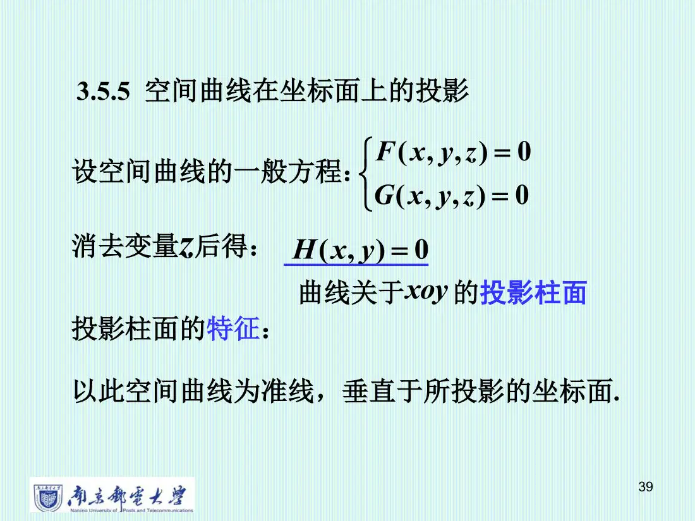

原文：

3.5.5 空间曲线在坐标面上的投影

设空间曲线的一般方程： $\left\{ { \begin{array} { l } { F ( x , y , z ) = 0 } \\ { G ( x , y , z ) = 0 } \end{array} } \right.$ 消去变量z后得： $H ( x , y ) = 0$ 曲线关于 xoy的投影柱面投影柱面的特征：

以此空间曲线为准线，垂直于所投影的坐标面.

南京郵電大学 Nanjing University of Posts and Telecommunications

39

### 空间曲线在 xoy面上的投影曲线

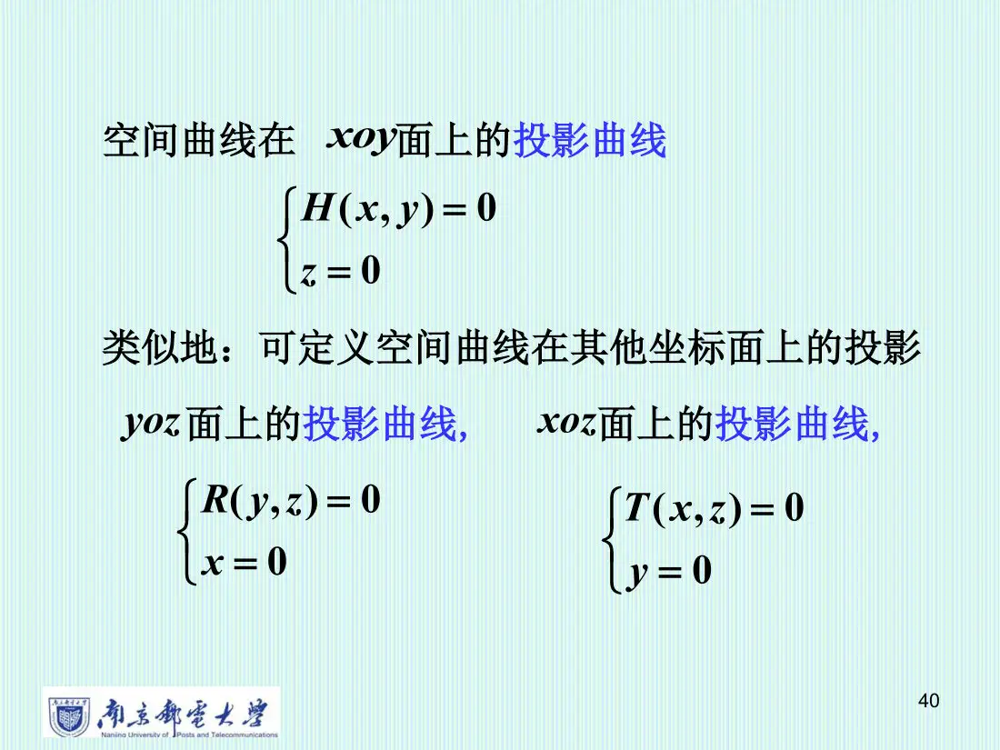

原文：

空间曲线在 xoy面上的投影曲线

$$
\left\{ \begin{array}{l} H (x, y) = 0 \\ z = 0 \end{array} \right.
$$

类似地：可定义空间曲线在其他坐标面上的投影面上的投影曲线, 面上的投影曲线,

$$
\left\{ \begin{array}{l} R (y, z) = 0 \\ x = 0 \end{array} \right.
$$

$$
\left\{ \begin{array}{l} T (x, z) = 0 \\ y = 0 \end{array} \right.
$$

南京郵電大学Nani communication

40

### 如图:投影曲线的研究过程.

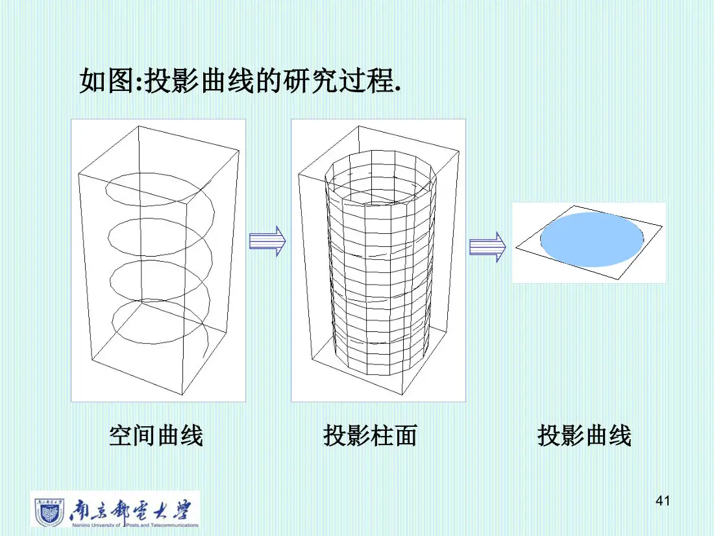

原文：

如图:投影曲线的研究过程.

南京郵電大学 Nanjing University of Posts and Telecommunications

41

### 截线方程为解

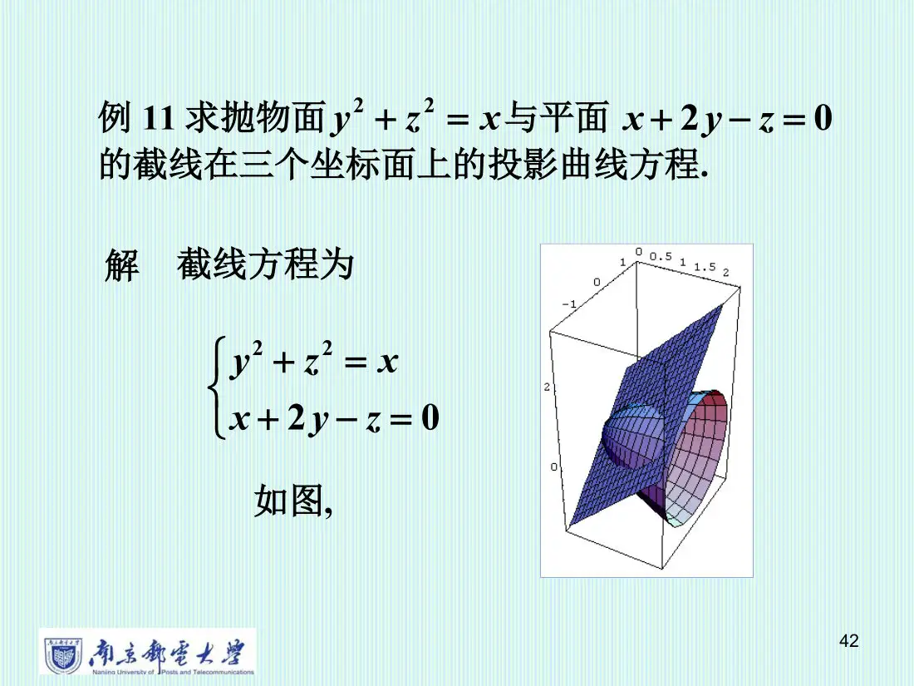

原文：

例11求抛物面 $y ^ { 2 } + z ^ { 2 } = x$ 与平面 $x + 2 y - z = 0$ 的截线在三个坐标面上的投影曲线方程.

截线方程为解

$$
\left\{ \begin{array}{l} y ^ {2} + z ^ {2} = x \\ x + 2 y - z = 0 \end{array} \right.
$$

如图,

南京郵電大学 Nanjing University of Posts and Telecommunications

42

### 43

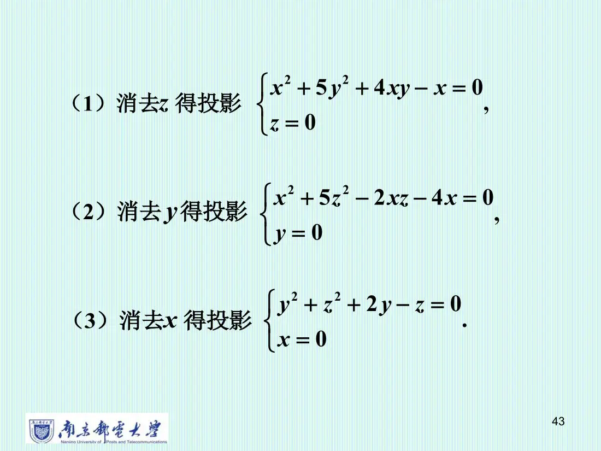

原文：

（1）消去z得投影 $\left\{ x ^ { 2 } + 5 y ^ { 2 } + 4 x y - x = 0 \right. \qquad $

（2） 消去y得投影 $\left\{ { x ^ { 2 } + 5 z ^ { 2 } - 2 x z - 4 x = 0 } \right. \qquad \mathrm { { , } }$

（3）消去x得投影 $\left\{ y ^ { 2 } + z ^ { 2 } + 2 y - z = 0 \right. \qquad .$

南京郵電大学 Nanjing University of Posts and Telecommunications

43

### 解 半球面和锥面的交线为

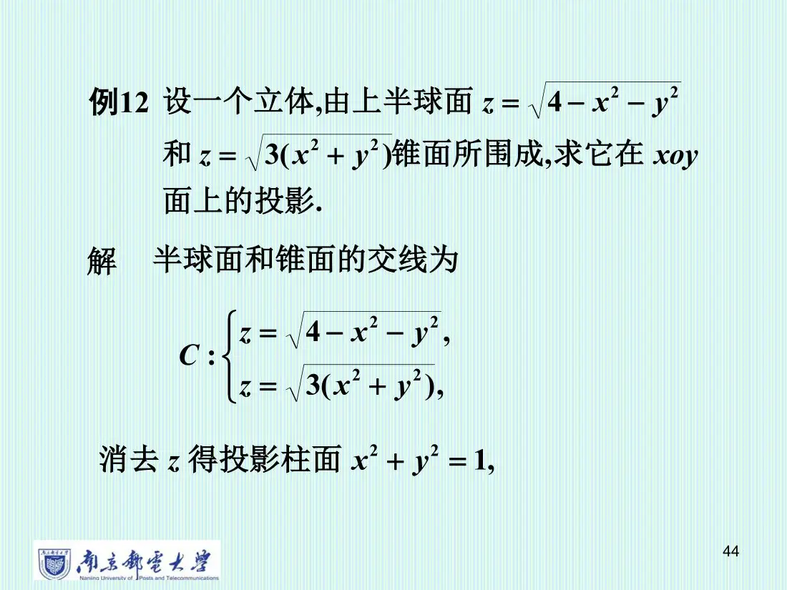

原文：

例12设一个立体,由上半球面 $z = \sqrt { 4 - x ^ { 2 } } - y ^ { 2 }$ 和 $z = \sqrt { 3 ( x ^ { 2 } + y ^ { 2 } }$ )锥面所围成,求它在 xoy面上的投影.

解 半球面和锥面的交线为

$$
C: \left\{ \begin{array}{l} z = \sqrt {4 - x ^ {2} - y ^ {2}}, \\ z = \sqrt {3 (x ^ {2} + y ^ {2})}, \end{array} \right.
$$

消去z得投影柱面 $x ^ { 2 } + y ^ { 2 } = 1$ の

南京郵電大学 Nanjing University of Posts and Telecommunications

44

### 则交线 C 在 xoy 面上的投影为

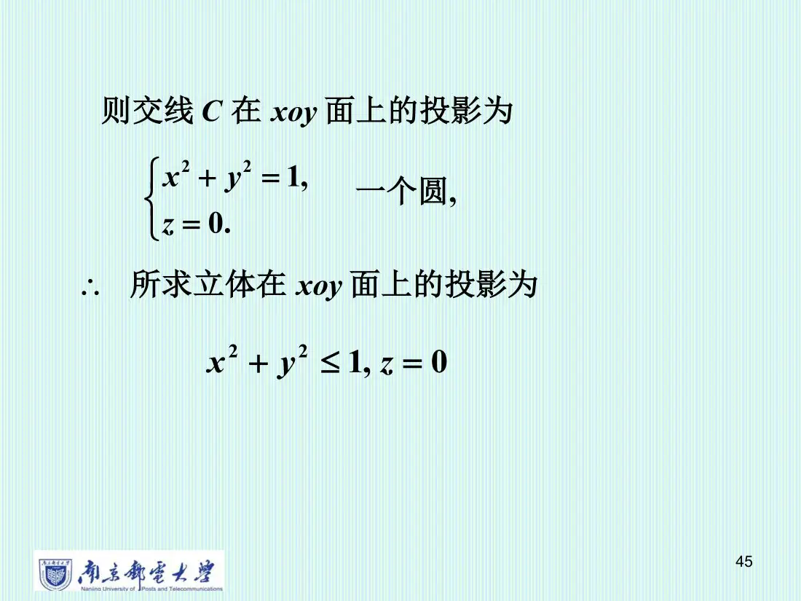

原文：

则交线 C 在 xoy 面上的投影为

$$
\left\{ \begin{array}{l l} {x ^ {2} + y ^ {2} = 1,} \\ {z = 0.} \end{array} \right. \quad \text {一个圆},
$$

∴所求立体在xoy面上的投影为

$$
x ^ {2} + y ^ {2} \leq 1, z = 0
$$

南京郵電大学 Nanjing University of Posts and Telecommunications

45
