# 《线性代数与解析几何》第3章 空间直线（课件）

原件的每一页，下面附识别出的文字。

### 4.4 空间直线

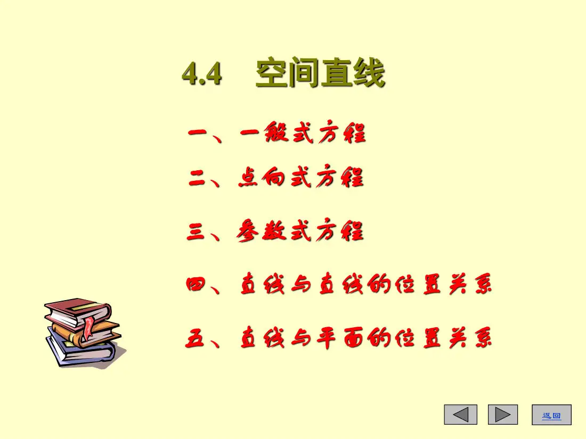

原文：

4.4 空间直线
一、一般式方程
二、点向式方程
三、参数式方程
四、直线与直线的位置关系
五、直线与平面的位置关系

返回

### 一、一般式方程

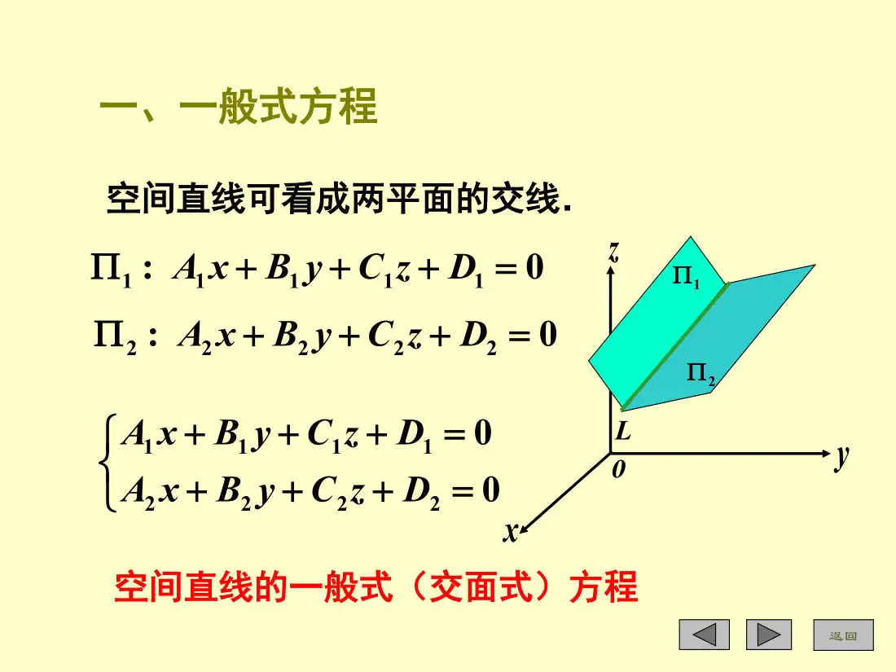

原文：

一、一般式方程

空间直线可看成两平面的交线.

$$
\Pi_ {1}: A _ {1} x + B _ {1} y + C _ {1} z + D _ {1} = 0
$$

$$
\Pi_ {2}: A _ {2} x + B _ {2} y + C _ {2} z + D _ {2} = 0
$$

$$
\left\{ \begin{array}{l} A _ {1} x + B _ {1} y + C _ {1} z + D _ {1} = 0 \\ A _ {2} x + B _ {2} y + C _ {2} z + D _ {2} = 0 \end{array} \right.
$$

空间直线的一般式（交面式）方程

返回

◀ ▶

### 二、点向式(标准式、对称式)方程

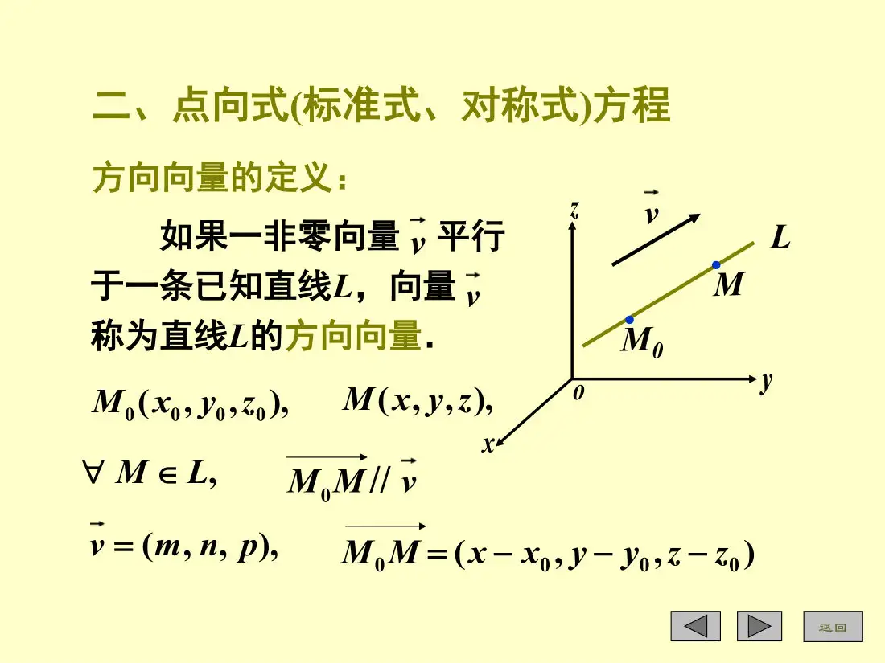

原文：

二、点向式(标准式、对称式)方程

方向向量的定义：

如果一非零向量 $\vec{v}$ 平行于一条已知直线 L，向量 $\vec{v}$ 称为直线 L 的方向向量.

$$
M _ {0} (x _ {0}, y _ {0}, z _ {0}), \quad M (x, y, z),
$$

$$
\forall M \in L, \overrightarrow {M _ {0} M} / / \vec {v}
$$

$$
\vec {v} = (m, n, p), \qquad \overrightarrow {M _ {0} M} = (x - x _ {0}, y - y _ {0}, z - z _ {0})
$$

◀ ▶

### 直线的点向式方程

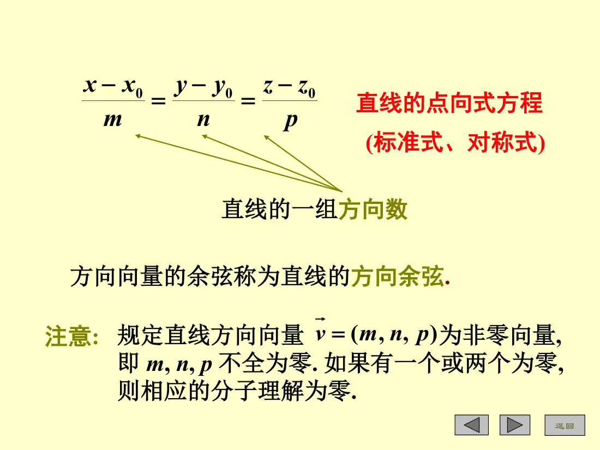

原文：

直线的点向式方程
(标准式、对称式)

直线的一组方向数

方向向量的余弦称为直线的方向余弦.

注意: 规定直线方向向量 $\vec{v}=(m,n,p)$ 为非零向量, 即 m,n,p 不全为零. 如果有一个或两个为零, 则相应的分子理解为零.

返回

◀ ▶

### 直线的两点式方程

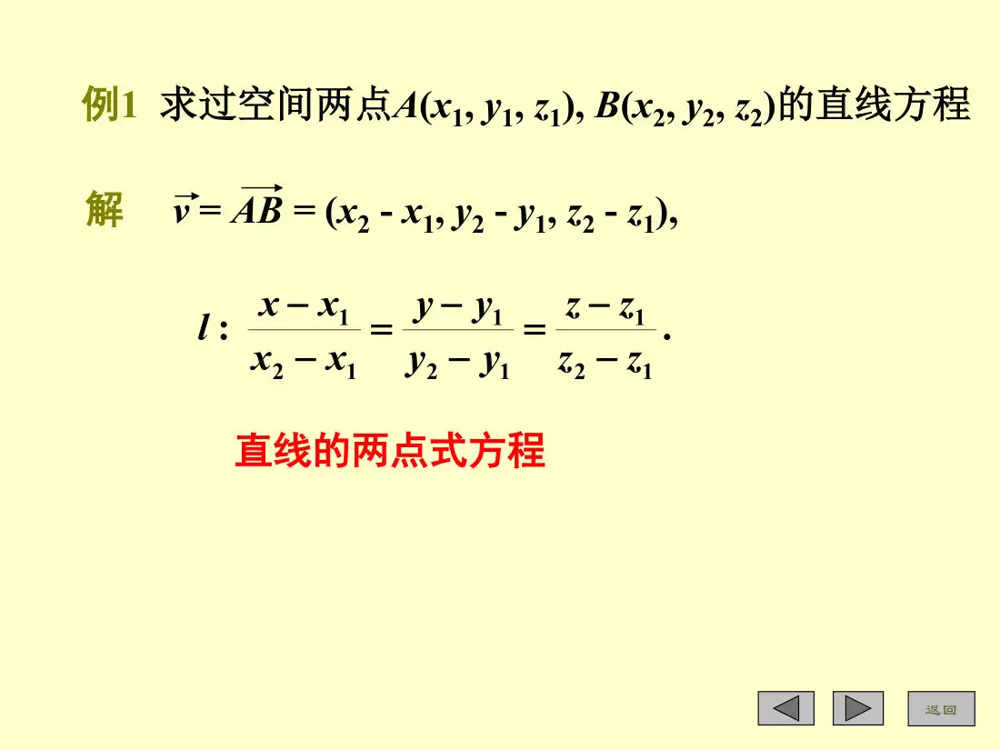

原文：

例1 求过空间两点 $A(x_{1},y_{1},z_{1}),B(x_{2},y_{2},z_{2})$ 的直线方程

解 $\vec{v}=\overrightarrow{AB}=(x_{2}-x_{1},y_{2}-y_{1},z_{2}-z_{1}),$

$l: \frac{x - x_1}{x_2 - x_1} = \frac{y - y_1}{y_2 - y_1} = \frac{z - z_1}{z_2 - z_1}$ .

直线的两点式方程

◀ ▶

### 三、参数式方程

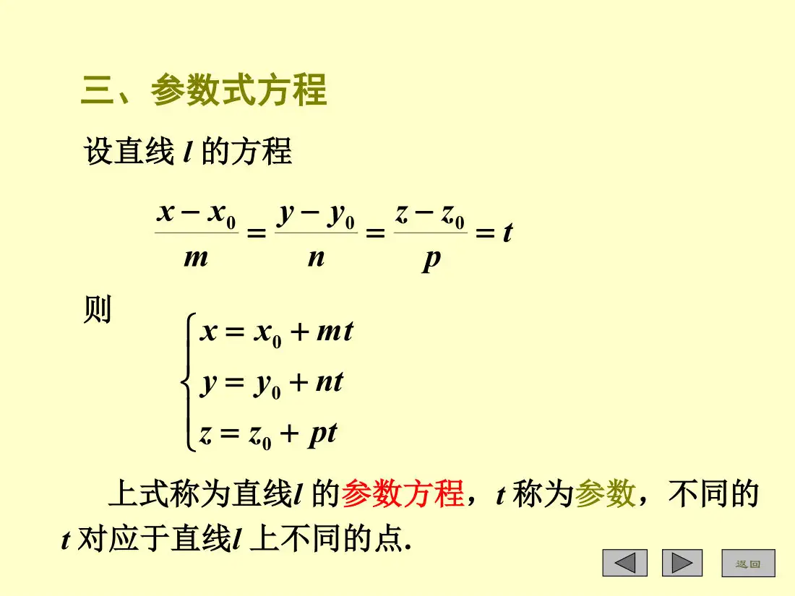

原文：

三、参数式方程

设直线 l 的方程

$$
\frac {x - x _ {0}}{m} = \frac {y - y _ {0}}{n} = \frac {z - z _ {0}}{p} = t
$$

则

$$
\left\{ \begin{array}{l} x = x _ {0} + m t \\ y = y _ {0} + n t \\ z = z _ {0} + p t \end{array} \right.
$$

上式称为直线 $l$ 的参数方程, $t$ 称为参数, 不同的 $t$ 对应于直线 $l$ 上不同的点.

返回

### 解一 先作一过点 $M$ 且与已知直线垂直的平面

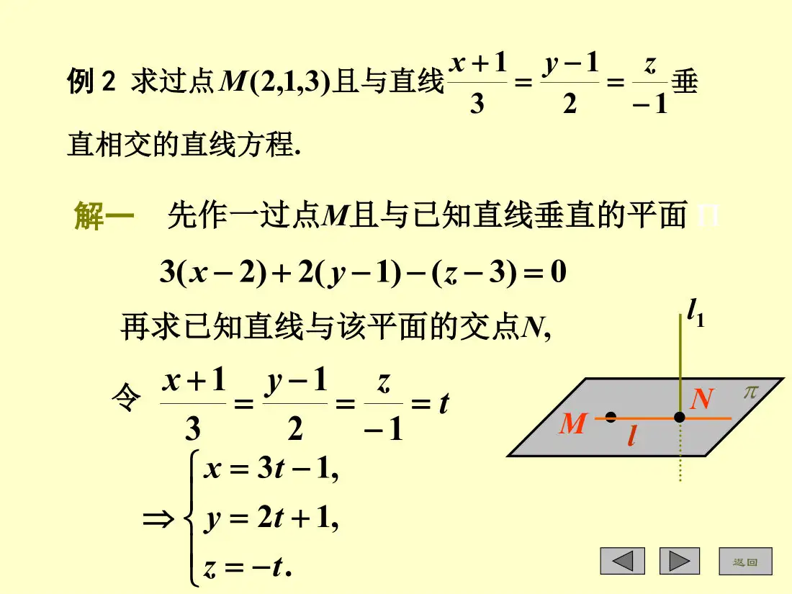

原文：

例 2 求过点 $M(2,1,3)$ 且与直线 $\frac{x+1}{3}=\frac{y-1}{2}=\frac{z}{-1}$ 垂直相交的直线方程.

解一 先作一过点 $M$ 且与已知直线垂直的平面

$$
3 (x - 2) + 2 (y - 1) - (z - 3) = 0
$$

再求已知直线与该平面的交点N,

$$
\begin{array}{r l} & {\text {令} \frac {x + 1}{3} = \frac {y - 1}{2} = \frac {z}{- 1} = t} \\ & {\Rightarrow \left\{ \begin{array}{l l} {x = 3 t - 1,} \\ {y = 2 t + 1,} \\ {z = - t.} \end{array} \right.} \end{array}
$$

返回

◀ ▶

### 返回

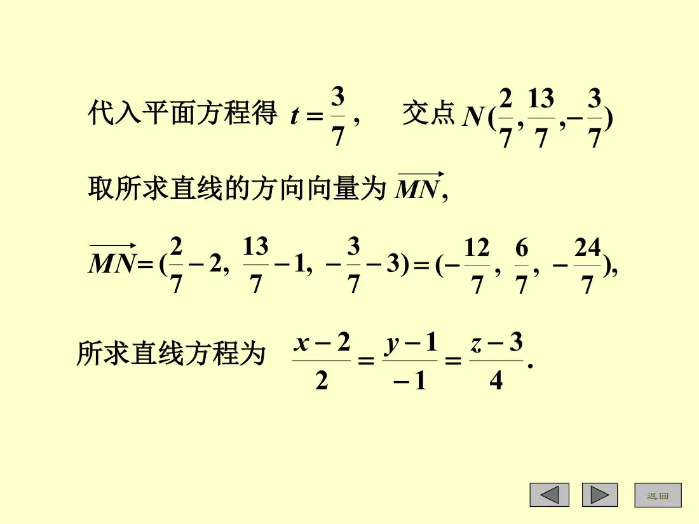

原文：

代入平面方程得 $t=\frac{3}{7}$ ，交点 $N(\frac{2}{7},\frac{13}{7},-\frac{3}{7})$ 取所求直线的方向向量为 $\overrightarrow{MN}$ , $\overrightarrow{MN}=(\frac{2}{7}-2,\frac{13}{7}-1,-\frac{3}{7}-3)=(-\frac{12}{7},\frac{6}{7},-\frac{24}{7})$ ,
所求直线方程为 $\frac{x-2}{2}=\frac{y-1}{-1}=\frac{z-3}{4}$ .

返回

### 故可设两直线垂直相交的交点为 $N(3t-1,2t+1,-t)$ ,

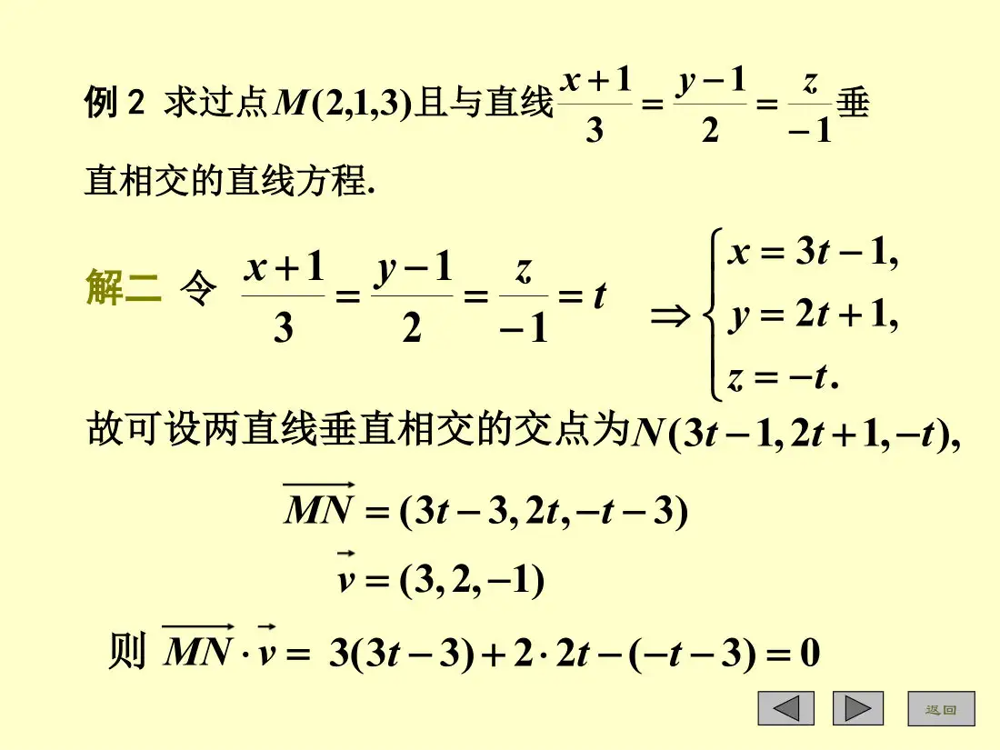

原文：

例 2 求过点 $M(2,1,3)$ 且与直线 $\frac{x+1}{3}=\frac{y-1}{2}=\frac{z}{-1}$ 垂直相交的直线方程.

解二 令 $\frac{x + 1}{3} = \frac{y - 1}{2} = \frac{z}{-1} = t$ $\Rightarrow \left\{ \begin{array}{l} x = 3t - 1, \\ y = 2t + 1, \\ z = -t. \end{array} \right.$

故可设两直线垂直相交的交点为 $N(3t-1,2t+1,-t)$ ,

$$
\begin{array}{c} \overrightarrow {M N} = (3 t - 3, 2 t, - t - 3) \\ \vec {\nu} = (3, 2, - 1) \end{array}
$$

则 $\overrightarrow{MN} \cdot \vec{v} = 3(3t - 3) + 2 \cdot 2t - (-t - 3) = 0$

返回

### 返回

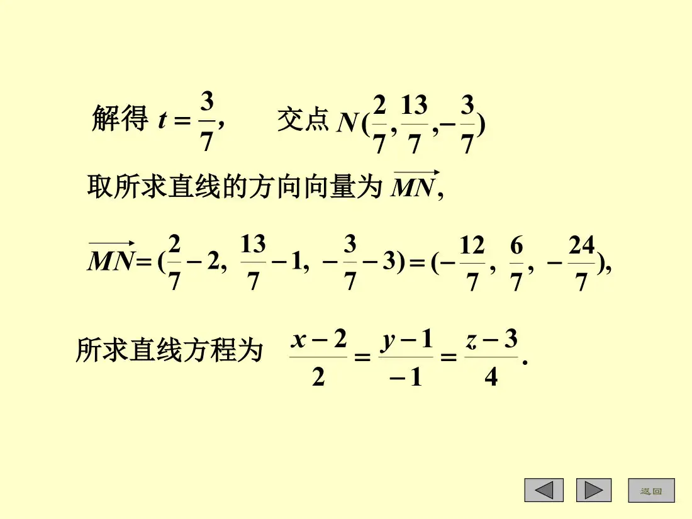

原文：

解得 $t=\frac{3}{7}$ ，交点 $N(\frac{2}{7},\frac{13}{7},-\frac{3}{7})$ 取所求直线的方向向量为 $\overrightarrow{MN}$ , $\overrightarrow{MN}=(\frac{2}{7}-2,\frac{13}{7}-1,-\frac{3}{7}-3)=(-\frac{12}{7},\frac{6}{7},-\frac{24}{7})$ ,
所求直线方程为 $\frac{x-2}{2}=\frac{y-1}{-1}=\frac{z-3}{4}$ .

返回

### 例3 用点向式方程及参数方程表示直线

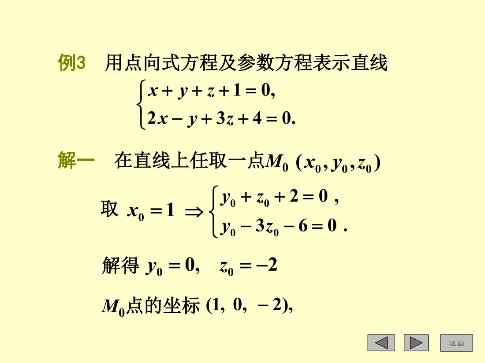

原文：

例3 用点向式方程及参数方程表示直线

$$
\left\{ \begin{array}{l} x + y + z + 1 = 0, \\ 2 x - y + 3 z + 4 = 0. \end{array} \right.
$$

解一 在直线上任取一点 $M_0(x_0,y_0,z_0)$

取 $x_0 = 1 \Rightarrow \left\{ \begin{array}{l} y_0 + z_0 + 2 = 0, \\ y_0 - 3z_0 - 6 = 0 \end{array} \right.$

解得 $y_0 = 0, z_0 = -2$

$M_{0}$ 点的坐标 $(1, 0, -2)$ ,

返回

### 因所求直线与两平面的法向量都垂直

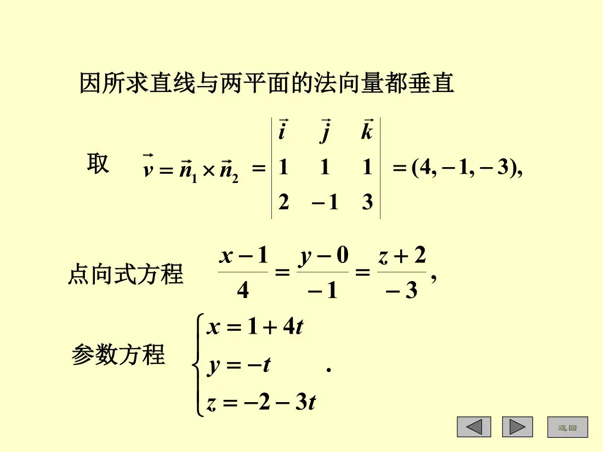

原文：

因所求直线与两平面的法向量都垂直

取

$$
\vec {v} = \vec {n} _ {1} \times \vec {n} _ {2} = \left| \begin{array}{c c c} \vec {i} & \vec {j} & \vec {k} \\ 1 & 1 & 1 \\ 2 & - 1 & 3 \end{array} \right| = (4, - 1, - 3),
$$

点向式方程 $\frac{x - 1}{4} = \frac{y - 0}{-1} = \frac{z + 2}{-3},$

参数方程

$$
\left\{ \begin{array}{l} x = 1 + 4 t \\ y = - t \\ z = - 2 - 3 t \end{array} \right..
$$

◀ ▶

返回

### 解二 由解法一已得直线上点 $M_{0}$ 的坐标(1,0,-2),

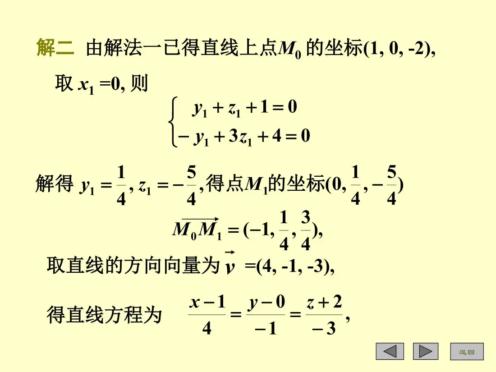

原文：

解二 由解法一已得直线上点 $M_{0}$ 的坐标(1,0,-2),
取 $x_{1}=0$ , 则 $\left\{\begin{aligned}y_{1}+z_{1}+1&=0\\ -y_{1}+3z_{1}+4&=0\end{aligned}\right.$ 解得 $y_{1}=\frac{1}{4}, z_{1}=-\frac{5}{4}$ ，得点 $M_{1}$ 的坐标 $(0,\frac{1}{4},-\frac{5}{4})$ $\overrightarrow{M_{0}M_{1}}=(-1,\frac{1}{4},\frac{3}{4})$ 取直线的方向向量为 $\vec{v}=(4,-1,-3)$ ,
得直线方程为 $\frac{x-1}{4}=\frac{y-0}{-1}=\frac{z+2}{-3}$

◀ ▶

### (1)

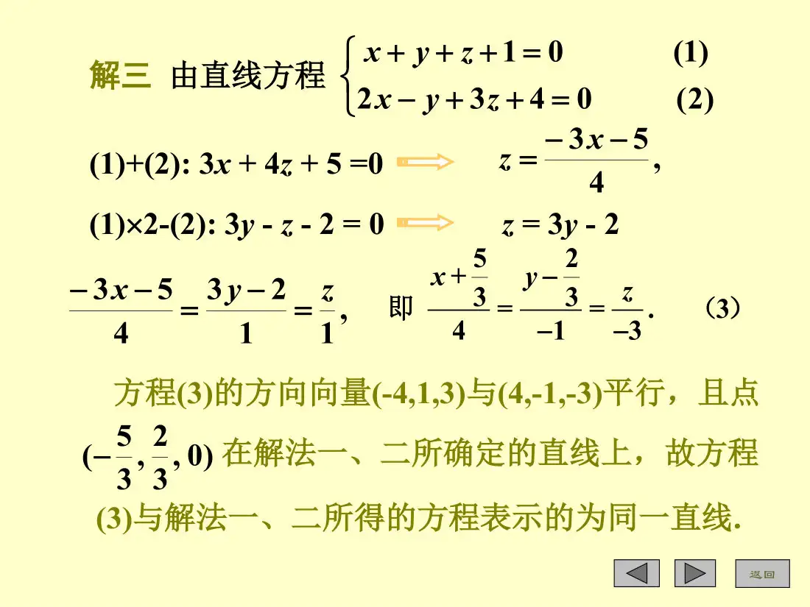

原文：

(1)

$$
(1) + (2): 3 x + 4 z + 5 = 0 \implies z = \frac {- 3 x - 5}{4},\tag{2}
$$

$$
(1) \times 2 - (2): 3 y - z - 2 = 0 \Longrightarrow z = 3 y - 2
$$

$$
\frac {- 3 x - 5}{4} = \frac {3 y - 2}{1} = \frac {z}{1}, \quad \text {即} \frac {x + \frac {5}{3}}{4} = \frac {y - \frac {2}{3}}{- 1} = \frac {z}{- 3}.\tag{3}
$$

方程(3)的方向向量(-4,1,3)与(4,-1,-3)平行，且点 $(- \frac{5}{3}, \frac{2}{3}, 0)$ 在解法一、二所确定的直线上，故方程

(3)与解法一、二所得的方程表示的为同一直线.

◀ ▶

返回

### 解四（用高斯消元法——行初等变换）

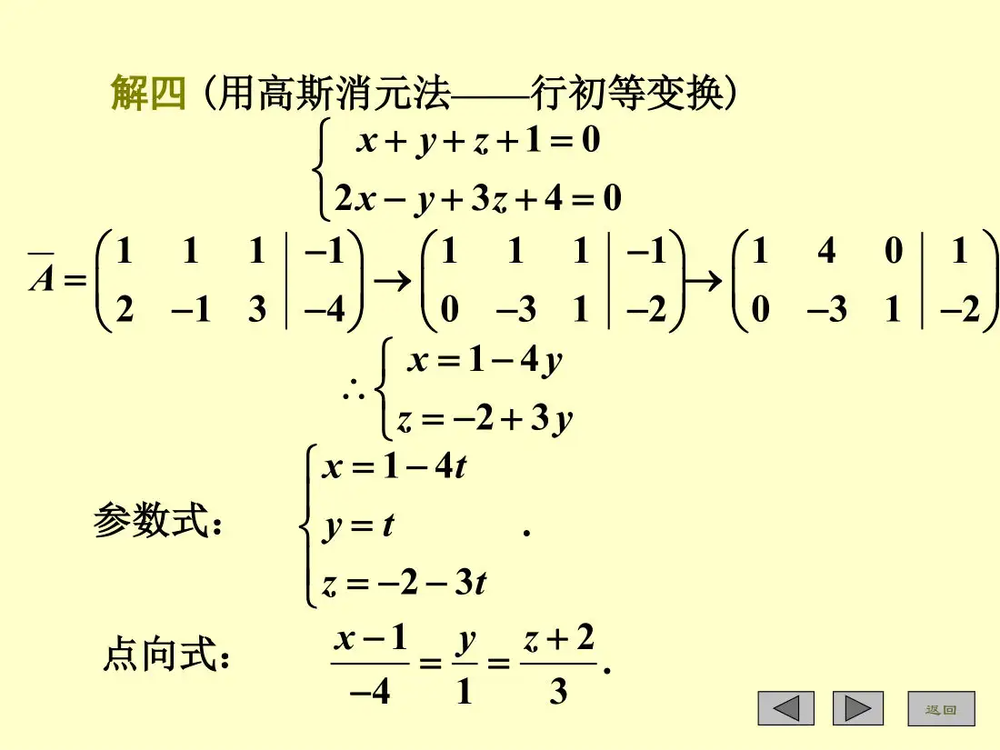

原文：

解四（用高斯消元法——行初等变换）

$$
\left\{ \begin{array}{c} x + y + z + 1 = 0 \\ 2 x - y + 3 z + 4 = 0 \end{array} \right.
$$

$$
\overline {{A}} = \left( \begin{array}{c c c c} 1 & 1 & 1 & - 1 \\ 2 & - 1 & 3 & - 4 \end{array} \right) \to \left( \begin{array}{c c c c} 1 & 1 & 1 & - 1 \\ 0 & - 3 & 1 & - 2 \end{array} \right) \to \left( \begin{array}{c c c c} 1 & 4 & 0 & 1 \\ 0 & - 3 & 1 & - 2 \end{array} \right)
$$

参数式:

点向式:

$$
\left\{ \begin{array}{l} x = 1 - 4 t \\ y = t \\ z = - 2 - 3 t \end{array} \right.
$$

$$
\frac {x - 1}{- 4} = \frac {y}{1} = \frac {z + 2}{3}.
$$

◀ ▶

返回

### 解：设点 $M_{1}(x_{1},y_{1},z_{1})$ 是直线l上的点，

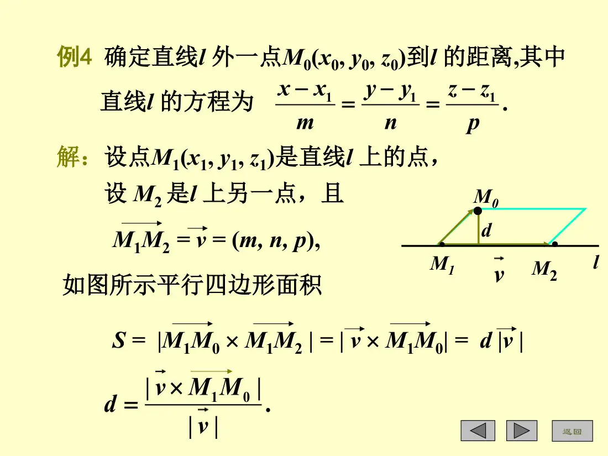

原文：

例4 确定直线l外一点 $M_{0}(x_{0},y_{0},z_{0})$ 到l的距离,其中直线l的方程为 $\frac{x-x_{1}}{m}=\frac{y-y_{1}}{n}=\frac{z-z_{1}}{p}$ .

解：设点 $M_{1}(x_{1},y_{1},z_{1})$ 是直线l上的点，

设 $M_{2}$ 是 $l$ 上另一点，且

$$
\overrightarrow {M _ {1} M _ {2}} = \overrightarrow {\nu} = (m, n, p),
$$

如图所示平行四边形面积

$S = |\overrightarrow{M_1M_0}\times \overrightarrow{M_1M_2}| = |\overrightarrow{v}\times \overrightarrow{M_1M_0}| = d|\overrightarrow{v}|$ $d = \frac{|\vec{v}\times\overrightarrow{M_1M_0}|}{|\vec{v}|}.$

### 例5 求点 $M_0(1,2,1)$ 到直线

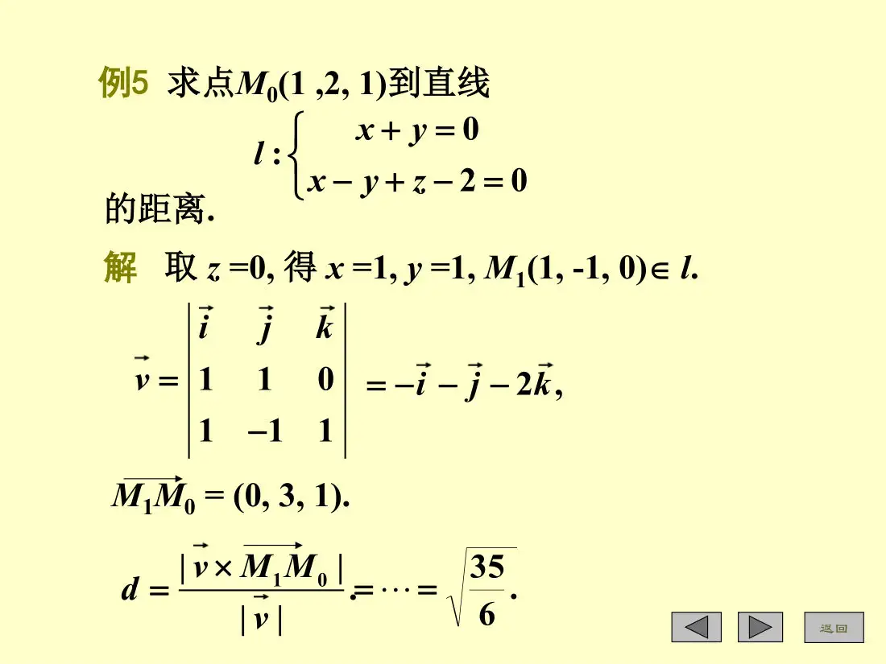

原文：

例5 求点 $M_0(1,2,1)$ 到直线

$$
l: \left\{ \begin{array}{c} x + y = 0 \\ x - y + z - 2 = 0 \end{array} \right.
$$

的距离.

解 取 z=0, 得 x=1, y=1, $M_{1}(1,-1,0)\in l$ .

$$
\vec {v} = \left| \begin{array}{c c c} \vec {i} & \vec {j} & \vec {k} \\ 1 & 1 & 0 \\ 1 & - 1 & 1 \end{array} \right| = - \vec {i} - \vec {j} - 2 \vec {k},
$$

$$
\overrightarrow {M _ {1} M _ {0}} = (0, 3, 1).
$$

$$
d = \frac {| \vec {v} \times \overrightarrow {M _ {1} M _ {0}} |}{| \vec {v} |} = \dots = \sqrt {\frac {3 5}{6}}.
$$

◀ ▶

### 四、直线与直线的位置关系

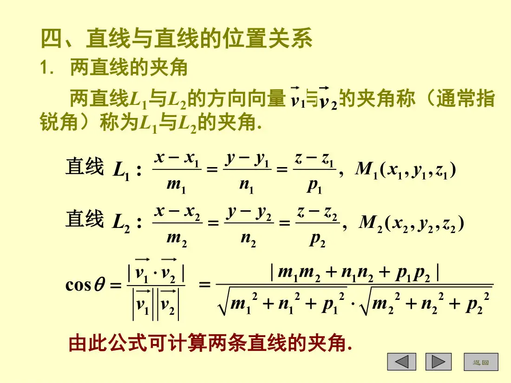

原文：

四、直线与直线的位置关系

1. 两直线的夹角

两直线 $L_{1}$ 与 $L_{2}$ 的方向向量 $\vec{v}_{1}$ 与 $\vec{v}_{2}$ 的夹角称（通常指锐角）称为 $L_{1}$ 与 $L_{2}$ 的夹角.

直线 $L_{1}: \frac{x - x_{1}}{m_{1}} = \frac{y - y_{1}}{n_{1}} = \frac{z - z_{1}}{p_{1}}, M_{1}(x_{1}, y_{1}, z_{1})$

$$
L _ {2}: \frac {x - x _ {2}}{m _ {2}} = \frac {y - y _ {2}}{n _ {2}} = \frac {z - z _ {2}}{p _ {2}}, M _ {2} (x _ {2}, y _ {2}, z _ {2})
$$

$$
\cos \theta = \frac {\left| \overrightarrow {v _ {1}} \cdot \overrightarrow {v _ {2}} \right|}{\left| \overrightarrow {v _ {1}} \right| \left| \overrightarrow {v _ {2}} \right|} = \frac {\left| m _ {1} m _ {2} + n _ {1} n _ {2} + p _ {1} p _ {2} \right|}{\sqrt {m _ {1} ^ {2} + n _ {1} ^ {2} + p _ {1} ^ {2}} \cdot \sqrt {m _ {2} ^ {2} + n _ {2} ^ {2} + p _ {2} ^ {2}}}
$$

由此公式可计算两条直线的夹角.

返回

### 2. 两直线的位置关系:

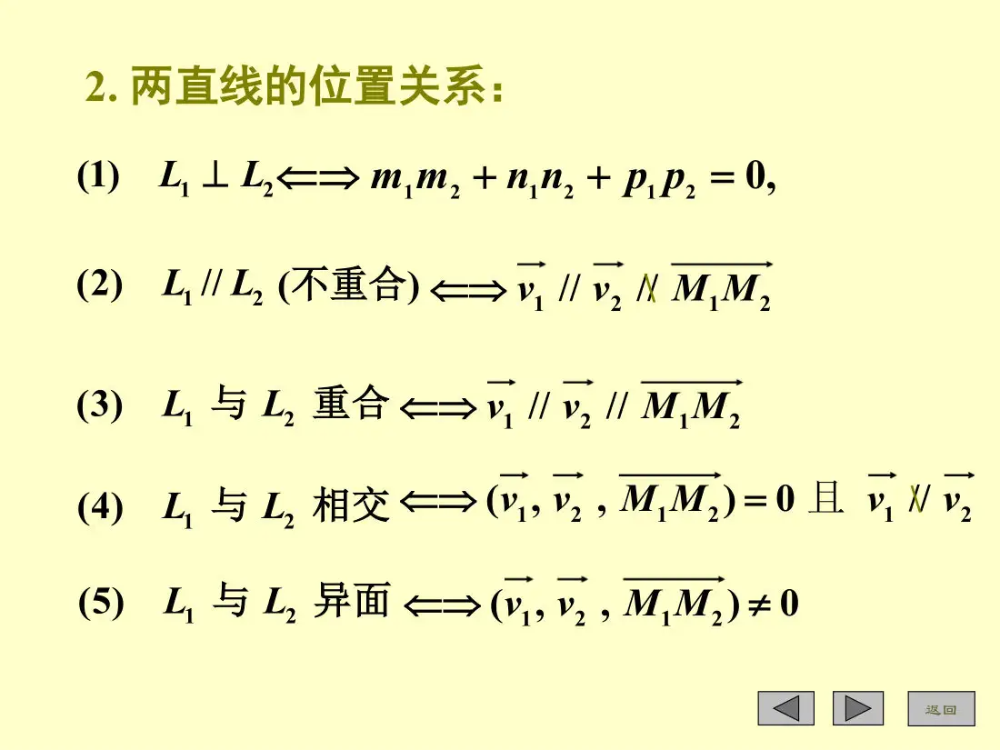

原文：

2. 两直线的位置关系:

(1) $L_{1} \perp L_{2} \Longleftrightarrow m_{1}m_{2} + n_{1}n_{2} + p_{1}p_{2} = 0,$

(2) $L_{1} // L_{2}$ (不重合) $\Longleftrightarrow \overrightarrow{v_{1}} // \overrightarrow{v_{2}} \not\sim \overrightarrow{M_{1} M_{2}}$

(3) $L_{1}$ 与 $L_{2}$ 重合 $\Longleftrightarrow \overrightarrow{v_1} // \overrightarrow{v_2} // \overrightarrow{M_1M_2}$

(4) $L_{1}$ 与 $L_{2}$ 相交 $\Longleftrightarrow (\vec{v}_{1},\vec{v}_{2},\overrightarrow{M_{1}M_{2}}) = 0$ 且 $\vec{v}_1\not\perp/\vec{v}_2$

(5) $L_{1}$ 与 $L_{2}$ 异面 $\Longleftrightarrow (\vec{v}_{1},\vec{v}_{2},\overrightarrow{M_{1}M_{2}})\neq 0$

返回

### $$

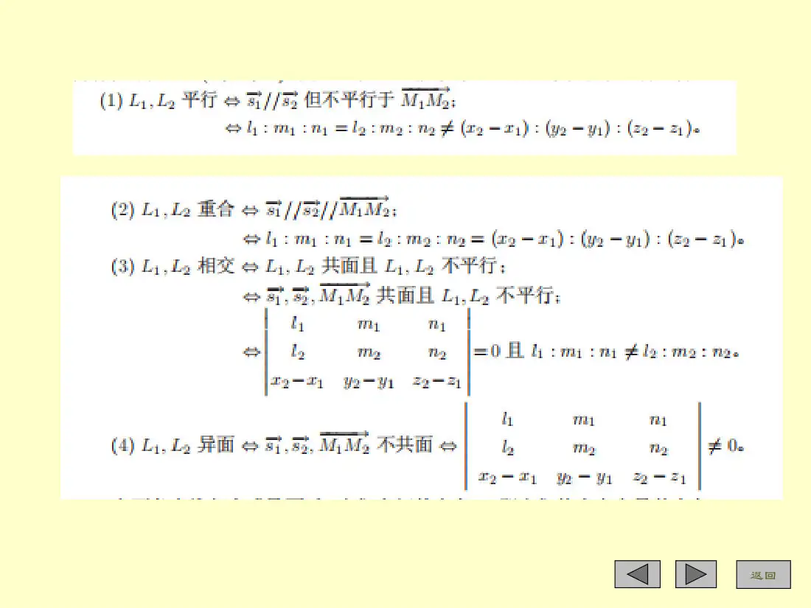

原文：

(1) $L_{1}, L_{2}$ 平行 $\Leftrightarrow \overrightarrow{s_1} / / \overrightarrow{s_2}$ 但不平行于 $\overrightarrow{M_1M_2}$ ;

$$
\Leftrightarrow l _ {1}: m _ {1}: n _ {1} = l _ {2}: m _ {2}: n _ {2} \neq (x _ {2} - x _ {1}): (y _ {2} - y _ {1}): (z _ {2} - z _ {1}).
$$

(2) $L_{1}, L_{2}$ 重合 $\Leftrightarrow \overrightarrow{s_{1}} / / \overrightarrow{s_{2}} / / \overrightarrow{M_{1}M_{2}};$

$$
\Leftrightarrow l _ {1}: m _ {1}: n _ {1} = l _ {2}: m _ {2}: n _ {2} = (x _ {2} - x _ {1}): (y _ {2} - y _ {1}): (z _ {2} - z _ {1}).
$$

(3) $L_{1}, L_{2}$ 相交 $\Leftrightarrow L_{1}, L_{2}$ 共面且 $L_{1}, L_{2}$ 不平行；

$\Leftrightarrow\overrightarrow{s_{1}},\overrightarrow{s_{2}},\overrightarrow{M_{1}M_{2}}$ 共面且 $L_{1},L_{2}$ 不平行；

$\Leftrightarrow \left| \begin{array}{ccc}l_{1} & m_{1} & n_{1}\\ l_{2} & m_{2} & n_{2}\\ x_{2} - x_{1} & y_{2} - y_{1} & z_{2} - z_{1} \end{array} \right| = 0$ 且 $l_{1}:m_{1}:n_{1}\neq l_{2}:m_{2}:n_{2}$

(4) $L_{1}, L_{2}$ 异面 $\Leftrightarrow \overrightarrow{s_{1}}, \overrightarrow{s_{2}}, \overrightarrow{M_{1}M_{2}}$ 不共面 $\Leftrightarrow \left| \begin{array}{cccc} l_{1} & m_{1} & n_{1} \\ l_{2} & m_{2} & n_{2} \\ x_{2} - x_{1} & y_{2} - y_{1} & z_{2} - z_{1} \end{array} \right|\neq 0.$

◀ ▶

返回

### 解 设所求直线的方向向量为 $\vec{v}=(m,n,p)$ ,

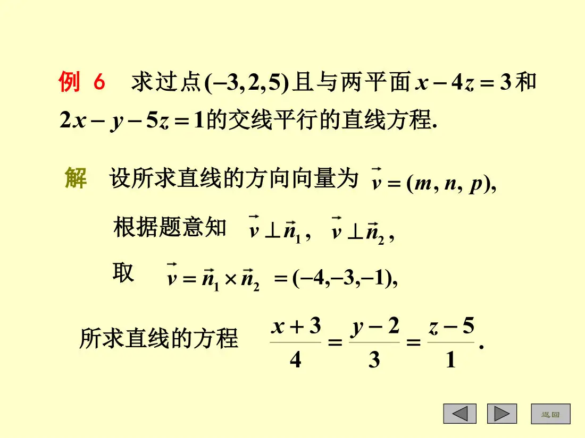

原文：

例 6 求过点 $(-3,2,5)$ 且与两平面 x-4z=3 和 2x-y-5z=1 的交线平行的直线方程.

解 设所求直线的方向向量为 $\vec{v}=(m,n,p)$ ,

根据题意知 $\vec{v} \perp \vec{n}_{1}, \vec{v} \perp \vec{n}_{2},$

取 $\vec{v}=\vec{n}_{1}\times\vec{n}_{2}=(-4,-3,-1),$

所求直线的方程 $\frac{x+3}{4}=\frac{y-2}{3}=\frac{z-5}{1}$ .

返回

### 五、直线与平面的位置关系

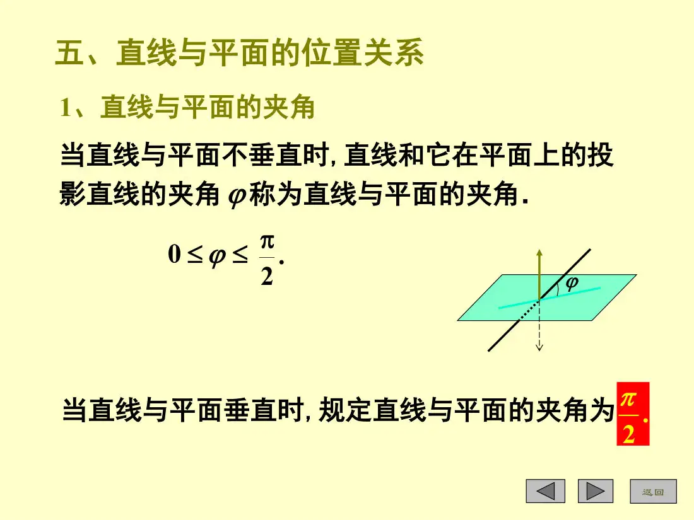

原文：

五、直线与平面的位置关系

1、直线与平面的夹角

当直线与平面不垂直时, 直线和它在平面上的投影直线的夹角 $\varphi$ 称为直线与平面的夹角.

$$
0 \leq \varphi \leq \frac {\pi}{2}.
$$

当直线与平面垂直时, 规定直线与平面的夹角为

返回

◀ ▶

### $$

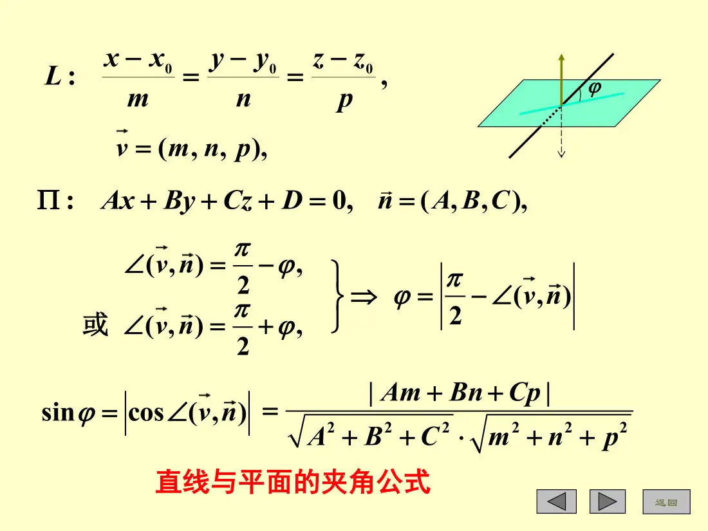

原文：

L: $\frac{x-x_{0}}{m}=\frac{y-y_{0}}{n}=\frac{z-z_{0}}{p},$ $\vec{v}=(m,n,p),$

$\Pi : Ax + By + Cz + D = 0, \vec{n} = (A, B, C),$

$$
\left. \begin{array}{l} \angle (\vec {v}, \vec {n}) = \frac {\pi}{2} - \varphi , \\ \angle (\vec {v}, \vec {n}) = \frac {\pi}{2} + \varphi , \end{array} \right\} \Rightarrow \varphi = \left| \frac {\pi}{2} - \angle (\vec {v}, \vec {n}) \right|
$$

$$
\sin \varphi = | \cos \angle (\vec {v}, \vec {n}) | = \frac {| A m + B n + C p |}{\sqrt {A ^ {2} + B ^ {2} + C ^ {2}} \cdot \sqrt {m ^ {2} + n ^ {2} + p ^ {2}}}
$$

直线与平面的夹角公式

返回

◀ ▶

### 2. 直线与平面的位置关系:

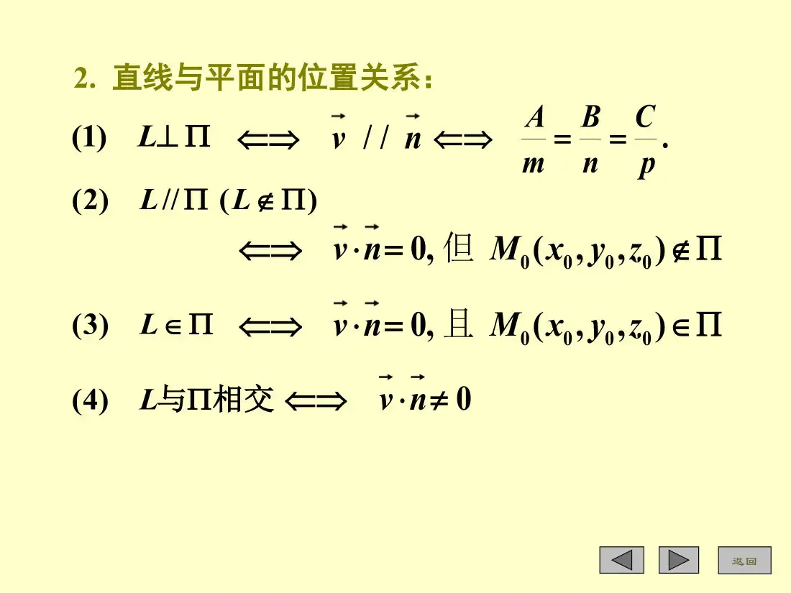

原文：

2. 直线与平面的位置关系:

(1) $L \perp \Pi \iff \vec{v} // \vec{n} \iff \frac{A}{m} = \frac{B}{n} = \frac{C}{p}.$

(2) $L \parallel \Pi (L \notin \Pi)$

$\Longleftrightarrow \vec{v} \cdot \vec{n} = 0$ ，但 $M_0(x_0, y_0, z_0) \notin \Pi$

(3) $L \in \Pi \iff \vec{v} \cdot \vec{n} = 0$ , 且 $M_0(x_0, y_0, z_0) \in \Pi$

(4) $L$ 与 $\Pi$ 相交 $\Longleftrightarrow \vec{v} \cdot \vec{n} \neq 0$ 从几何的观点来看, 它们可能平行、重合、相交。从代数的观点来看, 即 $L$ 与 $\pi$ 有没有交点? 有多少交点? 易证明:

返回

### $$

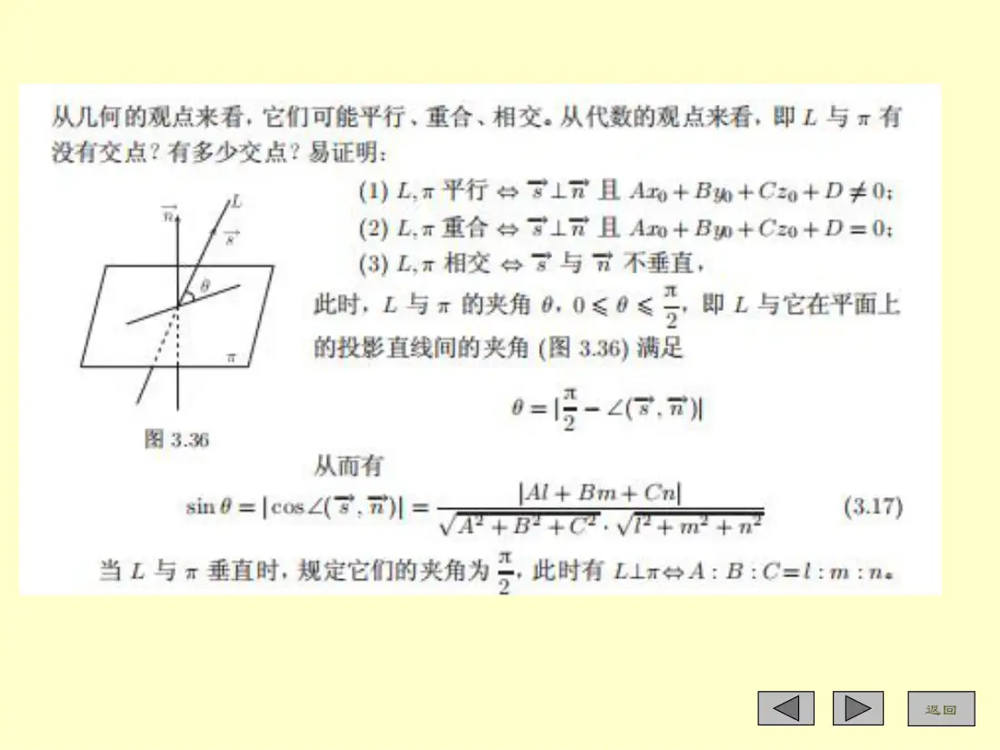

原文：

(1) $L, \pi$ 平行 $\Leftrightarrow \overrightarrow{s} \perp \overrightarrow{n}$ 且 $Ax_0 + By_0 + Cz_0 + D \neq 0$ ;

(2) $L,\pi$ 重合 $\Leftrightarrow\overrightarrow{s}\perp\overrightarrow{n}$ 且 $Ax_{0}+By_{0}+Cz_{0}+D=0;$

(3) $L, \pi$ 相交 $\Leftrightarrow \overrightarrow{s}$ 与 $\overrightarrow{n}$ 不垂直，

此时， $L$ 与 $\pi$ 的夹角 $\theta, 0 \leqslant \theta \leqslant \frac{\pi}{2}$ ，即 $L$ 与它在平面上的投影直线间的夹角（图3.36）满足

$$
\theta = \left| \frac {\pi}{2} - \angle (\overrightarrow {s}, \overrightarrow {n}) \right|
$$

从而有

$$
\sin \theta = | \cos \angle (\overrightarrow {s}, \overrightarrow {n}) | = \frac {| A l + B m + C n |}{\sqrt {A ^ {2} + B ^ {2} + C ^ {2}} \cdot \sqrt {l ^ {2} + m ^ {2} + n ^ {2}}}\tag{3.17}
$$

当 L 与 $\pi$ 垂直时，规定它们的夹角为 $\frac{\pi}{2}$ ，此时有 $L \perp \pi \Leftrightarrow A : B : C = l : m : n$ 。

◀ ▶

返回

### $$

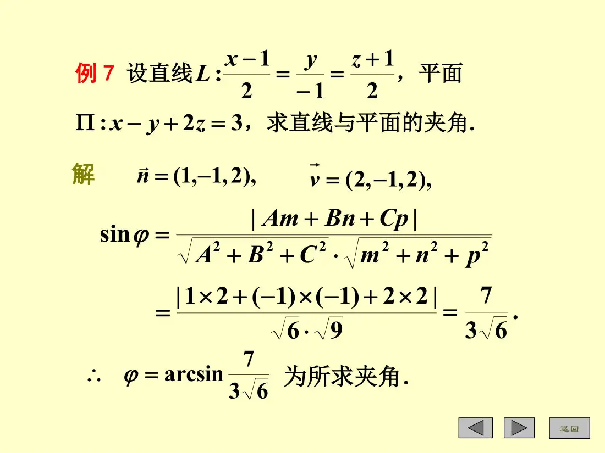

原文：

例 7 设直线 $L: \frac{x - 1}{2} = \frac{y}{-1} = \frac{z + 1}{2}$ ，平面 $\Pi: x - y + 2z = 3$ ，求直线与平面的夹角.

解 $\vec{n} = (1, - 1,2),\qquad \vec{\nu} = (2, - 1,2),$

$$
\begin{array}{r l} \sin \varphi & = \frac {| A m + B n + C p |}{\sqrt {A ^ {2} + B ^ {2} + C ^ {2}} \cdot \sqrt {m ^ {2} + n ^ {2} + p ^ {2}}} \\ & = \frac {| 1 \times 2 + (- 1) \times (- 1) + 2 \times 2 |}{\sqrt {6} \cdot \sqrt {9}} = \frac {7}{3 \sqrt {6}}. \end{array}
$$

∴ $\varphi = \arcsin \frac{7}{3\sqrt{6}}$ 为所求夹角.

◀ ▶

### 3. 平面束

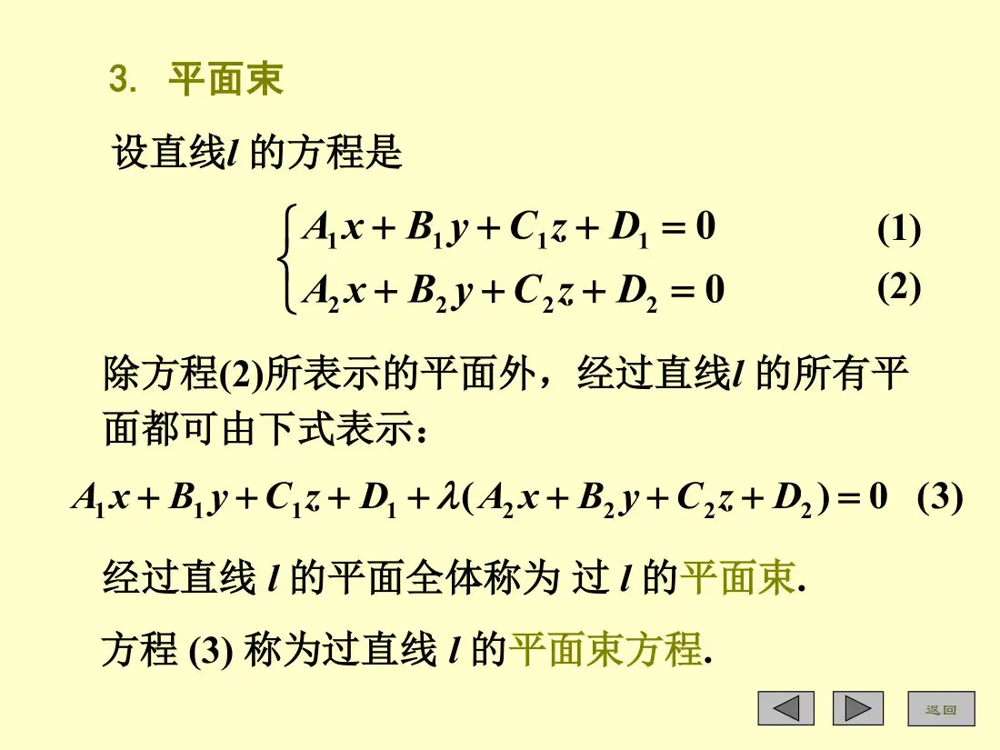

原文：

3. 平面束

设直线 $l$ 的方程是

$$
\int A _ {1} x + B _ {1} y + C _ {1} z + D _ {1} = 0\tag{1}
$$

$$
\left\lfloor A _ {2} x + B _ {2} y + C _ {2} z + D _ {2} = 0 \right.\tag{2}
$$

除方程(2)所表示的平面外，经过直线 $l$ 的所有平面都可由下式表示：

$$
A _ {1} x + B _ {1} y + C _ {1} z + D _ {1} + \lambda (A _ {2} x + B _ {2} y + C _ {2} z + D _ {2}) = 0\tag{3}
$$

经过直线 l 的平面全体称为过 l 的平面束.

方程 (3) 称为过直线 l 的平面束方程.

返回

◀ ▶

### $$

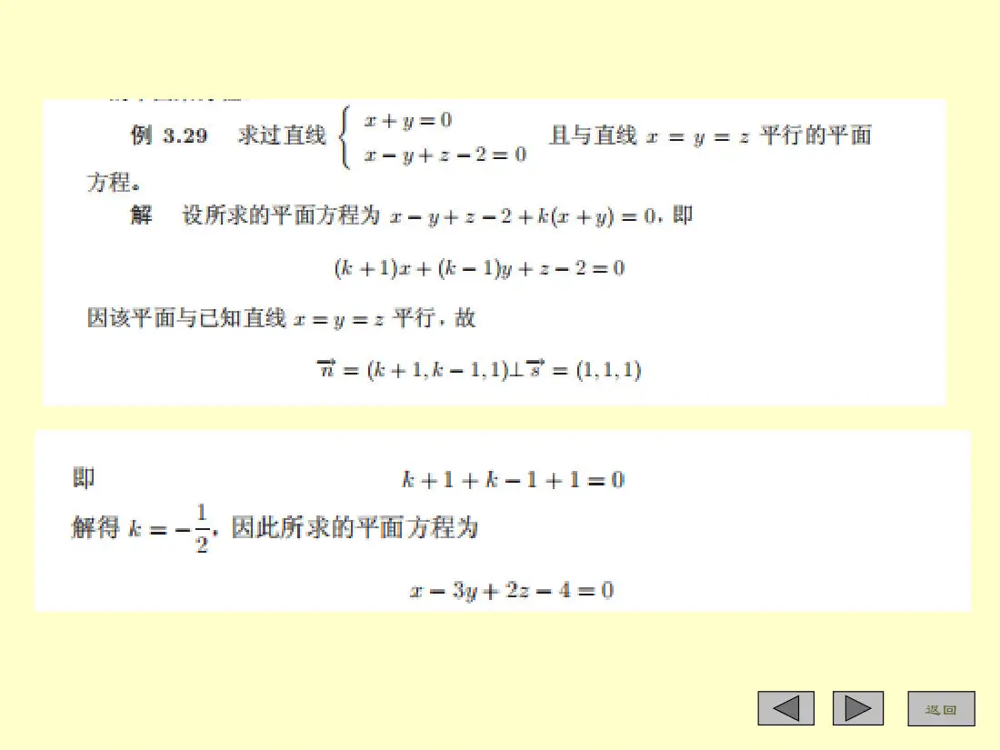

原文：

例3.29 求过直线 $\left\{ \begin{array}{l} x + y = 0 \\ x - y + z - 2 = 0 \end{array} \right.$ 且与直线 $x = y = z$ 平行的平面方程。

解 设所求的平面方程为 $x - y + z - 2 + k(x + y) = 0$ ，即

$$
(k + 1) x + (k - 1) y + z - 2 = 0
$$

因该平面与已知直线 $x = y = z$ 平行，故

$$
\overrightarrow {n} = (k + 1, k - 1, 1) \bot \overrightarrow {s} = (1, 1, 1)
$$

即

$$
k + 1 + k - 1 + 1 = 0
$$

解得 $k = -\frac{1}{2}$ ，因此所求的平面方程为

$$
x - 3 y + 2 z - 4 = 0
$$

返回

◀ ▶

### 解法一 过点 $A(2,1,3)$ 且垂直于已知直线的平面方程为

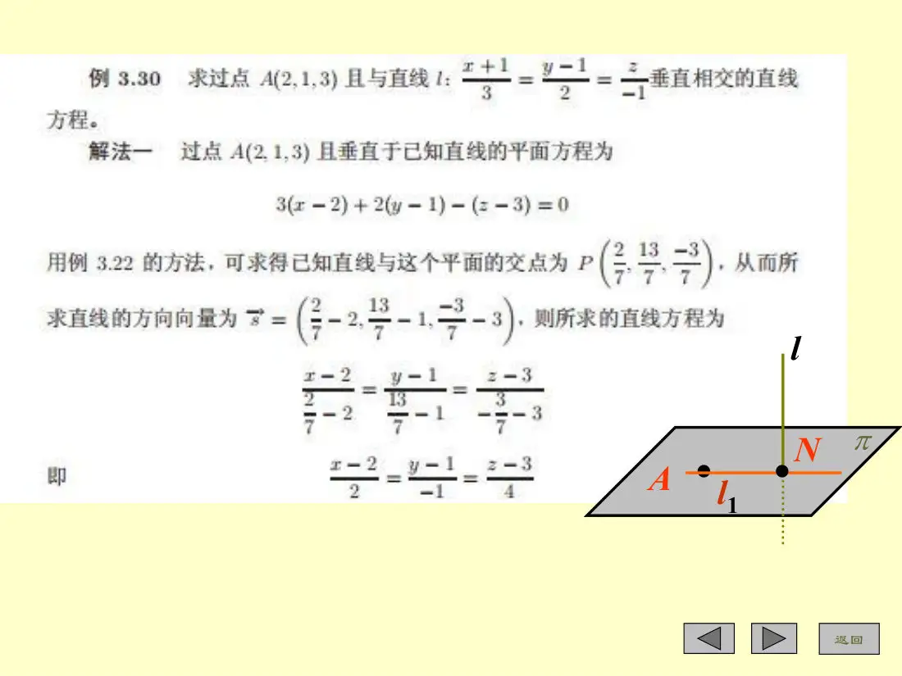

原文：

例3.30 求过点 $A(2,1,3)$ 且与直线 $l: \frac{x + 1}{3} = \frac{y - 1}{2} = \frac{z}{-1}$ 垂直相交的直线方程。

解法一 过点 $A(2,1,3)$ 且垂直于已知直线的平面方程为

$$
3 (x - 2) + 2 (y - 1) - (z - 3) = 0
$$

用例 3.22 的方法，可求得已知直线与这个平面的交点为 $P\left(\frac{2}{7}, \frac{13}{7}, \frac{-3}{7}\right)$ ，从而所求直线的方向向量为 $\overrightarrow{s} = \left(\frac{2}{7} - 2, \frac{13}{7} - 1, \frac{-3}{7} - 3\right)$ ，则所求的直线方程为

$$
\frac {x - 2}{\frac {2}{7} - 2} = \frac {y - 1}{\frac {1 3}{7} - 1} = \frac {z - 3}{- \frac {3}{7} - 3}
$$

即

$$
\frac {x - 2}{2} = \frac {y - 1}{- 1} = \frac {z - 3}{4}
$$

返回

◀ ▶

### $$

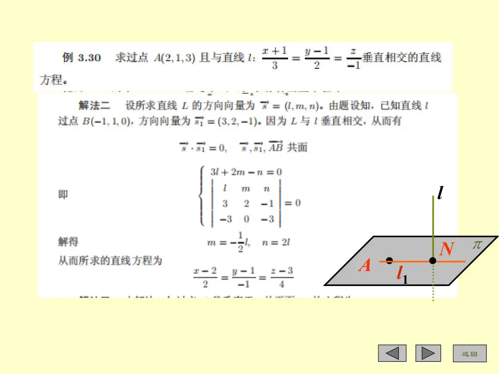

原文：

例3.30 求过点 $A(2,1,3)$ 且与直线 $l: \frac{x + 1}{3} = \frac{y - 1}{2} = \frac{z}{-1}$ 垂直相交的直线方程。

解法二 设所求直线 $L$ 的方向向量为 $\overrightarrow{s} = (l, m, n)$ 。由题设知，已知直线 $l$ 过点 $B(-1, 1, 0)$ ，方向向量为 $\overrightarrow{s_1} = (3, 2, -1)$ 。因为 $L$ 与 $l$ 垂直相交，从而有

$$
\overrightarrow {s} \cdot \overrightarrow {s _ {1}} = 0, \quad \overrightarrow {s}, \overrightarrow {s _ {1}}, \overrightarrow {A B} \text {共面}
$$

即

解得

$$
\left\{ \begin{array}{c c} 3 l + 2 m - n = 0 \\ \left| \begin{array}{c c c} l & m & n \\ 3 & 2 & - 1 \\ - 3 & 0 & - 3 \end{array} \right| = 0 \end{array} \right.
$$

从而所求的直线方程为

$$
m = - \frac {1}{2} l, \quad n = 2 l
$$

$$
\frac {x - 2}{2} = \frac {y - 1}{- 1} = \frac {z - 3}{4}
$$

返回

◀ ▶

### $$

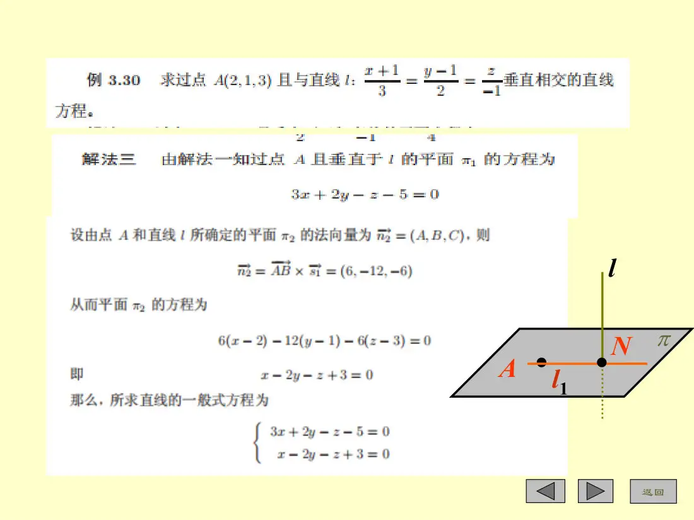

原文：

例3.30 求过点 $A(2,1,3)$ 且与直线 $l: \frac{x + 1}{3} = \frac{y - 1}{2} = \frac{z}{-1}$ 垂直相交的直线方程。

解法三 由解法一知过点 $A$ 且垂直于 $l$ 的平面 $\pi_1$ 的方程为

$$
3 x + 2 y - z - 5 = 0
$$

设由点 A 和直线 l 所确定的平面 $\pi_{2}$ 的法向量为 $\overrightarrow{n_{2}} = (A, B, C)$ ，则

$$
\overrightarrow {n _ {2}} = \overrightarrow {A B} \times \overrightarrow {s _ {1}} = (6, - 1 2, - 6)
$$

从而平面 $\pi_2$ 的方程为

$$
6 (x - 2) - 1 2 (y - 1) - 6 (z - 3) = 0
$$

即

$$
x - 2 y - z + 3 = 0
$$

那么，所求直线的一般式方程为

$$
\left\{ \begin{array}{r l} 3 x + 2 y - z - 5 & = 0 \\ x - 2 y - z + 3 & = 0 \end{array} \right.
$$

返回

### $$

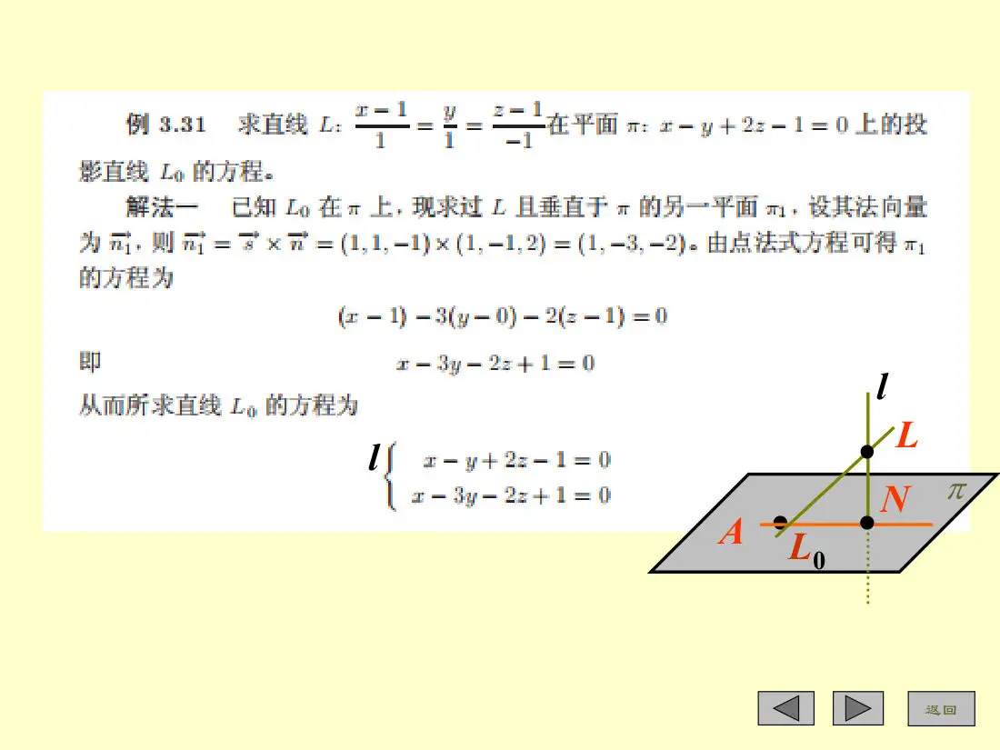

原文：

例3.31 求直线 $L: \frac{x - 1}{1} = \frac{y}{1} = \frac{z - 1}{-1}$ 在平面 $\pi: x - y + 2z - 1 = 0$ 上的投影直线 $L_0$ 的方程。

解法一 已知 $L_{0}$ 在 $\pi$ 上，现求过 $L$ 且垂直于 $\pi$ 的另一平面 $\pi_{1}$ ，设其法向量为 $\overrightarrow{n_1}$ ，则 $\overrightarrow{n_1} = \overrightarrow{s} \times \overrightarrow{n} = (1,1,-1) \times (1,-1,2) = (1,-3,-2)$ 。由点法式方程可得 $\pi_{1}$ 的方程为

$$
(x - 1) - 3 (y - 0) - 2 (z - 1) = 0
$$

即

$$
x - 3 y - 2 z + 1 = 0
$$

从而所求直线 $L_{0}$ 的方程为

$$
l \left\{ \begin{array}{r l} x - y + 2 z - 1 & = 0 \\ x - 3 y - 2 z + 1 & = 0 \end{array} \right.
$$

返回

◀ ▶

### $$

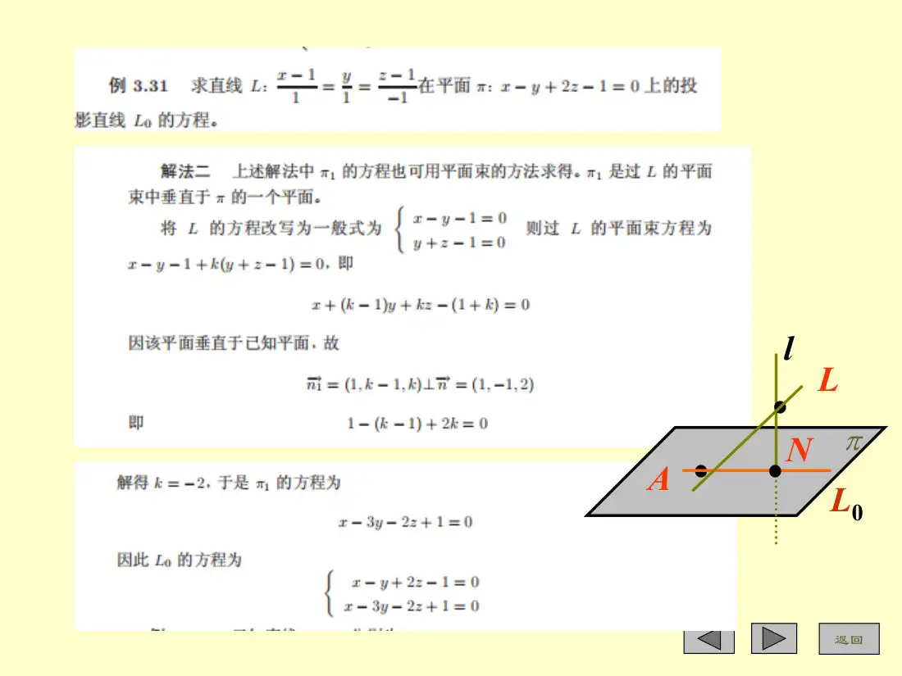

原文：

例3.31 求直线 $L: \frac{x - 1}{1} = \frac{y}{1} = \frac{z - 1}{-1}$ 在平面 $\pi: x - y + 2z - 1 = 0$ 上的投影直线 $L_0$ 的方程。

解法二 上述解法中 $\pi_{1}$ 的方程也可用平面束的方法求得。 $\pi_{1}$ 是过 $L$ 的平面束中垂直于 $\pi$ 的一个平面。

将 $L$ 的方程改写为一般式为 $\left\{ \begin{array}{l}x - y - 1 = 0\\ y + z - 1 = 0 \end{array} \right.$ 则过 $L$ 的平面束方程为 $x - y - 1 + k(y + z - 1) = 0$ ，即

$$
x + (k - 1) y + k z - (1 + k) = 0
$$

因该平面垂直于已知平面，故

$$
\overrightarrow {n} _ {\mathrm{i}} = (1, k - 1, k) \perp \overrightarrow {n} = (1, - 1, 2)
$$

即

$$
1 - (k - 1) + 2 k = 0
$$

解得 $k = -2$ ，于是 $\pi_1$ 的方程为

$$
x - 3 y - 2 z + 1 = 0
$$

因此 $L_{0}$ 的方程为

$$
\left\{ \begin{array}{r l} x - y + 2 z - 1 & = 0 \\ x - 3 y - 2 z + 1 & = 0 \end{array} \right.
$$

返回

### 例8 求直线

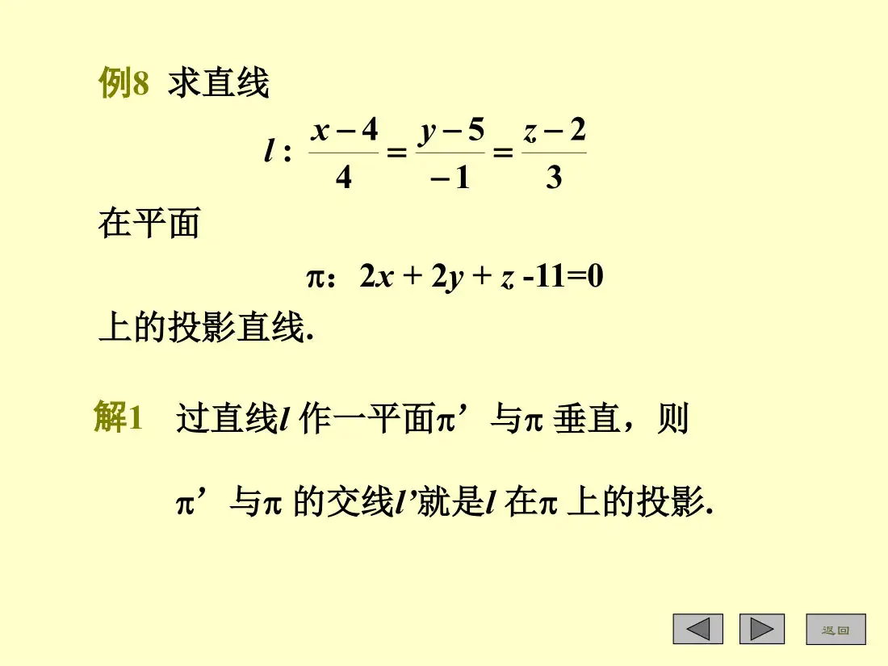

原文：

例8 求直线

$$
l: \frac {x - 4}{4} = \frac {y - 5}{- 1} = \frac {z - 2}{3}
$$

在平面

$$
\pi : 2 x + 2 y + z - 1 1 = 0
$$

上的投影直线.

解1 过直线 $l$ 作一平面 $\pi'$ 与 $\pi$ 垂直, 则 $\pi'$ 与 $\pi$ 的交线 $l'$ 就是 $l$ 在 $\pi$ 上的投影.

返回

### 将 $l$ 的方程改写为一般式

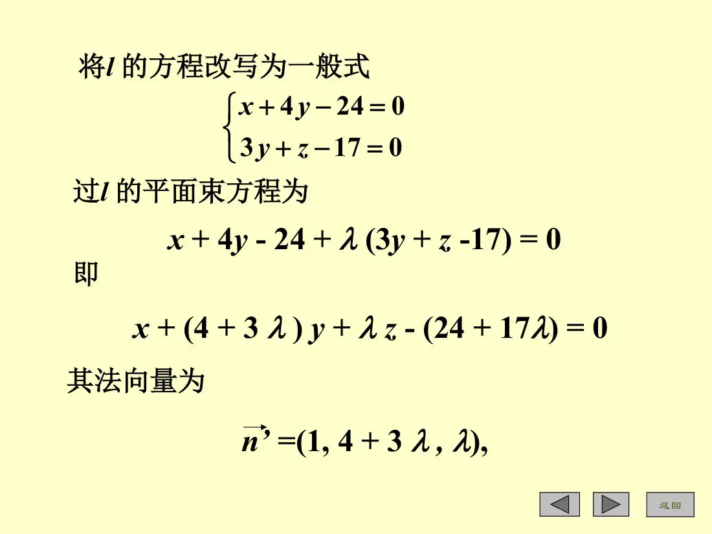

原文：

将 $l$ 的方程改写为一般式

$$
\left\{ \begin{array}{l} x + 4 y - 2 4 = 0 \\ 3 y + z - 1 7 = 0 \end{array} \right.
$$

过 $l$ 的平面束方程为

$$
x + 4 y - 2 4 + \lambda (3 y + z - 1 7) = 0
$$

即

$$
x + (4 + 3 \lambda) y + \lambda z - (2 4 + 1 7 \lambda) = 0
$$

其法向量为

$$
\vec {n} ^ {\prime} = (1, 4 + 3 \lambda , \lambda),
$$

返回

◀ ▶

### 由 $\pi^{\prime}\bot \pi$ 可得

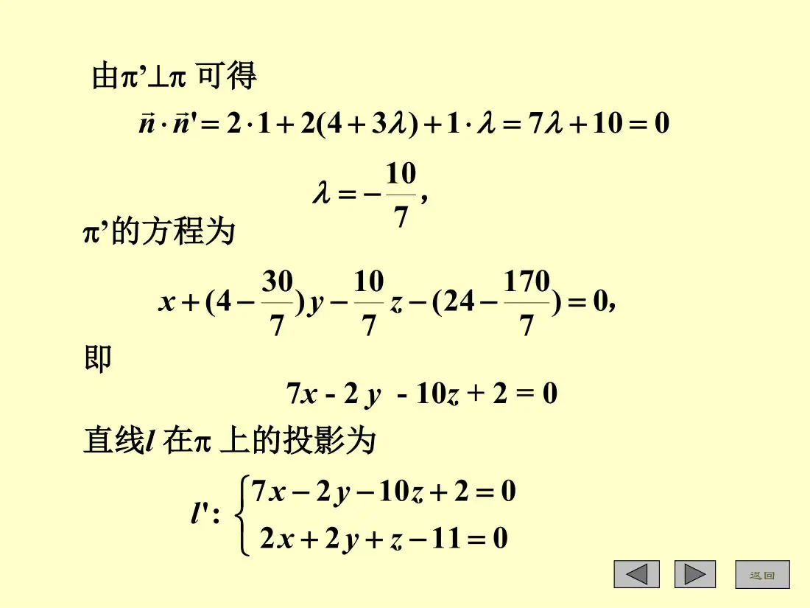

原文：

由 $\pi^{\prime}\bot \pi$ 可得

$$
\vec {n} \cdot \vec {n} ^ {\prime} = 2 \cdot 1 + 2 (4 + 3 \lambda) + 1 \cdot \lambda = 7 \lambda + 1 0 = 0
$$

$$
\lambda = - \frac {1 0}{7},
$$

$\pi^{\prime}$ 的方程为

$$
x + \left(4 - \frac {3 0}{7}\right) y - \frac {1 0}{7} z - \left(2 4 - \frac {1 7 0}{7}\right) = 0,
$$

即

$$
7 x - 2 y - 1 0 z + 2 = 0
$$

直线 $l$ 在 $\pi$ 上的投影为

$$
l ^ {\prime}: \left\{ \begin{array}{l} 7 x - 2 y - 1 0 z + 2 = 0 \\ 2 x + 2 y + z - 1 1 = 0 \end{array} \right.
$$

返回

### $$

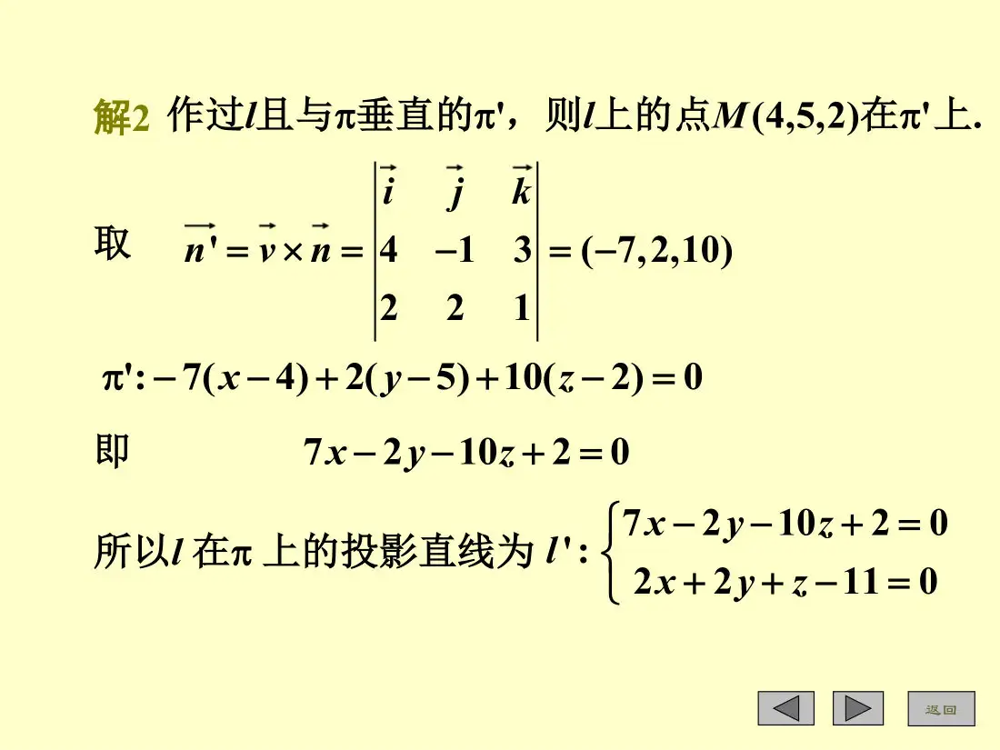

原文：

解2 作过 $l$ 且与 $\pi$ 垂直的 $\pi'$ ，则 $l$ 上的点 $M(4,5,2)$ 在 $\pi'$ 上.

取 $\overrightarrow{n'}=\overrightarrow{v}\times\overrightarrow{n}=\left|\begin{matrix}\overrightarrow{i}&\overrightarrow{j}&\overrightarrow{k}\\4&-1&3\\2&2&1\end{matrix}\right|=(-7,2,10)$

$$
\pi^ {\prime} \colon - 7 (x - 4) + 2 (y - 5) + 1 0 (z - 2) = 0
$$

即

$$
7 x - 2 y - 1 0 z + 2 = 0
$$

所以 $l$ 在 $\pi$ 上的投影直线为 $l'$ : $\left\{ \begin{array}{l} 7x - 2y - 10z + 2 = 0 \\ 2x + 2y + z - 11 = 0 \end{array} \right.$

◀ ▶

### 思考题 直线 $l$ 过点 $M(2,5,-2)$ 且与直线

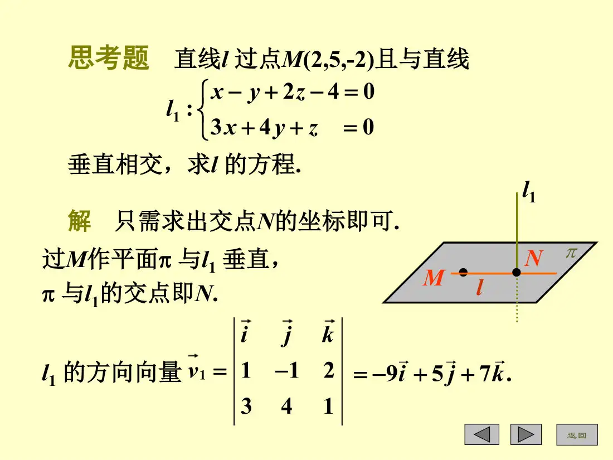

原文：

思考题 直线 $l$ 过点 $M(2,5,-2)$ 且与直线

$$
l _ {1}: \left\{ \begin{array}{l} x - y + 2 z - 4 = 0 \\ 3 x + 4 y + z = 0 \end{array} \right.
$$

垂直相交，求l的方程.

解 只需求出交点N的坐标即可.
过M作平面 $\pi$ 与 $l_{1}$ 垂直， $\pi$ 与 $l_{1}$ 的交点即N.

$l_{1}$ 的方向向量 $\vec{v}_{1} = \left| \begin{array}{ccc}\vec{i} & \vec{j} & \vec{k}\\ 1 & -1 & 2\\ 3 & 4 & 1 \end{array} \right| = -9\vec{i} +5\vec{j} +7\vec{k}.$

### 过 $M(2,5,-2)$ 且与l垂直的平面

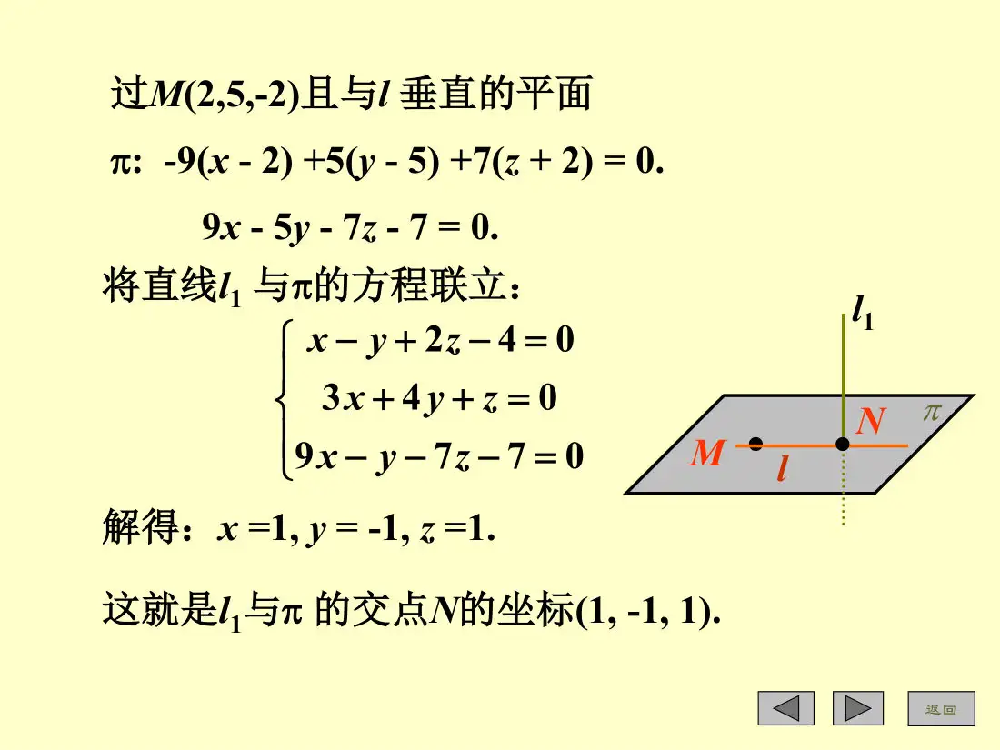

原文：

过 $M(2,5,-2)$ 且与l垂直的平面

$$
\pi : - 9 (x - 2) + 5 (y - 5) + 7 (z + 2) = 0.
$$

$$
9 x - 5 y - 7 z - 7 = 0.
$$

将直线 $l_{1}$ 与 $\pi$ 的方程联立：

$$
\left\{ \begin{array}{l l} x - y + 2 z - 4 = 0 \\ 3 x + 4 y + z = 0 \\ 9 x - y - 7 z - 7 = 0 \end{array} \right.
$$

解得：x=1,y=-1,z=1.

这就是 $l_{1}$ 与 $\pi$ 的交点N的坐标(1,-1,1).

返回

◀ ▶

### 直线l的方向向量

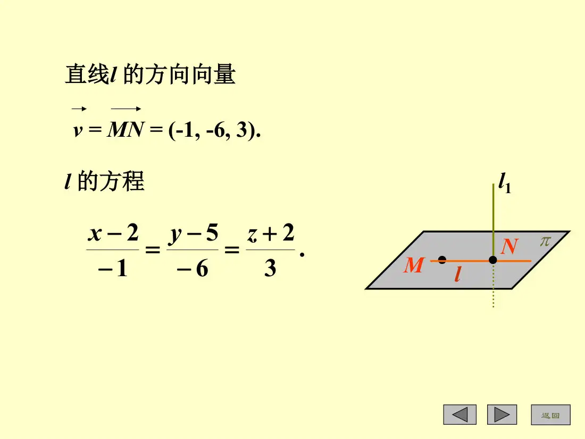

原文：

直线l的方向向量

$$
\vec {v} = \overrightarrow {M N} = (- 1, - 6, 3).
$$

$l$ 的方程

$$
\frac {x - 2}{- 1} = \frac {y - 5}{- 6} = \frac {z + 2}{3}.
$$

返回
