# 《线性代数与解析几何》第3章 空间解析几何与向量运算（课件）

原件的每一页，下面附识别出的文字。

### 第3章 空间解析几何与向量运算

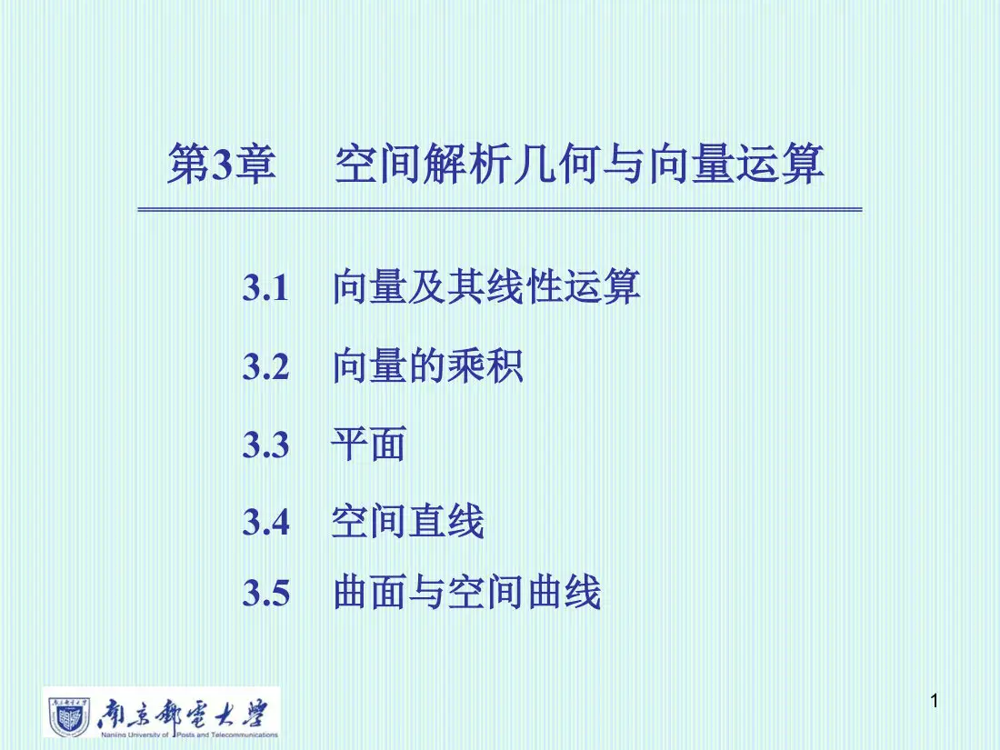

原文：

第3章 空间解析几何与向量运算

3.1 向量及其线性运算  
3.2 向量的乘积  
3.3 平面  
3.4 空间直线  
3.5 曲面与空间曲线

南京邮电大学
Nanjing University of Posts and Telecommunications

1

### 3.1 向量及其线性运算

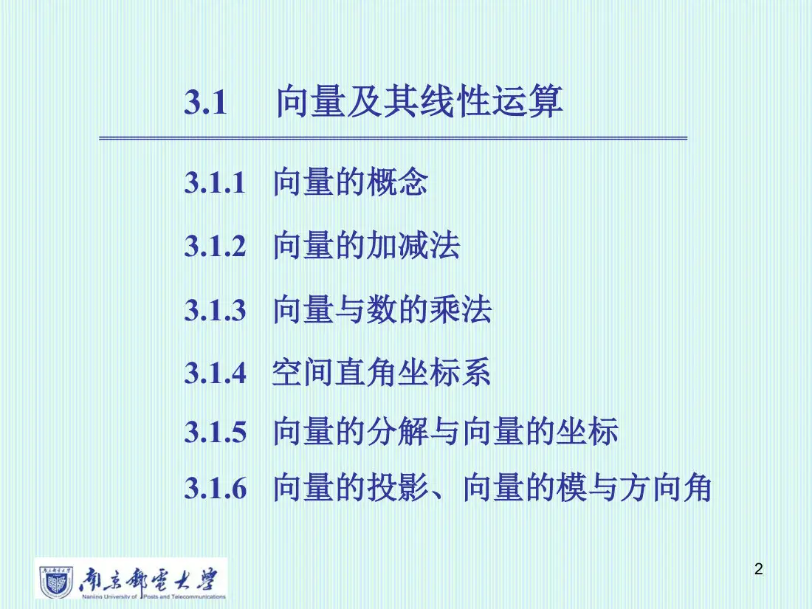

原文：

3.1 向量及其线性运算
3.1.1 向量的概念
3.1.2 向量的加减法
3.1.3 向量与数的乘法
3.1.4 空间直角坐标系
3.1.5 向量的分解与向量的坐标
3.1.6 向量的投影、向量的模与方向角

南京邮电大学
Nanjing University of Posts and Telecommunications

2

### 3.1 向量及其线性运算

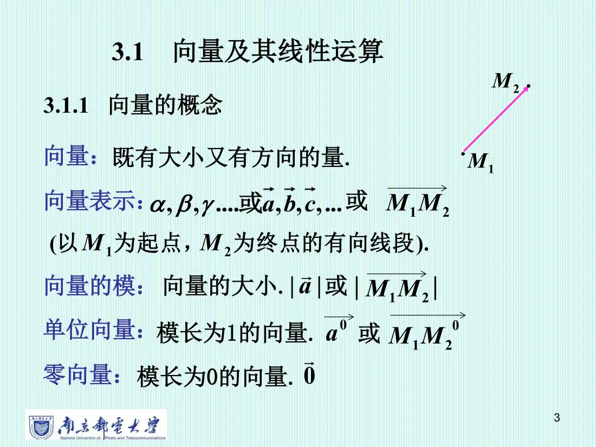

原文：

3.1 向量及其线性运算

3.1.1 向量的概念

向量: 既有大小又有方向的量. $M_{1}$ 向量表示: $\alpha, \beta, \gamma \ldots$ 或 $\vec{a}, \vec{b}, \vec{c}, \ldots$ 或 $\overrightarrow{M_{1} M_{2}}$ (以 $M_{1}$ 为起点, $M_{2}$ 为终点的有向线段). 向量的模: 向量的大小. $|\vec{a}|$ 或 $|\overrightarrow{M_{1} M_{2}}|$ 单位向量: 模长为1的向量. $\overrightarrow{a^{0}}$ 或 $\overrightarrow{M_{1} M_{2}^{0}}$ 零向量: 模长为0的向量. $\vec{0}$

南京邮电大学
Nanjing University of Posts and Telecommunications

3

### 自由向量: 不考虑起点位置的向量.

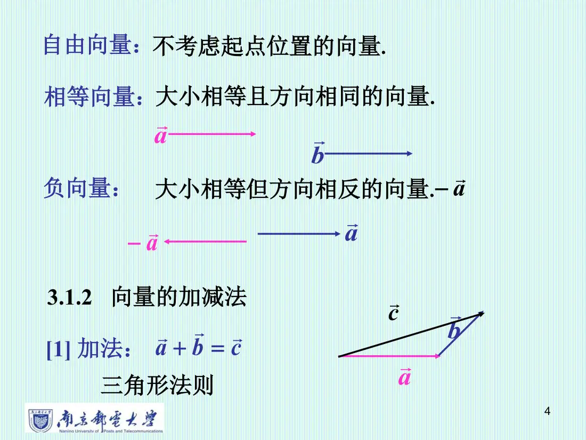

原文：

自由向量: 不考虑起点位置的向量.

相等向量: 大小相等且方向相同的向量.

负向量: 大小相等但方向相反的向量. - $\vec{a}$

3.1.2 向量的加减法

[1] 加法: $\vec{a} + \vec{b} = \vec{c}$

三角形法则

南京邮电大学
Nanjing University of Posts and Telecommunications

4

### 等价的平行四边形法则

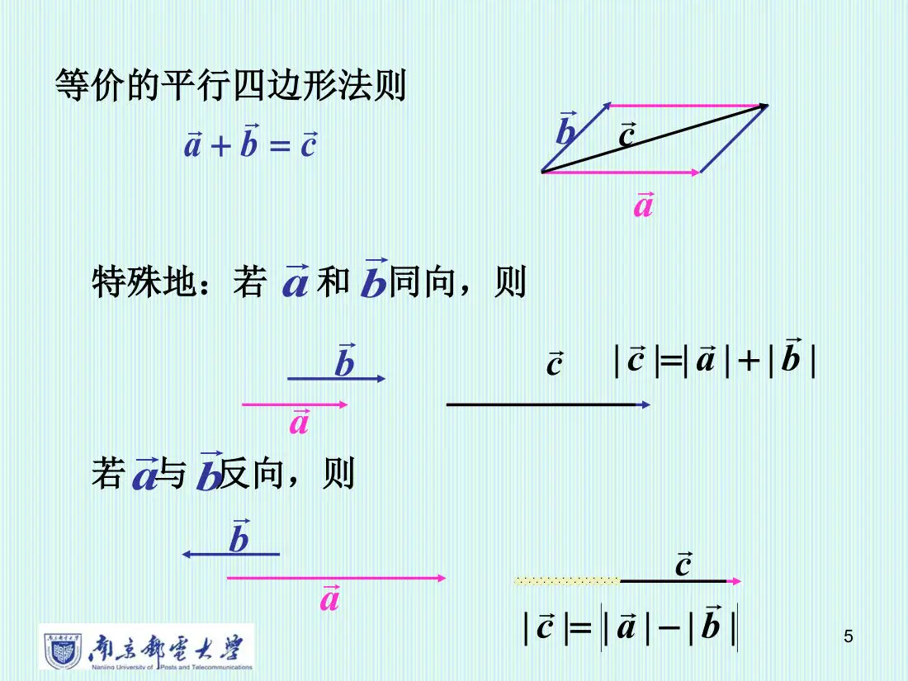

原文：

等价的平行四边形法则

$$
\vec {a} + \vec {b} = \vec {c}
$$

特殊地: 若 $\vec{a}$ 和 $\vec{b}$ 同向, 则

若 $\vec{a}$ 与 $\vec{b}$ 反向，则

南京邮电大学
Nanjing University of Posts and Telecommunications

5

### 向量的加法符合下列运算规律:

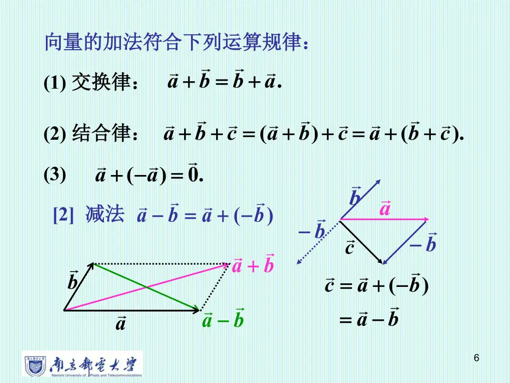

原文：

向量的加法符合下列运算规律:

(1) 交换律: $\vec{a} + \vec{b} = \vec{b} + \vec{a}$ .

(2) 结合律: $\vec{a} + \vec{b} + \vec{c} = (\vec{a} + \vec{b}) + \vec{c} = \vec{a} + (\vec{b} + \vec{c})$ .

(3) $\vec{a} + (-\vec{a}) = \vec{0}.$

[2] 减法 $\vec{a}-\vec{b}=\vec{a}+(-\vec{b})$

$$
\begin{array}{r} \vec {c} = \vec {a} + (- \vec {b}) \\ = \vec {a} - \vec {b} \end{array}
$$

南京邮电大学
Nanjing University of Posts and Telecommunications

6

### 3.1.3 向量与数的乘法

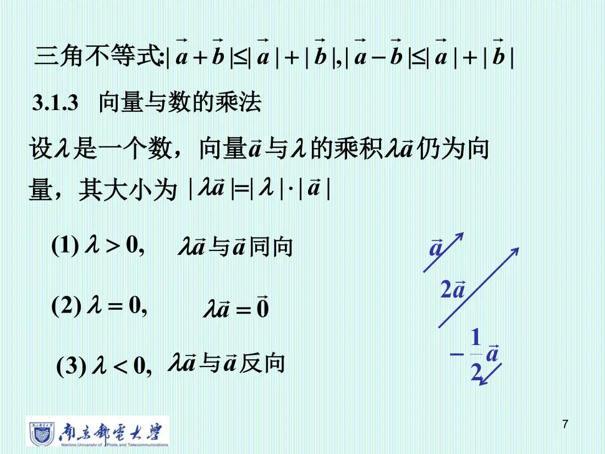

原文：

三角不等式: $|\vec{a} + \vec{b}| \leq |\vec{a}| + |\vec{b}|, |\vec{a} - \vec{b}| \leq |\vec{a}| + |\vec{b}|$

3.1.3 向量与数的乘法

设 $\lambda$ 是一个数，向量 $\vec{a}$ 与 $\lambda$ 的乘积 $\lambda \vec{a}$ 仍为向量，其大小为 $|\lambda \vec{a}| = |\lambda| \cdot |\vec{a}|$

(1) $\lambda > 0$ , $\lambda \vec{a}$ 与 $\vec{a}$ 同向

(2) $\lambda = 0$ , $\lambda \vec{a} = \vec{0}$

(3) $\lambda < 0$ , $\lambda \vec{a}$ 与 $\vec{a}$ 反向

南京邮电大学
Nanjing University of Posts and Telecommunications

7

### 数与向量的乘积符合下列运算规律:

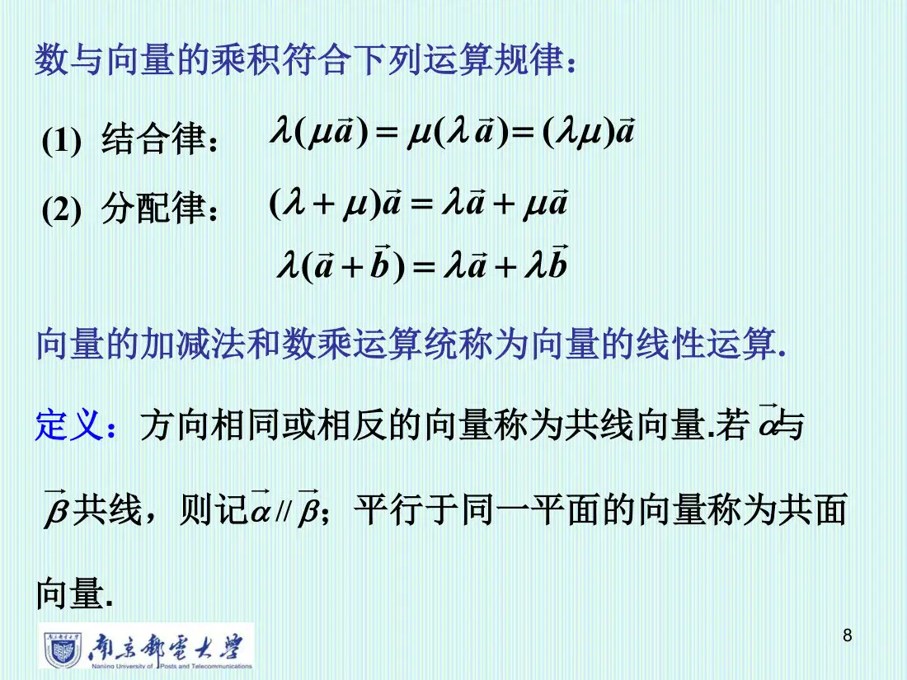

原文：

数与向量的乘积符合下列运算规律:

(1) 结合律: $\lambda (\mu \vec{a}) = \mu (\lambda \vec{a}) = (\lambda \mu)\vec{a}$

(2) 分配律: $(\lambda + \mu)\vec{a} = \lambda \vec{a} + \mu \vec{a}$

$$
\lambda (\vec {a} + \vec {b}) = \lambda \vec {a} + \lambda \vec {b}
$$

向量的加减法和数乘运算统称为向量的线性运算.

定义: 方向相同或相反的向量称为共线向量. 若 $\vec{\alpha}$ 与 $\vec{\beta}$ 共线, 则记 $\vec{\alpha} // \vec{\beta}$ ; 平行于同一平面的向量称为共面向量.

南京邮电大学
Nanjing University of Posts and Telecommunications

8

### 上式表明：一个非零向量除以它的模的结果是一个与原向量同方向的单位向量。

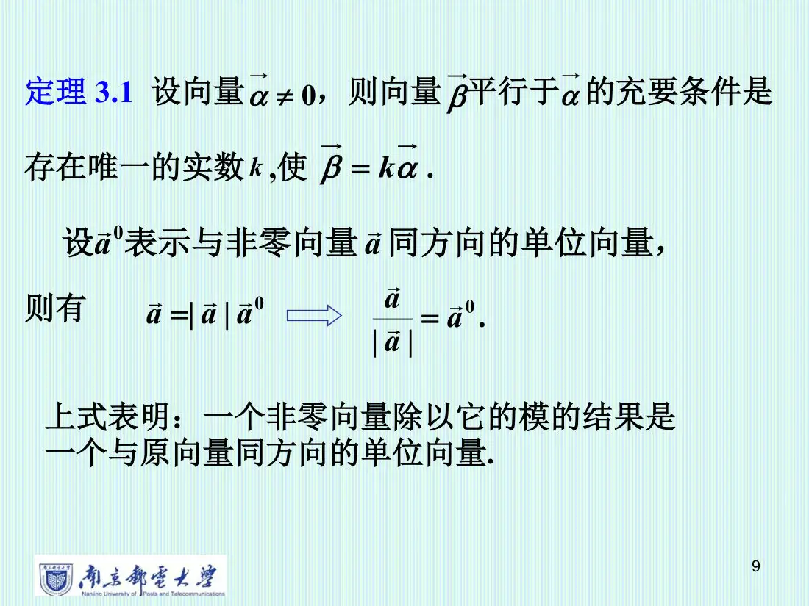

原文：

定理 3.1 设向量 $\vec{\alpha} \neq 0$ ，则向量 $\vec{\beta}$ 平行于 $\vec{\alpha}$ 的充要条件是存在唯一的实数 k，使 $\vec{\beta} = k\vec{\alpha}$ .

设 $\vec{a}^{0}$ 表示与非零向量 $\vec{a}$ 同方向的单位向量,则有 $\vec{a}=|\vec{a}|\vec{a}^{0}\Longrightarrow\frac{\vec{a}}{|\vec{a}|}=\vec{a}^{0}.$

上式表明：一个非零向量除以它的模的结果是一个与原向量同方向的单位向量。

南京邮电大学 Nanjing University of Posts and Telecommunications

9

### 例1. 已知平行四边形ABCD的对角线

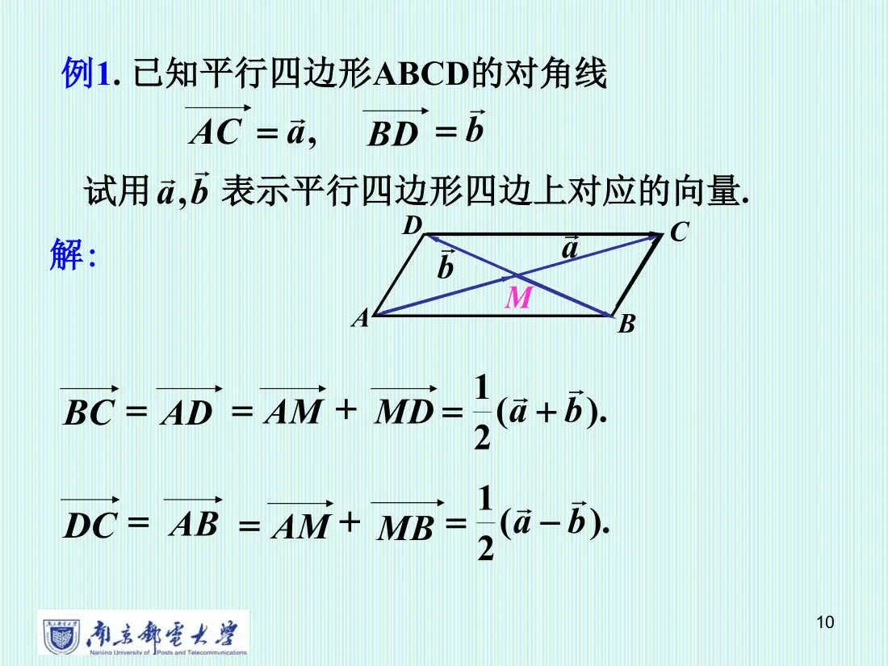

原文：

例1. 已知平行四边形ABCD的对角线

$$
\overrightarrow {A C} = \vec {a}, \quad \overrightarrow {B D} = \vec {b}
$$

试用 $\vec{a},\vec{b}$ 表示平行四边形四边上对应的向量.

解：

$$
\overrightarrow {B C} = \overrightarrow {A D} = \overrightarrow {A M} + \overrightarrow {M D} = \frac {1}{2} (\vec {a} + \vec {b}).
$$

$$
\overrightarrow {D C} = \overrightarrow {A B} = \overrightarrow {A M} + \overrightarrow {M B} = \frac {1}{2} (\vec {a} - \vec {b}).
$$

南京邮电大学
Nanjing University of Posts and Telecommunications

10

### 例2 试用向量方法证明: 对角线互相平分的四边形必是平行四边形.

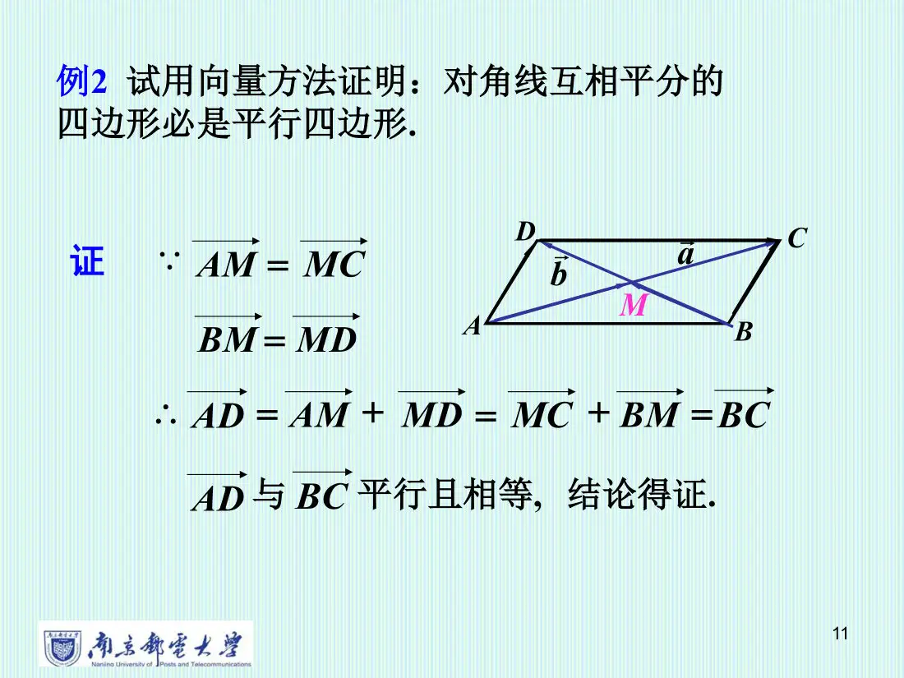

原文：

例2 试用向量方法证明: 对角线互相平分的四边形必是平行四边形.

证

$$
\because \overrightarrow {A M} = \overrightarrow {M C}
$$

$$
\overrightarrow {B M} = \overrightarrow {M D}
$$

$$
\therefore \overrightarrow {A D} = \overrightarrow {A M} + \overrightarrow {M D} = \overrightarrow {M C} + \overrightarrow {B M} = \overrightarrow {B C}
$$

$\overrightarrow{AD}$ 与 $\overrightarrow{BC}$ 平行且相等，结论得证.

南京邮电大学
Nanjing University of Posts and Telecommunications

11

### 3.1.4 空间直角坐标系

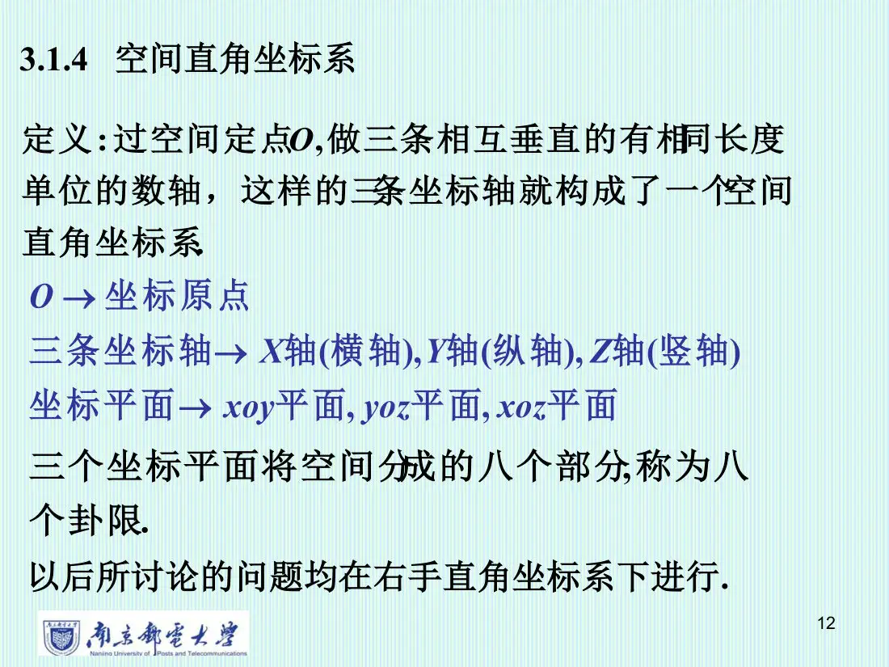

原文：

3.1.4 空间直角坐标系

定义:过空间定点O,做三条相互垂直的有相同长度单位的数轴, 这样的三条坐标轴就构成了一个空间直角坐标系

$O \rightarrow$ 坐标原点

三条坐标轴 $\rightarrow X$ 轴(横轴), $Y$ 轴(纵轴), $Z$ 轴(竖轴)

坐标平面 $\rightarrow$ xoy平面, yoz平面, xoz平面

三个坐标平面将空间分成的八个部分,称为八个卦限.

以后所讨论的问题均在右手直角坐标系下进行.

南京邮电大学
Nanjing University of Posts and Telecommunications

12

### 南京邮电大学

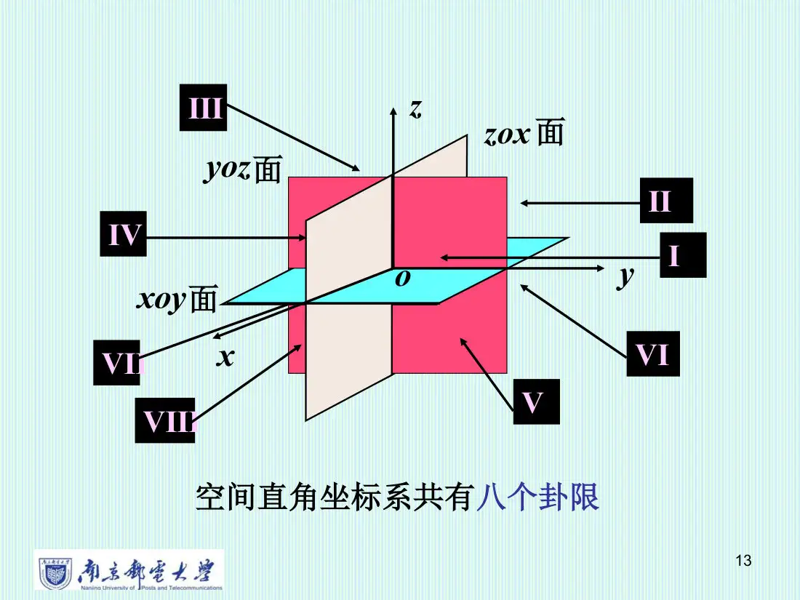

原文：

南京邮电大学
Nanjing University of Posts and Telecommunications

13

### 记作: $M(x, y, z)$

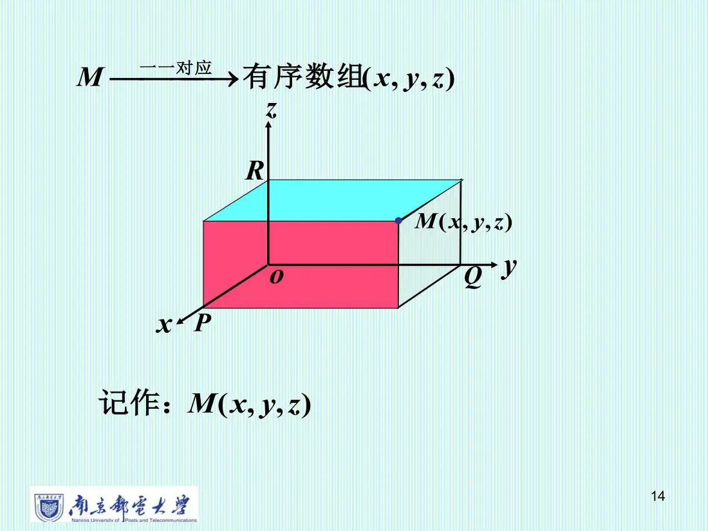

原文：

$M\xrightarrow{\text{一一对应}}$ 有序数组 $(x,y,z)$

记作: $M(x, y, z)$

南京邮电大学
Nanjing University of Posts and Telecommunications

14

### 南京邮电大学

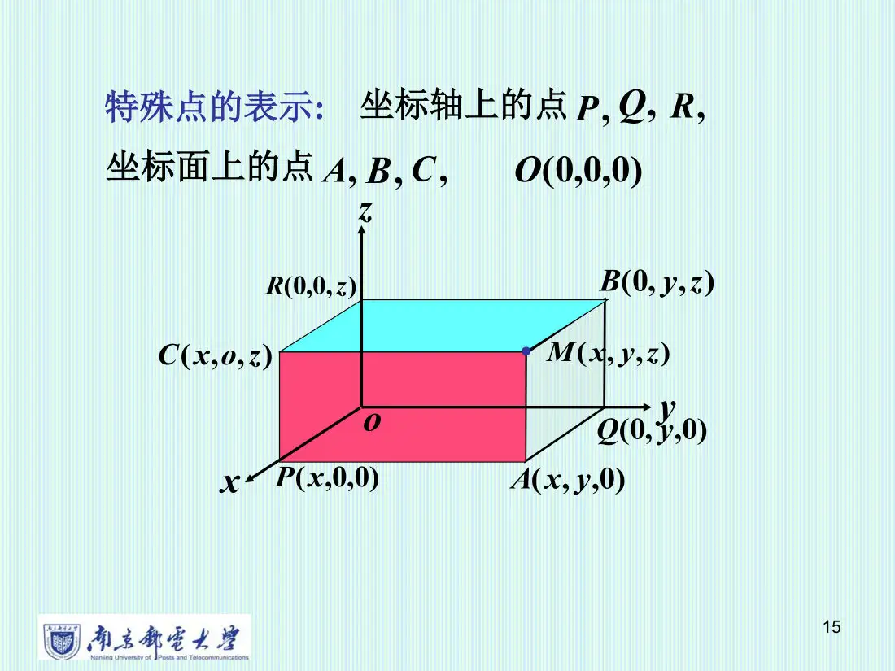

原文：

特殊点的表示: 坐标轴上的点 P, Q, R, 坐标面上的点 A, B, C, $O(0,0,0)$

南京邮电大学
Nanjing University of Posts and Telecommunications

15

### $$

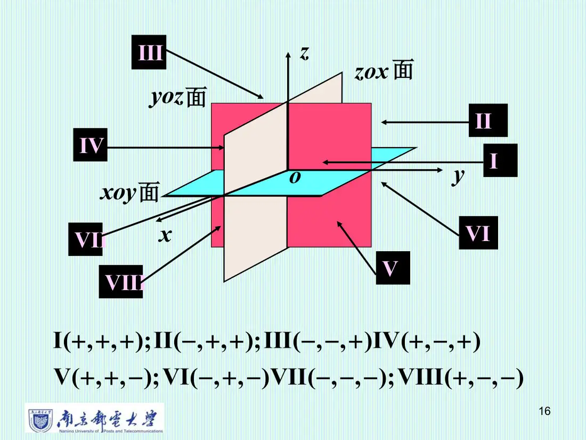

原文：

$$
\mathbf {I} (+, +, +); \mathbf {I I} (-, +, +); \mathbf {I I I} (-, -, +) \mathbf {I V} (+, -, +)
$$

$$
\mathbf {V} (+, +, -); \mathbf {V I} (-, +, -) \mathbf {V I I} (-, -, -); \mathbf {V I I I} (+, -, -)
$$

南京邮电大学
Nanjing University of Posts and Telecommunications

16

### 3.1.5 向量的分解与向量的坐标

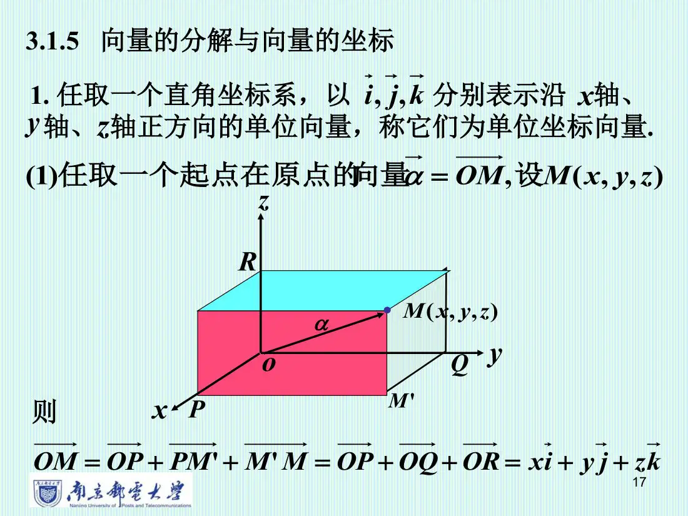

原文：

3.1.5 向量的分解与向量的坐标

1. 任取一个直角坐标系，以 $i, j, k$ 分别表示沿 $x$ 轴、 $y$ 轴、 $z$ 轴正方向的单位向量，称它们为单位坐标向量。

(1)任取一个起点在原点的向量 $\alpha=\overrightarrow{OM}$ ，设 $M(x,y,z)$

南京邮电大学
Nanjing University of Posts and Telecommunications

### α关于单位坐标向量的分解式

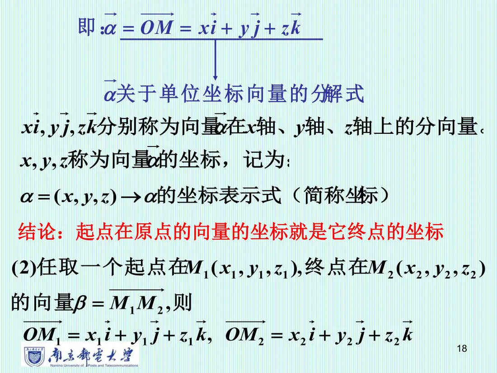

原文：

即: $\alpha=\overrightarrow{OM}=x\overrightarrow{i}+y\overrightarrow{j}+z\overrightarrow{k}$

α关于单位坐标向量的分解式

$x\vec{i}, y\vec{j}, z\vec{k}$ 分别称为向量 $\alpha$ 在x轴、y轴、z轴上的分向量。 $x, y, z$ 称为向量 $\alpha$ 的坐标，记为：

$\alpha = (x, y, z) \rightarrow \alpha$ 的坐标表示式（简称坐标）

结论：起点在原点的向量的坐标就是它终点的坐标

(2)任取一个起点在 $M_{1}(x_{1},y_{1},z_{1})$ ，终点在 $M_{2}(x_{2},y_{2},z_{2})$ 的向量 $\beta=\overrightarrow{M_{1}M_{2}}$ ，则

$$
\overrightarrow {O M _ {1}} = x _ {1} \vec {i} + y _ {1} \vec {j} + z _ {1} \vec {k}, \overrightarrow {O M _ {2}} = x _ {2} \vec {i} + y _ {2} \vec {j} + z _ {2} \vec {k}
$$

南京邮电大学
Nanjing University of Posts and Telecommunications

18

### $$

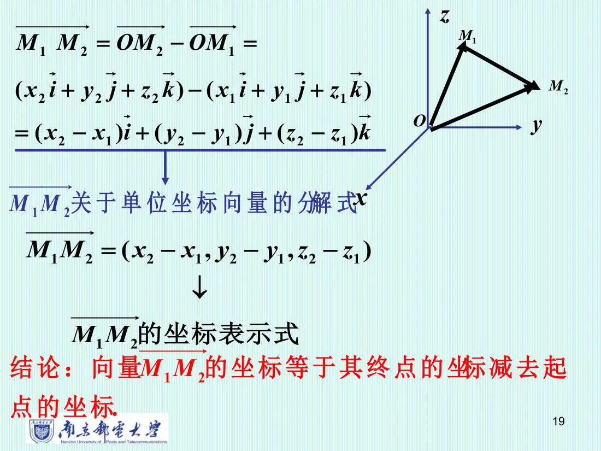

原文：

$$
\begin{array}{l} \overrightarrow {M _ {1} M _ {2}} = \overrightarrow {O M _ {2}} - \overrightarrow {O M _ {1}} = \\ (x _ {2} \vec {i} + y _ {2} \vec {j} + z _ {2} \vec {k}) - (x _ {1} \vec {i} + y _ {1} \vec {j} + z _ {1} \vec {k}) \\ = (x _ {2} - x _ {1}) \vec {i} + (y _ {2} - y _ {1}) \vec {j} + (z _ {2} - z _ {1}) \vec {k} \\ \hline \end{array}
$$

$\overrightarrow{M_{1}M_{2}}$ 关于单位坐标向量的分解式 $x^{2}$

$$
\overrightarrow {M _ {1} M _ {2}} = (x _ {2} - x _ {1}, y _ {2} - y _ {1}, z _ {2} - z _ {1}) \downarrow
$$

$\overrightarrow{M_{1}M_{2}}$ 的坐标表示式

结论: 向量 $M_{1} M_{2}$ 的坐标等于其终点的坐标减去起点的坐标.

南京邮电大学
Nanjing University of Posts and Telecommunications

19

### 2. 向量线性运算的坐标表达式

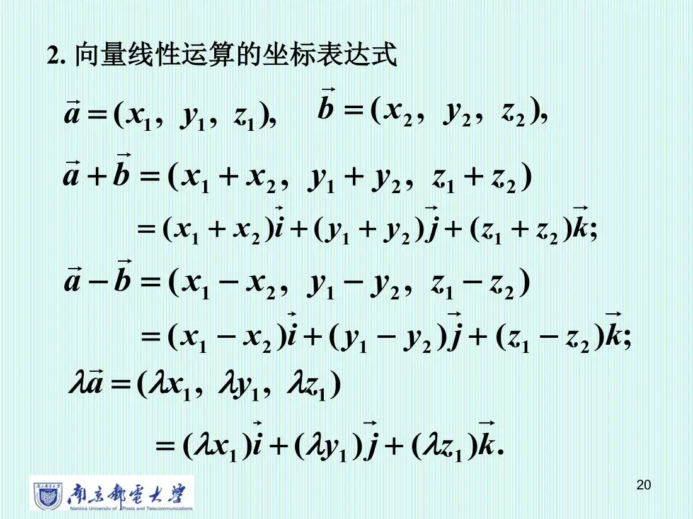

原文：

2. 向量线性运算的坐标表达式

$$
\vec {a} = (x _ {1}, y _ {1}, z _ {1}), \vec {b} = (x _ {2}, y _ {2}, z _ {2}),
$$

$$
\begin{array}{r l} & {\vec {a} + \vec {b} = (x _ {1} + x _ {2}, y _ {1} + y _ {2}, z _ {1} + z _ {2})} \\ & {\qquad = (x _ {1} + x _ {2}) \vec {i} + (y _ {1} + y _ {2}) \vec {j} + (z _ {1} + z _ {2}) \vec {k};} \end{array}
$$

$$
\begin{array}{r l} & {\vec {a} - \vec {b} = (x _ {1} - x _ {2}, y _ {1} - y _ {2}, z _ {1} - z _ {2})} \\ & {\qquad = (x _ {1} - x _ {2}) \vec {i} + (y _ {1} - y _ {2}) \vec {j} + (z _ {1} - z _ {2}) \vec {k};} \end{array}
$$

$$
\begin{array}{r l} \lambda \vec {a} & = (\lambda x _ {1}, \lambda y _ {1}, \lambda z _ {1}) \\ & = (\lambda x _ {1}) \vec {i} + (\lambda y _ {1}) \vec {j} + (\lambda z _ {1}) \vec {k}. \end{array}
$$

南京邮电大学
Nanjing University of Posts and Telecommunications

20

### $$

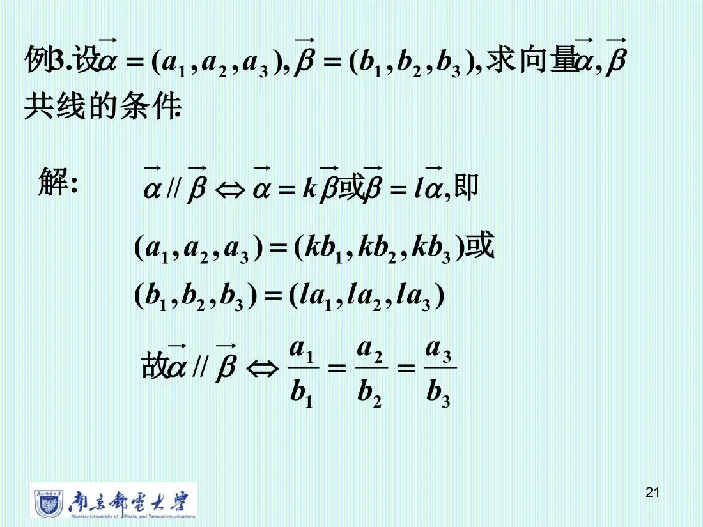

原文：

例3.设 $\vec{\alpha} = (a_{1}, a_{2}, a_{3}), \vec{\beta} = (b_{1}, b_{2}, b_{3})$ , 求向量 $\vec{\alpha}, \vec{\beta}$ 共线的条件

解: $\vec{\alpha} \parallel \vec{\beta} \Leftrightarrow \vec{\alpha} = k\vec{\beta}$ 或 $\vec{\beta} = l\vec{\alpha}$ , 即

$(a_{1},a_{2},a_{3}) = (kb_{1},kb_{2},kb_{3})$ 或

$$
(b _ {1}, b _ {2}, b _ {3}) = (l a _ {1}, l a _ {2}, l a _ {3})
$$

故 $\vec{\alpha} // \vec{\beta} \Leftrightarrow \frac{a_1}{b_1} = \frac{a_2}{b_2} = \frac{a_3}{b_3}$ 例 4. 设 $A(x_{1},y_{1},z_{1})$ 和 $B(x_{2},y_{2},z_{2})$ 为两已知点, 而在AB直线上的点M分有向线段 $\overrightarrow{AB}$ 为两部分 $\overrightarrow{AM}$ 、 $\overrightarrow{MB}$ ，使它们的值的比等于某数 $\lambda(\lambda\neq-1)$ ，即 $\frac{AM}{MB}=\lambda$ ，求分点的坐标.

南京邮电大学
Nanjing University of Posts and Telecommunications

21

### 南京邮电大学

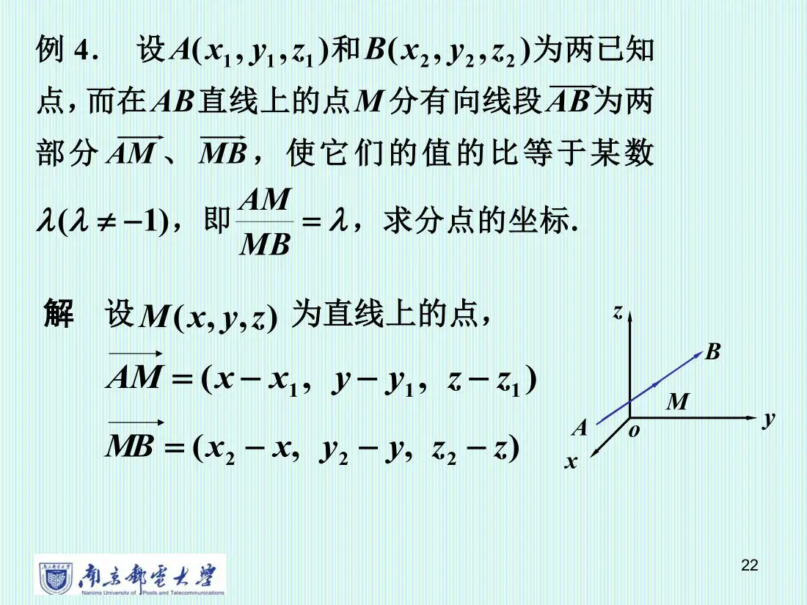

原文：

解 设 $M(x, y, z)$ 为直线上的点， $\overrightarrow{AM} = (x - x_1, y - y_1, z - z_1)$ $\overrightarrow{MB} = (x_2 - x, y_2 - y, z_2 - z)$

南京邮电大学
Nanjing University of Posts and Telecommunications

22

### $$

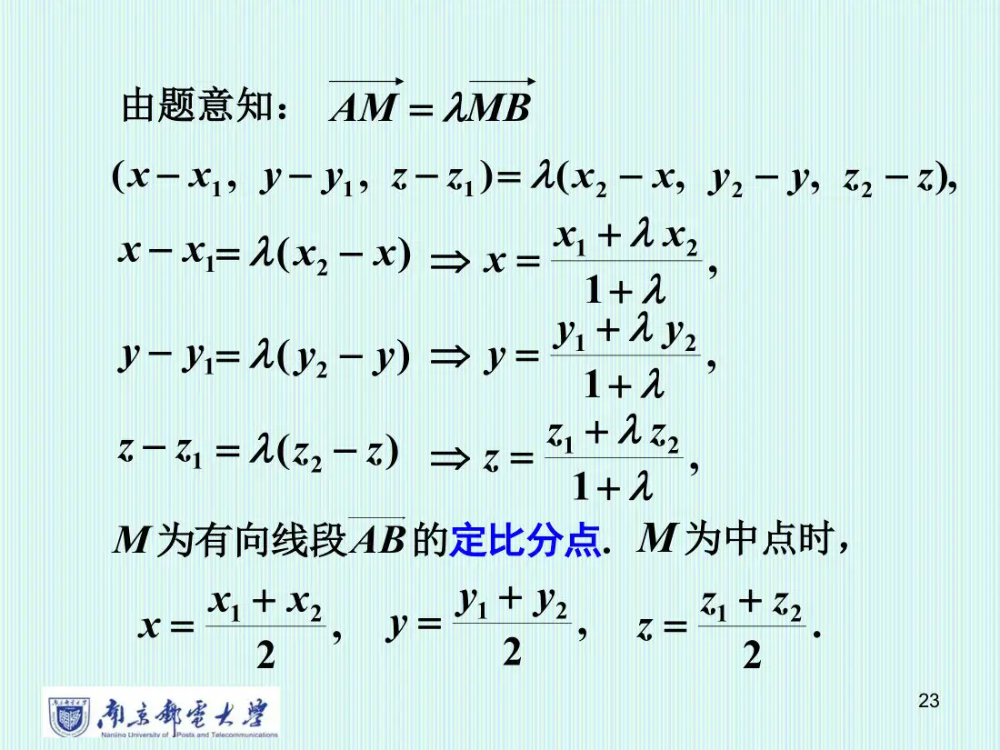

原文：

由题意知: $\overrightarrow{AM} = \lambda \overrightarrow{MB}$

$$
(x - x _ {1}, y - y _ {1}, z - z _ {1}) = \lambda (x _ {2} - x, y _ {2} - y, z _ {2} - z),
$$

$$
x - x _ {1} = \lambda (x _ {2} - x) \Rightarrow x = \frac {x _ {1} + \lambda x _ {2}}{1 + \lambda},
$$

$$
y - y _ {1} = \lambda (y _ {2} - y) \Rightarrow y = \frac {y _ {1} + \lambda y _ {2}}{1 + \lambda},
$$

$$
z - z _ {1} = \lambda (z _ {2} - z) \Rightarrow z = \frac {z _ {1} + \lambda z _ {2}}{1 + \lambda},
$$

M 为有向线段 $\overline{AB}$ 的定比分点。M 为中点时，

$$
x = \frac {x _ {1} + x _ {2}}{2}, \quad y = \frac {y _ {1} + y _ {2}}{2}, \quad z = \frac {z _ {1} + z _ {2}}{2}.
$$

南京邮电大学 Nanjing University of Posts and Telecommunications

23

### 3.1.6 向量的投影、向量的模与方向角

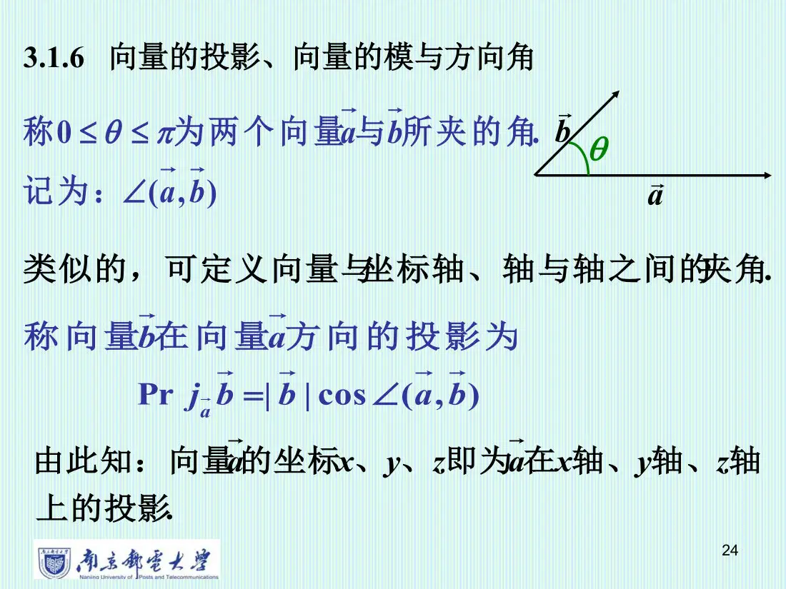

原文：

3.1.6 向量的投影、向量的模与方向角

称 $0 \leq \theta \leq \pi$ 为两个向量 $\vec{a}$ 与 $\vec{b}$ 所夹的角.记为: $\angle(\vec{a},\vec{b})$

类似的，可定义向量与坐标轴、轴与轴之间的夹角.称向量 $\vec{b}$ 在向量 $\vec{a}$ 方向的投影为

$$
\operatorname * {P r} j _ {\vec {a}} \vec {b} = | \vec {b} | \cos \angle (\vec {a}, \vec {b})
$$

由此知: 向量 $\vec{a}$ 的坐标 $x 、 y 、 z$ 即为 $\vec{a}$ 在 $x$ 轴、 $y$ 轴、 $z$ 轴上的投影。

南京邮电大学 Nanjing University of Posts and Telecommunications

24

### cos α, cos β, cos γ 称为 a 的方向余弦

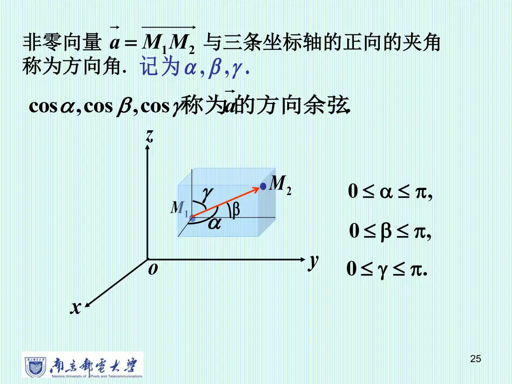

原文：

非零向量 $\vec{a} = M_{1}M_{2}$ 与三条坐标轴的正向的夹角称为方向角。记为 $\alpha, \beta, \gamma$ 。

cos α, cos β, cos γ 称为 a 的方向余弦

$$
0 \leq \alpha \leq \pi ,
$$

$$
0 \leq \beta \leq \pi ,
$$

$$
0 \leq \gamma \leq \pi .
$$

南京邮电大学
Nanjing University of Posts and Telecommunications

25

### 由投影的定义:

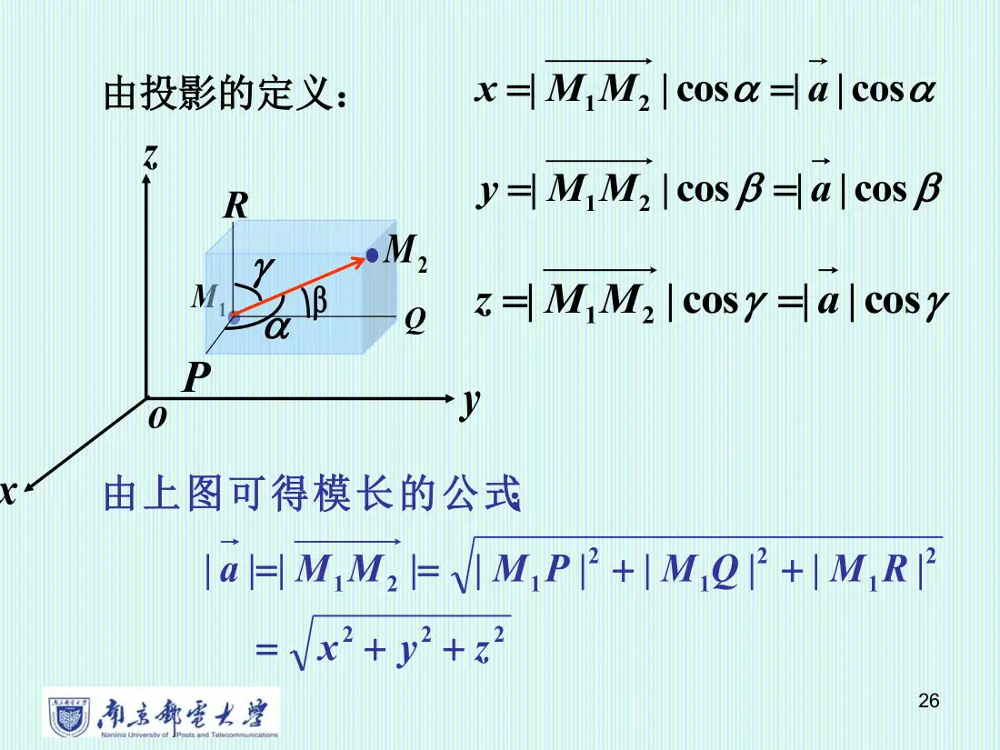

原文：

由投影的定义:

$$
x = \left| \overrightarrow {M _ {1} M _ {2}} \right| \cos \alpha = \left| \overrightarrow {a} \right| \cos \alpha
$$

$$
y = \left| \overrightarrow {M _ {1} M _ {2}} \right| \cos \beta = \left| \overrightarrow {a} \right| \cos \beta
$$

$$
z = | \overrightarrow {M _ {1} M _ {2}} | \cos \gamma = | \overrightarrow {a} | \cos \gamma
$$

由上图可得模长的公式

$$
\begin{array}{r l} & {| \overrightarrow {a} | = | \overrightarrow {M _ {1} M _ {2}} | = \sqrt {| M _ {1} P | ^ {2} + | M _ {1} Q | ^ {2} + | M _ {1} R | ^ {2}}} \\ & {\qquad = \sqrt {x ^ {2} + y ^ {2} + z ^ {2}}} \end{array}
$$

南京邮电大学
Nanjing University of Posts and Telecommunications

26

### $$

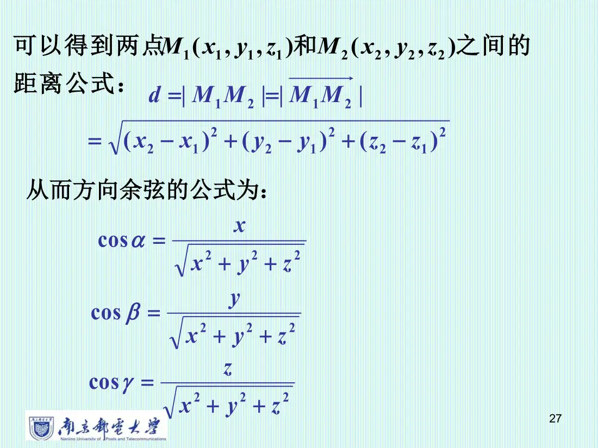

原文：

可以得到两点 $M_{1}(x_{1},y_{1},z_{1})$ 和 $M_{2}(x_{2},y_{2},z_{2})$ 之间的距离公式： $d=|M_{1}M_{2}|=|\overrightarrow{M_{1}M_{2}}|$ $=\sqrt{(x_{2}-x_{1})^{2}+(y_{2}-y_{1})^{2}+(z_{2}-z_{1})^{2}}$ 从而方向余弦的公式为：

$$
\cos \alpha = \frac {x}{\sqrt {x ^ {2} + y ^ {2} + z ^ {2}}}
$$

$$
\cos \beta = \frac {y}{\sqrt {x ^ {2} + y ^ {2} + z ^ {2}}}
$$

$$
\cos \gamma = \frac {z}{\sqrt {x ^ {2} + y ^ {2} + z ^ {2}}}
$$

南京邮电大学
Nanjing University of Posts and Telecommunications

27

### 方向余弦的特征

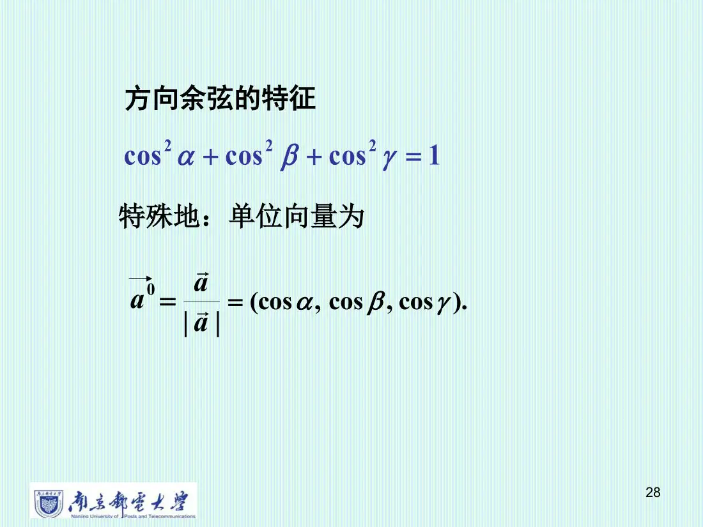

原文：

方向余弦的特征

$$
\cos^ {2} \alpha + \cos^ {2} \beta + \cos^ {2} \gamma = 1
$$

特殊地：单位向量为

$$
\overrightarrow {a ^ {0}} = \frac {\vec {a}}{| \vec {a} |} = (\cos \alpha , \cos \beta , \cos \gamma).
$$

南京邮电大学
Nanjing University of Posts and Telecommunications

28

### $$

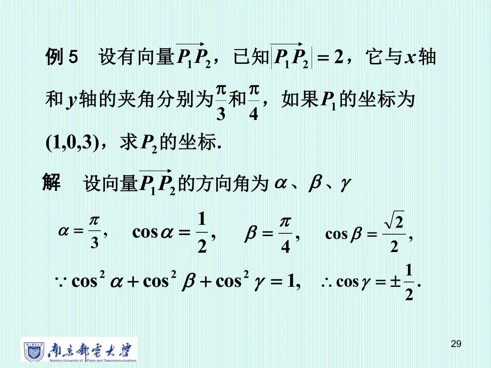

原文：

例 5 设有向量 $\overrightarrow{P_{1}P_{2}}$ ，已知 $\left|\overrightarrow{P_{1}P_{2}}\right|=2$ ，它与 x 轴和 y 轴的夹角分别为 $\frac{\pi}{3}$ 和 $\frac{\pi}{4}$ ，如果 $P_{1}$ 的坐标为 $(1,0,3)$ ，求 $P_{2}$ 的坐标.

解 设向量 $\overrightarrow{P_1P_2}$ 的方向角为 $\alpha$ 、 $\beta$ 、 $\gamma$

$$
\alpha = \frac {\pi}{3}, \cos \alpha = \frac {1}{2}, \beta = \frac {\pi}{4}, \cos \beta = \frac {\sqrt {2}}{2},
$$

$$
\because \cos^ {2} \alpha + \cos^ {2} \beta + \cos^ {2} \gamma = 1, \quad \therefore \cos \gamma = \pm \frac {1}{2}.
$$

南京邮电大学
Nanjing University of Posts and Telecommunications

29

### 设 $P_{2}$ 的坐标为 $(x,y,z)$ ,

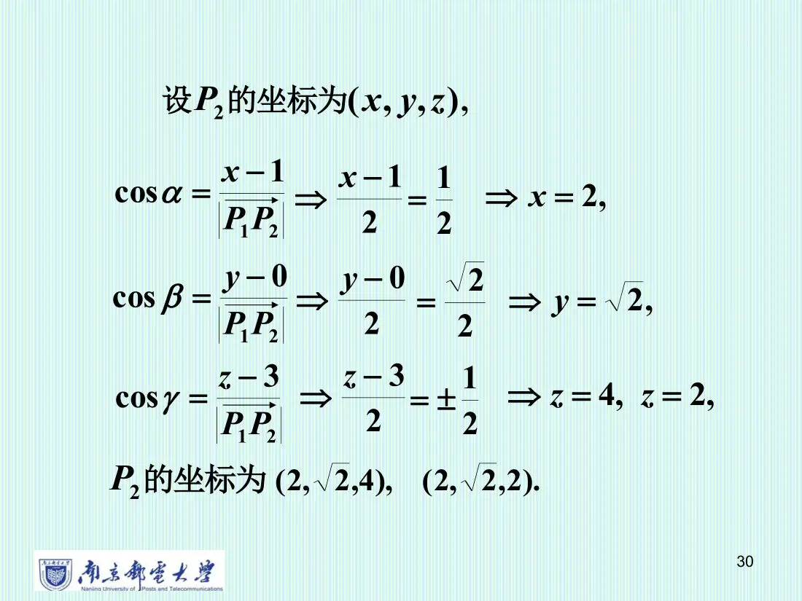

原文：

设 $P_{2}$ 的坐标为 $(x,y,z)$ ,

$$
\cos \alpha = \frac {x - 1}{| \overrightarrow {P _ {1} P _ {2}} |} \Rightarrow \frac {x - 1}{2} = \frac {1}{2} \Rightarrow x = 2,
$$

$$
\cos \beta = \frac {y - 0}{| \overrightarrow {P _ {1} P _ {2}} |} \Rightarrow \frac {y - 0}{2} = \frac {\sqrt {2}}{2} \Rightarrow y = \sqrt {2},
$$

$$
\cos \gamma = \frac {z - 3}{| \overrightarrow {P _ {1} P _ {2}} |} \Rightarrow \frac {z - 3}{2} = \pm \frac {1}{2} \Rightarrow z = 4, z = 2,
$$

$P_{2}$ 的坐标为 $(2,\sqrt{2},4)$ , $(2,\sqrt{2},2)$ .

南京邮电大学
Nanjing University of Posts and Telecommunications

30

### 第 31 页

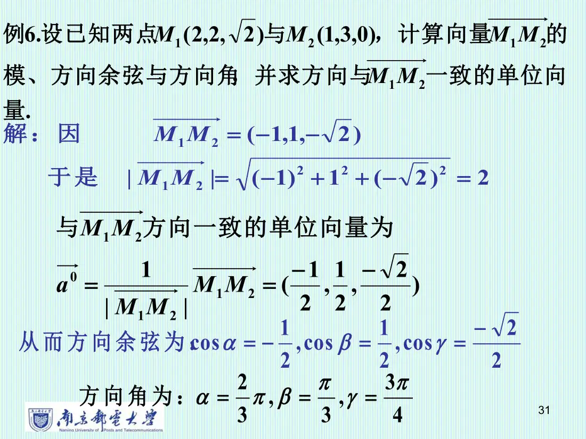

原文：

例6.设已知两点 $M_{1}(2,2,\sqrt{2})$ 与 $M_{2}(1,3,0)$ ，计算向量 $\overrightarrow{M_{1}M_{2}}$ 的模、方向余弦与方向角并求方向与 $\overrightarrow{M_{1}M_{2}}$ 一致的单位向量.
解：因 $\overrightarrow{M_{1}M_{2}}=(-1,1,-\sqrt{2})$ 于是 $\left|\overrightarrow{M_{1}M_{2}}\right|=\sqrt{(-1)^{2}+1^{2}+(-\sqrt{2})^{2}}=2$ 与 $\overrightarrow{M_{1}M_{2}}$ 方向一致的单位向量为 $\overrightarrow{a^{0}}=\frac{1}{\left|\overrightarrow{M_{1}M_{2}}\right|}\overrightarrow{M_{1}M_{2}}=\left(\frac{-1}{2},\frac{1}{2},\frac{-\sqrt{2}}{2}\right)$ 从而方向余弦为 $\cos\alpha=-\frac{1}{2},\cos\beta=\frac{1}{2},\cos\gamma=\frac{-\sqrt{2}}{2}$ 方向角为： $\alpha=\frac{2}{3}\pi,\beta=\frac{\pi}{3},\gamma=\frac{3\pi}{4}$
