# 《线性代数与解析几何》第3章 空间解析几何（习题课）

原件的每一页，下面附识别出的文字。

### 第3章习题课

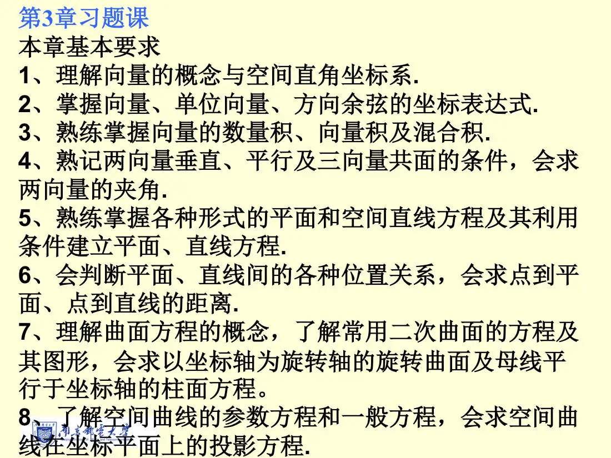

原文：

第3章习题课

本章基本要求

1、理解向量的概念与空间直角坐标系.

2、掌握向量、单位向量、方向余弦的坐标表达式.

3、熟练掌握向量的数量积、向量积及混合积.

4、熟记两向量垂直、平行及三向量共面的条件，会求两向量的夹角.

5、熟练掌握各种形式的平面和空间直线方程及其利用条件建立平面、直线方程.

6、会判断平面、直线间的各种位置关系，会求点到平面、点到直线的距离.

7、理解曲面方程的概念，了解常用二次曲面的方程及其图形，会求以坐标轴为旋转轴的旋转曲面及母线平行于坐标轴的柱面方程。

8、了解空间曲线的参数方程和一般方程，会求空间曲线在坐标平面上的投影方程。

### 一、空间解析几何

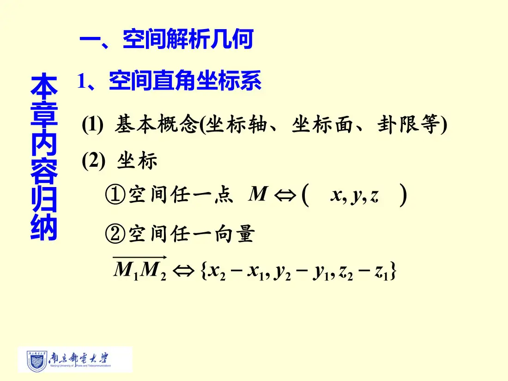

原文：

一、空间解析几何

1、空间直角坐标系

(1) 基本概念(坐标轴、坐标面、卦限等)

(2) 坐标

①空间任一点 $M \Leftrightarrow (x, y, z)$

②空间任一向量

$$
\overrightarrow {M _ {1} M _ {2}} \Leftrightarrow \left\{x _ {2} - x _ {1}, y _ {2} - y _ {1}, z _ {2} - z _ {1} \right\}
$$

本章内容归纳

南京邮电大学
Nanjing University of Posts and Telecommunications

### (3) 距离公式

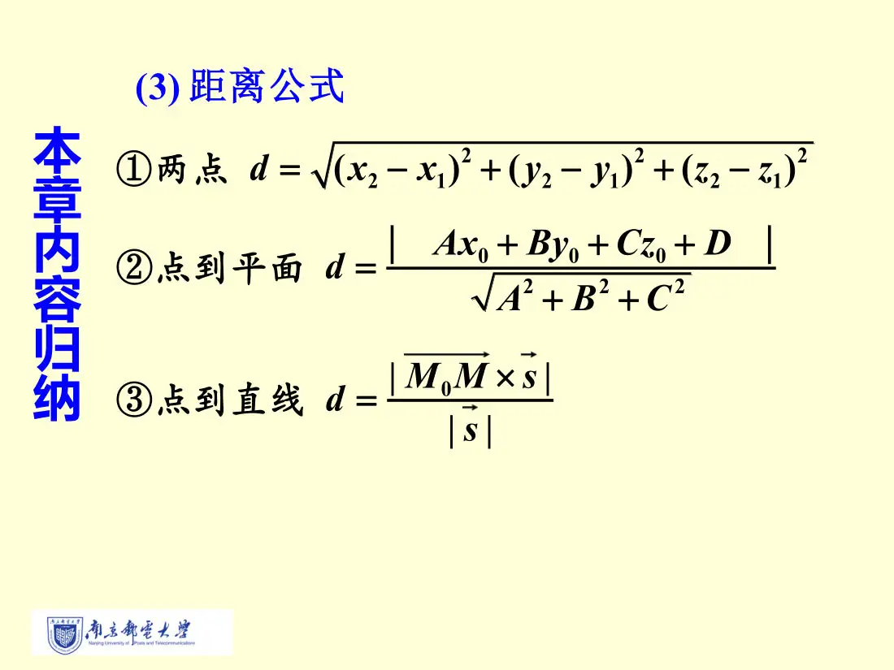

原文：

(3) 距离公式

①两点 $d=\sqrt{(x_{2}-x_{1})^{2}+(y_{2}-y_{1})^{2}+(z_{2}-z_{1})^{2}}$

②点到平面 $d = \frac{|Ax_0 + By_0 + Cz_0 + D|}{\sqrt{A^2 + B^2 + C^2}}$

③点到直线 $d=\frac{|\overrightarrow{M_{0}M}\times\vec{s}|}{|\vec{s}|}$

本章内容归纳

南京邮电大学
Nanjing University of Posts and Telecommunications

### 2、几何向量及其运算

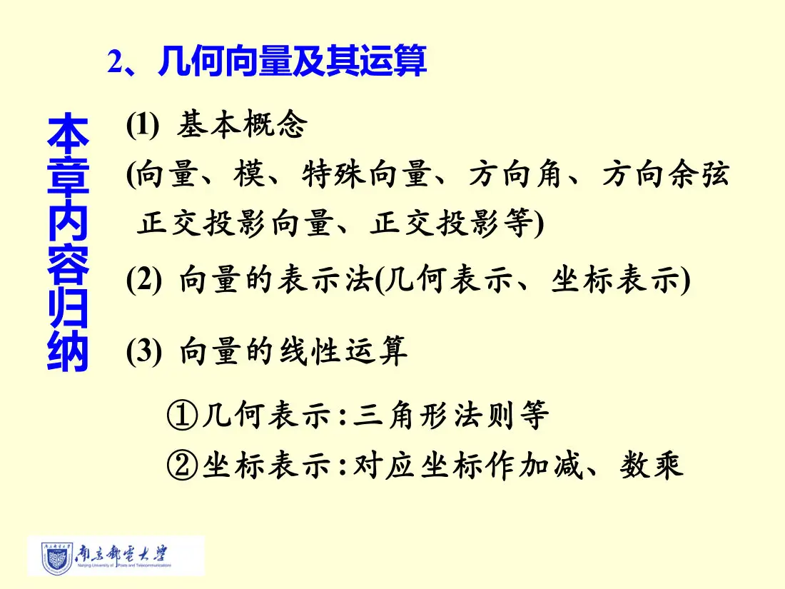

原文：

2、几何向量及其运算

(1) 基本概念

(向量、模、特殊向量、方向角、方向余弦正交投影向量、正交投影等)

(2) 向量的表示法(几何表示、坐标表示)

(3) 向量的线性运算

①几何表示:三角形法则等

②坐标表示:对应坐标作加减、数乘

本章内容归纳

南京邮电大学
Nanjing University of Posts and Telecommunications

### 2、几何向量及其运算

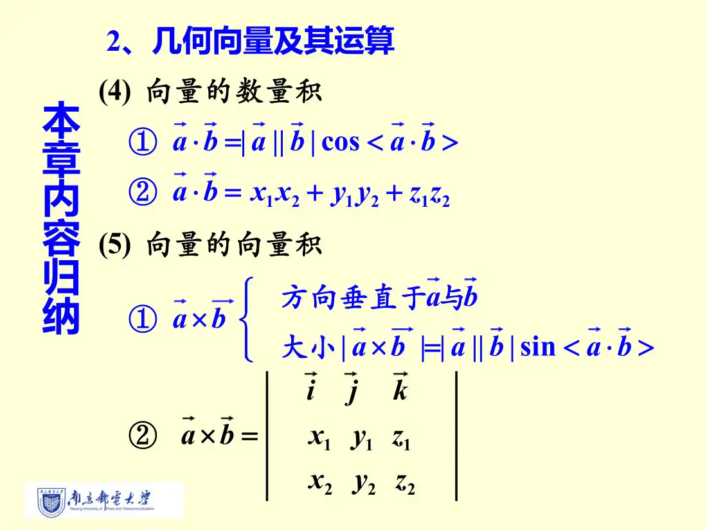

原文：

2、几何向量及其运算

(4) 向量的数量积

① $\vec{a} \cdot \vec{b} = |\vec{a}| |\vec{b}| \cos < \vec{a} \cdot \vec{b} >$

② $\vec{a}\cdot\vec{b}=x_{1}x_{2}+y_{1}y_{2}+z_{1}z_{2}$

(5) 向量的向量积

方向垂直于 $\vec{a}$ 与 $\vec{b}$

大小 $|\vec{a} \times \vec{b}| = |\vec{a}||\vec{b}|\sin < \vec{a} \cdot \vec{b}>$

②

$$
\vec {a} \times \vec {b} = \left| \begin{array}{c c c c} & \vec {i} & \vec {j} & \vec {k} \\ & x _ {1} & y _ {1} & z _ {1} \\ & x _ {2} & y _ {2} & z _ {2} \end{array} \right|
$$

本章内容归纳

南京邮电大学
Nanjing University of Posts and Telecommunications

### 2、几何向量及其运算

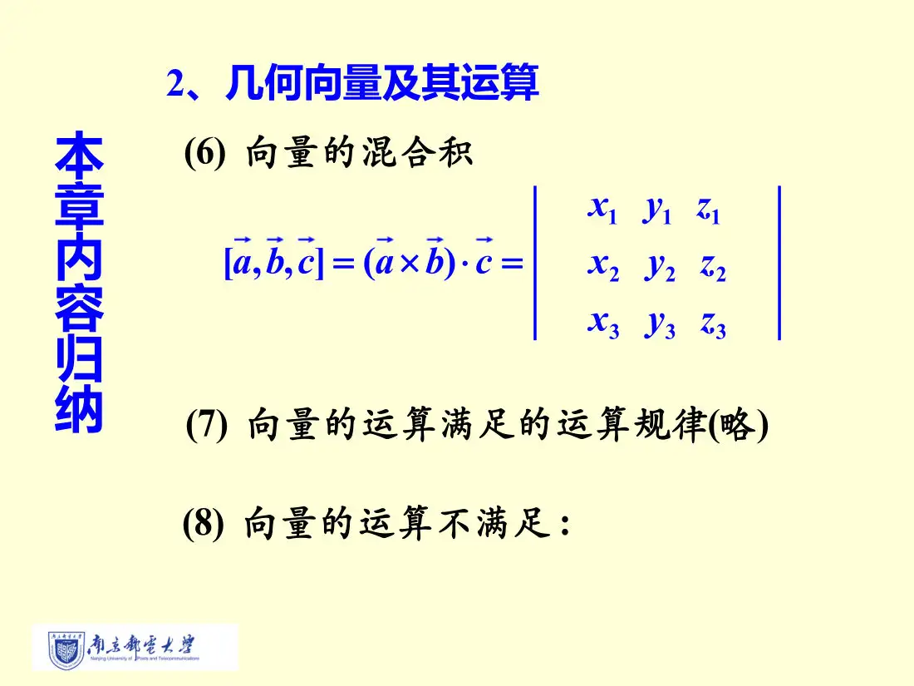

原文：

2、几何向量及其运算

(6) 向量的混合积

$$
[ \vec {a}, \vec {b}, \vec {c} ] = (\vec {a} \times \vec {b}) \cdot \vec {c} = \left| \begin{array}{l l l l} & x _ {1} & y _ {1} & z _ {1} \\ & x _ {2} & y _ {2} & z _ {2} \\ & x _ {3} & y _ {3} & z _ {3} \end{array} \right|
$$

(7) 向量的运算满足的运算规律(略)

(8) 向量的运算不满足：

本章内容归纳

南京邮电大学
Nanjing University of Posts and Telecommunications

### 本章内容归纳

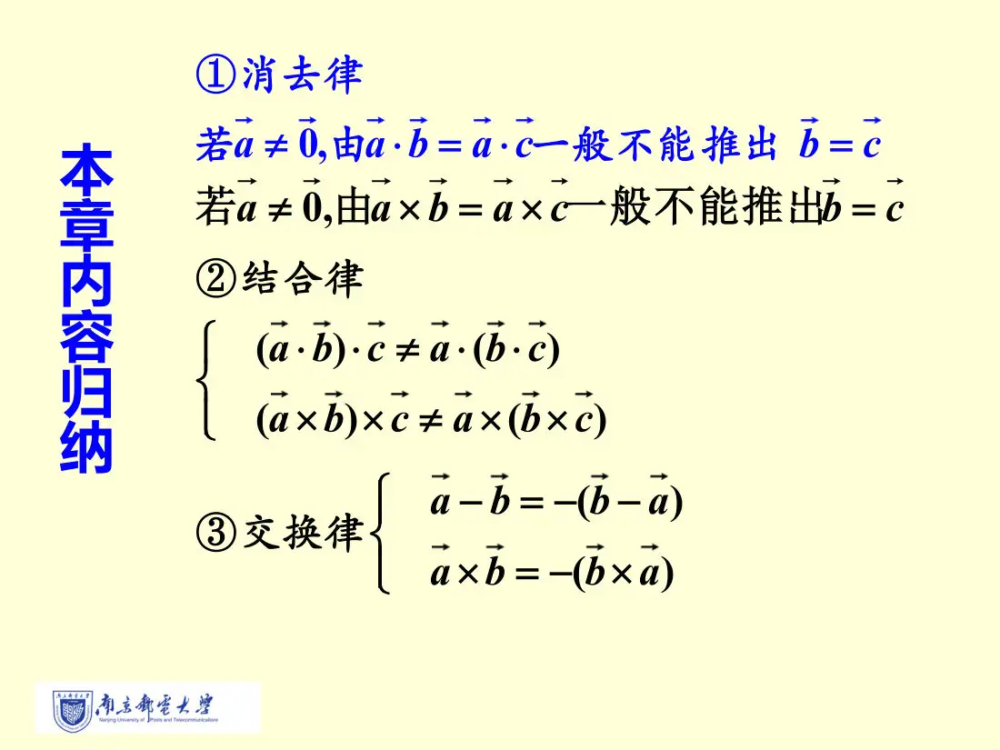

原文：

本章内容归纳

①消去律

若 $\vec{a} \neq \vec{0}$ , 由 $\vec{a} \cdot \vec{b} = \vec{a} \cdot \vec{c}$ 一般不能推出 $\vec{b} = \vec{c}$ 若 $\vec{a} \neq \vec{0}$ , 由 $\vec{a} \times \vec{b} = \vec{a} \times \vec{c}$ 一般不能推出 $\vec{b} = \vec{c}$

②结合律

$$
\left\{ \begin{array}{r l} & (\vec {a} \cdot \vec {b}) \cdot \vec {c} \neq \vec {a} \cdot (\vec {b} \cdot \vec {c}) \\ & (\vec {a} \times \vec {b}) \times \vec {c} \neq \vec {a} \times (\vec {b} \times \vec {c}) \end{array} \right.
$$

③交换律 $\left\{ \begin{array}{l} \vec{a} - \vec{b} = -(\vec{b} - \vec{a}) \\ \vec{a} \times \vec{b} = -(\vec{b} \times \vec{a}) \end{array} \right.$

南京邮电大学
Nanjing University of Posts and Telecommunications

### 2、几何向量及其运算

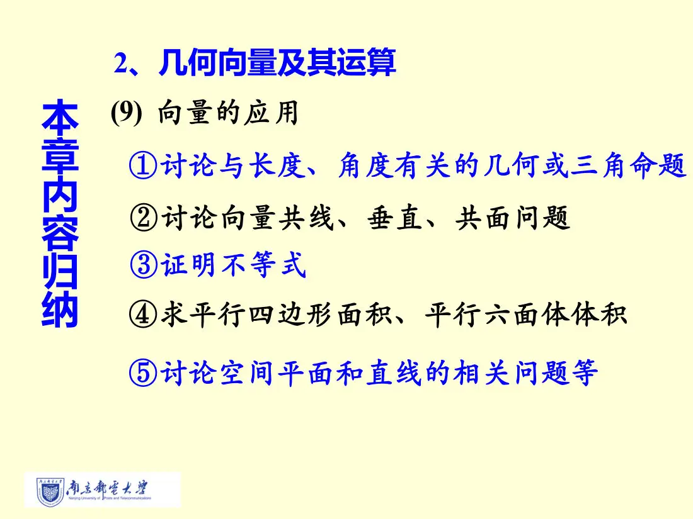

原文：

2、几何向量及其运算

(9) 向量的应用

①讨论与长度、角度有关的几何或三角命题

②讨论向量共线、垂直、共面问题

③证明不等式

④求平行四边形面积、平行六面体体积

⑤讨论空间平面和直线的相关问题等

本章内容归纳

南京邮电大学
Nanjing University of Posts and Telecommunications

### 2、几何向量及其运算

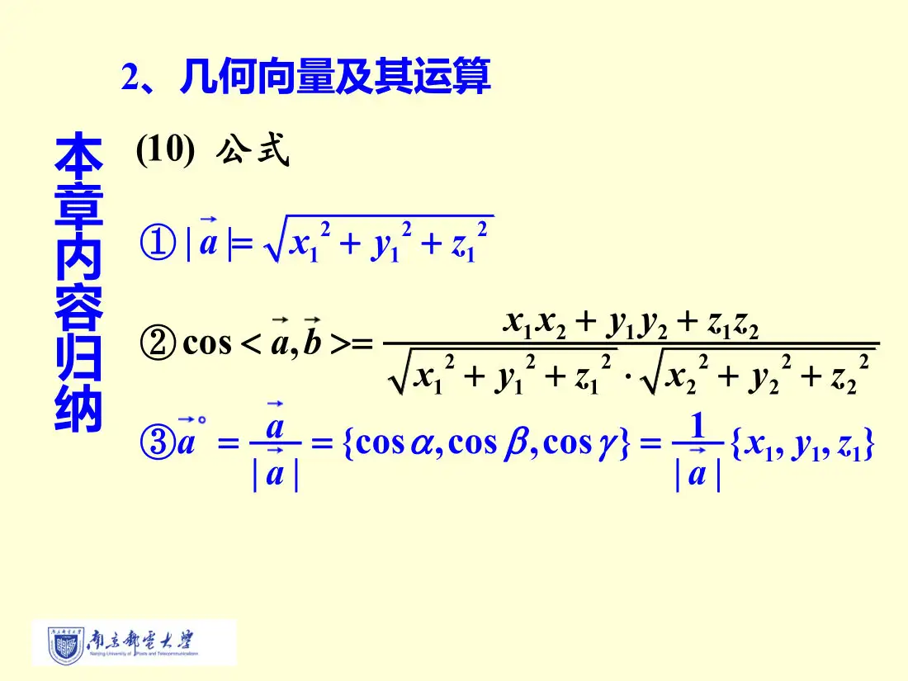

原文：

2、几何向量及其运算

(10) 公式

① $\left|\vec{a}\right|=\sqrt{x_{1}^{2}+y_{1}^{2}+z_{1}^{2}}$

$$
\cos <   \vec {a}, \vec {b} > = \frac {x _ {1} x _ {2} + y _ {1} y _ {2} + z _ {1} z _ {2}}{\sqrt {x _ {1} ^ {2} + y _ {1} ^ {2} + z _ {1} ^ {2}} \cdot \sqrt {x _ {2} ^ {2} + y _ {2} ^ {2} + z _ {2} ^ {2}}}
$$

$$
) \vec {a} ^ {\circ} = \frac {\vec {a}}{| \vec {a} |} = \{\cos \alpha , \cos \beta , \cos \gamma \} = \frac {1}{| \vec {a} |} \{x _ {1}, y _ {1}, z _ {1} \}
$$

南京邮电大学
Nanjing University of Posts and Telecommunications

### 3、向量共线、垂直、共面的充要条件

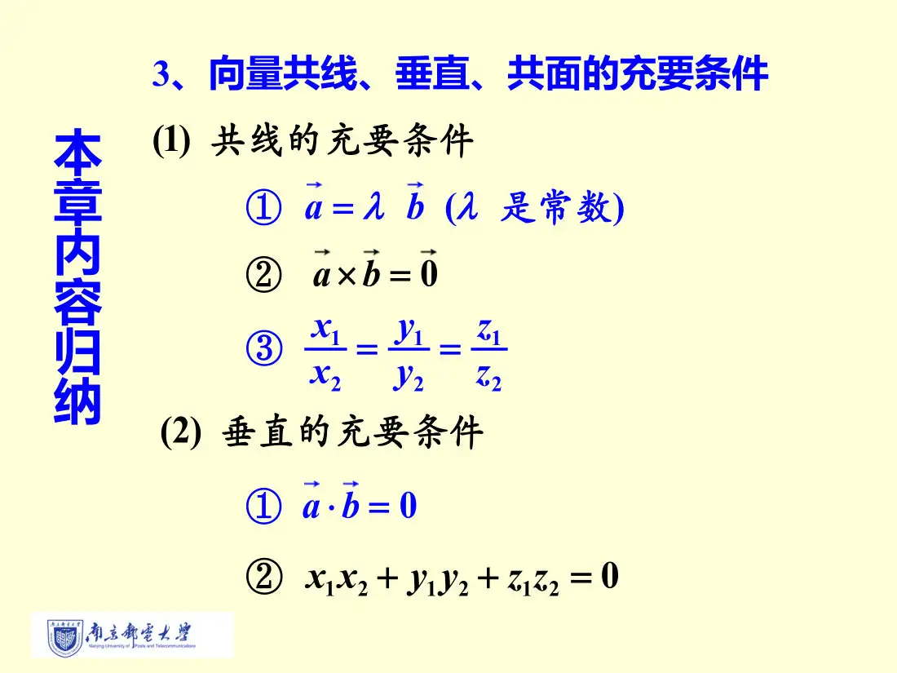

原文：

3、向量共线、垂直、共面的充要条件

(1) 共线的充要条件

① $\vec{a} = \lambda \vec{b} (\lambda \text{ 是常数})$

② $\vec{a} \times \vec{b} = \vec{0}$

③ $\frac{x_{1}}{x_{2}}=\frac{y_{1}}{y_{2}}=\frac{z_{1}}{z_{2}}$

(2) 垂直的充要条件

① $\vec{a} \cdot \vec{b} = 0$

② $x_{1}x_{2} + y_{1}y_{2} + z_{1}z_{2} = 0$

本章内容归纳

南京邮电大学
Nanjing University of Posts and Telecommunications

### 本章内容归纳

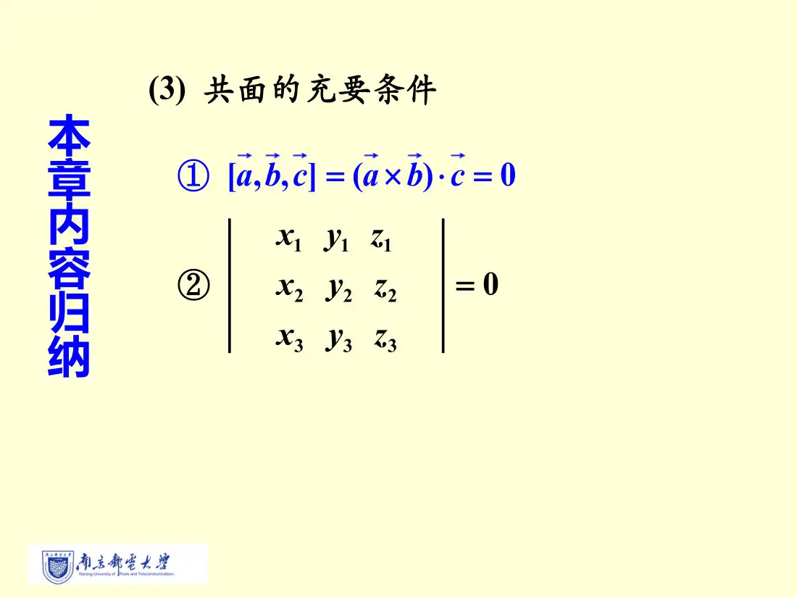

原文：

本章内容归纳

(3) 共面的充要条件

① $[\vec{a},\vec{b},\vec{c}]=(\vec{a}\times\vec{b})\cdot\vec{c}=0$

②

$$
\left. \begin{array}{l l} x _ {1} & y _ {1} z _ {1} \\ x _ {2} & y _ {2} z _ {2} \\ x _ {3} & y _ {3} z _ {3} \end{array} \right| = 0
$$

南京邮电大学
Nanjing University of Posts and Telecommunications

### 4、空间平面与直线

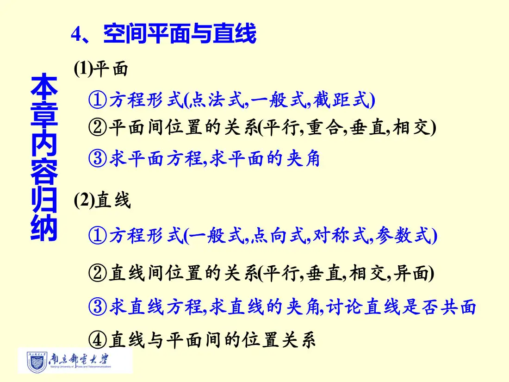

原文：

4、空间平面与直线

(1)平面

①方程形式(点法式,一般式,截距式)

②平面间位置的关系(平行,重合,垂直,相交)

③求平面方程,求平面的夹角

(2)直线

①方程形式(一般式,点向式,对称式,参数式)

②直线间位置的关系(平行,垂直,相交,异面)

③求直线方程,求直线的夹角,讨论直线是否共面

④直线与平面间的位置关系

本章内容归纳

南京邮电大学
Nanjing University of Posts and Telecommunications

### 4、空间平面与直线

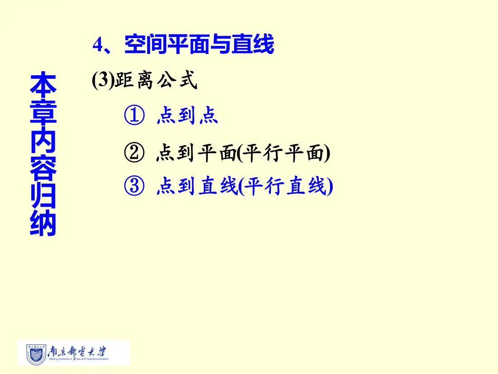

原文：

4、空间平面与直线

(3)距离公式

① 点到点

② 点到平面(平行平面)

③ 点到直线(平行直线)

本章内容归纳

南京邮电大学
Nanjing University of Posts and Telecommunications

### 5、空间曲面与曲线

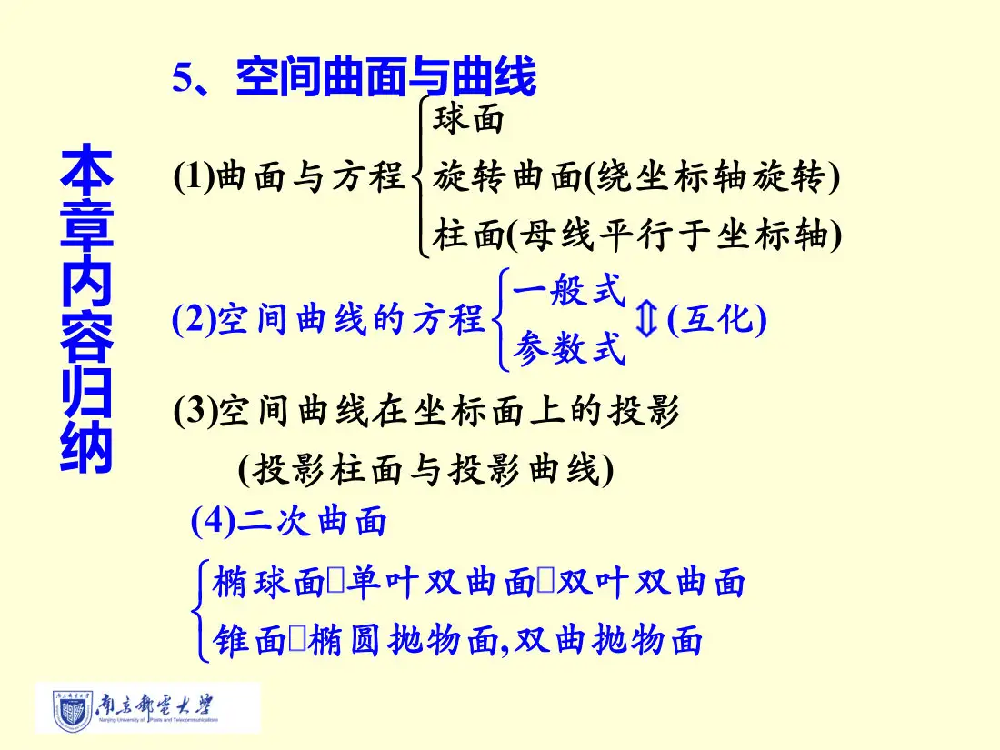

原文：

5、空间曲面与曲线

球面

(1)曲面与方程

旋转曲面(绕坐标轴旋转)

柱面(母线平行于坐标轴)

(2)空间曲线的方程

一般式

参数式

$\Updownarrow$ (互化)

(3)空间曲线在坐标面上的投影

(投影柱面与投影曲线)

(4)二次曲面

椭球面□单叶双曲面□双叶双曲面

锥面□椭圆抛物面,双曲抛物面

本章内容归纳

南京邮电大学
Nanjing University of Posts and Telecommunications

### 例1

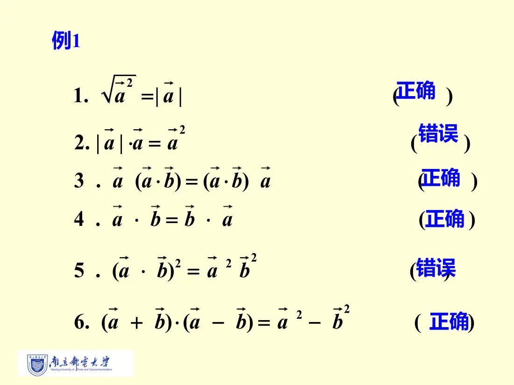

原文：

例1

1. $\sqrt{\vec{a}^2} = |\vec{a}|$

2. $|\vec{a} | \cdot \vec{a} = \vec{a}^2$

3. $\vec{a} (\vec{a}\cdot \vec{b}) = (\vec{a}\cdot \vec{b})\vec{a}$

4. $\vec{a} \cdot \vec{b} = \vec{b} \cdot \vec{a}$

5. $(\vec{a} \cdot \vec{b})^2 = \vec{a}^2 \vec{b}^2$

6. $(\vec{a} + \vec{b}) \cdot (\vec{a} - \vec{b}) = \vec{a}^{2} - \vec{b}^{2}$

(正确)

(错误)

(正确)

(正确)

(错误)

(正确)

南京邮电大学
Nanjing University of Posts and Telecommunications

### 解 设 $\theta = ,$ 由题设条件可知

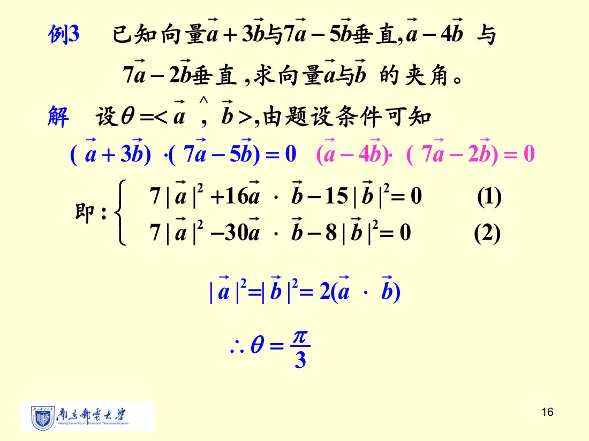

原文：

例3 已知向量 $\vec{a}+3\vec{b}$ 与 $7\vec{a}-5\vec{b}$ 垂直, $\vec{a}-4\vec{b}$ 与

$7\vec{a}-2\vec{b}$ 垂直，求向量 $\vec{a}$ 与 $\vec{b}$ 的夹角。

解 设 $\theta = <\vec{a}^{\wedge},\vec{b}>,$ 由题设条件可知

$$
(\vec {a} + 3 \vec {b}) \cdot (7 \vec {a} - 5 \vec {b}) = 0 (\vec {a} - 4 \vec {b}) \cdot (7 \vec {a} - 2 \vec {b}) = 0
$$

$$
\text {即}: \left\{ \begin{array}{l l} 7 | \vec {a} | ^ {2} + 1 6 \vec {a} \cdot \vec {b} - 1 5 | \vec {b} | ^ {2} = 0 \\ 7 | \vec {a} | ^ {2} - 3 0 \vec {a} \cdot \vec {b} - 8 | \vec {b} | ^ {2} = 0 \end{array} \right.\tag{1}
$$

$$
| \vec {a} | ^ {2} = | \vec {b} | ^ {2} = 2 (\vec {a} \cdot \vec {b})\tag{2}
$$

$$
\therefore \theta = \frac {\pi}{3}
$$

南京邮电大学
Nanjing University of Posts and Telecommunications

16

### 3、两向量的向量积的坐标运算

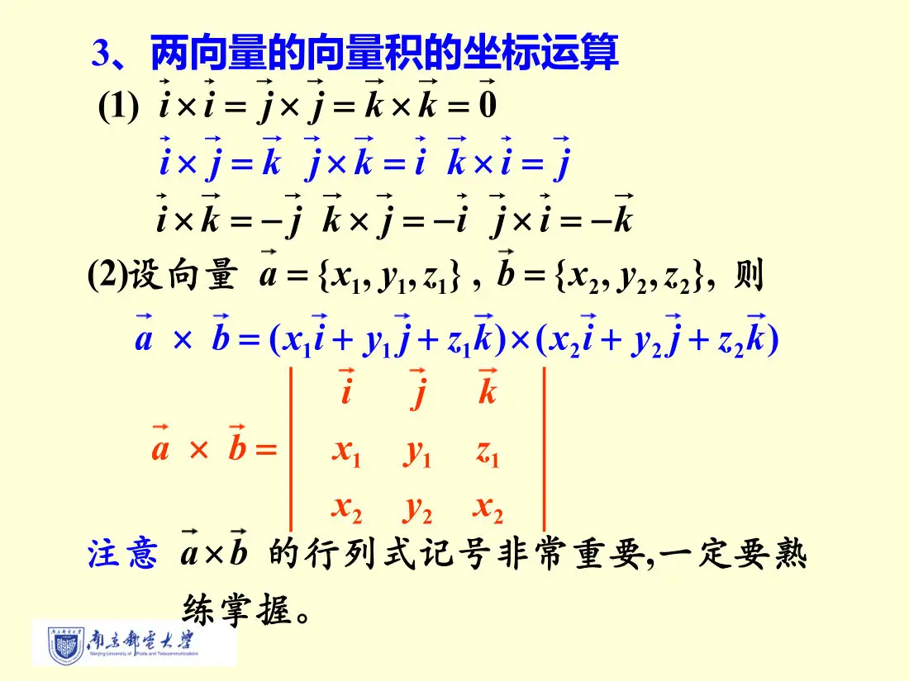

原文：

3、两向量的向量积的坐标运算

(1) $\vec{i} \times \vec{i} = \vec{j} \times \vec{j} = \vec{k} \times \vec{k} = \vec{0}$ $\vec{i} \times \vec{j} = \vec{k} \quad \vec{j} \times \vec{k} = \vec{i} \quad \vec{k} \times \vec{i} = \vec{j}$ $\vec{i} \times \vec{k} = -\vec{j} \quad \vec{k} \times \vec{j} = -\vec{i} \quad \vec{j} \times \vec{i} = -\vec{k}$

(2)设向量 $\vec{a} = \{x_{1},y_{1},z_{1}\}$ ， $\vec{b} = \{x_2,y_2,z_2\}$ ，则

$$
\begin{array}{r l} & {\vec {a} \times \vec {b} = (x _ {1} \vec {i} + y _ {1} \vec {j} + z _ {1} \vec {k}) \times (x _ {2} \vec {i} + y _ {2} \vec {j} + z _ {2} \vec {k})} \\ & {\vec {a} \times \vec {b} = \left| \begin{array}{c c c} \vec {i} & \vec {j} & \vec {k} \\ x _ {1} & y _ {1} & z _ {1} \\ x _ {2} & y _ {2} & x _ {2} \end{array} \right|} \end{array}
$$

注意 $\vec{a} \times \vec{b}$ 的行列式记号非常重要,一定要熟练掌握。

南京邮电大学
Nanjing University of Posts and Telecommunications

### 2、向量的向量积满足下列运算规律

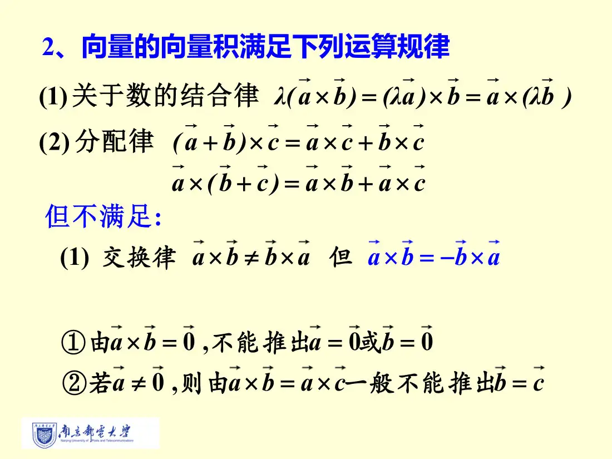

原文：

2、向量的向量积满足下列运算规律

(1)关于数的结合律 $\lambda (\vec{a}\times \vec{b}) = (\lambda \vec{a})\times \vec{b} = \vec{a}\times (\lambda \vec{b})$

(2) 分配律 $(\vec{a} + \vec{b}) \times \vec{c} = \vec{a} \times \vec{c} + \vec{b} \times \vec{c}$ $\vec{a} \times (\vec{b} + \vec{c}) = \vec{a} \times \vec{b} + \vec{a} \times \vec{c}$

但不满足:

(1) 交换律 $\vec{a} \times \vec{b} \neq \vec{b} \times \vec{a}$ 但 $\vec{a} \times \vec{b} = -\vec{b} \times \vec{a}$

①由 $\vec{a}\times\vec{b}=\vec{0}$ ，不能推出 $\vec{a}=\vec{0}$ 或 $\vec{b}=\vec{0}$

②若 $\vec{a}\neq\vec{0}$ ，则由 $\vec{a}\times\vec{b}=\vec{a}\times\vec{c}$ 一般不能推出 $\vec{b}=\vec{c}$

南京邮电大学
Nanjing University of Posts and Telecommunications

### 也不满足:

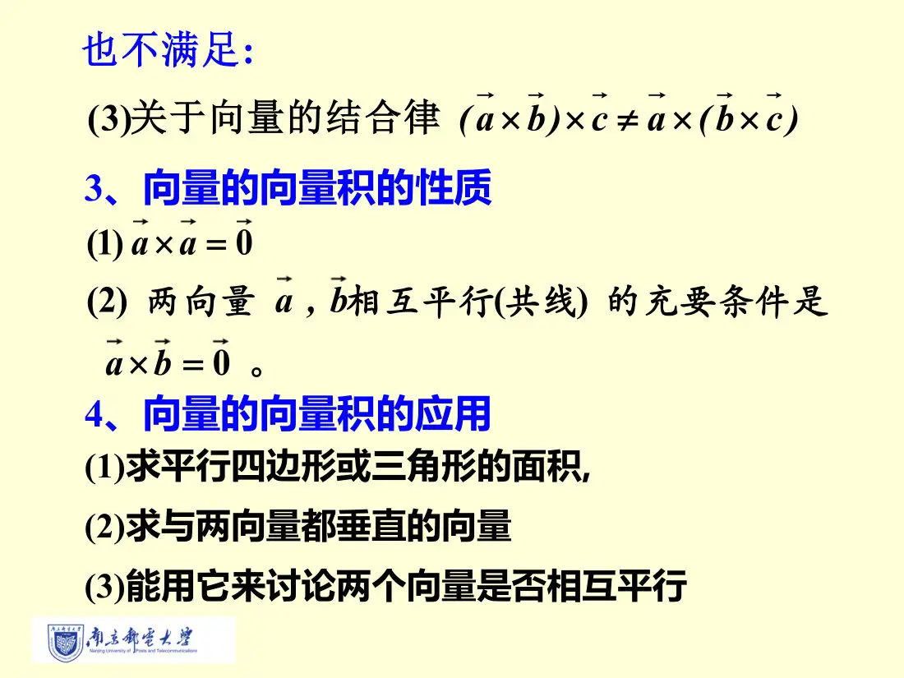

原文：

也不满足:

(3)关于向量的结合律 $(\vec{a} \times \vec{b}) \times \vec{c} \neq \vec{a} \times (\vec{b} \times \vec{c})$

3、向量的向量积的性质

(1) $\vec{a} \times \vec{a} = \vec{0}$

(2) 两向量 $\vec{a}$ , $\vec{b}$ 相互平行(共线)的充要条件是 $\vec{a} \times \vec{b} = \vec{0}$ 。

4、向量的向量积的应用

(1)求平行四边形或三角形的面积,

(2)求与两向量都垂直的向量

(3)能用它来讨论两个向量是否相互平行

南京邮电大学
Nanjing University of Posts and Telecommunications

### 例10

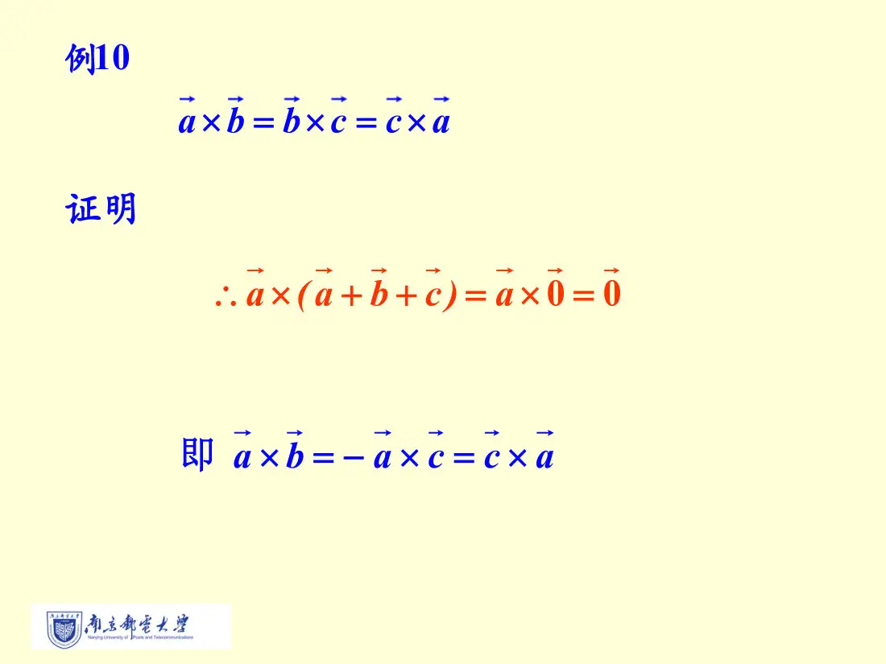

原文：

例10

$$
\vec {a} \times \vec {b} = \vec {b} \times \vec {c} = \vec {c} \times \vec {a}
$$

证明

$$
\therefore \vec {a} \times (\vec {a} + \vec {b} + \vec {c}) = \vec {a} \times \vec {0} = \vec {0}
$$

即 $\vec{a} \times \vec{b} = -\vec{a} \times \vec{c} = \vec{c} \times \vec{a}$ 例12 已知三角形ABC的三个顶点是A(1,2,3), B(3,4,5), C(2,4,7), 求三角形ABC的面积, 三角形AB边上的高。

南京邮电大学
Nanjing University of Posts and Telecommunications

### $$

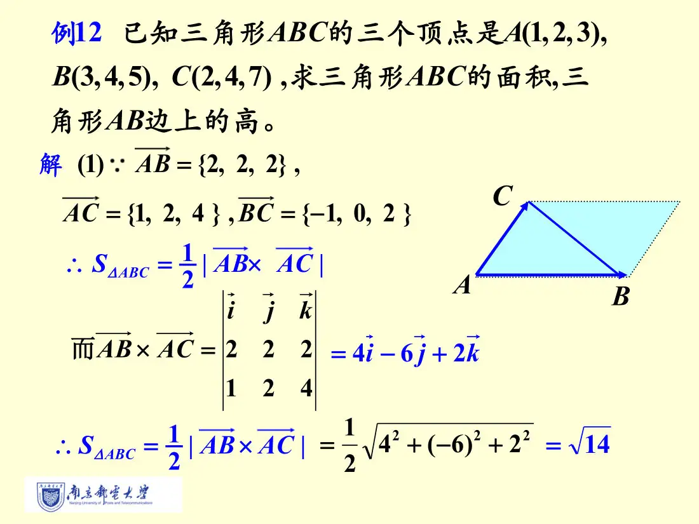

原文：

解 (1) $\because \overrightarrow{AB} = \{2, 2, 2\}$ ,

$$
\overrightarrow {A C} = \{1, 2, 4 \}, \overrightarrow {B C} = \{- 1, 0, 2 \}
$$

$\therefore S_{\triangle ABC} = \frac{1}{2} |\overrightarrow{AB} \times \overrightarrow{AC}|$ 而 $\overrightarrow{AB} \times \overrightarrow{AC} = \begin{vmatrix}\vec{i} & \vec{j} & \vec{k}\\ 2 & 2 & 2\\ 1 & 2 & 4\end{vmatrix} = 4\vec{i} - 6\vec{j} + 2\vec{k}$

$$
\therefore S _ {\triangle A B C} = \frac {1}{2} | \overrightarrow {A B} \times \overrightarrow {A C} | = \frac {1}{2} \sqrt {4 ^ {2} + (- 6) ^ {2} + 2 ^ {2}} = \sqrt {1 4}
$$

南京邮电大学
Nanjing University of Posts and Telecommunications

### $$

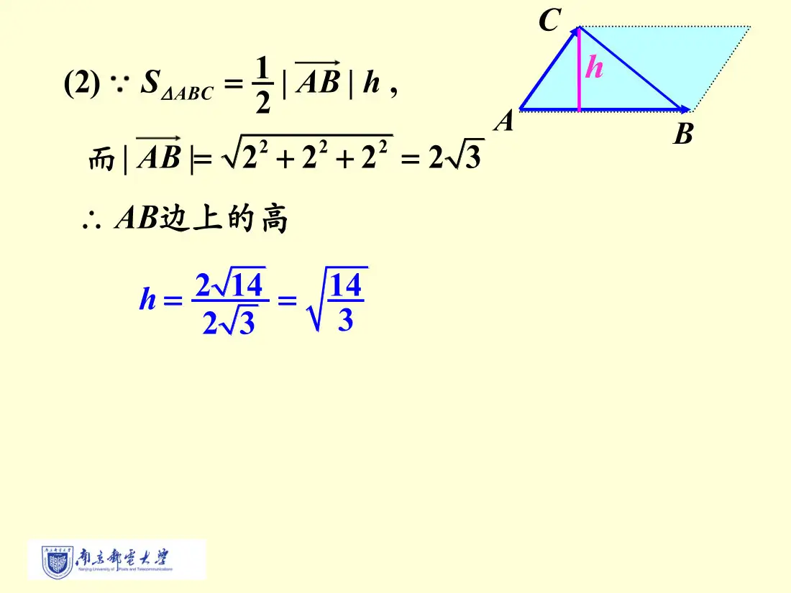

原文：

(2) $\because S_{\triangle ABC} = \frac{1}{2} |\overrightarrow{AB}|h,$ 而 $|\overrightarrow{AB}| = \sqrt{2^2 + 2^2 + 2^2} = 2\sqrt{3}$ $\therefore AB$ 边上的高

$$
h = \frac {2 \sqrt {1 4}}{2 \sqrt {3}} = \sqrt {\frac {1 4}{3}}
$$

南京邮电大学
Nanjing University of Posts and Telecommunications

### $$

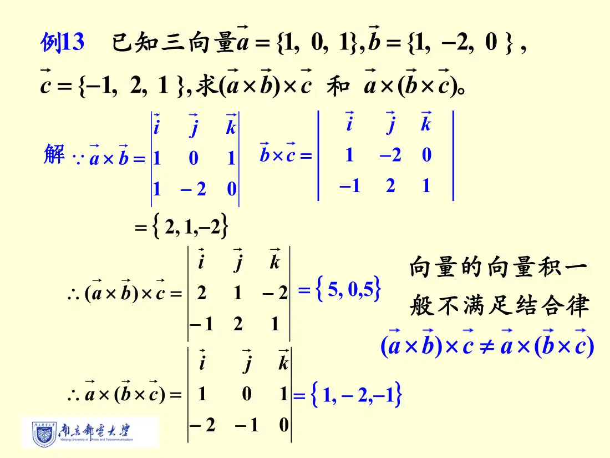

原文：

例13 已知三向量 $\vec{a} = \{1, 0, 1\}, \vec{b} = \{1, -2, 0\}$ , $\vec{c} = \{-1, 2, 1\}$ , 求 $(\vec{a} \times \vec{b}) \times \vec{c}$ 和 $\vec{a} \times (\vec{b} \times \vec{c})$ 。

$$
\begin{array}{r l} \text {军} \because \vec {a} \times \vec {b} & = \left| \begin{array}{c c c} \vec {i} & \vec {j} & \vec {k} \\ 1 & 0 & 1 \\ 1 & - 2 & 0 \end{array} \right| \quad \vec {b} \times \vec {c} = \left| \begin{array}{c c c} \vec {i} & \vec {j} & \vec {k} \\ 1 & - 2 & 0 \\ - 1 & 2 & 1 \end{array} \right| \\ & = \{2, 1, - 2 \} \end{array}
$$

$\therefore (\vec{a} \times \vec{b}) \times \vec{c} = \begin{vmatrix} \vec{i} & \vec{j} & \vec{k} \\ 2 & 1 & -2 \\ -1 & 2 & 1 \end{vmatrix} = \{5,0,5\}$ 向量的向量积一般不满足结合律 $(\vec{a} \times \vec{b}) \times \vec{c} \neq \vec{a} \times (\vec{b} \times \vec{c})$ $\therefore \vec{a} \times (\vec{b} \times \vec{c}) = \begin{vmatrix} \vec{i} & \vec{j} & \vec{k} \\ 1 & 0 & 1 \\ -2 & -1 & 0 \end{vmatrix} = \{1, -2, -1\}$ 南京邮電大學
Nanjing University of Posts and Telecommunications

南京邮电大学
Nanjing University of Posts and Telecommunications

### 例15

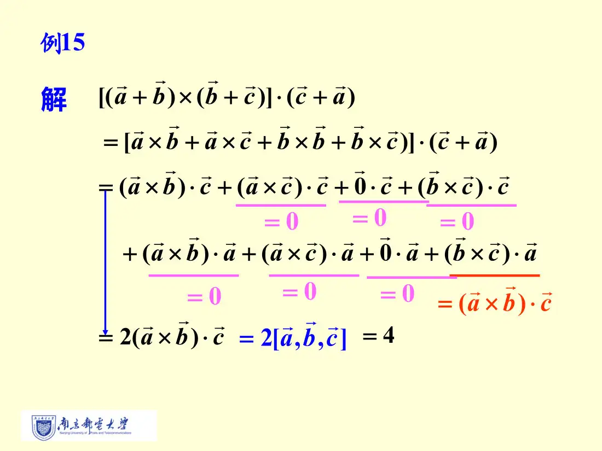

原文：

例15

解

$$
\begin{array}{r l} & [ (\vec {a} + \vec {b}) \times (\vec {b} + \vec {c}) ] \cdot (\vec {c} + \vec {a}) \\ & = [ \vec {a} \times \vec {b} + \vec {a} \times \vec {c} + \vec {b} \times \vec {b} + \vec {b} \times \vec {c}) ] \cdot (\vec {c} + \vec {a}) \\ & = (\vec {a} \times \vec {b}) \cdot \vec {c} + \overline {{(\vec {a} \times \vec {c}) \cdot \vec {c}}} + \overline {{\vec {0} \cdot \vec {c} + (\vec {b} \times \vec {c}) \cdot \vec {c}}} \\ & + (\vec {a} \times \vec {b}) \cdot \vec {a} + (\vec {a} \times \vec {c}) \cdot \vec {a} + \overline {{\vec {0} \cdot \vec {a} + (\vec {b} \times \vec {c}) \cdot \vec {a}}} \\ & = 0 \\ & = 0 \\ & = 0 \\ & = (\vec {a} \times \vec {b}) \cdot \vec {c} \\ & = 2 (\vec {a} \times \vec {b}) \cdot \vec {c} = 2 [ \vec {a}, \vec {b}, \vec {c} ] = 4 \end{array}
$$

南京邮电大学
Nanjing University of Posts and Telecommunications

### 4、特殊平面介绍

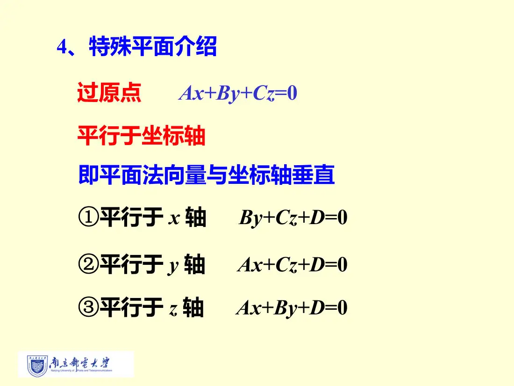

原文：

4、特殊平面介绍

过原点 $Ax + By + Cz = 0$

平行于坐标轴

即平面法向量与坐标轴垂直

①平行于 x 轴 $By+Cz+D=0$

②平行于 y 轴 $Ax+Cz+D=0$

③平行于 z 轴 Ax+By+D=0

南京邮电大学
Nanjing University of Posts and Telecommunications

### 通过坐标轴

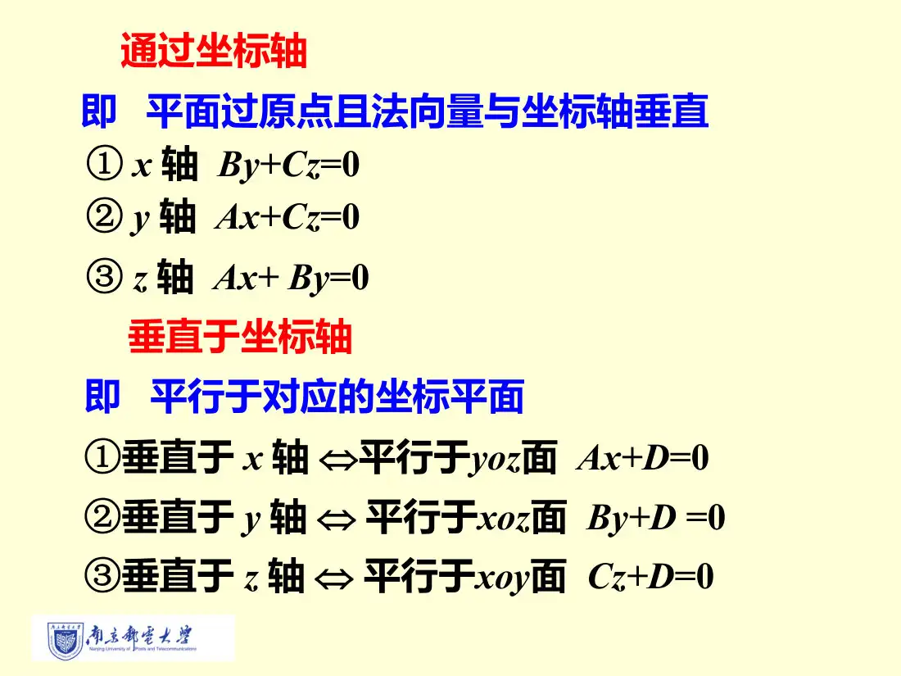

原文：

通过坐标轴

即 平面过原点且法向量与坐标轴垂直

① x 轴 $By + Cz = 0$

② y 轴 $Ax + Cz = 0$

③ z 轴 Ax + By = 0

垂直于坐标轴

即 平行于对应的坐标平面

①垂直于 x 轴 $\Leftrightarrow$ 平行于 yoz 面 $Ax+D=0$

②垂直于 y 轴 $\Leftrightarrow$ 平行于 xoz 面 $By+D=0$

③垂直于 z 轴 $\Leftrightarrow$ 平行于 xoy 面 $Cz + D = 0$

南京邮电大学
Nanjing University of Posts and Telecommunications

### 坐标面方程

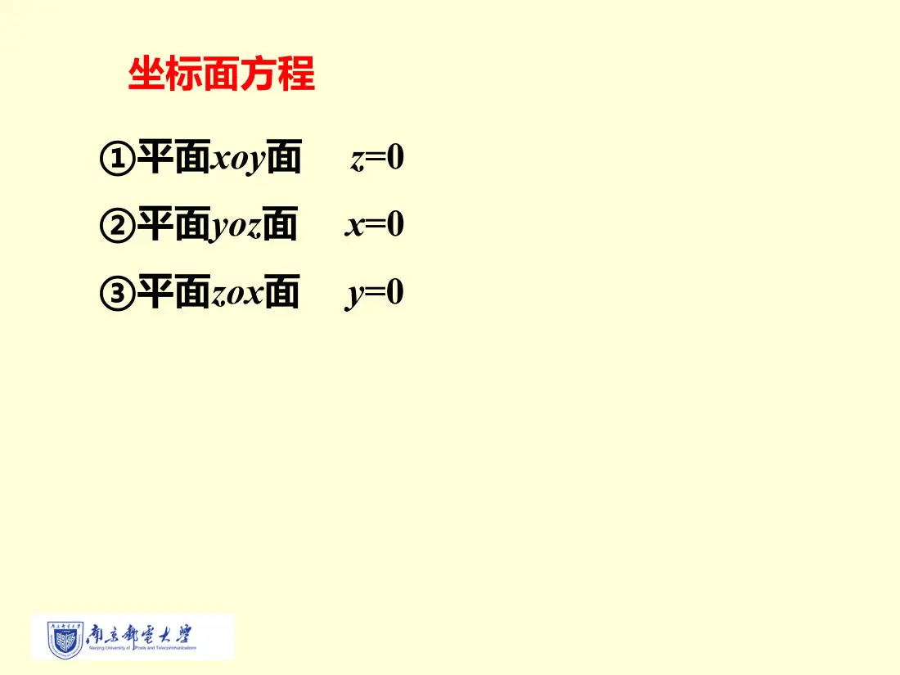

原文：

坐标面方程

①平面xoy面 z=0

②平面yoz面 x=0

③平面zox面 y=0

南京邮电大学
Nanjing University of Posts and Telecommunications

### 二、两平面的位置关系

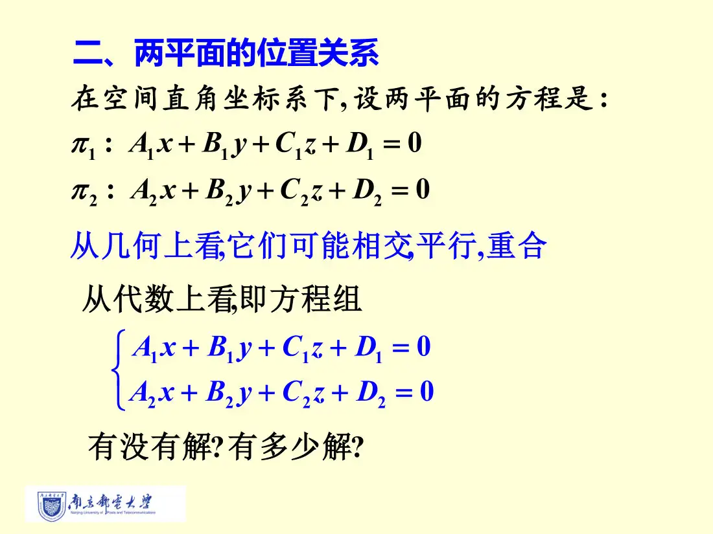

原文：

二、两平面的位置关系

在空间直角坐标系下,设两平面的方程是:

$$
\begin{array}{l} \pi_ {1}: A _ {1} x + B _ {1} y + C _ {1} z + D _ {1} = 0 \\ \pi_ {2}: A _ {2} x + B _ {2} y + C _ {2} z + D _ {2} = 0 \end{array}
$$

从几何上看,它们可能相交,平行,重合

从代数上看,即方程组

$$
\left\{ \begin{array}{l} A _ {1} x + B _ {1} y + C _ {1} z + D _ {1} = 0 \\ A _ {2} x + B _ {2} y + C _ {2} z + D _ {2} = 0 \end{array} \right.
$$

有没有解?有多少解?

南京邮电大学
Nanjing University of Posts and Telecommunications

### $$

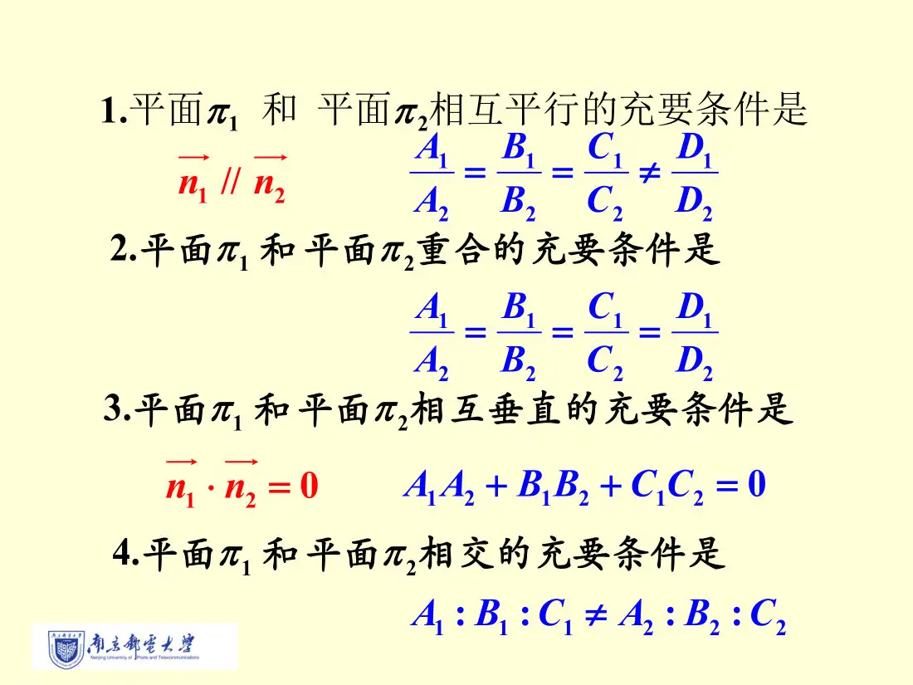

原文：

1. 平面 $\pi_{1}$ 和 平面 $\pi_{2}$ 相互平行的充要条件是

$$
\overrightarrow {n _ {1}} / / \overrightarrow {n _ {2}} \quad \frac {A _ {1}}{A _ {2}} = \frac {B _ {1}}{B _ {2}} = \frac {C _ {1}}{C _ {2}} \neq \frac {D _ {1}}{D _ {2}}
$$

2. 平面 $\pi_{1}$ 和平面 $\pi_{2}$ 重合的充要条件是

$$
\frac {A _ {1}}{A _ {2}} = \frac {B _ {1}}{B _ {2}} = \frac {C _ {1}}{C _ {2}} = \frac {D _ {1}}{D _ {2}}
$$

3. 平面 $\pi_{1}$ 和平面 $\pi_{2}$ 相互垂直的充要条件是

$$
\overrightarrow {n _ {1}} \cdot \overrightarrow {n _ {2}} = 0 \quad A _ {1} A _ {2} + B _ {1} B _ {2} + C _ {1} C _ {2} = 0
$$

4. 平面 $\pi_{1}$ 和平面 $\pi_{2}$ 相交的充要条件是

$$
A _ {1}: B _ {1}: C _ {1} \neq A _ {2}: B _ {2}: C _ {2}
$$

南京邮电大学
Nanjing University of Posts and Telecommunications

### 三、点到平面的距离

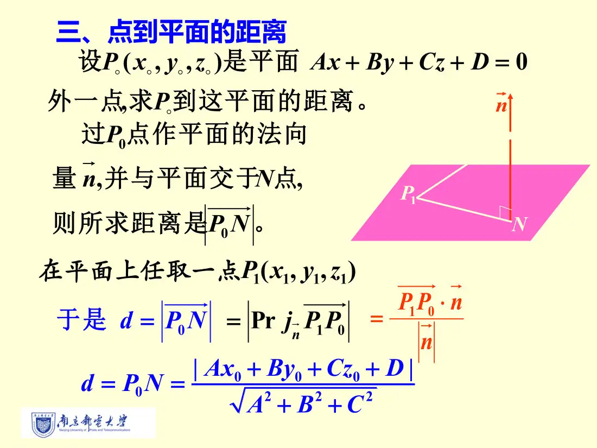

原文：

三、点到平面的距离

设 $P_{\circ}(x_{\circ},y_{\circ},z_{\circ})$ 是平面 $Ax+By+Cz+D=0$ 外一点,求 $P_{\circ}$ 到这平面的距离。

过 $P_{0}$ 点作平面的法向量 $\vec{n}$ ，并与平面交于N点，则所求距离是 $\left|\overrightarrow{P_{0}N}\right|$ 。

在平面上任取一点 $P_{1}(x_{1},y_{1},z_{1})$ 于是 $d = \left|\overrightarrow{P_0N}\right| = \left|\Pr j_{\vec{n}}\overrightarrow{P_1P_0}\right| = \frac{\overrightarrow{P_1P_0} \cdot \overrightarrow{n}}{\left|\overrightarrow{n}\right|}$ $d = P_0N = \frac{|Ax_0 + By_0 + Cz_0 + D|}{\sqrt{A^2 + B^2 + C^2}}$

南京邮电大学
Nanjing University of Posts and Telecommunications

### 类似地可讨论两个平行平面间的距离公式

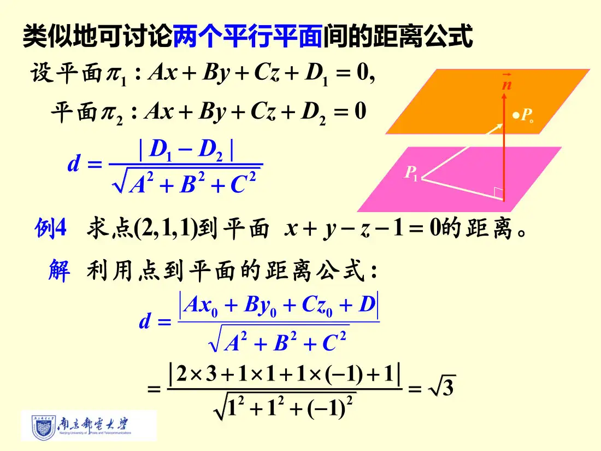

原文：

类似地可讨论两个平行平面间的距离公式

设平面 $\pi_1: Ax + By + Cz + D_1 = 0,$

平面 $\pi_{2}:Ax + By + Cz + D_{2} = 0$

$$
d = \frac {\left| D _ {1} - D _ {2} \right|}{\sqrt {A ^ {2} + B ^ {2} + C ^ {2}}}
$$

例4 求点(2,1,1)到平面 $x + y - z - 1 = 0$ 的距离。

解 利用点到平面的距离公式：

$$
\begin{array}{r l} & {d = \frac {\left| A x _ {0} + B y _ {0} + C z _ {0} + D \right|}{\sqrt {A ^ {2} + B ^ {2} + C ^ {2}}}} \\ & {= \frac {\left| 2 \times 3 + 1 \times 1 + 1 \times (- 1) + 1 \right|}{\sqrt {1 ^ {2} + 1 ^ {2} + (- 1) ^ {2}}} = \sqrt {3}} \end{array}
$$

南京邮电大学
Nanjing University of Posts and Telecommunications

### 二、空间两条直线间的位置关系

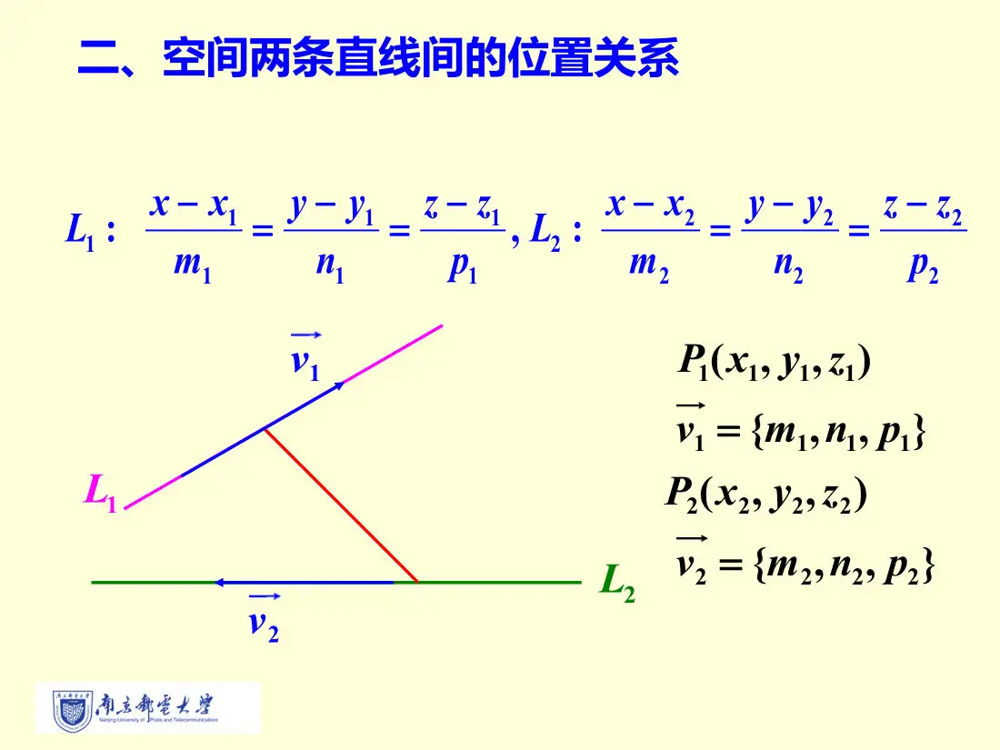

原文：

二、空间两条直线间的位置关系

$$
\begin{array}{r l} & L _ {1}: \frac {x - x _ {1}}{m _ {1}} = \frac {y - y _ {1}}{n _ {1}} = \frac {z - z _ {1}}{p _ {1}}, L _ {2}: \frac {x - x _ {2}}{m _ {2}} = \frac {y - y _ {2}}{n _ {2}} = \frac {z - z _ {2}}{p _ {2}} \\ & \quad \overrightarrow {v _ {1}} \\ & L _ {1} \quad \overrightarrow {v _ {2}} \end{array} \quad \begin{array}{r l} & P _ {1} (x _ {1}, y _ {1}, z _ {1}) \\ & \overrightarrow {v _ {1}} = \{m _ {1}, n _ {1}, p _ {1} \} \\ & P _ {2} (x _ {2}, y _ {2}, z _ {2}) \\ & \overrightarrow {v _ {2}} = \{m _ {2}, n _ {2}, p _ {2} \} \end{array}
$$

南京邮电大学
Nanjing University of Posts and Telecommunications

### 3、直线 $L_{1}$ 和直线 $L_{2}$ 共面的充要条件是

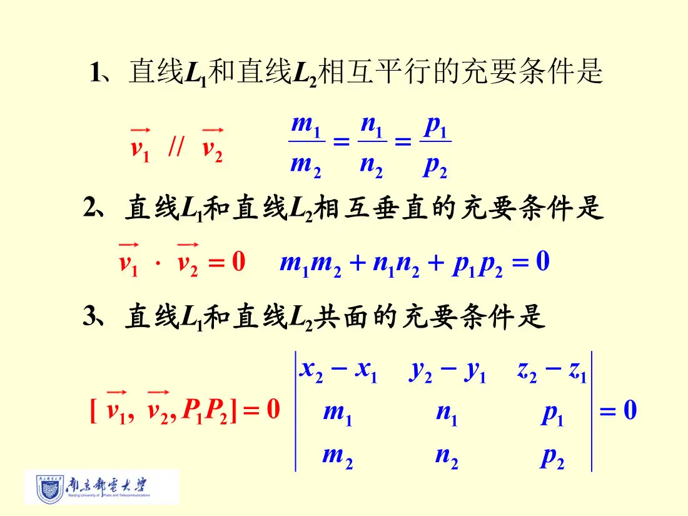

原文：

1、直线 $L_{1}$ 和直线 $L_{2}$ 相互平行的充要条件是 $\overrightarrow{v_{1}} // \overrightarrow{v_{2}} \quad \frac{m_{1}}{m_{2}} = \frac{n_{1}}{n_{2}} = \frac{p_{1}}{p_{2}}$

2、直线 $L_{1}$ 和直线 $L_{2}$ 相互垂直的充要条件是 $\vec{v}_{1} \cdot \vec{v}_{2} = 0 \quad m_{1}m_{2} + n_{1}n_{2} + p_{1}p_{2} = 0$

3、直线 $L_{1}$ 和直线 $L_{2}$ 共面的充要条件是

$$
[ \vec {v} _ {1}, \vec {v} _ {2}, P _ {1} P _ {2} ] = 0 \left| \begin{array}{c c c} x _ {2} - x _ {1} & y _ {2} - y _ {1} & z _ {2} - z _ {1} \\ m _ {1} & n _ {1} & p _ {1} \\ m _ {2} & n _ {2} & p _ {2} \end{array} \right| = 0
$$

南京邮电大学
Nanjing University of Posts and Telecommunications

### 两直线的方向向量的夹角（通常指锐角）叫做两直线的夹角。

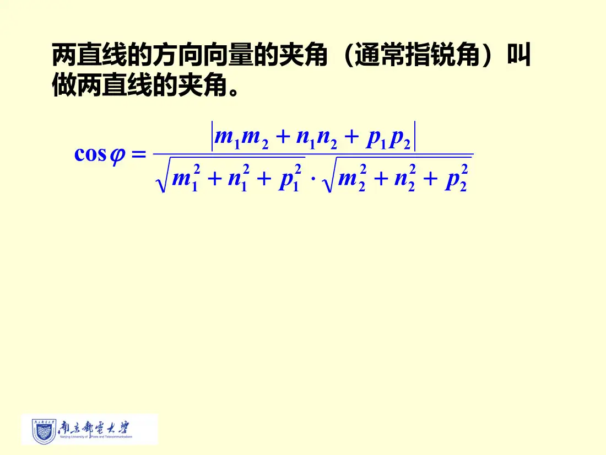

原文：

两直线的方向向量的夹角（通常指锐角）叫做两直线的夹角。

$$
\cos \varphi = \frac {\left| m _ {1} m _ {2} + n _ {1} n _ {2} + p _ {1} p _ {2} \right|}{\sqrt {m _ {1} ^ {2} + n _ {1} ^ {2} + p _ {1} ^ {2}} \cdot \sqrt {m _ {2} ^ {2} + n _ {2} ^ {2} + p _ {2} ^ {2}}}
$$

南京邮电大学
Nanjing University of Posts and Telecommunications

### $$

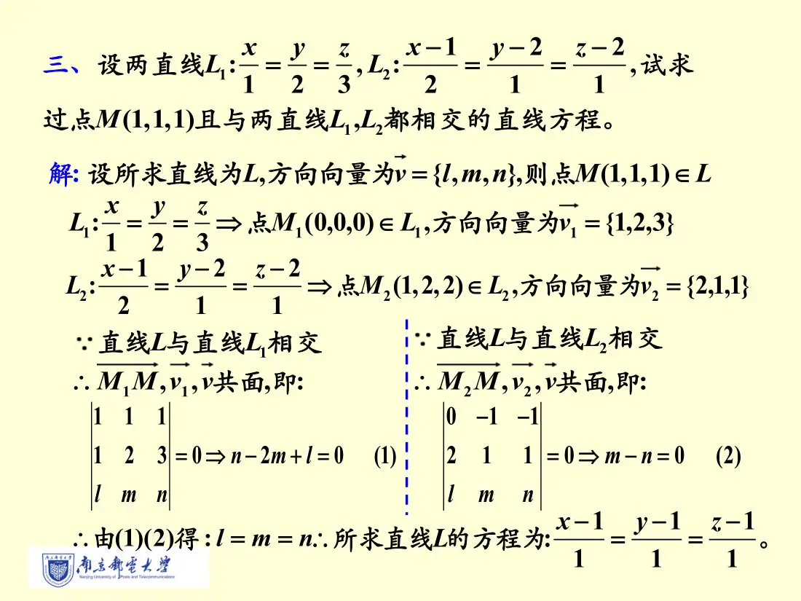

原文：

三、设两直线 $L_{1}:\frac{x}{1}=\frac{y}{2}=\frac{z}{3},L_{2}:\frac{x-1}{2}=\frac{y-2}{1}=\frac{z-2}{1}$ ，试求过点 $M(1,1,1)$ 且与两直线 $L_{1},L_{2}$ 都相交的直线方程。

解: 设所求直线为L, 方向向量为 $\vec{v}=\{l,m,n\}$ , 则点 $M(1,1,1)\in L$ $L_{1}:\frac{x}{1}=\frac{y}{2}=\frac{z}{3}\Rightarrow$ 点 $M_{1}(0,0,0)\in L_{1}$ , 方向向量为 $\vec{v}_{1}=\{1,2,3\}$ $L_{2}:\frac{x-1}{2}=\frac{y-2}{1}=\frac{z-2}{1}\Rightarrow$ 点 $M_{2}(1,2,2)\in L_{2}$ , 方向向量为 $\vec{v}_{2}=\{2,1,1\}$ ∵ 直线L与直线 $L_{1}$ 相交 ∴ 直线L与直线 $L_{2}$ 相交

∴ $\overrightarrow{M_{1}M},\overrightarrow{v_{1}},\overrightarrow{v}$ 共面, 即: ∴ $\overrightarrow{M_{2}M},\overrightarrow{v_{2}},\overrightarrow{v}$ 共面, 即:

$$
\left| \begin{array}{c c c} 1 & 1 & 1 \\ 1 & 2 & 3 \\ l & m & n \end{array} \right| = 0 \Rightarrow n - 2 m + l = 0
$$

$$
\left| \begin{array}{c c c} 0 & - 1 & - 1 \\ 2 & 1 & 1 \\ l & m & n \end{array} \right| = 0 \Rightarrow m - n = 0\tag{2}
$$

∴由(1)(2)得：l=m=n∴所求直线L的方程为： $\frac{x-1}{1}=\frac{y-1}{1}=\frac{z-1}{1}$ 。

### 解: 过已知直线L的平面束方程为:

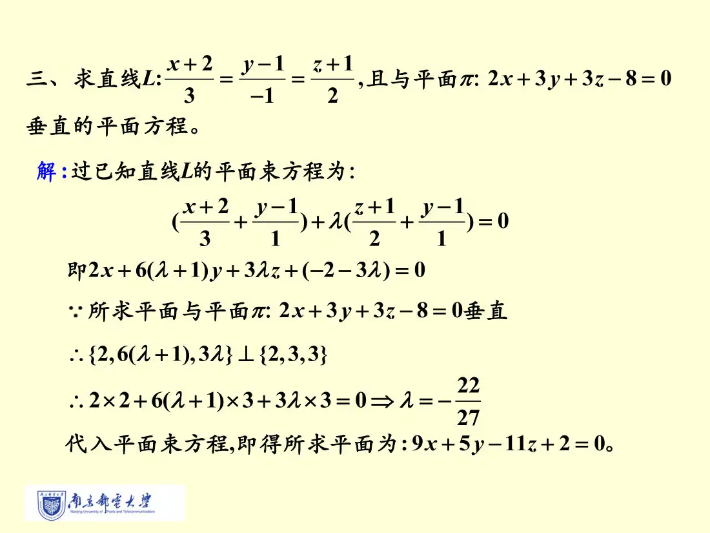

原文：

三、求直线 $L:\frac{x+2}{3}=\frac{y-1}{-1}=\frac{z+1}{2}$ ，且与平面 $\pi:2x+3y+3z-8=0$ 垂直的平面方程。

解: 过已知直线L的平面束方程为:

$$
(\frac {x + 2}{3} + \frac {y - 1}{1}) + \lambda (\frac {z + 1}{2} + \frac {y - 1}{1}) = 0
$$

即 $2x + 6(\lambda + 1)y + 3\lambda z + (-2 - 3\lambda) = 0$

∵所求平面与平面π: $2x + 3y + 3z - 8 = 0$ 垂直

$$
\therefore \{2, 6 (\lambda + 1), 3 \lambda \} \perp \{2, 3, 3 \}
$$

$$
\therefore 2 \times 2 + 6 (\lambda + 1) \times 3 + 3 \lambda \times 3 = 0 \Rightarrow \lambda = - \frac {2 2}{2 7}
$$

代入平面束方程,即得所求平面为: $9x+5y-11z+2=0$ 。

南京邮电大学
Nanjing University of Posts and Telecommunications

### 3、旋转曲面

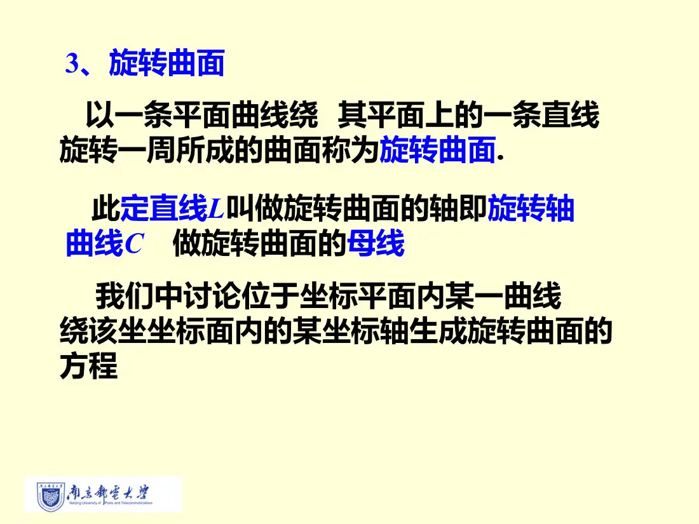

原文：

3、旋转曲面

以一条平面曲线绕 其平面上的一条直线旋转一周所成的曲面称为旋转曲面。

此定直线L叫做旋转曲面的轴即旋转轴曲线C 做旋转曲面的母线

我们中讨论位于坐标平面内某一曲线绕该坐坐标面内的某坐标轴生成旋转曲面的方程

南京邮电大学
Nanjing University of Posts and Telecommunications

### 所以将yoz面上给定

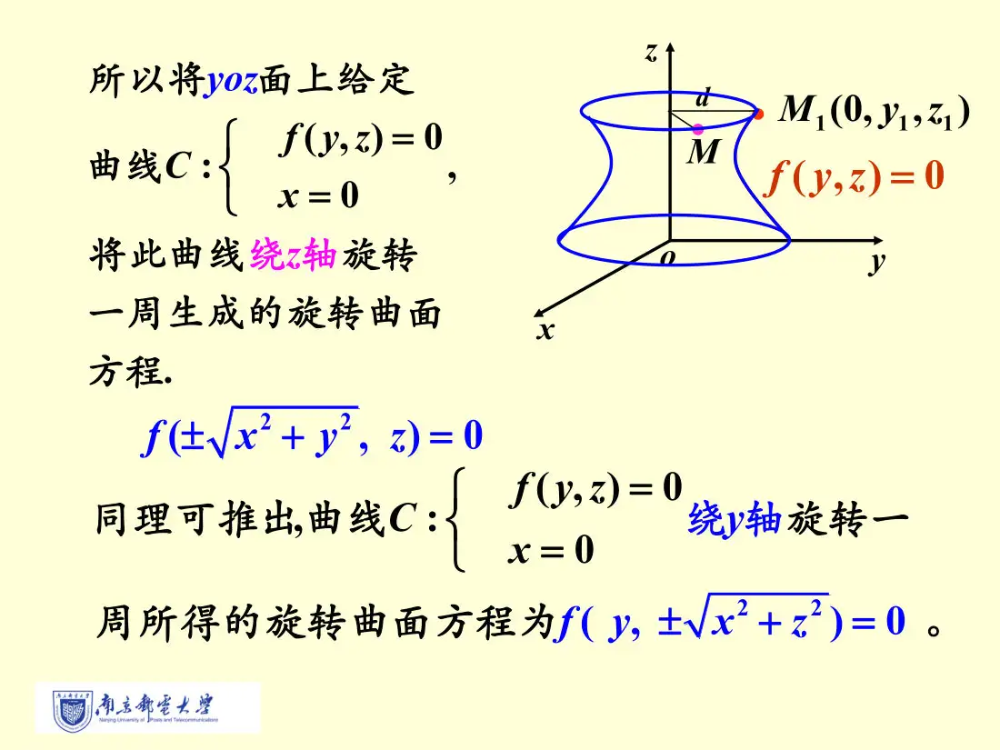

原文：

所以将yoz面上给定
曲线 $C:\left\{\begin{aligned}f(y,z)&=0\\ x&=0\end{aligned}\right.$ 将此曲线绕z轴旋转
一周生成的旋转曲面
方程.

$f(\pm\sqrt{x^{2}+y^{2}},z)=0$ 同理可推出,曲线 $C:\left\{\begin{aligned}f(y,z)&=0\\ x&=0\end{aligned}\right.$ 绕y轴旋转一
周所得的旋转曲面方程为 $f(y,\pm\sqrt{x^{2}+z^{2}})=0$ xoy 平面内的曲线C分别绕x轴、y轴旋转生成的旋转曲面方程。

南京邮电大学
Nanjing University of Posts and Telecommunications

### 南京邮电大学

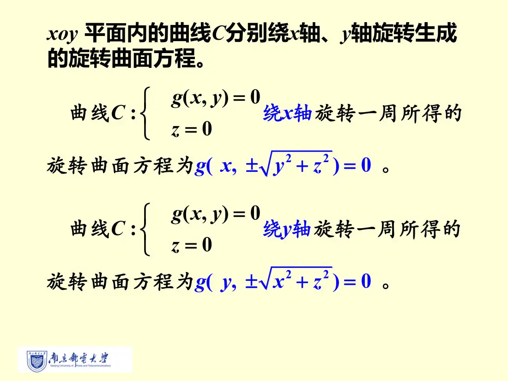

原文：

曲线 $C: \left\{ \begin{array}{l} g(x, y) = 0 \\ z = 0 \end{array} \right.$ 绕 $x$ 轴旋转一周所得的旋转曲面方程为 $g(x, \pm \sqrt{y^2 + z^2}) = 0$ 。

曲线 $C: \left\{ \begin{array}{l} g(x, y) = 0 \\ z = 0 \end{array} \right.$ 绕y轴旋转一周所得的旋转曲面方程为 $g(y, \pm \sqrt{x^2 + z^2}) = 0$ 。

南京邮电大学
Nanjing University of Posts and Telecommunications

### zox 平面内的曲线 C 分别绕 z 轴、x 轴旋转生成的旋转曲面方程

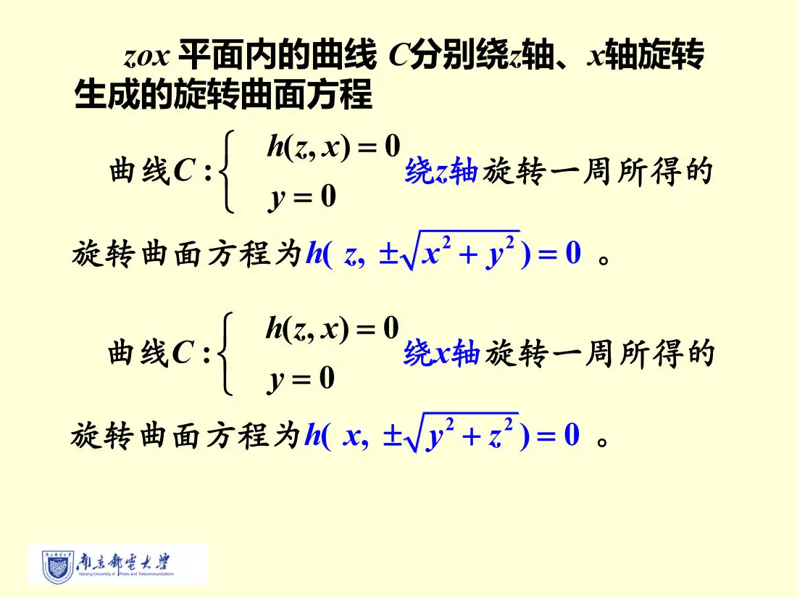

原文：

zox 平面内的曲线 C 分别绕 z 轴、x 轴旋转生成的旋转曲面方程

曲线 $C: \left\{ \begin{array}{l} h(z, x) = 0 \\ y = 0 \end{array} \right.$ 绕 $z$ 轴旋转一周所得的旋转曲面方程为 $h(z, \pm \sqrt{x^2 + y^2}) = 0$ 。

曲线 $C: \left\{ \begin{array}{l} h(z, x) = 0 \\ y = 0 \end{array} \right.$ 绕 $x$ 轴旋转一周所得的旋转曲面方程为 $h(x, \pm \sqrt{y^2 + z^2}) = 0$ 。

南京邮电大学
Nanjing University of Posts and Telecommunications

### 五、空间曲线在坐标面上的投影

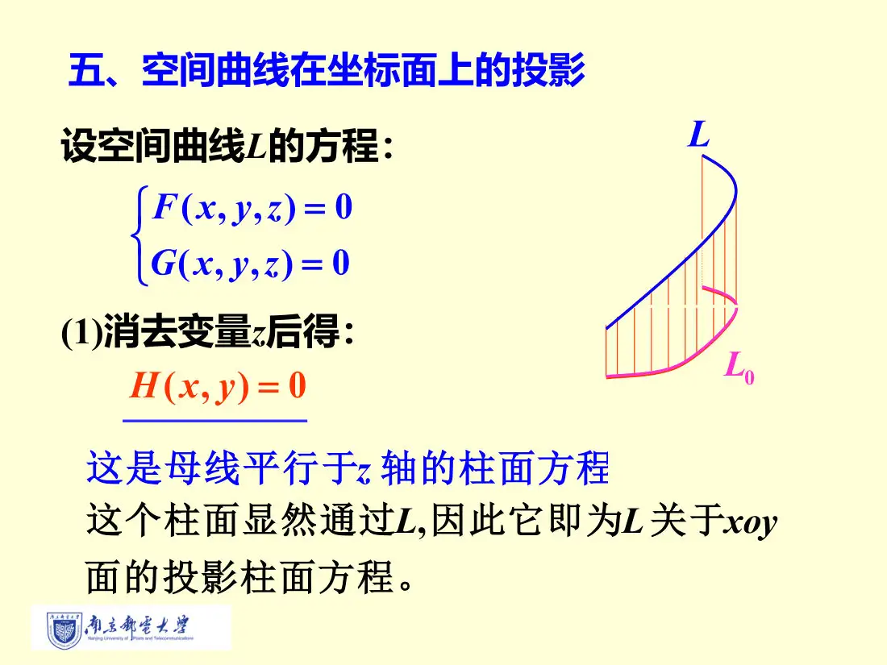

原文：

五、空间曲线在坐标面上的投影

设空间曲线L的方程：

$$
\left\{ \begin{array}{l} F (x, y, z) = 0 \\ G (x, y, z) = 0 \end{array} \right.
$$

(1)消去变量z后得:

$$
H (x, y) = 0
$$

这是母线平行于z轴的柱面方程

这个柱面显然通过L,因此它即为L关于xoy面的投影柱面方程。

南京邮电大学
Nanjing University of Posts and Telecommunications

### $$

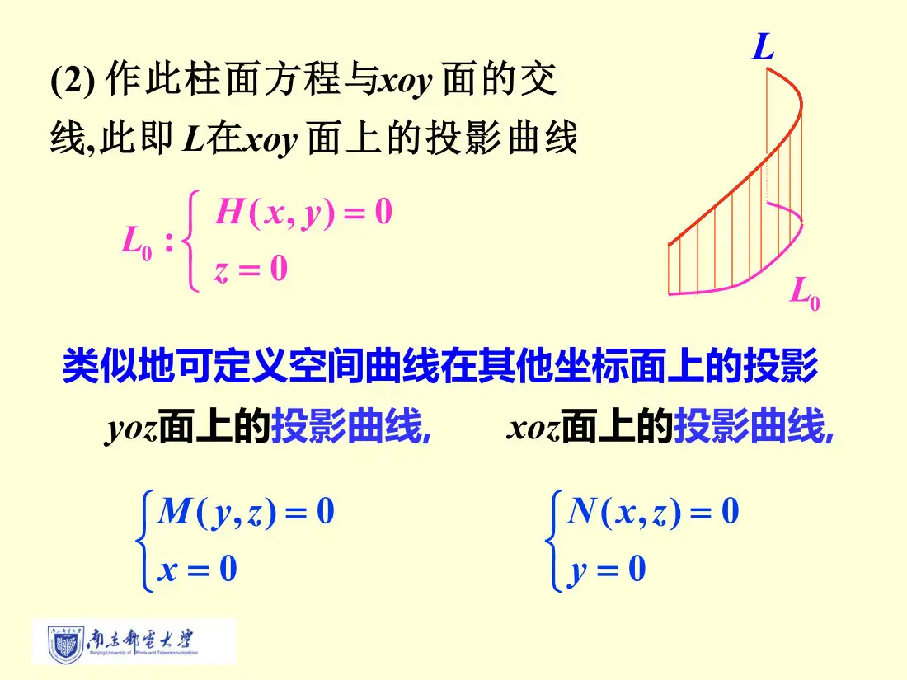

原文：

(2) 作此柱面方程与 $xoy$ 面的交线, 此即 $L$ 在 $xoy$ 面上的投影曲线

$$
L _ {0}: \left\{ \begin{array}{l} H (x, y) = 0 \\ z = 0 \end{array} \right.
$$

类似地可定义空间曲线在其他坐标面上的投影
yoz面上的投影曲线, xoz面上的投影曲线,

$$
\left\{ \begin{array}{l} M (y, z) = 0 \\ x = 0 \end{array} \right.
$$

$$
\left\{ \begin{array}{l} N (x, z) = 0 \\ y = 0 \end{array} \right.
$$

南京邮电大学
Nanjing University of Posts and Telecommunications

### 例55

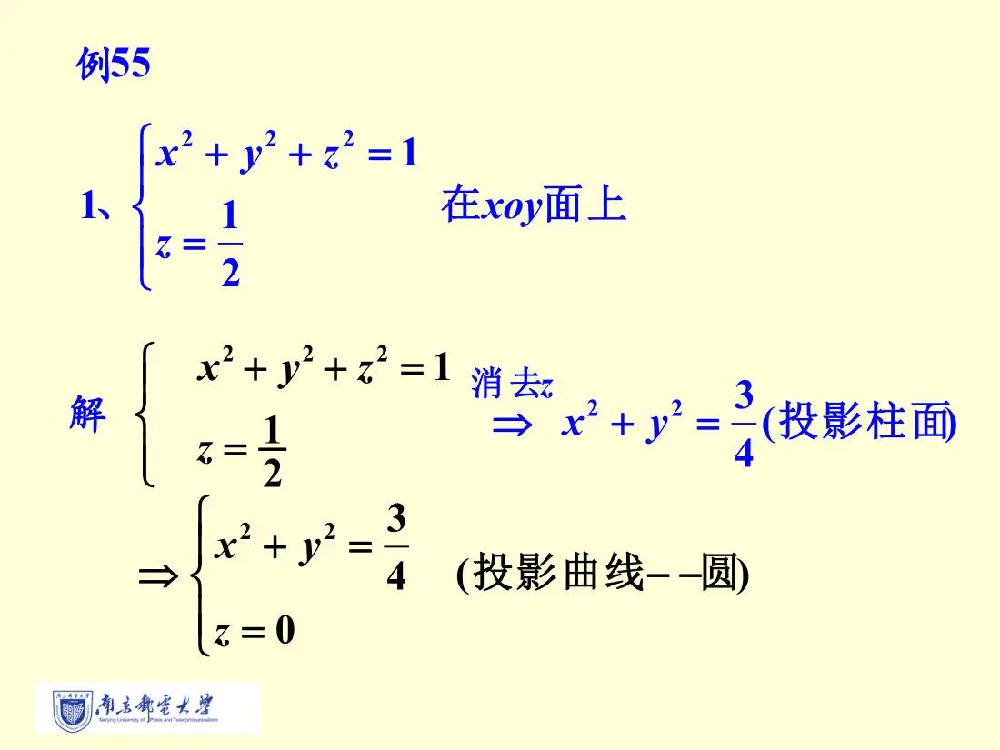

原文：

例55

1、 $\left\{\begin{aligned}x^{2}+y^{2}+z^{2}&=1\\ z&=\frac{1}{2}\end{aligned}\right.$ 在xoy面上

解 $\left\{ \begin{array}{l} x^{2} + y^{2} + z^{2} = 1 \\ z = \frac{1}{2} \end{array} \right.$ 消去 $z$ $\Rightarrow x^{2} + y^{2} = \frac{3}{4}$ (投影柱面) $\Rightarrow \left\{ \begin{array}{ll} x^{2} + y^{2} = \frac{3}{4}\\ z = 0 \end{array} \right.$ （投影曲线--圆）

南京邮电大学
Nanjing University of Posts and Telecommunications

### 南京邮电大学

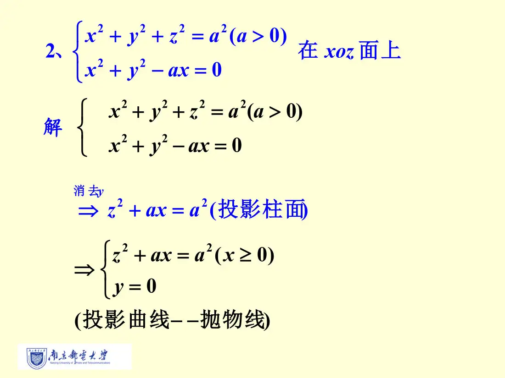

原文：

2、 $\left\{\begin{aligned}x^{2}+y^{2}+z^{2}=a^{2}(a>0)\\ x^{2}+y^{2}-ax=0\end{aligned}\right.$ 在 xoz 面上
解 $\left\{\begin{aligned}x^{2}+y^{2}+z^{2}=a^{2}(a>0)\\ x^{2}+y^{2}-ax=0\end{aligned}\right.$ $\Rightarrow z^{2} + ax = a^{2}$ (投影柱面) $\Rightarrow \left\{\begin{aligned}z^{2}+ax &= a^{2}(x \geq 0) \\ y &= 0\end{aligned}\right.$ (投影曲线--抛物线)

南京邮电大学
Nanjing University of Posts and Telecommunications

### $$

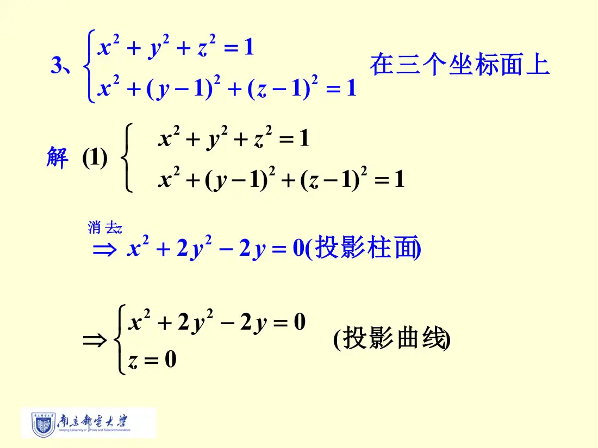

原文：

3、 $\left\{\begin{aligned}x^{2}+y^{2}+z^{2}=1\\ x^{2}+(y-1)^{2}+(z-1)^{2}=1\end{aligned}\right.$ 在三个坐标面上

解 (1) $\left\{ \begin{array}{l} x^{2} + y^{2} + z^{2} = 1 \\ x^{2} + (y - 1)^{2} + (z - 1)^{2} = 1 \end{array} \right.$

消去 $\Rightarrow x^{2} + 2y^{2} - 2y = 0$ (投影柱面)

$$
\Rightarrow \left\{ \begin{array}{l} x ^ {2} + 2 y ^ {2} - 2 y = 0 \\ z = 0 \end{array} \right.
$$

(投影曲线)

南京邮电大学
Nanjing University of Posts and Telecommunications

### 南京邮电大学

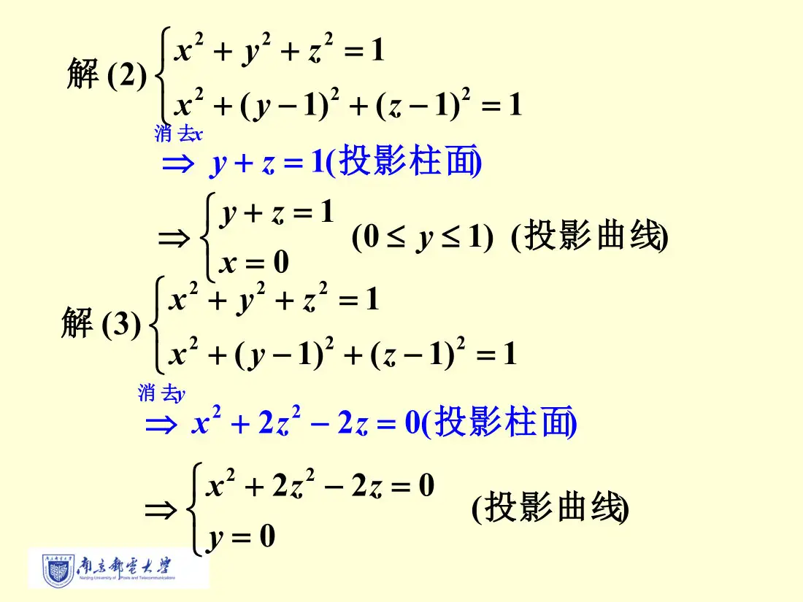

原文：

解(2) $\left\{\begin{aligned}x^{2}+y^{2}+z^{2}&=1\\ x^{2}+(y-1)^{2}+(z-1)^{2}&=1\end{aligned}\right.$ 消去 $\Rightarrow y+z=1$ (投影柱面) $\Rightarrow\left\{\begin{aligned}y+z&=1\\ x&=0\end{aligned}\right.$ $(0\leq y\leq1)$ (投影曲线)

解(3) $\left\{\begin{aligned}x^{2}+y^{2}+z^{2}&=1\\ x^{2}+(y-1)^{2}+(z-1)^{2}&=1\end{aligned}\right.$ 消去 $\Rightarrow x^{2}+2z^{2}-2z=0$ (投影柱面) $\Rightarrow\left\{\begin{aligned}x^{2}+2z^{2}-2z&=0\\ y&=0\end{aligned}\right.$ (投影曲线)

南京邮电大学
Nanjing University of Posts and Telecommunications
