# 《线性代数与解析几何》第4章 4.3 向量组的秩（课件）

原件的每一页，下面附识别出的文字。

### 4.3 向量组的秩

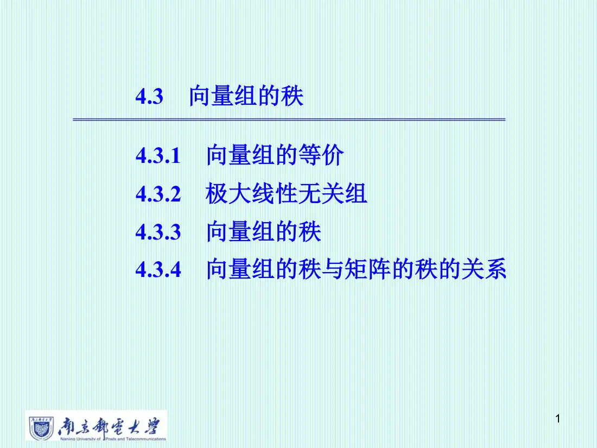

原文：

4.3 向量组的秩
4.3.1 向量组的等价
4.3.2 极大线性无关组
4.3.3 向量组的秩
4.3.4 向量组的秩与矩阵的秩的关系

南京邮电大学
Nanjing University of Posts and Telecommunications

1

### 4.3 向量组的秩

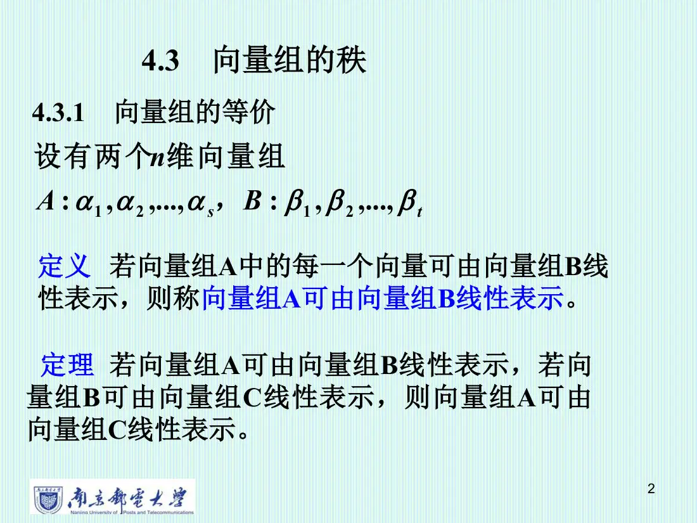

原文：

4.3 向量组的秩

4.3.1 向量组的等价

设有两个 $n$ 维向量组

$$
A: \alpha_ {1}, \alpha_ {2}, \dots , \alpha_ {s}, B: \beta_ {1}, \beta_ {2}, \dots , \beta_ {t}
$$

定义 若向量组A中的每一个向量可由向量组B线性表示，则称向量组A可由向量组B线性表示。

定理 若向量组A可由向量组B线性表示，若向量组B可由向量组C线性表示，则向量组A可由向量组C线性表示。

南京邮电大学
Nanjing University of Posts and Telecommunications

2

### 等价向量组具有下列三个性质：

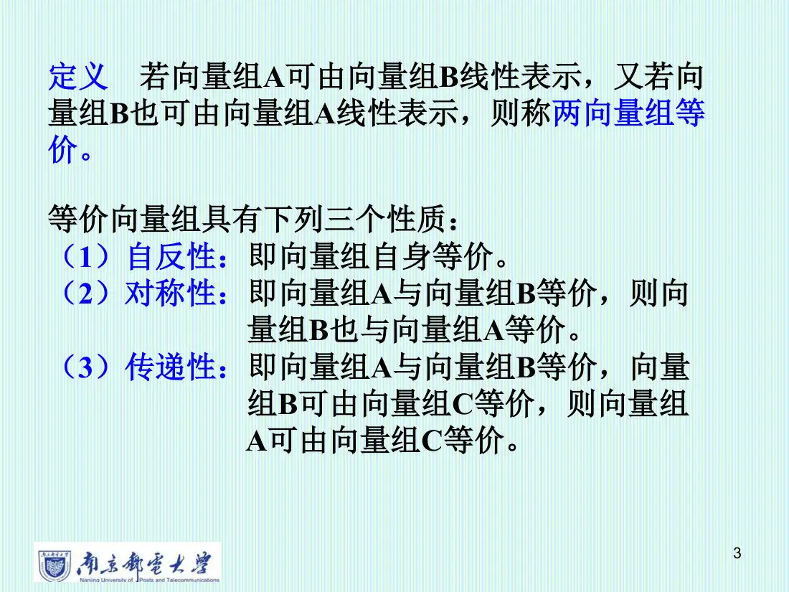

原文：

定义 若向量组A可由向量组B线性表示，又若向量组B也可由向量组A线性表示，则称两向量组等价。

等价向量组具有下列三个性质：

(1) 自反性: 即向量组自身等价。

(2) 对称性: 即向量组A与向量组B等价, 则向量组B也与向量组A等价。

(3) 传递性: 即向量组A与向量组B等价, 向量组B可由向量组C等价, 则向量组A可由向量组C等价。

南京邮电大学
Nanjing University of Posts and Telecommunications

3

### 推论 两个等价的线性无关组所含向量的个数相等。

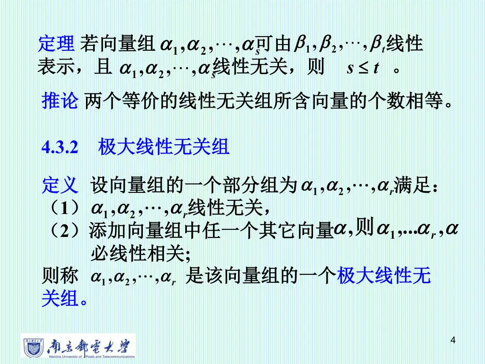

原文：

定理 若向量组 $\alpha_{1},\alpha_{2},\cdots,\alpha_{s}$ 可由 $\beta_{1},\beta_{2},\cdots,\beta_{t}$ 线性表示，且 $\alpha_{1},\alpha_{2},\cdots,\alpha_{s}$ 线性无关，则 $s\leq t$ 。

推论 两个等价的线性无关组所含向量的个数相等。

4.3.2 极大线性无关组

定义 设向量组的一个部分组为 $\alpha_{1}, \alpha_{2}, \cdots, \alpha_{r}$ 满足：

(1) $\alpha_{1},\alpha_{2},\cdots,\alpha_{r}$ 线性无关,

(2) 添加向量组中任一个其它向量 $\alpha$ , 则 $\alpha_{1}, \ldots, \alpha_{r}, \alpha$ 必线性相关;

则称 $\alpha_{1},\alpha_{2},\cdots,\alpha_{r}$ 是该向量组的一个极大线性无关组。

南京邮电大学
Nanjing University of Posts and Telecommunications

4

### 结论:

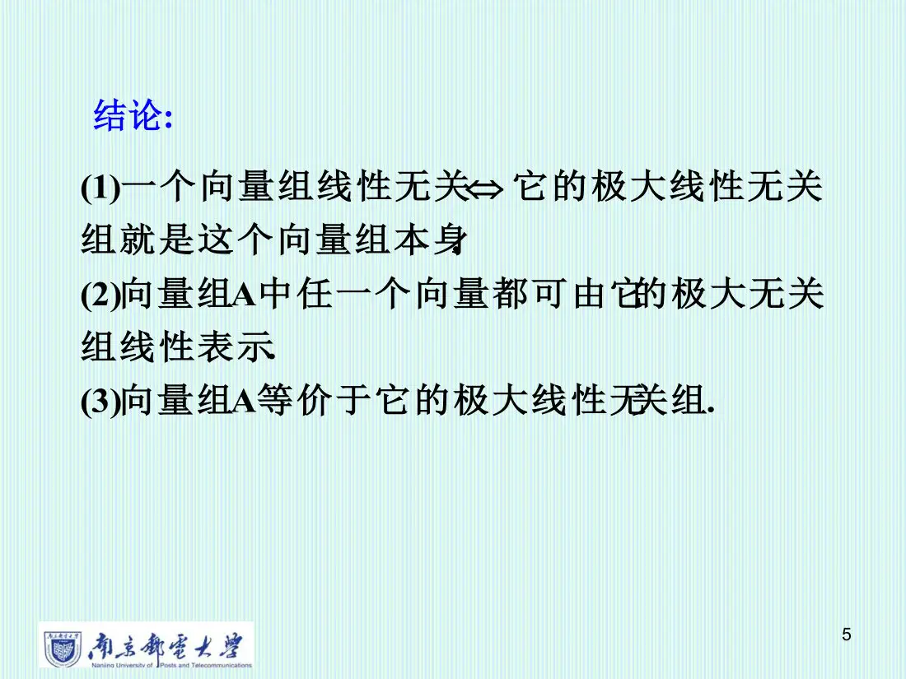

原文：

结论:

(1)一个向量组线性无关 $\Leftrightarrow$ 它的极大线性无关组就是这个向量组本身

(2)向量组A中任一个向量都可由它的极大无关组线性表示

(3)向量组A等价于它的极大线性无关组.

南京邮电大学
Nanjing University of Posts and Telecommunications

5

### 可见，一个向量组的极大线性无关组不是唯一的。

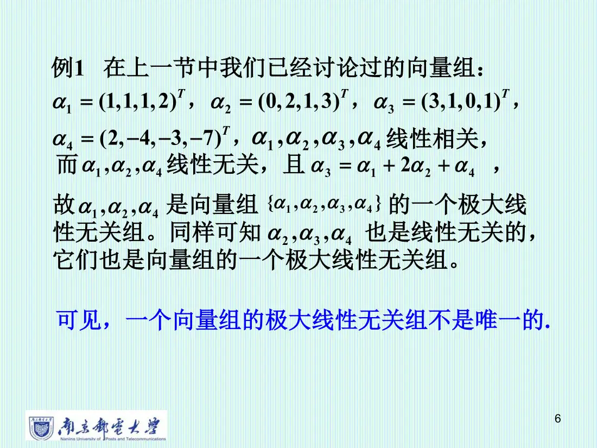

原文：

例1 在上一节中我们已经讨论过的向量组： $\alpha_{1}=(1,1,1,2)^{T},\quad\alpha_{2}=(0,2,1,3)^{T},\quad\alpha_{3}=(3,1,0,1)^{T},$ $\alpha_{4}=(2,-4,-3,-7)^{T},\quad\alpha_{1},\alpha_{2},\alpha_{3},\alpha_{4}$ 线性相关，
而 $\alpha_{1},\alpha_{2},\alpha_{4}$ 线性无关，且 $\alpha_{3}=\alpha_{1}+2\alpha_{2}+\alpha_{4}$ ，
故 $\alpha_{1},\alpha_{2},\alpha_{4}$ 是向量组 $\{\alpha_{1},\alpha_{2},\alpha_{3},\alpha_{4}\}$ 的一个极大线性无关组。同样可知 $\alpha_{2},\alpha_{3},\alpha_{4}$ 也是线性无关的，它们也是向量组的一个极大线性无关组。

可见，一个向量组的极大线性无关组不是唯一的。

南京邮电大学
Nanjing University of Posts and Telecommunications

6

### 定理 一个向量组中任两个极大线性无关组所含向量个数是相同的。

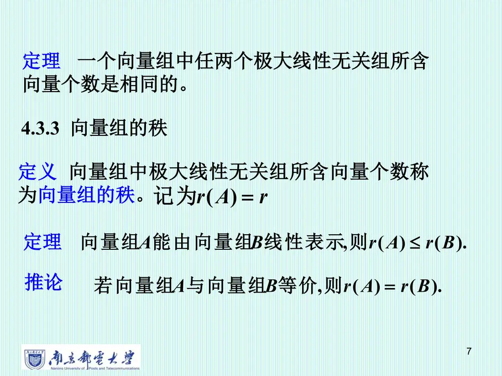

原文：

定理 一个向量组中任两个极大线性无关组所含向量个数是相同的。

4.3.3 向量组的秩

定义 向量组中极大线性无关组所含向量个数称为向量组的秩。记为 $r(A) = r$

定理 向量组A能由向量组B线性表示,则 $r(A)\leq r(B)$ .

推论 若向量组A与向量组B等价,则 $r(A)=r(B)$ .

南京邮电大学
Nanjing University of Posts and Telecommunications

7

### 4.3.4 向量组的秩与矩阵的秩的关系

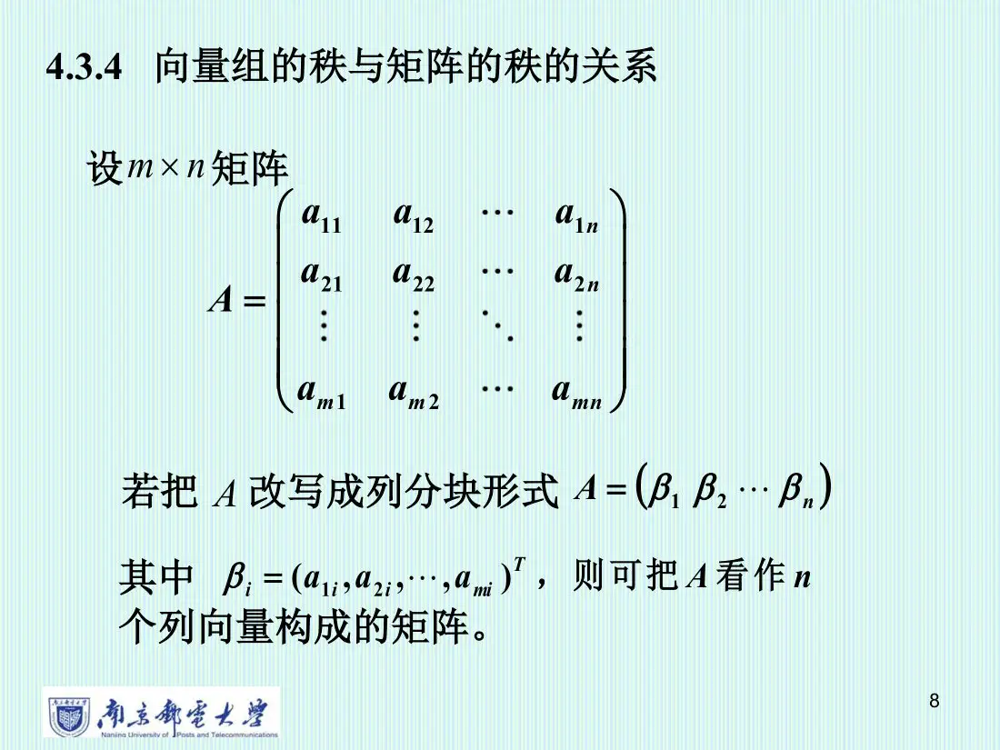

原文：

4.3.4 向量组的秩与矩阵的秩的关系

设 $m \times n$ 矩阵

$$
A = \left( \begin{array}{c c c c} a _ {1 1} & a _ {1 2} & \dots & a _ {1 n} \\ a _ {2 1} & a _ {2 2} & \dots & a _ {2 n} \\ \vdots & \vdots & \ddots & \vdots \\ a _ {m 1} & a _ {m 2} & \dots & a _ {m n} \end{array} \right)
$$

若把 A 改写成列分块形式 $A = (\beta_{1} \beta_{2} \cdots \beta_{n})$ 其中 $\beta_{i}=(a_{1i},a_{2i},\cdots,a_{mi})^{T}$ ，则可把 A 看作 n 个列向量构成的矩阵。

南京邮电大学
Nanjing University of Posts and Telecommunications

8

### 若把 $A$ 作行分块

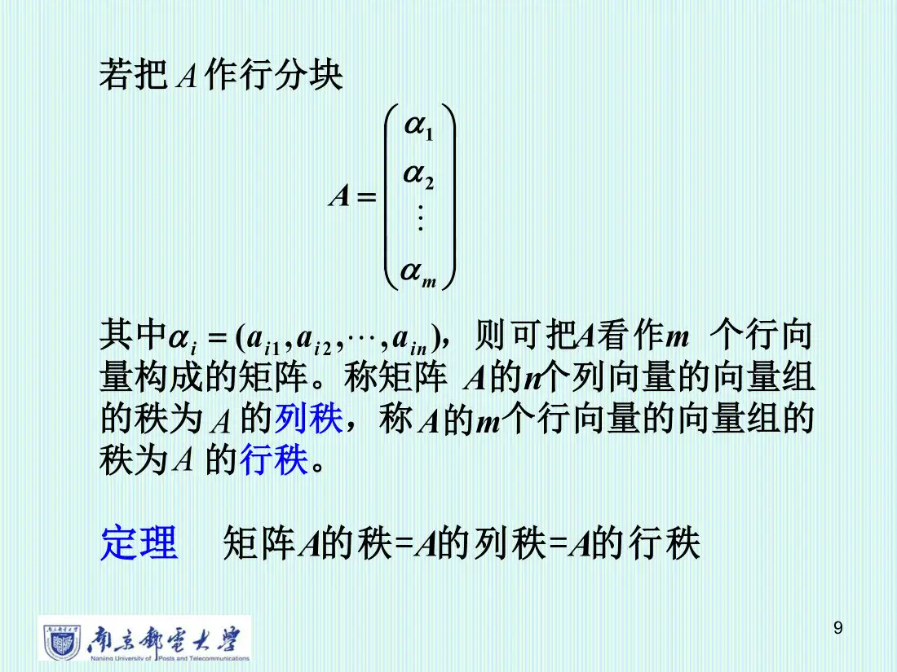

原文：

若把 $A$ 作行分块

$$
A = \left( \begin{array}{c} \alpha_ {1} \\ \alpha_ {2} \\ \vdots \\ \alpha_ {m} \end{array} \right)
$$

其中 $\alpha_{i}=(a_{i1},a_{i2},\cdots,a_{in})$ ，则可把A看作m个行向量构成的矩阵。称矩阵A的n个列向量的向量组的秩为A的列秩，称A的m个行向量的向量组的秩为A的行秩。

定理 矩阵 $A$ 的秩 $= A$ 的列秩 $= A$ 的行秩

南京邮电大学
Nanjing University of Posts and Telecommunications

9

### 南京邮电大学

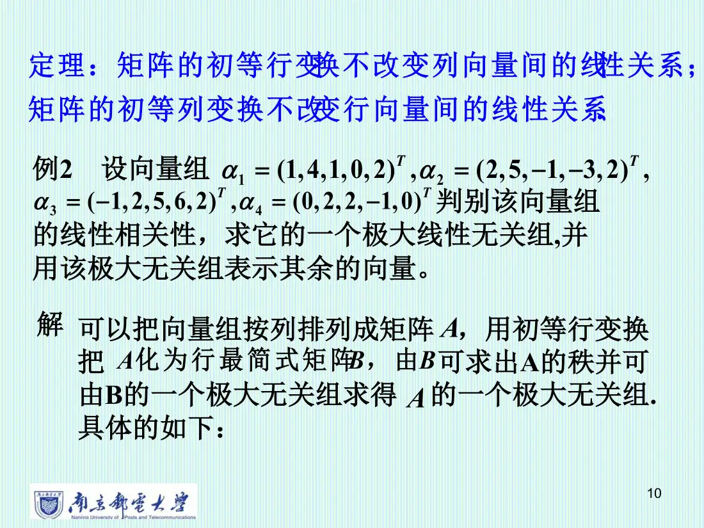

原文：

定理：矩阵的初等行变换不改变列向量间的线性关系；矩阵的初等列变换不改变行向量间的线性关系

例2 设向量组 $\alpha_{1} = (1,4,1,0,2)^{T},\alpha_{2} = (2,5,-1,-3,2)^{T}$ , $\alpha_{3} = (-1,2,5,6,2)^{T},\alpha_{4} = (0,2,2,-1,0)^{T}$ 判别该向量组的线性相关性，求它的一个极大线性无关组，并用该极大无关组表示其余的向量。

解 可以把向量组按列排列成矩阵 A，用初等行变换把 A 化为行最简式矩阵 B，由 B 可求出 A 的秩并可由 B 的一个极大无关组求得 A 的一个极大无关组。具体的如下：

南京邮电大学
Nanjing University of Posts and Telecommunications

10

### $$

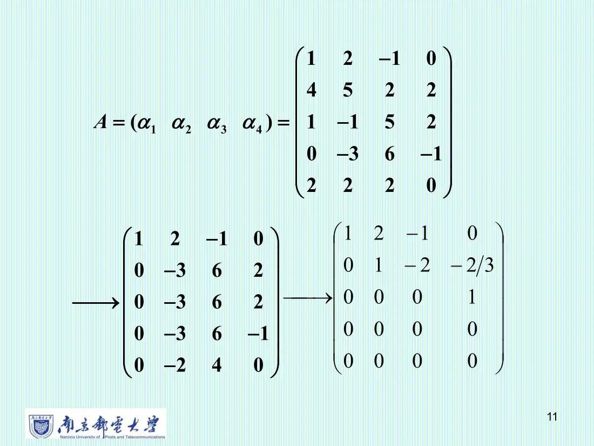

原文：

$$
A = (\alpha_ {1} \quad \alpha_ {2} \quad \alpha_ {3} \quad \alpha_ {4}) = \left( \begin{array}{c c c c} 1 & 2 & - 1 & 0 \\ 4 & 5 & 2 & 2 \\ 1 & - 1 & 5 & 2 \\ 0 & - 3 & 6 & - 1 \\ 2 & 2 & 2 & 0 \end{array} \right)
$$

$$
\longrightarrow \left( \begin{array}{r r r r} 1 & 2 & - 1 & 0 \\ 0 & - 3 & 6 & 2 \\ 0 & - 3 & 6 & 2 \\ 0 & - 3 & 6 & - 1 \\ 0 & - 2 & 4 & 0 \end{array} \right) \longrightarrow \left( \begin{array}{r r r r} 1 & 2 & - 1 & 0 \\ 0 & 1 & - 2 & - 2 / 3 \\ 0 & 0 & 0 & 1 \\ 0 & 0 & 0 & 0 \\ 0 & 0 & 0 & 0 \end{array} \right)
$$

南京邮电大学
Nanjing University of Posts and Telecommunications

11

### $$

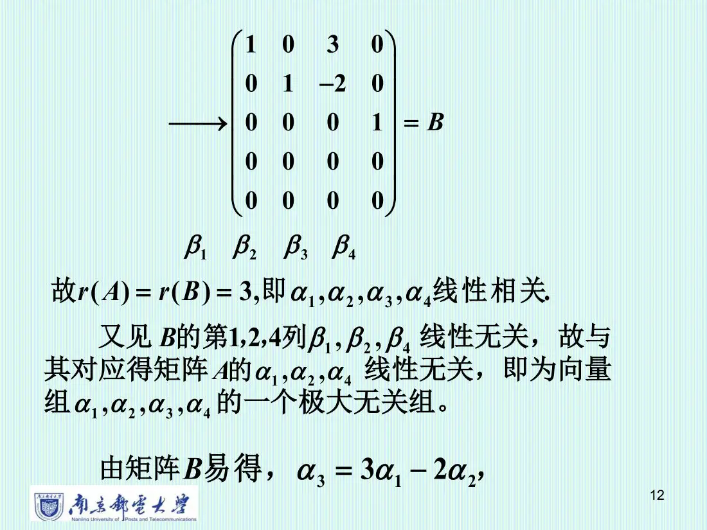

原文：

$$
\longrightarrow \left( \begin{array}{c c c c} 1 & 0 & 3 & 0 \\ 0 & 1 & - 2 & 0 \\ 0 & 0 & 0 & 1 \\ 0 & 0 & 0 & 0 \\ 0 & 0 & 0 & 0 \end{array} \right) = B
$$

$$
\beta_ {1} \quad \beta_ {2} \quad \beta_ {3} \quad \beta_ {4}
$$

故 $r(A)=r(B)=3$ ，即 $\alpha_{1},\alpha_{2},\alpha_{3},\alpha_{4}$ 线性相关.

又见 B 的第 1,2,4 列 $\beta_{1}, \beta_{2}, \beta_{4}$ 线性无关，故与其对应得矩阵 A 的 $\alpha_{1}, \alpha_{2}, \alpha_{4}$ 线性无关，即为向量组 $\alpha_{1}, \alpha_{2}, \alpha_{3}, \alpha_{4}$ 的一个极大无关组。

由矩阵B易得， $\alpha_{3}=3\alpha_{1}-2\alpha_{2}$ 例3.求向量组 $\alpha_{1} = (2,1,3 - 1),\alpha_{2} = (3, - 1,2,0),\alpha_{3} = (1,3,4, - 2)$ $\alpha_{4} = (4, - 3,1,1)$ 的极大线性无关组及秩，并用此极大无关组表示其余的向量.

南京邮电大学
Nanjing University of Posts and Telecommunications

12

### 解:

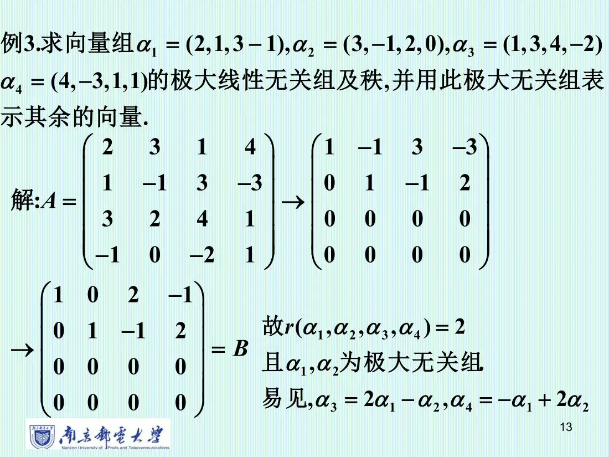

原文：

解:

$$
\text {军}: A = \left(\begin{array}{c c c c}2&3&1&4\\1&- 1&3&- 3\\3&2&4&1\\- 1&0&- 2&1\end{array}\right)\rightarrow \left(\begin{array}{c c c c}1&- 1&3&- 3\\0&1&- 1&2\\0&0&0&0\\0&0&0&0\end{array}\right)
$$

$\rightarrow \left( \begin{array}{cccc}1 & 0 & 2 & -1\\ 0 & 1 & -1 & 2\\ 0 & 0 & 0 & 0\\ 0 & 0 & 0 & 0 \end{array} \right) = B$ 故 $r(\alpha_{1},\alpha_{2},\alpha_{3},\alpha_{4}) = 2$ 且 $\alpha_{1},\alpha_{2}$ 为极大无关组易见， $\alpha_{3} = 2\alpha_{1} - \alpha_{2},\alpha_{4} = -\alpha_{1} + 2\alpha_{2}$

南京邮电大学
Nanjing University of Posts and Telecommunications

13
