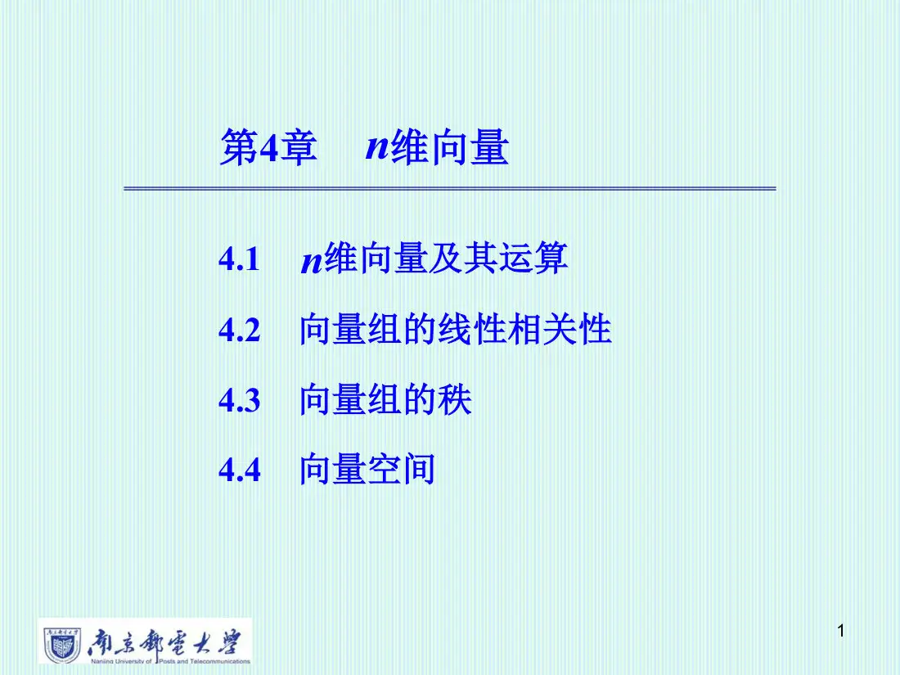
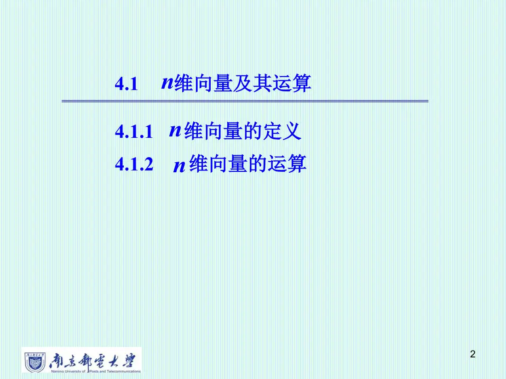
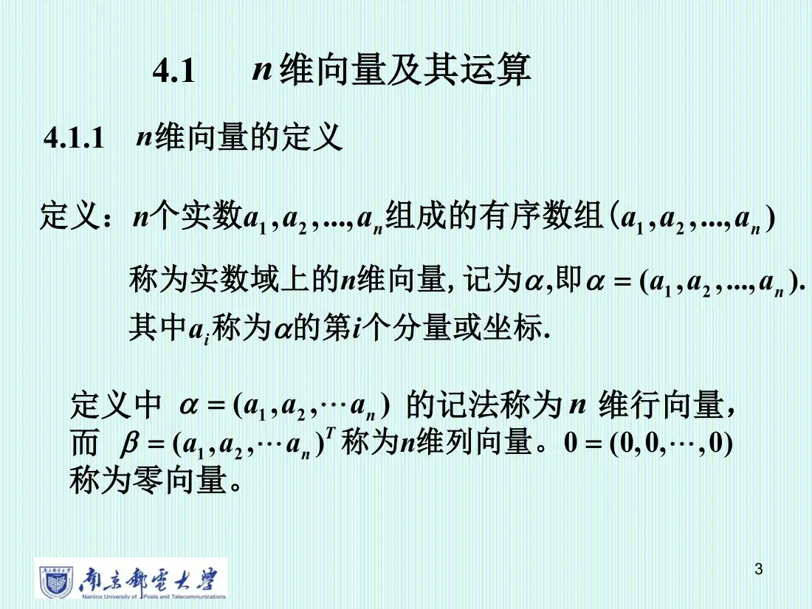
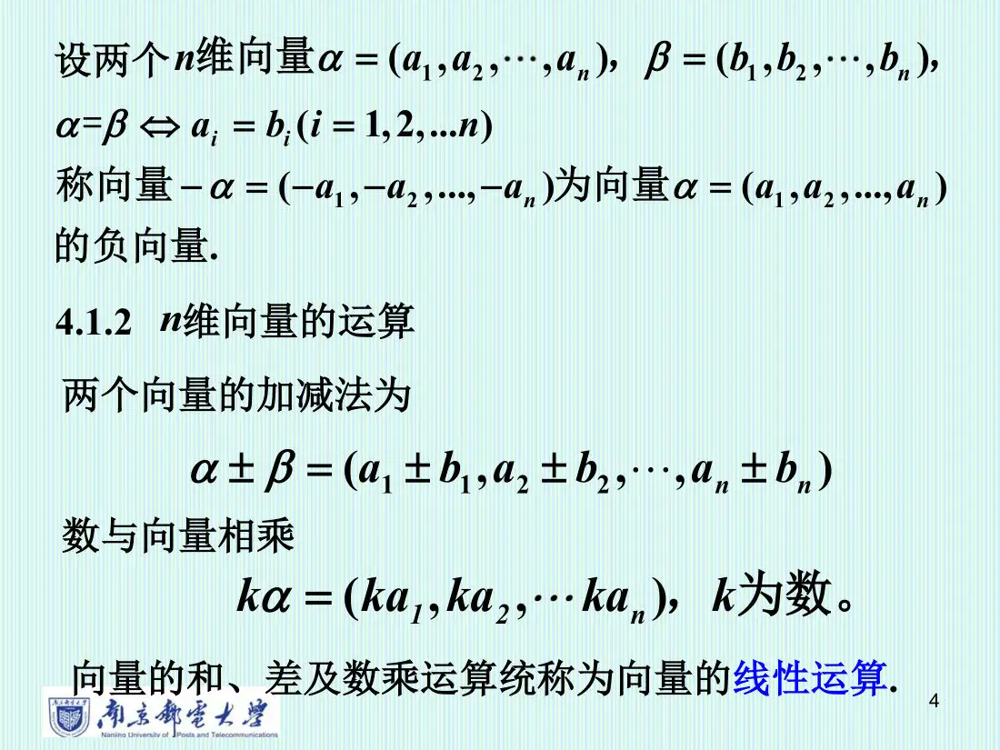
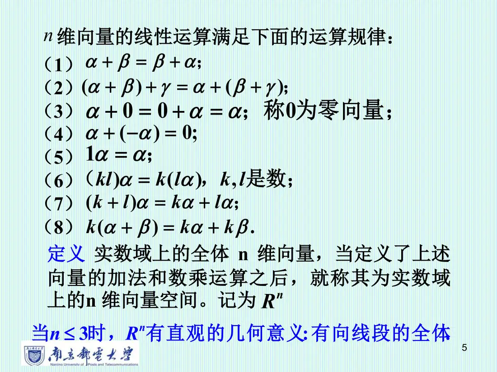
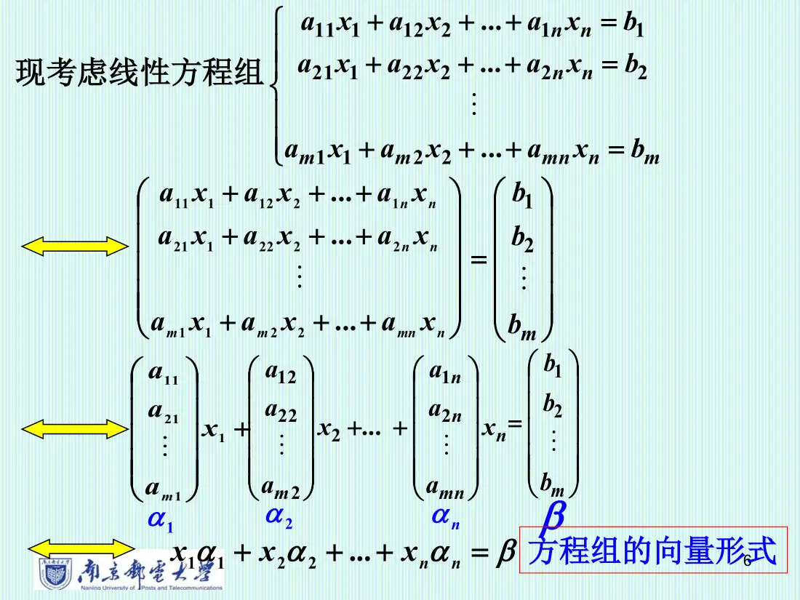

# 《线性代数与解析几何》第4章 n维向量（课件）

原件的每一页，下面附识别出的文字。

### 第4章 n维向量

原文：

第4章 n维向量

4.1 n维向量及其运算  
4.2 向量组的线性相关性  
4.3 向量组的秩  
4.4 向量空间

南京邮电大学
Nanjing University of Posts and Telecommunications

1

### 4.1 $n$ 维向量及其运算

原文：

4.1 $n$ 维向量及其运算

4.1.1 $n$ 维向量的定义

4.1.2 $n$ 维向量的运算

南京邮电大学
Nanjing University of Posts and Telecommunications

2

### 4.1 $n$ 维向量及其运算

原文：

4.1 $n$ 维向量及其运算

4.1.1 $n$ 维向量的定义

定义： $n$ 个实数 $a_1, a_2, \ldots, a_n$ 组成的有序数组 $(a_1, a_2, \ldots, a_n)$

称为实数域上的n维向量, 记为 $\alpha$ , 即 $\alpha = (a_{1}, a_{2}, ..., a_{n})$ .

其中 $a_{i}$ 称为 $\alpha$ 的第i个分量或坐标.

定义中 $\alpha=(a_{1},a_{2},\cdots,a_{n})$ 的记法称为 n 维行向量，而 $\beta=(a_{1},a_{2},\cdots,a_{n})^{T}$ 称为 n 维列向量。 $0=(0,0,\cdots,0)$ 称为零向量。

南京邮电大学
Nanjing University of Posts and Telecommunications

3

### 4.1.2 $n$ 维向量的运算

原文：

设两个n维向量 $\alpha=(a_{1},a_{2},\cdots,a_{n}),\quad\beta=(b_{1},b_{2},\cdots,b_{n})$ $\alpha=\beta\Leftrightarrow a_{i}=b_{i}(i=1,2,\ldots,n)$

称向量 $-\alpha=(-a_{1},-a_{2},...,-a_{n})$ 为向量 $\alpha=(a_{1},a_{2},...,a_{n})$ 的负向量.

4.1.2 $n$ 维向量的运算

两个向量的加减法为

$$
\alpha \pm \beta = (a _ {1} \pm b _ {1}, a _ {2} \pm b _ {2}, \dots , a _ {n} \pm b _ {n})
$$

数与向量相乘

$$
k \alpha = (k a _ {1}, k a _ {2}, \dots k a _ {n}), k \text {为数。}
$$

向量的和、差及数乘运算统称为向量的线性运算。

南京邮电大学
Nanjing University of Posts and Telecommunications

### n 维向量的线性运算满足下面的运算规律:

原文：

n 维向量的线性运算满足下面的运算规律:

(1) $\alpha + \beta = \beta + \alpha$ ;

(2) $(\alpha + \beta) + \gamma = \alpha + (\beta + \gamma)$ ;

(3) $\alpha + 0 = 0 + \alpha = \alpha$ ; 称0为零向量;

(4) $\alpha + (-\alpha) = 0$ ;

(5) $1\alpha = \alpha;$

(6) $(kl)\alpha = k(l\alpha), k,l$ 是数；

(7) $(k + l)\alpha = k\alpha + l\alpha$ ;

(8) $k(\alpha + \beta) = k\alpha + k\beta$ .

定义 实数域上的全体 n 维向量，当定义了上述向量的加法和数乘运算之后，就称其为实数域上的n维向量空间。记为 $R^n$

当 $n\leq3$ 时， $R^{n}$ 有直观的几何意义:有向线段的全体

南京邮电大学
Nanjing University of Posts and Telecommunications

5

### 现考虑线性方程组

原文：

现考虑线性方程组

$$
a _ {2 1} x _ {1} + a _ {2 2} x _ {2} + \ldots + a _ {2 n} x _ {n} = b _ {2}
$$

$$
\left\lfloor a _ {m 1} x _ {1} + a _ {m 2} x _ {2} + \ldots + a _ {m n} x _ {n} = b _ {m} \right.
$$

$$
\Longleftrightarrow \left( \begin{array}{c} a _ {1 1} x _ {1} + a _ {1 2} x _ {2} + \ldots + a _ {1 n} x _ {n} \\ a _ {2 1} x _ {1} + a _ {2 2} x _ {2} + \ldots + a _ {2 n} x _ {n} \\ \vdots \\ a _ {m 1} x _ {1} + a _ {m 2} x _ {2} + \ldots + a _ {m n} x _ {n} \end{array} \right) = \left( \begin{array}{c} b _ {1} \\ b _ {2} \\ \vdots \\ b _ {m} \end{array} \right)
$$

$$
\Longleftrightarrow \left( \begin{array}{c} a _ {1 1} \\ a _ {2 1} \\ \vdots \\ a _ {m 1} \end{array} \right) x _ {1} + \left( \begin{array}{c} a _ {1 2} \\ a _ {2 2} \\ \vdots \\ a _ {m 2} \end{array} \right) x _ {2} + \dots + \left( \begin{array}{c} a _ {1 n} \\ a _ {2 n} \\ \vdots \\ a _ {m n} \end{array} \right) x _ {n} = \left( \begin{array}{c} b _ {1} \\ b _ {2} \\ \vdots \\ b _ {m} \end{array} \right)
$$

$x_{1}\alpha_{1} + x_{2}\alpha_{2} + \ldots + x_{n}\alpha_{n} = \beta$ 方程组的向量形式
