# 《线性代数与解析几何》第4章 习题课（课件）

原件的每一页，下面附识别出的文字。

### 第4章 n 维向量

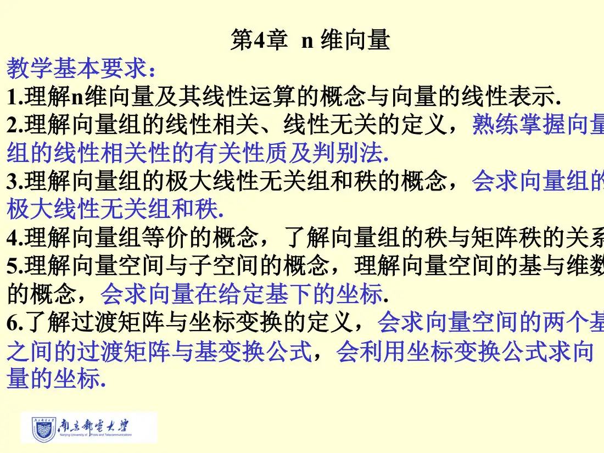

原文：

第4章 n 维向量

教学基本要求:

1. 理解n维向量及其线性运算的概念与向量的线性表示.

2. 理解向量组的线性相关、线性无关的定义，熟练掌握向量组的线性相关性的有关性质及判别法。

3.理解向量组的极大线性无关组和秩的概念, 会求向量组的极大线性无关组和秩.

4.理解向量组等价的概念，了解向量组的秩与矩阵秩的关系

5.理解向量空间与子空间的概念，理解向量空间的基与维数的概念，会求向量在给定基下的坐标。

6. 了解过渡矩阵与坐标变换的定义，会求向量空间的两个基之间的过渡矩阵与基变换公式，会利用坐标变换公式求向量的坐标。

南京邮电大学
Nanjing University of Posts and Telecommunications

### 问题

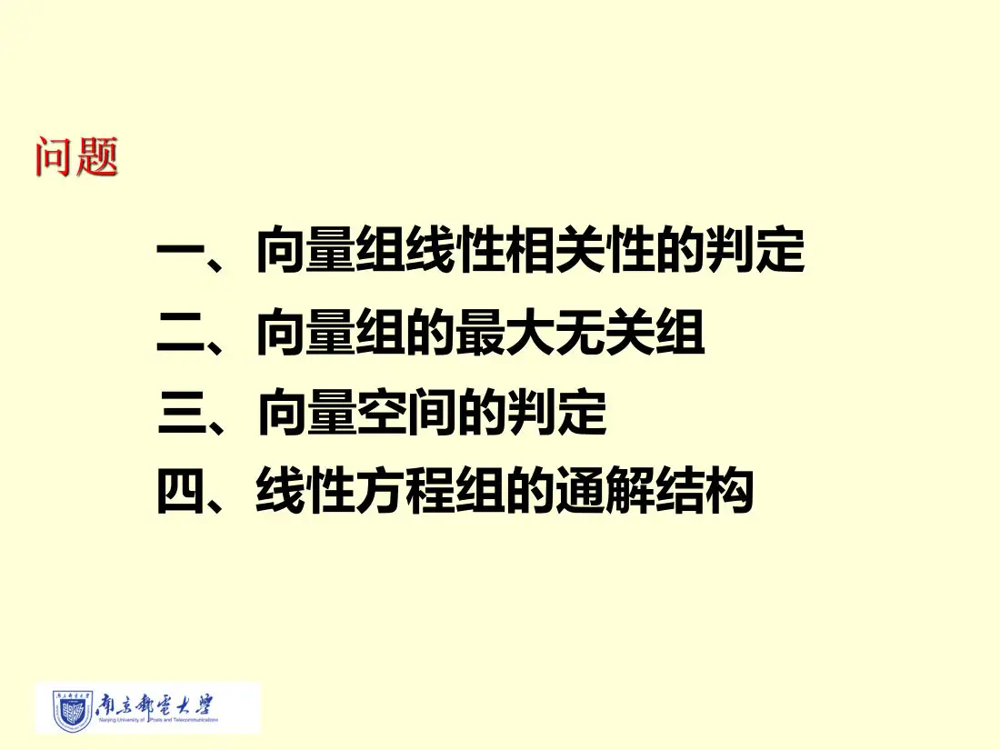

原文：

问题

一、向量组线性相关性的判定
二、向量组的最大无关组
三、向量空间的判定
四、线性方程组的通解结构

南京邮电大学
Nanjing University of Posts and Telecommunications

### 一. 向量组的线性相关性

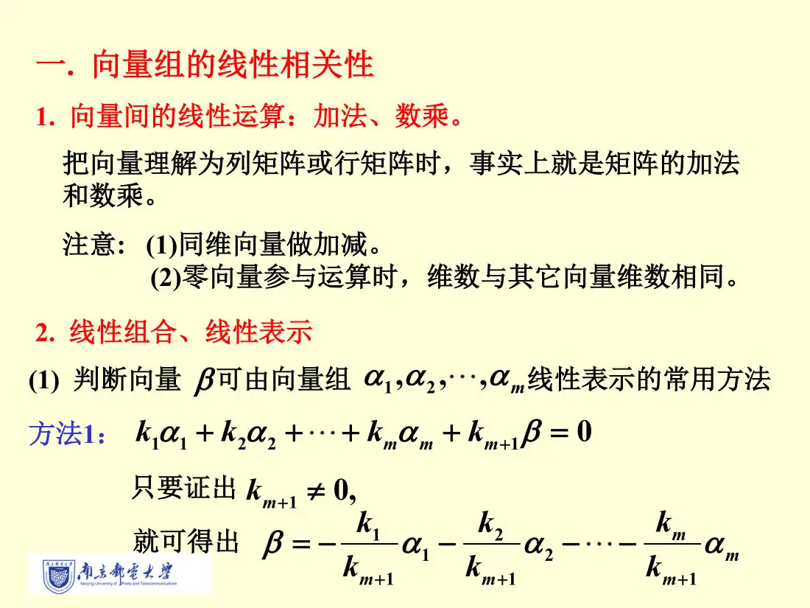

原文：

一. 向量组的线性相关性

1. 向量间的线性运算：加法、数乘。

把向量理解为列矩阵或行矩阵时，事实上就是矩阵的加法和数乘。

注意: (1)同维向量做加减。

(2)零向量参与运算时，维数与其它向量维数相同。

2. 线性组合、线性表示

(1) 判断向量 $\beta$ 可由向量组 $\alpha_{1}, \alpha_{2}, \cdots, \alpha_{m}$ 线性表示的常用方法

方法1: $k_{1}\alpha_{1} + k_{2}\alpha_{2} + \cdots + k_{m}\alpha_{m} + k_{m+1}\beta = 0$ 只要证出 $k_{m+1} \neq 0$ ,

就可得出 $\beta = -\frac{k_{1}}{k_{m+1}}\alpha_{1} - \frac{k_{2}}{k_{m+1}}\alpha_{2} - \cdots - \frac{k_{m}}{k_{m+1}}\alpha_{m}$

### 方法2：证下列线性方程组有解

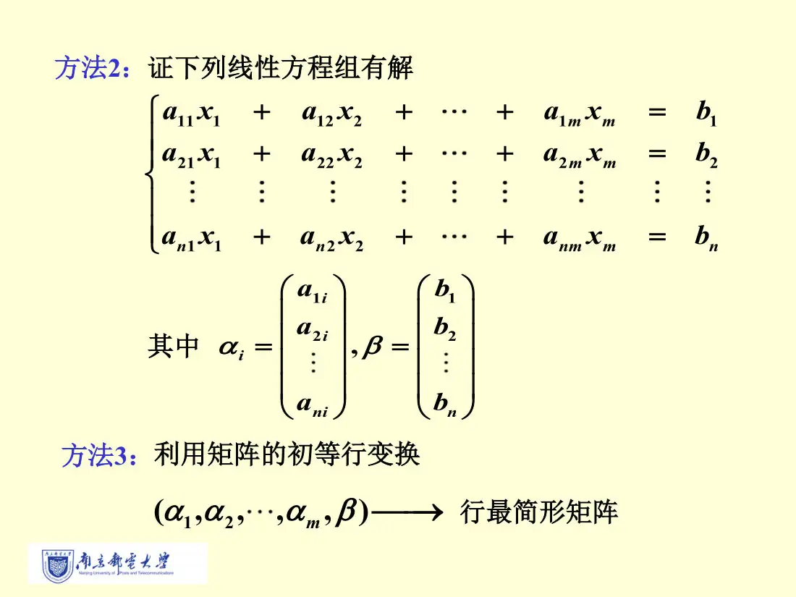

原文：

方法2：证下列线性方程组有解

$$
\left\{ \begin{array}{c c c c c c c c c} a _ {1 1} x _ {1} & + & a _ {1 2} x _ {2} & + & \dots & + & a _ {1 m} x _ {m} & = & b _ {1} \\ a _ {2 1} x _ {1} & + & a _ {2 2} x _ {2} & + & \dots & + & a _ {2 m} x _ {m} & = & b _ {2} \\ \vdots & \vdots & \vdots & \vdots & \vdots & \vdots & \vdots & \vdots & \vdots \\ a _ {n 1} x _ {1} & + & a _ {n 2} x _ {2} & + & \dots & + & a _ {n m} x _ {m} & = & b _ {n} \end{array} \right.
$$

其中

$$
\alpha_ {i} = \left( \begin{array}{c} a _ {1 i} \\ a _ {2 i} \\ \vdots \\ a _ {n i} \end{array} \right), \beta = \left( \begin{array}{c} b _ {1} \\ b _ {2} \\ \vdots \\ b _ {n} \end{array} \right)
$$

方法3：利用矩阵的初等行变换

$$
(\alpha_ {1}, \alpha_ {2}, \dots , \alpha_ {m}, \beta) \longrightarrow \text {行最简形矩阵}
$$

南京邮电大学
Nanjing University of Posts and Telecommunications

### (2) 在判断或证明中，常用到的两个结论：

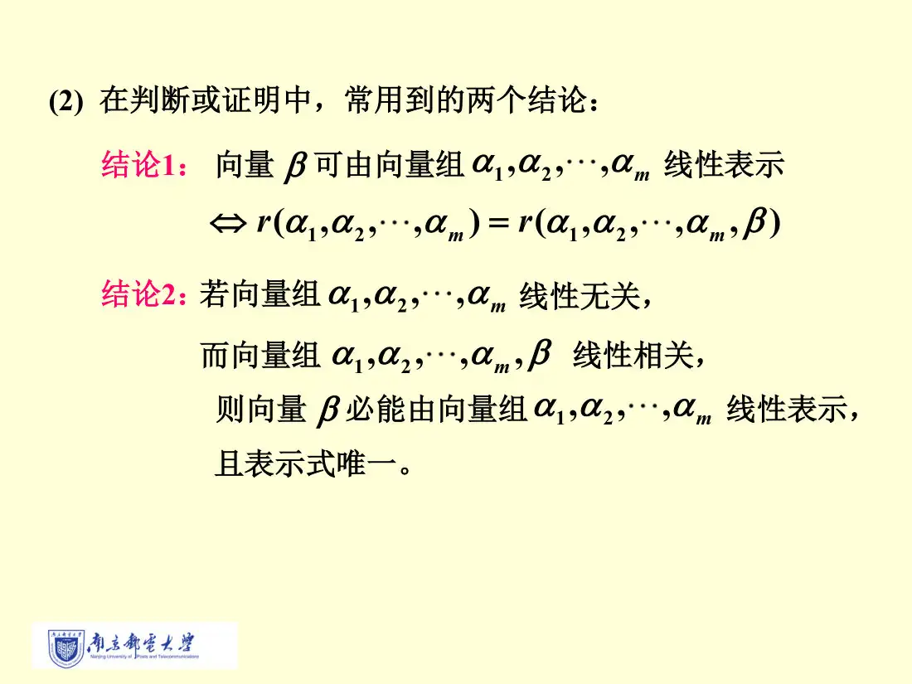

原文：

(2) 在判断或证明中，常用到的两个结论：

结论1: 向量 $\beta$ 可由向量组 $\alpha_{1}, \alpha_{2}, \cdots, \alpha_{m}$ 线性表示

$$
\Leftrightarrow r (\alpha_ {1}, \alpha_ {2}, \dots , \alpha_ {m}) = r (\alpha_ {1}, \alpha_ {2}, \dots , \alpha_ {m}, \beta)
$$

结论2: 若向量组 $\alpha_{1},\alpha_{2},\cdots,\alpha_{m}$ 线性无关，
而向量组 $\alpha_{1},\alpha_{2},\cdots,\alpha_{m},\beta$ 线性相关，
则向量 $\beta$ 必能由向量组 $\alpha_{1},\alpha_{2},\cdots,\alpha_{m}$ 线性表示，
且表示式唯一。

南京邮电大学
Nanjing University of Posts and Telecommunications

### 3. 线性相关性的判别方法

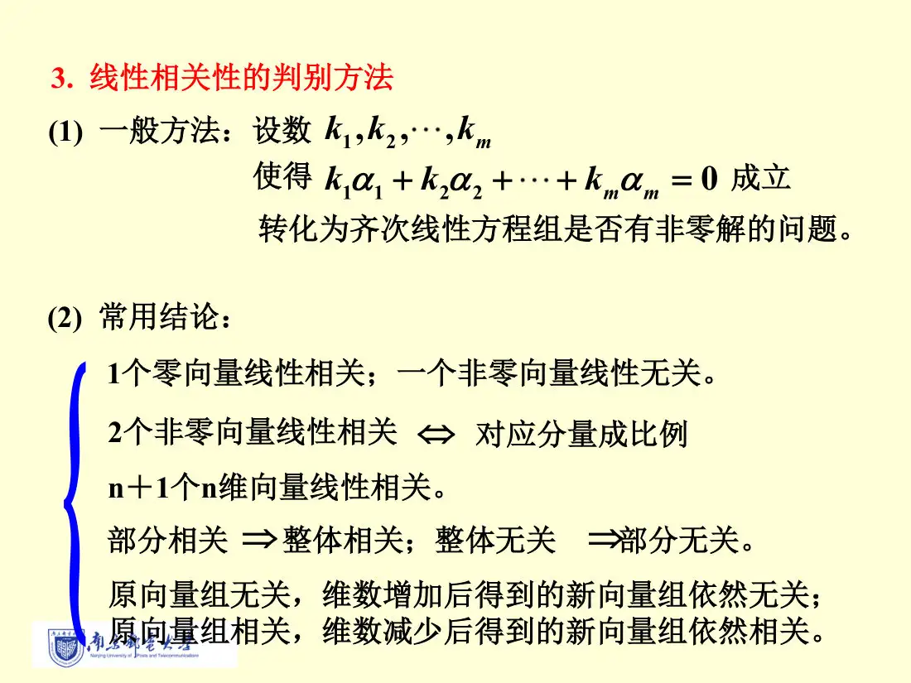

原文：

3. 线性相关性的判别方法

(1) 一般方法：设数 $k_{1}, k_{2}, \cdots, k_{m}$

使得 $k_{1}\alpha_{1} + k_{2}\alpha_{2} + \cdots + k_{m}\alpha_{m} = 0$ 成立

转化为齐次线性方程组是否有非零解的问题。

(2) 常用结论:

1个零向量线性相关；一个非零向量线性无关。

2个非零向量线性相关 $\Leftrightarrow$ 对应分量成比例

n+1个n维向量线性相关。

$$
\text { 部分相关 } \Rightarrow \text { 整体相关；整体无关 } \Rightarrow \text { 部分无关。 }
$$

原向量组无关，维数增加后得到的新向量组依然无关；原向量组相关，维数减少后得到的新向量组依然相关。

南京科技大学
University of Physics and Technology

### (3) 利用向量组的秩判断:

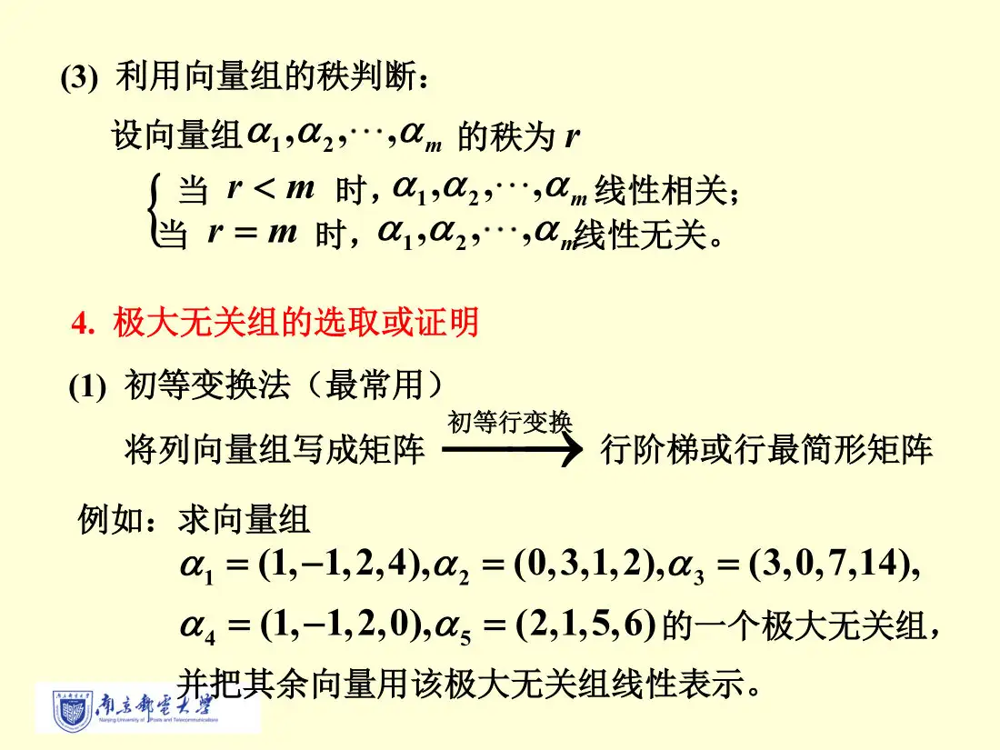

原文：

(3) 利用向量组的秩判断:

设向量组 $\alpha_{1},\alpha_{2},\cdots,\alpha_{m}$ 的秩为r

当 r < m 时， $\alpha_{1}, \alpha_{2}, \cdots, \alpha_{m}$ 线性相关；
当 r = m 时， $\alpha_{1}, \alpha_{2}, \cdots, \alpha_{m}$ 线性无关。

4. 极大无关组的选取或证明

(1) 初等变换法（最常用）

将列向量组写成矩阵 $\xrightarrow{\text{初等行变换}}$ 行阶梯或行最简形矩阵

例如：求向量组

$$
\alpha_ {1} = (1, - 1, 2, 4), \alpha_ {2} = (0, 3, 1, 2), \alpha_ {3} = (3, 0, 7, 1 4),
$$

$\alpha_{4} = (1, - 1,2,0),\alpha_{5} = (2,1,5,6)$ 的一个极大无关组，

并把其余向量用该极大无关组线性表示。

南京邮电大学
Nanjing University of Posts and Telecommunications

### $$

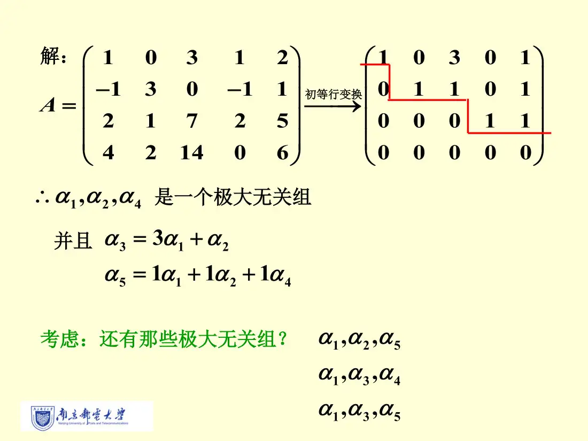

原文：

$$
A = \left( \begin{array}{r r r r r} 1 & 0 & 3 & 1 & 2 \\ - 1 & 3 & 0 & - 1 & 1 \\ 2 & 1 & 7 & 2 & 5 \\ 4 & 2 & 1 4 & 0 & 6 \end{array} \right) \xrightarrow {\text {初等行变换}} \left( \begin{array}{r r r r r} 1 & 0 & 3 & 0 & 1 \\ 0 & 1 & 1 & 0 & 1 \\ 0 & 0 & 0 & 1 & 1 \\ 0 & 0 & 0 & 0 & 0 \end{array} \right)
$$

$\therefore \alpha_{1}, \alpha_{2}, \alpha_{4}$ 是一个极大无关组

并且 $\alpha_{3} = 3\alpha_{1} + \alpha_{2}$

$$
\alpha_ {5} = 1 \alpha_ {1} + 1 \alpha_ {2} + 1 \alpha_ {4}
$$

考虑：还有那些极大无关组？ $\alpha_{1}, \alpha_{2}, \alpha_{5}$

$$
\alpha_ {1}, \alpha_ {3}, \alpha_ {4}
$$

$$
\alpha_ {1}, \alpha_ {3}, \alpha_ {5}
$$

南京邮电大学
Nanjing University of Posts and Telecommunications

### (2) 极大无关组的证明

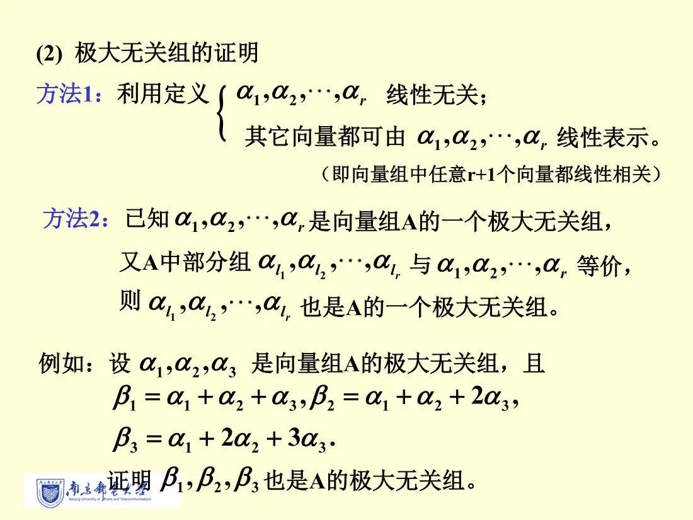

原文：

(2) 极大无关组的证明

方法1: 利用定义 $\left\{\begin{aligned}\alpha_{1},\alpha_{2},\cdots,\alpha_{r}\end{aligned}\right.$ 线性无关；
其它向量都可由 $\alpha_{1},\alpha_{2},\cdots,\alpha_{r}$ 线性表示。
(即向量组中任意r+1个向量都线性相关)

方法2: 已知 $\alpha_{1}, \alpha_{2}, \cdots, \alpha_{r}$ 是向量组A的一个极大无关组，又A中部分组 $\alpha_{l_{1}}, \alpha_{l_{2}}, \cdots, \alpha_{l_{r}}$ 与 $\alpha_{1}, \alpha_{2}, \cdots, \alpha_{r}$ 等价，则 $\alpha_{l_{1}}, \alpha_{l_{2}}, \cdots, \alpha_{l_{r}}$ 也是A的一个极大无关组。

例如：设 $\alpha_{1}, \alpha_{2}, \alpha_{3}$ 是向量组A的极大无关组，且

$$
\beta_ {1} = \alpha_ {1} + \alpha_ {2} + \alpha_ {3}, \beta_ {2} = \alpha_ {1} + \alpha_ {2} + 2 \alpha_ {3},
$$

$$
\beta_ {3} = \alpha_ {1} + 2 \alpha_ {2} + 3 \alpha_ {3}.
$$

证明 $\beta_{1},\beta_{2},\beta_{3}$ 也是A的极大无关组。

### $$

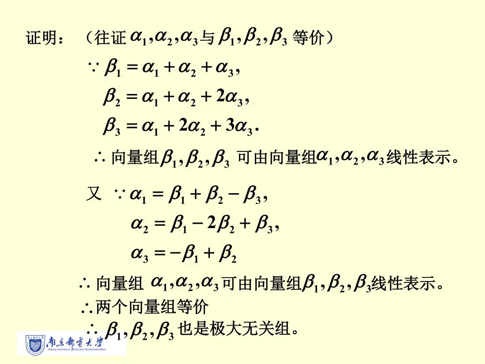

原文：

证明：（往证 $\alpha_{1},\alpha_{2},\alpha_{3}$ 与 $\beta_{1},\beta_{2},\beta_{3}$ 等价）

$$
\because \beta_ {1} = \alpha_ {1} + \alpha_ {2} + \alpha_ {3},
$$

$$
\beta_ {2} = \alpha_ {1} + \alpha_ {2} + 2 \alpha_ {3},
$$

$$
\beta_ {3} = \alpha_ {1} + 2 \alpha_ {2} + 3 \alpha_ {3}.
$$

∴ 向量组 $\beta_{1}, \beta_{2}, \beta_{3}$ 可由向量组 $\alpha_{1}, \alpha_{2}, \alpha_{3}$ 线性表示。

又 $\because \alpha_{1} = \beta_{1} + \beta_{2} - \beta_{3},$

$$
\alpha_ {2} = \beta_ {1} - 2 \beta_ {2} + \beta_ {3},
$$

$$
\alpha_ {3} = - \beta_ {1} + \beta_ {2}
$$

∴ 向量组 $\alpha_{1},\alpha_{2},\alpha_{3}$ 可由向量组 $\beta_{1},\beta_{2},\beta_{3}$ 线性表示。

∴两个向量组等价

∴ $\beta_{1}, \beta_{2}, \beta_{3}$ 也是极大无关组。

南京邮电大学
Nanjing University of Posts and Telecommunications

### 二. 矩阵的秩、向量组的秩的求法

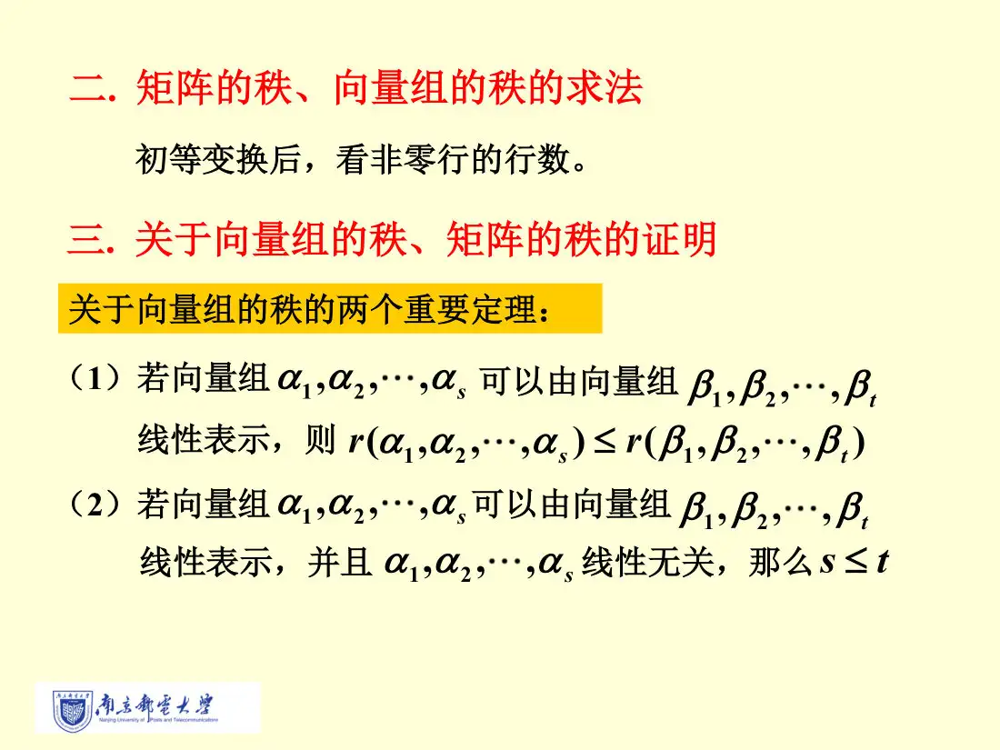

原文：

二. 矩阵的秩、向量组的秩的求法

初等变换后，看非零行的行数。

三. 关于向量组的秩、矩阵的秩的证明

关于向量组的秩的两个重要定理:

(1) 若向量组 $\alpha_{1}, \alpha_{2}, \cdots, \alpha_{s}$ 可以由向量组 $\beta_{1}, \beta_{2}, \cdots, \beta_{t}$ 线性表示，则 $r(\alpha_{1},\alpha_{2},\cdots,\alpha_{s})\leq r(\beta_{1},\beta_{2},\cdots,\beta_{t})$

(2) 若向量组 $\alpha_{1}, \alpha_{2}, \cdots, \alpha_{s}$ 可以由向量组 $\beta_{1}, \beta_{2}, \cdots, \beta_{t}$ 线性表示，并且 $\alpha_{1}, \alpha_{2}, \cdots, \alpha_{s}$ 线性无关，那么 $s \leq t$

南京邮电大学
Nanjing University of Posts and Telecommunications

### 1. 向量组秩的不等式的证明

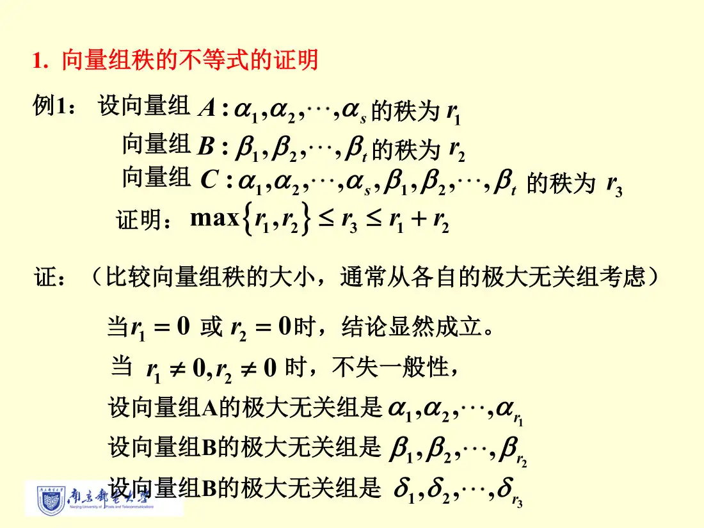

原文：

1. 向量组秩的不等式的证明

例1: 设向量组 $A:\alpha_{1},\alpha_{2},\cdots,\alpha_{s}$ 的秩为 $r_{1}$

向量组 $B: \beta_{1}, \beta_{2}, \cdots, \beta_{t}$ 的秩为 $r_{2}$

向量组 $C:\alpha_{1},\alpha_{2},\cdots,\alpha_{s},\beta_{1},\beta_{2},\cdots,\beta_{t}$ 的秩为 $r_{3}$

证明： $\max \{r_1,r_2\} \leq r_3\leq r_1 + r_2$

证：（比较向量组秩的大小，通常从各自的极大无关组考虑）

当 $r_{1}=0$ 或 $r_{2}=0$ 时，结论显然成立。

当 $r_{1} \neq 0, r_{2} \neq 0$ 时，不失一般性，

设向量组A的极大无关组是 $\alpha_{1},\alpha_{2},\cdots,\alpha_{r_{1}}$

设向量组B的极大无关组是 $\beta_{1},\beta_{2},\cdots,\beta_{r_{2}}$

设向量组B的极大无关组是 $\delta_{1},\delta_{2},\cdots,\delta_{r_{3}}$ 显然 $\delta_{1},\delta_{2},\cdots,\delta_{r_{3}}$ 可由 $\alpha_{1},\alpha_{2},\cdots,\alpha_{r_{1}},\beta_{1},\beta_{2},\cdots,\beta_{r_{2}}$ 线性表示，
又 $\delta_{1},\delta_{2},\cdots,\delta_{r_{3}}$ 线性无关， $\therefore r_{3} \leq r_{1} + r_{2}$

### 第 13 页

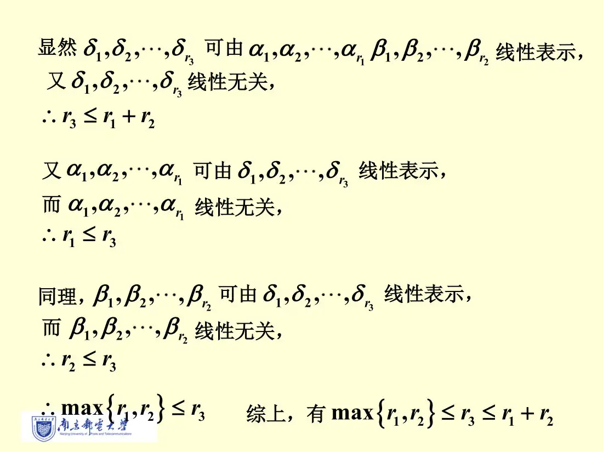

原文：

又 $\alpha_{1},\alpha_{2},\cdots,\alpha_{r_{1}}$ 可由 $\delta_{1},\delta_{2},\cdots,\delta_{r_{3}}$ 线性表示，
而 $\alpha_{1},\alpha_{2},\cdots,\alpha_{r_{1}}$ 线性无关， $\therefore r_{1} \leq r_{3}$

同理， $\beta_{1},\beta_{2},\cdots,\beta_{r_{2}}$ 可由 $\delta_{1},\delta_{2},\cdots,\delta_{r_{3}}$ 线性表示，
而 $\beta_{1},\beta_{2},\cdots,\beta_{r_{2}}$ 线性无关， $\therefore r_{2} \leq r_{3}$ $\therefore \max\{r_{1}, r_{2}\} \leq r_{3}$ 综上，有 $\max\{r_{1}, r_{2}\} \leq r_{3} \leq r_{1} + r_{2}$

### 一. 向量组线性关系的判定

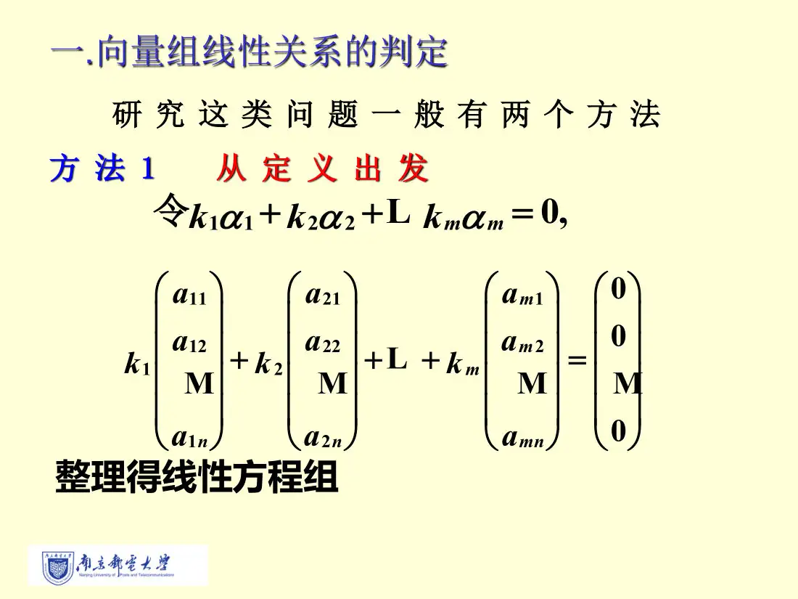

原文：

一. 向量组线性关系的判定

研究这类问题一般有两个方法

方法 1 从定义出发

令 $k_{1}\alpha_{1}+k_{2}\alpha_{2}+L\quad k_{m}\alpha_{m}=0,$

$$
k _ {1} \left( \begin{array}{c} a _ {1 1} \\ a _ {1 2} \\ \mathbf {M} \\ a _ {1 n} \end{array} \right) + k _ {2} \left( \begin{array}{c} a _ {2 1} \\ a _ {2 2} \\ \mathbf {M} \\ a _ {2 n} \end{array} \right) + \mathbf {L} + k _ {m} \left( \begin{array}{c} a _ {m 1} \\ a _ {m 2} \\ \mathbf {M} \\ a _ {m n} \end{array} \right) = \left( \begin{array}{c} \mathbf {0} \\ \mathbf {0} \\ \mathbf {M} \\ \mathbf {0} \end{array} \right)
$$

整理得线性方程组

南京邮电大学
Nanjing University of Posts and Telecommunications

### $$

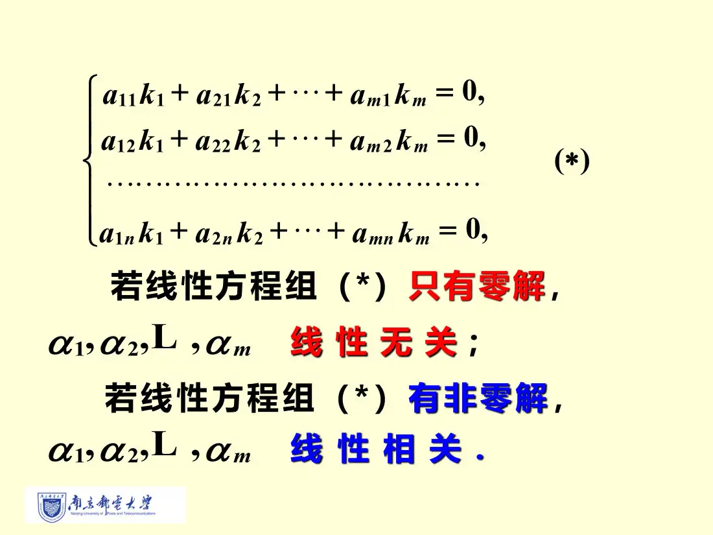

原文：

$$
\left\{ \begin{array}{l} a _ {1 1} k _ {1} + a _ {2 1} k _ {2} + \dots + a _ {m 1} k _ {m} = 0, \\ a _ {1 2} k _ {1} + a _ {2 2} k _ {2} + \dots + a _ {m 2} k _ {m} = 0, \\ \dots \\ a _ {1 n} k _ {1} + a _ {2 n} k _ {2} + \dots + a _ {m n} k _ {m} = 0, \end{array} \right.\tag{*}
$$

若线性方程组（\*）只有零解， $\alpha_{1},\alpha_{2},L,\alpha_{m}$ 线性无关；

若线性方程组（\*）有非零解， $\alpha_{1}, \alpha_{2}, L, \alpha_{m}$ 线性相关。

南京邮电大学
Nanjing University of Posts and Telecommunications

### 方法 2

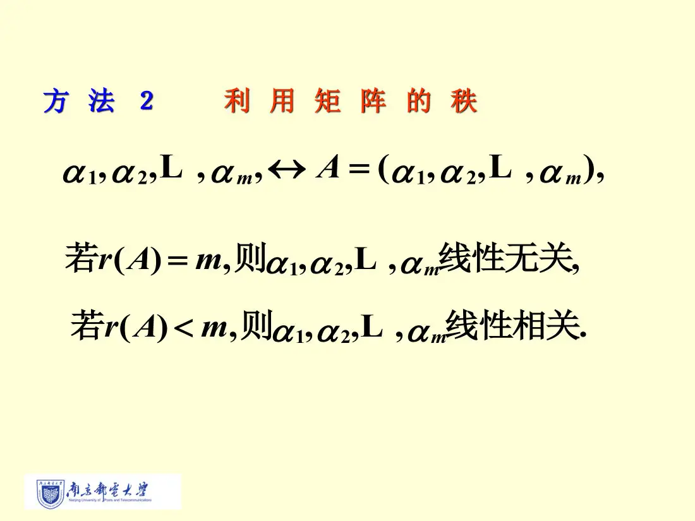

原文：

$\alpha_{1}, \alpha_{2}, \mathrm{L}, \alpha_{m}, \leftrightarrow A = (\alpha_{1}, \alpha_{2}, \mathrm{L}, \alpha_{m})$ 若 $r(A) = m$ ，则 $\alpha_{1}, \alpha_{2}, \mathrm{L}, \alpha_{m}$ 线性无关，若 $r(A) < m$ ，则 $\alpha_{1}, \alpha_{2}, \mathrm{L}, \alpha_{m}$ 线性相关.

方法 2

利用矩阵的秩

南京邮电大学
Nanjing University of Posts and Telecommunications

### 例 1 讨论下列向量组的线性相关性

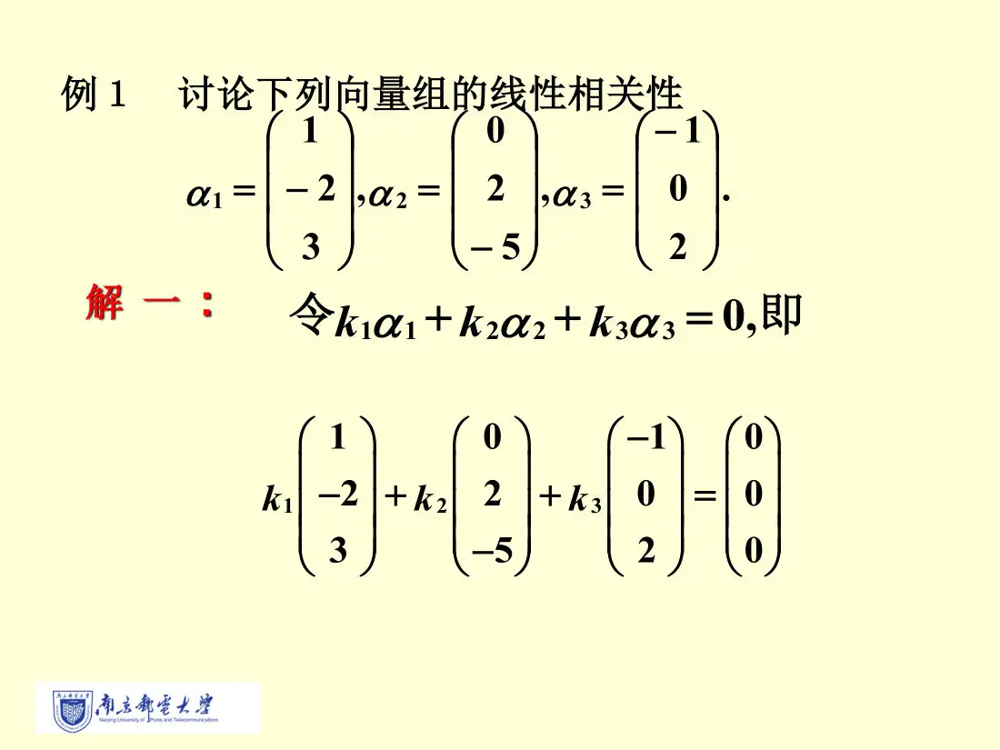

原文：

例 1 讨论下列向量组的线性相关性

$$
\alpha_ {1} = \left( \begin{array}{c} 1 \\ - 2 \\ 3 \end{array} \right), \alpha_ {2} = \left( \begin{array}{c} 0 \\ 2 \\ - 5 \end{array} \right), \alpha_ {3} = \left( \begin{array}{c} - 1 \\ 0 \\ 2 \end{array} \right).
$$

解一：令 $k_{1}\alpha_{1}+k_{2}\alpha_{2}+k_{3}\alpha_{3}=0$ ，即

$$
k _ {1} \left( \begin{array}{c} 1 \\ - 2 \\ 3 \end{array} \right) + k _ {2} \left( \begin{array}{c} 0 \\ 2 \\ - 5 \end{array} \right) + k _ {3} \left( \begin{array}{c} - 1 \\ 0 \\ 2 \end{array} \right) = \left( \begin{array}{c} 0 \\ 0 \\ 0 \end{array} \right)
$$

南京邮电大学
Nanjing University of Posts and Telecommunications

### (\*)

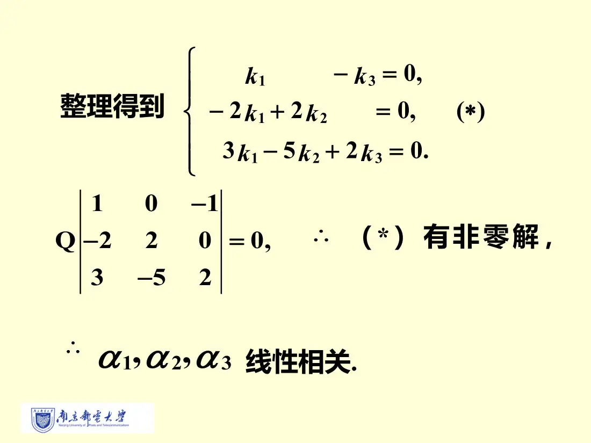

原文：

(\*)

整理得到

$$
\left\{ \begin{array}{r l} k _ {1} & - k _ {3} = 0, \\ - 2 k _ {1} + 2 k _ {2} & = 0, \\ 3 k _ {1} - 5 k _ {2} + 2 k _ {3} = 0. \end{array} \right.
$$

Q $\begin{vmatrix}1&0&-1\\-2&2&0\\3&-5&2\end{vmatrix}=0,\quad\therefore\quad(*)$ 有非零解，

∴ $\alpha_{1},\alpha_{2},\alpha_{3}$ 线性相关.

南京邮电大学
Nanjing University of Posts and Telecommunications

### 解二：

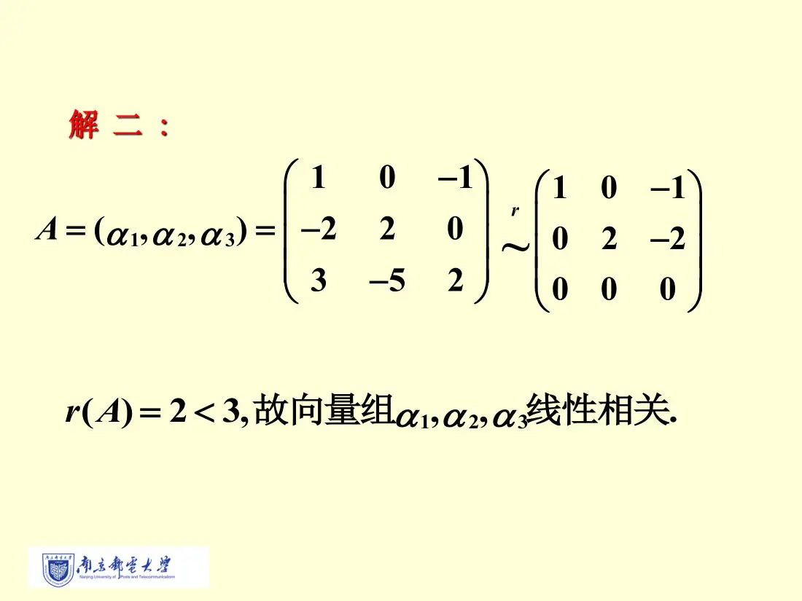

原文：

解二：

$$
A = (\alpha_ {1}, \alpha_ {2}, \alpha_ {3}) = \left( \begin{array}{c c c} 1 & 0 & - 1 \\ - 2 & 2 & 0 \\ 3 & - 5 & 2 \end{array} \right) \stackrel {{r}} {{\sim}} \left( \begin{array}{c c c} 1 & 0 & - 1 \\ 0 & 2 & - 2 \\ 0 & 0 & 0 \end{array} \right)
$$

$r(A)=2<3$ , 故向量组 $\alpha_{1},\alpha_{2},\alpha_{3}$ 线性相关.

南京邮电大学
Nanjing University of Posts and Telecommunications

### 第 20 页

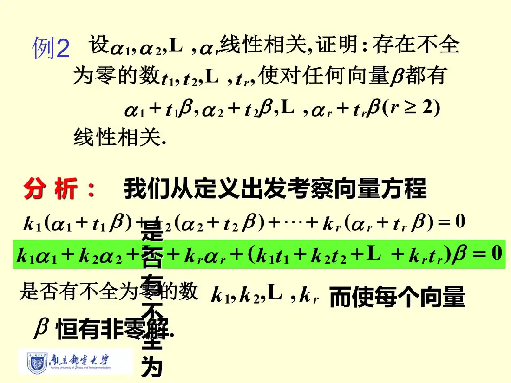

原文：

例2 设 $\alpha_{1}, \alpha_{2}, \mathbf{L}, \alpha_{r}$ 线性相关, 证明: 存在不全为零的数 $t_{1}, t_{2}, \mathbf{L}, t_{r}$ , 使对任何向量 $\beta$ 都有 $\alpha_{1} + t_{1} \beta, \alpha_{2} + t_{2} \beta, \mathbf{L}, \alpha_{r} + t_{r} \beta (r \geq 2)$ 线性相关.

$k_{1}(\alpha_{1}+t_{1}\beta)+t_{2}(\alpha_{2}+t_{2}\beta)+\cdots+k_{r}(\alpha_{r}+t_{r}\beta)=0$ $k_{1}\alpha_{1}+k_{2}\alpha_{2}+\text{否}+k_{r}\alpha_{r}+(k_{1}t_{1}+k_{2}t_{2}+L+k_{r}t_{r})\beta=0$ 是否有不全为零的数 $k_{1}, k_{2}, L, k_{r}$ 而使每个向量 $\beta$ 恒有非零解.

为

### 南京邮电大学

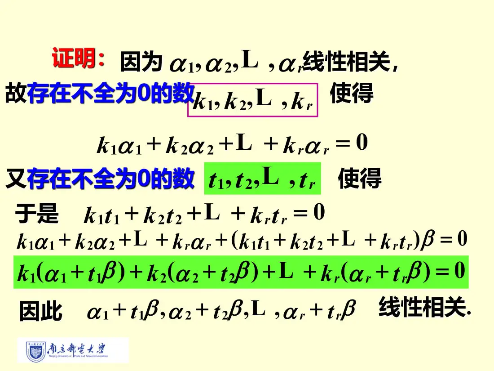

原文：

证明：因为 $\alpha_{1},\alpha_{2},\mathbf{L},\alpha_{r}$ 线性相关，故存在不全为0的数 $k_{1},k_{2},\mathbf{L},k_{r}$ 使得 $k_{1}\alpha_{1} + k_{2}\alpha_{2} + \mathbf{L} + k_{r}\alpha_{r} = 0$ 又存在不全为0的数 $t_1,t_2,\mathbf{L},t_r$ 使得于是 $k_{1}t_{1} + k_{2}t_{2} + \mathbf{L} + k_{r}t_{r} = 0$ $k_{1}\alpha_{1} + k_{2}\alpha_{2} + \mathbf{L} + k_{r}\alpha_{r} + (k_{1}t_{1} + k_{2}t_{2} + \mathbf{L} + k_{r}t_{r})\beta = 0$ $k_{1}(\alpha_{1} + t_{1}\beta) + k_{2}(\alpha_{2} + t_{2}\beta) + \mathbf{L} + k_{r}(\alpha_{r} + t_{r}\beta) = 0$ 因此 $\alpha_{1} + t_{1}\beta ,\alpha_{2} + t_{2}\beta ,\mathbf{L},\alpha_{r} + t_{r}\beta$ 线性相关.

南京邮电大学
Nanjing University of Posts and Telecommunications

### $$

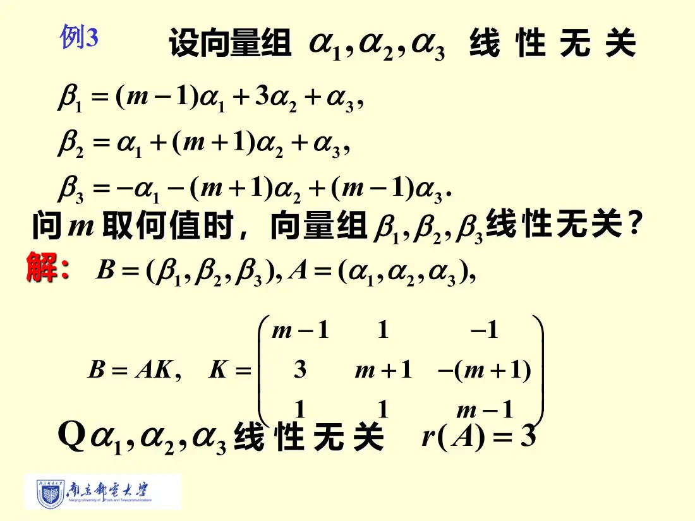

原文：

例3 设向量组 $\alpha_{1}, \alpha_{2}, \alpha_{3}$ 线性无关

$$
\beta_ {1} = (m - 1) \alpha_ {1} + 3 \alpha_ {2} + \alpha_ {3},
$$

$$
\beta_ {2} = \alpha_ {1} + (m + 1) \alpha_ {2} + \alpha_ {3},
$$

$$
\beta_ {3} = - \alpha_ {1} - (m + 1) \alpha_ {2} + (m - 1) \alpha_ {3}.
$$

问 m 取何值时，向量组 $\beta_{1}, \beta_{2}, \beta_{3}$ 线性无关？

解： $B = (\beta_{1},\beta_{2},\beta_{3}),A = (\alpha_{1},\alpha_{2},\alpha_{3}),$

$B = AK, K = \begin{pmatrix} m - 1 & 1 & -1 \\ 3 & m + 1 & -(m + 1) \\ 1 & 1 & m - 1 \end{pmatrix}$ $\mathbf{Q}\alpha_{1},\alpha_{2},\alpha_{3}$ 线性无关 $r(A) = 3$

南京邮电大学
Nanjing University of Posts and Telecommunications

### $$

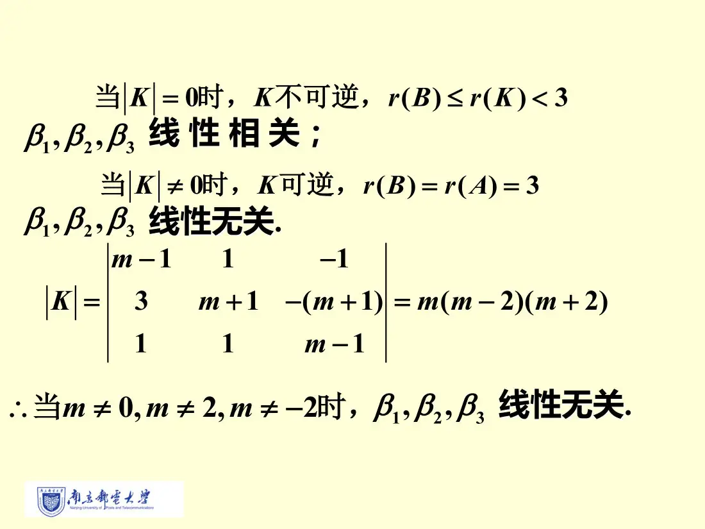

原文：

当 $|K|=0$ 时，K不可逆， $r(B)\leq r(K)<3$ $\beta_{1},\beta_{2},\beta_{3}$ 线性相关；

当 $|K|\neq0$ 时，K可逆， $r(B)=r(A)=3$ $\beta_{1},\beta_{2},\beta_{3}$ 线性无关.

$$
| K | = \left| \begin{array}{c c c} m - 1 & 1 & - 1 \\ 3 & m + 1 & - (m + 1) \\ 1 & 1 & m - 1 \end{array} \right| = m (m - 2) (m + 2)
$$

∴当 $m\neq0,m\neq2,m\neq-2$ 时， $\beta_{1},\beta_{2},\beta_{3}$ 线性无关.

南京邮电大学
Nanjing University of Posts and Telecommunications

### 证明B的列向量组线性无关

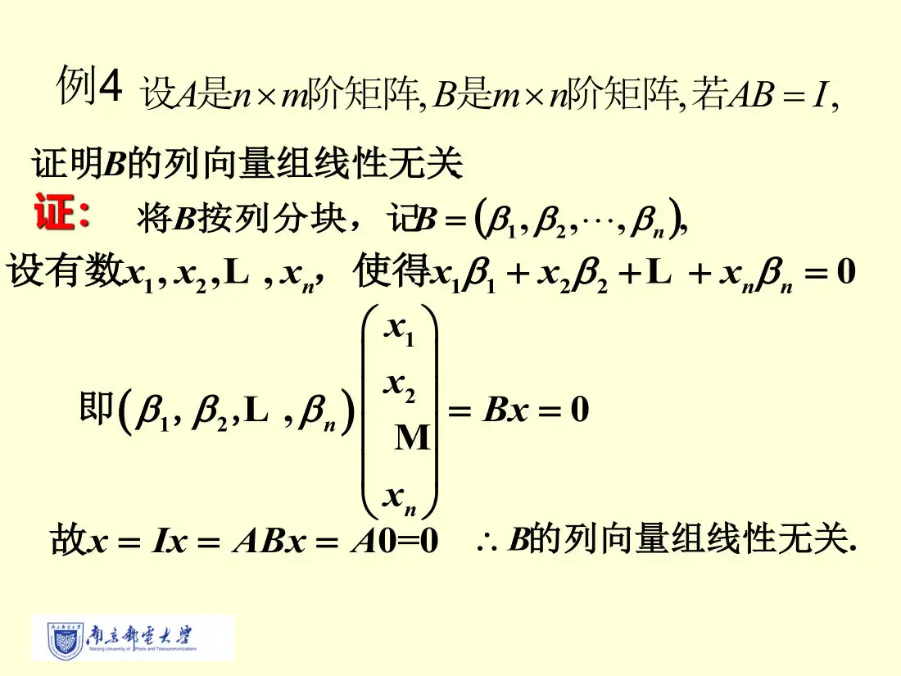

原文：

例4 设A是 $n \times m$ 阶矩阵, B是 $m \times n$ 阶矩阵, 若AB = I,
证明B的列向量组线性无关

证：将B按列分块，记 $B=(\beta_{1},\beta_{2},\cdots,\beta_{n})$ ，
设有数 $x_{1},x_{2},L,x_{n}$ ，使得 $x_{1}\beta_{1}+x_{2}\beta_{2}+L+x_{n}\beta_{n}=0$ 即 $\left(\beta_{1},\beta_{2},L,\beta_{n}\right)\begin{pmatrix}x_{1}\\x_{2}\\M\\x_{n}\end{pmatrix}=Bx=0$ 故x=Ix=ABx=A0=0 ∴B的列向量组线性无关.

南京邮电大学
Nanjing University of Posts and Telecommunications

### 二、求向量组的最大无关组

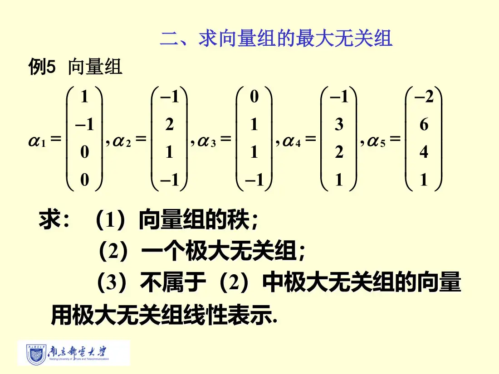

原文：

二、求向量组的最大无关组

例5 向量组

$$
\alpha_ {1} = \left( \begin{array}{c} 1 \\ - 1 \\ 0 \\ 0 \end{array} \right), \alpha_ {2} = \left( \begin{array}{c} - 1 \\ 2 \\ 1 \\ - 1 \end{array} \right), \alpha_ {3} = \left( \begin{array}{c} 0 \\ 1 \\ 1 \\ - 1 \end{array} \right), \alpha_ {4} = \left( \begin{array}{c} - 1 \\ 3 \\ 2 \\ 1 \end{array} \right), \alpha_ {5} = \left( \begin{array}{c} - 2 \\ 6 \\ 4 \\ 1 \end{array} \right)
$$

求: (1) 向量组的秩;

(2) 一个极大无关组;

(3) 不属于 (2) 中极大无关组的向量用极大无关组线性表示.

南京邮电大学
Nanjing University of Posts and Telecommunications

### $$

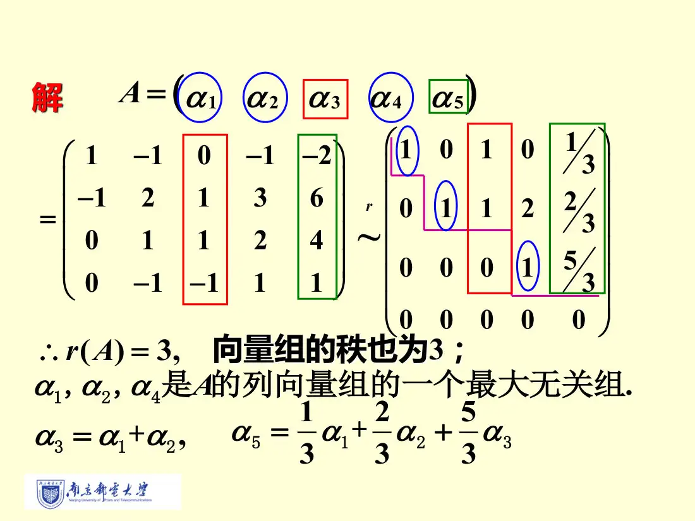

原文：

解 $A=\left(\alpha_{1}\quad\alpha_{2}\quad\alpha_{3}\quad\alpha_{4}\quad\alpha_{5}\right)$

$$
= \left( \begin{array}{c c c c c} 1 & - 1 & \boxed {0} & - 1 & \boxed {- 2} \\ - 1 & 2 & 1 & 3 & 6 \\ 0 & 1 & 1 & 2 & 4 \\ 0 & - 1 & - 1 & 1 & 1 \end{array} \right) \sim \left( \begin{array}{c c c c c} \boxed {1} & 0 & \boxed {1} & 0 & \boxed {1 / 3} \\ 0 & \boxed {1} & 1 & 2 & \boxed {2 / 3} \\ 0 & 0 & 0 & \boxed {1} & \boxed {5 / 3} \\ 0 & 0 & 0 & 0 & 0 \end{array} \right)
$$

$\therefore r(A) = 3,\quad \text{向量组的秩也为}3;$

$\alpha_{1}, \alpha_{2}, \alpha_{4}$ 是A的列向量组的一个最大无关组.

$$
\alpha_ {3} = \alpha_ {1} + \alpha_ {2}, \quad \alpha_ {5} = \frac {1}{3} \alpha_ {1} + \frac {2}{3} \alpha_ {2} + \frac {5}{3} \alpha_ {3}
$$

南京邮电大学
Nanjing University of Posts and Telecommunications

### 三.向量空间的判定

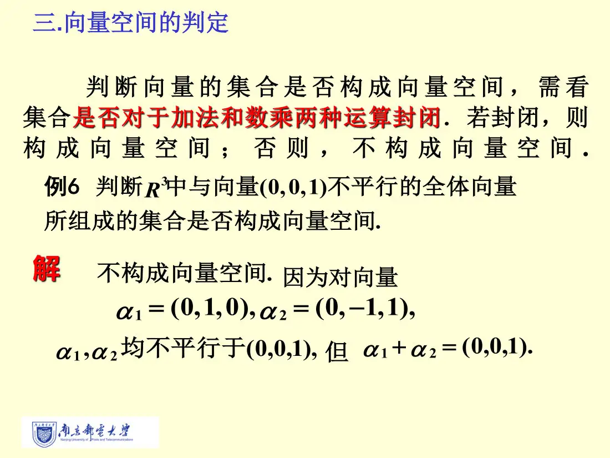

原文：

三.向量空间的判定

判断向量的集合是否构成向量空间，需看集合是否对于加法和数乘两种运算封闭。若封闭，则构成向量空间；否则，不构成向量空间。

例6 判断 $R^3$ 中与向量 $(0,0,1)$ 不平行的全体向量

所组成的集合是否构成向量空间.

解 不构成向量空间. 因为对向量

$$
\alpha_ {1} = (0, 1, 0), \alpha_ {2} = (0, - 1, 1),
$$

$\alpha_{1}, \alpha_{2}$ 均不平行于 $(0, 0, 1)$ , 但 $\alpha_{1} + \alpha_{2} = (0, 0, 1)$ .

南京邮电大学
Nanjing University of Posts and Telecommunications

### 四．基变换与坐标变换

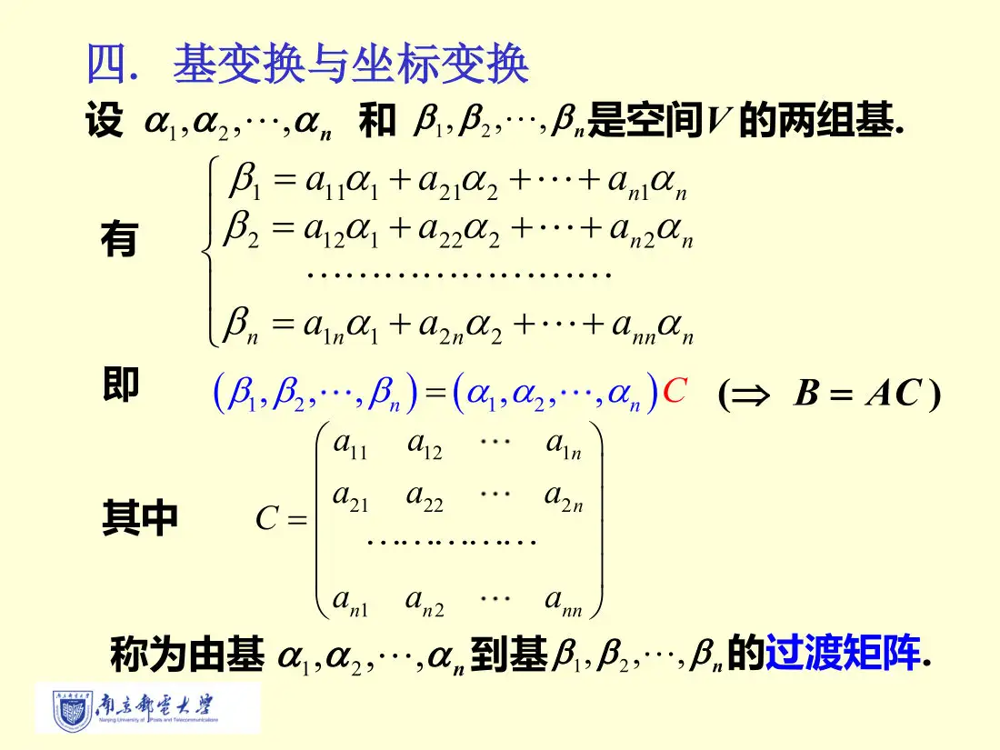

原文：

四．基变换与坐标变换

设 $\alpha_{1},\alpha_{2},\cdots,\alpha_{n}$ 和 $\beta_{1},\beta_{2},\cdots,\beta_{n}$ 是空间 V 的两组基.

有

$$
\left\{ \begin{array}{l} \beta_ {1} = a _ {1 1} \alpha_ {1} + a _ {2 1} \alpha_ {2} + \dots + a _ {n 1} \alpha_ {n} \\ \beta_ {2} = a _ {1 2} \alpha_ {1} + a _ {2 2} \alpha_ {2} + \dots + a _ {n 2} \alpha_ {n} \\ \dots\dots\\ \beta_ {n} = a _ {1 n} \alpha_ {1} + a _ {2 n} \alpha_ {2} + \dots + a _ {n n} \alpha_ {n} \end{array} \right.
$$

即

$$
\left(\beta_ {1}, \beta_ {2}, \dots , \beta_ {n}\right) = \left(\alpha_ {1}, \alpha_ {2}, \dots , \alpha_ {n}\right) C (\Rightarrow B = A C)
$$

其中

$$
C = \left( \begin{array}{c c c c} a _ {1 1} & a _ {1 2} & \dots & a _ {1 n} \\ a _ {2 1} & a _ {2 2} & \dots & a _ {2 n} \\ \dots & \dots & \dots & \dots \\ a _ {n 1} & a _ {n 2} & \dots & a _ {n n} \end{array} \right)
$$

称为由基 $\alpha_{1},\alpha_{2},\cdots,\alpha_{n}$ 到基 $\beta_{1},\beta_{2},\cdots,\beta_{n}$ 的过渡矩阵.

南京邮电大学
Nanjing University of Posts and Telecommunications

### 可知C可逆，故有

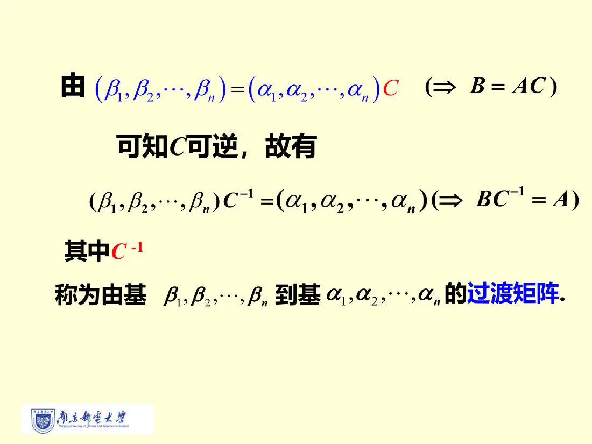

原文：

由 $\left(\beta_{1},\beta_{2},\cdots,\beta_{n}\right)=\left(\alpha_{1},\alpha_{2},\cdots,\alpha_{n}\right)C$ $(\Rightarrow B=AC)$

可知C可逆，故有

$$
(\beta_ {1}, \beta_ {2}, \dots , \beta_ {n}) C ^ {- 1} = (\alpha_ {1}, \alpha_ {2}, \dots , \alpha_ {n}) (\Rightarrow B C ^ {- 1} = A)
$$

其中 $C^{-1}$

称为由基 $\beta_{1},\beta_{2},\cdots,\beta_{n}$ 到基 $\alpha_{1},\alpha_{2},\cdots,\alpha_{n}$ 的过渡矩阵.

南京邮电大学
Nanjing University of Posts and Telecommunications

### $$

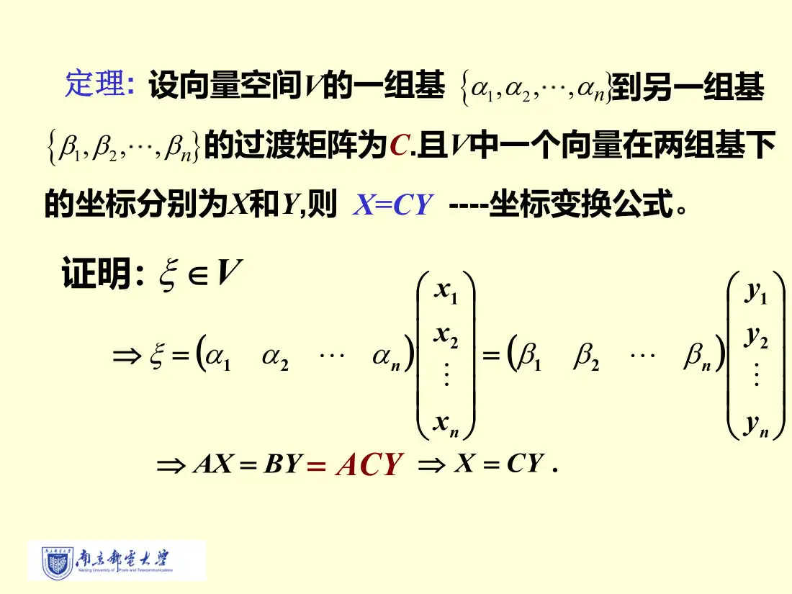

原文：

定理: 设向量空间 V 的一组基 $\left\{\alpha_{1},\alpha_{2},\cdots,\alpha_{n}\right\}$ 到另一组基 $\left\{\beta_{1},\beta_{2},\cdots,\beta_{n}\right\}$ 的过渡矩阵为 C. 且 V 中一个向量在两组基下的坐标分别为 X 和 Y, 则 X=CY ---- 坐标变换公式。

$$
\begin{array}{r l} & {\text {证明:} \xi \in V} \\ & {\Rightarrow \xi = (\alpha_ {1} \quad \alpha_ {2} \quad \dots \quad \alpha_ {n}) \left( \begin{array}{c} x _ {1} \\ x _ {2} \\ \vdots \\ x _ {n} \end{array} \right) = (\beta_ {1} \quad \beta_ {2} \quad \dots \quad \beta_ {n}) \left( \begin{array}{c} y _ {1} \\ y _ {2} \\ \vdots \\ y _ {n} \end{array} \right)} \\ & {\Rightarrow A X = B Y = A C Y \Rightarrow X = C Y.} \end{array}
$$

南京邮电大学
Nanjing University of Posts and Telecommunications

### 例7 已知 $R^3$ 的两组基

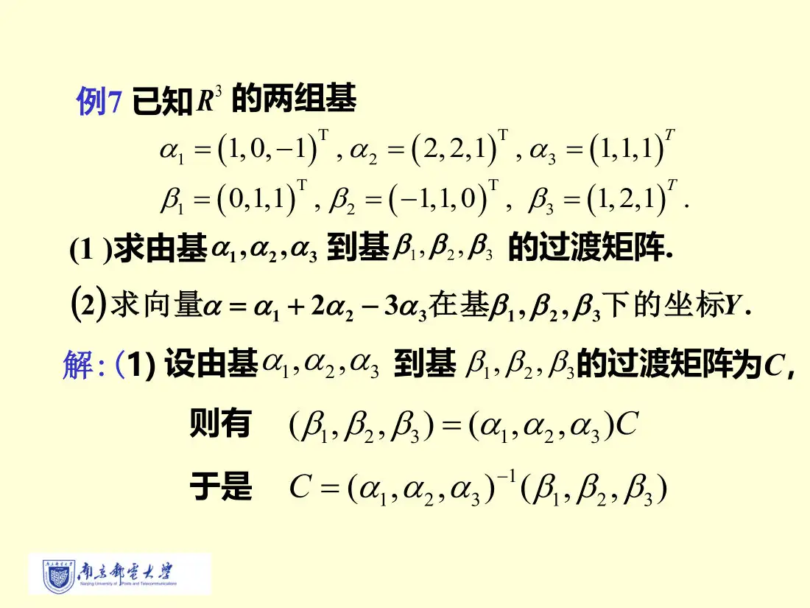

原文：

例7 已知 $R^3$ 的两组基

$$
\alpha_ {1} = (1, 0, - 1) ^ {\mathrm{T}}, \alpha_ {2} = (2, 2, 1) ^ {\mathrm{T}}, \alpha_ {3} = (1, 1, 1) ^ {T}
$$

$$
\beta_ {1} = (0, 1, 1) ^ {\mathrm{T}}, \beta_ {2} = (- 1, 1, 0) ^ {\mathrm{T}}, \beta_ {3} = (1, 2, 1) ^ {T}
$$

(1) 求由基 $\alpha_{1}, \alpha_{2}, \alpha_{3}$ 到基 $\beta_{1}, \beta_{2}, \beta_{3}$ 的过渡矩阵.

(2) 求向量 $\alpha = \alpha_{1} + 2\alpha_{2} - 3\alpha_{3}$ 在基 $\beta_{1}, \beta_{2}, \beta_{3}$ 下的坐标 Y.

解: (1) 设由基 $\alpha_{1}, \alpha_{2}, \alpha_{3}$ 到基 $\beta_{1}, \beta_{2}, \beta_{3}$ 的过渡矩阵为 C,

则有 $(\beta_{1},\beta_{2},\beta_{3})=(\alpha_{1},\alpha_{2},\alpha_{3})C$

于是 $C = (\alpha_{1},\alpha_{2},\alpha_{3})^{-1}(\beta_{1},\beta_{2},\beta_{3})$

南京邮电大学
Nanjing University of Posts and Telecommunications

### $$

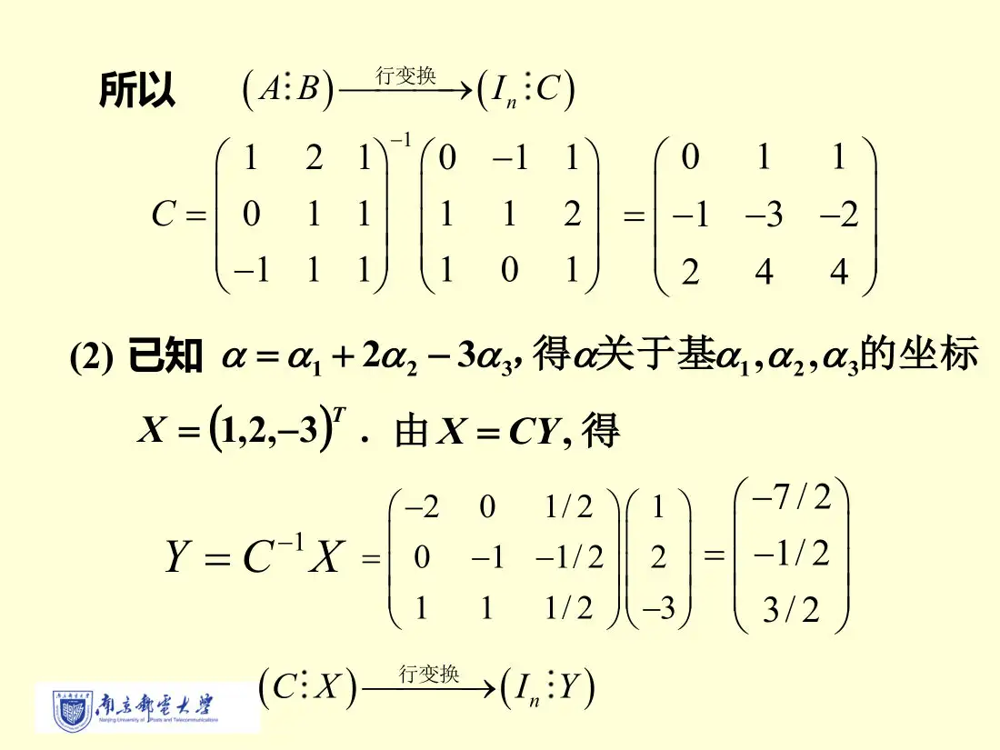

原文：

所以 $(A:B)\xrightarrow{\text{行变换}}(I_{n}:C)$

$$
C = \left( \begin{array}{c c c} 1 & 2 & 1 \\ 0 & 1 & 1 \\ - 1 & 1 & 1 \end{array} \right) ^ {- 1} \left( \begin{array}{c c c} 0 & - 1 & 1 \\ 1 & 1 & 2 \\ 1 & 0 & 1 \end{array} \right) = \left( \begin{array}{c c c} 0 & 1 & 1 \\ - 1 & - 3 & - 2 \\ 2 & 4 & 4 \end{array} \right)
$$

(2) 已知 $\alpha = \alpha_{1} + 2\alpha_{2} - 3\alpha_{3}$ , 得 $\alpha$ 关于基 $\alpha_{1}, \alpha_{2}, \alpha_{3}$ 的坐标 $X = (1, 2, -3)^{T}$ . 由 $X = CY$ , 得

$$
Y = C ^ {- 1} X = \left( \begin{array}{c c c} - 2 & 0 & 1 / 2 \\ 0 & - 1 & - 1 / 2 \\ 1 & 1 & 1 / 2 \end{array} \right) \left( \begin{array}{c} 1 \\ 2 \\ - 3 \end{array} \right) = \left( \begin{array}{c} - 7 / 2 \\ - 1 / 2 \\ 3 / 2 \end{array} \right)
$$

$$
(C \vdots X) \xrightarrow {\text {行变换}} (I _ {n} \vdots Y)
$$

南京邮电大学
Nanjing University of Posts and Telecommunications
