# 《线性代数与解析几何》第4章 向量空间（课件）

原件的每一页，下面附识别出的文字。

### 4.4 向量空间

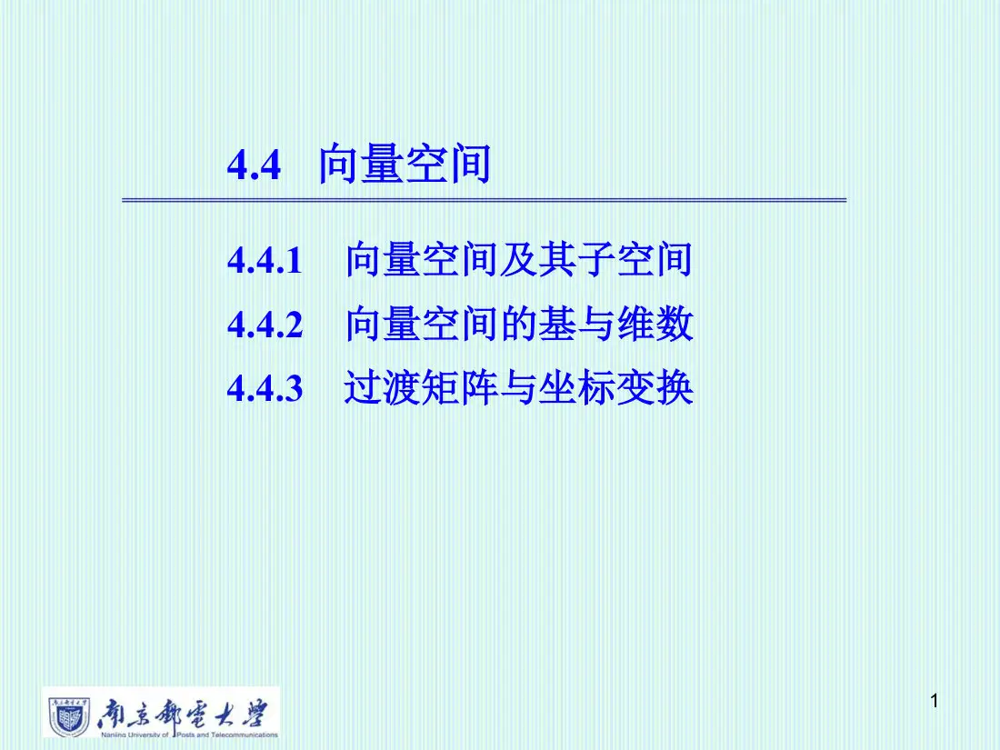

原文：

4.4 向量空间

4.4.1 向量空间及其子空间

4.4.2 向量空间的基与维数

4.4.3 过渡矩阵与坐标变换

南京邮电大学
Nanjing University of Posts and Telecommunications

1

### 4.4 向量空间

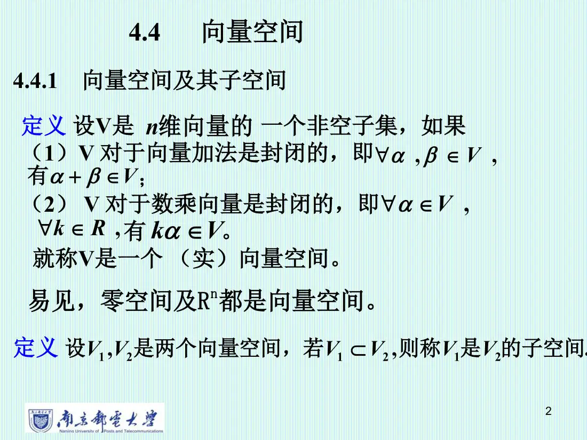

原文：

4.4 向量空间

4.4.1 向量空间及其子空间

定义 设V是 n维向量的一个非空子集，如果

(1) V 对于向量加法是封闭的, 即 $\forall \alpha, \beta \in V$ , 有 $\alpha + \beta \in V$ ;

(2) V 对于数乘向量是封闭的, 即 $\forall \alpha \in V$ , $\forall k \in R$ , 有 $k \alpha \in V$ 。

就称V是一个（实）向量空间。

易见，零空间及 $\mathbb{R}^{\mathrm{n}}$ 都是向量空间。

定义 设 $V_{1}, V_{2}$ 是两个向量空间，若 $V_{1} \subset V_{2}$ ，则称 $V_{1}$ 是 $V_{2}$ 的子空间。

南京邮电大学
Nanjing University of Posts and Telecommunications

2

### 例1 判别下列集合是否为向量空间.

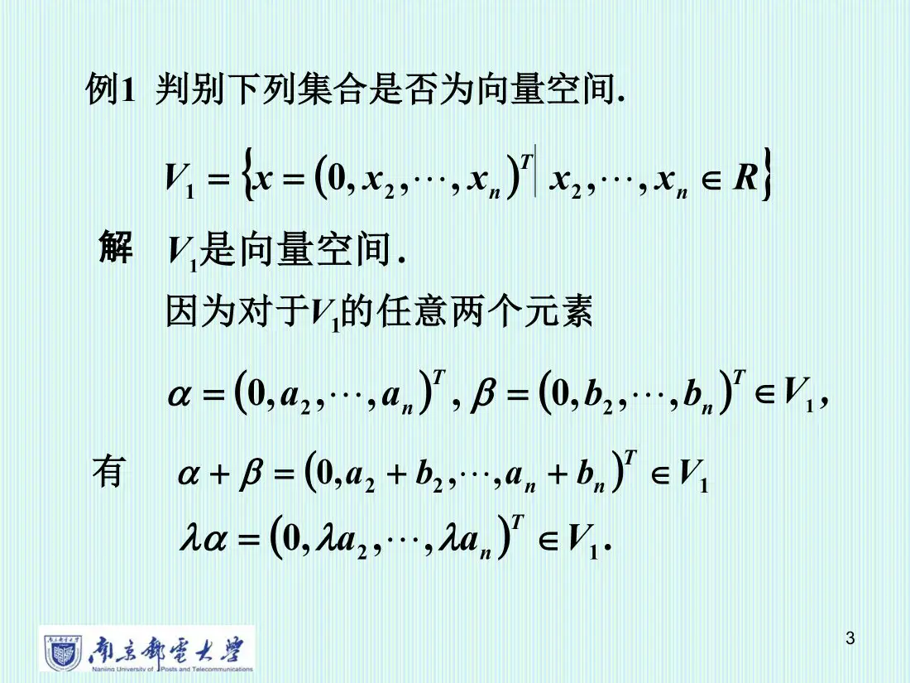

原文：

例1 判别下列集合是否为向量空间.

$$
V _ {1} = \left\{x = (0, x _ {2}, \dots , x _ {n}) ^ {T} \mid x _ {2}, \dots , x _ {n} \in R \right\}
$$

解 $V_{1}$ 是向量空间.

因为对于 $V_{1}$ 的任意两个元素

$$
\boldsymbol {\alpha} = \left(\mathbf {0}, a _ {2}, \dots , a _ {n}\right) ^ {T}, \boldsymbol {\beta} = \left(\mathbf {0}, b _ {2}, \dots , b _ {n}\right) ^ {T} \in V _ {1},
$$

有 $\alpha + \beta = (0, a_{2} + b_{2}, \cdots, a_{n} + b_{n})^{T} \in V_{1}$

$$
\lambda \alpha = (0, \lambda a _ {2}, \dots , \lambda a _ {n}) ^ {T} \in V _ {1}
$$

南京邮电大学
Nanjing University of Posts and Telecommunications

3

### 例2 判别下列集合是否为向量空间.

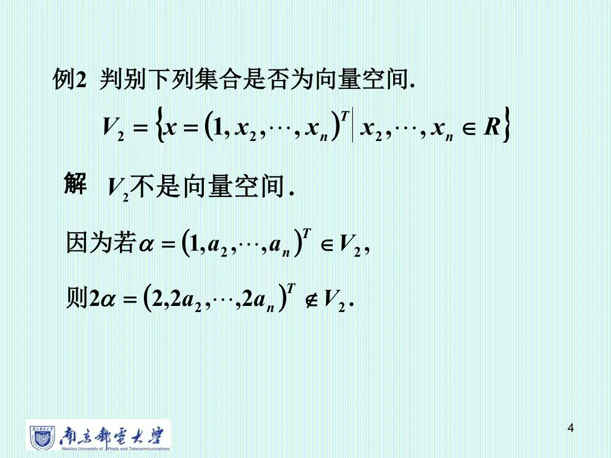

原文：

例2 判别下列集合是否为向量空间.

$$
V _ {2} = \left\{x = (1, x _ {2}, \dots , x _ {n}) ^ {T} \mid x _ {2}, \dots , x _ {n} \in R \right\}
$$

解 $V_{2}$ 不是向量空间.

因为若 $\alpha=(1,a_{2},\cdots,a_{n})^{T}\in V_{2}$

则 $2\alpha=(2,2a_{2},\cdots,2a_{n})^{T}\notin V_{2}$ .

南京邮电大学
Nanjing University of Posts and Telecommunications

4

### 例3.设 $a, b$ 为两个 $n$ 维向量，那么集合

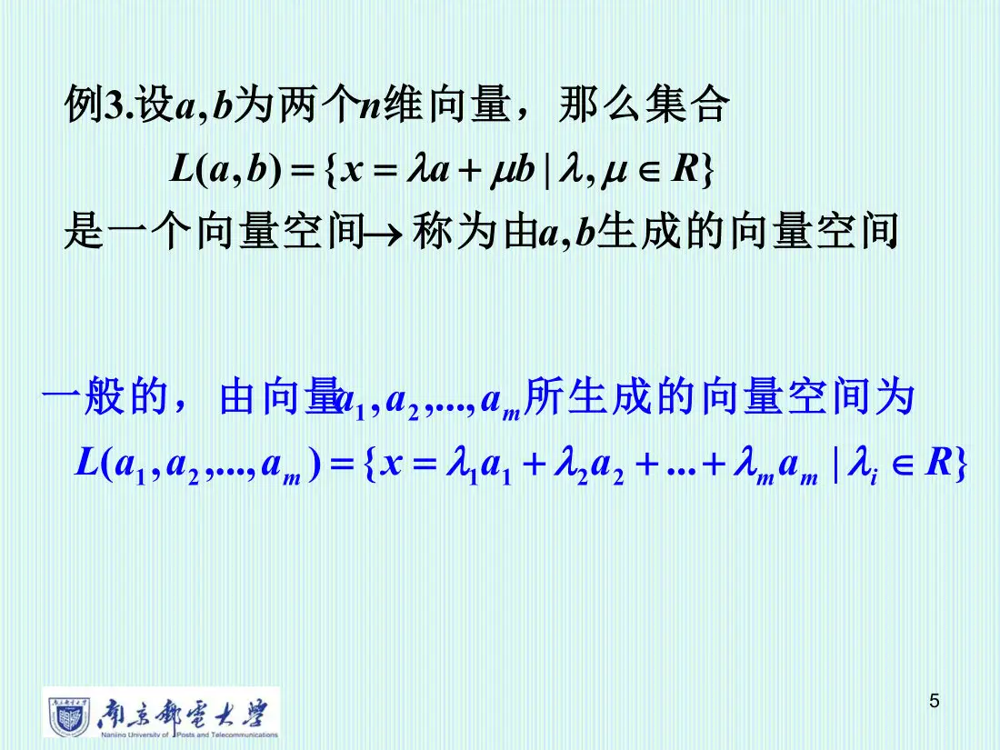

原文：

例3.设 $a, b$ 为两个 $n$ 维向量，那么集合

$L(a,b) = \{x = \lambda a + \mu b\mid \lambda ,\mu \in R\}$ 是一个向量空间 $\rightarrow$ 称为由 $a,b$ 生成的向量空间

一般的，由向量 $a_{1},a_{2},\ldots,a_{m}$ 所生成的向量空间为 $L(a_{1},a_{2},\ldots,a_{m})=\{x=\lambda_{1}a_{1}+\lambda_{2}a_{2}+\ldots+\lambda_{m}a_{m}\mid\lambda_{i}\in R\}$

南京邮电大学
Nanjing University of Posts and Telecommunications

5

### 4.4.2 向量空间的基与维数

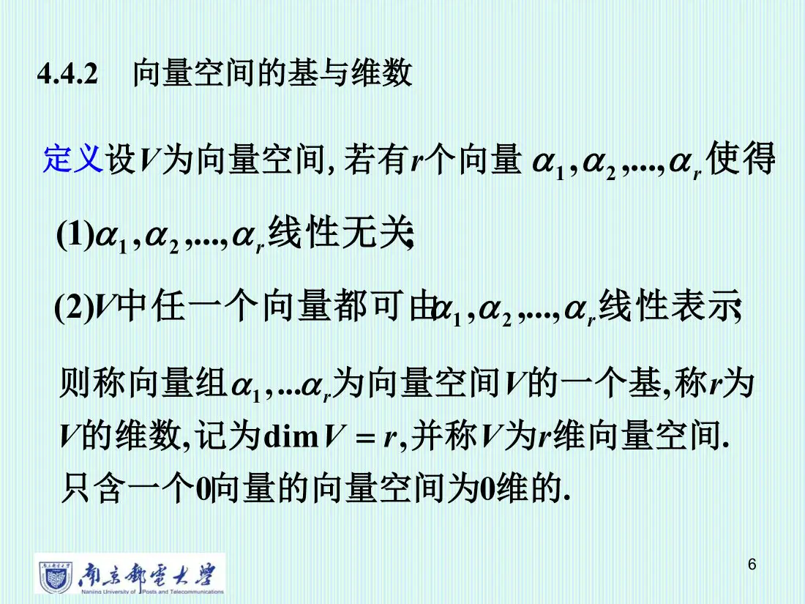

原文：

4.4.2 向量空间的基与维数

定义设V为向量空间, 若有r个向量 $\alpha_{1}, \alpha_{2}, \ldots, \alpha_{r}$ 使得

(1) $\alpha_{1},\alpha_{2},\ldots,\alpha_{r}$ 线性无关

(2) $V$ 中任一个向量都可由 $\alpha_{1}, \alpha_{2}, \ldots, \alpha_{r}$ 线性表示则称向量组 $\alpha_{1}, \ldots, \alpha_{r}$ 为向量空间 $V$ 的一个基, 称 $r$ 为 $V$ 的维数, 记为 $\dim V = r$ , 并称 $V$ 为 $r$ 维向量空间. 只含一个0向量的向量空间为0维的.

南京邮电大学
Nanjing University of Posts and Telecommunications

6

### 南京邮电大学

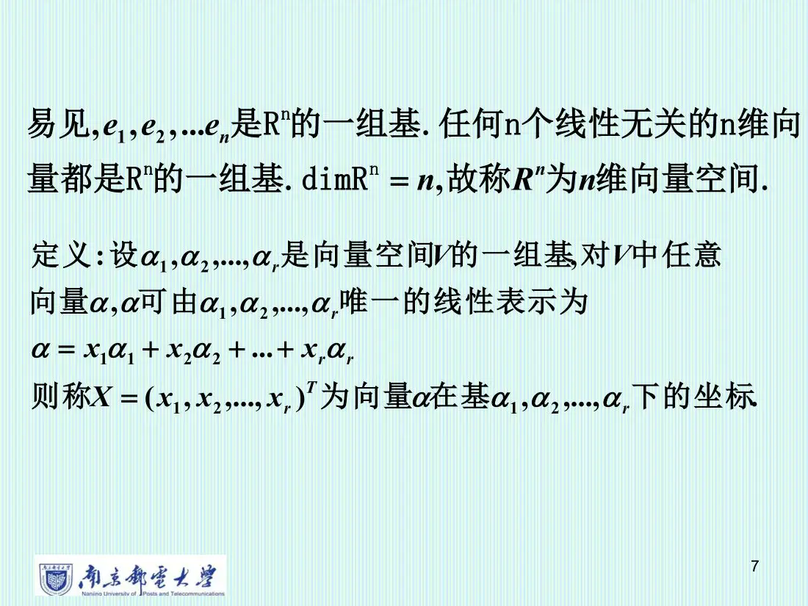

原文：

易见, $e_{1},e_{2},\ldots,e_{n}$ 是 $R^{n}$ 的一组基. 任何n个线性无关的n维向量都是 $R^{n}$ 的一组基. $\dim R^{n}=n$ ,故称 $R^{n}$ 为n维向量空间.

定义:设 $\alpha_{1},\alpha_{2},..., \alpha_{r}$ 是向量空间 $V$ 的一组基,对 $V$ 中任意向量 $\alpha,\alpha$ 可由 $\alpha_{1},\alpha_{2},..., \alpha_{r}$ 唯一的线性表示为 $\alpha = x_{1}\alpha_{1} + x_{2}\alpha_{2} + ... + x_{r}\alpha_{r}$ 则称 $X = (x_{1},x_{2},...,x_{r})^{T}$ 为向量 $\alpha$ 在基 $\alpha_{1},\alpha_{2},..., \alpha_{r}$ 下的坐标.

南京邮电大学
Nanjing University of Posts and Telecommunications

7

### $$

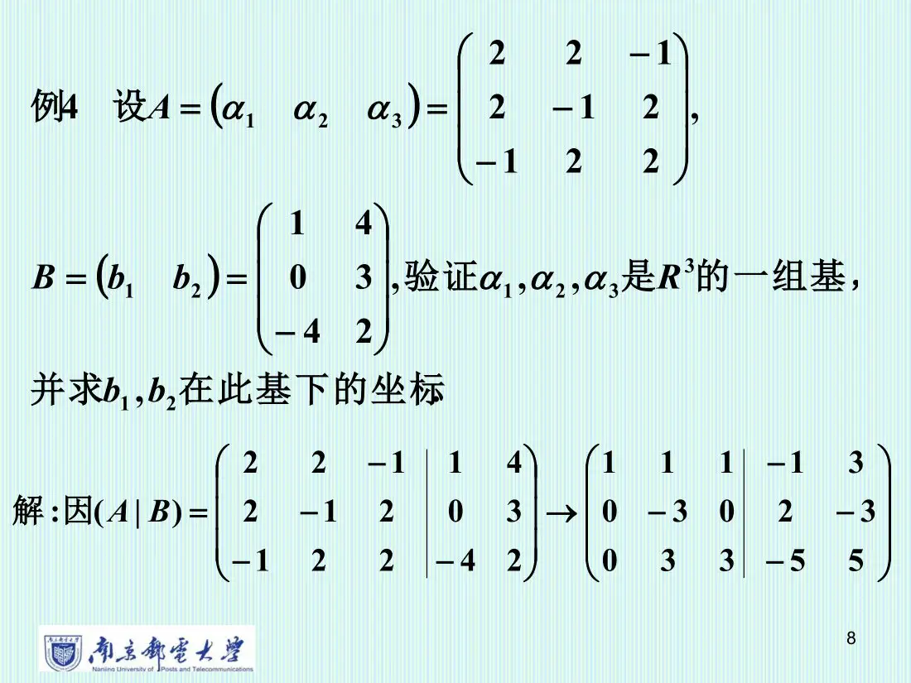

原文：

例4 设 $A = \left( \alpha_{1} \quad \alpha_{2} \quad \alpha_{3} \right) = \begin{pmatrix} 2 & 2 & -1 \\ 2 & -1 & 2 \\ -1 & 2 & 2 \end{pmatrix}$ , $B = \left( b_{1} \quad b_{2} \right) = \begin{pmatrix} 1 & 4 \\ 0 & 3 \\ -4 & 2 \end{pmatrix}$ , 验证 $\alpha_{1}, \alpha_{2}, \alpha_{3}$ 是 $R^{3}$ 的一组基, 并求 $b_{1}, b_{2}$ 在此基下的坐标

$$
\text {解}: \text {因} (A \mid B) = \left(\begin{array}{c c c c c}2&2&- 1&1&4\\2&- 1&2&0&3\\- 1&2&2&- 4&2\end{array}\right)\rightarrow \left(\begin{array}{c c c c c}1&1&1&- 1&3\\0&- 3&0&2&- 3\\0&3&3&- 5&5\end{array}\right)
$$

南京邮电大学 Nanjing University of Posts and Telecommunications

8

### $$

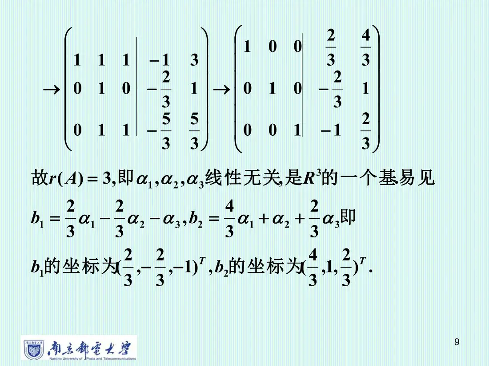

原文：

$$
\rightarrow \left(\begin{array}{c c c c c}1&1&1&- 1&3\\0&1&0&- \frac {2}{3}&1\\0&1&1&- \frac {5}{3}&\frac {5}{3}\end{array}\right)\rightarrow \left(\begin{array}{c c c c c}1&0&0&\frac {2}{3}&\frac {4}{3}\\0&1&0&- \frac {2}{3}&1\\0&0&1&- 1&\frac {2}{3}\end{array}\right)
$$

故 $r(A)=3$ , 即 $\alpha_{1}, \alpha_{2}, \alpha_{3}$ 线性无关, 是 $R^{3}$ 的一个基易见 $b_{1}=\frac{2}{3}\alpha_{1}-\frac{2}{3}\alpha_{2}-\alpha_{3}, b_{2}=\frac{4}{3}\alpha_{1}+\alpha_{2}+\frac{2}{3}\alpha_{3}$ 即 $b_{1}$ 的坐标为 $(\frac{2}{3}, -\frac{2}{3}, -1)^{T}, b_{2}$ 的坐标为 $(\frac{4}{3}, 1, \frac{2}{3})^{T}$ .

南京邮电大学
Nanjing University of Posts and Telecommunications

9

### 4.4.3 过渡矩阵与坐标变换

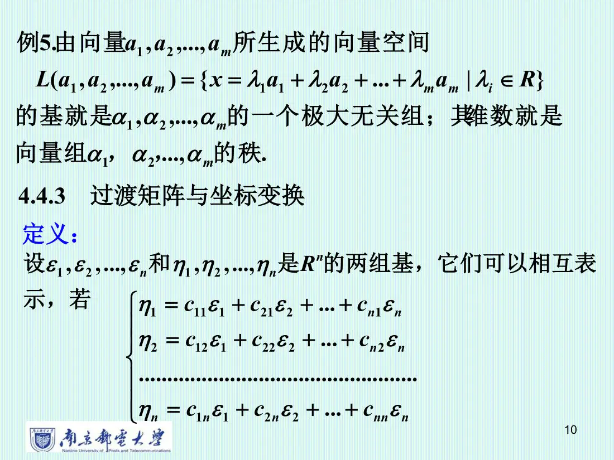

原文：

例5.由向量 $a_{1},a_{2},\ldots,a_{m}$ 所生成的向量空间

$L(a_{1},a_{2},\ldots,a_{m})=\{x=\lambda_{1}a_{1}+\lambda_{2}a_{2}+\ldots+\lambda_{m}a_{m}\mid\lambda_{i}\in R\}$ 的基就是 $\alpha_{1},\alpha_{2},\ldots,\alpha_{m}$ 的一个极大无关组；其维数就是向量组 $\alpha_{1},\alpha_{2},\ldots,\alpha_{m}$ 的秩.

4.4.3 过渡矩阵与坐标变换

定义:

设 $\varepsilon_{1},\varepsilon_{2},\ldots ,\varepsilon_{n}$ 和 $\eta_1,\eta_2,\dots ,\eta_n$ 是 $R^n$ 的两组基，它们可以相互表

示，若

$$
\left\{ \begin{array}{l} \eta_ {1} = c _ {1 1} \varepsilon_ {1} + c _ {2 1} \varepsilon_ {2} + \ldots + c _ {n 1} \varepsilon_ {n} \\ \eta_ {2} = c _ {1 2} \varepsilon_ {1} + c _ {2 2} \varepsilon_ {2} + \ldots + c _ {n 2} \varepsilon_ {n} \\ \dots\dots\\ \eta_ {n} = c _ {1 n} \varepsilon_ {1} + c _ {2 n} \varepsilon_ {2} + \ldots + c _ {n n} \varepsilon_ {n} \end{array} \right.
$$

南京邮电大学
Nanjing University of Posts and Telecommunications

10

### $$

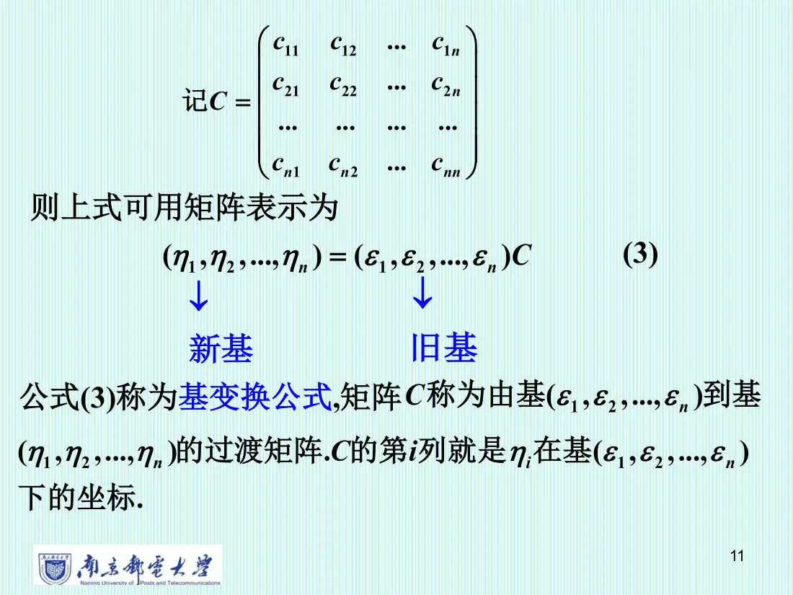

原文：

记

$$
C = \left( \begin{array}{c c c c} c _ {1 1} & c _ {1 2} & \dots & c _ {1 n} \\ c _ {2 1} & c _ {2 2} & \dots & c _ {2 n} \\ \dots & \dots & \dots & \dots \\ c _ {n 1} & c _ {n 2} & \dots & c _ {n n} \end{array} \right)
$$

则上式可用矩阵表示为

$$
(\eta_ {1}, \eta_ {2},..., \eta_ {n}) = (\varepsilon_ {1}, \varepsilon_ {2},..., \varepsilon_ {n}) C\tag{3}
$$

新基 旧基

公式(3)称为基变换公式,矩阵C称为由基 $(\varepsilon_{1},\varepsilon_{2},..., \varepsilon_{n})$ 到基 $(\eta_{1},\eta_{2},..., \eta_{n})$ 的过渡矩阵.C的第i列就是 $\eta_{i}$ 在基 $(\varepsilon_{1},\varepsilon_{2},..., \varepsilon_{n})$ 下的坐标.

南京邮电大学
Nanjing University of Posts and Telecommunications

11

### 称X = CY或Y = C⁻¹ X为坐标变换公式

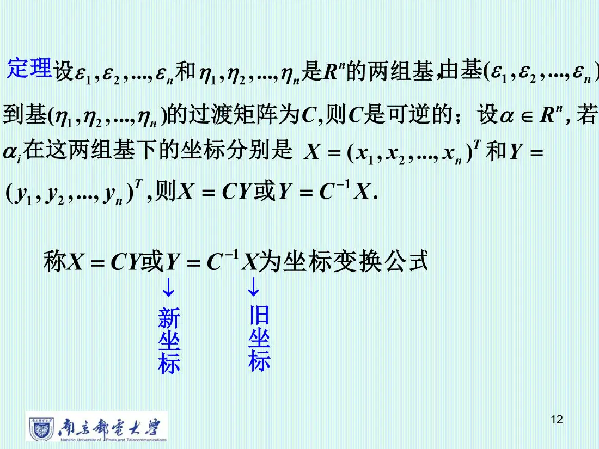

原文：

定理设 $\varepsilon_1, \varepsilon_2, \ldots, \varepsilon_n$ 和 $\eta_1, \eta_2, \ldots, \eta_n$ 是 $R^n$ 的两组基，由基 $(\varepsilon_1, \varepsilon_2, \ldots, \varepsilon_n)$ 到基 $(\eta_1, \eta_2, \ldots, \eta_n)$ 的过渡矩阵为 $C$ ，则 $C$ 是可逆的；设 $\alpha \in R^n$ ，若 $\alpha_i$ 在这两组基下的坐标分别是 $X = (x_1, x_2, \ldots, x_n)^T$ 和 $Y = (y_1, y_2, \ldots, y_n)^T$ ，则 $X = CY$ 或 $Y = C^{-1}X$ .

称X = CY或Y = C⁻¹ X为坐标变换公式
↓    ↓
新    旧
坐标    坐标

南京邮电大学
Nanjing University of Posts and Telecommunications

12

### 例6.设 $R^{3}$ 中的两组基

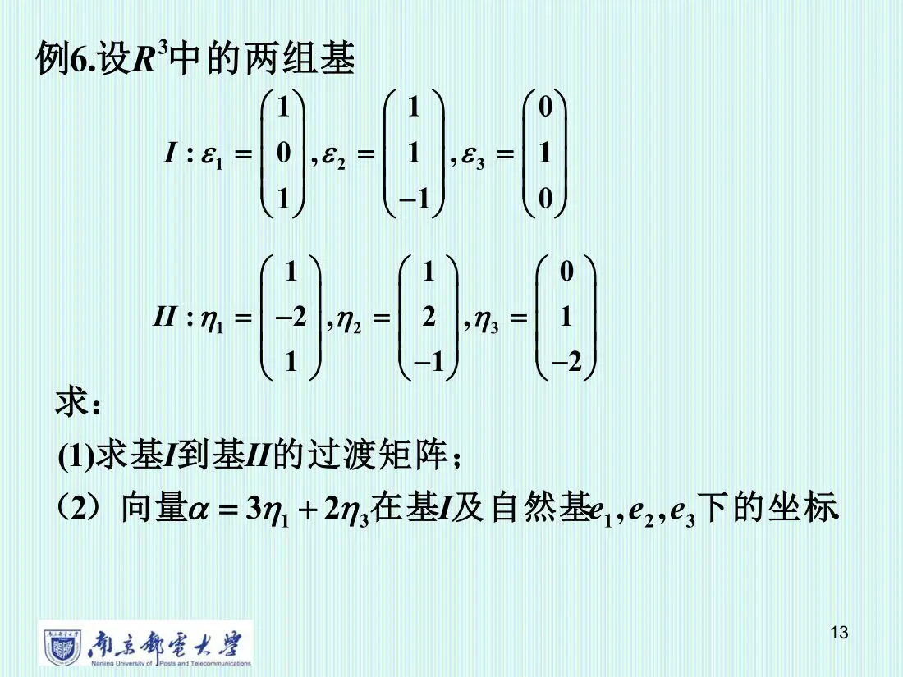

原文：

例6.设 $R^{3}$ 中的两组基

$$
I: \varepsilon_ {1} = \left( \begin{array}{c} 1 \\ 0 \\ 1 \end{array} \right), \varepsilon_ {2} = \left( \begin{array}{c} 1 \\ 1 \\ - 1 \end{array} \right), \varepsilon_ {3} = \left( \begin{array}{c} 0 \\ 1 \\ 0 \end{array} \right)
$$

$$
I I: \eta_ {1} = \left( \begin{array}{c} 1 \\ - 2 \\ 1 \end{array} \right), \eta_ {2} = \left( \begin{array}{c} 1 \\ 2 \\ - 1 \end{array} \right), \eta_ {3} = \left( \begin{array}{c} 0 \\ 1 \\ - 2 \end{array} \right)
$$

求：

(1)求基I到基II的过渡矩阵;

(2) 向量 $\alpha = 3\eta_{1} + 2\eta_{3}$ 在基 $I$ 及自然基 $e_1, e_2, e_3$ 下的坐标

南京邮电大学
Nanjing University of Posts and Telecommunications

13

### $$

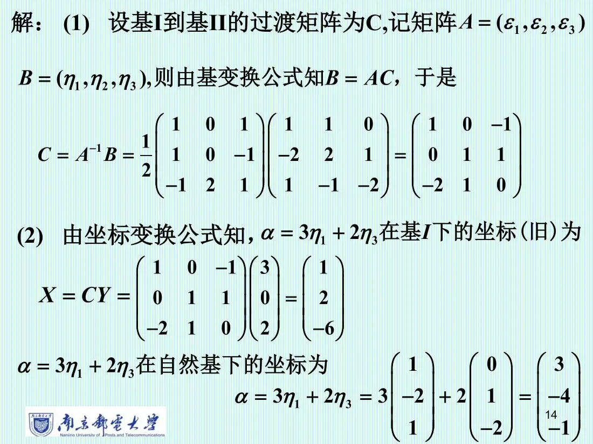

原文：

解: (1) 设基I到基II的过渡矩阵为C,记矩阵 $A = (\varepsilon_{1}, \varepsilon_{2}, \varepsilon_{3})$ $B = (\eta_{1}, \eta_{2}, \eta_{3})$ ,则由基变换公式知 $B = AC$ , 于是

$$
\boldsymbol {C} = \boldsymbol {A} ^ {- 1} \boldsymbol {B} = \frac {\mathbf {1}}{2} \left( \begin{array}{c c c} \mathbf {1} & \mathbf {0} & \mathbf {1} \\ \mathbf {1} & \mathbf {0} & - \mathbf {1} \\ - \mathbf {1} & \mathbf {2} & \mathbf {1} \end{array} \right) \left( \begin{array}{c c c} \mathbf {1} & \mathbf {1} & \mathbf {0} \\ - \mathbf {2} & \mathbf {2} & \mathbf {1} \\ \mathbf {1} & - \mathbf {1} & - \mathbf {2} \end{array} \right) = \left( \begin{array}{c c c} \mathbf {1} & \mathbf {0} & - \mathbf {1} \\ \mathbf {0} & \mathbf {1} & \mathbf {1} \\ - \mathbf {2} & \mathbf {1} & \mathbf {0} \end{array} \right)
$$

(2) 由坐标变换公式知, $\alpha = 3\eta_{1} + 2\eta_{3}$ 在基 $I$ 下的坐标 (旧) 为

$$
X = C Y = \left( \begin{array}{c c c} 1 & 0 & - 1 \\ 0 & 1 & 1 \\ - 2 & 1 & 0 \end{array} \right) \left( \begin{array}{c} 3 \\ 0 \\ 2 \end{array} \right) = \left( \begin{array}{c} 1 \\ 2 \\ - 6 \end{array} \right)
$$

$\alpha = 3 \eta_{1} + 2 \eta_{3}$ 在自然基下的坐标为

$$
\alpha = 3 \eta_ {1} + 2 \eta_ {3} = 3 {\left( \begin{array}{l} {{1}} \\ {{- 2}} \\ {{1}} \end{array} \right)} + 2 {\left( \begin{array}{l} {{0}} \\ {{1}} \\ {{- 2}} \end{array} \right)} = {\left( \begin{array}{l} {{3}} \\ {{- 4}} \\ {{1 ^ {4}}} \\ {{- 1}} \end{array} \right)}
$$

南京邮电大学 Nanjing University of Posts and Telecommunications

### 第 15 页

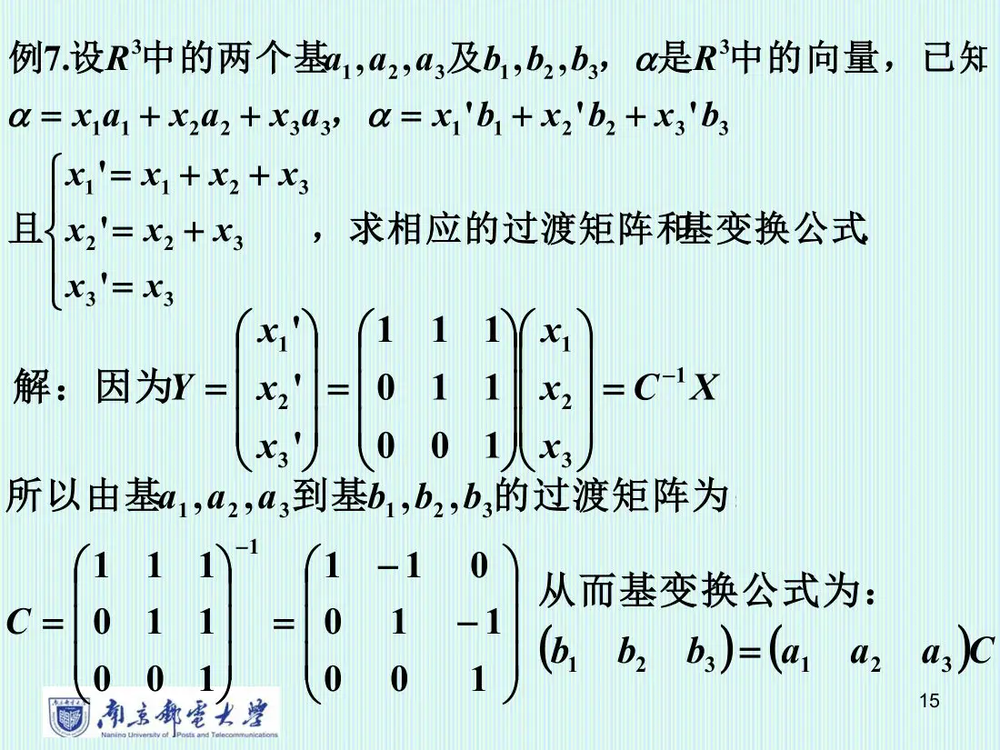

原文：

例7.设 $R^{3}$ 中的两个基 $a_{1},a_{2},a_{3}$ 及 $b_{1},b_{2},b_{3}$ ， $\alpha$ 是 $R^{3}$ 中的向量，已知 $\alpha=x_{1}a_{1}+x_{2}a_{2}+x_{3}a_{3},\quad\alpha=x_{1}'b_{1}+x_{2}'b_{2}+x_{3}'b_{3}$ 且 $\left\{\begin{aligned}x_{1}&=x_{1}+x_{2}+x_{3}\\ x_{2}&=x_{2}+x_{3}\\ x_{3}&=x_{3}\end{aligned}\right.$ ，求相应的过渡矩阵和基变换公式
解：因为 $Y=\begin{pmatrix}x_{1}\\x_{2}\\x_{3}\end{pmatrix}=\begin{pmatrix}1&1&1\\0&1&1\\0&0&1\end{pmatrix}\begin{pmatrix}x_{1}\\x_{2}\\x_{3}\end{pmatrix}=C^{-1}X$ 所以由基 $a_{1},a_{2},a_{3}$ 到基 $b_{1},b_{2},b_{3}$ 的过渡矩阵为： $C=\begin{pmatrix}1&1&1\\0&1&1\\0&0&1\end{pmatrix}^{-1}=\begin{pmatrix}1&-1&0\\0&1&-1\\0&0&1\end{pmatrix}$ 从而基变换公式为： $(b_{1}\quad b_{2}\quad b_{3})=(a_{1}\quad a_{2}\quad a_{3})C$
