# 《线性代数与解析几何》第4章 向量组的线性相关性（课件）

原件的每一页，下面附识别出的文字。

### 4.2 向量组的线性相关性

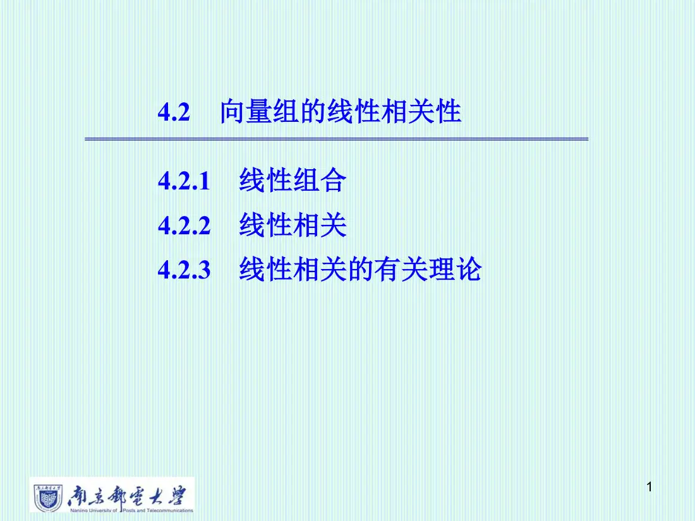

原文：

4.2 向量组的线性相关性

4.2.1 线性组合

4.2.2 线性相关

4.2.3 线性相关的有关理论

南京邮电大学
Nanjing University of Posts and Telecommunications

1

### 4.2 向量组的线性相关性

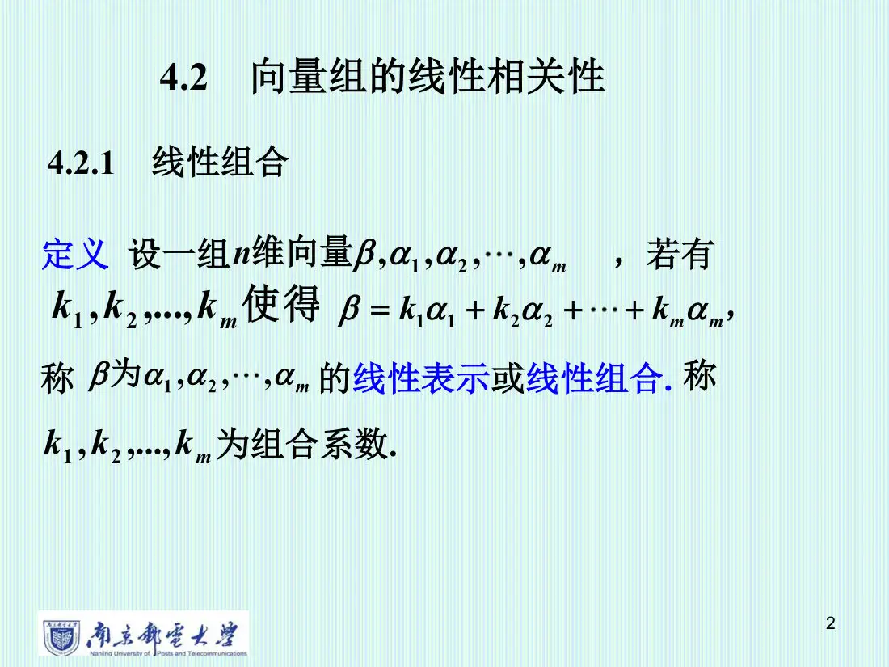

原文：

4.2 向量组的线性相关性

4.2.1 线性组合

定义 设一组n维向量 $\beta,\alpha_{1},\alpha_{2},\cdots,\alpha_{m}$ ，若有 $k_{1},k_{2},\ldots,k_{m}$ 使得 $\beta=k_{1}\alpha_{1}+k_{2}\alpha_{2}+\cdots+k_{m}\alpha_{m}$ 称 $\beta$ 为 $\alpha_{1}, \alpha_{2}, \cdots, \alpha_{m}$ 的线性表示或线性组合. 称 $k_{1},k_{2},\ldots,k_{m}$ 为组合系数.

南京邮电大学
Nanjing University of Posts and Telecommunications

2

### 南京邮电大学

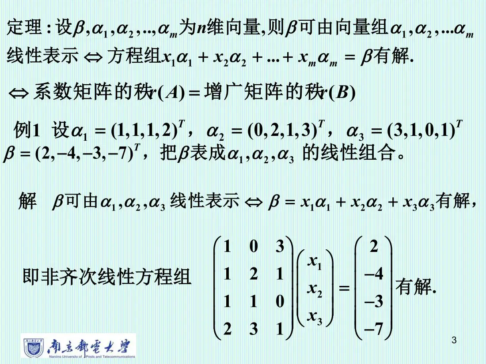

原文：

定理: 设 $\beta, \alpha_{1}, \alpha_{2}, \ldots, \alpha_{m}$ 为 n 维向量, 则 $\beta$ 可由向量组 $\alpha_{1}, \alpha_{2}, \ldots, \alpha_{m}$ 线性表示 $\Leftrightarrow$ 方程组 $x_{1}\alpha_{1} + x_{2}\alpha_{2} + \ldots + x_{m}\alpha_{m} = \beta$ 有解.

$\Leftrightarrow$ 系数矩阵的秩 $\mathbf{r}(A) =$ 增广矩阵的秩 $\mathbf{r}(B)$

例1 设 $\alpha_{1} = (1, 1, 1, 2)^{T}$ , $\alpha_{2} = (0, 2, 1, 3)^{T}$ , $\alpha_{3} = (3, 1, 0, 1)^{T}$ $\beta = (2, -4, -3, -7)^{T}$ , 把 $\beta$ 表成 $\alpha_{1}, \alpha_{2}, \alpha_{3}$ 的线性组合。

解 $\beta$ 可由 $\alpha_{1},\alpha_{2},\alpha_{3}$ 线性表示 $\Leftrightarrow \beta = x_{1}\alpha_{1} + x_{2}\alpha_{2} + x_{3}\alpha_{3}$ 有解，

即非齐次线性方程组 $\begin{pmatrix}1&0&3\\1&2&1\\1&1&0\\2&3&1\end{pmatrix}\begin{pmatrix}x_{1}\\x_{2}\\x_{3}\end{pmatrix}=\begin{pmatrix}2\\-4\\-3\\-7\end{pmatrix}$ 有解.

南京邮电大学
Nanjing University of Posts and Telecommunications

3

### $$

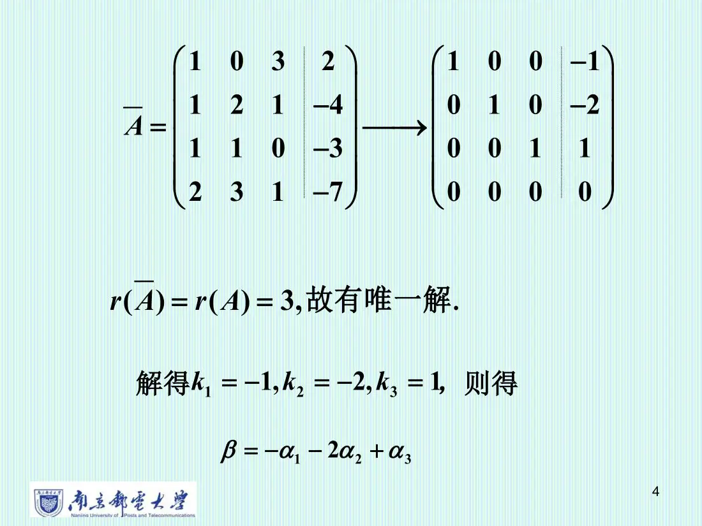

原文：

$$
\overline {{A}} = \left( \begin{array}{c c c c} 1 & 0 & 3 & 2 \\ 1 & 2 & 1 & - 4 \\ 1 & 1 & 0 & - 3 \\ 2 & 3 & 1 & - 7 \end{array} \right) \longrightarrow \left( \begin{array}{c c c c} 1 & 0 & 0 & - 1 \\ 0 & 1 & 0 & - 2 \\ 0 & 0 & 1 & 1 \\ 0 & 0 & 0 & 0 \end{array} \right)
$$

$r(A)=r(A)=3$ , 故有唯一解.

解得 $k_{1} = -1, k_{2} = -2, k_{3} = 1$ ，则得

$$
\beta = - \alpha_ {1} - 2 \alpha_ {2} + \alpha_ {3}
$$

南京邮电大学
Nanjing University of Posts and Telecommunications

4

### 例2 已知

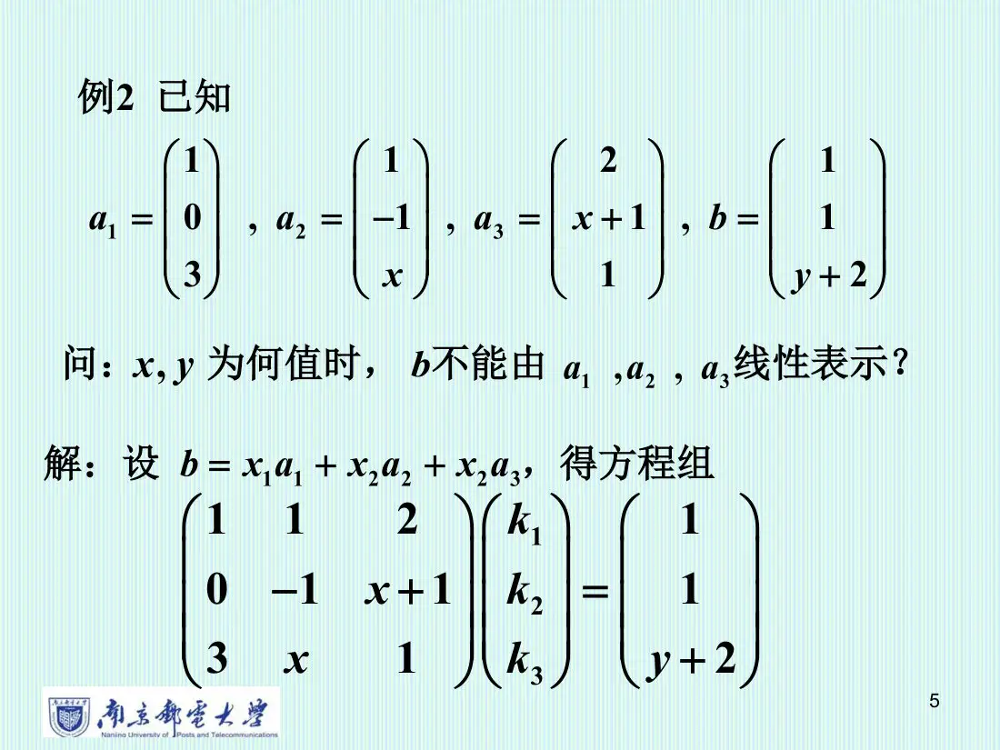

原文：

例2 已知

$$
\boldsymbol {a} _ {1} = \left( \begin{array}{c} 1 \\ 0 \\ 3 \end{array} \right), \boldsymbol {a} _ {2} = \left( \begin{array}{c} 1 \\ - 1 \\ x \end{array} \right), \boldsymbol {a} _ {3} = \left( \begin{array}{c} 2 \\ x + 1 \\ 1 \end{array} \right), \boldsymbol {b} = \left( \begin{array}{c} 1 \\ 1 \\ y + 2 \end{array} \right)
$$

问: $x, y$ 为何值时, $b$ 不能由 $a_{1}, a_{2}, a_{3}$ 线性表示?

解：设 $b = x_{1}a_{1} + x_{2}a_{2} + x_{2}a_{3}$ ，得方程组

$$
\left( \begin{array}{c c c} 1 & 1 & 2 \\ 0 & - 1 & x + 1 \\ 3 & x & 1 \end{array} \right) \left( \begin{array}{c} k _ {1} \\ k _ {2} \\ k _ {3} \end{array} \right) = \left( \begin{array}{c} 1 \\ 1 \\ y + 2 \end{array} \right)
$$

南京邮电大学
Nanjing University of Posts and Telecommunications

5

### 增广矩阵为

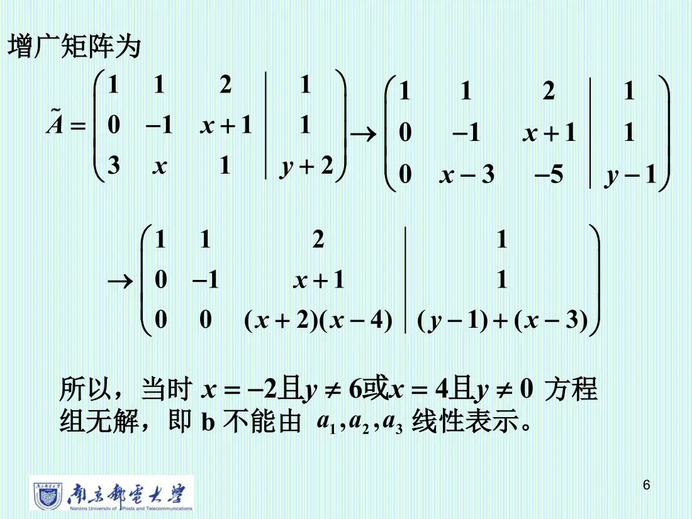

原文：

增广矩阵为

$$
\tilde {A} = \left( \begin{array}{c c c c} 1 & 1 & 2 & 1 \\ 0 & - 1 & x + 1 & 1 \\ 3 & x & 1 & y + 2 \end{array} \right) \to \left( \begin{array}{c c c c} 1 & 1 & 2 & 1 \\ 0 & - 1 & x + 1 & 1 \\ 0 & x - 3 & - 5 & y - 1 \end{array} \right)
$$

$$
\rightarrow \left(\begin{array}{c c c c}1&1&2&1\\0&- 1&x + 1&1\\0&0&(x + 2) (x - 4)&(y - 1) + (x - 3)\end{array}\right)
$$

所以，当时 $x = -2$ 且 $y \neq 6$ 或 $x = 4$ 且 $y \neq 0$ 方程组无解，即 b 不能由 $a_1, a_2, a_3$ 线性表示。

南京邮电大学
Nanjing University of Posts and Telecommunications

6

### 4.2.2 线性相关

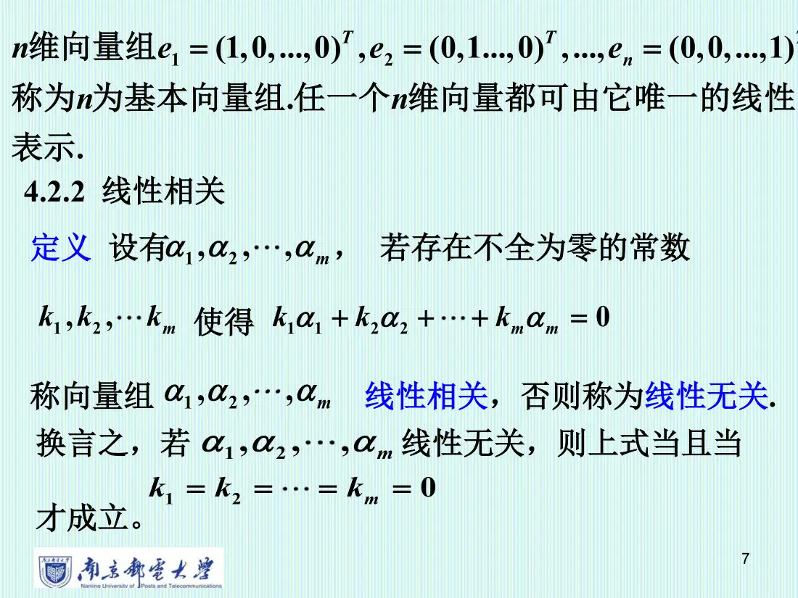

原文：

n维向量组 $e_{1}=(1,0,...,0)^{T},e_{2}=(0,1...,0)^{T},...,e_{n}=(0,0,...,1)^{T}$ 称为n为基本向量组.任一个n维向量都可由它唯一的线性表示.

4.2.2 线性相关

定义 设有 $\alpha_{1},\alpha_{2},\cdots,\alpha_{m}$ ，若存在不全为零的常数

$$
k _ {1}, k _ {2}, \dots k _ {m} \text {使得} k _ {1} \alpha_ {1} + k _ {2} \alpha_ {2} + \dots + k _ {m} \alpha_ {m} = 0
$$

称向量组 $\alpha_{1},\alpha_{2},\cdots,\alpha_{m}$ 线性相关，否则称为线性无关。
换言之，若 $\alpha_{1},\alpha_{2},\cdots,\alpha_{m}$ 线性无关，则上式当且当

$k_{1}=k_{2}=\cdots=k_{m}=0$ 才成立。

南京邮电大学 Nanjing University of Posts and Telecommunications

7

### 第 8 页

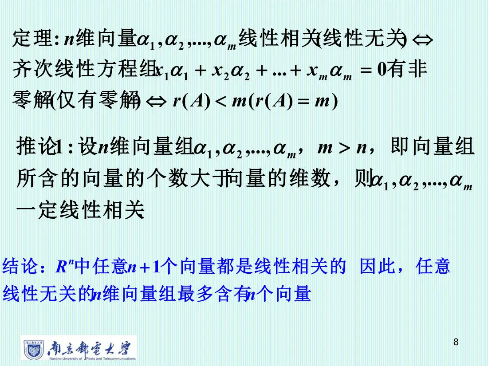

原文：

定理: n维向量 $\alpha_{1},\alpha_{2},\ldots,\alpha_{m}$ 线性相关(线性无关) $\Leftrightarrow$ 齐次线性方程组 $x_{1}\alpha_{1}+x_{2}\alpha_{2}+\ldots+x_{m}\alpha_{m}=0$ 有非零解(仅有零解) $\Leftrightarrow r(A)<m(r(A)=m)$

推论1: 设n维向量组 $\alpha_{1}, \alpha_{2}, \ldots, \alpha_{m}, m > n$ ，即向量组所含的向量的个数大于向量的维数，则 $\alpha_{1}, \alpha_{2}, \ldots, \alpha_{m}$ 一定线性相关

结论: $R^n$ 中任意 $n + 1$ 个向量都是线性相关的 因此, 任意线性无关的 $n$ 维向量组最多含有 $n$ 个向量

南京邮电大学 Nanjing University of Posts and Telecommunications

8

### 线性相关(线性无关)

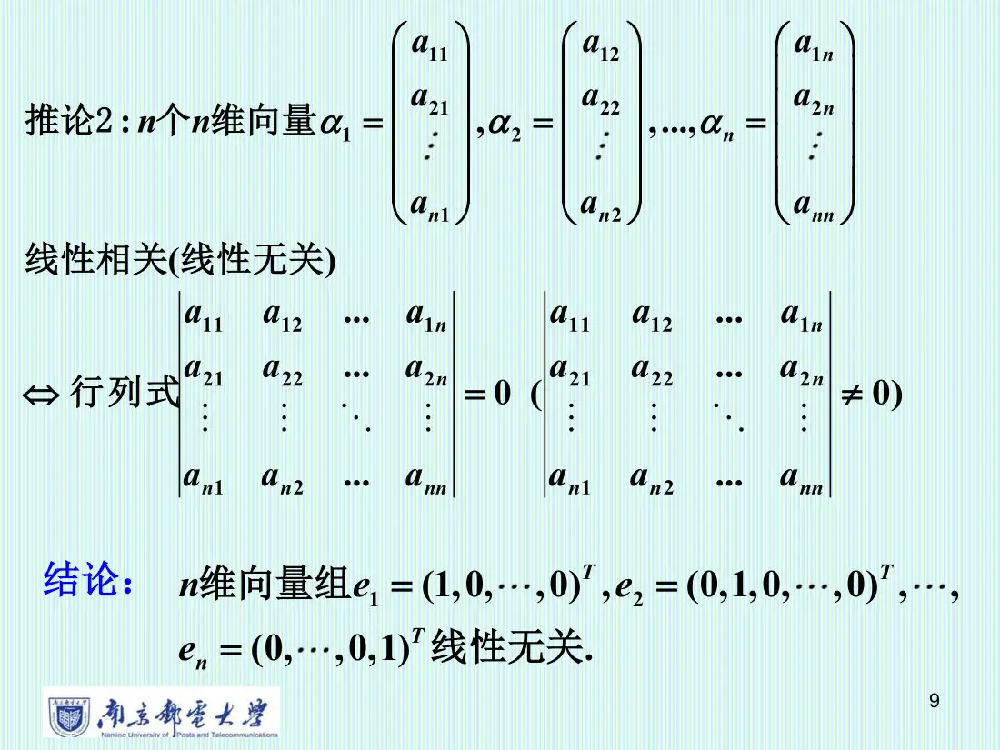

原文：

推论2:n个n维向量 $\alpha_{1}=\begin{pmatrix}a_{11}\\a_{21}\\ \vdots\\a_{n1}\end{pmatrix},\alpha_{2}=\begin{pmatrix}a_{12}\\a_{22}\\ \vdots\\a_{n2}\end{pmatrix},\ldots,\alpha_{n}=\begin{pmatrix}a_{1n}\\a_{2n}\\ \vdots\\a_{nn}\end{pmatrix}$

线性相关(线性无关)

$$
\Leftrightarrow \text {行列式} \left| \begin{array}{c c c c} {{a _ {1 1}}} & {{a _ {1 2}}} & {{\dots}} & {{a _ {1 n}}} \\ {{a _ {2 1}}} & {{a _ {2 2}}} & {{\dots}} & {{a _ {2 n}}} \\ {{\vdots}} & {{\vdots}} & {{\ddots}} & {{\vdots}} \\ {{a _ {n 1}}} & {{a _ {n 2}}} & {{\dots}} & {{a _ {n n}}} \end{array} \right| = 0 (\left| \begin{array}{c c c c} {{a _ {1 1}}} & {{a _ {1 2}}} & {{\dots}} & {{a _ {1 n}}} \\ {{a _ {2 1}}} & {{a _ {2 2}}} & {{\dots}} & {{a _ {2 n}}} \\ {{\vdots}} & {{\vdots}} & {{\ddots}} & {{\vdots}} \\ {{ a _ {n 1}}} & {{a _ {n 2}}} & {{\dots}} & {{a _ {n n}}} \end{array} \right| \neq 0)
$$

结论: $n$ 维向量组 $e_{1} = (1,0,\cdots,0)^{T}, e_{2} = (0,1,0,\cdots,0)^{T}, \cdots, e_{n} = (0,\cdots,0,1)^{T}$ 线性无关.

南京邮电大学
Nanjing University of Posts and Telecommunications

9

### 例3 讨论

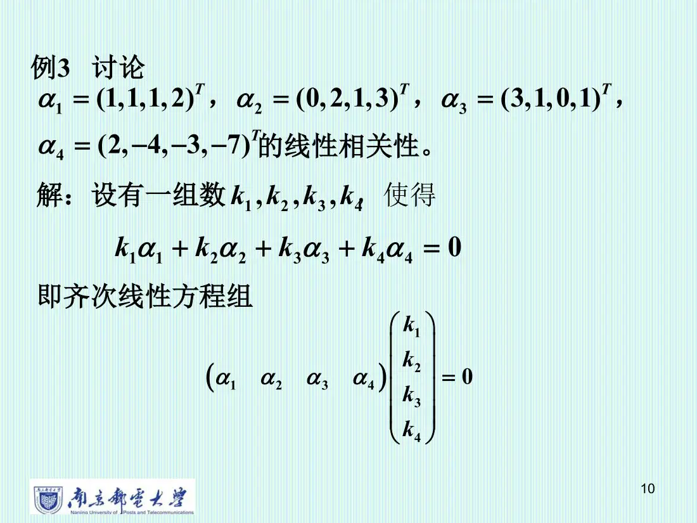

原文：

例3 讨论

$\alpha_{1} = (1, 1, 1, 2)^{T}, \alpha_{2} = (0, 2, 1, 3)^{T}, \alpha_{3} = (3, 1, 0, 1)^{T},$ $\alpha_{4} = (2, -4, -3, -7)^{T}$ 的线性相关性。

解: 设有一组数 $k_{1}, k_{2}, k_{3}, k_{4}$ 使得

$$
k _ {1} \alpha_ {1} + k _ {2} \alpha_ {2} + k _ {3} \alpha_ {3} + k _ {4} \alpha_ {4} = 0
$$

即齐次线性方程组

$$
\left( \begin{array}{c c c c} \alpha_ {1} & \alpha_ {2} & \alpha_ {3} & \alpha_ {4} \end{array} \right) \left( \begin{array}{c} k _ {1} \\ k _ {2} \\ k _ {3} \\ k _ {4} \end{array} \right) = 0
$$

南京邮电大学
Nanjing University of Posts and Telecommunications

10

### 对系数矩阵 $A$ 作初等行变换

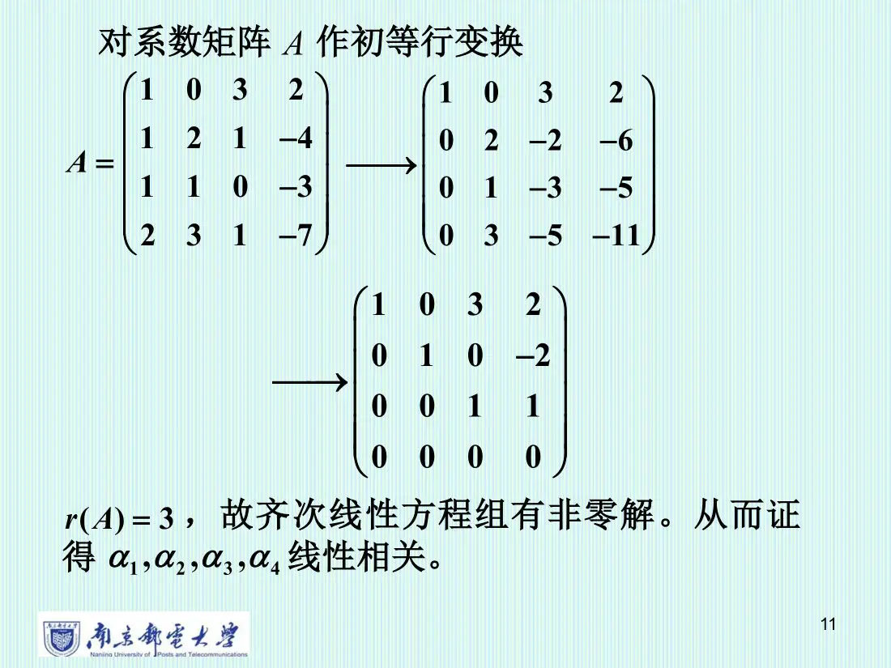

原文：

对系数矩阵 $A$ 作初等行变换

$$
A = \left( \begin{array}{c c c c} 1 & 0 & 3 & 2 \\ 1 & 2 & 1 & - 4 \\ 1 & 1 & 0 & - 3 \\ 2 & 3 & 1 & - 7 \end{array} \right) \longrightarrow \left( \begin{array}{c c c c} 1 & 0 & 3 & 2 \\ 0 & 2 & - 2 & - 6 \\ 0 & 1 & - 3 & - 5 \\ 0 & 3 & - 5 & - 1 1 \end{array} \right)
$$

$$
\longrightarrow \left( \begin{array}{c c c c} 1 & 0 & 3 & 2 \\ 0 & 1 & 0 & - 2 \\ 0 & 0 & 1 & 1 \\ 0 & 0 & 0 & 0 \end{array} \right)
$$

$r(A)=3$ ，故齐次线性方程组有非零解。从而证得 $\alpha_{1},\alpha_{2},\alpha_{3},\alpha_{4}$ 线性相关。

南京邮电大学
Nanjing University of Posts and Telecommunications

11

### 南京邮电大学

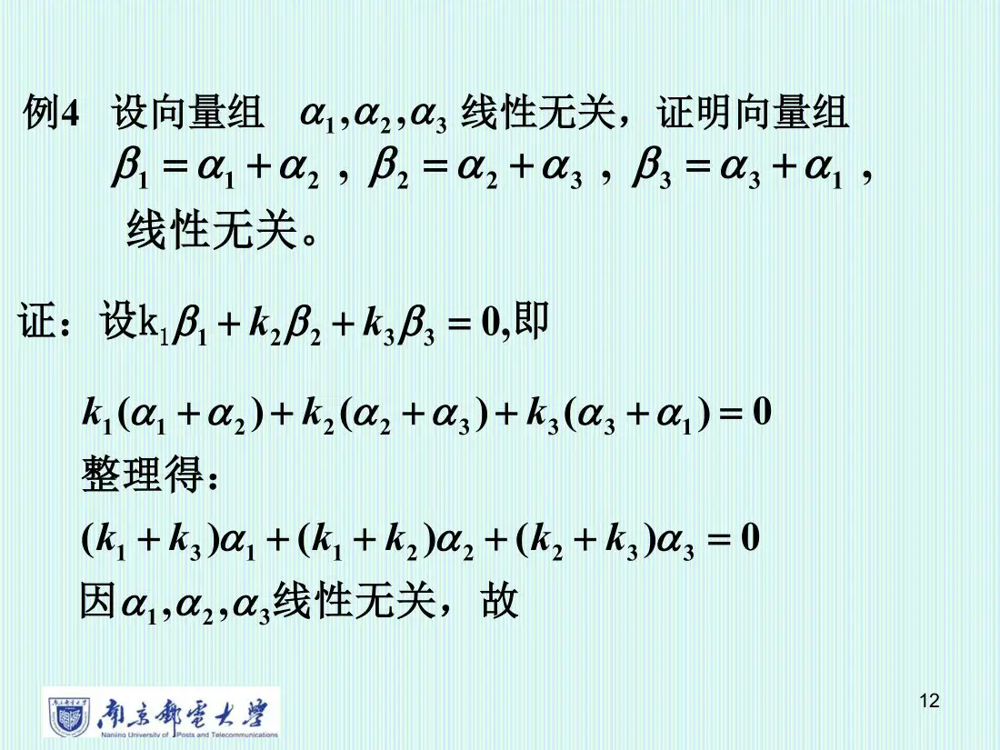

原文：

例4 设向量组 $\alpha_{1}, \alpha_{2}, \alpha_{3}$ 线性无关，证明向量组 $\beta_{1} = \alpha_{1} + \alpha_{2}, \beta_{2} = \alpha_{2} + \alpha_{3}, \beta_{3} = \alpha_{3} + \alpha_{1}$ ，线性无关。

证：设 $k_{1}\beta_{1}+k_{2}\beta_{2}+k_{3}\beta_{3}=0$ ，即 $k_{1}(\alpha_{1}+\alpha_{2})+k_{2}(\alpha_{2}+\alpha_{3})+k_{3}(\alpha_{3}+\alpha_{1})=0$ 整理得： $(k_{1}+k_{3})\alpha_{1}+(k_{1}+k_{2})\alpha_{2}+(k_{2}+k_{3})\alpha_{3}=0$ 因 $\alpha_{1}, \alpha_{2}, \alpha_{3}$ 线性无关，故

南京邮电大学
Nanjing University of Posts and Telecommunications

12

### 南京邮电大学

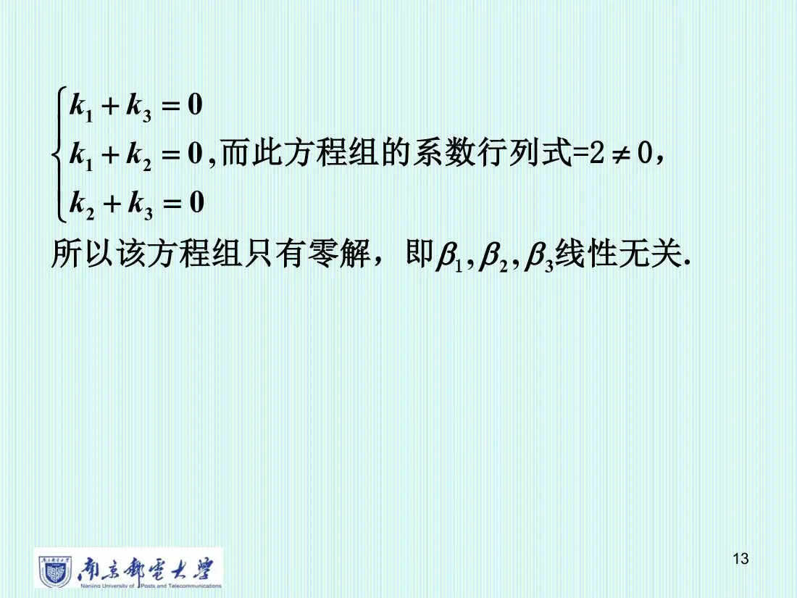

原文：

$\left\{ \begin{array}{l} k_{1} + k_{3} = 0 \\ k_{1} + k_{2} = 0,\\ k_{2} + k_{3} = 0 \end{array} \right.$ 而此方程组的系数行列式 $= 2\neq 0$

所以该方程组只有零解，即 $\beta_{1},\beta_{2},\beta_{3}$ 线性无关.

南京邮电大学
Nanjing University of Posts and Telecommunications

13

### 向量组线性相关有如下一些性质：

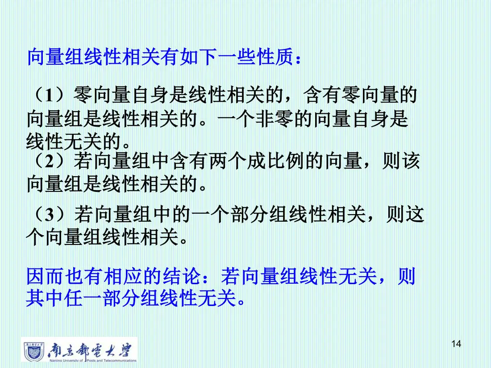

原文：

向量组线性相关有如下一些性质：

(1) 零向量自身是线性相关的, 含有零向量的向量组是线性相关的。一个非零的向量自身是线性无关的。

(2) 若向量组中含有两个成比例的向量, 则该向量组是线性相关的。

(3) 若向量组中的一个部分组线性相关, 则这个向量组线性相关。

因而也有相应的结论：若向量组线性无关，则其中任一部分组线性无关。

南京邮电大学
Nanjing University of Posts and Telecommunications

14

### 4.2.3 线性相关的有关理论

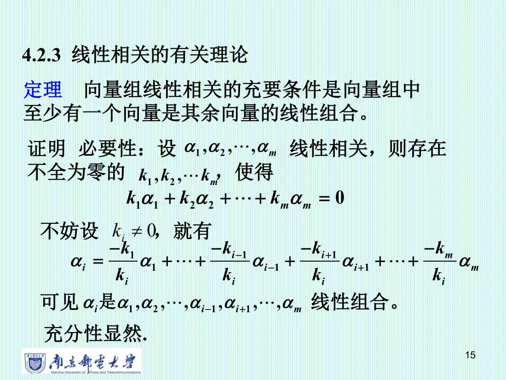

原文：

4.2.3 线性相关的有关理论

定理 向量组线性相关的充要条件是向量组中至少有一个向量是其余向量的线性组合。

证明 必要性: 设 $\alpha_{1}, \alpha_{2}, \cdots, \alpha_{m}$ 线性相关, 则存在不全为零的 $k_{1}, k_{2}, \cdots, k_{m}$ , 使得

$$
k _ {1} \alpha_ {1} + k _ {2} \alpha_ {2} + \dots + k _ {m} \alpha_ {m} = 0
$$

不妨设 $k_{i} \neq 0$ ，就有

$$
\alpha_ {i} = \frac {- k _ {1}}{k _ {i}} \alpha_ {1} + \dots + \frac {- k _ {i - 1}}{k _ {i}} \alpha_ {i - 1} + \frac {- k _ {i + 1}}{k _ {i}} \alpha_ {i + 1} + \dots + \frac {- k _ {m}}{k _ {i}} \alpha_ {m}
$$

可见 $\alpha_{i}$ 是 $\alpha_{1},\alpha_{2},\cdots,\alpha_{i-1},\alpha_{i+1},\cdots,\alpha_{m}$ 线性组合。

充分性显然.

南京邮电大学
Nanjing University of Posts and Telecommunications

15

### $$

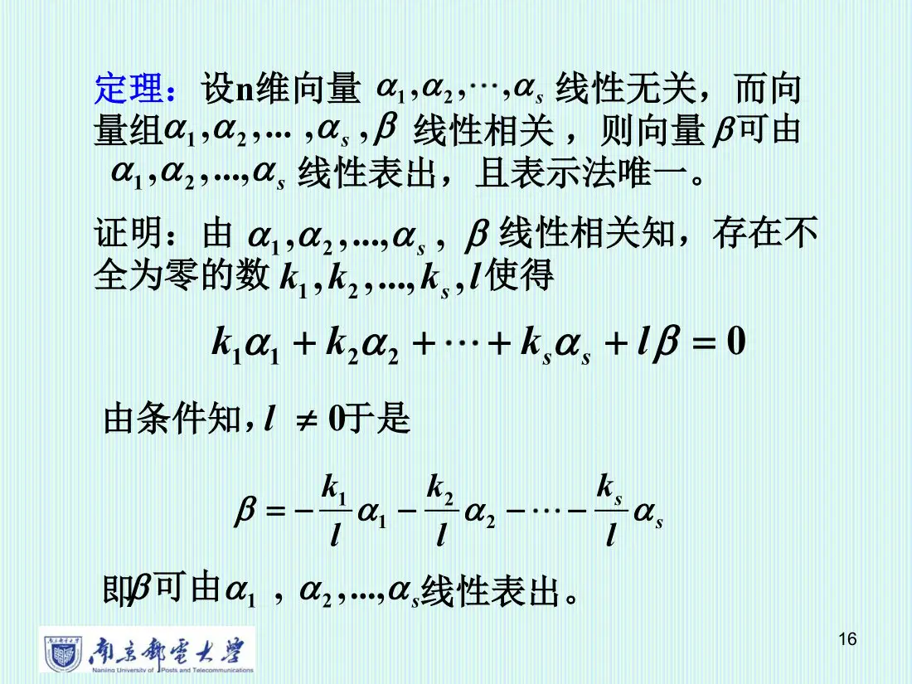

原文：

定理: 设n维向量 $\alpha_{1}, \alpha_{2}, \cdots, \alpha_{s}$ 线性无关, 而向量组 $\alpha_{1}, \alpha_{2}, \cdots, \alpha_{s}, \beta$ 线性相关, 则向量 $\beta$ 可由 $\alpha_{1}, \alpha_{2}, \cdots, \alpha_{s}$ 线性表出, 且表示法唯一。

证明: 由 $\alpha_{1}, \alpha_{2}, \ldots, \alpha_{s}$ , $\beta$ 线性相关知, 存在不全为零的数 $k_{1}, k_{2}, \ldots, k_{s}, l$ 使得

$$
k _ {1} \alpha_ {1} + k _ {2} \alpha_ {2} + \dots + k _ {s} \alpha_ {s} + l \beta = 0
$$

由条件知， $l \neq 0$ 于是

$$
\beta = - \frac {k _ {1}}{l} \alpha_ {1} - \frac {k _ {2}}{l} \alpha_ {2} - \dots - \frac {k _ {s}}{l} \alpha_ {s}
$$

即 $\beta$ 可由 $\alpha_{1}$ ， $\alpha_{2},\ldots ,\alpha_{s}$ 线性表出。

南京邮电大学
Nanjing University of Posts and Telecommunications

16

### 若 $\beta$ 可有两种不同的表示方法，设

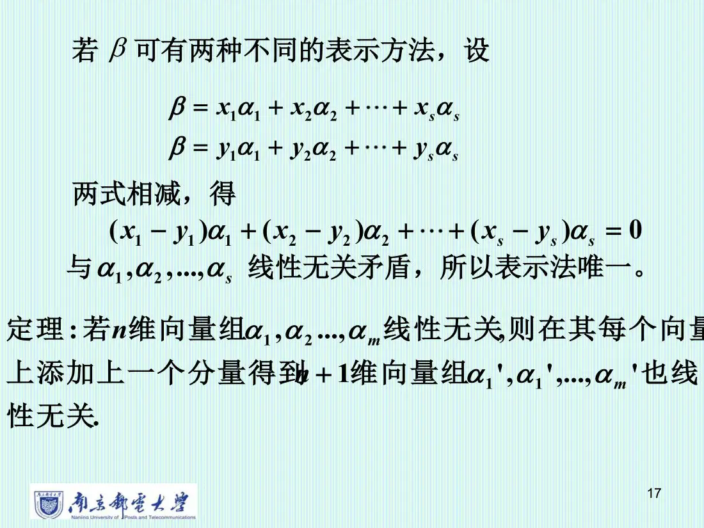

原文：

若 $\beta$ 可有两种不同的表示方法，设

$$
\beta = x _ {1} \alpha_ {1} + x _ {2} \alpha_ {2} + \dots + x _ {s} \alpha_ {s}
$$

$$
\beta = y _ {1} \alpha_ {1} + y _ {2} \alpha_ {2} + \dots + y _ {s} \alpha_ {s}
$$

两式相减，得

$(x_{1}-y_{1})\alpha_{1}+(x_{2}-y_{2})\alpha_{2}+\cdots+(x_{s}-y_{s})\alpha_{s}=0$ 与 $\alpha_{1},\alpha_{2},\ldots,\alpha_{s}$ 线性无关矛盾，所以表示法唯一。

定理:若n维向量组 $\alpha_{1},\alpha_{2},\ldots,\alpha_{m}$ 线性无关,则在其每个向量上添加上一个分量得到 $h+1$ 维向量组 $\alpha_{1}'$ , $\alpha_{1}'$ , ..., $\alpha_{m}'$ 也线性无关.

南京邮电大学
Nanjing University of Posts and Telecommunications

17
