# 《线性代数与解析几何》第4章 空间解析几何：平面（课件）

原件的每一页，下面附识别出的文字。

### 4.3 平面

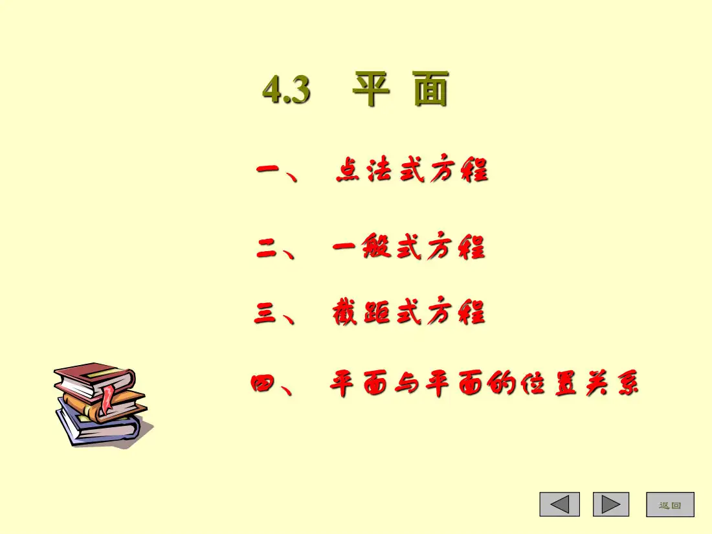

原文：

4.3 平面
一、点法式方程
二、一般式方程
三、截距式方程
四、平面与平面的位置关系

返回

### 一、点法式方程

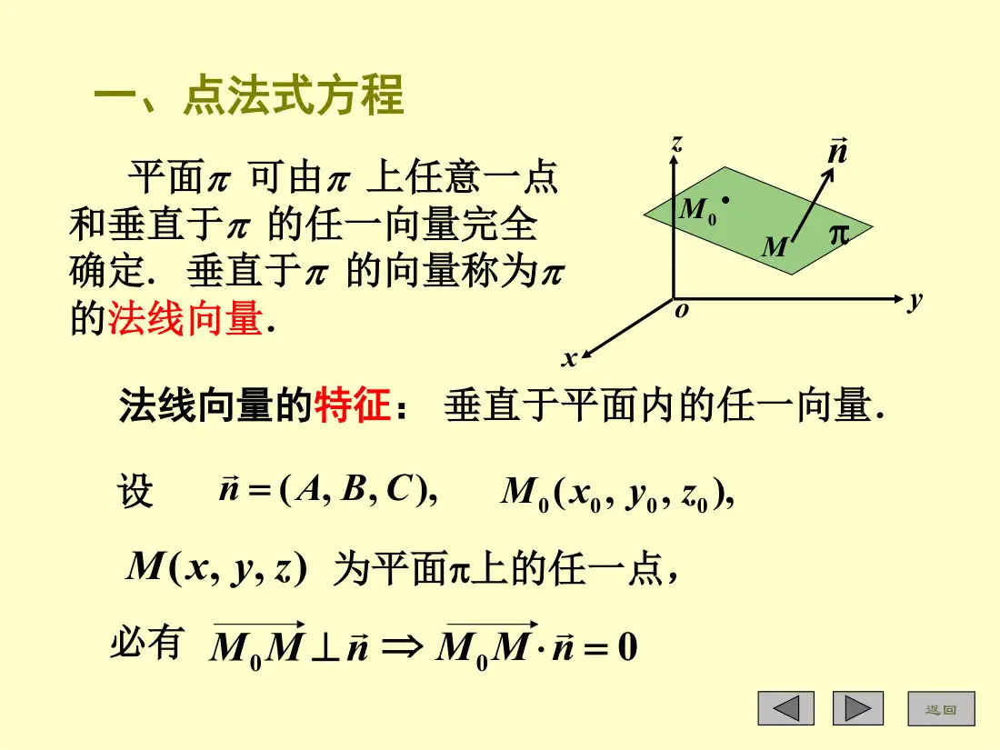

原文：

一、点法式方程

平面 $\pi$ 可由 上任意一点和垂直于 $\pi$ 的任一向量完全确定. 垂直于 $\pi$ 的向量称为的法线向量

法线向量的特征： 垂直于平面内的任一向量

$$
\vec {n} = (A, B, C), \quad M _ {0} (x _ {0}, y _ {0}, z _ {0}),
$$

$M ( x , y , z )$ 为平面上的任一点，

必有 $\overrightarrow { M _ { 0 } M } \perp \vec { n } \Rightarrow \overrightarrow { M _ { 0 } M } \cdot \vec { n } = 0$

返回

### $$

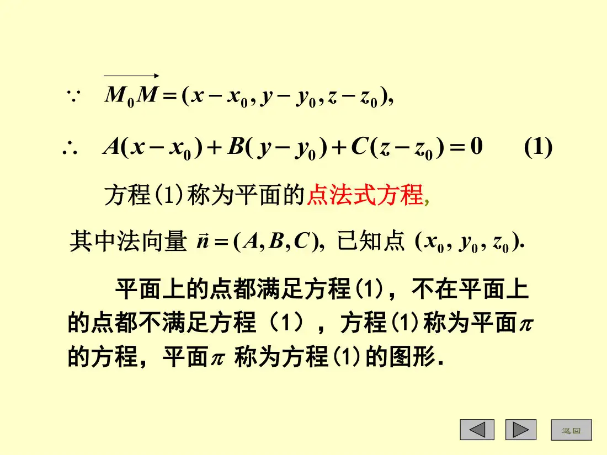

原文：

$$
\because \overrightarrow {M _ {0} M} = (x - x _ {0}, y - y _ {0}, z - z _ {0}),
$$

$$
\therefore A (x - x _ {0}) + B (y - y _ {0}) + C (z - z _ {0}) = 0\tag{1}
$$

方程(1)称为平面的点法式方程,其中法向量 $\vec { \pmb { n } } = ( A , B , C )$ 已知点 $( x _ { 0 } , y _ { 0 } , z _ { 0 } )$

平面上的点都满足方程(1)，不在平面上的点都不满足方程（1），方程(1)称为平面 $\pi$ 的方程，平面 称为方程(1)的图形

返回

### 二、一般式方程

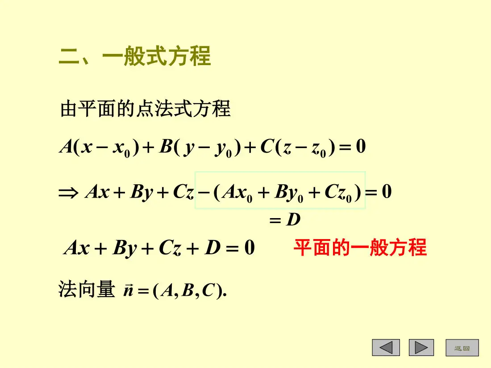

原文：

二、一般式方程

由平面的点法式方程

$$
A (x - x _ {0}) + B (y - y _ {0}) + C (z - z _ {0}) = 0
$$

$$
\Rightarrow A x + B y + C z - (A x _ {0} + B y _ {0} + C z _ {0}) = 0   = D
$$

$$
A x + B y + C z + D = 0
$$

平面的一般方程

法向量 $\vec { \pmb { n } } = ( A , B , C )$

返回

### $$

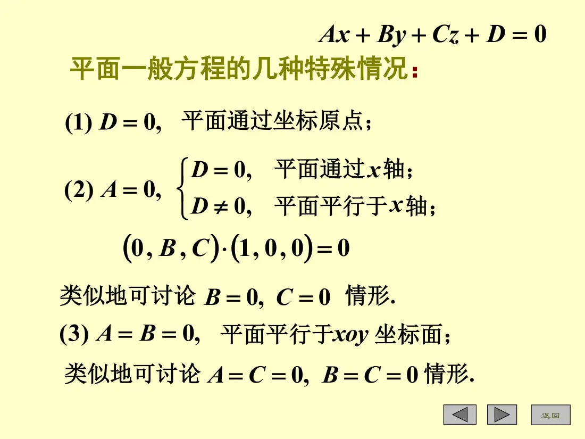

原文：

$$
A x + B y + C z + D = 0
$$

平面一般方程的几种特殊情况：

(1) $D = \mathbf { 0 } .$ 平面通过坐标原点；

$A = 0 , \left\{ { D / } = 0 , \right.$ 平面通过 x轴；(2)平面平行于 x轴；

$$
(0, B, C) \cdot (1, 0, 0) = 0
$$

类似地可讨论 $\boldsymbol { B } = \mathbf { 0 } , \ \boldsymbol { C } = \mathbf { 0 }$ 情形.

(3) $A = B = \mathbf { 0 }$ 平面平行于xoy 坐标面；

类似地可讨论 $\scriptstyle A = C = 0 , \ B = C = 0$ 情形.

返回

### 三、 截距式方程

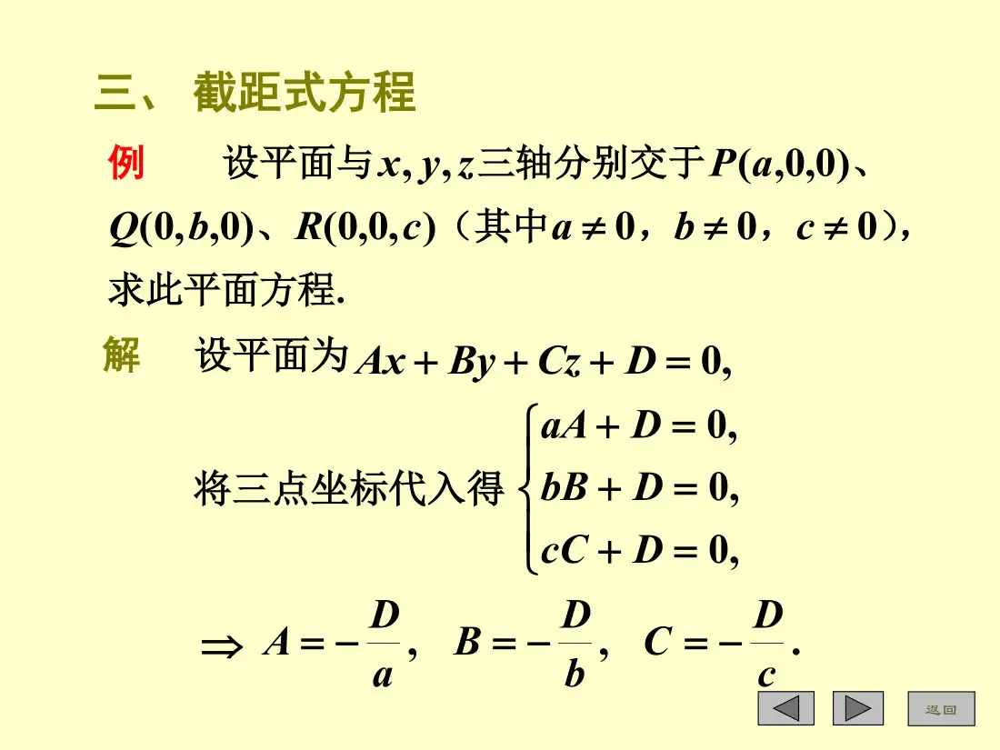

原文：

三、 截距式方程

例 设平面与 $x , y , z$ 三轴分别交于 $P ( a , \mathbf { 0 } , \mathbf { 0 } )$ Q(0,b,0)、R(0,0,c)（其中 $a \neq \mathbf { 0 } , b \neq \mathbf { 0 } , c \neq \mathbf { 0 } )$ 求此平面方程.

设平面为解 $\scriptstyle A x + B y + C z + D = 0 ,$ 将三点坐标代入得 $\left\{ \begin{array} { l l } { a \mathcal { A } + D = { \bf 0 } , } \\ { b B + D = { \bf 0 } , } \\ { c C + D = { \bf 0 } , } \end{array} \right.$ D D D ⇒ A = B = C : a b C 将 $A = - \frac { D } { a } , B = - \frac { D } { b } , C = - \frac { D } { c } ,$ 代入所设方程得

### 返回

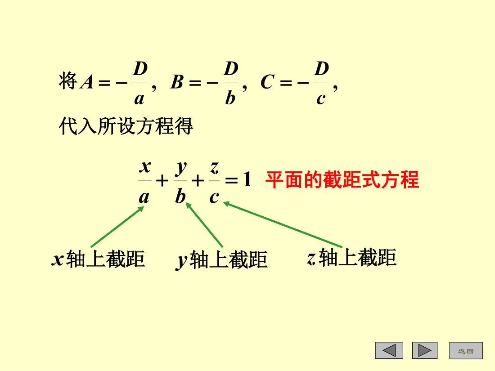

原文：

$\displaystyle \frac { x } { a } + \frac { y } { b } + \frac { z } { c } = 1$ 平面的截距式方程x轴上截距 y轴上截距 z轴上截距例 求过不共线的三点 $A _ { i } ( x _ { i } , y _ { i } , z _ { i } ) , i = 1 , 2 , 3$ 的平面方程.

返回

### 解: $M ( x , y , z )$ 为平面上的任意一点，

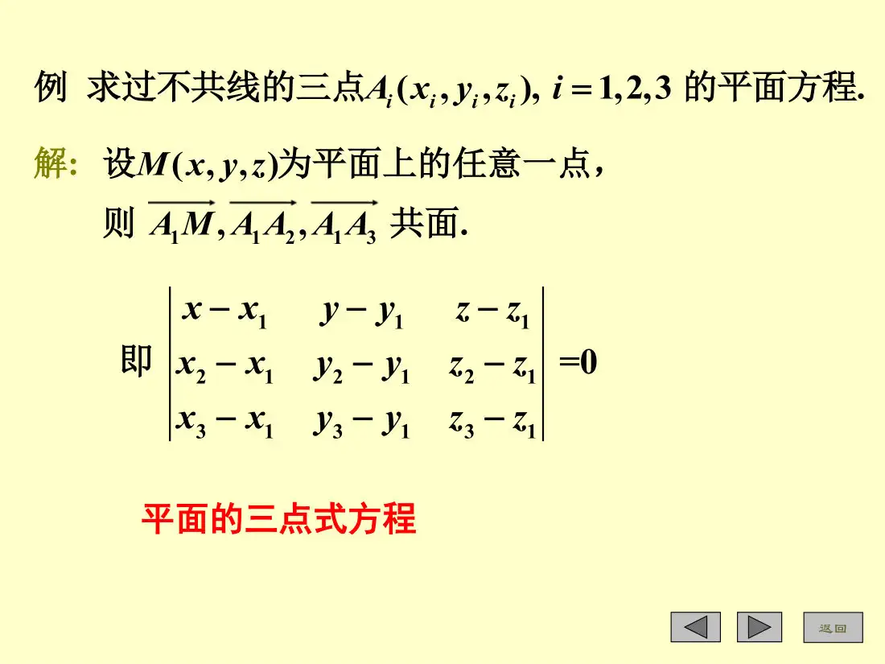

原文：

解: $M ( x , y , z )$ 为平面上的任意一点，

则 $\overrightarrow { A _ { 1 } M } , \overrightarrow { A _ { 1 } A _ { 2 } } , \overrightarrow { A _ { 1 } A _ { 3 } }$ 共面.

即

$$
\left| \begin{array}{c c c} x - x _ {1} & y - y _ {1} & z - z _ {1} \\ x _ {2} - x _ {1} & y _ {2} - y _ {1} & z _ {2} - z _ {1} \\ x _ {3} - x _ {1} & y _ {3} - y _ {1} & z _ {3} - z _ {1} \end{array} \right| = 0
$$

平面的三点式方程

### 化简得 $1 4 x + 9 y - z - 1 5 = 0 .$

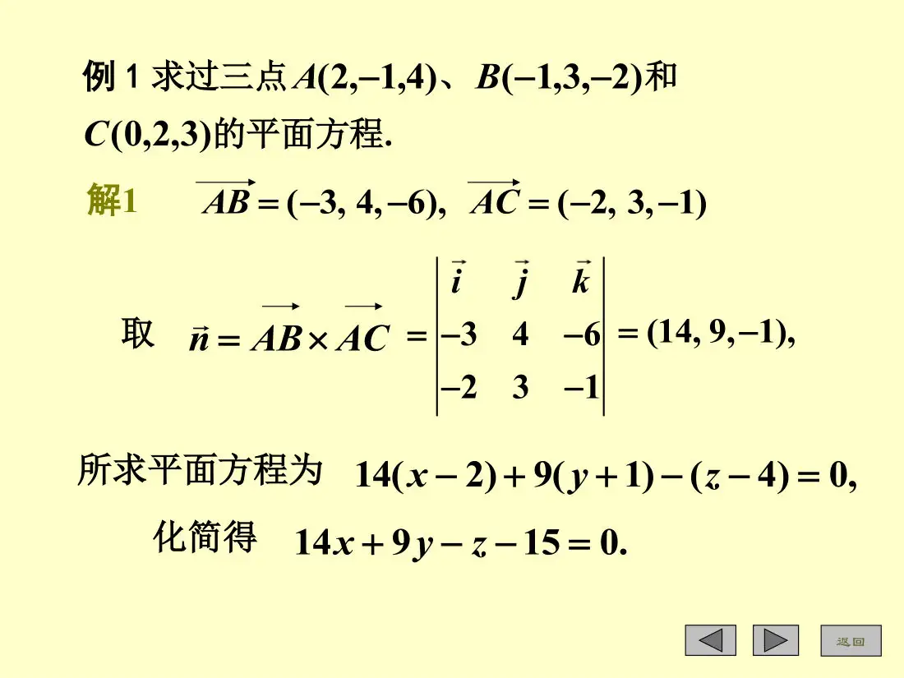

原文：

例1 求过三点A(2,-1,4)、B(-1,3,-2)和C(0,2,3)的平面方程.

解1 $\overrightarrow { A B } = ( - 3 , 4 , - 6 ) , \overrightarrow { A C } = ( - 2 , 3 , - 1 )$

取 $\vec { \pmb { n } } = \overrightarrow { A B } \times \overrightarrow { A C } = \left| - 3 \quad 4 \quad - \bf { 6 } \right| = ( 1 4 , 9 , - 1 ) ,$

所求平面方程为 $1 4 ( x - 2 ) + 9 ( y + 1 ) - ( z - 4 ) = 0 ,$

化简得 $1 4 x + 9 y - z - 1 5 = 0 .$

返回

### 例1 求过三点A(2,-1,4)、B(-1,3,-2)和

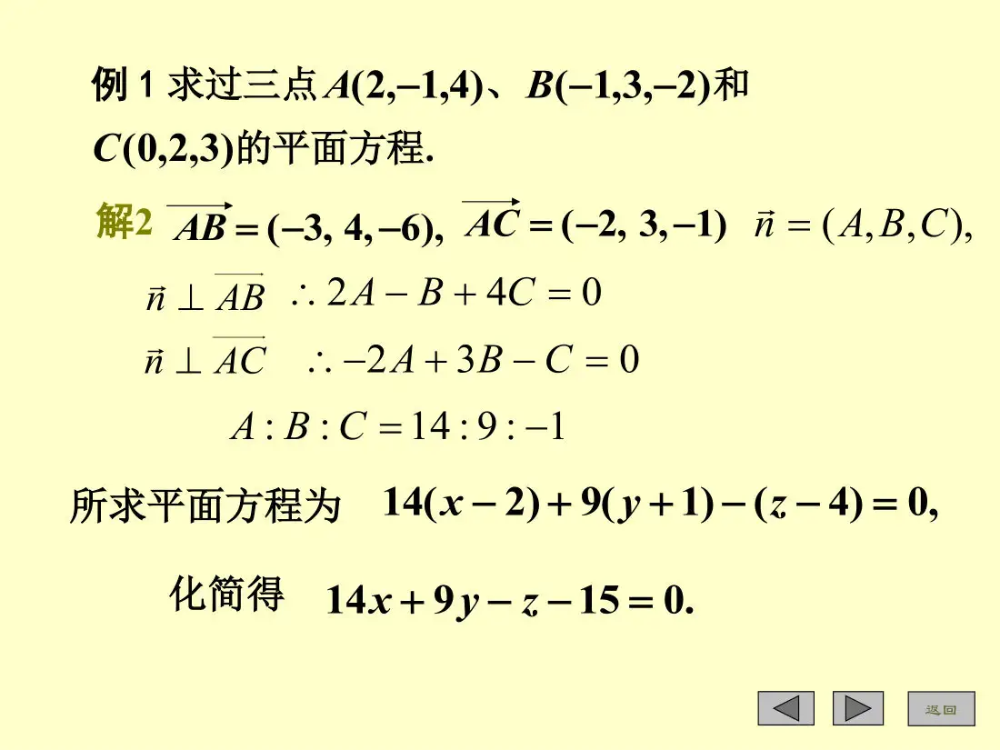

原文：

例1 求过三点A(2,-1,4)、B(-1,3,-2)和

C(0,2,3)的平面方程.

解2 $\overrightarrow { A B } = ( - 3 , 4 , - 6 ) , \overrightarrow { A C } = ( - 2 , 3 , - 1 ) \overrightarrow { n } = ( A , B , C ) ,$

$$
\vec {n} \perp \overrightarrow {A B} \therefore 2 A - B + 4 C = 0
$$

$$
\vec {n} \perp \overrightarrow {A C} \quad \therefore - 2 A + 3 B - C = 0
$$

$$
A: B: C = 1 4: 9: - 1
$$

所求平面方程为 $1 4 ( x - 2 ) + 9 ( y + 1 ) - ( z - 4 ) = 0 ,$

化简得 $1 4 x + 9 y - z - 1 5 = 0 .$

返回

### 设 $M ( x , y , z )$ 为平面上的任意一点，

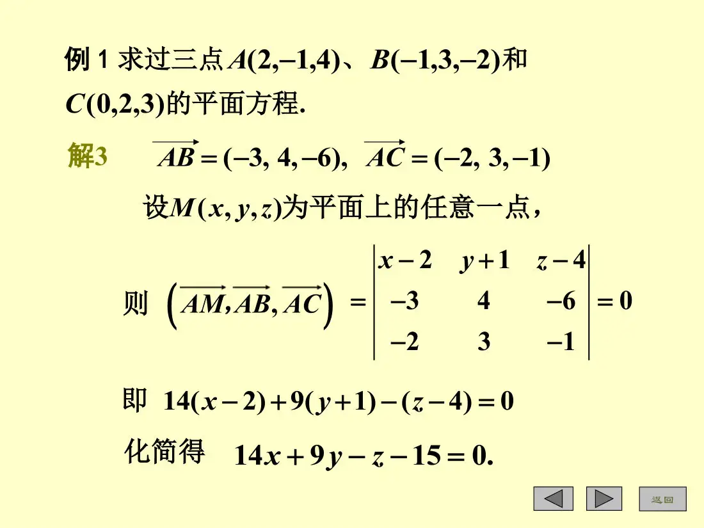

原文：

例 1 求过三点A(2,-1,4)、B(-1,3,-2)和$C ( 0 , 2 , 3 )$ 的平面方程.

解3 $\overrightarrow { A B } = ( - 3 , 4 , - 6 ) , \overrightarrow { A C } = ( - 2 , 3 , - 1 )$

设 $M ( x , y , z )$ 为平面上的任意一点，

$$
\left(\overrightarrow {A M}, \overrightarrow {A B}, \overrightarrow {A C}\right) = \left| \begin{array}{c c c} x - 2 & y + 1 & z - 4 \\ - 3 & 4 & - 6 \\ - 2 & 3 & - 1 \end{array} \right| = 0
$$

即 $1 4 ( x - 2 ) + 9 ( y + 1 ) - ( z - 4 ) = 0$

化简得 $1 4 x + 9 y - z - 1 5 = 0 .$

返回

### 返回

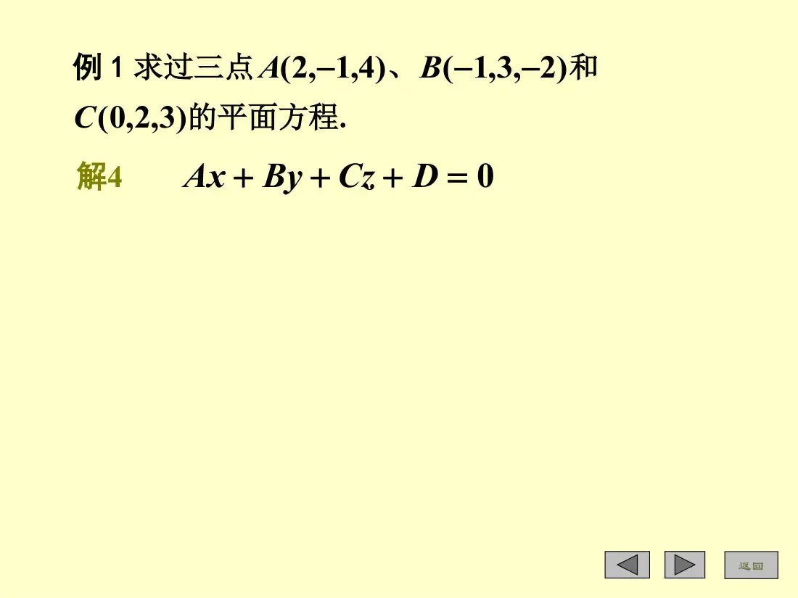

原文：

例 1 求过三点A(2,-1,4)、B(-1,3,-2)和C(0,2,3)的平面方程.

解4 $A x + B y + C z + D = 0$ 例 2 求过点(1,1,1)，且垂直于平面 $x - y + z = 7$ 和$3 x + 2 y - 1 2 z + 5 = 0$ 的平面方程.

返回

### 所求平面方程为

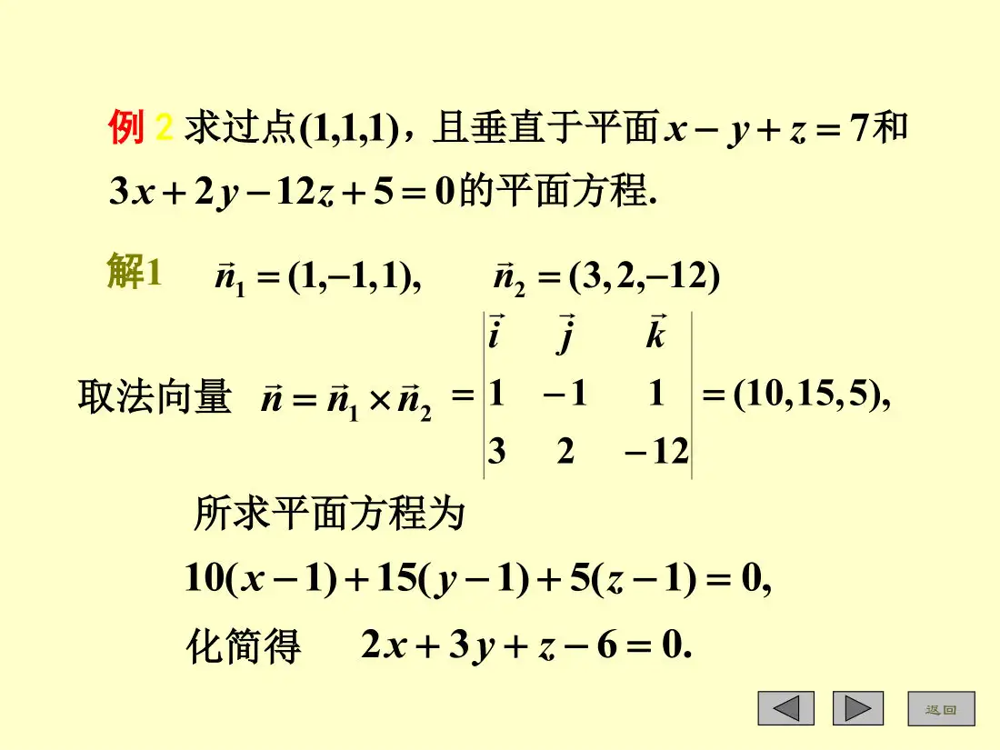

原文：

解1 $\vec { n } _ { 1 } = ( 1 , - 1 , 1 ) , ~ \vec { n } _ { 2 } = ( 3 , 2 , - 1 2 )$ 取法向量 $\vec { n } = \vec { n } _ { 1 } \times \vec { n } _ { 2 } = \left| \begin{array} { c c c } { \vec { i } } & { \vec { j } } & { \vec { k } } \\ { - 1 } & { 1 } \\ { 3 } & { 2 } & { - 1 2 } \end{array} \right| = ( 1 0 , 1 5 , 5 ) ,$

所求平面方程为

$$
1 0 (x - 1) + 1 5 (y - 1) + 5 (z - 1) = 0,
$$

化简得 $2 x + 3 y + z - 6 = 0 .$

返回

### 解2

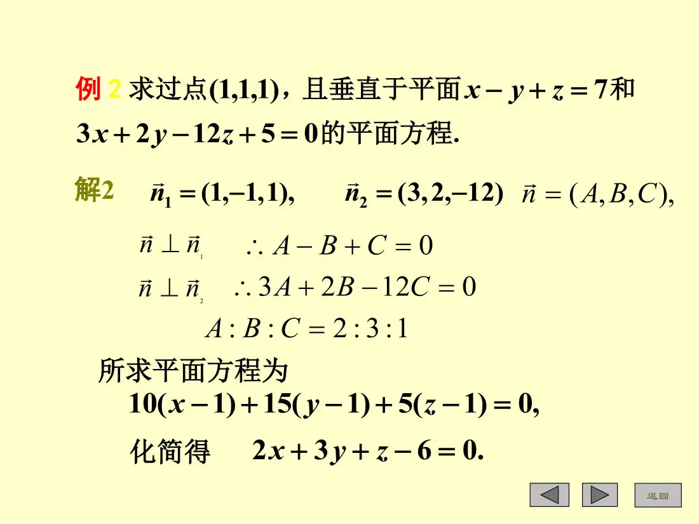

原文：

例2 求过点(1,1,1)，且垂直于平面 $x - y + z = 7$ 和$3 x + 2 y - 1 2 z + 5 = 0$ 的平面方程.

解2

$$
\vec {n} _ {1} = (1, - 1, 1), \quad \vec {n} _ {2} = (3, 2, - 1 2) \quad \vec {n} = (A, B, C),
$$

$$
\vec {n} \perp \vec {n} _ {1} \quad \therefore A - B + C = 0
$$

$$
\vec {n} \perp \vec {n} _ {2} \quad \therefore 3 A + 2 B - 1 2 C = 0
$$

$$
A: B: C = 2: 3: 1
$$

所求平面方程为

$$
1 0 (x - 1) + 1 5 (y - 1) + 5 (z - 1) = 0,
$$

化简得 2x + 3y + z − 6 = 0.

返回

### $$

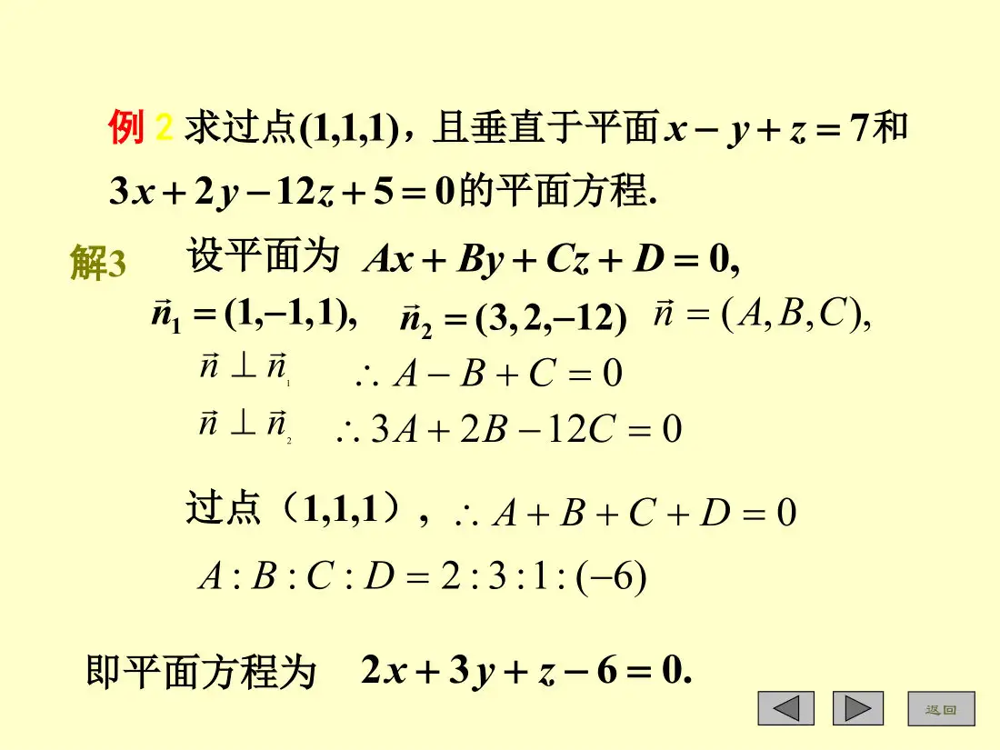

原文：

例2求过点(1,1,1)，且垂直于平面 $x - y + z = 7$ 和$3 x + 2 y - 1 2 z + 5 = 0$ 的平面方程.

解3 设平面为 $\scriptstyle { A x + B y + C z + D = 0 } .$

$$
\begin{array}{r l} & {\vec {n} _ {1} = (1, - 1, 1), \quad \vec {n} _ {2} = (3, 2, - 1 2) \quad \vec {n} = (A, B, C),} \\ & {\vec {n} \perp \vec {n} _ {_ 1} \qquad \therefore A - B + C = 0} \\ & {\vec {n} \perp \vec {n} _ {_ 2} \quad \therefore 3 A + 2 B - 1 2 C = 0} \end{array}
$$

过点 $( 1 , 1 , 1 ) , . . . A + B + C + D = 0$

$$
A: B: C: D = 2: 3: 1: (- 6)
$$

即平面方程为 $2 x + 3 y + z - 6 = 0 .$

### 第 16 页

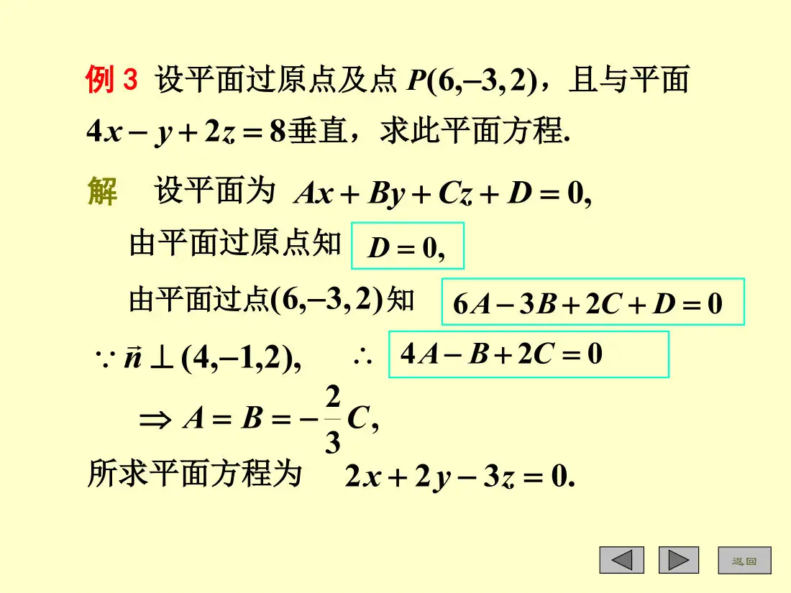

原文：

例3 设平面过原点及点 $P ( 6 , - 3 , 2 )$ ，且与平面 $4 x - y + 2 z = 8$ 垂直，求此平面方程.

设平面为解 $\scriptstyle A x + B y + C z + D = 0 ,$ 由平面过原点知 $D = \mathbf { 0 } ,$ 由平面过点 $( 6 , - 3 , 2 )$ 知 $6 A - 3 B + 2 C + D = 0$ $\because n \perp ( 4 , - 1 , 2 )$ $\therefore \vert 4 A - B + 2 C = 0$ $\Rightarrow A = B = - { \frac { 2 } { 3 } } C ,$ 所求平面方程为 $2 x + 2 y - 3 z = 0 .$

### 四、平面与平面的位置关系

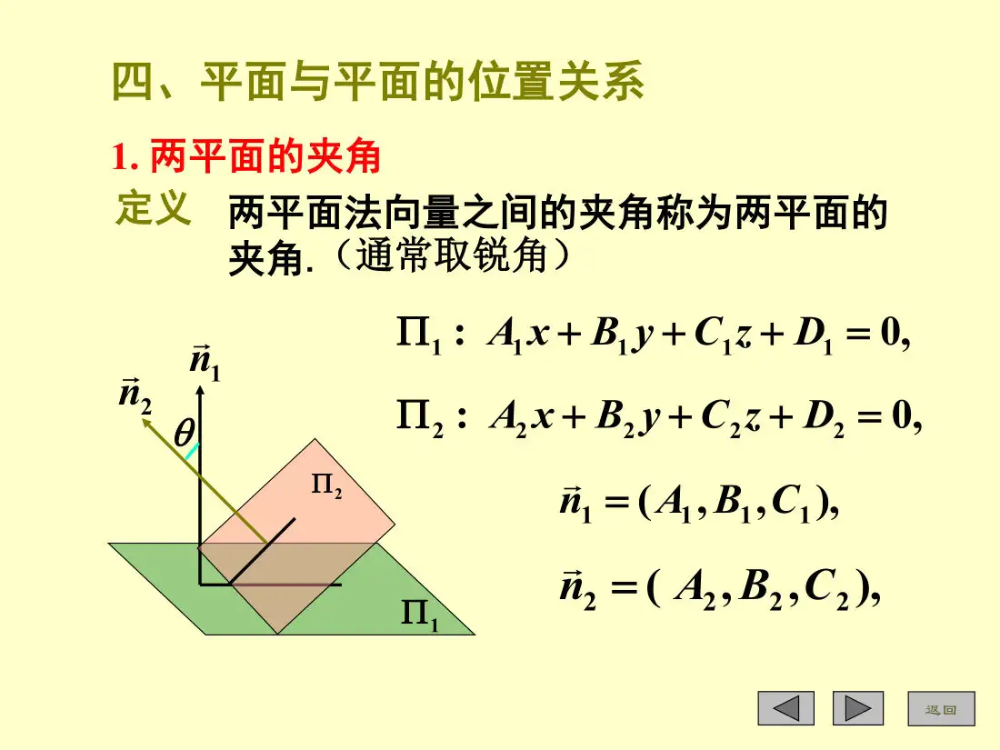

原文：

四、平面与平面的位置关系

1. 两平面的夹角

定义 两平面法向量之间的夹角称为两平面的（通常取锐角）夹角.

$$
\Pi_ {1}: A _ {1} x + B _ {1} y + C _ {1} z + D _ {1} = 0,
$$

$$
\Pi_ {2}: A _ {2} x + B _ {2} y + C _ {2} z + D _ {2} = 0,
$$

$$
\vec {n} _ {1} = (A _ {1}, B _ {1}, C _ {1}),
$$

$$
\vec {n} _ {2} = (A _ {2}, B _ {2}, C _ {2}),
$$

返回

### 按照两向量夹角余弦公式有

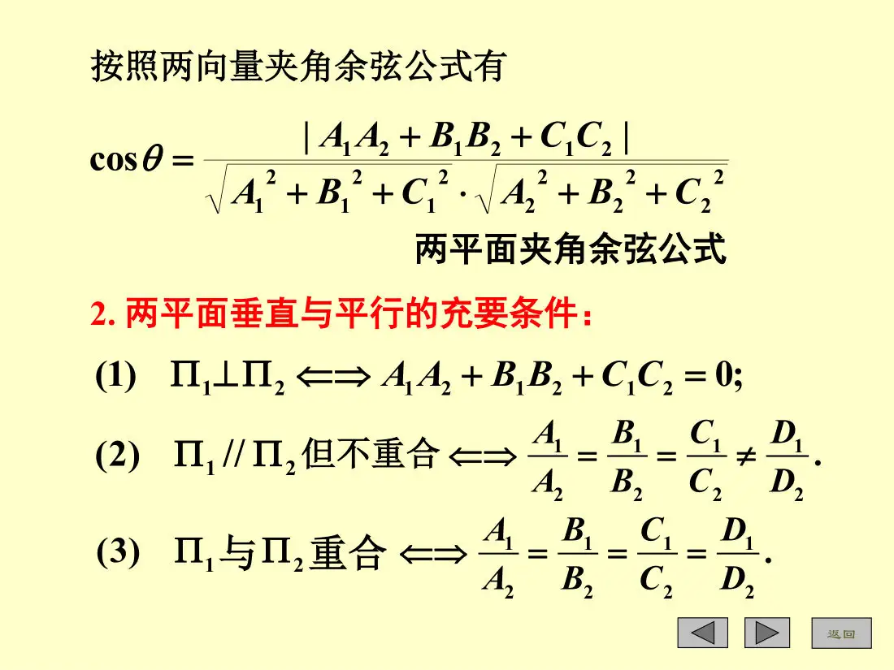

原文：

按照两向量夹角余弦公式有

$$
\cos \theta = \frac {\left| A _ {1} A _ {2} + B _ {1} B _ {2} + C _ {1} C _ {2} \right|}{\sqrt {A _ {1} ^ {2} + B _ {1} ^ {2} + C _ {1} ^ {2}} \cdot \sqrt {A _ {2} ^ {2} + B _ {2} ^ {2} + C _ {2} ^ {2}}} \text {两平面夹角余弦公式}
$$

2. 两平面垂直与平行的充要条件：

(1) $\Pi _ { 1 } \bot \Pi _ { 2 } \Longleftrightarrow A _ { 1 } A _ { 2 } + B _ { 1 } B _ { 2 } + C _ { 1 } C _ { 2 } = 0 ;$

(2) $\Pi _ { 1 } / / \Pi _ { 2 }$ 但不重合 $\Longleftrightarrow \frac { A _ { 1 } } { A _ { 2 } } = \frac { B _ { 1 } } { B _ { 2 } } = \frac { C _ { 1 } } { C _ { 2 } } \neq \frac { D _ { 1 } } { D _ { 2 } }$

(3) $\Pi _ { 1 }$ 与 $\Pi _ { 2 }$ 重合 $\Longleftrightarrow \frac { A _ { 1 } } { A _ { 2 } } = \frac { B _ { 1 } } { B _ { 2 } } = \frac { C _ { 1 } } { C _ { 2 } } = \frac { D _ { 1 } } { D _ { 2 } }$

返回

### 例4 讨论以下各组平面的位置关系：

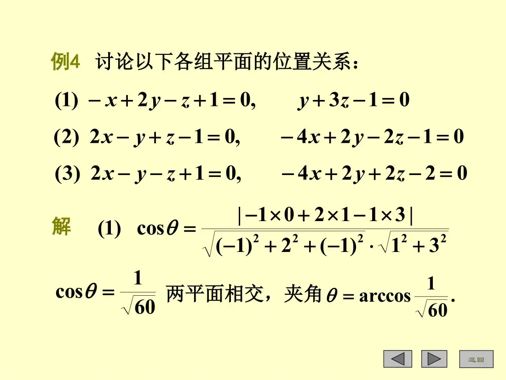

原文：

例4 讨论以下各组平面的位置关系：

(1) $- x + 2 y - z + 1 = 0 , \qquad y + 3 z - 1 = 0$

$$
2 x - y + z - 1 = 0, \quad - 4 x + 2 y - 2 z - 1 = 0 \tag {2}
$$

(3) $2 x - y - z + 1 = 0 ,$ -4x+2y+2z-2=0

解 $\cos \theta = { \frac { \left| - 1 \times 0 + 2 \times 1 - 1 \times 3 \right| } { \sqrt { \left( - 1 \right) ^ { 2 } + 2 ^ { 2 } + \left( - 1 \right) ^ { 2 } } \cdot \sqrt { 1 ^ { 2 } + 3 ^ { 2 } } } }$

$\cos \theta = { \frac { 1 } { \sqrt { 6 0 } } }$ 两平面相交，夹角 $\theta = \operatorname { a r c c o s } { \frac { 1 } { \sqrt { 6 0 } } } .$

### $$

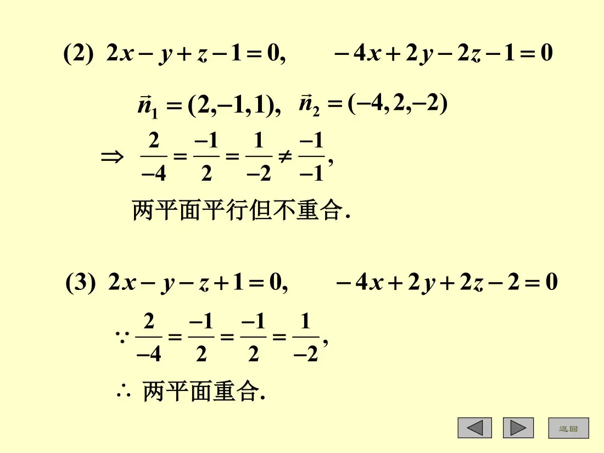

原文：

$$
2 x - y + z - 1 = 0, \quad - 4 x + 2 y - 2 z - 1 = 0 \tag {2}
$$

$$
\begin{array}{r l} & {\vec {n} _ {1} = (2, - 1, 1), \vec {n} _ {2} = (- 4, 2, - 2)} \\ & {\Rightarrow \frac {2}{- 4} = \frac {- 1}{2} = \frac {1}{- 2} \neq \frac {- 1}{- 1},} \end{array}
$$

两平面平行但不重合

(3) $2 x - y - z + 1 = 0 , \qquad - 4 x + 2 y + 2 z - 2 = 0$ $\because { \frac { 2 } { - 4 } } = { \frac { - 1 } { 2 } } = { \frac { - 1 } { 2 } } = { \frac { 1 } { - 2 } } ,$

$\therefore$ 两平面重合.

返回

### $$

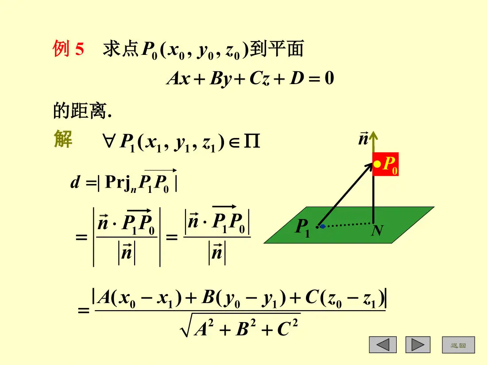

原文：

例5 求点 $P _ { 0 } ( x _ { 0 } , y _ { 0 } , z _ { 0 } )$ 到平面

$$
A x + B y + C z + D = 0
$$

的距离.

$$
\begin{array}{r l} & {\forall P _ {1} (x _ {1}, y _ {1}, z _ {1}) \in \Pi} \\ & {d = | \operatorname * {P r j} _ {n} \overrightarrow {P _ {1} P _ {0}} |} \\ & {= \left| \frac {\vec {n} \cdot \overrightarrow {P _ {1} P _ {0}}}{| \vec {n} |} \right| = \frac {| \vec {n} \cdot \overrightarrow {P _ {1} P _ {0}} |}{| \vec {n} |}} \\ & {= \frac {| A (x _ {0} - x _ {1}) + B (y _ {0} - y _ {1}) + C (z _ {0} - z _ {1}) |}{\sqrt {A ^ {2} + B ^ {2} + C ^ {2}}}} \end{array}
$$

### $$

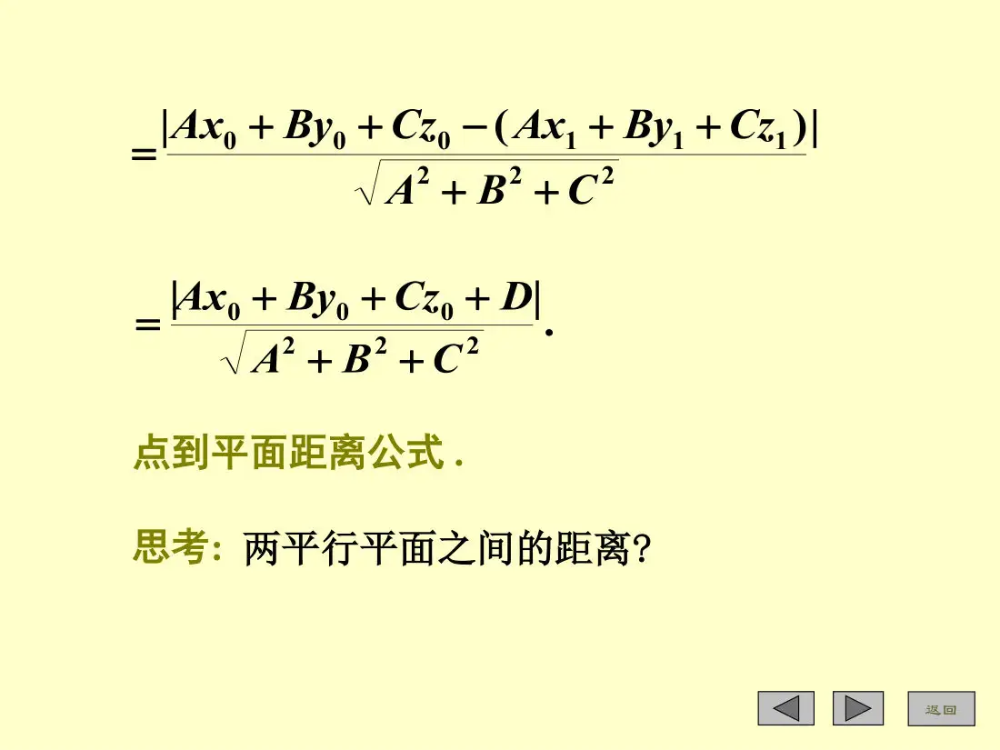

原文：

$$
= \frac {\left| A x _ {0} + B y _ {0} + C z _ {0} - \left(A x _ {1} + B y _ {1} + C z _ {1}\right) \right|}{\sqrt {A ^ {2} + B ^ {2} + C ^ {2}}}
$$

$$
= \frac {\left| A x _ {0} + B y _ {0} + C z _ {0} + D \right|}{\sqrt {A ^ {2} + B ^ {2} + C ^ {2}}}.
$$

点到平面距离公式.

思考: 两平行平面之间的距离?

返回
