# 《线性代数与解析几何》第5章 线性方程组（课件）

原件的每一页，下面附识别出的文字。

### 第5章 线性方程组

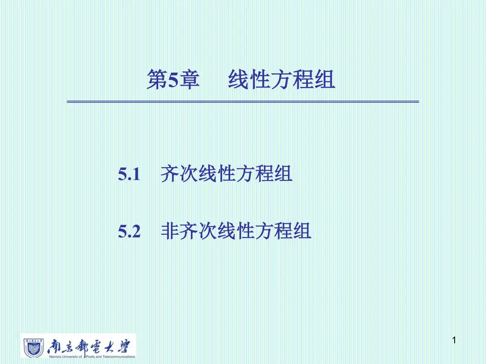

原文：

第5章 线性方程组

5.1 齐次线性方程组

5.2 非齐次线性方程组

南京邮电大学
Nanjing University of Posts and Telecommunications

1

### 5.1 齐次线性方程组

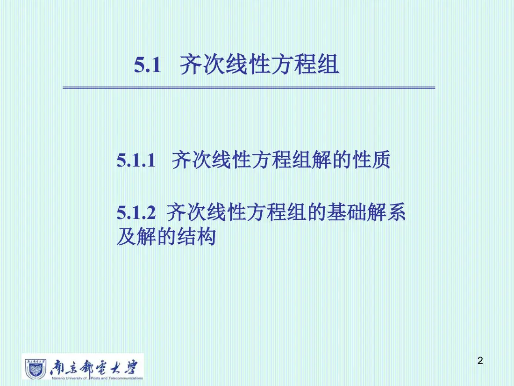

原文：

5.1 齐次线性方程组

5.1.1 齐次线性方程组解的性质

5.1.2 齐次线性方程组的基础解系及解的结构

南京邮电大学
Nanjing University of Posts and Telecommunications

2

### 5.1 齐次线性方程组

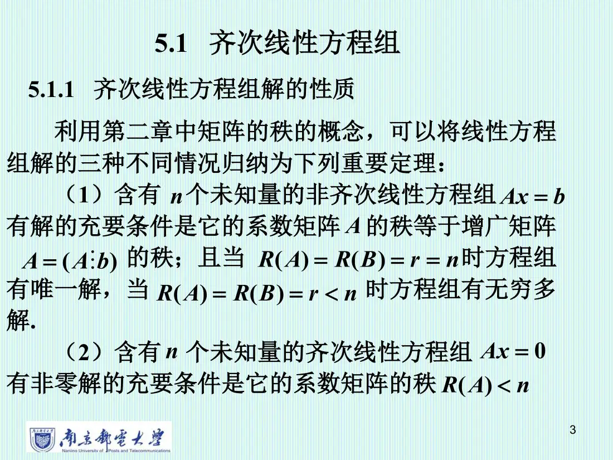

原文：

5.1 齐次线性方程组

5.1.1 齐次线性方程组解的性质

利用第二章中矩阵的秩的概念，可以将线性方程组解的三种不同情况归纳为下列重要定理：

(1) 含有 $n$ 个未知量的非齐次线性方程组 $Ax = b$ 有解的充要条件是它的系数矩阵 $A$ 的秩等于增广矩阵 $A = (A:b)$ 的秩; 且当 $R(A) = R(B) = r = n$ 时方程组有唯一解, 当 $R(A) = R(B) = r < n$ 时方程组有无穷多解.

(2) 含有 $n$ 个未知量的齐次线性方程组 $Ax = 0$ 有非零解的充要条件是它的系数矩阵的秩 $R(A) < n$

南京邮电大学
Nanjing University of Posts and Telecommunications

3

### 1. 解向量的概念

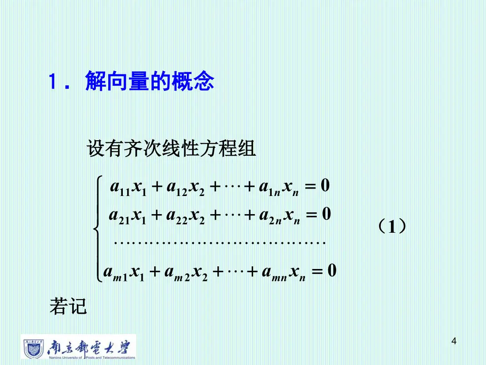

原文：

1. 解向量的概念

设有齐次线性方程组

$$
\left\{ \begin{array} {l}a _ {1 1} x _ {1} + a _ {1 2} x _ {2} + \dots + a _ {1 n} x _ {n} = 0 \\ a _ {2 1} x _ {1} + a _ {2 2} x _ {2} + \dots + a _ {2 n} x _ {n} = 0 \\ \cdots \\ a _ {m 1} x _ {1} + a _ {m 2} x _ {2} + \dots + a _ {m n} x _ {n} = 0 \end{array} \right.\tag{1}
$$

若记

南京邮电大学
Nanjing University of Posts and Telecommunications

4

### $$

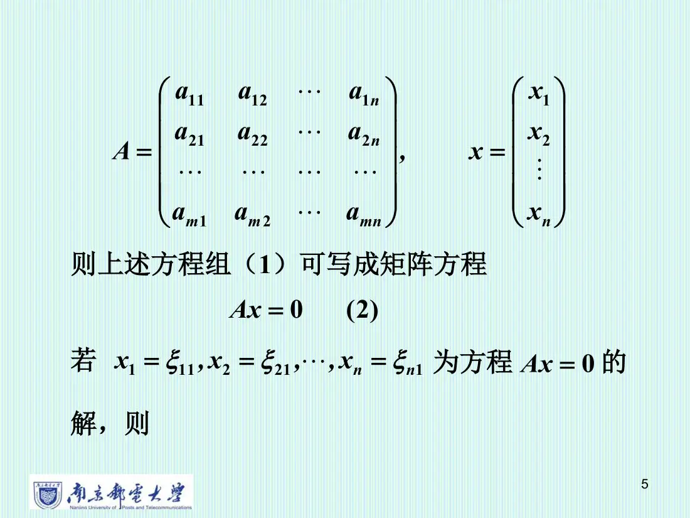

原文：

$$
A = \left( \begin{array}{c c c c} a _ {1 1} & a _ {1 2} & \dots & a _ {1 n} \\ a _ {2 1} & a _ {2 2} & \dots & a _ {2 n} \\ \dots & \dots & \dots & \dots \\ a _ {m 1} & a _ {m 2} & \dots & a _ {m n} \end{array} \right), \qquad x = \left( \begin{array}{c} x _ {1} \\ x _ {2} \\ \vdots \\ x _ {n} \end{array} \right)
$$

则上述方程组（1）可写成矩阵方程

$$
A x = 0\tag{2}
$$

若 $x_{1}=\xi_{11},x_{2}=\xi_{21},\cdots,x_{n}=\xi_{n1}$ 为方程 Ax=0 的解，则

南京邮电大学
Nanjing University of Posts and Telecommunications

5

### $$

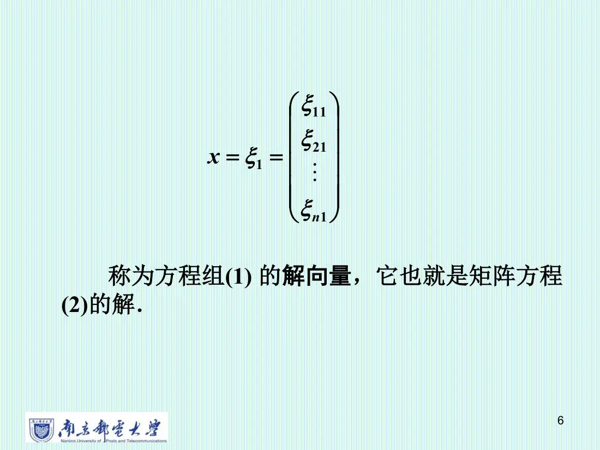

原文：

$$
\boldsymbol {x} = \boldsymbol {\xi} _ {1} = \left( \begin{array}{c} \boldsymbol {\xi} _ {1 1} \\ \boldsymbol {\xi} _ {2 1} \\ \vdots \\ \boldsymbol {\xi} _ {n 1} \end{array} \right)
$$

称为方程组(1)的解向量，它也就是矩阵方程(2)的解.

南京邮电大学
Nanjing University of Posts and Telecommunications

6

### 2. 齐次线性方程组解的性质

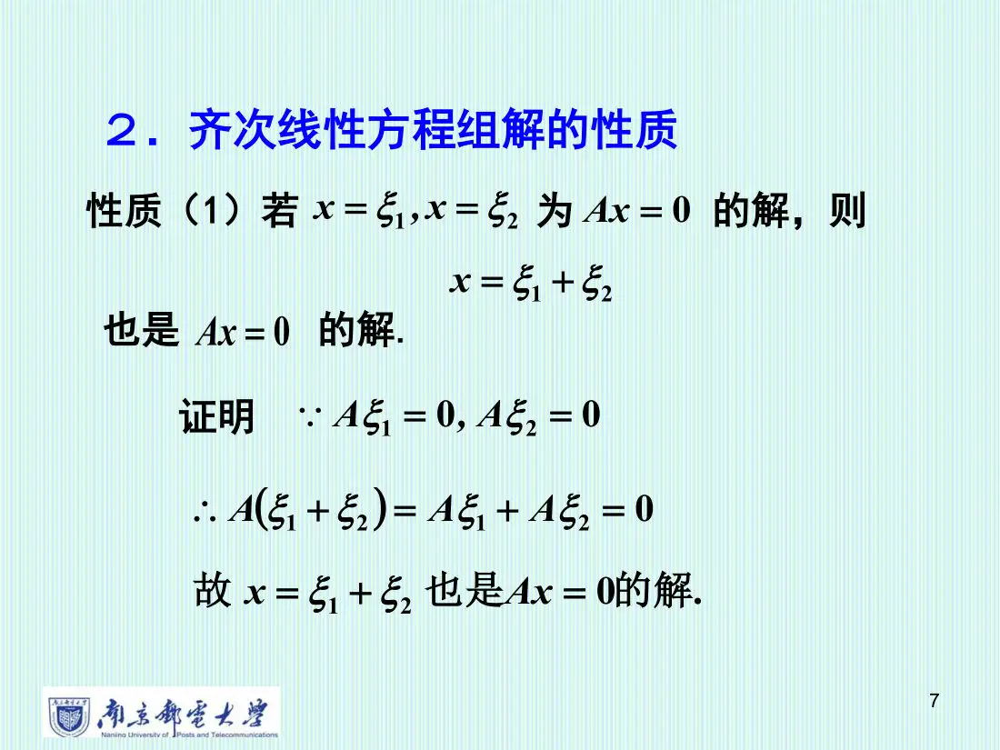

原文：

2. 齐次线性方程组解的性质

性质（1）若 $x = \xi_{1}, x = \xi_{2}$ 为 $Ax = 0$ 的解，则

$$
x = \xi_ {1} + \xi_ {2}
$$

也是 Ax = 0 的解.

证明 $\because A\xi_{1} = 0, A\xi_{2} = 0$

$$
\therefore A \left(\xi_ {1} + \xi_ {2}\right) = A \xi_ {1} + A \xi_ {2} = 0
$$

故 $x = \xi_{1} + \xi_{2}$ 也是 $Ax = 0$ 的解.

南京邮电大学
Nanjing University of Posts and Telecommunications

7

### 证明 $A(k\xi_1) = kA(\xi_1) = k0 = 0.$ 证毕.

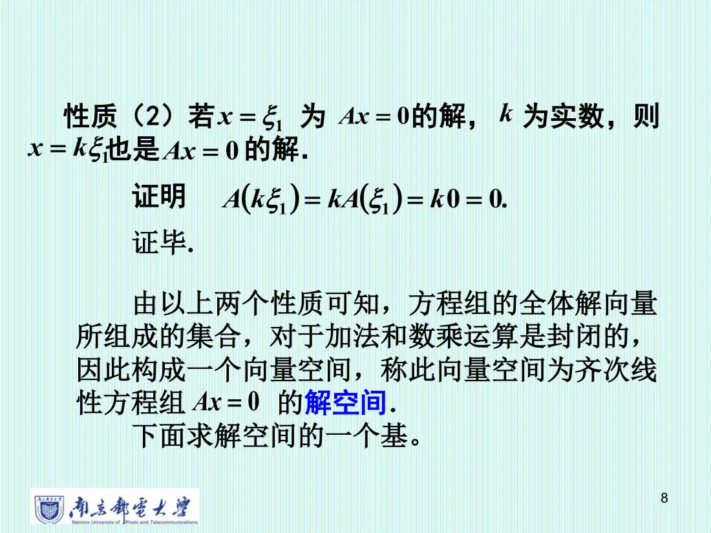

原文：

性质（2）若 $x = \xi_{1}$ 为 $Ax = 0$ 的解， $k$ 为实数，则 $x = k\xi_{1}$ 也是 $Ax = 0$ 的解.

证明 $A(k\xi_1) = kA(\xi_1) = k0 = 0.$ 证毕.

由以上两个性质可知，方程组的全体解向量所组成的集合，对于加法和数乘运算是封闭的，因此构成一个向量空间，称此向量空间为齐次线性方程组 Ax = 0 的解空间。

下面求解空间的一个基。

南京邮电大学
Nanjing University of Posts and Telecommunications

8

### 5.1.2 齐次线性方程组基础解系及解的结构

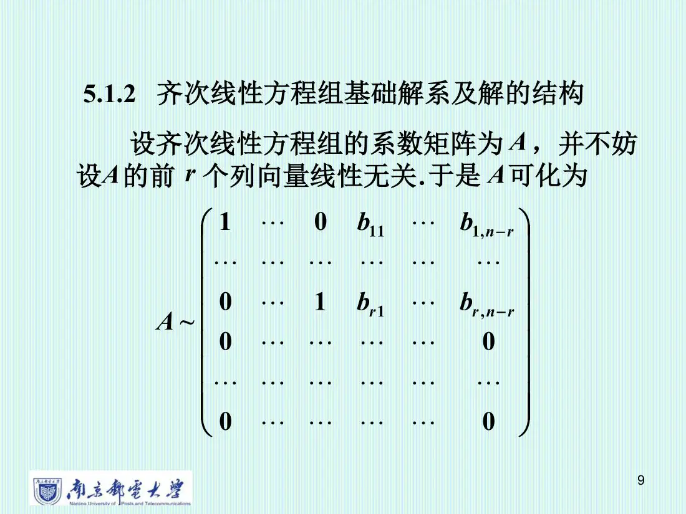

原文：

5.1.2 齐次线性方程组基础解系及解的结构

设齐次线性方程组的系数矩阵为 A，并不妨设 A 的前 r 个列向量线性无关。于是 A 可化为

$$
A \sim \left( \begin{array}{c c c c c c} 1 & \dots & 0 & b _ {1 1} & \dots & b _ {1, n - r} \\ \dots & \dots & \dots & \dots & \dots & \dots \\ 0 & \dots & 1 & b _ {r 1} & \dots & b _ {r, n - r} \\ 0 & \dots & \dots & \dots & \dots & 0 \\ \dots & \dots & \dots & \dots & \dots & \dots \\ 0 & \dots & \dots & \dots & \dots & 0 \end{array} \right)
$$

南京邮电大学
Nanjing University of Posts and Telecommunications

9

### $$

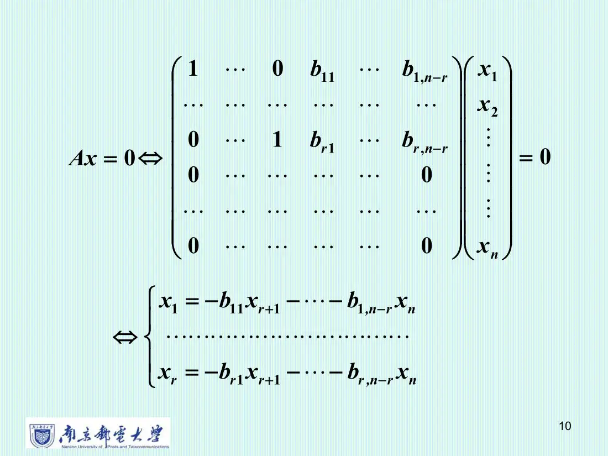

原文：

$$
A x = 0 \Longleftrightarrow \left( \begin{array}{c c c c c c} 1 & \dots & 0 & b _ {1 1} & \dots & b _ {1, n - r} \\ \dots & \dots & \dots & \dots & \dots & \dots \\ 0 & \dots & 1 & b _ {r 1} & \dots & b _ {r, n - r} \\ 0 & \dots & \dots & \dots & \dots & 0 \\ \dots & \dots & \dots & \dots & \dots & \dots \\ 0 & \dots & \dots & \dots & \dots & 0 \end{array} \right) \left( \begin{array}{c} x _ {1} \\ x _ {2} \\ \vdots \\ \vdots \\ \vdots \\ x _ {n} \end{array} \right) = 0
$$

$$
\Leftrightarrow \left\{ \begin{array}{l} x _ {1} = - b _ {1 1} x _ {r + 1} - \dots - b _ {1, n - r} x _ {n} \\ \dots\dots\\ x _ {r} = - b _ {r 1} x _ {r + 1} - \dots - b _ {r, n - r} x _ {n} \end{array} \right.
$$

南京邮电大学
Nanjing University of Posts and Telecommunications

10

### 现对 $x_{r+1},\cdots,x_{n}$ 取下列 n-r 组数:

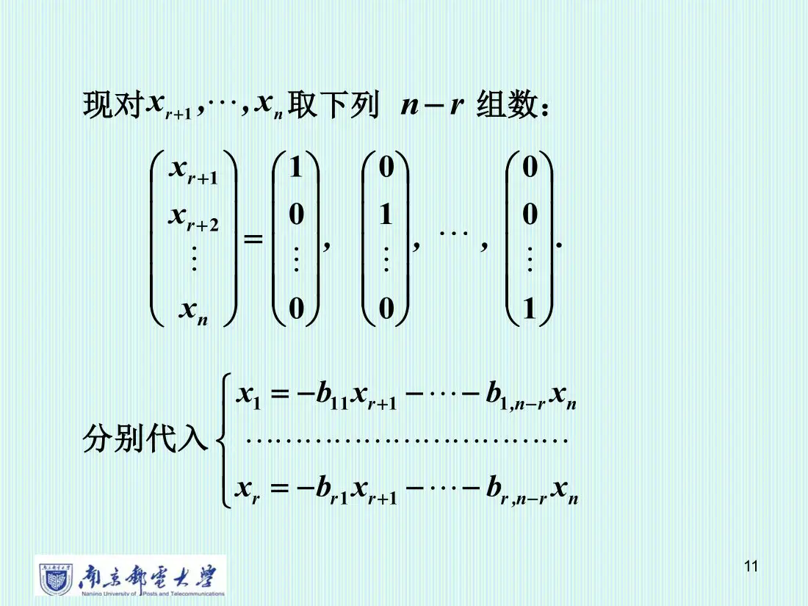

原文：

现对 $x_{r+1},\cdots,x_{n}$ 取下列 n-r 组数:

$$
\left( \begin{array}{c} x _ {r + 1} \\ x _ {r + 2} \\ \vdots \\ x _ {n} \end{array} \right) = \left( \begin{array}{c} 1 \\ 0 \\ \vdots \\ 0 \end{array} \right), \quad \left( \begin{array}{c} 0 \\ 1 \\ \vdots \\ 0 \end{array} \right), \dots , \left( \begin{array}{c} 0 \\ 0 \\ \vdots \\ 1 \end{array} \right).
$$

分别代入 $\left\{\begin{aligned}x_{1}&=-b_{11}x_{r+1}-\cdots-b_{1,n-r}x_{n}\\ &\cdots\\ x_{r}&=-b_{r1}x_{r+1}-\cdots-b_{r,n-r}x_{n}\end{aligned}\right.$

南京邮电大学
Nanjing University of Posts and Telecommunications

11

### 依次得

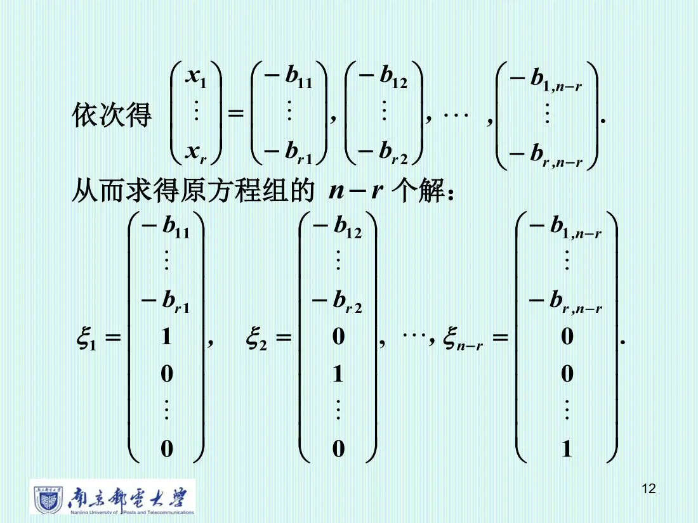

原文：

依次得

$$
\left( \begin{array}{c} x _ {1} \\ \vdots \\ x _ {r} \end{array} \right) = \left( \begin{array}{c} - b _ {1 1} \\ \vdots \\ - b _ {r 1} \end{array} \right), \left( \begin{array}{c} - b _ {1 2} \\ \vdots \\ - b _ {r 2} \end{array} \right), \dots , \left( \begin{array}{c} - b _ {1, n - r} \\ \vdots \\ - b _ {r, n - r} \end{array} \right).
$$

从而求得原方程组的 $n - r$ 个解:

$$
\xi_ {1} = \left( \begin{array}{c} - b _ {1 1} \\ \vdots \\ - b _ {r 1} \\ \mathbf {1} \\ \mathbf {0} \\ \vdots \\ \mathbf {0} \end{array} \right), \quad \xi_ {2} = \left( \begin{array}{c} - b _ {1 2} \\ \vdots \\ - b _ {r 2} \\ \mathbf {0} \\ \mathbf {1} \\ \vdots \\ \mathbf {0} \end{array} \right), \dots , \xi_ {n - r} = \left( \begin{array}{c} - b _ {1, n - r} \\ \vdots \\ - b _ {r, n - r} \\ \mathbf {0} \\ \mathbf {0} \\ \vdots \\ \mathbf {1} \end{array} \right).
$$

南京邮电大学
Nanjing University of Posts and Telecommunications

12

### 南京邮电大学

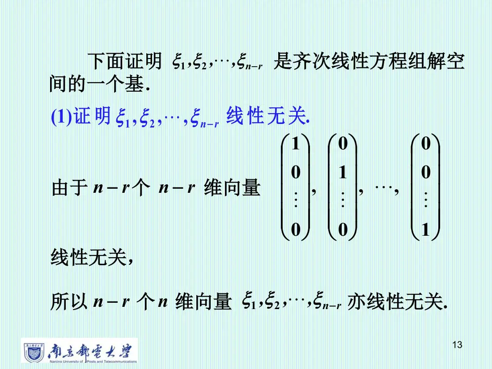

原文：

下面证明 $\xi_1, \xi_2, \dots, \xi_{n-r}$ 是齐次线性方程组解空间的一个基.

(1)证明 $\xi_{1},\xi_{2},\cdots,\xi_{n-r}$ 线性无关.

由于 n-r 个 n-r 维向量 $\begin{pmatrix}1\\0\\\vdots\\0\end{pmatrix},\begin{pmatrix}0\\1\\\vdots\\0\end{pmatrix},\cdots,\begin{pmatrix}0\\0\\\vdots\\1\end{pmatrix}$ 线性无关，

所以 n-r 个 n 维向量 $\xi_{1},\xi_{2},\cdots,\xi_{n-r}$ 亦线性无关.

南京邮电大学
Nanjing University of Posts and Telecommunications

13

### $$

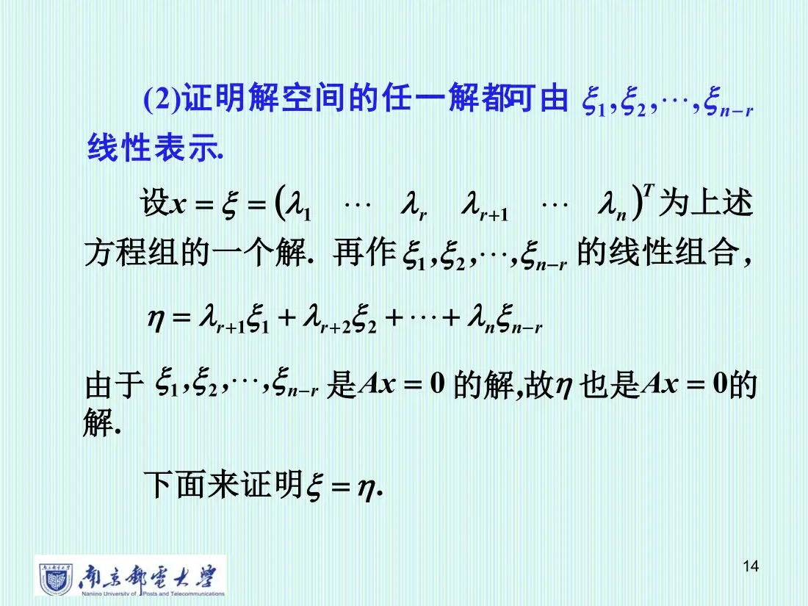

原文：

(2)证明解空间的任一解都可由 $\xi_{1}, \xi_{2}, \cdots, \xi_{n-r}$ 线性表示.

设 $x=\xi=(\lambda_{1}\cdots\lambda_{r}\lambda_{r+1}\cdots\lambda_{n})^{T}$ 为上述方程组的一个解. 再作 $\xi_{1},\xi_{2},\cdots,\xi_{n-r}$ 的线性组合,

$$
\eta = \lambda_ {r + 1} \xi_ {1} + \lambda_ {r + 2} \xi_ {2} + \dots + \lambda_ {n} \xi_ {n - r}
$$

由于 $\xi_{1},\xi_{2},\cdots,\xi_{n-r}$ 是 Ax=0 的解, 故 $\eta$ 也是 Ax=0 的解.

下面来证明 $\xi = \eta$ .

南京邮电大学
Nanjing University of Posts and Telecommunications

14

### $$

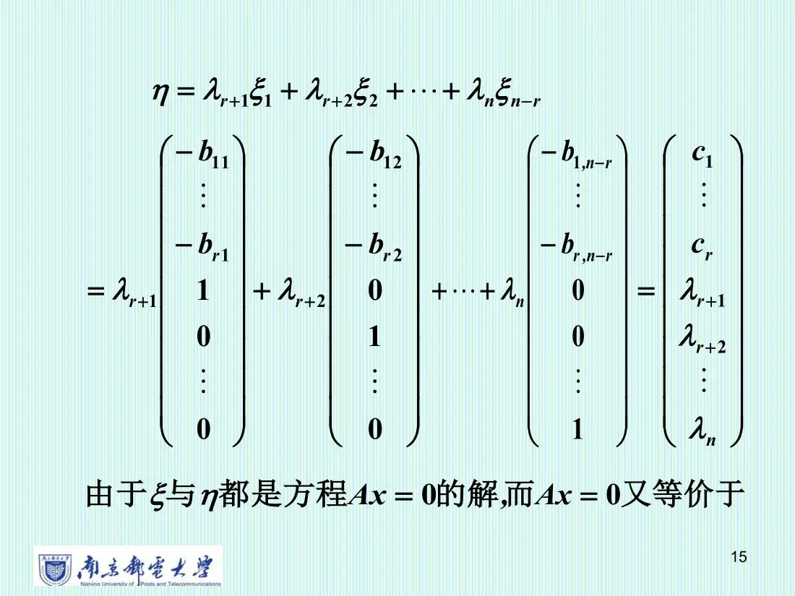

原文：

$$
\eta = \lambda_ {r + 1} \xi_ {1} + \lambda_ {r + 2} \xi_ {2} + \dots + \lambda_ {n} \xi_ {n - r}
$$

$$
= \lambda_ {r + 1} \left( \begin{array}{c} - b _ {1 1} \\ \vdots \\ - b _ {r 1} \\ \mathbf {1} \\ \mathbf {0} \\ \vdots \\ \mathbf {0} \end{array} \right) + \lambda_ {r + 2} \left( \begin{array}{c} - b _ {1 2} \\ \vdots \\ - b _ {r 2} \\ \mathbf {0} \\ \mathbf {1} \\ \vdots \\ \mathbf {0} \end{array} \right) + \dots + \lambda_ {n} \left( \begin{array}{c} - b _ {1, n - r} \\ \vdots \\ - b _ {r, n - r} \\ \mathbf {0} \\ \mathbf {0} \\ \vdots \\ \mathbf {1} \end{array} \right) = \left( \begin{array}{c} c _ {1} \\ \vdots \\ c _ {r} \\ \lambda_ {r + 1} \\ \lambda_ {r + 2} \\ \vdots \\ \lambda_ {n} \end{array} \right)
$$

由于 $\xi$ 与 $\eta$ 都是方程 $Ax = 0$ 的解, 而 $Ax = 0$ 又等价于

南京邮电大学
Nanjing University of Posts and Telecommunications

15

### 方程组

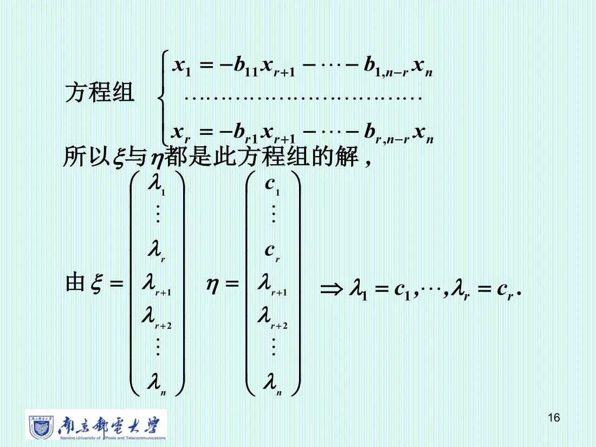

原文：

方程组

$$
\left\{ \begin{array}{l} x _ {1} = - b _ {1 1} x _ {r + 1} - \dots - b _ {1, n - r} x _ {n} \\ \dots \dots \\ x _ {r} = - b _ {r 1} x _ {r + 1} - \dots - b _ {r, n - r} x _ {n} \end{array} \right.
$$

所以 $\xi$ 与 $\eta$ 都是此方程组的解，

$$
\text {由} \xi = \left( \begin{array}{c} {{\dot {\lambda} _ {_ 1}}} \\ {{\vdots}} \\ {{\lambda_ {_ r}}} \\ {{\lambda_ {_ {r + 1}}}} \\ {{\lambda_ {_ {r + 2}}}} \\ {{\vdots}} \\ {{\lambda_ {_ n}}} \end{array} \right) \quad \eta = \left( \begin{array}{c} {{c _ {_ 1}}} \\ {{\vdots}} \\ {{c _ {_ r}}} \\ {{\lambda_ {_ {r + 1}}}} \\ {{\lambda_ {_ {r + 2}}}} \\ {{\vdots}} \\ {{\lambda_ {_ n}}} \end{array} \right) \Rightarrow \lambda_ {1} = c _ {1}, \dots , \lambda_ {r} = c _ {r}.
$$

南京邮电大学
Nanjing University of Posts and Telecommunications

16

### · $\dim S = n - r$

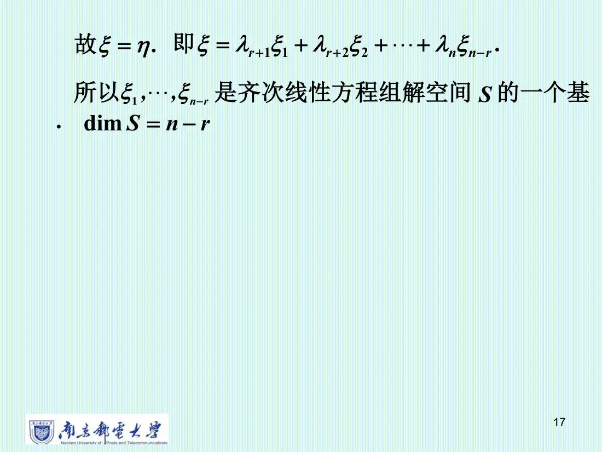

原文：

故 $\xi = \eta$ 即 $\xi = \lambda_{r + 1}\xi_1 + \lambda_{r + 2}\xi_2 + \dots +\lambda_n\xi_{n - r}.$

所以 $\xi_{1},\cdots,\xi_{n-r}$ 是齐次线性方程组解空间 S 的一个基
· $\dim S = n - r$

南京邮电大学
Nanjing University of Posts and Telecommunications

17

### 基础解系及其求法

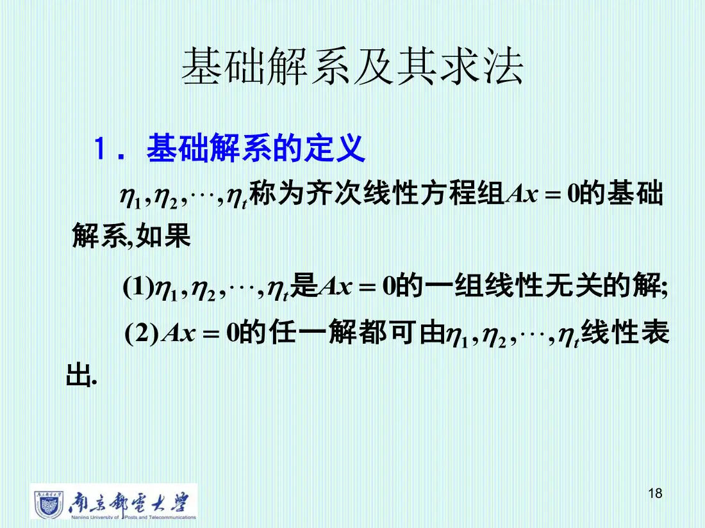

原文：

基础解系及其求法

1. 基础解系的定义

$\eta_{1},\eta_{2},\cdots,\eta_{t}$ 称为齐次线性方程组Ax=0的基础解系,如果

(1) $\eta_{1},\eta_{2},\cdots,\eta_{t}$ 是Ax=0的一组线性无关的解;

(2) $Ax = 0$ 的任一解都可由 $\eta_1, \eta_2, \cdots, \eta_t$ 线性表出.

南京邮电大学
Nanjing University of Posts and Telecommunications

18

### $$

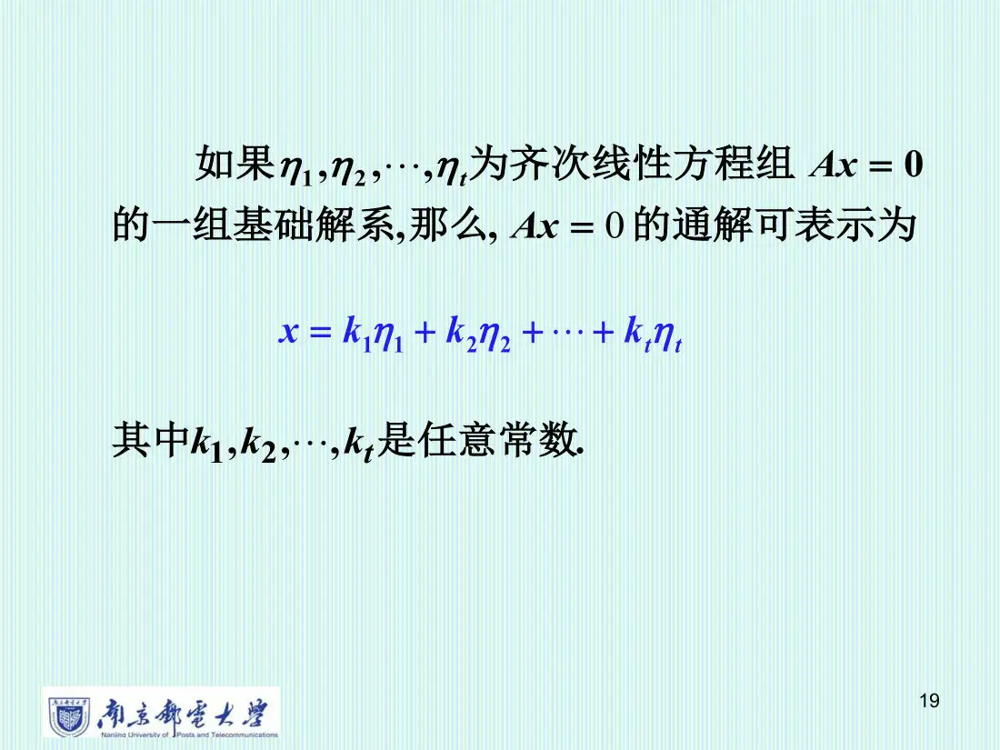

原文：

如果 $\eta_{1},\eta_{2},\cdots,\eta_{t}$ 为齐次线性方程组Ax=0的一组基础解系,那么,Ax=0的通解可表示为

$$
x = k _ {1} \eta_ {1} + k _ {2} \eta_ {2} + \dots + k _ {t} \eta_ {t}
$$

其中 $k_{1},k_{2},\cdots,k_{t}$ 是任意常数.

南京邮电大学
Nanjing University of Posts and Telecommunications

19

### 说明

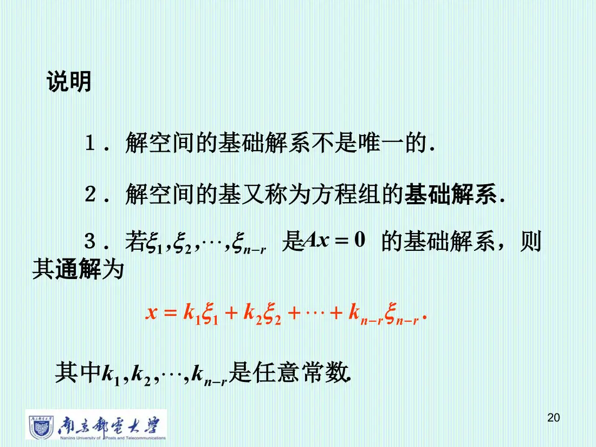

原文：

说明

1. 解空间的基础解系不是唯一的。

2．解空间的基又称为方程组的基础解系.

3. 若 $\xi_{1}, \xi_{2}, \cdots, \xi_{n - r}$ 是 $Ax = 0$ 的基础解系，则其通解为

$$
x = k _ {1} \xi_ {1} + k _ {2} \xi_ {2} + \dots + k _ {n - r} \xi_ {n - r}.
$$

其中 $k_{1},k_{2},\cdots,k_{n-r}$ 是任意常数.

南京邮电大学
Nanjing University of Posts and Telecommunications

20

### $$

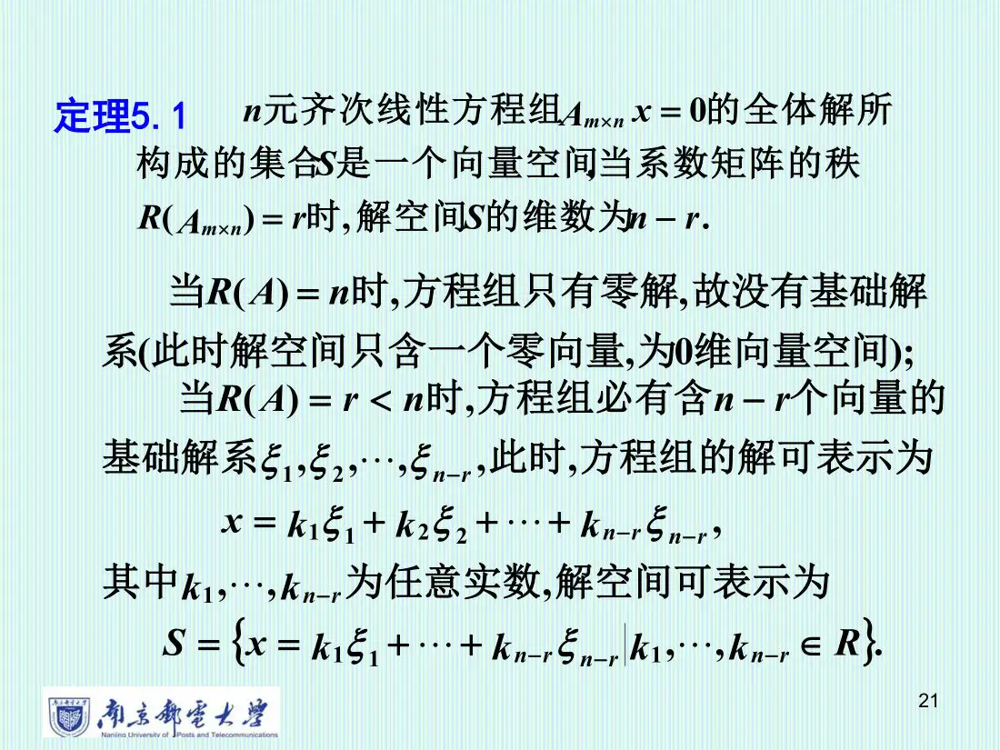

原文：

定理5.1 n元齐次线性方程组 $A_{m \times n}$ x = 0的全体解所构成的集合S是一个向量空间当系数矩阵的秩 $R(A_{m \times n}) = r$ 时, 解空间S的维数为n - r.

当 $R(A)=n$ 时,方程组只有零解,故没有基础解系(此时解空间只含一个零向量,为0维向量空间);

当 $R(A)=r<n$ 时,方程组必有含n-r个向量的基础解系 $\xi_{1},\xi_{2},\cdots,\xi_{n-r}$ ,此时,方程组的解可表示为

$$
\boldsymbol {x} = k _ {1} \xi_ {1} + k _ {2} \xi_ {2} + \dots + k _ {n - r} \xi_ {n - r},
$$

其中 $k_{1},\cdots,k_{n-r}$ 为任意实数,解空间可表示为

$$
S = \{x = k _ {1} \xi_ {1} + \dots + k _ {n - r} \xi_ {n - r} | k _ {1}, \dots , k _ {n - r} \in R \}.
$$

南京邮电大学
Nanjing University of Posts and Telecommunications

21

### 例1 求齐次线性方程组

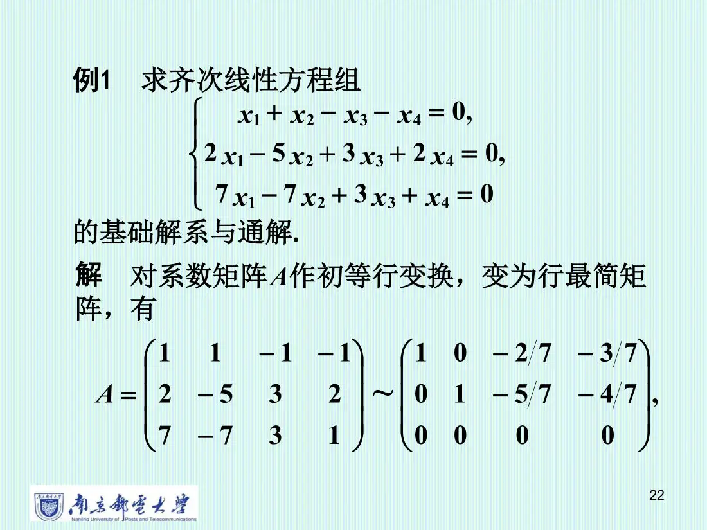

原文：

例1 求齐次线性方程组

$$
\left\{ \begin{array}{c} x _ {1} + x _ {2} - x _ {3} - x _ {4} = 0, \\ 2 x _ {1} - 5 x _ {2} + 3 x _ {3} + 2 x _ {4} = 0, \\ 7 x _ {1} - 7 x _ {2} + 3 x _ {3} + x _ {4} = 0 \end{array} \right.
$$

的基础解系与通解.

解 对系数矩阵 $A$ 作初等行变换，变为行最简矩阵，有

$$
A = \left( \begin{array}{c c c c} 1 & 1 & - 1 & - 1 \\ 2 & - 5 & 3 & 2 \\ 7 & - 7 & 3 & 1 \end{array} \right) \sim \left( \begin{array}{c c c c} 1 & 0 & - 2 / 7 & - 3 / 7 \\ 0 & 1 & - 5 / 7 & - 4 / 7 \\ 0 & 0 & 0 & 0 \end{array} \right),
$$

南京邮电大学
Nanjing University of Posts and Telecommunications

22

### 南京邮电大学

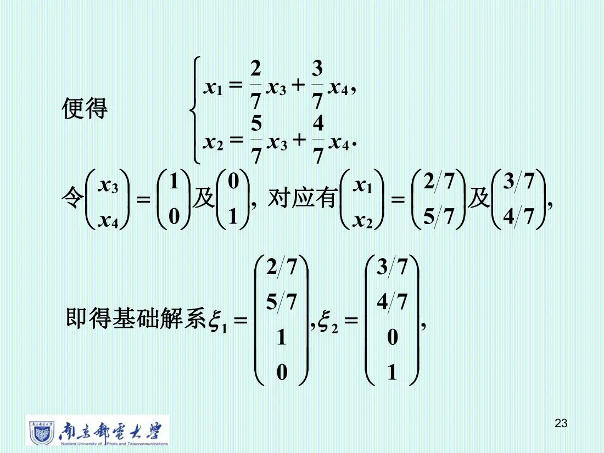

原文：

便得 $\left\{ \begin{array}{l}x_{1} = \frac{2}{7} x_{3} + \frac{3}{7} x_{4},\\ x_{2} = \frac{5}{7} x_{3} + \frac{4}{7} x_{4}. \end{array} \right.$ 令 $\binom{x_3}{x_4} = \binom{1}{0}$ 及 $\binom{0}{1}$ , 对应有 $\binom{x_1}{x_2} = \binom{2 / 7}{5 / 7}$ 及 $\binom{3 / 7}{4 / 7}$ , 即得基础解系 $\xi_{1} = \left( \begin{array}{c}2 / 7\\ 5 / 7\\ 1\\ 0 \end{array} \right),\xi_{2} = \left( \begin{array}{c}3 / 7\\ 4 / 7\\ 0\\ 1 \end{array} \right),$

南京邮电大学
Nanjing University of Posts and Telecommunications

23

### 并由此得到通解

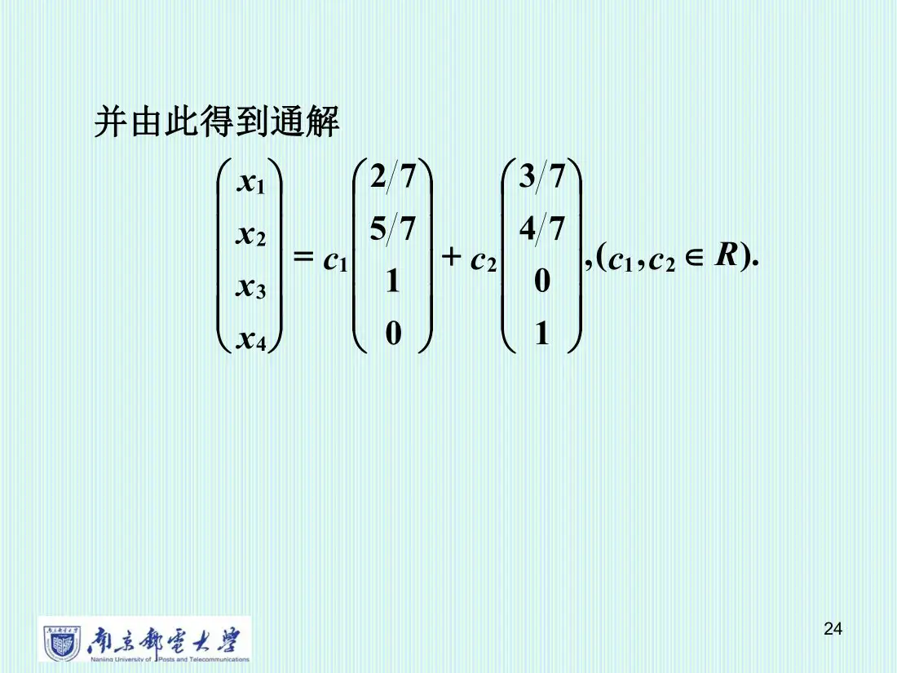

原文：

并由此得到通解

$$
\left( \begin{array}{c} x _ {1} \\ x _ {2} \\ x _ {3} \\ x _ {4} \end{array} \right) = c _ {1} \left( \begin{array}{c} 2 / 7 \\ 5 / 7 \\ 1 \\ 0 \end{array} \right) + c _ {2} \left( \begin{array}{c} 3 / 7 \\ 4 / 7 \\ 0 \\ 1 \end{array} \right), (c _ {1}, c _ {2} \in R).
$$

南京邮电大学
Nanjing University of Posts and Telecommunications

24

### 例2 解线性方程组

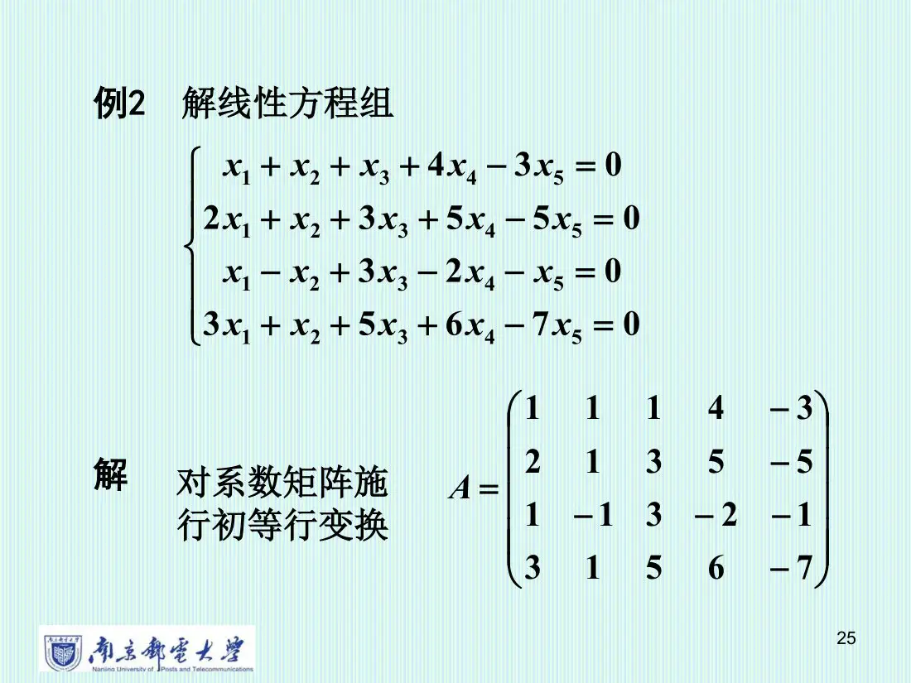

原文：

例2 解线性方程组

$$
\left\{ \begin{array}{l l} x _ {1} + x _ {2} + x _ {3} + 4 x _ {4} - 3 x _ {5} = 0 \\ 2 x _ {1} + x _ {2} + 3 x _ {3} + 5 x _ {4} - 5 x _ {5} = 0 \\ x _ {1} - x _ {2} + 3 x _ {3} - 2 x _ {4} - x _ {5} = 0 \\ 3 x _ {1} + x _ {2} + 5 x _ {3} + 6 x _ {4} - 7 x _ {5} = 0 \end{array} \right.
$$

解

对系数矩阵施行初等行变换

$$
A = \left( \begin{array}{c c c c c} 1 & 1 & 1 & 4 & - 3 \\ 2 & 1 & 3 & 5 & - 5 \\ 1 & - 1 & 3 & - 2 & - 1 \\ 3 & 1 & 5 & 6 & - 7 \end{array} \right)
$$

南京邮电大学
Nanjing University of Posts and Telecommunications

25

### $$

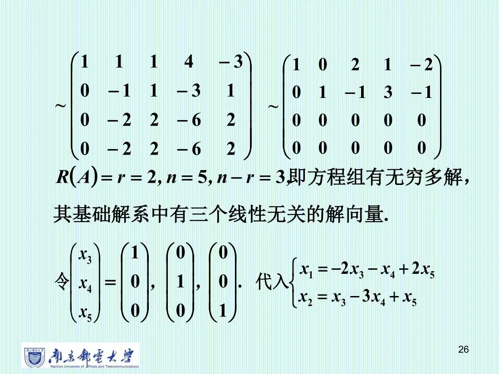

原文：

$$
\sim \left( \begin{array}{r r r r r} 1 & 1 & 1 & 4 & - 3 \\ 0 & - 1 & 1 & - 3 & 1 \\ 0 & - 2 & 2 & - 6 & 2 \\ 0 & - 2 & 2 & - 6 & 2 \end{array} \right) \sim \left( \begin{array}{r r r r r} 1 & 0 & 2 & 1 & - 2 \\ 0 & 1 & - 1 & 3 & - 1 \\ 0 & 0 & 0 & 0 & 0 \\ 0 & 0 & 0 & 0 & 0 \end{array} \right)
$$

$R(A)=r=2,n=5,n-r=3$ , 即方程组有无穷多解, 其基础解系中有三个线性无关的解向量.

$$
\text {令} \left( \begin{array}{l} {x _ {3}} \\ {x _ {4}} \\ {x _ {5}} \end{array} \right) = \left( \begin{array}{l} {1} \\ {0} \\ {0} \end{array} \right), \quad \left( \begin{array}{l} {0} \\ {1} \\ {0} \end{array} \right), \quad \left( \begin{array}{l} {0} \\ {0} \\ {1} \end{array} \right).
$$

代入

$$
\left\{ \begin{array}{l} x _ {1} = - 2 x _ {3} - x _ {4} + 2 x _ {5} \\ x _ {2} = x _ {3} - 3 x _ {4} + x _ {5} \end{array} \right.
$$

南京邮电大学
Nanjing University of Posts and Telecommunications

26

### 所以原方程组的一个基础解系为

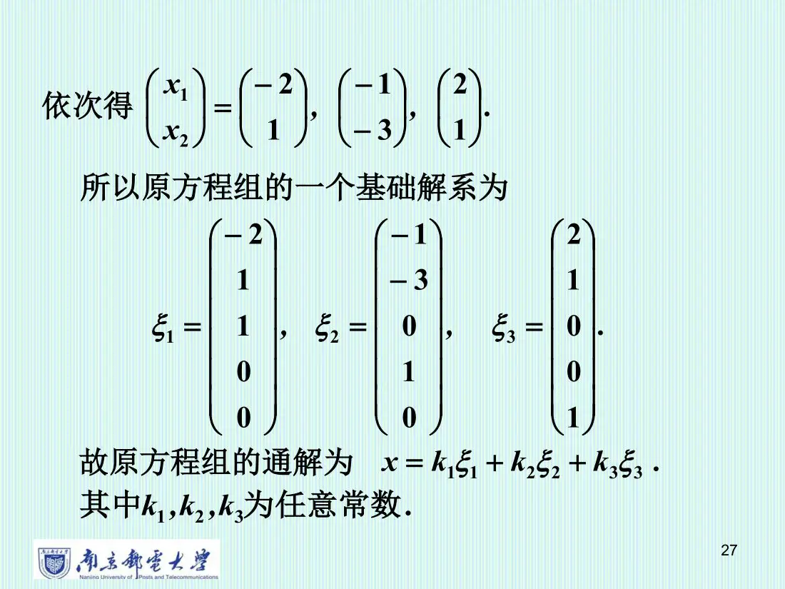

原文：

依次得 $\left( \begin{array}{l}x_{1}\\ x_{2} \end{array} \right) = \left( \begin{array}{l} - 2\\ 1 \end{array} \right),\quad \left( \begin{array}{l} - 1\\ -3 \end{array} \right),\quad \left( \begin{array}{l}2\\ 1 \end{array} \right).$

所以原方程组的一个基础解系为

$$
\xi_ {1} = \left( \begin{array}{c} - 2 \\ 1 \\ 1 \\ 0 \\ 0 \end{array} \right), \quad \xi_ {2} = \left( \begin{array}{c} - 1 \\ - 3 \\ 0 \\ 1 \\ 0 \end{array} \right), \quad \xi_ {3} = \left( \begin{array}{c} 2 \\ 1 \\ 0 \\ 0 \\ 1 \end{array} \right).
$$

故原方程组的通解为 $x = k_{1}\xi_{1} + k_{2}\xi_{2} + k_{3}\xi_{3}$ .
其中 $k_{1},k_{2},k_{3}$ 为任意常数.

南京邮电大学
Nanjing University of Posts and Telecommunications

27

### 例3 证明 $R(A^{T}A)=R(A)$ .

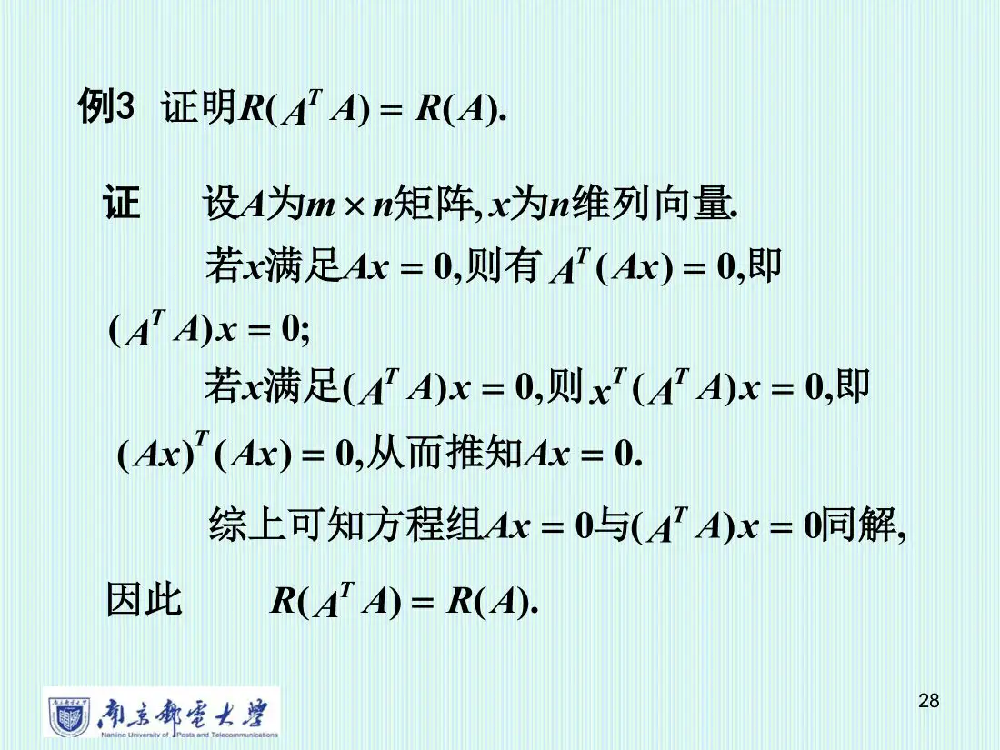

原文：

例3 证明 $R(A^{T}A)=R(A)$ .

证 设A为 $m \times n$ 矩阵,x为n维列向量.

若x满足Ax=0,则有 $A^{T}(Ax)=0$ ,即 $(A^{T}A)x=0;$

若x满足 $(A^{T}A)x=0$ ,则 $x^{T}(A^{T}A)x=0$ ,即 $(Ax)^{T}(Ax)=0$ ,从而推知Ax=0.

综上可知方程组 $Ax = 0$ 与 $(A^T A)x = 0$ 同解，因此 $R(A^T A) = R(A)$ .

南京邮电大学
Nanjing University of Posts and Telecommunications

28

### 例4 设B 是一个三阶非零矩阵，它的每一列是齐次方程组

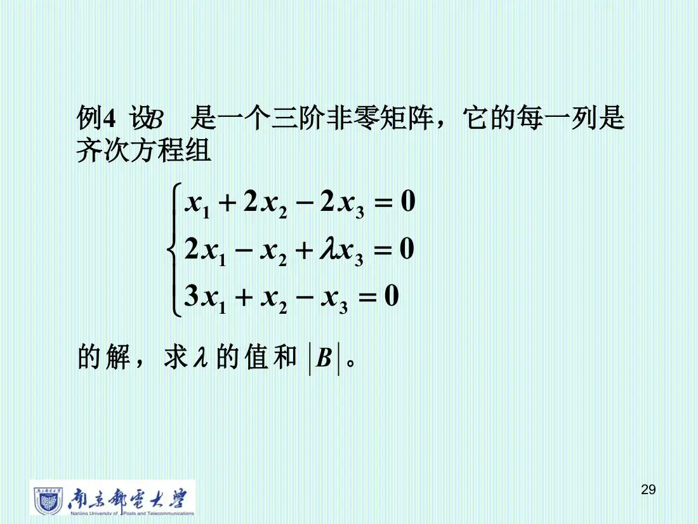

原文：

例4 设B 是一个三阶非零矩阵，它的每一列是齐次方程组

$$
\left\{ \begin{array}{l} x _ {1} + 2 x _ {2} - 2 x _ {3} = 0 \\ 2 x _ {1} - x _ {2} + \lambda x _ {3} = 0 \\ 3 x _ {1} + x _ {2} - x _ {3} = 0 \end{array} \right.
$$

的解，求 $\lambda$ 的值和 $|B|$ 。

南京邮电大学
Nanjing University of Posts and Telecommunications

29

### $$

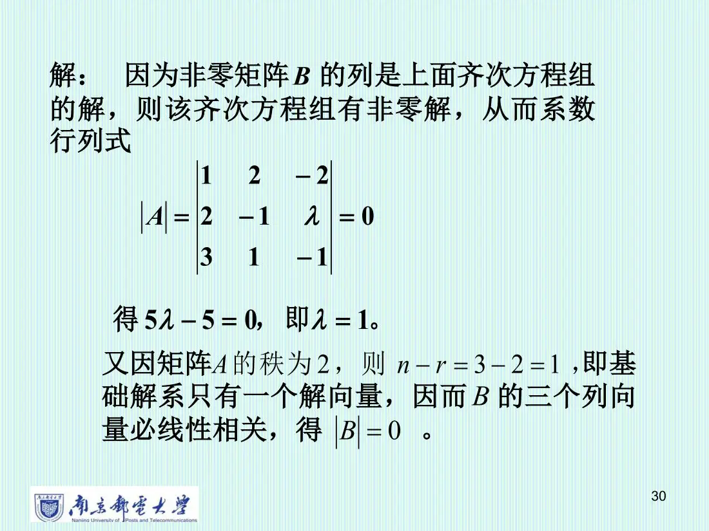

原文：

解: 因为非零矩阵 $B$ 的列是上面齐次方程组的解, 则该齐次方程组有非零解, 从而系数行列式

$$
| A | = \left| \begin{array}{c c c} 1 & 2 & - 2 \\ 2 & - 1 & \lambda \\ 3 & 1 & - 1 \end{array} \right| = 0
$$

得 $5\lambda - 5 = 0$ ，即 $\lambda = 1$ 。

又因矩阵A的秩为2，则 n-r=3-2=1，即基础解系只有一个解向量，因而B的三个列向量必线性相关，得 $|B|=0$ 。

南京邮电大学
Nanjing University of Posts and Telecommunications

30

### 5.2 非齐次线性方程组

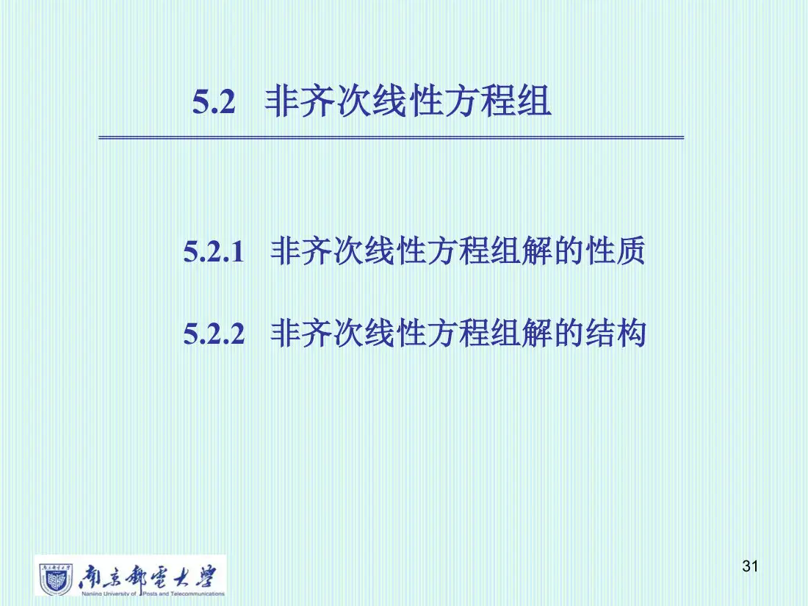

原文：

5.2 非齐次线性方程组

5.2.1 非齐次线性方程组解的性质

5.2.2 非齐次线性方程组解的结构

南京邮电大学
Nanjing University of Posts and Telecommunications

31

### 5.2.1 非齐次线性方程组解的性质

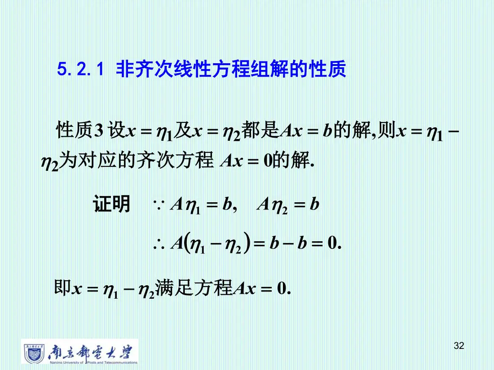

原文：

5.2.1 非齐次线性方程组解的性质

性质3 设 $x = \eta_{1}$ 及 $x = \eta_{2}$ 都是 $Ax = b$ 的解, 则 $x = \eta_{1} - \eta_{2}$ 为对应的齐次方程 $Ax = 0$ 的解.

证明 $\because A\eta_{1} = b, \quad A\eta_{2} = b$

$$
\therefore A \left(\eta_ {1} - \eta_ {2}\right) = b - b = 0.
$$

即 $x=\eta_{1}-\eta_{2}$ 满足方程Ax=0.

南京邮电大学
Nanjing University of Posts and Telecommunications

32

### 南京邮电大学

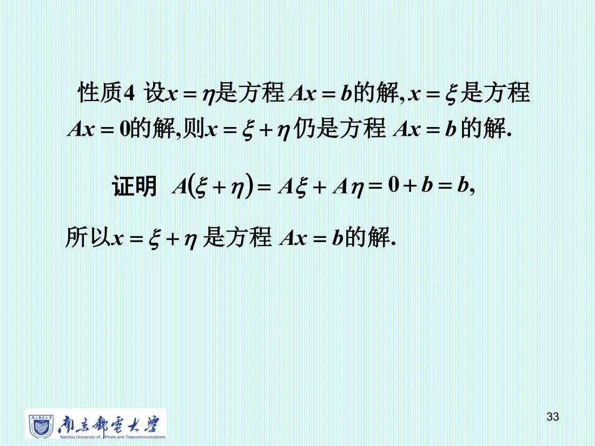

原文：

性质4 设 $x = \eta$ 是方程 $Ax = b$ 的解, $x = \xi$ 是方程 $Ax = 0$ 的解, 则 $x = \xi + \eta$ 仍是方程 $Ax = b$ 的解.

证明 $A(\xi + \eta) = A\xi + A\eta = 0 + b = b,$ 所以 $x = \xi + \eta$ 是方程 $Ax = b$ 的解.

南京邮电大学
Nanjing University of Posts and Telecommunications

33

### 5.2.2 非齐次线性方程组解的结构

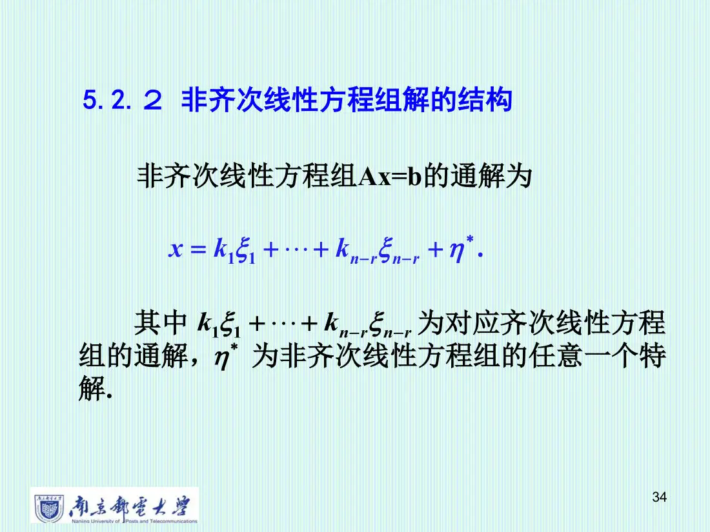

原文：

5.2.2 非齐次线性方程组解的结构

非齐次线性方程组Ax=b的通解为

$$
x = k _ {1} \xi_ {1} + \dots + k _ {n - r} \xi_ {n - r} + \eta^ {*}.
$$

其中 $k_{1}\xi_{1}+\cdots+k_{n-r}\xi_{n-r}$ 为对应齐次线性方程组的通解， $\eta^{*}$ 为非齐次线性方程组的任意一个特解.

南京邮电大学
Nanjing University of Posts and Telecommunications

34

### 3. 与方程组 $Ax = b$ 有解等价的命题

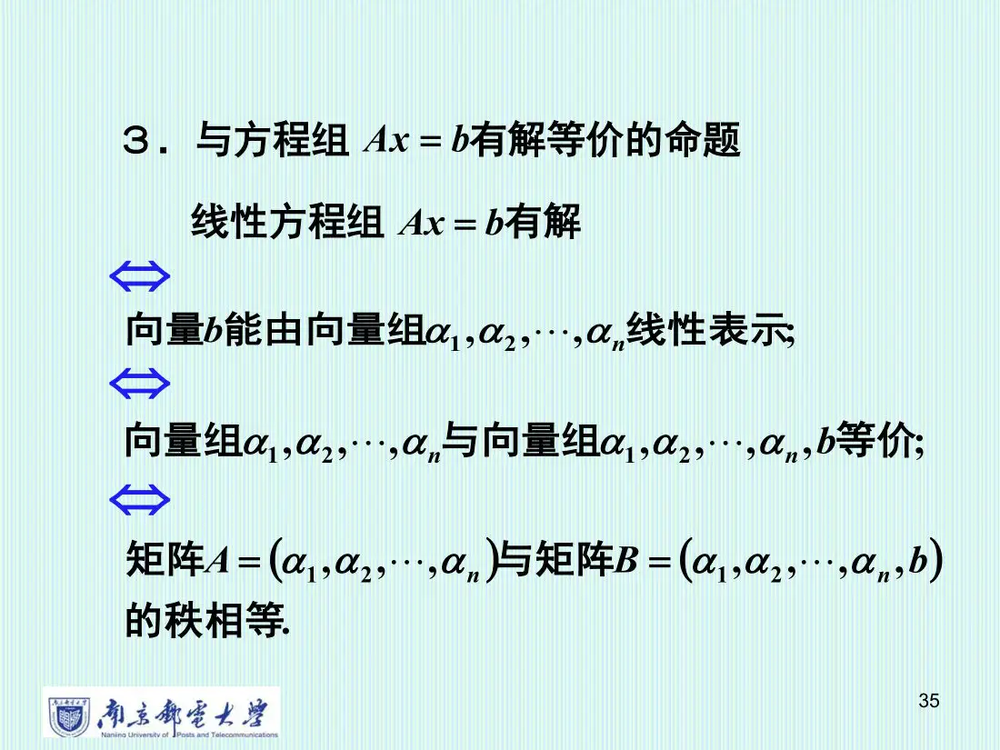

原文：

3. 与方程组 $Ax = b$ 有解等价的命题

线性方程组 Ax = b 有解

向量b能由向量组 $\alpha_{1},\alpha_{2},\cdots,\alpha_{n}$ 线性表示;

向量组 $\alpha_{1},\alpha_{2},\cdots,\alpha_{n}$ 与向量组 $\alpha_{1},\alpha_{2},\cdots,\alpha_{n},b$ 等价;

矩阵 $A=(\alpha_{1},\alpha_{2},\cdots,\alpha_{n})$ 与矩阵 $B=(\alpha_{1},\alpha_{2},\cdots,\alpha_{n},b)$ 的秩相等.

南京邮电大学
Nanjing University of Posts and Telecommunications

35

### 4. 线性方程组的解法

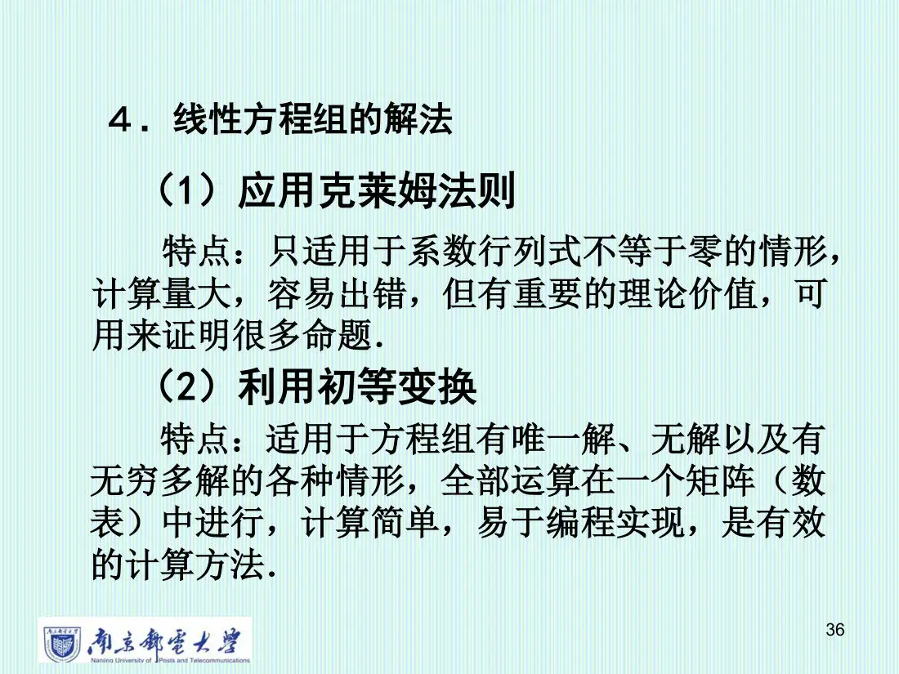

原文：

4. 线性方程组的解法

(1) 应用克莱姆法则

特点: 只适用于系数行列式不等于零的情形,计算量大,容易出错,但有重要的理论价值,可用来证明很多命题.

(2) 利用初等变换

特点：适用于方程组有唯一解、无解以及有无穷多解的各种情形，全部运算在一个矩阵（数表）中进行，计算简单，易于编程实现，是有效的计算方法。

南京邮电大学
Nanjing University of Posts and Telecommunications

36

### 例5 求解方程组

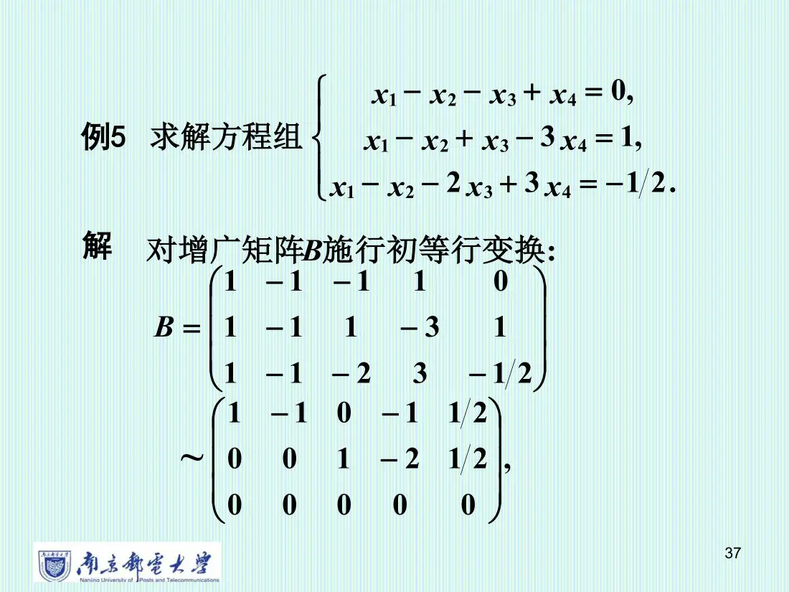

原文：

例5 求解方程组

$$
\left\{ \begin{array}{c} x _ {1} - x _ {2} - x _ {3} + x _ {4} = 0, \\ x _ {1} - x _ {2} + x _ {3} - 3 x _ {4} = 1, \\ x _ {1} - x _ {2} - 2 x _ {3} + 3 x _ {4} = - 1 / 2. \end{array} \right.
$$

解 对增广矩阵B施行初等行变换:

$$
\begin{array}{r} B = \left( \begin{array}{c c c c c} 1 & - 1 & - 1 & 1 & 0 \\ 1 & - 1 & 1 & - 3 & 1 \\ 1 & - 1 & - 2 & 3 & - 1 / 2 \end{array} \right) \\ \sim \left( \begin{array}{c c c c c} 1 & - 1 & 0 & - 1 & 1 / 2 \\ 0 & 0 & 1 & - 2 & 1 / 2 \\ 0 & 0 & 0 & 0 & 0 \end{array} \right), \end{array}
$$

南京邮电大学
Nanjing University of Posts and Telecommunications

37

### 可见 $R(A)=R(B)=2$ ,故方程组有解,并有

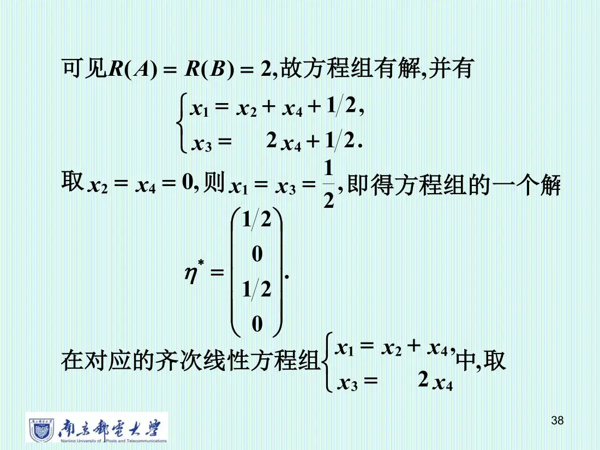

原文：

可见 $R(A)=R(B)=2$ ,故方程组有解,并有

$$
\left\{ \begin{array}{l} x _ {1} = x _ {2} + x _ {4} + 1 / 2, \\ x _ {3} = 2 x _ {4} + 1 / 2. \end{array} \right.
$$

取 $x_{2} = x_{4} = 0$ ，则 $x_{1} = x_{3} = \frac{1}{2}$ 即得方程组的一个解 $\eta^{*} = \left( \begin{array}{c}1 / 2\\ 0\\ 1 / 2\\ 0 \end{array} \right).$

在对应的齐次线性方程组 $\left\{\begin{aligned}x_{1}&=x_{2}+x_{4},\\ x_{3}&=2x_{4}\end{aligned}\right.$ 中,取

南京邮电大学
Nanjing University of Posts and Telecommunications

38

### 即得对应的齐次线性方程组的基础解系

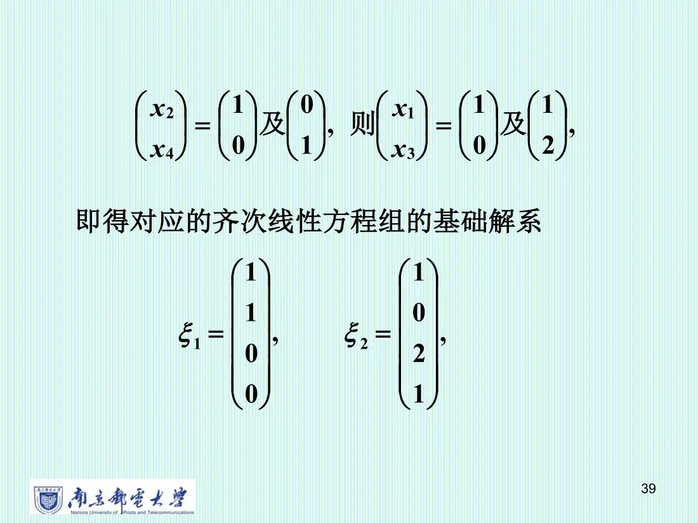

原文：

$\binom{x_{2}}{x_{4}}=\binom{1}{0}$ 及 $\binom{0}{1}$ ，则 $\binom{x_{1}}{x_{3}}=\binom{1}{0}$ 及 $\binom{1}{2}$ ,

即得对应的齐次线性方程组的基础解系

$$
\xi_ {1} = \left( \begin{array}{c} 1 \\ 1 \\ 0 \\ 0 \end{array} \right), \qquad \xi_ {2} = \left( \begin{array}{c} 1 \\ 0 \\ 2 \\ 1 \end{array} \right),
$$

南京邮电大学
Nanjing University of Posts and Telecommunications

39

### 于是所求通解为

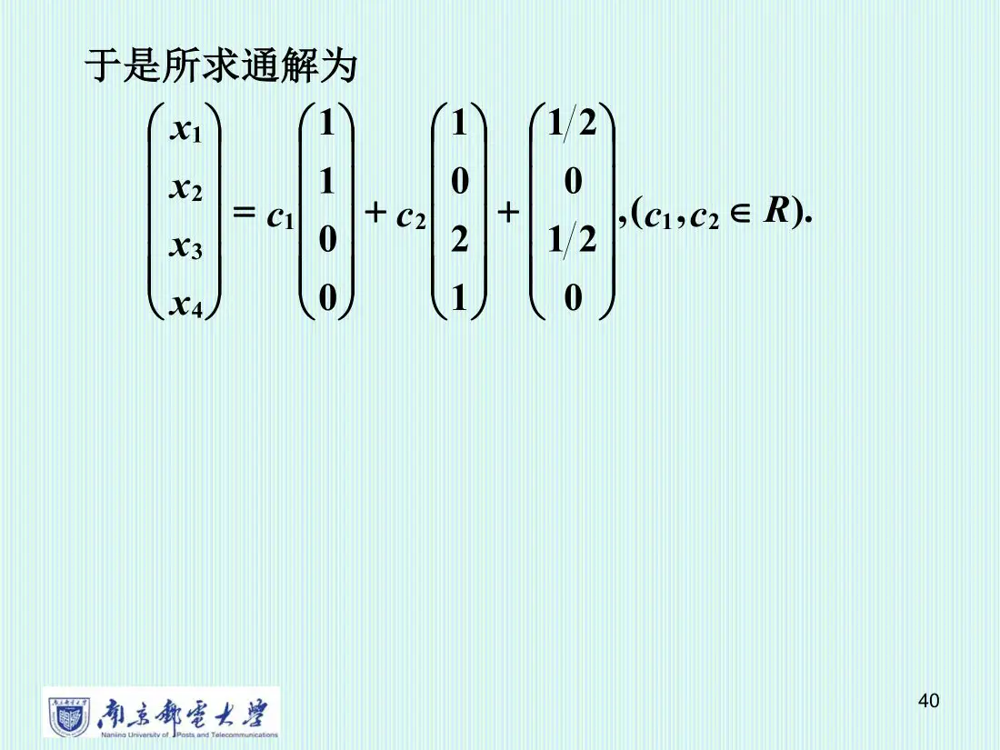

原文：

于是所求通解为

$$
\left( \begin{array}{c} x _ {1} \\ x _ {2} \\ x _ {3} \\ x _ {4} \end{array} \right) = c _ {1} \left( \begin{array}{c} 1 \\ 1 \\ 0 \\ 0 \end{array} \right) + c _ {2} \left( \begin{array}{c} 1 \\ 0 \\ 2 \\ 1 \end{array} \right) + \left( \begin{array}{c} 1 / 2 \\ 0 \\ 1 / 2 \\ 0 \end{array} \right), (c _ {1}, c _ {2} \in R).
$$

南京邮电大学
Nanjing University of Posts and Telecommunications

40

### 思考题

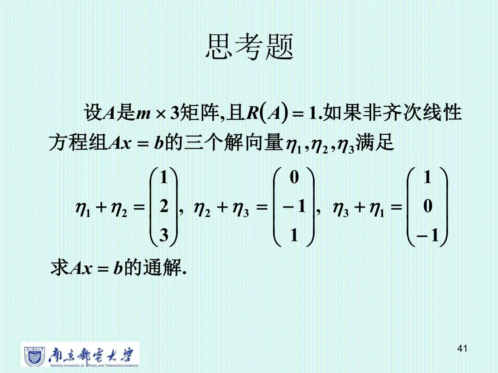

原文：

思考题

设A是 $m \times 3$ 矩阵,且 $R(A) = 1$ .如果非齐次线性方程组Ax = b的三个解向量 $\eta_{1}, \eta_{2}, \eta_{3}$ 满足

$$
\eta_ {1} + \eta_ {2} = \left( \begin{array}{c} 1 \\ 2 \\ 3 \end{array} \right), \eta_ {2} + \eta_ {3} = \left( \begin{array}{c} 0 \\ - 1 \\ 1 \end{array} \right), \eta_ {3} + \eta_ {1} = \left( \begin{array}{c} 1 \\ 0 \\ - 1 \end{array} \right)
$$

求 $Ax = b$ 的通解.

南京邮电大学
Nanjing University of Posts and Telecommunications

41

### 思考题解答

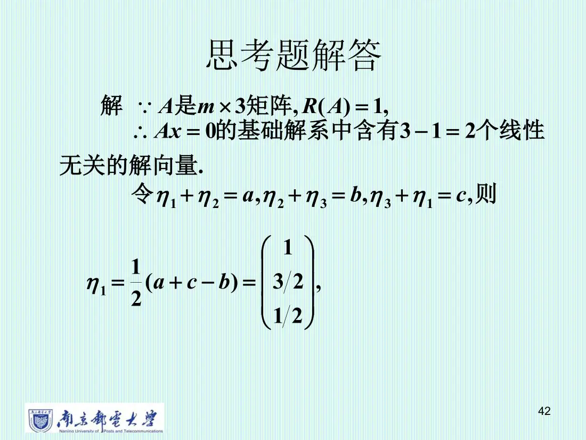

原文：

思考题解答

解 $\because A$ 是 $m \times 3$ 矩阵, $R(A) = 1$ ,

∴ Ax = 0 的基础解系中含有 3 - 1 = 2 个线性无关的解向量.

令 $\eta_{1} + \eta_{2} = a, \eta_{2} + \eta_{3} = b, \eta_{3} + \eta_{1} = c$ ，则

$$
\eta_ {1} = \frac {1}{2} (a + c - b) = \left( \begin{array}{c} 1 \\ 3 / 2 \\ 1 / 2 \end{array} \right),
$$

南京邮电大学
Nanjing University of Posts and Telecommunications

42

### $$

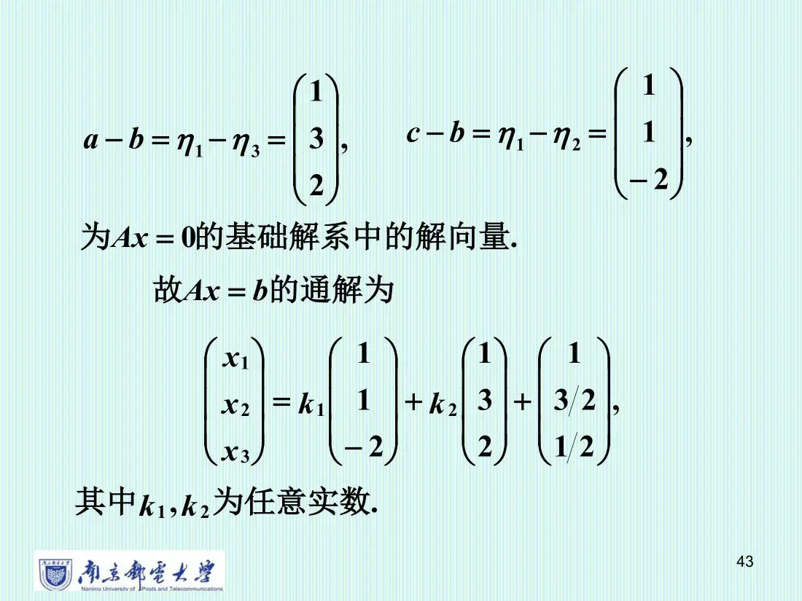

原文：

$$
a - b = \eta_ {1} - \eta_ {3} = \left( \begin{array}{c} 1 \\ 3 \\ 2 \end{array} \right), \qquad c - b = \eta_ {1} - \eta_ {2} = \left( \begin{array}{c} 1 \\ 1 \\ - 2 \end{array} \right),
$$

为Ax=0的基础解系中的解向量.

故 $Ax = b$ 的通解为

$$
\left( \begin{array}{c} x _ {1} \\ x _ {2} \\ x _ {3} \end{array} \right) = k _ {1} \left( \begin{array}{c} 1 \\ 1 \\ - 2 \end{array} \right) + k _ {2} \left( \begin{array}{c} 1 \\ 3 \\ 2 \end{array} \right) + \left( \begin{array}{c} 1 \\ 3 / 2 \\ 1 / 2 \end{array} \right),
$$

其中 $k_{1}, k_{2}$ 为任意实数.

南京邮电大学
Nanjing University of Posts and Telecommunications

43
