# 《线性代数与解析几何》第5章 齐次与非齐次线性方程组（课件）

原件的每一页，下面附识别出的文字。

### 若n阶方阵 $A=(a_{ij})$ 可逆，则方程组（）

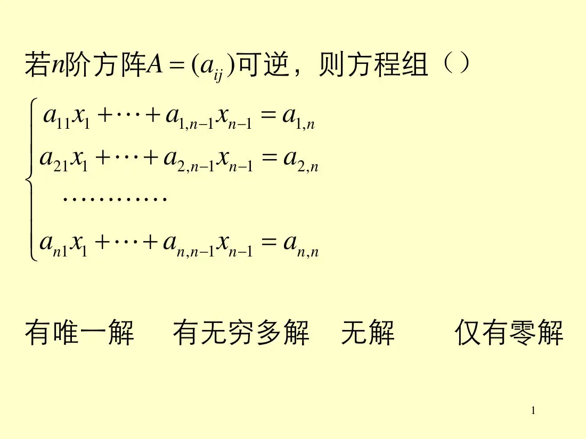

原文：

若n阶方阵 $A=(a_{ij})$ 可逆，则方程组（）

有唯一解 有无穷多解 无解 仅有零解. 设矩阵 $A = \begin{pmatrix} 1 & 2 & 3 \\ 2 & 4 & t \\ 3 & 6 & 9 \end{pmatrix}$ , $B$ 是 3 阶非零矩阵, 且 $AB = 0$ 则 \_\_\_\_ $A) t = 6$ 时 $B$ 的秩必为 1    (B) $t = 6$ 时 $B$ 的秩必为 2 $(C) t \neq 6$ 时 $B$ 的秩必为 1    (D) $t \neq 6$ 时 $B$ 的秩必为 2

1

### 5. 设 A,B 都是 n 阶非零矩阵，且 AB=0，则 A 和 B 的秩

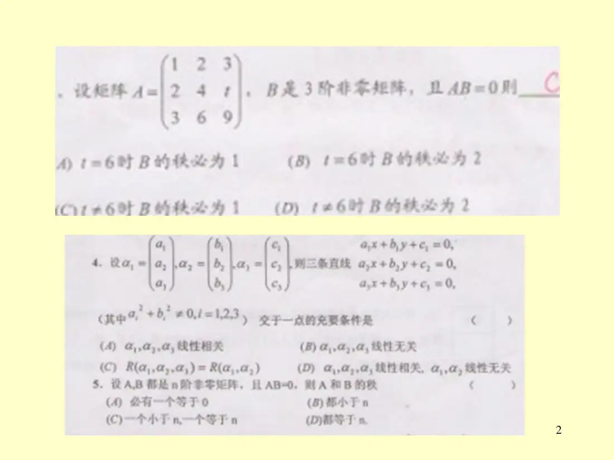

原文：

4. 设 $\alpha_{1}=\begin{pmatrix}a_{1}\\a_{2}\\a_{3}\end{pmatrix},\alpha_{2}=\begin{pmatrix}b_{1}\\b_{2}\\b_{3}\end{pmatrix},\alpha_{3}=\begin{pmatrix}c_{1}\\c_{2}\\c_{3}\end{pmatrix}$ ，则三条直线 $a_{1}x+b_{1}y+c_{1}=0,$ $a_{2}x+b_{2}y+c_{2}=0,$ $a_{3}x+b_{3}y+c_{3}=0,$

(其中 $a_{i}^{2}+b_{i}^{2}\neq0,i=1,2,3$ ) 交于一点的充要条件是
(A) $\alpha_{1},\alpha_{2},\alpha_{3}$ 线性相关 (B) $\alpha_{1},\alpha_{2},\alpha_{3}$ 线性无关
(C) $R(\alpha_{1},\alpha_{2},\alpha_{3})=R(\alpha_{1},\alpha_{2})$ (D) $\alpha_{1},\alpha_{2},\alpha_{3}$ 线性相关， $\alpha_{1},\alpha_{2}$ 线性无关

5. 设 A,B 都是 n 阶非零矩阵，且 AB=0，则 A 和 B 的秩
(A) 必有一个等于 0    (B) 都小于 n
(C) 一个小于 n, 一个等于 n    (D) 都等于 n.

2

### 设A为2×3的矩阵，P为3阶可逆矩阵，

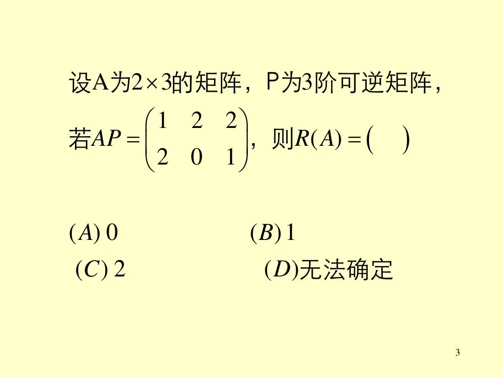

原文：

设A为2×3的矩阵，P为3阶可逆矩阵，
若 $AP=\begin{pmatrix}1&2&2\\ 2&0&1\end{pmatrix}$ ，则 $R(A)=()$ (A)0 (B)1
(C)2 (D)无法确定

3

### 《线性代数与空间解析几何》

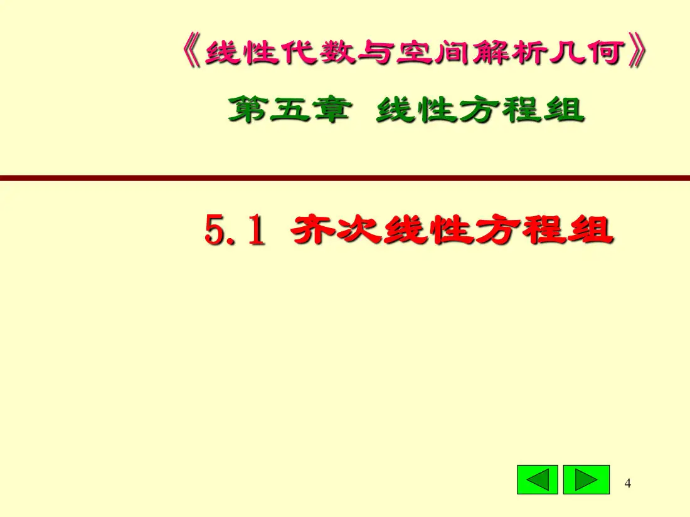

原文：

《线性代数与空间解析几何》

第五章 线性方程组

5.1 齐次线性方程组

◀ △

4

### 本章主要内容

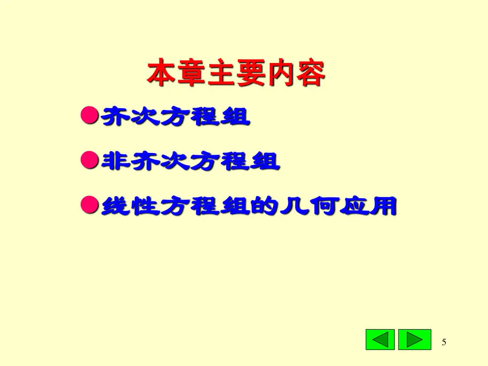

原文：

本章主要内容

●齐次方程组

● 非齐次方程组

线性方程组的几何应用

◀ ▶

5

### 5.1.1 齐次线性方程组的表示形式

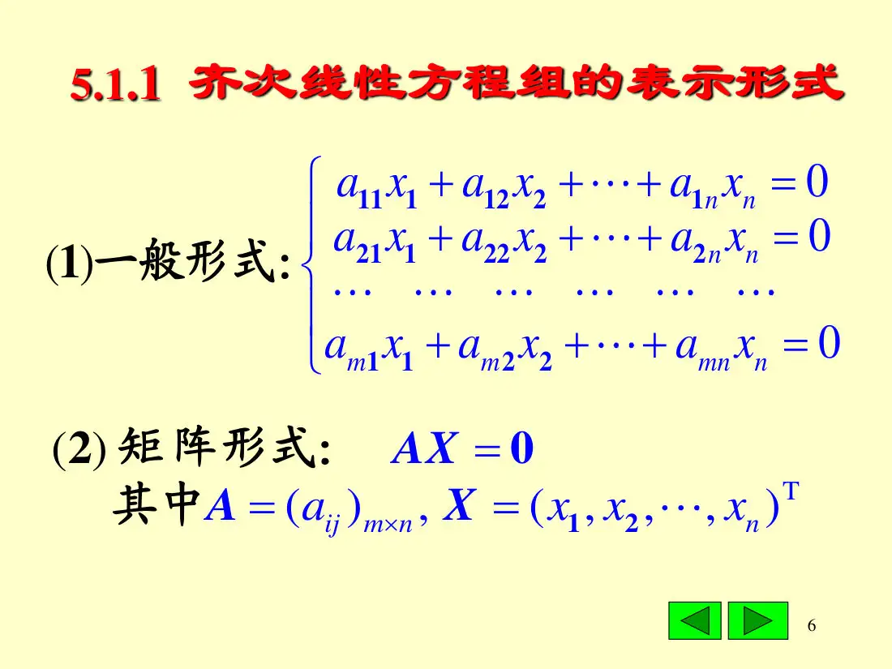

原文：

5.1.1 齐次线性方程组的表示形式

(1)一般形式:

$$
\left\{ \begin{array}{l} a _ {1 1} x _ {1} + a _ {1 2} x _ {2} + \dots + a _ {1 n} x _ {n} = 0 \\ a _ {2 1} x _ {1} + a _ {2 2} x _ {2} + \dots + a _ {2 n} x _ {n} = 0 \\ \dots \dots \\ a _ {m 1} x _ {1} + a _ {m 2} x _ {2} + \dots + a _ {m n} x _ {n} = 0 \end{array} \right.
$$

(2) 矩阵形式: AX = 0
其中 $A = (a_{ij})_{m \times n}, X = (x_1, x_2, \cdots, x_n)^{\mathrm{T}}$ (3) 向量形式: $x_{1}\alpha_{1} + x_{2}\alpha_{2} + \cdots + x_{n}\alpha_{n} = 0$

◀ ▶

6

### $$

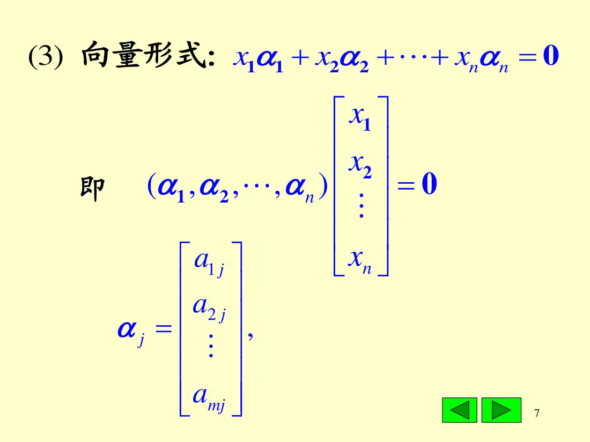

原文：

即

$$
\begin{array}{r l} & {(\alpha_ {1}, \alpha_ {2}, \dots , \alpha_ {n}) \left[ \begin{array}{l} x _ {1} \\ x _ {2} \\ \vdots \\ x _ {n} \end{array} \right] = 0} \\ & {\alpha_ {j} = \left[ \begin{array}{l} a _ {1 j} \\ a _ {2 j} \\ \vdots \\ a _ {m j} \end{array} \right],} \end{array}
$$

◀ ▶

7

### 齐次方程组的内容

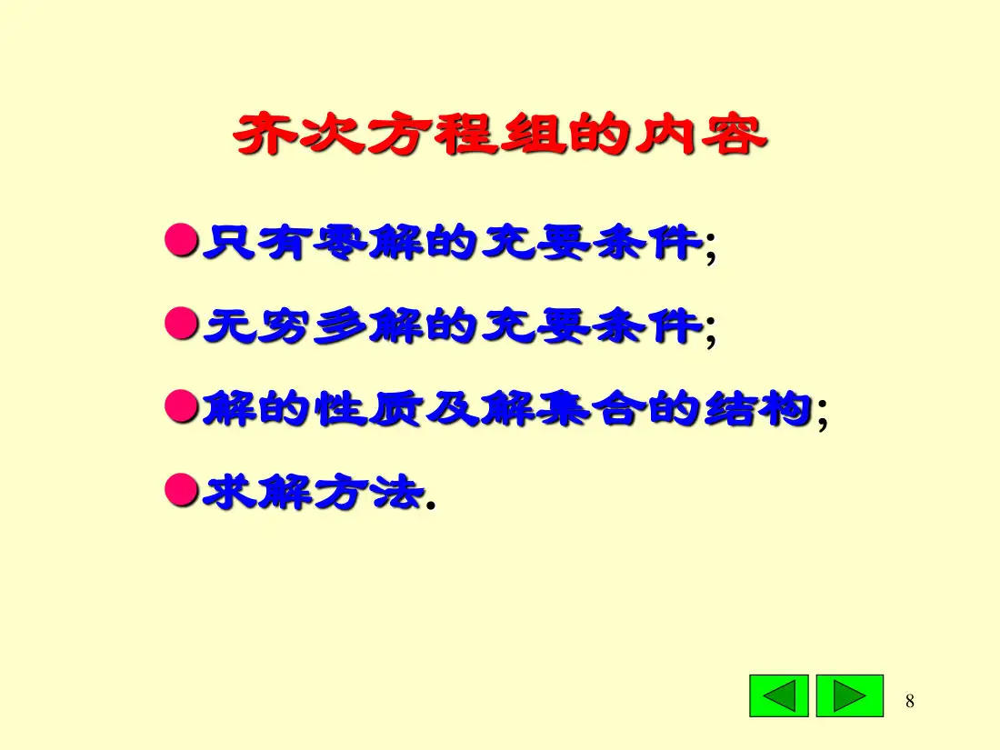

原文：

齐次方程组的内容

● 只有零解的充要条件;

无穷多解的充要条件;

解的性质及解集合的结构;

求解方法。

◀ ▶

8

### 5.1.2 齐次线性方程组有解的条件

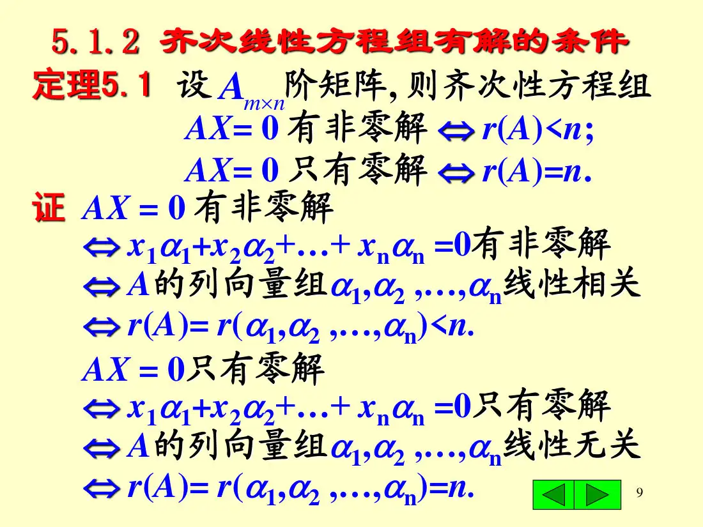

原文：

5.1.2 齐次线性方程组有解的条件

定理5.1 设 $A_{m \times n}$ 阶矩阵, 则齐次性方程组

AX=0 有非零解 $\Leftrightarrow r(A)<n;$

AX=0 只有零解 $\Leftrightarrow r(A)=n.$

证 AX = 0 有非零解

$\Leftrightarrow x_{1}\alpha_{1} + x_{2}\alpha_{2} + \ldots +x_{n}\alpha_{n} = 0$ 有非零解

$\Leftrightarrow A$ 的列向量组 $\alpha_{1}, \alpha_{2}, \ldots, \alpha_{n}$ 线性相关

$\Leftrightarrow r(A) = r(\alpha_{1}, \alpha_{2}, \dots, \alpha_{n}) < n.$

AX = 0 只有零解

$\Leftrightarrow x_{1}\alpha_{1} + x_{2}\alpha_{2} + \ldots +x_{n}\alpha_{n} = 0$ 只有零解

$\Leftrightarrow A$ 的列向量组 $\alpha_{1}, \alpha_{2}, \ldots, \alpha_{n}$ 线性无关

$\Leftrightarrow r(A) = r(\alpha_{1}, \alpha_{2}, \dots, \alpha_{n}) = n.$

### 5.1.3 齐次方程组解的性质及结构

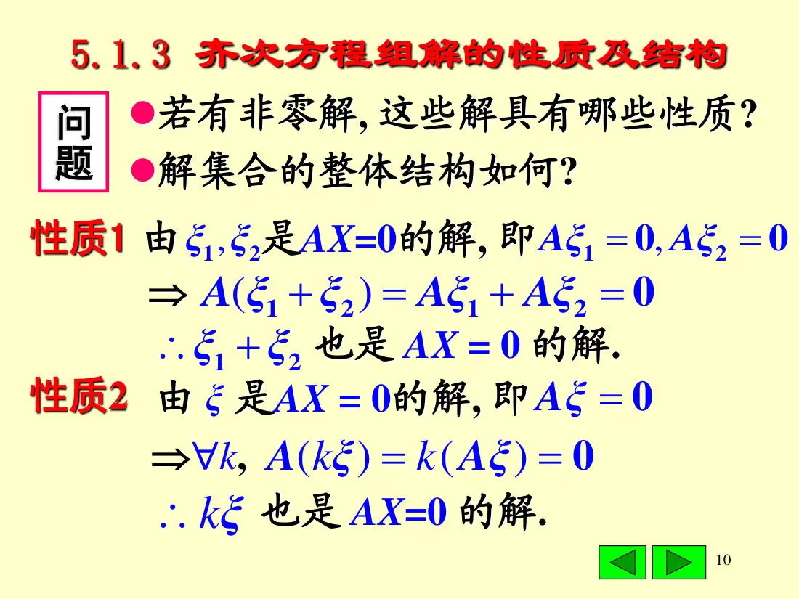

原文：

5.1.3 齐次方程组解的性质及结构

问 ●若有非零解,这些解具有哪些性质?

\- 解集合的整体结构如何？

性质1 由 $\xi_{1}, \xi_{2}$ 是 $AX = 0$ 的解, 即 $A\xi_{1} = 0$ , $A\xi_{2} = 0$ $\Rightarrow A(\xi_{1} + \xi_{2}) = A\xi_{1} + A\xi_{2} = 0$ $\therefore \xi_{1} + \xi_{2}$ 也是 $AX = 0$ 的解.

性质2 由 $\xi$ 是 $AX = 0$ 的解, 即 $A\xi = 0$ $\Rightarrow \forall k, A(k\xi) = k(A\xi) = 0$ $\therefore k\xi$ 也是 $AX = 0$ 的解.

◀ ▶

10

### 只要找到S的一个基(基础解系),就能表示所有解。

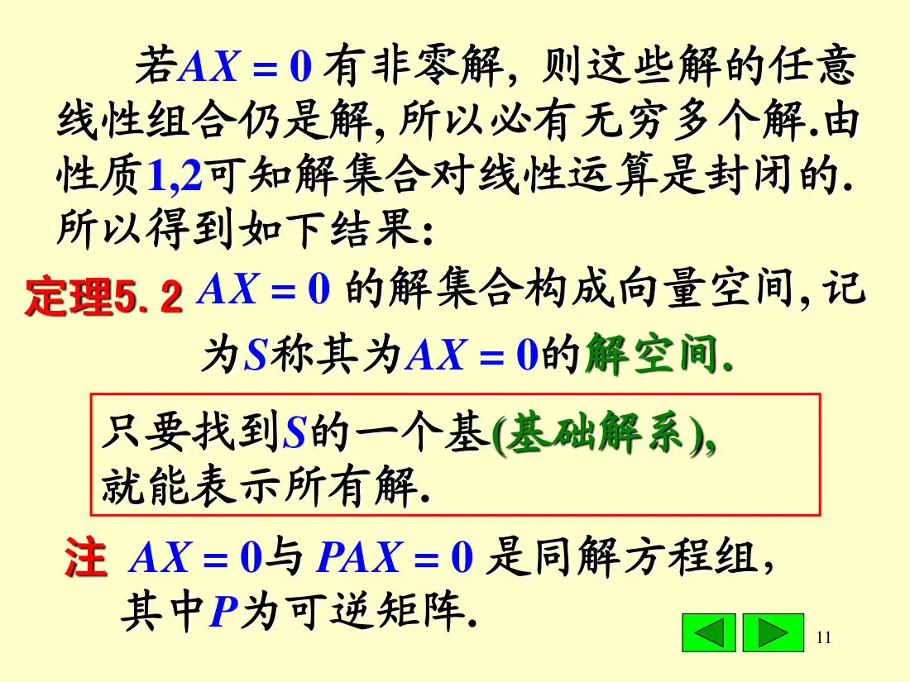

原文：

若AX=0有非零解，则这些解的任意线性组合仍是解，所以必有无穷多个解。由性质1,2可知解集合对线性运算是封闭的。所以得到如下结果：

定理5.2 AX = 0 的解集合构成向量空间, 记为S称其为AX = 0的解空间.

只要找到S的一个基(基础解系),就能表示所有解。

注 AX = 0 与 PAX = 0 是同解方程组，其中 P 为可逆矩阵。

◀ ▶

11

### 齐次线性方程组的关键问题就是求通解，而求通解的关键问题是求基础解系。

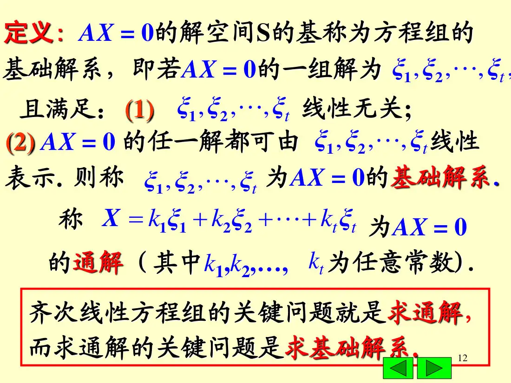

原文：

定义: $AX = 0$ 的解空间 $\mathbf{S}$ 的基称为方程组的基础解系, 即若 $AX = 0$ 的一组解为 $\xi_1, \xi_2, \cdots, \xi_t$ ,

且满足: (1) $\xi_{1}, \xi_{2}, \cdots, \xi_{t}$ 线性无关;

(2) AX = 0 的任一解都可由 $\xi_{1}, \xi_{2}, \cdots, \xi_{t}$ 线性表示. 则称 $\xi_{1}, \xi_{2}, \cdots, \xi_{t}$ 为 AX = 0 的基础解系.

称 $X = k_{1}\xi_{1} + k_{2}\xi_{2} + \cdots + k_{t}\xi_{t}$ 为 AX = 0

的通解（其中 $k_{1}, k_{2}, \ldots, k_{t}$ 为任意常数）.

齐次线性方程组的关键问题就是求通解，而求通解的关键问题是求基础解系。

### 定理5.3 设 $A_{m \times n}$ , $r(A) = r$

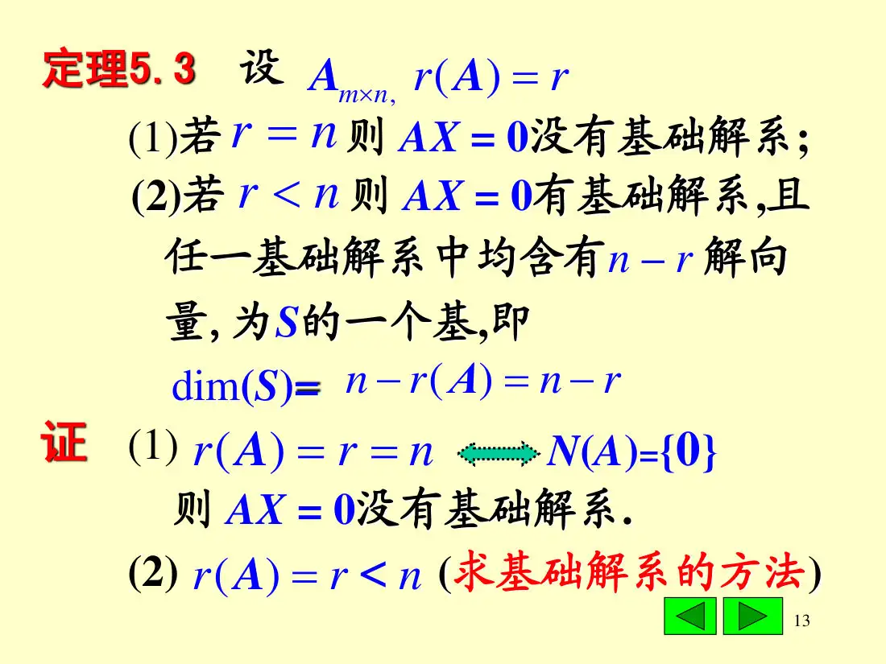

原文：

定理5.3 设 $A_{m \times n}$ , $r(A) = r$

(1)若 r = n 则 AX = 0 没有基础解系;

(2)若 r < n 则 AX = 0 有基础解系,且任一基础解系中均含有 n - r 解向量,为 S 的一个基,即

$$
\dim (S) = n - r (A) = n - r
$$

证 (1) $r(A) = r = n \Longleftrightarrow N(A) = \{0\}$ 则 $AX = 0$ 没有基础解系.

(2) $r(A) = r < n$ (求基础解系的方法)

◀

13

### 1. 不妨设 A 的前 r 个列向量线性无关

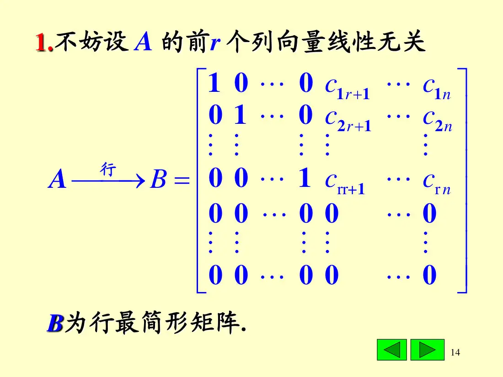

原文：

1. 不妨设 A 的前 r 个列向量线性无关

$$
A \xrightarrow {\text {行}} B = \left[ \begin{array}{l l l l l l} 1 & 0 & \dots & 0 & c _ {1 r + 1} & \dots & c _ {1 n} \\ 0 & 1 & \dots & 0 & c _ {2 r + 1} & \dots & c _ {2 n} \\ \vdots & \vdots & & \vdots & \vdots & & \vdots \\ 0 & 0 & \dots & 1 & c _ {\mathrm{rr} + 1} & \dots & c _ {\mathrm{rn}} \\ 0 & 0 & \dots & 0 & 0 & \dots & 0 \\ \vdots & \vdots & & \vdots & \vdots & & \vdots \\ 0 & 0 & \dots & 0 & 0 & \dots & 0 \end{array} \right]
$$

B为行最简形矩阵.

◀ ▶

14

### $$

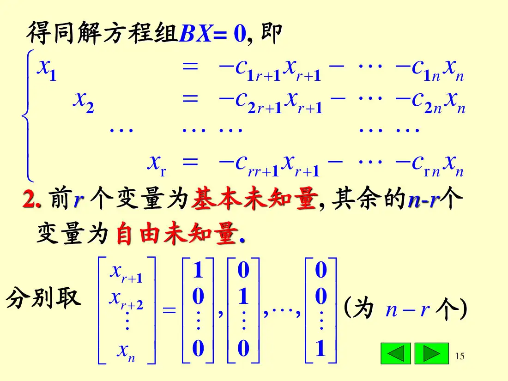

原文：

$$
\begin{array}{r l} & {\text {得同解方程组} B X = 0, \text {即}} \\ & {\left\{ \begin{array}{l l l l l} {x _ {1}} & & {= - c _ {1 r + 1} x _ {r + 1} - \dots - c _ {1 n} x _ {n}} \\ & {x _ {2}} & & {= - c _ {2 r + 1} x _ {r + 1} - \dots - c _ {2 n} x _ {n}} \\ & {\dots} & {\dots \dots} & {\dots \dots} \\ & {x _ {r} = - c _ {r r + 1} x _ {r + 1} - \dots - c _ {r n} x _ {n}} \end{array} \right.} \end{array}
$$

2. 前 $r$ 个变量为基本未知量, 其余的 $n - r$ 个变量为自由未知量.

分别取

$$
\left[ \begin{array}{c} x _ {r + 1} \\ x _ {r + 2} \\ \vdots \\ x _ {n} \end{array} \right] = \left[ \begin{array}{c} \mathbf {1} \\ \mathbf {0} \\ \vdots \\ \mathbf {0} \end{array} \right], \left[ \begin{array}{c} \mathbf {0} \\ \mathbf {1} \\ \vdots \\ \mathbf {0} \end{array} \right], \dots , \left[ \begin{array}{c} \mathbf {0} \\ \mathbf {0} \\ \vdots \\ \mathbf {1} \end{array} \right]
$$

(为

### 3. 代入同解的方程组 BX=0 中得

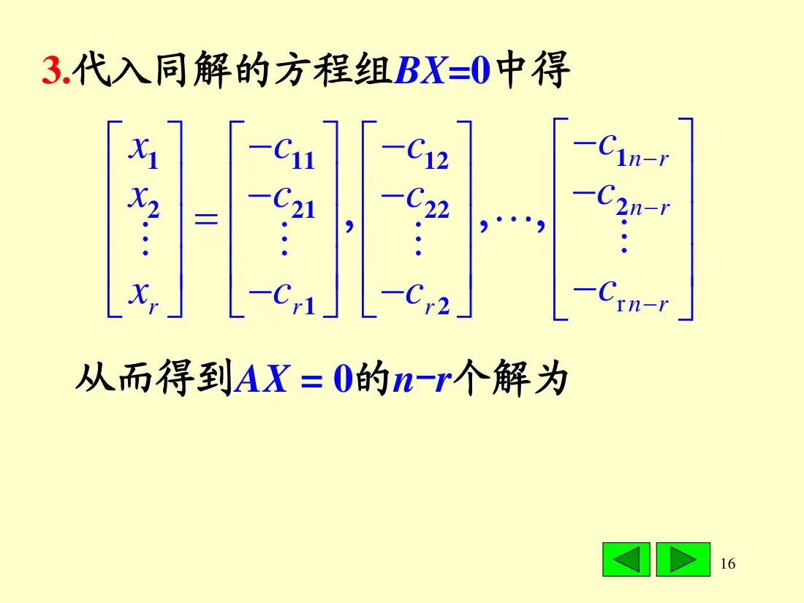

原文：

3. 代入同解的方程组 BX=0 中得

$$
\left[ \begin{array}{c} x _ {1} \\ x _ {2} \\ \vdots \\ x _ {r} \end{array} \right] = \left[ \begin{array}{c} - c _ {1 1} \\ - c _ {2 1} \\ \vdots \\ - c _ {r 1} \end{array} \right], \left[ \begin{array}{c} - c _ {1 2} \\ - c _ {2 2} \\ \vdots \\ - c _ {r 2} \end{array} \right], \dots , \left[ \begin{array}{c} - c _ {1 n - r} \\ - c _ {2 n - r} \\ \vdots \\ - c _ {r n - r} \end{array} \right]
$$

从而得到AX=0的n-r个解为

◀ △

16

### $$

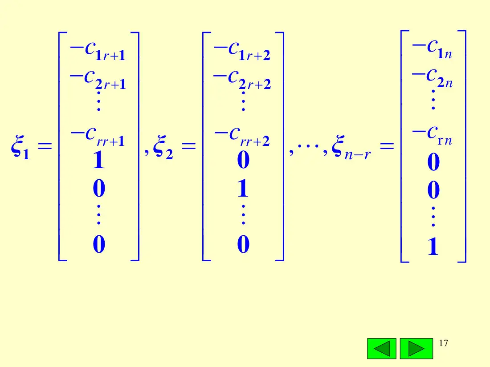

原文：

$$
\boldsymbol {\xi} _ {1} = \left[ \begin{array}{c} - c _ {1 r + 1} \\ - c _ {2 r + 1} \\ \vdots \\ - c _ {r r + 1} \\ \mathbf {1} \\ \mathbf {0} \\ \vdots \\ \mathbf {0} \end{array} \right], \boldsymbol {\xi} _ {2} = \left[ \begin{array}{c} - c _ {1 r + 2} \\ - c _ {2 r + 2} \\ \vdots \\ - c _ {r r + 2} \\ \mathbf {0} \\ \mathbf {1} \\ \vdots \\ \mathbf {0} \end{array} \right], \dots , \boldsymbol {\xi} _ {n - r} = \left[ \begin{array}{c} - c _ {1 n} \\ - c _ {2 n} \\ \vdots \\ - c _ {r n} \\ \mathbf {0} \\ \mathbf {0} \\ \vdots \\ \mathbf {1} \end{array} \right]
$$

◀ ▶

17

### 第 18 页

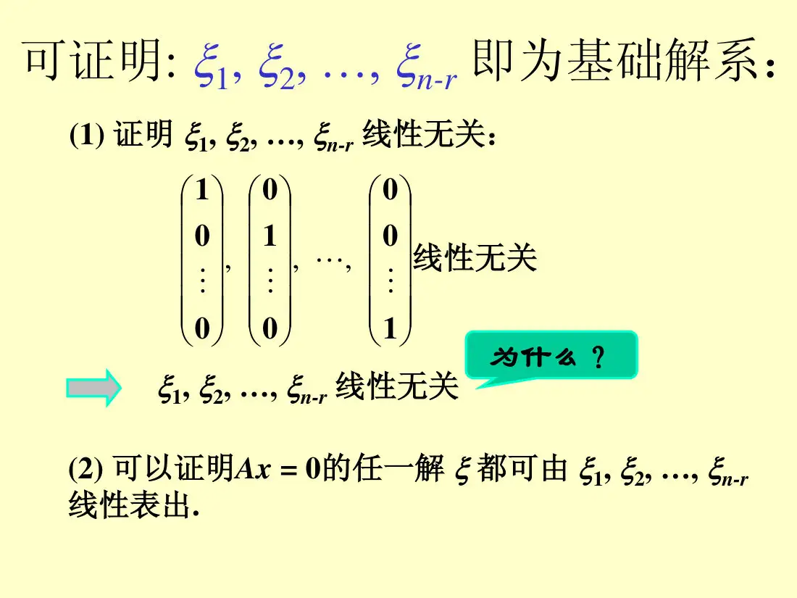

原文：

可证明: $\xi_1, \xi_2, \ldots, \xi_{n-r}$ 即为基础解系:

(1) 证明 $\xi_1, \xi_2, \ldots, \xi_{n-r}$ 线性无关:

$\left(\begin{array}{c}1\\0\\\vdots\\0\end{array}\right),\left(\begin{array}{c}0\\1\\\vdots\\0\end{array}\right),\cdots,\left(\begin{array}{c}0\\0\\\vdots\\1\end{array}\right)$ 线性无关 $\xi_{1}, \xi_{2}, \ldots, \xi_{n-r}$ 线性无关 为什么？

(2) 可以证明 Ax = 0 的任一解 $\xi$ 都可由 $\xi_{1}, \xi_{2}, \ldots, \xi_{n-r}$ 线性表出.

### 故由性质 1 及性质 2 知： $\eta$ 也为 Ax = 0 的解.

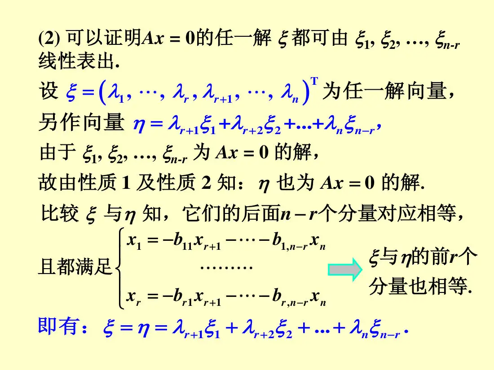

原文：

(2) 可以证明 Ax = 0 的任一解 $\xi$ 都可由 $\xi_{1}, \xi_{2}, \ldots, \xi_{n-r}$ 线性表出.

设 $\xi = (\lambda_{1}, \cdots, \lambda_{r}, \lambda_{r+1}, \cdots, \lambda_{n})^{\mathrm{T}}$ 为任一解向量，

另作向量 $\eta = \lambda_{r+1} \xi_{1} + \lambda_{r+2} \xi_{2} + \ldots + \lambda_{n} \xi_{n-r}$ 由于 $\xi_{1}, \xi_{2}, \ldots, \xi_{n-r}$ 为 Ax = 0 的解，

故由性质 1 及性质 2 知： $\eta$ 也为 Ax = 0 的解.

比较 $\xi$ 与 $\eta$ 知，它们的后面 n - r 个分量对应相等，

且都满足 $\left\{\begin{aligned}x_{1}&=-b_{11}x_{r+1}-\cdots-b_{1,n-r}x_{n}\\ &\cdots\cdots\\ x_{r}&=-b_{r1}x_{r+1}-\cdots-b_{r,n-r}x_{n}\end{aligned}\right.$ $\rightarrow$ $\xi$ 与 $\eta$ 的前 r 个分量也相等.

即有： $\xi = \eta = \lambda_{r+1} \xi_{1} + \lambda_{r+2} \xi_{2} + \ldots + \lambda_{n} \xi_{n-r}$ .

### $$

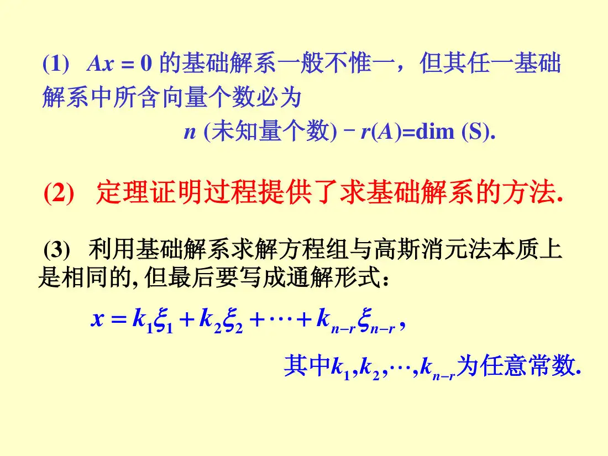

原文：

(1) $Ax = 0$ 的基础解系一般不惟一, 但其任一基础解系中所含向量个数必为

$$
n (\text {未知量个数}) - r (A) = \dim (S).
$$

(2) 定理证明过程提供了求基础解系的方法.

(3) 利用基础解系求解方程组与高斯消元法本质上是相同的,但最后要写成通解形式:

$$
x = k _ {1} \xi_ {1} + k _ {2} \xi_ {2} + \dots + k _ {n - r} \xi_ {n - r},
$$

其中 $k_{1},k_{2},\cdots,k_{n-r}$ 为任意常数.

### 总结

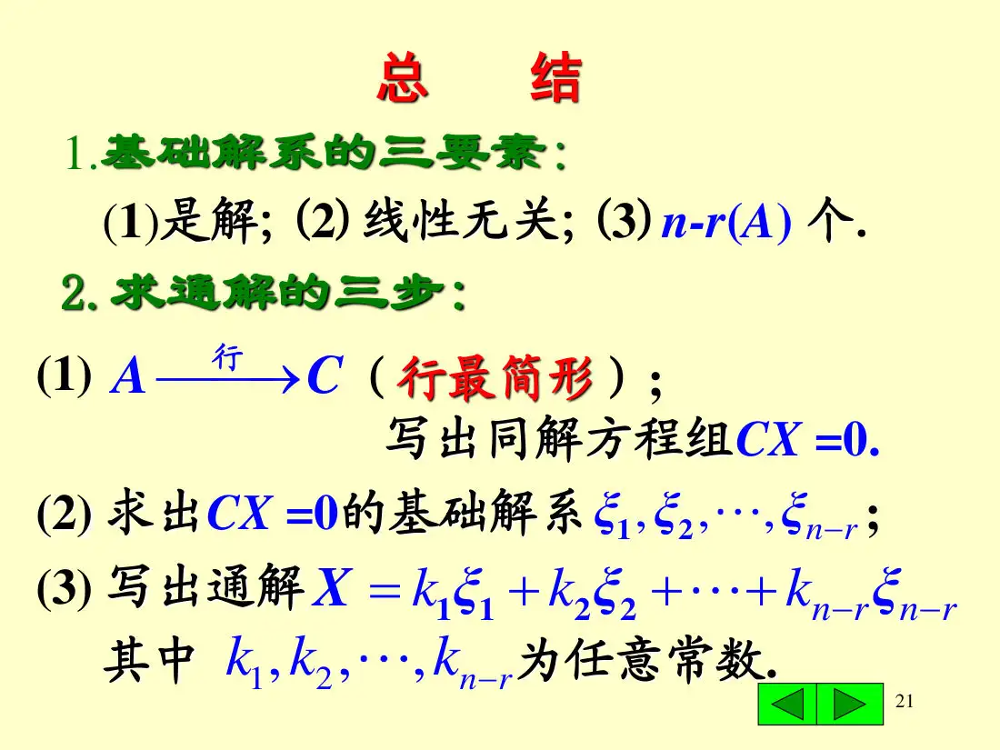

原文：

总结

1. 基础解系的三要素:

(1)是解; (2)线性无关; (3) $n-r(A)$ 个.

2. 求通解的三步:

(1) $A \xrightarrow{行} C$ (行最简形); 写出同解方程组 CX = 0.

(2) 求出 CX=0 的基础解系 $\xi_{1}, \xi_{2}, \cdots, \xi_{n-r}$ ;

(3) 写出通解 $X = k_{1}\xi_{1} + k_{2}\xi_{2} + \cdots + k_{n-r}\xi_{n-r}$ 其中 $k_{1}, k_{2}, \cdots, k_{n-r}$ 为任意常数.

◀ △

21

### 例 求下列方程组的基础解系:

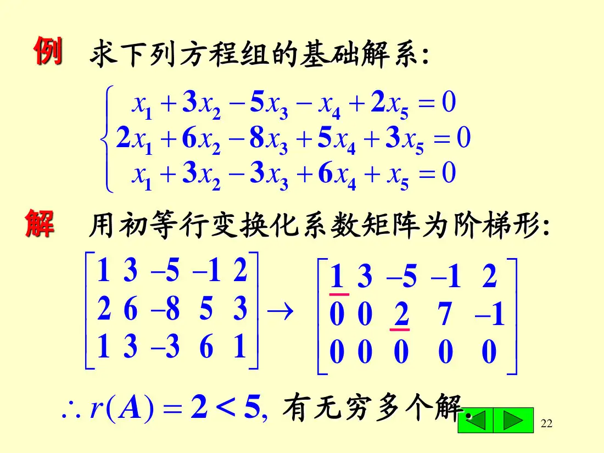

原文：

例 求下列方程组的基础解系:

$$
\left\{ \begin{array}{l} x _ {1} + 3 x _ {2} - 5 x _ {3} - x _ {4} + 2 x _ {5} = 0 \\ 2 x _ {1} + 6 x _ {2} - 8 x _ {3} + 5 x _ {4} + 3 x _ {5} = 0 \\ x _ {1} + 3 x _ {2} - 3 x _ {3} + 6 x _ {4} + x _ {5} = 0 \end{array} \right.
$$

解 用初等行变换化系数矩阵为阶梯形:

$$
\left[\begin{array}{c c c c c}1&3&- 5&- 1&2\\2&6&- 8&5&3\\1&3&- 3&6&1\end{array}\right]\rightarrow \left[\begin{array}{c c c c c}\underline {{1}}&3&- 5&- 1&2\\\overline {{0}}&0&\underline {{2}}&7&- 1\\0&0&\overline {{0}}&0&0\end{array}\right]
$$

∴ $r(A)=2<5$ ，有无穷多个解

22

### $$

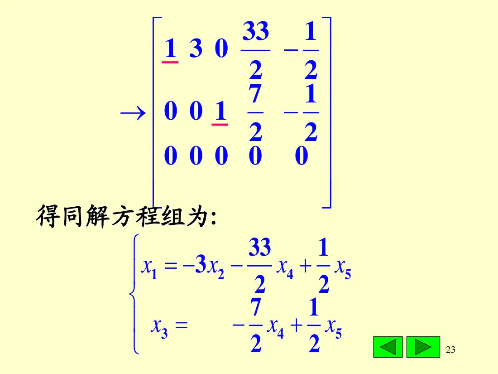

原文：

$$
\rightarrow \left[\begin{array}{l l l l l}1&3&0&\frac {3 3}{2}&- \frac {1}{2}\\0&0&1&\frac {7}{2}&- \frac {1}{2}\\0&0&0&0&0\end{array}\right]
$$

得同解方程组为:

$$
\left\{ \begin{array}{l l} x _ {1} = - 3 x _ {2} - \frac {3 3}{2} x _ {4} + \frac {1}{2} x _ {5} \\ x _ {3} = - \frac {7}{2} x _ {4} + \frac {1}{2} x _ {5} \end{array} \right.
$$

◀ ▶

23

### $$

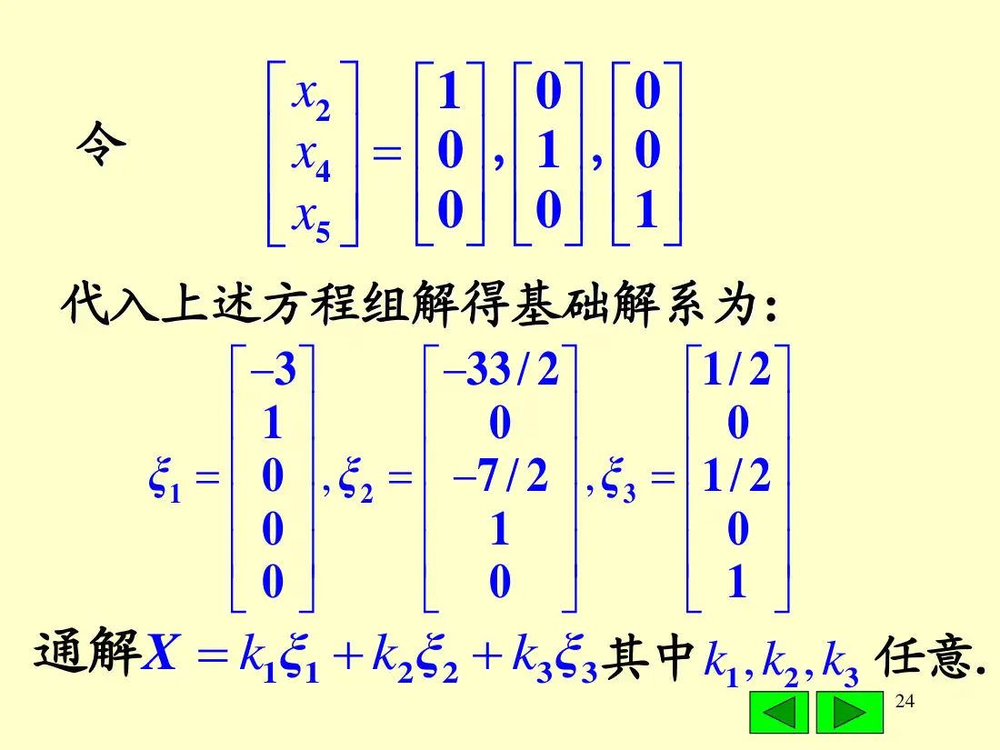

原文：

令

$$
\left[ \begin{array}{l} x _ {2} \\ x _ {4} \\ x _ {5} \end{array} \right] = \left[ \begin{array}{l} 1 \\ 0 \\ 0 \end{array} \right], \left[ \begin{array}{l} 0 \\ 1 \\ 0 \end{array} \right], \left[ \begin{array}{l} 0 \\ 0 \\ 1 \end{array} \right]
$$

代入上述方程组解得基础解系为:

$$
\xi_ {1} = \left[ \begin{array}{c} - 3 \\ 1 \\ 0 \\ 0 \\ 0 \end{array} \right], \xi_ {2} = \left[ \begin{array}{c} - 3 3 / 2 \\ 0 \\ - 7 / 2 \\ 1 \\ 0 \end{array} \right], \xi_ {3} = \left[ \begin{array}{c} 1 / 2 \\ 0 \\ 1 / 2 \\ 0 \\ 1 \end{array} \right]
$$

通解 $X = k_{1}\xi_{1} + k_{2}\xi_{2} + k_{3}\xi_{3}$ 其中 $k_{1}, k_{2}, k_{3}$ 任意.

◀ ▶

24

### 例 求方程组的通解

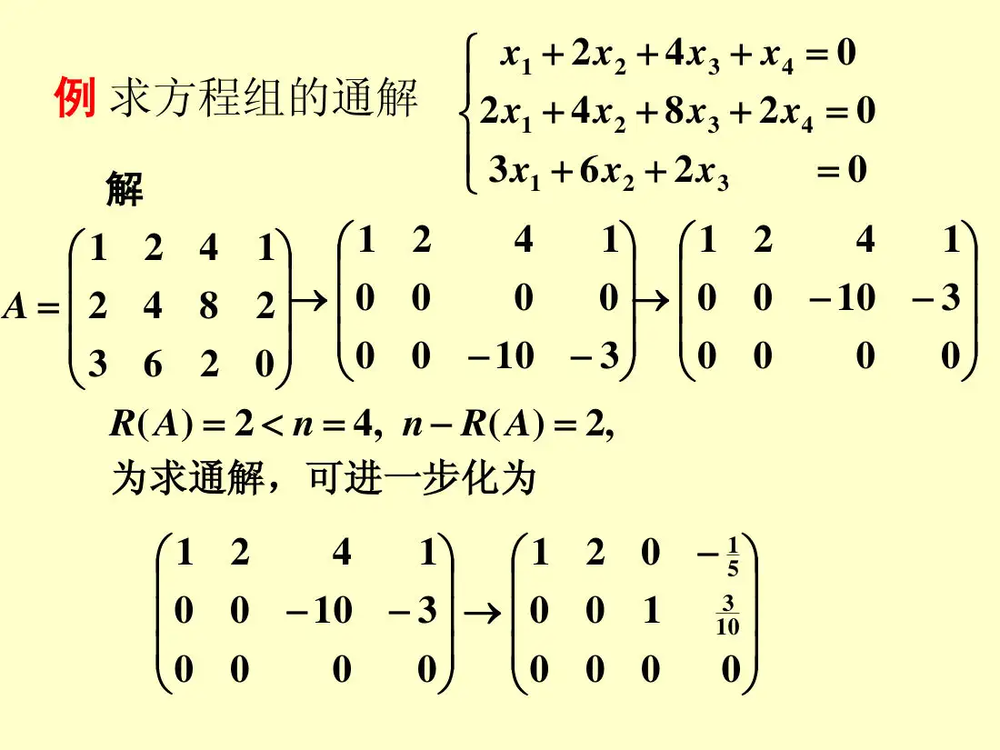

原文：

例 求方程组的通解

解

$$
\left\{ \begin{array}{l l} x _ {1} + 2 x _ {2} + 4 x _ {3} + x _ {4} = 0 \\ 2 x _ {1} + 4 x _ {2} + 8 x _ {3} + 2 x _ {4} = 0 \\ 3 x _ {1} + 6 x _ {2} + 2 x _ {3} = 0 \end{array} \right.
$$

$$
A = \left(\begin{array}{c c c c}1&2&4&1\\2&4&8&2\\3&6&2&0\end{array}\right)\rightarrow \left(\begin{array}{c c c c}1&2&4&1\\0&0&0&0\\0&0&- 1 0&- 3\end{array}\right)\rightarrow \left(\begin{array}{c c c c}1&2&4&1\\0&0&- 1 0&- 3\\0&0&0&0\end{array}\right)
$$

$R(A) = 2 < n = 4, n - R(A) = 2,$

为求通解，可进一步化为

$$
\left(\begin{array}{c c c c}1&2&4&1\\\mathbf {0}&\mathbf {0}&- 1 \mathbf {0}&- 3\\\mathbf {0}&\mathbf {0}&\mathbf {0}&\mathbf {0}\end{array}\right)\rightarrow \left(\begin{array}{c c c c}1&2&\mathbf {0}&- \frac {1}{5}\\\mathbf {0}&\mathbf {0}&1&\frac {3}{1 0}\\\mathbf {0}&\mathbf {0}&\mathbf {0}&\mathbf {0}\end{array}\right)
$$

### 第 26 页

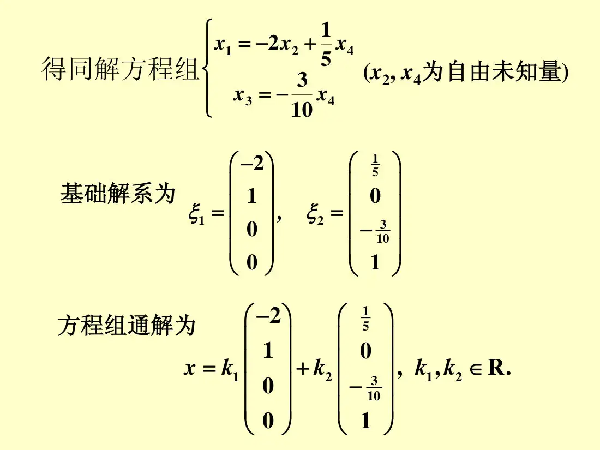

原文：

得同解方程组 $\left\{ \begin{array}{l} x_{1} = -2x_{2} + \frac{1}{5} x_{4} \\ x_{3} = -\frac{3}{10} x_{4} \end{array} \right.$ ( $x_{2}, x_{4}$ 为自由未知量)

基础解系为 $\xi_{1} = \begin{pmatrix} -2 \\ 1 \\ 0 \\ 0 \end{pmatrix}, \quad \xi_{2} = \begin{pmatrix} \frac{1}{5} \\ 0 \\ -\frac{3}{10} \\ 1 \end{pmatrix}$ 方程组通解为 $x = k_{1} \begin{pmatrix} -2 \\ 1 \\ 0 \\ 0 \end{pmatrix} + k_{2} \begin{pmatrix} \frac{1}{5} \\ 0 \\ -\frac{3}{10} \\ 1 \end{pmatrix}, k_{1}, k_{2} \in \mathbb{R}$ .

### $$

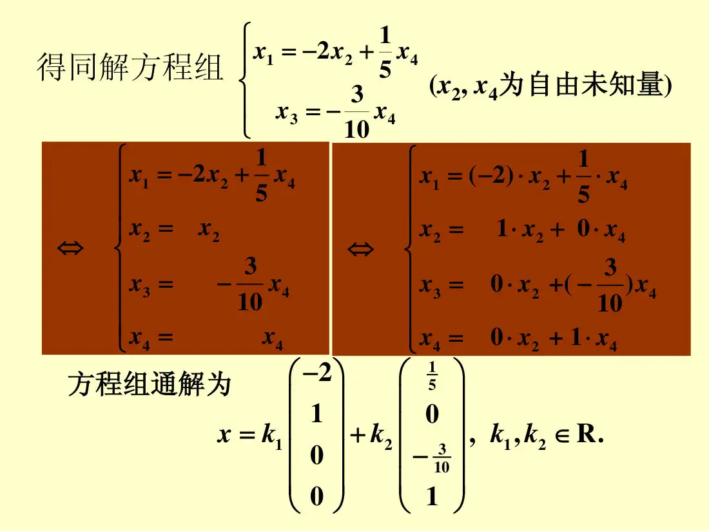

原文：

得同解方程组 $\left\{ \begin{array}{l} x_{1} = -2x_{2} + \frac{1}{5} x_{4} \\ x_{3} = -\frac{3}{10} x_{4} \end{array} \right.$ ( $x_{2}, x_{4}$ 为自由未知量)

$$
\left\{ \begin{array}{l} x _ {1} = - 2 x _ {2} + \frac {1}{5} x _ {4} \\ x _ {2} = x _ {2} \\ x _ {3} = - \frac {3}{1 0} x _ {4} \\ x _ {4} = x _ {4} \end{array} \right.
$$

$$
\left\{ \begin{array}{l l} x _ {1} = (- 2) \cdot x _ {2} + \frac {1}{5} \cdot x _ {4} \\ x _ {2} = 1 \cdot x _ {2} + 0 \cdot x _ {4} \\ x _ {3} = 0 \cdot x _ {2} + (- \frac {3}{1 0}) x _ {4} \\ x _ {4} = 0 \cdot x _ {2} + 1 \cdot x _ {4} \end{array} \right.
$$

方程组通解为 $x = k_{1}\left( \begin{array}{c} - 2\\ 1\\ 0\\ 0 \end{array} \right) + k_{2}\left( \begin{array}{c}\frac{1}{5}\\ 0\\ -\frac{3}{10}\\ 1 \end{array} \right),k_{1},k_{2}\in \mathbf{R}.$

### ◀ ▶

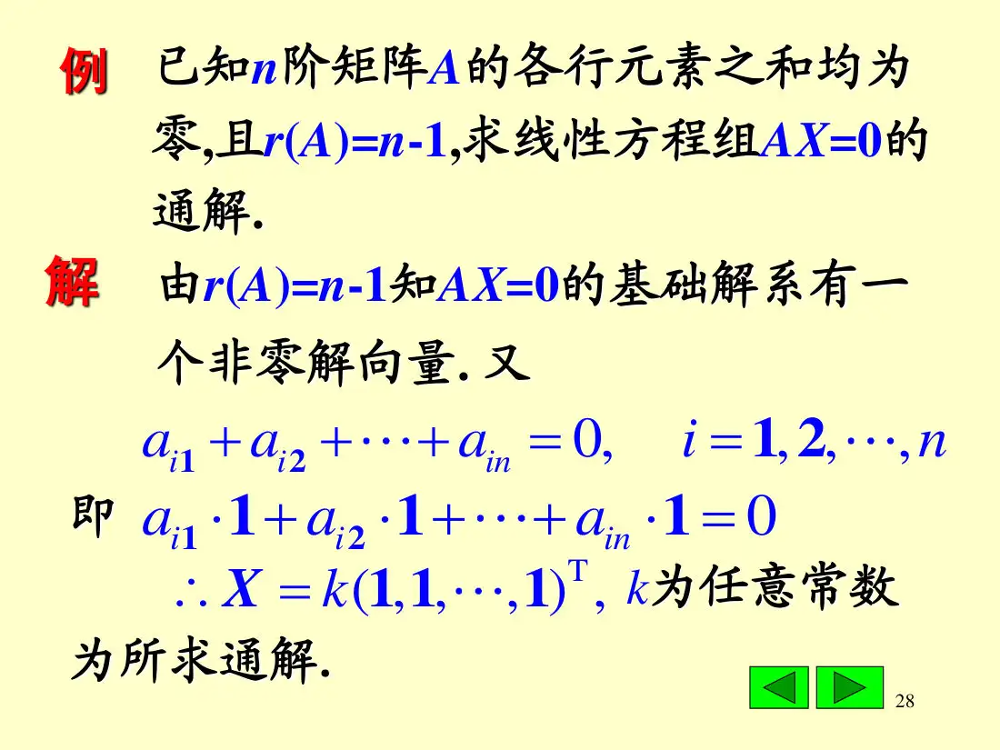

原文：

例 已知n阶矩阵A的各行元素之和均为零,且 $r(A)=n-1$ ,求线性方程组AX=0的通解.

解 由 $r(A)=n-1$ 知AX=0的基础解系有一个非零解向量. 又 $a_{i1} + a_{i2} + \cdots + a_{in} = 0, \quad i = 1, 2, \cdots, n$ 即 $a_{i1} \cdot 1 + a_{i2} \cdot 1 + \cdots + a_{in} \cdot 1 = 0$ $\therefore X = k(1,1,\cdots,1)^{\mathrm{T}}$ , k为任意常数为所求通解.

◀ ▶

28

### $$

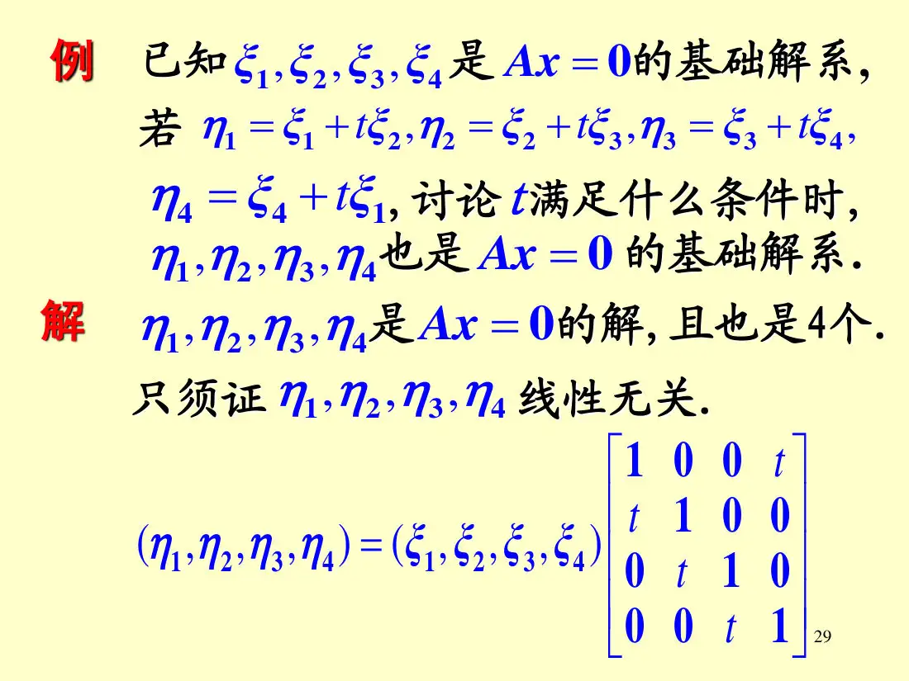

原文：

例 已知 $\xi_1, \xi_2, \xi_3, \xi_4$ 是 $Ax = 0$ 的基础解系，若 $\eta_1 = \xi_1 + t\xi_2, \eta_2 = \xi_2 + t\xi_3, \eta_3 = \xi_3 + t\xi_4,$ $\eta_4 = \xi_4 + t\xi_1$ ，讨论 $t$ 满足什么条件时， $\eta_1, \eta_2, \eta_3, \eta_4$ 也是 $Ax = 0$ 的基础解系。解 $\eta_1, \eta_2, \eta_3, \eta_4$ 是 $Ax = 0$ 的解，且也是4个。只须证 $\eta_1, \eta_2, \eta_3, \eta_4$ 线性无关。

$$
\left(\eta_ {1}, \eta_ {2}, \eta_ {3}, \eta_ {4}\right) = \left(\xi_ {1}, \xi_ {2}, \xi_ {3}, \xi_ {4}\right) \left[ \begin{array}{c c c c} 1 & 0 & 0 & t \\ t & 1 & 0 & 0 \\ 0 & t & 1 & 0 \\ 0 & 0 & t & 1 \end{array} \right] _ {2 9}
$$

### $\eta_1, \eta_2, \eta_3, \eta_4$ 线性无关

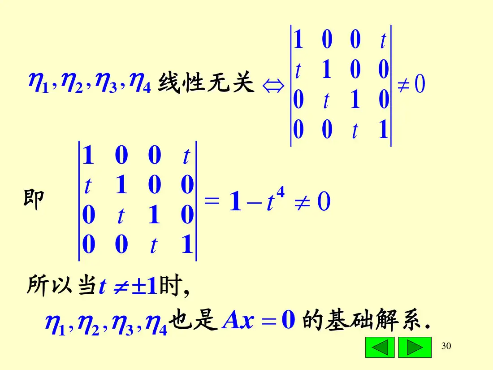

原文：

$\eta_1, \eta_2, \eta_3, \eta_4$ 线性无关

$$
\Leftrightarrow \left| \begin{array}{c c c c} \mathbf {1} & \mathbf {0} & \mathbf {0} & t \\ t & \mathbf {1} & \mathbf {0} & \mathbf {0} \\ \mathbf {0} & t & \mathbf {1} & \mathbf {0} \\ \mathbf {0} & \mathbf {0} & t & \mathbf {1} \end{array} \right| \neq 0
$$

即

$$
\left| \begin{array}{c c c c} \mathbf {1} & \mathbf {0} & \mathbf {0} & t \\ t & \mathbf {1} & \mathbf {0} & \mathbf {0} \\ \mathbf {0} & t & \mathbf {1} & \mathbf {0} \\ \mathbf {0} & \mathbf {0} & t & \mathbf {1} \end{array} \right| = \mathbf {1} - t ^ {4} \neq 0
$$

所以当 $t \neq \pm 1$ 时，

$\eta_{1},\eta_{2},\eta_{3},\eta_{4}$ 也是Ax=0的基础解系.

◀ ▶

30

### 例 求下列方程组的基础解系及通解:

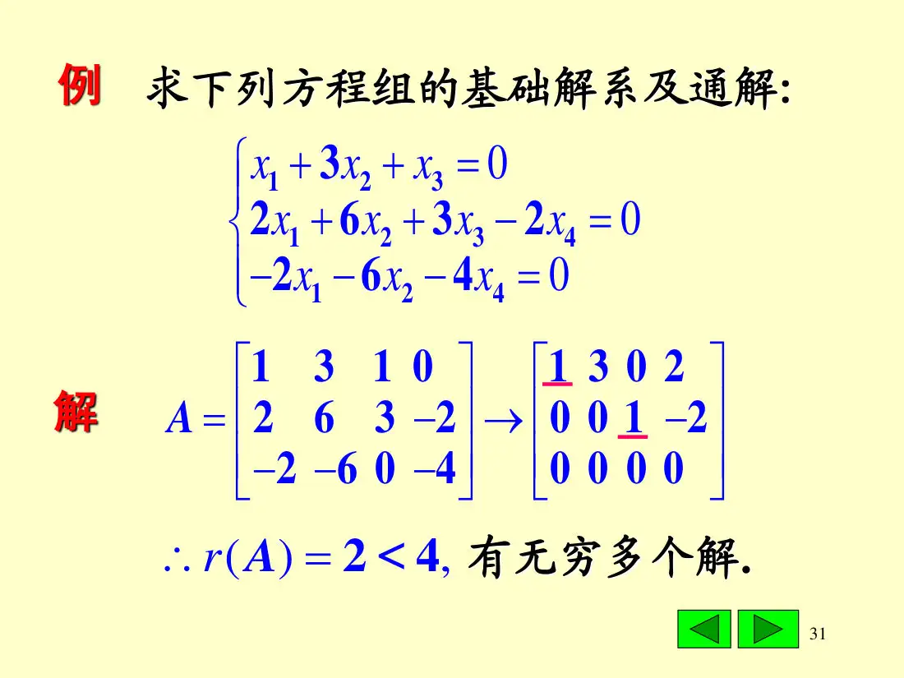

原文：

例 求下列方程组的基础解系及通解:

$$
\left\{ \begin{array}{l} x _ {1} + 3 x _ {2} + x _ {3} = 0 \\ 2 x _ {1} + 6 x _ {2} + 3 x _ {3} - 2 x _ {4} = 0 \\ - 2 x _ {1} - 6 x _ {2} - 4 x _ {4} = 0 \end{array} \right.
$$

解

$$
A = \left[\begin{array}{c c c c}1&3&1&0\\2&6&3&- 2\\- 2&- 6&0&- 4\end{array}\right]\rightarrow \left[\begin{array}{c c c c}\underline {{1}}&3&0&2\\0&0&\underline {{1}}&- 2\\0&0&0&0\end{array}\right]
$$

$\therefore r(A) = 2 < 4,$ 有无穷多个解.

◀ ▶

31

### ◀ ▶

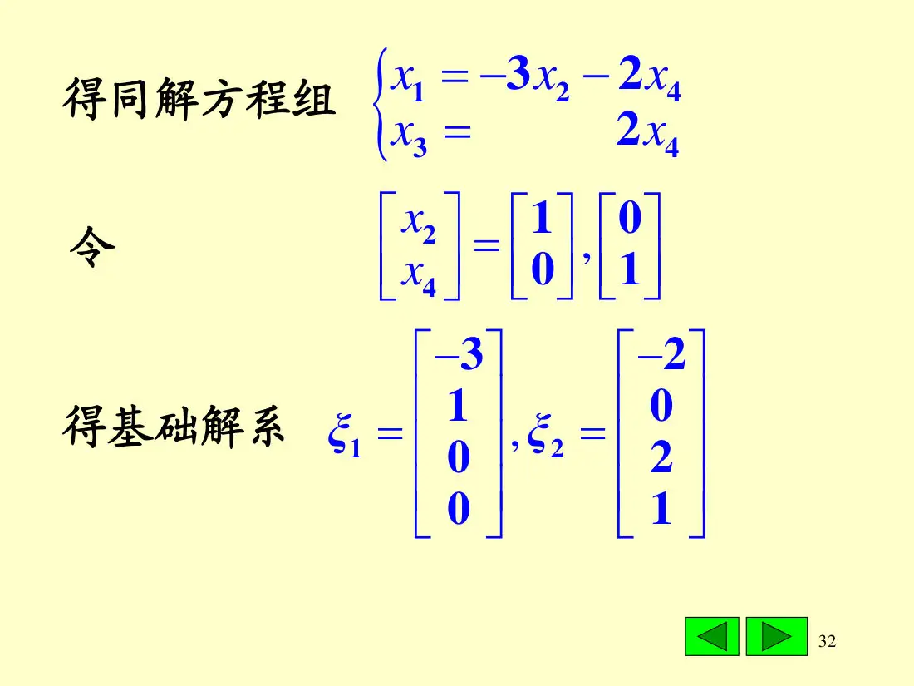

原文：

得同解方程组 $\left\{\begin{aligned}x_{1}&=-3x_{2}-2x_{4}\\ x_{3}&=2x_{4}\end{aligned}\right.$ 令 $\left[\begin{matrix}x_{2}\\ x_{4}\end{matrix}\right]=\left[\begin{matrix}1\\ 0\end{matrix}\right],\left[\begin{matrix}0\\ 1\end{matrix}\right]$ 得基础解系 $\xi_{1}=\left[\begin{matrix}-3\\ 1\\ 0\\ 0\end{matrix}\right],\xi_{2}=\left[\begin{matrix}-2\\ 0\\ 2\\ 1\end{matrix}\right]$ 方程组的通解是:

◀ ▶

32

### $$

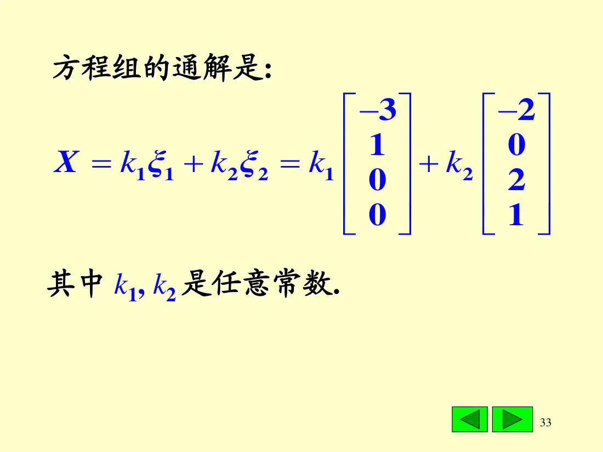

原文：

$$
\boldsymbol {X} = k _ {1} \boldsymbol {\xi} _ {1} + k _ {2} \boldsymbol {\xi} _ {2} = k _ {1} \left[ \begin{array}{c} - 3 \\ \mathbf {1} \\ \mathbf {0} \\ \mathbf {0} \end{array} \right] + k _ {2} \left[ \begin{array}{c} - 2 \\ \mathbf {0} \\ \mathbf {2} \\ \mathbf {1} \end{array} \right]
$$

其中 $k_{1}, k_{2}$ 是任意常数.

◀ ▶

33

### 例 设齐次方程组

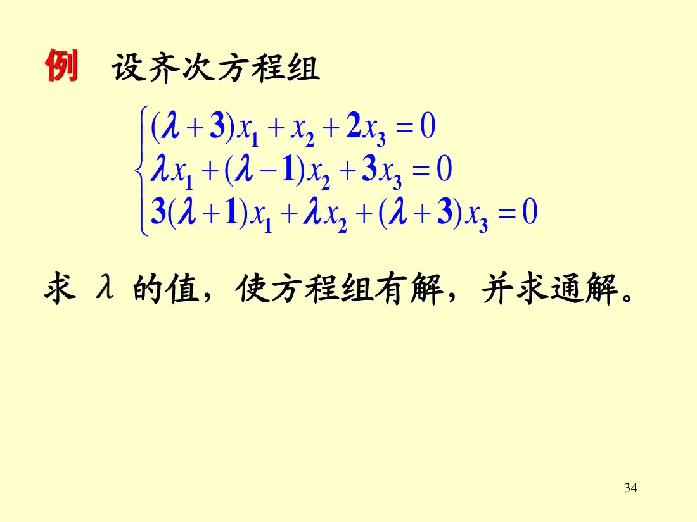

原文：

例 设齐次方程组

$$
\left\{ \begin{array}{l} (\lambda + 3) x _ {1} + x _ {2} + 2 x _ {3} = 0 \\ \lambda x _ {1} + (\lambda - 1) x _ {2} + 3 x _ {3} = 0 \\ 3 (\lambda + 1) x _ {1} + \lambda x _ {2} + (\lambda + 3) x _ {3} = 0 \end{array} \right.
$$

求 $\lambda$ 的值，使方程组有解，并求通解。

34

### 解：计算系数行列式

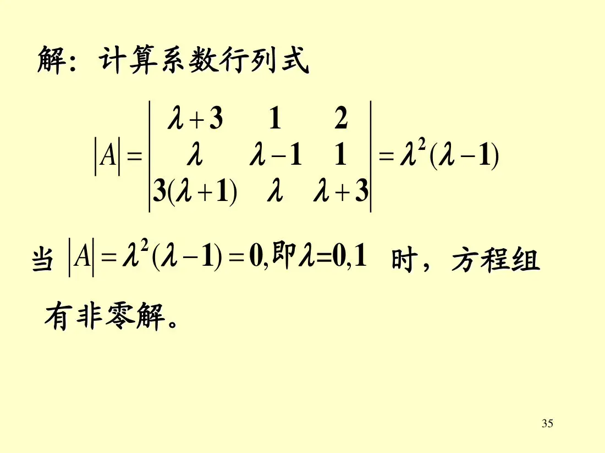

原文：

解：计算系数行列式

$$
\left| A \right| = \left| \begin{array}{c c c} \lambda + 3 & 1 & 2 \\ \lambda & \lambda - 1 & 1 \\ 3 (\lambda + 1) & \lambda & \lambda + 3 \end{array} \right| = \lambda^ {2} (\lambda - 1)
$$

当 $|A| = \lambda^2 (\lambda - 1) = 0$ ，即 $\lambda = 0, 1$ 时，方程组有非零解。

35

### 当 $\lambda=0$ 时，方程组变为

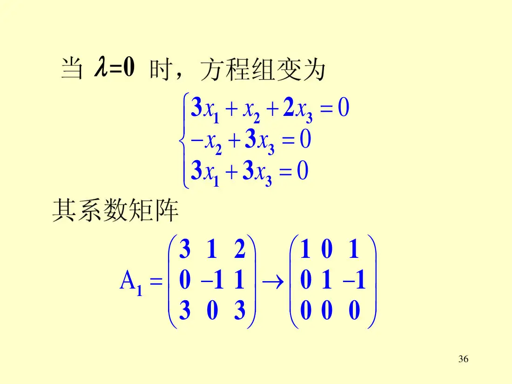

原文：

当 $\lambda=0$ 时，方程组变为

$$
\left\{ \begin{array}{l} 3 x _ {1} + x _ {2} + 2 x _ {3} = 0 \\ - x _ {2} + 3 x _ {3} = 0 \\ 3 x _ {1} + 3 x _ {3} = 0 \end{array} \right.
$$

其系数矩阵

$$
\mathrm{A} _ {1} = \left(\begin{array}{c c c}3&1&2\\0&- 1&1\\3&0&3\end{array}\right)\rightarrow \left(\begin{array}{c c c}1&0&1\\0&1&- 1\\0&0&0\end{array}\right)
$$

36

### 37

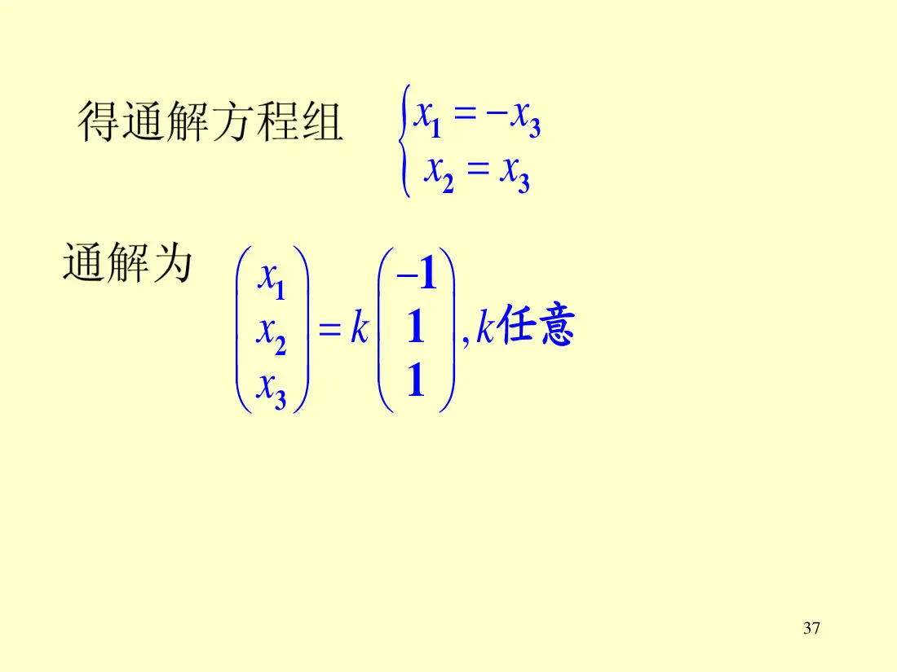

原文：

得通解方程组 $\left\{\begin{aligned}x_{1}&=-x_{3}\\ x_{2}&=x_{3}\end{aligned}\right.$ 通解为 $\begin{pmatrix}x_{1}\\ x_{2}\\ x_{3}\end{pmatrix}=k\begin{pmatrix}-1\\ 1\\ 1\end{pmatrix},k$ 任意当 $\lambda=1$ 时，方程组变为

37

### $$

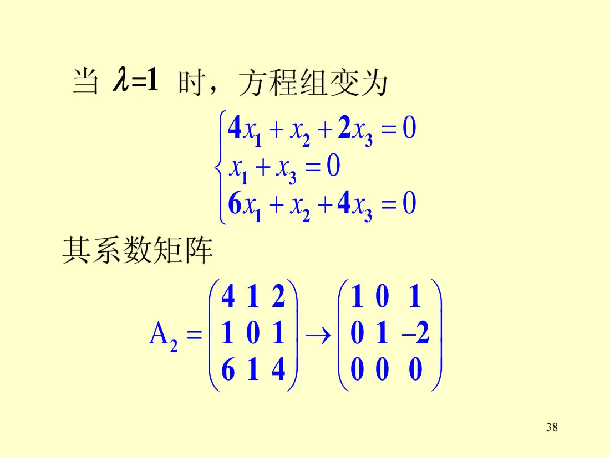

原文：

$$
\left\{ \begin{array}{l} 4 x _ {1} + x _ {2} + 2 x _ {3} = 0 \\ x _ {1} + x _ {3} = 0 \\ 6 x _ {1} + x _ {2} + 4 x _ {3} = 0 \end{array} \right.
$$

其系数矩阵

$$
\mathrm{A} _ {2} = \left(\begin{array}{c c c}4&1&2\\1&0&1\\6&1&4\end{array}\right)\rightarrow \left(\begin{array}{c c c}1&0&1\\0&1&- 2\\0&0&0\end{array}\right)
$$

38

### 39

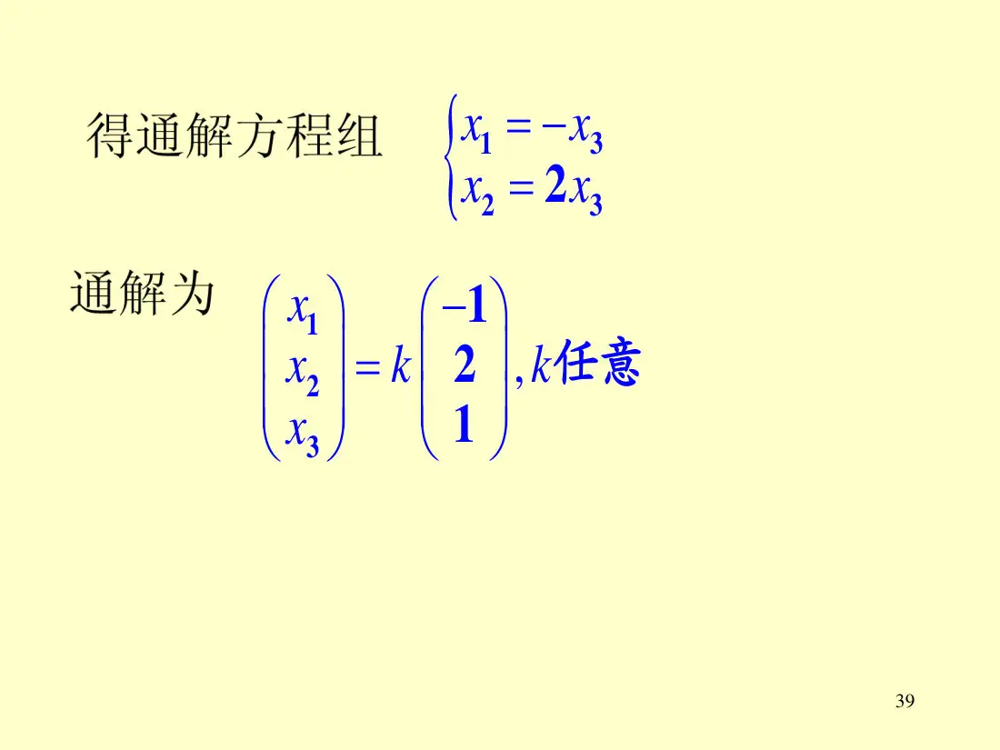

原文：

得通解方程组 $\left\{\begin{aligned}x_{1}&=-x_{3}\\ x_{2}&=2x_{3}\end{aligned}\right.$ 通解为 $\begin{pmatrix}x_{1}\\ x_{2}\\ x_{3}\end{pmatrix}=k\begin{pmatrix}-1\\ 2\\ 1\end{pmatrix},k$ 任意

39

### 例 设 $B$ 是一个三阶非零矩阵，它的每一列都是齐次线性方程组

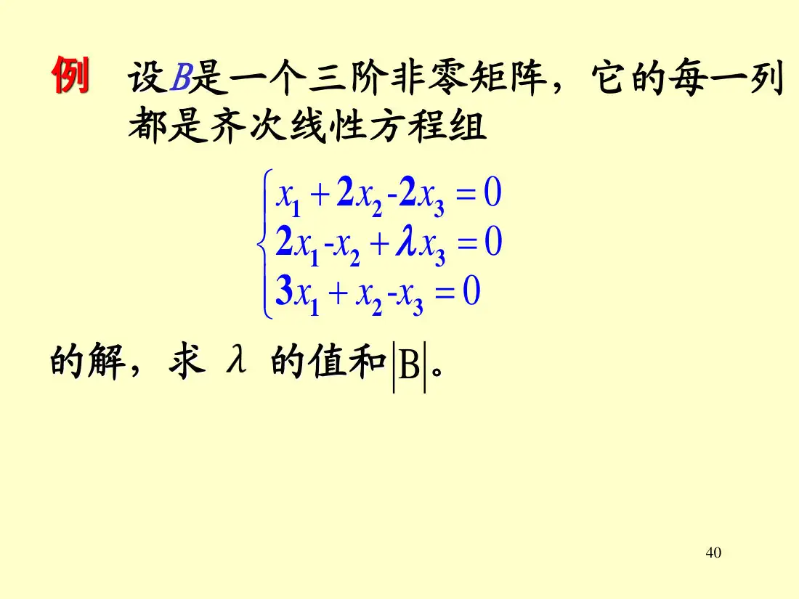

原文：

例 设 $B$ 是一个三阶非零矩阵，它的每一列都是齐次线性方程组

$$
\left\{ \begin{array}{l} x _ {1} + 2 x _ {2} - 2 x _ {3} = 0 \\ 2 x _ {1} - x _ {2} + \lambda x _ {3} = 0 \\ 3 x _ {1} + x _ {2} - x _ {3} = 0 \end{array} \right.
$$

的解，求 $\lambda$ 的值和 $|B|$ 。

40

### 例 设 A 是 s×n 矩阵，B 是 n×m 矩阵， AB=0, 求证

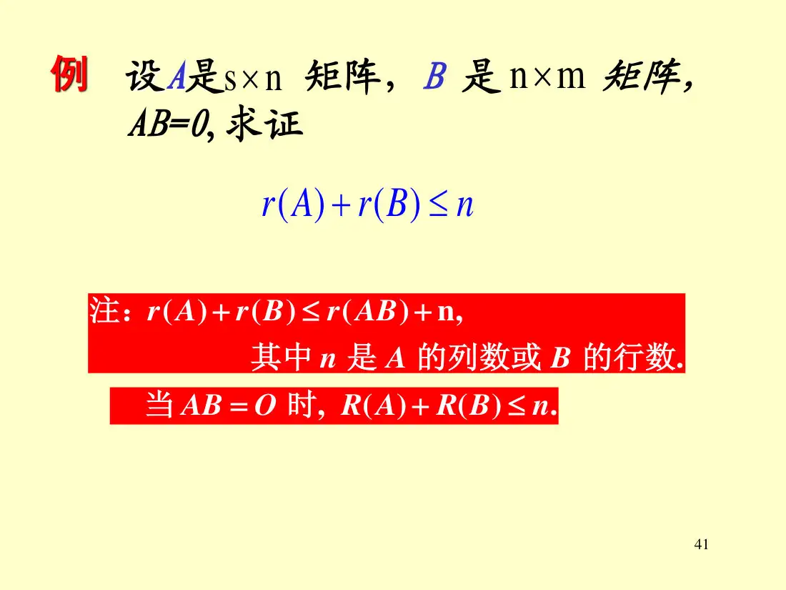

原文：

例 设 A 是 s×n 矩阵，B 是 n×m 矩阵， AB=0, 求证

$$
r (A) + r (B) \leq n
$$

注： $r(A)+r(B)\leq r(AB)+n,$ 其中 n 是 A 的列数或 B 的行数.
当 AB = O 时， $R(A) + R(B) \leq n.$

41

### 例5. A, B 均为 n 阶矩阵，且 AB = 0 ，证明：

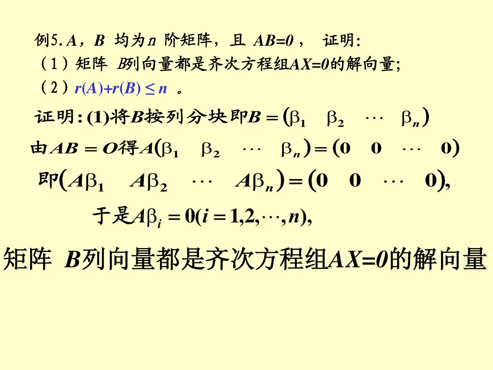

原文：

例5. A, B 均为 n 阶矩阵，且 AB = 0 ，证明：

(1) 矩阵 B列向量都是齐次方程组AX=0的解向量;

(2) $r(A)+r(B)\leq n$

证明:(1)将B按列分块即 $B=\left(\beta_{1}\quad\beta_{2}\quad\cdots\quad\beta_{n}\right)$ 由AB=O得 $A\left(\beta_{1}\quad\beta_{2}\quad\cdots\quad\beta_{n}\right)=\left(0\quad0\quad\cdots\quad0\right)$ 即 $\left(A\beta_{1}\quad A\beta_{2}\quad\cdots\quad A\beta_{n}\right)=\left(0\quad0\quad\cdots\quad0\right),$

于是 $A\beta_{i}=0(i=1,2,\cdots,n)$ ,

矩阵 B列向量都是齐次方程组AX=0的解向量(2) 当 AX=0 仅有全零解时 $r(A)=n$ ，
B=0 所以 $r(A)+r(B)=n$ ；
当AX=0有非零解时， $r(A)<n$ ，基
设基础解系为 $\eta_{1},\cdots,\eta_{n-r(A)}$ 础解系存在，
由(1)得 $\beta_{1},\cdots,\beta_{n}$ 为AX=0的解，
则 $\beta_{1}\cdots\beta_{n}$ 可由 $\eta_{1},\cdots,\eta_{n-r(A)}$ 线性表示，
于是 $r(\beta_{1}\cdots\beta_{n})\leq n-r(A)$ ,
即 $r(B)\leq n-r(A)$ ,
因此 $r(A)+r(B)\leq n.$

### 第 43 页

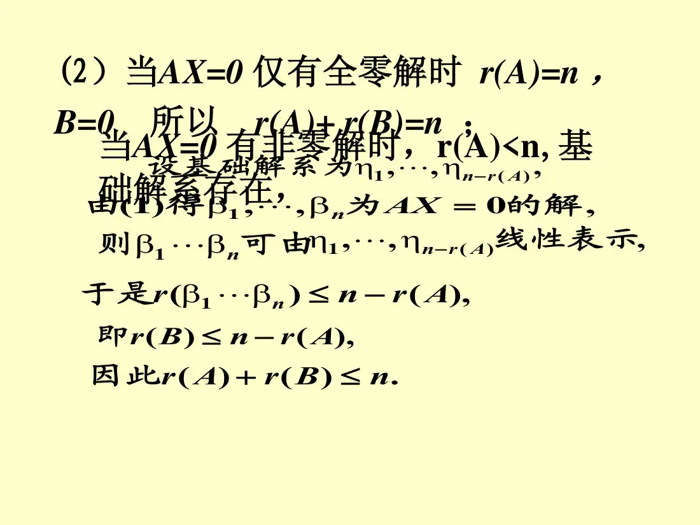

### $$

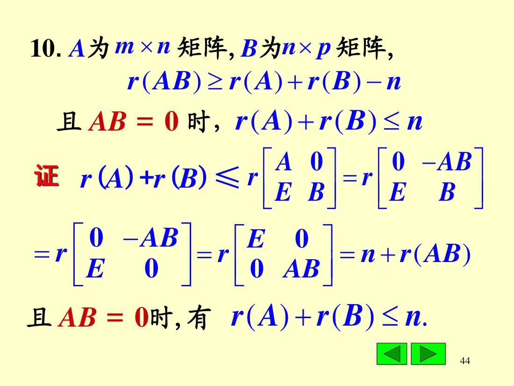

原文：

10. A 为 $m \times n$ 矩阵, B 为 $n \times p$ 矩阵,

$$
\boldsymbol {r} (\boldsymbol {A B}) \geq \boldsymbol {r} (\boldsymbol {A}) + \boldsymbol {r} (\boldsymbol {B}) - \boldsymbol {n}
$$

且 $AB = 0$ 时， $r(A) + r(B) \leq n$

证 $r(A) + r(B) \leqslant r\left[ \begin{array}{cc}A & 0\\ E & B \end{array} \right] = r\left[ \begin{array}{cc}0 & -AB\\ E & B \end{array} \right]$

$$
= r \left[ \begin{array}{c c} \mathbf {0} & - A B \\ E & \mathbf {0} \end{array} \right] = r \left[ \begin{array}{c c} E & \mathbf {0} \\ \mathbf {0} & A B \end{array} \right] = n + r (A B)
$$

且 AB = 0 时, 有 $r(A) + r(B) \leq n$ .

◀ ▶

44

### 例10 若A为n阶矩阵 $(n\geq2)$ ，则

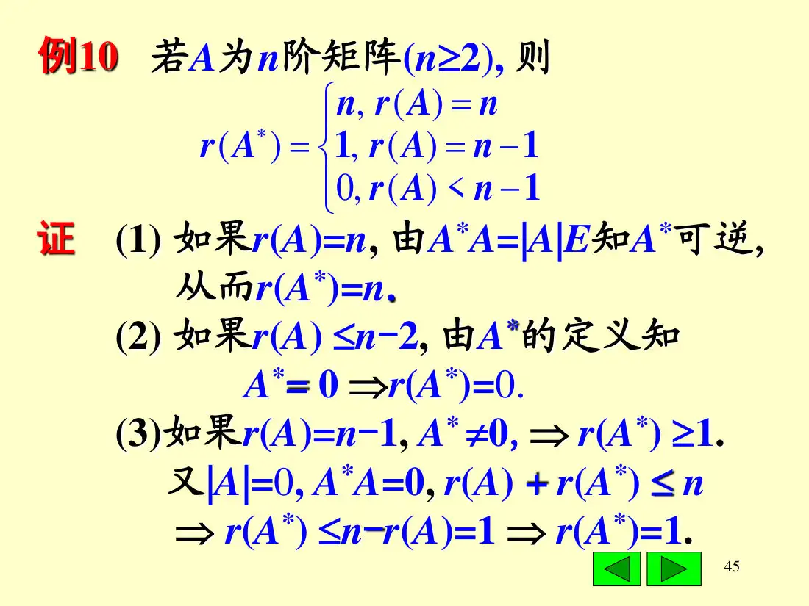

原文：

例10 若A为n阶矩阵 $(n\geq2)$ ，则

$$
r (A ^ {*}) = \left\{ \begin{array}{l} n, r (A) = n \\ 1, r (A) = n - 1 \\ 0, r (A) <   n - 1 \end{array} \right.
$$

证 (1) 如果 $r(A)=n$ ，由 $A^{*}A=|A|E$ 知 $A^{*}$ 可逆，从而 $r(A^{*})=n$ .

(2) 如果 $r(A) \leq n-2$ , 由 $A^{*}$ 的定义知 $A^{*} = 0 \Rightarrow r(A^{*}) = 0$ .

(3)如果 $r(A)=n-1, A^{*}\neq0,\Rightarrow r(A^{*})\geq1.$ 又 $|A|=0, A^{*}A=0, r(A)+r(A^{*})\leq n$ $\Rightarrow r(A^{*})\leq n-r(A)=1\Rightarrow r(A^{*})=1.$

45

### 秩的运算性质 (2)

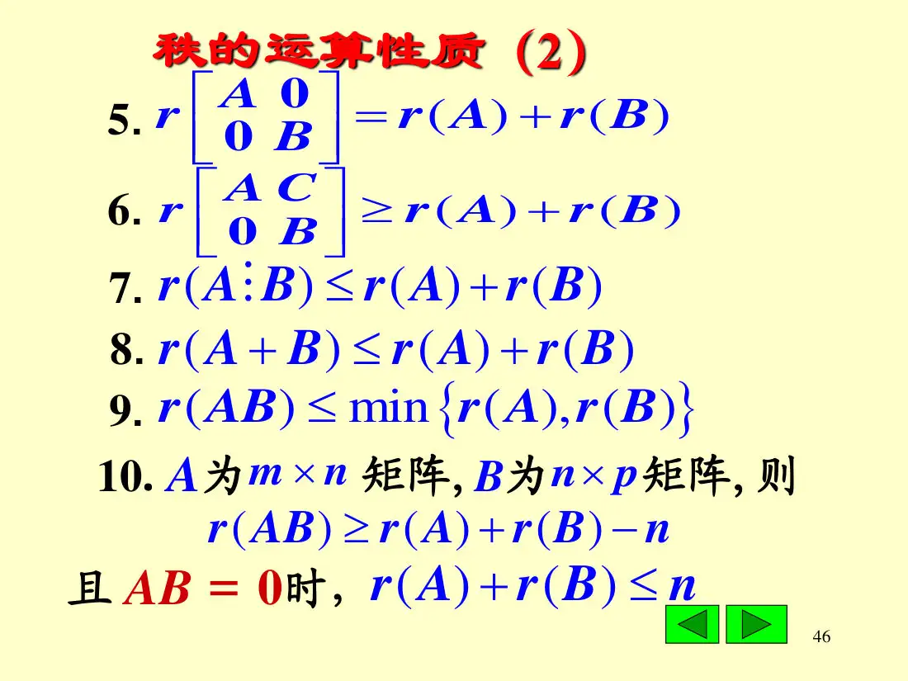

原文：

秩的运算性质 (2)

5. $r\begin{bmatrix}A & 0 \\ 0 & B\end{bmatrix} = r(A) + r(B)$

6. $r\begin{bmatrix}A & C \\ 0 & B\end{bmatrix} \geq r(A) + r(B)$

7. $r(A:B) \leq r(A) + r(B)$

8. $r(A + B) \leq r(A) + r(B)$

9. $r(AB) \leq \min\left\{r(A), r(B)\right\}$

10. A 为 $m \times n$ 矩阵, B 为 $n \times p$ 矩阵, 则 $r(AB) \geq r(A) + r(B) - n$ 且 AB = 0 时， $r(A) + r(B) \leq n$

46

### 解1 B为可逆阵, 则可写成初等阵之积,

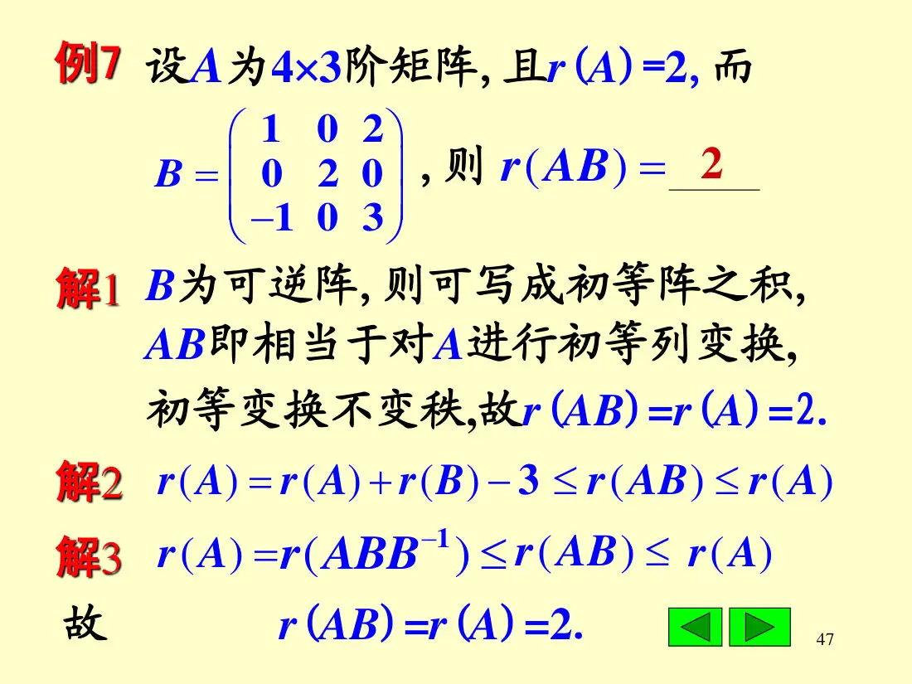

原文：

例7 设A为4×3阶矩阵, 且 $r(A)=2$ , 而 $B=\begin{pmatrix}1&0&2\\0&2&0\\-1&0&3\end{pmatrix}$ ，则 $r(AB)=2$

解1 B为可逆阵, 则可写成初等阵之积,
AB即相当于对A进行初等列变换,
初等变换不变秩,故 $r(AB)=r(A)=2$ .

解2 $r(A) = r(A) + r(B) - 3 \leq r(AB) \leq r(A)$ 解3 $r(A) = r(ABB^{-1}) \leq r(AB) \leq r(A)$ 故 $r(AB) = r(A) = 2.$

### 证明秩的等式

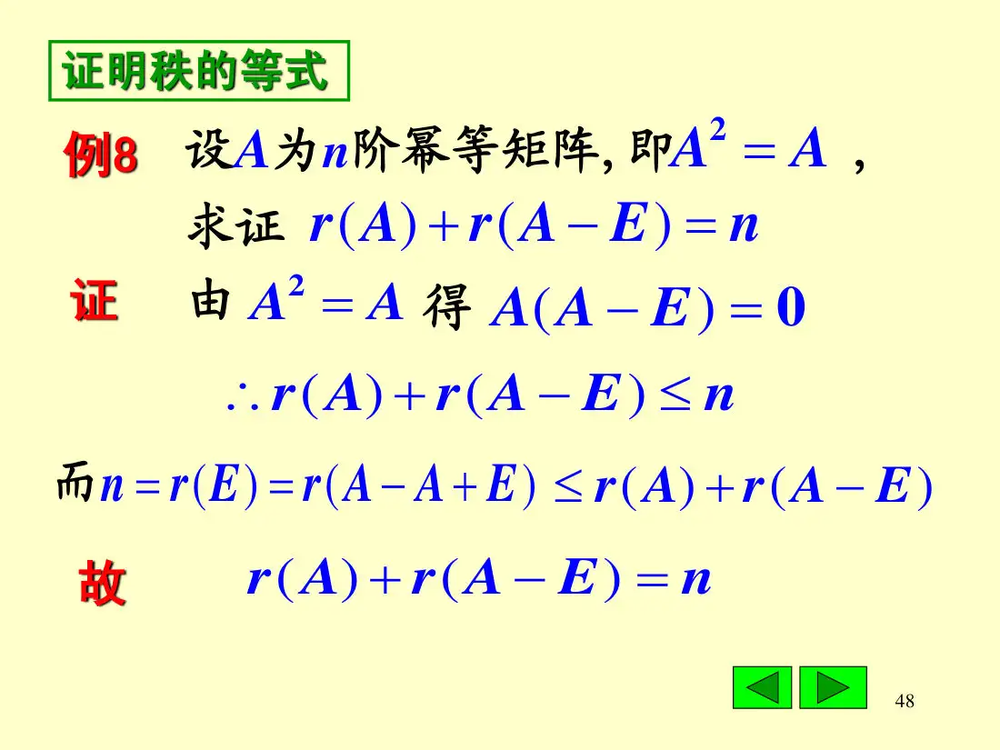

原文：

证明秩的等式

例8 设A为n阶幂等矩阵, 即 $A^{2}=A$ ,

求证 $r(A) + r(A - E) = n$

证 由 $A^2 = A$ 得 $A(A - E) = 0$

$$
\therefore r (A) + r (A - E) \leq n
$$

$$
\text {而} \boldsymbol {n} = \boldsymbol {r} (\boldsymbol {E}) = \boldsymbol {r} (\boldsymbol {A} - \boldsymbol {A} + \boldsymbol {E}) \leq \boldsymbol {r} (\boldsymbol {A}) + \boldsymbol {r} (\boldsymbol {A} - \boldsymbol {E})
$$

故 $r(A) + r(A - E) = n$

◀

48

### 关于伴随

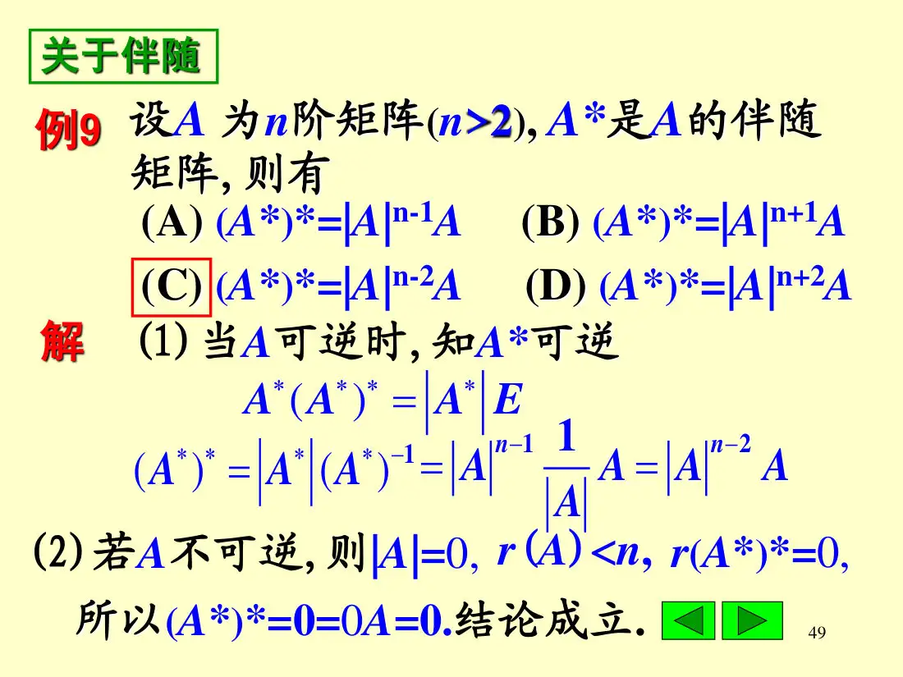

原文：

关于伴随

例9 设A为n阶矩阵(n>2), A\*是A的伴随矩阵, 则有
(A) (A\*)\*=|A|^{n-1}A (B) (A\*)\*=|A|^{n+1}A
(C) (A\*)\*=|A|^{n-2}A (D) (A\*)\*=|A|^{n+2}A

解 (1) 当 $A$ 可逆时, 知 $A^{*}$ 可逆 $\mathbf{A}^{*}(\mathbf{A}^{*})^{*} = |\mathbf{A}^{*}| \mathbf{E}$ $(A^{*})^{*} = |A^{*}| (A^{*})^{-1} = |A|^{n-1} \frac{1}{|A|} A = |A|^{n-2} A$ (2) 若 A 不可逆, 则 $|A|=0$ , $r(A)'<n$ , $r(A^{*})^{*}=0$ ,
所以 $(A^{*})^{*}=0=0A=0$ . 结论成立. ▶ ▶ 49

### $$

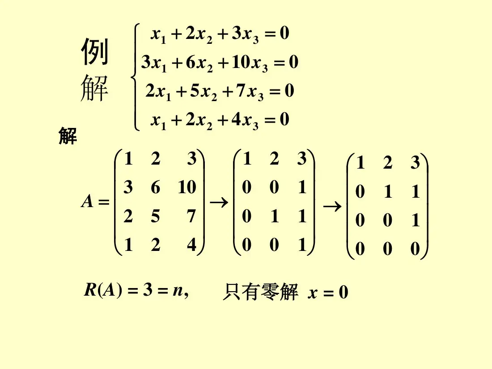

原文：

例

解

$$
\left\{ \begin{array}{l} x _ {1} + 2 x _ {2} + 3 x _ {3} = 0 \\ 3 x _ {1} + 6 x _ {2} + 1 0 x _ {3} = 0 \\ 2 x _ {1} + 5 x _ {2} + 7 x _ {3} = 0 \\ x _ {1} + 2 x _ {2} + 4 x _ {3} = 0 \end{array} \right.
$$

解

$$
A = \left(\begin{array}{c c c}1&2&3\\3&6&1 0\\2&5&7\\1&2&4\end{array}\right)\rightarrow \left(\begin{array}{c c c}1&2&3\\0&0&1\\0&1&1\\0&0&1\end{array}\right)\rightarrow \left(\begin{array}{c c c}1&2&3\\0&1&1\\0&0&1\\0&0&0\end{array}\right)
$$

$R(A) = 3 = n,$ 只有零解 $x = 0$

### 例解

原文：

例解

$$
\left\{ \begin{array}{l l} x _ {1} + 2 x _ {2} + 3 x _ {3} - x _ {4} = 0 \\ x _ {1} + 4 x _ {2} + 4 x _ {3} + 3 x _ {4} = 0 \\ 2 x _ {1} + 4 x _ {2} + 6 x _ {3} + 4 x _ {4} = 0 \\ - x _ {1} - 2 x _ {2} - 3 x _ {3} + 4 x _ {4} = 0 \end{array} \right.
$$

解

$$
A = \left(\begin{array}{c c c c}1&2&3&- 1\\1&4&4&3\\2&4&6&4\\- 1&- 2&- 3&4\end{array}\right)\rightarrow \left(\begin{array}{c c c c}1&2&3&- 1\\0&2&1&4\\0&0&0&6\\0&0&0&3\end{array}\right)\rightarrow \left(\begin{array}{c c c c}1&2&3&- 1\\0&2&1&4\\0&0&0&6\\0&0&0&0\end{array}\right)
$$

$$
\rightarrow \left(\begin{array}{c c c c}1&0&2&- 5\\0&1&\frac {1}{2}&2\\0&0&0&1\\0&0&0&0\end{array}\right)\rightarrow \left(\begin{array}{c c c c}1&0&2&0\\0&1&\frac {1}{2}&0\\0&0&0&1\\0&0&0&0\end{array}\right)
$$

### 第 52 页

原文：

得同解方程组 $\left\{\begin{aligned}x_{1}&=-2x_{3}\\ x_{2}&=-\frac{1}{2}x_{3}\\ &x_{4}&=0\end{aligned}\right.$ ( $x_{3}$ 为自由未知量)

基础解系为 $\xi=\left(\begin{matrix}-2\\-\frac{1}{2}\\1\\0\end{matrix}\right),$ 方程组通解为 $x=k\xi=k\left(\begin{matrix}-2\\-\frac{1}{2}\\1\\0\end{matrix}\right), k\in\mathbb{R}.$

### $$

原文：

设 $\xi=(a_{1},a_{2},\cdots,a_{n})^{\mathrm{T}}$ 是 AX=0 的任一解,

下证 $\xi_{1},\xi_{2},\cdots,\xi_{n-r},\xi$ 线性相关.

令 $B=(\xi_{1},\xi_{2},\cdots,\xi_{n-r},\xi)$ ，则

$$
\begin{array}{c} A B = (A \xi_ {1}, A \xi_ {2}, \dots , A \xi_ {n - r}, A \xi) = 0 \\ r (B) \leq n - r (A) <   n - r + 1 \end{array}
$$

所以 $\xi_{1},\xi_{2},\cdots,\xi_{n-r},\xi$ 线性相关,

于是 $\xi$ 可由 $\xi_1, \xi_2, \dots, \xi_{n-r}$ 线性表示.

所以 $\xi_{1},\xi_{2},\cdots,\xi_{n-r}$ 是 S 的一个基，

即 $\dim(S)=\quad n-r(A)=n-r.$

◀ ▶

53

### 5.2 非齐次线性方程组

原文：

5.2 非齐次线性方程组

◀ ▶

54

### 5.2.1 非齐次线性方程组的表示形式

原文：

5.2.1 非齐次线性方程组的表示形式

(1)一般形式:

$$
\left\{ \begin{array}{l} a _ {1 1} x _ {1} + a _ {1 2} x _ {2} + \dots + a _ {1 n} x _ {n} = b _ {1} \\ a _ {2 1} x _ {1} + a _ {2 2} x _ {2} + \dots + a _ {2 n} x _ {n} = b _ {2} \\ \dots \quad \dots \quad \dots \quad \dots \quad \dots \quad \dots \\ a _ {m 1} x _ {1} + a _ {m 2} x _ {2} + \dots + a _ {m n} x _ {n} = b _ {m} \end{array} \right.
$$

(2) AX = 0 称为 AX = b 的对应的齐次方

$$
\begin{array}{l} \text {程组} \\ : A X = b \end{array}
$$

(3) 矩阵形式: $AX = b$

其中 $A=(a_{ij})_{m\times n},X=(x_{1},x_{2},\cdots,x_{n})^{\mathrm{T}}$

$$
\boldsymbol {b} = (b _ {1}, b _ {2}, \dots , b _ {m}) ^ {\mathrm{T}}
$$

增广矩阵: (A b)

◀ ▶

55

### (4) 向量形式:

原文：

(4) 向量形式:

$$
x _ {1} \boldsymbol {\alpha} _ {1} + x _ {2} \boldsymbol {\alpha} _ {2} + \dots + x _ {n} \boldsymbol {\alpha} _ {n} = (\boldsymbol {\alpha} _ {1}, \boldsymbol {\alpha} _ {2}, \dots , \boldsymbol {\alpha} _ {n}) \left[ \begin{array}{c} x _ {1} \\ x _ {2} \\ \vdots \\ x _ {n} \end{array} \right] = \boldsymbol {b}
$$

$$
\boldsymbol {\alpha} _ {j} = \left[ \begin{array}{c} a _ {1 j} \\ a _ {2 j} \\ \vdots \\ a _ {m j} \end{array} \right], j = 1, 2, \dots , n, \boldsymbol {b} = \left[ \begin{array}{c} b _ {1} \\ b _ {2} \\ \vdots \\ b _ {m} \end{array} \right]
$$

◀ ▶

56

### 非齐次线性方程组的内容

原文：

非齐次线性方程组的内容

方程组有解的条件;

有唯一解、无穷多解的条件；

解的性质及解集合的结构;

求解方法。

◀ ▶

57

### 5.2.2 非齐次线性方程组有解的条件

原文：

5.2.2 非齐次线性方程组有解的条件

AX=b 有解

$\Leftrightarrow x_{1}\alpha_{1} + x_{2}\alpha_{2} + \ldots +x_{n}\alpha_{n} = b$ 有解

$\Leftrightarrow b$ 可由 $A$ 的列向量 $\alpha_{1},\alpha_{2},\ldots ,\alpha_{n}$ 线性表示

$\Leftrightarrow \alpha_{1},\alpha_{2},\ldots ,\alpha_{\mathrm{n}}$ 与 $\alpha_{1},\alpha_{2},\ldots ,\alpha_{\mathrm{n}},b$ 等价

$\Leftrightarrow r(\alpha_{1},\alpha_{2},\dots,\alpha_{n}) = r(\alpha_{1},\alpha_{2},\dots,\alpha_{n},b)$

$\Leftrightarrow r(A) = r(A:b)$ 得出定理

定理5.4 方程组 AX=b 有解 $\Leftrightarrow r(A)=r(A:b)$ 注 当 $r(A)<r(A:b)$ 方程组 AX=b 无解。

◀ ▶

58

### 5.2.3 非齐次方程组解的性质及结构

原文：

5.2.3 非齐次方程组解的性质及结构

问 ● 若解不唯一, 这些解具有哪些性质?

题 • 解集合的整体结构如何?

性质1 若 $\eta_{1}, \eta_{2}$ 是 AX=b 的解, $A\eta_{1}=b, A\eta_{2}=b$ $\Rightarrow A(\eta_{1}-\eta_{2})=A\eta_{1}-A\eta_{2}=b-b=0$ $\therefore \eta_{1}-\eta_{2}$ 是 AX=0 的解.

性质2 若 $\xi$ 是 $AX = 0$ 的解, $\eta$ 是 $AX = b$ 的解

$$
\Rightarrow A (\xi + \eta) = A \xi + A \eta = 0 + b = b
$$

∴ $\xi + \eta$ 是 AX = b 的解.

注 非齐次方程组有解的条件下,有两种情况

59

### 定理5.5

原文：

定理5.5

(1) AX = b 有唯一解 $\Leftrightarrow r(A) = r(A:b) = n.$

(2) AX=b 有无穷多解 $\Leftrightarrow r(A)=r(A:b)<n,$

证 (1) $\Longrightarrow$ AX = b 有解, 所以 $r(A) = r(A:b)$

又因为(1)的解唯一,由性质2知(2)有唯一零解,所以 $r(A)=n$ ,即 $r(A)=r(A:b)=n$ .

因为 $r(A)=r(A:b)$ 所以(1)有解,若有两个以上不同的解,则由性质1知(2)有非零解,这与 $r(A)=n$ 矛盾.故(1)只有唯一解.

◀ ▶

### (1)有无穷多解.

原文：

(2) $\Rightarrow AX = b$ 有解, 所以 $r(A) = r(A:b)$

又因为(1)有无穷多解,由性质2知(2)有非零解,所以 $r(A)<n$ ,即 $r(A)=r(A:b)<n$ .

因为 $r(A)=r(A:b)$ 所以(1)有解,又因为 $r(A)<n$ , 所以(2)有无穷多解, 由性质2知

(1)有无穷多解.

注 当A为方阵时AX=b有唯一解 $\Leftrightarrow|A|\neq0.$

◀ ▶

61

### 1. AX = b 与 PAX = Pb 是同解方程组.

原文：

求 AX = b 的解 $A_{m \times n}$ , $r(A) = r$

1. AX = b 与 PAX = Pb 是同解方程组.

其中 $P$ 为可逆矩阵.

2. 用初等行变换求解不妨设前r列线性无关

$$
(A: b) \xrightarrow {\text {行}} \left[ \begin{array}{c c c c c c} c _ {1 1} & c _ {1 2} & \dots & c _ {1 r} & \dots & c _ {1 n} & d _ {1} \\ & c _ {2 2} & \dots & c _ {2 r} & \dots & c _ {2 n} & d _ {2} \\ & & \ddots & \vdots & & \vdots & \vdots \\ & & & c _ {r r} & \dots & c _ {r n} & d _ {r} \\ & & & & & & d _ {r + 1} \\ & & & & & & 0 \\ & & & & & & \vdots \\ & & & & & & 0 \end{array} \right] _ {(增 广 矩 阵)}
$$

62

### (1) $d_{r+1} \neq 0$ 时, 原方程组无解.

原文：

其中 $c_{ii} \neq 0 (i = 1, 2, \cdots, r)$ ，所以知

(1) $d_{r+1} \neq 0$ 时, 原方程组无解.

(2) $d_{r+1}=0,r=n$ 时,原方程组有唯一解.

(3) $d_{r+1}=0,r<n$ 时,原方程组有无穷多解.

通解为 $X = \eta^{*} + k_{1}\xi_{1} + k_{2}\xi_{2} + \cdots + k_{n-r}\xi_{n-r}$ $\xi_{1}, \xi_{2}, \cdots, \xi_{n-r}$ 为(2)的基础解系， $\eta^{*}$ 为(1)的特解， $k_{1}, k_{2}, \cdots, k_{n-r}$ 为任意常数。

◀ ▶

63

### 非齐次线性方程组解的结构定理：

原文：

为了求 $Ax = b$ 的通解（全部解），只需求其一个特解 $\eta_0$ ，以及其对应的齐次方程组的全部解即可：

非齐次线性方程组解的结构定理：

设 $\eta_0$ 为 $Ax = b$ 的一个特解， $\xi_1, \xi_2, \ldots, \xi_{n - r}$ 为其其对应的齐次方程组的基础解系，则 $Ax = b$ 的通解为

$$
x = \eta_ {0} + k _ {1} \xi_ {1} + \ldots + k _ {n - r} \xi_ {n - r}, k _ {1}, \ldots , k _ {n - r} \in \mathbf {R}
$$

### 例 求下列方程组的通解

原文：

例 求下列方程组的通解

$$
\left\{ \begin{array}{l l} x _ {1} + x _ {2} + x _ {3} + x _ {4} + x _ {5} = 1 \\ 3 x _ {1} + 2 x _ {2} + x _ {3} + x _ {4} - 3 x _ {5} = 0 \\ 5 x _ {1} + 4 x _ {2} + 3 x _ {3} + 3 x _ {4} - x _ {5} = 2 \end{array} \right.
$$

解 用初等行变换化增广矩阵为行最简形

$$
\begin{array}{r l}&{\left(A: b\right) = \left[\begin{array}{l l l l l l}{1}&{1}&{1}&{1}&{1}&{1}\\{3}&{2}&{1}&{1}&{- 3}&{0}\\{5}&{4}&{3}&{3}&{- 1}&{2}\end{array}\right]\rightarrow \left[\begin{array}{l l l l l l}{1}&{1}&{1}&{1}&{1}&{1}\\{\overline {{{0}}}}&{\underline {{{1}}}}&{2}&{2}&{6}&{3}\\{0}&{0}&{0}&{0}&{0}&{0}\end{array}\right]}\\&{\rightarrow \left[\begin{array}{l l l l l l}{1}&{0}&{- 1}&{- 1}&{- 5}&{- 2}\\{0}&{1}&{2}&{2}&{6}&{3}\\{0}&{0}&{0}&{0}&{0}&{0}\end{array}\right] \quad \therefore r (A) = r (A: b) = 2 <   5 \text {故有无穷多解}.}\\&{\boxed {\triangleleft}}\end{array}
$$

### 分别为：

原文：

同解方程组为 $\left\{\begin{aligned}x_{1}&=-2+x_{3}+x_{4}+5x_{5}\\ x_{2}&=3-2x_{3}-2x_{4}-6x_{5}\end{aligned}\right.$ 其对应的齐次方程组有自由未知量 $x_{3}, x_{4}$ ， $x_{5}$ ，在非齐次方程组中，令 $x_{3}=x_{4}=x_{5}=0$ ，求出一个特解： $\eta^{*}=(-2,3,0,0,0)^{\mathrm{T}}$ 其对应的齐次方程组的基础
解系含有5- $\xi_{1}=\begin{bmatrix}1\\ -2\\ 1\\ 0\\ 0\end{bmatrix},\xi_{2}=\begin{bmatrix}1\\ -2\\ 0\\ 1\\ 0\end{bmatrix},\xi_{3}=\begin{bmatrix}5\\ -6\\ 0\\ 0\\ 1\end{bmatrix}$ r(A)=3个解向量，
分别为：

### 原方程组的通解为:

原文：

原方程组的通解为:

$$
\begin{array}{r l} & X = \eta^ {*} + k _ {1} \xi_ {1} + k _ {2} \xi_ {2} + k _ {3} \xi_ {3} \\ & = \left[ \begin{array}{l} - 2 \\ 3 \\ 0 \\ 0 \\ 0 \end{array} \right] + k _ {1} \left[ \begin{array}{l} 1 \\ - 2 \\ 1 \\ 0 \\ 0 \end{array} \right] + k _ {2} \left[ \begin{array}{l} 1 \\ - 2 \\ 0 \\ 1 \\ 0 \end{array} \right] + k _ {3} \left[ \begin{array}{l} 5 \\ - 6 \\ 0 \\ 0 \\ 1 \end{array} \right] \end{array}
$$

$k_{1}, k_{2}, k_{3}$ 为任意常数.

◀ ▶

67

### $$

原文：

例 求解 $\left\{\begin{aligned}x_{1}+x_{2}+x_{3}&=5\\ 3x_{1}+2x_{2}+x_{3}&=13\\ x_{2}+2x_{3}&=2\end{aligned}\right.$

解

$$
(A \mid b) = \left( \begin{array}{c c c c} 1 & 1 & 1 & 5 \\ 3 & 2 & 1 & 1 3 \\ 0 & 1 & 2 & 2 \end{array} \right) \to \left( \begin{array}{c c c c} \mathbf {1} & \mathbf {1} & \mathbf {1} & \mathbf {5} \\ \mathbf {0} & - \mathbf {1} & - \mathbf {2} & - \mathbf {2} \\ \mathbf {0} & \mathbf {0} & \mathbf {0} & \mathbf {0} \end{array} \right) \to \left( \begin{array}{c c c c} \mathbf {1} & \mathbf {0} & - \mathbf {1} & \mathbf {3} \\ \mathbf {0} & \mathbf {1} & \mathbf {2} & \mathbf {2} \\ \mathbf {0} & \mathbf {0} & \mathbf {0} & \mathbf {0} \end{array} \right)
$$

$R(A)=R(\overline{A})=2<n=3,$ 有无穷多解

得同解方程组 $\left\{\begin{aligned}x_{1}&=3+x_{3}\\ x_{2}&=2-2x_{3}\end{aligned}\right.$

### (2)其对应的齐次方程组的基础解系: 取 $x_{3} = 1$ , 得

原文：

得同解方程组 $\left\{\begin{aligned}x_{1}&=3+x_{3}\\ x_{2}&=2-2x_{3}\end{aligned}\right.$ $\Leftrightarrow\left\{\begin{aligned}x_{1}&=3+1\cdot x_{3}\\ x_{2}&=2+(-2)x_{3}\\ x_{3}&=0+1\cdot x_{3}\end{aligned}\right.$

(1) 求非齐次的特解: 取 $x_{3} = 0$ , 得 $\eta_0 = (3, 2, 0)^{\mathrm{T}}$

(2)其对应的齐次方程组的基础解系: 取 $x_{3} = 1$ , 得

$$
\boldsymbol {\xi} = (\mathbf {1}, - \mathbf {2}, \mathbf {1}) ^ {\mathrm{T}}
$$

故 Ax=b 的通解为： $\eta=\begin{pmatrix}3\\2\\0\end{pmatrix}+k\begin{pmatrix}1\\-2\\1\end{pmatrix},\quad k\in R.$

### $$

原文：

例. 设A是 $m \times 3$ 矩阵,且 $R(A) = 1$ .如果非齐次线性方程组Ax = b的三个解向量 $\eta_{1}, \eta_{2}, \eta_{3}$ 满足

$$
\eta_ {1} + \eta_ {2} = \left( \begin{array}{c} 1 \\ 2 \\ 3 \end{array} \right), \eta_ {2} + \eta_ {3} = \left( \begin{array}{c} 0 \\ - 1 \\ 1 \end{array} \right), \eta_ {3} + \eta_ {1} = \left( \begin{array}{c} 1 \\ 0 \\ - 1 \end{array} \right)
$$

求Ax=b的通解.

解 $\because A$ 是 $m \times 3$ 矩阵, $R(A) = 1$ ,

∴ Ax = 0 的基础解系中含有 3 - 1 = 2 个线性无关的解向量.

### $$

原文：

方法1 令 $\eta_{1} + \eta_{2} = a, \eta_{2} + \eta_{3} = b, \eta_{3} + \eta_{1} = c$ ，则

$$
\eta_ {1} = \frac {1}{2} (a + c - b) = \left( \begin{array}{c} 1 \\ 3 / 2 \\ 1 / 2 \end{array} \right),
$$

$$
\eta_ {2} = \frac {1}{2} (a + b - c) = \left( \begin{array}{c} 0 \\ 1 / 2 \\ 5 / 2 \end{array} \right),
$$

$$
\eta_ {3} = \frac {1}{2} (b + c - a) = \left( \begin{array}{c} 0 \\ - 3 / 2 \\ - 3 / 2 \end{array} \right),
$$

### $$

原文：

$$
\eta_ {1} - \eta_ {2} = \left( \begin{array}{c} 1 \\ 1 \\ - 2 \end{array} \right), \quad \eta_ {1} - \eta_ {3} = \left( \begin{array}{c} 1 \\ 3 \\ 2 \end{array} \right)
$$

为Ax=0的一个基础解系.

故Ax=b的通解为

$$
\left( \begin{array}{c} x _ {1} \\ x _ {2} \\ x _ {3} \end{array} \right) = k _ {1} \left( \begin{array}{c} 1 \\ 1 \\ - 2 \end{array} \right) + k _ {2} \left( \begin{array}{c} 1 \\ 3 \\ 2 \end{array} \right) + \left( \begin{array}{c} 1 \\ 3 / 2 \\ 1 / 2 \end{array} \right),
$$

其中 $k_{1},k_{2}$ 为任意实数.

### 方法2（更简单）：

原文：

方法2（更简单）：

$$
\left(\eta_ {1} + \eta_ {2}\right) - \left(\eta_ {2} + \eta_ {3}\right) = \left( \begin{array}{l} 1 \\ 3 \\ 2 \end{array} \right), \quad \left(\eta_ {1} + \eta_ {2}\right) - \left(\eta_ {3} + \eta_ {1}\right) = \left( \begin{array}{l} 0 \\ 2 \\ 4 \end{array} \right),
$$

线性无关，所以为Ax=0的基础解系.

$$
A \left(\frac {1}{2} \left(\eta_ {2} + \eta_ {3}\right)\right) = \frac {1}{2} (b + b) = b,
$$

$\therefore \frac{1}{2} (\eta_2 + \eta_3) = \begin{pmatrix} 0 \\ -1 / 2 \\ 1 / 2 \end{pmatrix}$ 为 $Ax = b$ 的特解.

故通解为 $x = \begin{pmatrix} 0 \\ -1 / 2 \\ 1 / 2 \end{pmatrix} + k_1\begin{pmatrix} 1 \\ 3 \\ 2 \end{pmatrix} + k_2\begin{pmatrix} 0 \\ 2 \\ 4 \end{pmatrix}, k_1, k_2 \in R.$

### 例 解

原文：

例 解

解法（一）

$$
\left\{ \begin{array}{l} \lambda x _ {1} + x _ {2} + x _ {3} = 1 \\ x _ {1} + \lambda x _ {2} + x _ {3} = \lambda \\ x _ {1} + x _ {2} + \lambda x _ {3} = \lambda^ {2} \end{array} \right.
$$

$$
b) = \left( \begin{array}{c c c c} \lambda & 1 & 1 & 1 \\ 1 & \lambda & 1 & \lambda \\ 1 & 1 & \lambda & \lambda^ {2} \end{array} \right) \to \left( \begin{array}{c c c c} \mathbf {1} & \mathbf {1} & \lambda & \lambda^ {2} \\ \mathbf {1} & \lambda & \mathbf {1} & \lambda \\ \lambda & \mathbf {1} & \mathbf {1} & \mathbf {1} \end{array} \right)
$$

$$
\rightarrow \left(\begin{array}{c c c c}\mathbf {1}&\mathbf {1}&\lambda&\lambda^ {2}\\\mathbf {0}&\lambda - \mathbf {1}&\mathbf {1} - \lambda&\lambda (\mathbf {1} - \lambda)\\\mathbf {0}&\mathbf {1} - \lambda&\mathbf {1} - \lambda^ {2}&\mathbf {1} - \lambda^ {3}\end{array}\right)
$$

### $$

原文：

$$
\rightarrow \left(\begin{array}{c c c c}\mathbf {1}&\mathbf {1}&\lambda&\lambda^ {2}\\\mathbf {0}&\lambda - \mathbf {1}&\mathbf {1} - \lambda&\lambda (\mathbf {1} - \lambda)\\\mathbf {0}&\mathbf {1} - \lambda&\mathbf {1} - \lambda^ {2}&\mathbf {1} - \lambda^ {3}\end{array}\right)
$$

$$
\rightarrow \left(\begin{array}{c c c c}\mathbf {1}&\mathbf {1}&\lambda&\lambda^ {2}\\\mathbf {0}&\lambda - \mathbf {1}&\mathbf {1} - \lambda&\lambda (\mathbf {1} - \lambda)\\\mathbf {0}&\mathbf {0}&2 - \lambda - \lambda^ {2}&\mathbf {1} - \lambda^ {2} + \lambda - \lambda^ {3}\end{array}\right)
$$

$$
\rightarrow \left(\begin{array}{c c c c}\mathbf {1}&\mathbf {1}&\lambda&\lambda^ {2}\\\mathbf {0}&\lambda - \mathbf {1}&\mathbf {1} - \lambda&\lambda (\mathbf {1} - \lambda)\\\mathbf {0}&\mathbf {0}&(\mathbf {1} - \lambda) (\lambda + \mathbf {2})&(\mathbf {1} + \lambda) ^ {2} (\mathbf {1} - \lambda)\end{array}\right)
$$

### $$

原文：

(1) $\lambda = 1$ 时, $R(A) = R(A \mid b) = 1 < n = 3$ , 有无穷多解 $(A \mid b) \to \begin{pmatrix} 1 & 1 & 1 & 1 \\ 0 & 0 & 0 & 0 \\ 0 & 0 & 0 & 0 \end{pmatrix}$ 得同解方程组 $x_{1} = 1 - x_{2} - x_{3}$ 非齐次特解: $\eta_{0} = (1, 0, 0)^{\mathrm{T}}$ 其对应的齐次方程组基础解系:

$$
\boldsymbol {\xi} _ {1} = (- \mathbf {1}, \mathbf {1}, \mathbf {0}) ^ {\mathrm{T}}, \quad \boldsymbol {\xi} _ {2} = (- \mathbf {1}, \mathbf {0}, \mathbf {1}) ^ {\mathrm{T}}
$$

原方程组通解:

$$
x = \eta_ {0} + k _ {1} \xi_ {1} + k _ {2} \xi_ {2}, k _ {1}, k _ {2} \in \mathbf {R}
$$

### $$

原文：

(2) $\lambda = -2$ 时， $R(A) = 2 \neq R(A \mid b) = 3,$ 无解

(3) $\lambda \neq 1, -2$ 时， $R(A) = R(A \mid b) = 3 = n$ ，有惟一解：

$$
\left\{ \begin{array}{l} x _ {1} = \frac {- \lambda - 1}{\lambda + 2} \\ x _ {2} = \frac {1}{\lambda + 2} \\ x _ {3} = \frac {(\lambda + 1) ^ {2}}{\lambda + 2} \end{array} \right.,
$$

即

$$
\left( \begin{array}{c} x _ {1} \\ x _ {2} \\ x _ {3} \end{array} \right) = \left( \begin{array}{c} \frac {- \lambda - 1}{\lambda + 2} \\ \frac {1}{\lambda + 2} \\ \frac {(\lambda + 1) ^ {2}}{\lambda + 2} \end{array} \right).
$$

### $$

原文：

例解 $\left\{ \begin{array}{l}\lambda x_1 + x_2 + x_3 = 1\\ x_1 + \lambda x_2 + x_3 = \lambda \\ x_1 + x_2 + \lambda x_3 = \lambda^2 \end{array} \right.$ 解法（二） $A = \left( \begin{array}{lll}\lambda & 1 & 1\\ 1 & \lambda & 1\\ 1 & 1 & \lambda \end{array} \right)\Rightarrow |A| = (\lambda -1)^2 (\lambda +2)$

(1) 当 $\lambda \neq 1$ 且 $\lambda \neq -2$ 时, $|A| \neq 0$ , A 可逆, 方程有唯一解;

$$
\left\{ \begin{array}{l} x _ {1} = \frac {- \lambda - 1}{\lambda + 2} \\ x _ {2} = \frac {1}{\lambda + 2} \\ x _ {3} = \frac {(\lambda + 1) ^ {2}}{\lambda + 2} \end{array} \right.,
$$

即

$$
\left( \begin{array}{c} x _ {1} \\ x _ {2} \\ x _ {3} \end{array} \right) = \left( \begin{array}{c} \frac {- \lambda - 1}{\lambda + 2} \\ \frac {1}{\lambda + 2} \\ \frac {(\lambda + 1) ^ {2}}{\lambda + 2} \end{array} \right).
$$

### 得同解方程组： $x_{1} = 1 - x_{2} - x_{3}$

原文：

(2) 当 $\lambda = 1$ 时, $(A \mid b) = \begin{pmatrix} 1 & 1 & 1 & 1 \\ 1 & 1 & 1 & 1 \\ 1 & 1 & 1 & 1 \end{pmatrix} \to \begin{pmatrix} 1 & 1 & 1 & 1 \\ 0 & 0 & 0 & 0 \\ 0 & 0 & 0 & 0 \end{pmatrix}$

$R(A) = R(A \mid b) = 1 < n = 3$ , 方程有无穷多解;

得同解方程组： $x_{1} = 1 - x_{2} - x_{3}$

非齐次特解: $\eta_0 = (1, 0, 0)^{\mathrm{T}}$

其对应的齐次方程组基础解系:

$$
\boldsymbol {\xi} _ {1} = (- \mathbf {1}, \mathbf {1}, \mathbf {0}) ^ {\mathrm{T}}, \quad \boldsymbol {\xi} _ {2} = (- \mathbf {1}, \mathbf {0}, \mathbf {1}) ^ {\mathrm{T}}
$$

原方程组通解:

$$
\boldsymbol {x} = \eta_ {0} + k _ {1} \xi_ {1} + k _ {2} \xi_ {2}, k _ {1}, k _ {2} \in \mathbf {R}
$$

### (3) 当 $\lambda = -2$ 时,

原文：

(3) 当 $\lambda = -2$ 时,

$$
(A \mid b) = \left(\begin{array}{c c c c}- 2&1&1&1\\1&- 2&1&- 2\\1&1&- 2&4\end{array}\right)\rightarrow \left(\begin{array}{c c c c}1&1&- 2&4\\1&- 2&1&- 2\\- 2&1&1&1\end{array}\right)
$$

$$
\rightarrow \left(\begin{array}{c c c c}1&1&- 2&4\\0&- 3&3&- 6\\0&3&- 3&9\end{array}\right)\rightarrow \left(\begin{array}{c c c c}1&1&- 2&4\\0&- 3&3&- 6\\0&0&0&3\end{array}\right)
$$

$R(A) = 2 \neq R(A \mid b) = 3,$ 无解

### 例1 已知

原文：

例1 已知

$$
\boldsymbol {\alpha} _ {1} = \left[ \begin{array}{l} 1 \\ 0 \\ 2 \\ 3 \end{array} \right], \boldsymbol {\alpha} _ {2} = \left[ \begin{array}{l} 1 \\ 1 \\ 3 \\ 5 \end{array} \right], \boldsymbol {\alpha} _ {3} = \left[ \begin{array}{l} 1 \\ - 1 \\ a \\ 1 \end{array} \right], \boldsymbol {\beta} = \left[ \begin{array}{l} 1 \\ b \\ 4 \\ 7 \end{array} \right]
$$

(1) a,b 为何值时, $\beta$ 不能表为 $\alpha_{1},\alpha_{2},\alpha_{3}$ 的线性组合.

(2) a,b 为何值时, $\beta$ 可唯一表为 $\alpha_{1},\alpha_{2},\alpha_{3}$ 的线性组合.

◀ ▶

81

### 线性表示时写出表达式。

原文：

(3) a,b 为何值时, $\beta$ 能够由 $\alpha_{1},\alpha_{2},\alpha_{3}$ 线性表出，但表示法不唯一？在可
线性表示时写出表达式。

82

### ◀ ▶

原文：

解 (1) $\beta$ 不能表为 $\alpha_{1},\alpha_{2},\alpha_{3}$ 的线性组合 $x_{1}\alpha_{1} + x_{2}\alpha_{2} + x_{3}\alpha_{3} = \beta$ 无解.

(2) $\beta$ 可唯一表为 $\alpha_{1},\alpha_{2},\alpha_{3}$ 的线性组合 $x_{1}\alpha_{1} + x_{2}\alpha_{2} + x_{3}\alpha_{3} = \beta$ 有唯一解.

(3) $\beta$ 能够由 $\alpha_{1}, \alpha_{2}, \alpha_{3}$ 线性表示，但表示法不唯一

$x_{1}\alpha_{1} + x_{2}\alpha_{2} + x_{3}\alpha_{3} = \beta$ 有无穷多解.

◀ ▶

83

### 84

原文：

即: $\beta$ 是否可由 $\alpha_{1},\alpha_{2},\alpha_{3}$ 线性表示 $\Leftrightarrow$ 是否存在 $x_{1},x_{2},x_{3}$ , 使得 $x_{1}\alpha_{1} + x_{2}\alpha_{2} + x_{3}\alpha_{3} = \beta$ $\Leftrightarrow$ 线性方程组 $x_{1}\alpha_{1} + x_{2}\alpha_{2} + x_{3}\alpha_{3} = \beta$ 何时无解, 有唯一解, 无穷多解?

84

### $$

原文：

$$
\begin{array}{l}\mathrm{B} = (A: \beta) =\\(\alpha_ {1}, \alpha_ {2}, \alpha_ {3}: \beta) = \left[\begin{array}{c c c c}1&1&1&1\\0&1&- 1&b\\2&3&a&4\\3&5&1&7\end{array}\right]\rightarrow \left[\begin{array}{c c c c}1&1&1&1\\0&1&- 1&b\\0&1&a - 2&2\\0&2&- 2&4\end{array}\right]\end{array}
$$

$$
\rightarrow \left[\begin{array}{c c c c}1&1&1&1\\0&1&- 1&b\\0&0&a - 1&2 - b\\0&0&0&4 - 2 b\end{array}\right]\rightarrow \left[\begin{array}{c c c c}1&0&2&1 - b\\0&1&- 1&b\\0&0&a - 1&2 - b\\0&0&0&4 - 2 b\end{array}\right]
$$

85

### ◀ △

原文：

(1)当 $b \neq 2, a \neq 1$ 时, $\mathbf{r}(\mathbf{A}) = 3$ , $\mathbf{r}(\mathbf{B}) = 4$ , 方程组无解, 此时, $\beta$ 不能表为 $\alpha_{1}, \alpha_{2}, \alpha_{3}$ 的线性组合

当 $b \neq 2, a = 1$ 时, $\mathbf{r}(\mathbf{A}) = 2$ , $\mathbf{r}(\mathbf{B}) = 3$ , 方程组无解, 此时, $\beta$ 不能表为 $\alpha_{1}, \alpha_{2}, \alpha_{3}$ 的线性组合

◀ △

86

### $$

原文：

(2)当 $b=2, a \neq 1$ 时, $\mathbf{r}(\mathbf{A}=\mathbf{r}(\mathbf{B})=3,$ 方程组有唯一解，

$x=(x_{1},x_{2},x_{3})^{T}=(-1,2,0)^{T}$ 此时， $\beta$ 能够由 $\alpha_{1},\alpha_{2},\alpha_{3}$ 唯一线性表出，其表示式为

$$
\beta = - \alpha_ {1} + 2 \alpha_ {2}
$$

◀ ▶

87

### (3)当 b=2, a=1 时, r(A)=r(B)=2,

原文：

(3)当 b=2, a=1 时, r(A)=r(B)=2,
方程组有无穷多组解, $x=(x_{1},x_{2},x_{3})^{T}=(-1,2,0)^{T}+k(-2,1,1)^{T}$ 此时， $\beta$ 能够由 $\alpha_{1},\alpha_{2},\alpha_{3}$ 线性表出，
但表示法不唯一，其所有表示式为 $=(-2k\beta1)\alpha_{1}+(k+2)\alpha_{2}+k\alpha_{3}$

◀

88

### ◀ ▶

原文：

例 已知 $\eta_{1},\eta_{2}$ 为 $AX=\beta$ 的两个不同解， $\xi_{1},\xi_{2}$ 为 AX=0 的基础解系， $k_{1},k_{2}$ 是两个任意常数，则 $AX=\beta$ 的通解为：

$\frac{(A)k_{1}\xi_{1}+k_{2}(\xi_{1}+\xi_{2})+\frac{\eta_{1}-\eta_{2}}{2}.}{(B)k_{1}\xi_{1}+k_{2}(\xi_{1}-\xi_{2})+\frac{\eta_{1}+\eta_{2}}{2}.}$ $\frac{(C)k_{1}\xi_{1}+k_{2}(\eta_{1}+\eta_{2})+\frac{\eta_{1}-\eta_{2}}{2}.}{(D)k_{1}\xi_{1}+k_{2}(\eta_{1}-\eta_{2})+\frac{\eta_{1}+\eta_{2}}{2}.}$ 例 设 $X_{1},X_{2},\ldots,X_{t}$ 是非齐次线性方程组 $AX=b\neq0$ 的解向量,证明

◀ ▶

89

### $$

原文：

$$
X _ {0} = k _ {1} X _ {1} + k _ {2} X _ {2} + \dots + k _ {t} X _ {t}
$$

当 $k_{1}+k_{2}+\ldots+k_{t}=1$ 时, 是AX=b的解.

当 $k_{1}+k_{2}+\ldots+k_{t}=0$ 时，是AX=0的解.

证 $AX_{0} = A(k_{1}X_{1} + k_{2}X_{2} + \ldots +k_{t}X_{t})$ $= k_{1}AX_{1} + k_{2}AX_{2} + \ldots +k_{t}AX_{t}$ $= k_{1}b + k_{2}b + \ldots +k_{t}b = (k_{1} + k_{2} + \ldots +k_{t})b$

故 当 $k_{1}+k_{2}+\ldots+k_{t}=1$ 时, $AX_{0}=b$

当 $k_{1} + k_{2} + \ldots +k_{t} = 0$ 时， $AX_0 = 0$ 由此可见,非齐次方程组的解对于线性组合并不一定封闭,只有组合系数的和等于1的时候,解向量组的线性组合才是解!

◀ ▶

### $$

原文：

例 设A是4阶方阵, $\beta(\neq0)$ 是 $4\times1$ 矩阵, $r(A)=2,\eta_{1},\eta_{2},\eta_{3},\eta_{4}$ 是AX= $\beta$ 的解,且满足

$$
\boldsymbol {\eta} _ {1} + \boldsymbol {\eta} _ {2} = \left[ \begin{array}{c} 2 \\ 4 \\ 0 \\ 8 \end{array} \right], 2 \boldsymbol {\eta} _ {2} + \boldsymbol {\eta} _ {3} = \left[ \begin{array}{c} 3 \\ 0 \\ 3 \\ 3 \end{array} \right], 3 \boldsymbol {\eta} _ {3} + \boldsymbol {\eta} _ {4} = \left[ \begin{array}{c} 2 \\ 1 \\ 0 \\ 1 \end{array} \right]
$$

试求方程组 $AX = \beta$ 的通解.

### 解 先求 $AX = \beta$ 的一个特解

原文：

解 先求 $AX = \beta$ 的一个特解

$$
\eta^ {*} = \frac {1}{2} \left(\eta_ {1} + \eta_ {2}\right) = \left[ \begin{array}{l} 1 \\ 2 \\ 0 \\ 4 \end{array} \right]
$$

再求 AX = 0 的一个基础解系

$$
\begin{array}{r l} & X = 0 \text {的一个基础解系} \\ & \xi_ {1} = \frac {1}{2} (\eta_ {1} + \eta_ {2}) - \frac {1}{3} (2 \eta_ {2} + \eta_ {3}) = \left[ \begin{array}{l} 0 \\ 2 \\ - 1 \\ 3 \end{array} \right] \\ & \xi_ {2} = 2 (\eta_ {1} + \eta_ {2}) - (3 \eta_ {3} + \eta_ {4}) = \left[ \begin{array}{l} 2 \\ 7 \\ 0 \\ 1 5 \end{array} \right] \end{array}
$$

92

### 故 原方程组 $AX = \beta$ 的通解为

原文：

$4-R(A)=2$ , 且 $\xi_{1},\xi_{2}$ 线性无关, 所以 $\xi_{1},\xi_{2}$ AX = 0 的一个基础解系.

故 原方程组 $AX = \beta$ 的通解为

$$
\boldsymbol {X} = \boldsymbol {\eta} ^ {*} + k _ {1} \boldsymbol {\xi} _ {1} + k _ {2} \boldsymbol {\xi} _ {2} = \left[ \begin{array}{l} 1 \\ 2 \\ 0 \\ 4 \end{array} \right] + k _ {1} \left[ \begin{array}{l} 0 \\ 2 \\ - 1 \\ 3 \end{array} \right] + k _ {2} \left[ \begin{array}{l} 2 \\ 7 \\ 0 \\ 1 5 \end{array} \right]
$$

$k_{1}, k_{2}$ 为任意常数.

◀ ▶

93

### 三种形式

原文：

线

三种形式

性

齐次

方

程

非齐次

组

几何应用

有解判定

解的性质解的结构

求解方法

有解判定

解的性质解的结构

求解方法

平面位置关系的判定

◀

94

### 例1 已知

原文：

例1 已知

$$
\boldsymbol {\alpha} _ {1} = \left[ \begin{array}{l} 1 \\ 0 \\ 2 \\ 3 \end{array} \right], \boldsymbol {\alpha} _ {2} = \left[ \begin{array}{l} 1 \\ 1 \\ 3 \\ 5 \end{array} \right], \boldsymbol {\alpha} _ {3} = \left[ \begin{array}{c} 1 \\ - 1 \\ a + 2 \\ 1 \end{array} \right], \boldsymbol {\alpha} _ {4} = \left[ \begin{array}{c} 1 \\ 2 \\ 4 \\ a + 8 \end{array} \right], \boldsymbol {\beta} = \left[ \begin{array}{l} 1 \\ 1 \\ b + 3 \\ 5 \end{array} \right]
$$

(1) a,b 为何值时, $\beta$ 不能表为 $\alpha_{1},\alpha_{2},\alpha_{3},\alpha_{4}$ 的线性组合.

(2) a,b 为何值时, $\beta$ 可唯一表为 $\alpha_{1},\alpha_{2},\alpha_{3},\alpha_{4}$ 的线性组合.

◀ ▶

95

### $$

原文：

解 (1) $\beta$ 不能表为 $\alpha_{1}, \alpha_{2}, \alpha_{3}, \alpha_{4}$ 的线性组合 $\Leftrightarrow x_{1} \alpha_{1} + x_{2} \alpha_{2} + x_{3} \alpha_{3} + x_{4} \alpha_{4} = \beta$ 无解.

(2) $\beta$ 可唯一表为 $\alpha_{1}, \alpha_{2}, \alpha_{3}, \alpha_{4}$ 的线性组合 $\Leftrightarrow x_{1} \alpha_{1} + x_{2} \alpha_{2} + x_{3} \alpha_{3} + x_{4} \alpha_{4} = \beta$ 有唯一解.

$$
(\alpha_ {1}, \alpha_ {2}, \alpha_ {3}, \alpha_ {4} \vdots \beta) = \left[ \begin{array}{c c c c c} 1 & 1 & 1 & 1 & 1 \\ 0 & 1 & - 1 & 2 & 1 \\ 2 & 3 & a + 2 & 4 & b + 3 \\ 3 & 5 & 1 & a + 8 & 5 \end{array} \right]
$$

◀ ▶

96

### $$

原文：

$$
\xrightarrow {\text {行}} \left[ \begin{array}{c c c c c} 1 & 1 & 1 & 1 & 1 \\ 0 & 1 & - 1 & 2 & 1 \\ 0 & 0 & a + 1 & 0 & b \\ 0 & 0 & 0 & a + 1 & 0 \end{array} \right]
$$

(1) 当 $a = -1, b \neq 0$ 时，

$$
r \left(\alpha_ {1}, \alpha_ {2}, \alpha_ {3}, \alpha_ {4}\right) = 2 <   r \left(\alpha_ {1}, \alpha_ {2}, \alpha_ {3}, \alpha_ {4}: \beta\right) = 3
$$

这时 $\beta$ 不能表为 $\alpha_{1},\alpha_{2},\alpha_{3},\alpha_{4}$ 的线性组合.

(2) 当 $a \neq -1, b$ 任意时，

$r(\alpha_{1},\alpha_{2},\alpha_{3},\alpha_{4})=r(\alpha_{1},\alpha_{2},\alpha_{3},\alpha_{4}:\beta)=4$ 这时 $\beta$ 可唯一表为 $\alpha_{1},\alpha_{2},\alpha_{3},\alpha_{4}$ 的线性组合.

◀ ▶

### ◀ ▶

原文：

例2 已知线性方程组 $A_{4 \times 4} X = 0$ 有基础解系 $\xi_1 = (1, 2, -3, 0)^{\mathrm{T}}, \xi_2 = (2, -1, 0, 1)^{\mathrm{T}}, \xi_3 = (1, 0, -2, 1)^{\mathrm{T}}$ 则该方程的一个特解是 $(A)(-1, 5, 3, 7)^{\mathrm{T}}; (B)(0, 4, -9, 1)^{\mathrm{T}};$ $(C)(1, 2, -3, 1)^{\mathrm{T}}; (D)(2, -1, -2, 0)^{\mathrm{T}}.$ 解 设 $\beta_1 = (-1, 5, 3, 7)^{\mathrm{T}}; \beta_2 = (0, 4, -9, 1)^{\mathrm{T}};$ $\beta_3 = (1, 2, -3, 1)^{\mathrm{T}}; \beta_4 = (2, -1, -2, 0)^{\mathrm{T}}.$

◀ ▶

98

### $$

原文：

$$
\begin{array}{r l} & {\left[ \xi_ {1} \xi_ {2 2} \xi_ {3}: \beta_ {1} \beta_ {2} \beta_ {3} \beta_ {4} \right] = \left[ \begin{array}{r r r r r r r} 1 & 2 & 1 & - 1 & 0 & 1 & 2 \\ 2 & - 1 & 0 & 5 & 4 & 2 & - 1 \\ - 3 & 0 & - 2 & 3 & - 9 & - 3 & - 2 \\ 0 & 1 & 1 & 7 & 1 & 1 & 0 \end{array} \right]} \\ & {\xrightarrow {\text {行}} \left[ \begin{array}{r r r r r r r} 1 & 2 & 1 & - 1 & 0 & 1 & 2 \\ 0 & 1 & - 1 & 7 & - 5 & 0 & - 1 \\ 0 & 0 & 2 & 0 & 6 & 1 & - 1 \\ 0 & 0 & 0 & 8 4 & 0 & - 7 & 1 3 \end{array} \right]} \end{array}
$$

故 $\beta_{2}$ 可由 $\xi_{1}, \xi_{2}, \xi_{3}$ 线性表示, 所以 $\beta_{2}$ 是该方程组的一个解, $\beta_{1}, \beta_{3}, \beta_{4}$ 不能由基础解系线性表示, 所以不是解. 应选(B).

◀ ▶

99

### (A) $n > m$ 时仅有零解.

原文：

例3 设 $A_{m \times n}, B_{n \times m}$ ，则方程组 ABx = 0

(A) $n > m$ 时仅有零解.

(B) $n > m$ 时必有非零解.

(C)m > n 时仅有零解.

(D)m > n 时必有非零解.

解 $ABx = 0$ 只有零解 $\Leftrightarrow r(AB) = m$ .

ABx = 0 有非零解 $\Leftrightarrow r(AB) < m,$

这时 $n < m$ 即可.

故应选(D).

◀▶

100

### 列形成的矩阵为 $A_{1}, A$ 的第 $n$ 列为 $b$ .

原文：

例4 设矩阵 $A_{n \times n}$ 且 $|A| \neq 0$ , 记 $A$ 的前 $n - 1$

列形成的矩阵为 $A_{1}, A$ 的第 $n$ 列为 $b$ .

问: 线性方程组 $A_{1}X=b$ 是否有解? 为什么?

解1: 无解, 因为 $r(A_{1}) = n - 1$

$$
r (A _ {1}, b) = r (A) = n
$$

系数矩阵与增广矩阵的秩不等.

解2: 因为A可逆, A的n个列向量组线性无关, 所以b不能由前n-1个向量线性表示, 即原方程组 $A_{1}X=b$ 无解.

◀ ▶

101

### ◀ ▶

原文：

例5 已知向量组 $\alpha_{1}, \alpha_{2}, \alpha_{3}$ 是齐次线性方程组 $AX = 0$ 的基础解系, 则下列向量组中也可以作为 $AX = 0$ 的基础解系的是( ).

(A) $\alpha_{1} + \alpha_{2},\alpha_{2} + \alpha_{3},\alpha_{3} - \alpha_{1}$ (B) $\alpha_{1} - \alpha_{2},\alpha_{2} - \alpha_{3},\alpha_{3} - \alpha_{1}$ (C) $\alpha_{1},\alpha_{1} - \alpha_{2},\alpha_{1} + \alpha_{2}$ (D) $\alpha_{1},\alpha_{1} + \alpha_{2},\alpha_{1} + \alpha_{3}$

解 利用前面学习的结论, 把这些向量组用 $\alpha_{1}, \alpha_{2}, \alpha_{3}$ 表示出来, 观察相应的矩阵.

◀ ▶

102

### (D) PAX = 0 的基础解系 (P 是可逆阵).

原文：

例6 已知 $\xi_{1}, \xi_{2}, \cdots, \xi_{n-r}$ 是 AX = 0 的基础解系, 则 AX = 0 的基础解系还可以表示成

(A) $\xi_{1},\xi_{2},\cdots,\xi_{n-r}$ 的一个等价向量组.

(B) $\xi_{1},\xi_{2},\cdots,\xi_{n-r}$ 的一个等秩向量组.

(C) $P\xi_{1},P\xi_{2},\cdots,P\xi_{n-r}(P$ 是可逆阵).

(D) PAX = 0 的基础解系 (P 是可逆阵).

解 (A) 错. 个数可能 >n .

(B) 错. 可能不是解.

(C) 错. 可能不是解. $A(P\xi_{i}) \neq 0$ (D) 对. $\because r(PA)=r(A)$ $\therefore PAX=0$ 的基础解系含有 n-r 个解向量，

又 $\because (PA)\xi_{i}=P(A\xi_{i})=0, i=1,2,\cdots,n-r$ $\xi_{1},\xi_{2},\cdots,\xi_{n-r}$ 是 PAX=0

的 n-r 个线性无关的解向量，

即为基础解系.

◀ ▶

103

### ◀ ▶

原文：

◀ ▶

104

### 第 105 页

原文：

例7 已知 $\alpha_{1}=\begin{bmatrix}a_{11}\\ a_{12}\\ a_{13}\end{bmatrix},\alpha_{2}=\begin{bmatrix}a_{21}\\ a_{22}\\ a_{23}\end{bmatrix}\in\mathbf{R}^{3}$ 线性无关， $\beta=\begin{bmatrix}b_{1}\\ b_{2}\\ b_{3}\end{bmatrix}\in\mathbf{R}^{3}$ 是线性方程组 $\left\{\begin{aligned}a_{11}x_{1}+a_{12}x_{2}+a_{13}x_{3}&=0\\ a_{21}x_{1}+a_{22}x_{2}+a_{23}x_{3}&=0\end{aligned}\right.$ 的非零解向量，
试判断 $\alpha_{1},\alpha_{2},\beta$ 的线性相关性。
解 $\left\{\begin{aligned}a_{11}b_{1}+a_{12}b_{2}+a_{13}b_{3}&=\alpha_{1}^{\mathrm{T}}\beta=0,\beta\perp\alpha_{1}\\ a_{21}b_{1}+a_{22}b_{2}+a_{23}b_{3}&=\alpha_{2}^{\mathrm{T}}\beta=0,\beta\perp\alpha_{2}\end{aligned}\right.$ $\therefore \alpha_{1}, \alpha_{2}, \beta$ 线性无关(不共面).

### ◀ ▶

原文：

例8 设 $A = (\alpha_{1}, \alpha_{2}) \in R^{3 \times 2}, r(A) = 2, \beta$ 是线性方程组 $A^{\mathrm{T}}X = 0$ 的基础解系求线性方程组 $\beta^{\mathrm{T}}X = 0$ 的基础解系. 解 $\because A^{\mathrm{T}}\beta = 0, \therefore \beta^{\mathrm{T}}A = 0$ 即 $\beta^{\mathrm{T}}(\alpha_{1}, \alpha_{2}) = 0$ $\therefore (\beta^{\mathrm{T}}\alpha_{1}, \beta^{\mathrm{T}}\alpha_{2}) = (0, 0)$ $\therefore \beta^{\mathrm{T}}\alpha_{1} = 0, \beta^{\mathrm{T}}\alpha_{2} = 0$ $\alpha_{1}, \alpha_{2}$ 又线性无关 $\alpha_{1}, \alpha_{2}$ 是 $\beta^{\mathrm{T}}X = 0$ 的基础解系.

◀ ▶

106

### 第 107 页

原文：

例9 设 $\beta$ 是非齐次线性方程组 $AX = b \neq 0$ 的解， $\alpha_{1}, \alpha_{2}, \ldots, \alpha_{n - r}$ 是导出组 $AX = 0$ 的基础解系，证明：(1) $\beta, \alpha_{1}, \alpha_{2}, \ldots, \alpha_{n - r}$ 线性无关；

(2) $\beta + \alpha_{1}, \beta + \alpha_{2}, \ldots, \beta + \alpha_{n - r}, \beta$ 是 $AX = b$ 的 $n - r + 1$ 个线性无关的解向量.

证 (1) $k\beta + k_{1}\alpha_{1} + k_{2}\alpha_{2} + k_{n-r}\alpha_{n-r} = 0$ 左乘A得 $kA\beta = 0, \therefore kb = 0, \because b \neq 0, \therefore k = 0$ $k_{1}\alpha_{1} + k_{2}\alpha_{2} + k_{n-r}\alpha_{n-r} = 0$ $\because \alpha_{1}, \alpha_{2}, \cdots, \alpha_{n-r}$ 线性无关 $\therefore k_{1} = k_{2} = \cdots = k_{n-r}$ 故 $\beta, \alpha_{1}, \alpha_{2}, \ldots, \alpha_{n-r}$ 线性无关.

### $$

原文：

$$
\because A (\alpha_ {i} + \beta) = A \alpha_ {i} + A \beta = 0 + b = b
$$

$$
\therefore \alpha_ {i} + \beta
$$

$$
A X = \beta
$$

$$
i = 1, 2, \dots , n - r.
$$

再证它们线性无关。

$$
k \boldsymbol {\beta} + k _ {1} (\alpha_ {1} + \boldsymbol {\beta}) + k _ {n - r} (\alpha_ {n - r} + \boldsymbol {\beta}) = \mathbf {0}
$$

$$
\therefore (k + k _ {1} + \dots + k _ {n - r}) \boldsymbol {\beta} + k _ {1} \boldsymbol {\alpha} _ {1} + \dots + k _ {n - r} \boldsymbol {\alpha} _ {n - r} = \mathbf {0}
$$

由(1)知 $\beta,\alpha_{1},\cdots,\alpha_{n-r}$ 线性无关， $\therefore k+k_{1}+\cdots+k_{n-r}=k_{1}=k_{2}=\cdots=k_{n-r}=0\Rightarrow k=0.$ 故 $\beta+\alpha_{1},\beta+\alpha_{2},\ldots,\beta+\alpha_{n-r},\beta$ 是
AX=b 的 n-r +1 个线性无关的解向量.

108

### 例10 设非齐次线性方程组 $AX = b (b \neq 0)$ ,

原文：

例10 设非齐次线性方程组 $AX = b (b \neq 0)$ ,

$r(A)=r,\eta_{1},\eta_{2},\cdots,\eta_{n-r},\eta_{n-r+1}$ 是它的 $n-r+1$ 个线性无关的解向量,证明它的任一个解向量都可以表示为

$X = k_{1}\eta_{1} + k_{2}\eta_{2} + \cdots + k_{n-r+1}\eta_{n-r+1}$ 其中 $k_{1} + k_{2} + \cdots + k_{n-r+1} = 1$ .

证 AX=0 的基础解系含 n-r 个线性无关的解向量,而由解的性质知 $\eta_{n-r+1}-\eta_{1},\eta_{n-r+1}-\eta_{2},\cdots,\eta_{n-r+1}-\eta_{n-r}$ 是 AX=0 的解,下证他们线性无关.

◀ △

109

### $$

原文：

$$
k _ {1} (\eta_ {n - r + 1} - \eta_ {1}) + k _ {2} (\eta_ {n - r + 1} - \eta_ {2}) + \dots + k _ {n - r} (\eta_ {n - r + 1} - \eta_ {n - r}) = 0
$$

$$
(k _ {1} + k _ {2} + \dots + k _ {n - r}) \eta_ {n - r + 1} - k _ {1} \eta_ {1} - k _ {2} \eta_ {2} - \dots - k _ {n - r} \eta_ {n - r} = 0
$$

$\because\eta_{1},\eta_{2},\cdots,\eta_{n-r},\eta_{n-r+1}$ 线性无关，

$$
\therefore k _ {1} = k _ {2} = \dots = k _ {n - r} = 0
$$

$$
\therefore \eta_ {n - r + 1} - \eta_ {1}, \eta_ {n - r + 1} - \eta_ {2}, \dots , \eta_ {n - r + 1} - \eta_ {n - r}
$$

线性无关,是 AX=0 的基础解系,所以

AX=b的通解为:

$$
X = l _ {1} (\eta_ {n - r + 1} - \eta_ {1}) + l _ {2} (\eta_ {n - r + 1} - \eta_ {2}) + \dots + l _ {n - r} (\eta_ {n - r + 1} - \eta_ {n - r}) + \eta_ {n - r + 1}
$$

◀ ▶

### $$

原文：

$$
= - l _ {1} \eta_ {1} - l _ {2} \eta_ {2} - \dots - l _ {n - r} \eta_ {n - r} + (l _ {1} + l _ {2} + \dots + l _ {n - r} + 1) \eta_ {n - r + 1}
$$

$$
k _ {1} = - l _ {1}, k _ {2} = - l _ {2}, \dots , k _ {n - r} = - l _ {n - r}
$$

$$
\begin{array}{r l} & k _ {n - r + 1} = l _ {1} + l _ {2} + \dots + l _ {n - r} + 1 \\ & = - k _ {1} - k _ {2} - \dots - k _ {n - r} + 1. \end{array}
$$

$$
\therefore X = k _ {1} \eta_ {1} + k _ {2} \eta_ {2} + \dots + k _ {n - r + 1} \eta_ {n - r + 1}
$$

$k_{i}$ 为任意常数且 $k_{1} + k_{2} + \cdots + k_{n-r+1} = 1$ 例11 设A为m×n阶实矩阵, 则方程组
(I): AX=0, (II): $A^{T}AX=0$ 为同解方程组.
证 因为, 如果AX=0, 则 $A^{T}(AX)=0$ , 所以(I)的解都是(II)的解.
反之, 若 $X \in R^{n}$ 是 $A^{T}AX=0$ 的任一解, 则有 $X^{\mathrm{T}}(A^{\mathrm{T}}AX)=0$ 即 $(AX)^{\mathrm{T}}AX = /AX/2 = 0$ 又 $AX \in R^{m} \Rightarrow AX = 0$ .
所以(II)的解也是(I)的解.
故 (I)与(II)同解.

◀

### ◀ △

原文：

◀ △

112

### 本题可进一步得出

原文：

本题可进一步得出
若A为 $m \times n$ 阶实矩阵,则

$$
\boldsymbol {r} (\boldsymbol {A}) = \boldsymbol {r} \left(\boldsymbol {A} ^ {\mathrm{T}} \boldsymbol {A}\right)
$$

因为AX=0与 $A^{T}AX=0$ 同解，故基础解系相同.则基础解系所含无关的解向量的个数相同,即 $n-r(A)=n-r(A^{T}A)$ .所以 $r(A)=r(A^{T}A)$ .

113

### 例 判断下列命题是否正确, A 为 $m \times n$ 矩阵.

原文：

例 判断下列命题是否正确, A 为 $m \times n$ 矩阵.

(1)若AX=0只有零解,则AX=b有唯一解.

答:错, 因 $r(A)=n,\ r(A)=n=r(A:b)$ ?

(2)若AX=0有非零解, 则AX=b有无穷多解.
答: 错, 因 $r(A)<n$ , $r(A)=r(A:b)$ ?

(3)若AX=b唯一解,则AX=0只有零解.

答:对, $r(A)=r(A:b)=n.$

◀ ▶

114

### (4)若AX=0有非零解, 则 $A^{T}X=0$ 也有非零解.

原文：

(4)若AX=0有非零解, 则 $A^{T}X=0$ 也有非零解.

答: 错, A 为 $m \times n$ , $r(A) = m < n$ , $r(A^{\mathrm{T}}) = m$ ,

这时 $A^{T}X=0$ 只有零解.

例如A为 $3\times4$ , $R(A)=3<4$ , $r(A^{\mathrm{T}})=3=m$ .

(5)若 $r(A)=r=m$ ,则AX=b必有解.

答: 对, $r(A)=r=m=r(A:b)$ .

(6)若 $r(A)=r=n$ ，则AX=b必有唯一解.

答: 错, A 为 $m \times n$ , 当 m > n 时, 可以 $r(A:b) = n + 1$ .

◀ ▶

115

### 例6 设A为n阶实矩阵, 则方程组

原文：

例6 设A为n阶实矩阵, 则方程组
(I): AX=0, (II): $A^{T}AX=0$ 为同解方程组.
证 因为, 如果 AX=0, 则 $A^{T}(AX)=0$ , 所以
(I)的解都是(II)的解.
反之, 若 $X \in R^{n}$ 是 $A^{T}AX=0$ 的任一解, 则有 $X^{\mathrm{T}}(A^{\mathrm{T}}AX)=0$ 即 $(AX)^{\mathrm{T}}AX=|AX|^{2}=0$ 又 $AX \in R^{n}$ ，则必有
故 AX=0，即(II)的解也是(I)的解。
所以结论成立。

◀ △

116

### 本题可进一步得出

原文：

本题可进一步得出

$$
\boldsymbol {r} (\boldsymbol {A}) = \boldsymbol {r} \left(\boldsymbol {A} ^ {\mathrm{T}} \boldsymbol {A}\right)
$$

因为AX=0与 $A^{T}AX=0$ 同解，故基础解系相同。也即基础解系所含无关的解向量的个数相同。即 $n-r(A)=n-r(A^{T}A)$ 。所以 $r(A)=r(A^{T}A)$ 。

117

### 预习 几何应用及习题课

原文：

预习 几何应用及习题课

$$
(^ {\wedge} - ^ {\wedge}), \text { Bye! }
$$

◀ ▶

118

### 解的性质：

原文：

解的性质：

性质3 设 $\eta_{1}$ ， $\eta_{2}$ 为 Ax=b 的解，则 $\eta_{1}-\eta_{2}$ 为其导出组的解.

$$
A (\eta_ {1} \cdot \eta_ {2}) = A \eta_ {1} \cdot A \eta_ {2} = b - b = 0
$$

$$
\eta_ {1} - \eta_ {2}
$$

$$
A x = 0
$$

性质4 设 $\eta$ 为 $Ax = b$ 的解, $\xi$ 为 $Ax = 0$ 的解, 则 $\eta + \xi$ 为

Ax = b 的解.

证 $A(\eta + \xi) = A\eta + A\xi = b + 0 = b$

所以， $\eta + \xi$ 为 $Ax = b$ 的解.

◀ ▶

返回

### 定义: $Ax = b$ 的特解为 $Ax = b$ 的任一解.

原文：

定义: $Ax = b$ 的特解为 $Ax = b$ 的任一解.

性质5 设 $\eta_0$ 为 $Ax = b$ 的一个特解, 则 $Ax = b$ 的任一解 $\eta$ 可表为:

$$
\eta = \eta_ {0} + \xi ,
$$

(ξ为Ax=0 的一个解)

证明： $\eta=\eta_{0}+(\eta-\eta_{0})$

为Ax = 0的解，设为 $\xi$

对于 $Ax = b$ 的任一个特解 $\eta_0$ , 当 $\xi$ 取遍它的导出组的全部解时, $\eta = \eta_0 + \xi$ 就给出 $Ax = b$ 的全部解.

◀ ▶

返回

### 非齐次线性方程组解的结构定理：

原文：

为了求Ax = b 的通解（全部解），只需求其一个特解 $\eta_{0}$ ，以及导出组的全部解即可：

非齐次线性方程组解的结构定理：

设 $\eta_0$ 为 $Ax = b$ 的一个特解， $\xi_1, \xi_2, \ldots, \xi_{n - r}$ 为其导出组的基础解系，则 $Ax = b$ 的通解为

$$
x = \eta_ {0} + k _ {1} \xi_ {1} + \ldots + k _ {n - r} \xi_ {n - r}, k _ {1}, \ldots , k _ {n - r} \in \mathbf {R}
$$

返回

### $$

原文：

$$
x _ {1} + x _ {2} + x _ {3} = 5
$$

例7 求解

$$
3 x _ {1} + 2 x _ {2} + x _ {3} = 1 3
$$

$$
x _ {2} + 2 x _ {3} = 2
$$

解

$$
\overline {{A}} = \left(\begin{array}{c c c c}1&1&1&5\\3&2&1&1 3\\0&1&2&2\end{array}\right)\rightarrow \left(\begin{array}{c c c c}1&1&1&5\\0&- 1&- 2&- 2\\0&0&0&0\end{array}\right)\rightarrow \left(\begin{array}{c c c c}1&0&- 1&3\\0&1&2&2\\0&0&0&0\end{array}\right)
$$

$R(A)=R(\overline{A})=2<n=3,$ 有无穷多解

得同解方程组

$$
x _ {2} = 2 - 2 x _ {3}
$$

◀ ▶

返回

### 得同解方程组

原文：

得同解方程组

$$
\left\{ \begin{array}{l} x _ {1} = 3 + x _ {3} \\ x _ {2} = 2 - 2 x _ {3} \end{array} \right.
$$

$$
\left\{ \begin{array}{l l} x _ {1} = 3 + \mathbf {1} \cdot x _ {3} \\ x _ {2} = 2 + (- 2) x _ {3} \\ x _ {3} = 0 + \mathbf {1} \cdot x _ {3} \end{array} \right.
$$

(1) 求非齐次的特解: 取 $x_{3} = 0$ , 得 $\eta_0 = (3, 2, 0)^{\mathrm{T}}$

(2) 求导出组的基础解系: 取 $x_{3} = 1$ , 得 $\xi = (1, -2, 1)^{\mathrm{T}}$

故 Ax = b 的通解为:

$\eta = \begin{pmatrix} 3 \\ 2 \\ 0 \end{pmatrix} + k \begin{pmatrix} 1 \\ -2 \\ 1 \end{pmatrix}, k \in R.$

◀ ▶

返回

### 例8 解

原文：

例8 解

$$
\left\{ \begin{array}{c} 3 x _ {1} + x _ {2} + x _ {3} = 5 \\ 3 x _ {1} + 2 x _ {2} + 3 x _ {3} = 3 \\ x _ {2} + 2 x _ {3} = 2 \end{array} \right.
$$

解

$$
\left(\begin{array}{c c c c}3&1&1&5\\3&2&3&3\\0&1&2&2\end{array}\right)\rightarrow \left(\begin{array}{c c c c}3&1&1&5\\0&1&2&- 2\\0&1&2&2\end{array}\right)\rightarrow \left(\begin{array}{c c c c}3&1&1&5\\0&1&2&- 2\\0&0&0&4\end{array}\right)
$$

$R(A)=2\neq R(\overline{A})=3,$ 无解例9. 设 $A$ 是 $m \times 3$ 矩阵, 且 $R(A) = 1$ . 如果非齐次线性方程组 $Ax = b$ 的三个解向量 $\eta_1, \eta_2, \eta_3$ 满足

◀ ▶

返回

### $$

原文：

$$
\eta_ {1} + \eta_ {2} = \left( \begin{array}{c} 1 \\ 2 \\ 3 \end{array} \right), \eta_ {2} + \eta_ {3} = \left( \begin{array}{c} 0 \\ - 1 \\ 1 \end{array} \right), \eta_ {3} + \eta_ {1} = \left( \begin{array}{c} 1 \\ 0 \\ - 1 \end{array} \right)
$$

求Ax = b的通解.

解 $\because A$ 是 $m \times 3$ 矩阵, $R(A) = 1$ ,

∴ Ax = 0 的基础解系中含有 3 - 1 = 2 个线性无关的解向量.

◀ ▶

返回

### $$

原文：

方法1 令 $\eta_{1} + \eta_{2} = a, \eta_{2} + \eta_{3} = b, \eta_{3} + \eta_{1} = c$ , 则

$$
\eta_ {1} = \frac {1}{2} (a + c - b) = \left( \begin{array}{c} 1 \\ 3 / 2 \\ 1 / 2 \end{array} \right),
$$

$$
\eta_ {2} = \frac {1}{2} (a + b - c) = \binom{1 / 2}{5 / 2},
$$

$$
\eta_ {3} = \frac {1}{2} (b + c - a) = \left( \begin{array}{c} 0 \\ - 3 / 2 \\ - 3 / 2 \end{array} \right),
$$

◀ ▶

返回

### $$

原文：

$$
\eta_ {1} - \eta_ {2} = \left( \begin{array}{c} 1 \\ 1 \\ - 2 \end{array} \right), \qquad \eta_ {1} - \eta_ {3} = \left( \begin{array}{c} 1 \\ 3 \\ 2 \end{array} \right)
$$

为Ax = 0的一个基础解系.

故 ${Ax} = b$ 的通解为

$$
\left( \begin{array}{c} x _ {1} \\ x _ {2} \\ x _ {3} \end{array} \right) = k _ {1} \left( \begin{array}{c} 1 \\ 1 \\ - 2 \end{array} \right) + k _ {2} \left( \begin{array}{c} 1 \\ 3 \\ 2 \end{array} \right) + \left( \begin{array}{c} 1 \\ 3 / 2 \\ 1 / 2 \end{array} \right),
$$

其中 $k_{1}, k_{2}$ 为任意实数.

◀ ▶

返回

### 方法2（更简单）：

原文：

方法2（更简单）：

$$
(\eta_ {1} + \eta_ {2}) - (\eta_ {2} + \eta_ {3}) = \left( \begin{array}{l} 1 \\ 3 \\ 2 \end{array} \right), (\eta_ {1} + \eta_ {2}) - (\eta_ {3} + \eta_ {1}) = \left( \begin{array}{l} 0 \\ 2 \\ 4 \end{array} \right),
$$

线性无关，所以为 $Ax = 0$ 的基础解系.

$$
A \left(\frac {1}{2} \left(\eta_ {2} + \eta_ {3}\right)\right) = \frac {1}{2} (b + b) = b,
$$

$\therefore \frac{1}{2} (\eta_2 + \eta_3) = \begin{bmatrix} 0 \\ -1/2 \\ 1/2 \end{bmatrix}$ 为 $Ax = b$ 的特解.

故通解为 $x = \begin{pmatrix} 0 \\ -1 / 2 \\ 1 / 2 \end{pmatrix} + k_1\begin{pmatrix} 1 \\ 3 \\ 2 \end{pmatrix} + k_2\begin{pmatrix} 0 \\ 2 \\ 4 \end{pmatrix}, k_1, k_2 \in R.$

### 例10 解

原文：

例10 解

解法（一）

$$
\left\{ \begin{array}{l} \lambda x _ {1} + x _ {2} + x _ {3} = 1 \\ x _ {1} + \lambda x _ {2} + x _ {3} = \lambda \\ x _ {1} + x _ {2} + \lambda x _ {3} = \lambda^ {2} \end{array} \right.
$$

$$
\overline {{\boldsymbol {A}}} = \left(\begin{array}{c c c c}\lambda&\mathbf {1}&\mathbf {1}\\\mathbf {1}&\lambda&\mathbf {1}&\lambda\\\mathbf {1}&\mathbf {1}&\lambda&\lambda^ {2}\end{array}\right)\rightarrow \left(\begin{array}{c c c c}\mathbf {1}&\mathbf {1}&\lambda&\lambda^ {2}\\\mathbf {1}&\lambda&\mathbf {1}&\lambda\\\lambda&\mathbf {1}&\mathbf {1}&\mathbf {1}\end{array}\right)
$$

$$
\rightarrow \left(\begin{array}{c c c c}\mathbf {1}&\mathbf {1}&\lambda&\lambda^ {2}\\\mathbf {0}&\lambda - \mathbf {1}&\mathbf {1} - \lambda&\lambda (\mathbf {1} - \lambda)\\\mathbf {0}&\mathbf {1} - \lambda&\mathbf {1} - \lambda^ {2}&\mathbf {1} - \lambda^ {3}\end{array}\right)
$$

◀ ▶

返回

### $$

原文：

$$
\rightarrow \left(\begin{array}{c c c c}\mathbf {1}&\mathbf {1}&\lambda&\lambda^ {2}\\\mathbf {0}&\lambda - \mathbf {1}&\mathbf {1} - \lambda&\lambda (\mathbf {1} - \lambda)\\\mathbf {0}&\mathbf {1} - \lambda&\mathbf {1} - \lambda^ {2}&\mathbf {1} - \lambda^ {3}\end{array}\right)
$$

$$
\rightarrow \left(\begin{array}{c c c c}\mathbf {1}&\mathbf {1}&\lambda&\lambda^ {2}\\\mathbf {0}&\lambda - \mathbf {1}&\mathbf {1} - \lambda&\lambda (\mathbf {1} - \lambda)\\\mathbf {0}&\mathbf {0}&2 - \lambda - \lambda^ {2}&\mathbf {1} - \lambda^ {2} + \lambda - \lambda^ {3}\end{array}\right)
$$

$$
\rightarrow \left( \begin{array}{ccc|c} 1&1&\lambda&\lambda^ {2}\\\mathbf {0}&\lambda - \mathbf {1}&\mathbf {1} - \lambda&\lambda (\mathbf {1} - \lambda)\\\mathbf {0}&\mathbf {0}&(\mathbf {1} - \lambda) (\lambda + \mathbf {2})&(\mathbf {1} + \lambda) ^ {2} (\mathbf {1} - \lambda)\end{array}\left. \right)
$$

◀ ▶

返回

### $$

原文：

(1) $\lambda = 1$ 时, $R(A) = R(\overline{A}) = 1 < n = 3$ , 有无穷多解

$$
\overline {{A}} \rightarrow \left(\begin{array}{c c c c}1&1&1&1\\0&0&0&0\\0&0&0&0\end{array}\right)
$$

得同解方程组 $x_{1} = 1 - x_{2} - x_{3}$

非齐次特解: $\eta_0 = (1, 0, 0)^{\mathrm{T}}$ 导出组基础解系:

$$
\xi_ {1} = (- 1, 1, 0) ^ {\mathrm{T}}, \quad \xi_ {2} = (- 1, 0, 1) ^ {\mathrm{T}}
$$

原方程组通解:

$$
x = \eta_ {0} + k _ {1} \xi_ {1} + k _ {2} \xi_ {2}, k _ {1}, k _ {2} \in \mathbf {R}
$$

◀ ▶

返回

### $$

原文：

(2) $\lambda = -2$ 时, $R(A) = 2 \neq R(\overline{A}) = 3$ , 无解

(3) $\lambda \neq 1, -2$ 时， $R(A) = R(\overline{A}) = 3 = n$ ，有惟一解：

$$
\begin{array}{c} x _ {1} = \frac {- \lambda - 1}{\lambda + 2} \\ x _ {2} = \frac {1}{\lambda + 2} \end{array}
$$

即

$$
x _ {3} = \frac {(\lambda + 1) ^ {2}}{\lambda + 2}
$$

$$
\left( \begin{array}{l} x _ {1} \\ x _ {2} \end{array} \right) = \left( \begin{array}{l} \frac {- \lambda - 1}{\lambda + 2} \\ \frac {1}{\lambda + 2} \end{array} \right)
$$

$$
\binom{x _ {3}}{\lambda + 2} \binom{(\lambda + 1) ^ {2}}{\lambda + 2}
$$

◀ ▶

返回

### 例10 解

原文：

例10 解

$$
\left\{ \begin{array}{l} \lambda x _ {1} + x _ {2} + x _ {3} = 1 \\ x _ {1} + \lambda x _ {2} + x _ {3} = \lambda \\ x _ {1} + x _ {2} + \lambda x _ {3} = \lambda^ {2} \end{array} \right.
$$

解法（二） $A = \begin{bmatrix} \lambda & 1 & 1 \\ 1 & \lambda & 1 \\ 1 & 1 & \lambda \end{bmatrix} \Rightarrow \det A = (\lambda - 1)^2 (\lambda + 2)$

(1) 当 $\lambda \neq 1$ 且 $\lambda \neq -2$ 时, $\det A \neq 0$ , $A$ 可逆, 方程有唯一解;

$$
\left\{ \begin{array}{l} x _ {1} = \frac {- \lambda - 1}{\lambda + 2} \\ x _ {2} = \frac {1}{\lambda + 2} \\ x _ {3} = \frac {(\lambda + 1) ^ {2}}{\lambda + 2} \end{array} \right.,
$$

即

$$
\left( \begin{array}{c} x _ {1} \\ x _ {2} \\ x _ {3} \end{array} \right) = \left( \begin{array}{c} \frac {- \lambda - 1}{\lambda + 2} \\ \frac {1}{\lambda + 2} \\ \frac {(\lambda + 1) ^ {2}}{\lambda + 2} \end{array} \right)
$$

返回

### ◀ ▶

原文：

(2) 当 $\lambda = 1$ 时, $\overline{A} = \begin{pmatrix} 1 & 1 & 1 & 1 \\ 1 & 1 & 1 & 1 \\ 1 & 1 & 1 & 1 \end{pmatrix} \to \begin{pmatrix} 1 & 1 & 1 & 1 \\ 0 & 0 & 0 & 0 \\ 0 & 0 & 0 & 0 \end{pmatrix}$ $R(A) = R(\overline{A}) = 1 < n = 3$ , 方程有无穷多解;

得同解方程组: $x_1 = 1 - x_2 - x_3$ 非齐次特解: $\eta_0 = (1,0,0)^{\mathrm{T}}$ 导出组基础解系: $\xi_1 = (-1,1,0)^{\mathrm{T}}, \xi_2 = (-1,0,1)^{\mathrm{T}}$ 原方程组通解: $x = \eta_0 + k_1\xi_1 + k_2\xi_2, k_1,k_2 \in \mathbb{R}$

◀ ▶

返回

### (3) 当 $\lambda = -2$ 时,

原文：

(3) 当 $\lambda = -2$ 时,

$$
\overline {{A}} = \left( \begin{array}{c c c c} - 2 & 1 & 1 & 1 \\ 1 & - 2 & 1 & - 2 \\ 1 & 1 & - 2 & 4 \end{array} \right) \to \left( \begin{array}{c c c c} 1 & 1 & - 2 & 4 \\ 1 & - 2 & 1 & - 2 \\ - 2 & 1 & 1 & 1 \end{array} \right)
$$

$$
\rightarrow \left(\begin{array}{c c c c}1&1&- 2&4\\0&- 3&3&- 6\\0&3&- 3&9\end{array}\right) \quad \rightarrow \left(\begin{array}{c c c c}1&1&- 2&4\\0&- 3&3&- 6\\0&0&0&3\end{array}\right)
$$

$R(A)=2\neq R(\overline{A})=3,$ 无解

◀ ▶

返回

### 例11 判断方程组有无解

原文：

例11 判断方程组有无解

$$
x _ {1} + x _ {2} = 1
$$

$ax_{1}+bx_{2}=c(a,b,c$ 互不等 $)$

$$
a ^ {2} x _ {1} + b ^ {2} x _ {2} = c ^ {2}
$$

解

$$
\det \overline {{A}} = \left| \begin{array}{c c c} 1 & 1 & 1 \\ a & b & c \end{array} \right| = (b - a) (c - a) (c - b) \neq 0
$$

$$
R (A) = 3,
$$

$$
R (A) = 2,
$$

$$
(\mathrm{为什么?})
$$

所以，方程组无解.

◀ ▶

返回

### 思考题

原文：

思考题

1. 证明 $R(A^{\mathrm{T}}A)=R(A)$ .

证 设A为 $m \times n$ 矩阵,x为n维列向量.

若x满足Ax=0,则有 $A^{\mathrm{T}}(Ax)=0$ ,即

$$
\left(\boldsymbol {A} ^ {\mathrm{T}} \boldsymbol {A}\right) \boldsymbol {x} = \boldsymbol {0};
$$

$(Ax)^{\mathrm{T}}(Ax)=0$ ，从而推知 Ax=0.

综上可知方程组Ax = 0与 $(A^{\mathrm{T}}A)x = 0$ 同解,

$$
\therefore n - R (A) = n - R (A ^ {\mathrm{T}} A)
$$

因此 $R(A^{\mathrm{T}}A)=R(A)$ .

◀ ▶

返回

### $$

原文：

$$
a _ {1 1} x _ {1} + a _ {1 2} x _ {2} + \dots + a _ {1 n} x _ {n} = b _ {1}\tag{2.}
$$

$$
a _ {2 1} x _ {1} + a _ {2 2} x _ {2} + \dots + a _ {2 n} x _ {n} = b _ {2}
$$

系数矩阵A的秩等于

$$
\left\lfloor a _ {n 1} x _ {1} + a _ {n 2} x _ {2} + \dots + a _ {n n} x _ {n} = b _ {n} \right.
$$

$$
B = \left( \begin{array}{c c c c c} a _ {1 1} & a _ {1 2} & \dots & a _ {1 n} & b _ {1} \\ \vdots & \vdots & & \vdots & \vdots \\ a _ {n 1} & a _ {n 2} & \dots & a _ {n n} & b _ {n} \\ b _ {1} & b _ {2} & \dots & b _ {n} & 0 \end{array} \right)
$$

的秩，证明上述方程组有解.

证

$$
\overline {{A}} = \left( \begin{array}{c c c c c} a _ {1 1} & a _ {1 2} & \dots & a _ {1 n} & b _ {1} \\ a _ {2 1} & a _ {2 2} & \dots & a _ {2 n} & b _ {2} \\ \vdots & \vdots & & \vdots & \vdots \\ a _ {n 1} & a _ {n 2} & \dots & a _ {n n} & b _ {n} \end{array} \right)
$$

◀ ▶

返回

### $\overline{A}$ 的行向量组是 B 的行向量组的部分组，

原文：

$\overline{A}$ 的行向量组是 B 的行向量组的部分组，
所以 $\overline{A}$ 的行向量组可由 B 的行向量组线性表出， $\overline{A}$ 的行向量组的秩 $\leq B$ 的行向量组的秩

$$
R (A) \leq R (B) = R (A),
$$

又
故
故

$$
R (A) \leq R (A),
$$

已知

$R(A) = R(A),$

故 方程组有解.

◀ ▶

返回
