# 《线性代数与解析几何》第6章 二次型（习题课）

原件的每一页，下面附识别出的文字。

### 线性代数习题讲解

原文：

线性代数习题讲解

### 第六章 二次型

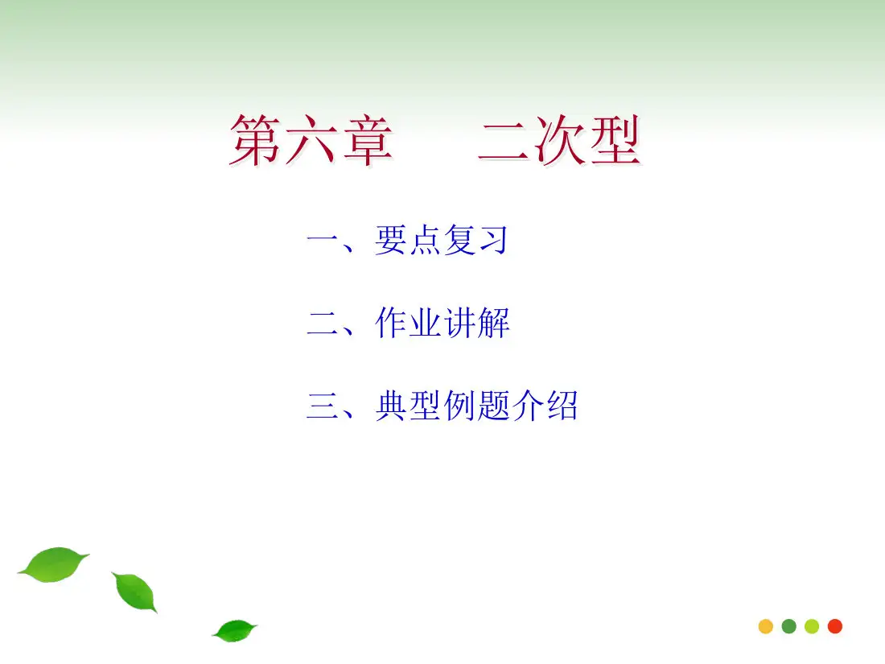

原文：

第六章 二次型
一、要点复习
二、作业讲解
三、典型例题介绍

● ● ● ●

### 一、要点复习

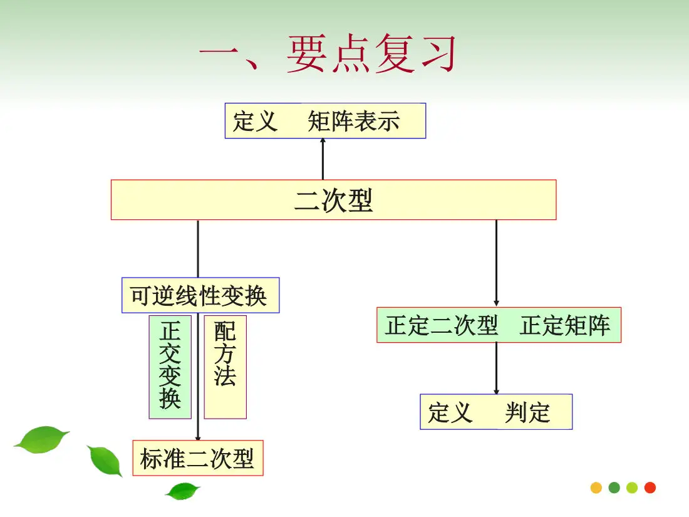

原文：

一、要点复习

定义 矩阵表示

### 1. 二次型及其矩阵表示

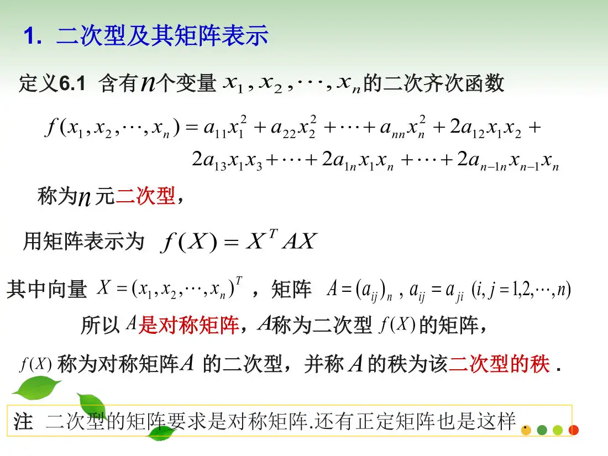

原文：

1. 二次型及其矩阵表示

定义6.1 含有n个变量 $x_{1}, x_{2}, \cdots, x_{n}$ 的二次齐次函数

$$
\begin{array}{r} f (x _ {1}, x _ {2}, \dots , x _ {n}) = a _ {1 1} x _ {1} ^ {2} + a _ {2 2} x _ {2} ^ {2} + \dots + a _ {n n} x _ {n} ^ {2} + 2 a _ {1 2} x _ {1} x _ {2} + \\ 2 a _ {1 3} x _ {1} x _ {3} + \dots + 2 a _ {1 n} x _ {1} x _ {n} + \dots + 2 a _ {n - 1 n} x _ {n - 1} x _ {n} \end{array}
$$

称为n元二次型，

用矩阵表示为 $f(X) = X^{T}AX$

其中向量 $X=(x_{1},x_{2},\cdots,x_{n})^{T}$ ，矩阵 $A=(a_{ij})_{n}$ ， $a_{ij}=a_{ji}(i,j=1,2,\cdots,n)$

所以 A 是对称矩阵，A 称为二次型 $f(X)$ 的矩阵，

$f(X)$ 称为对称矩阵 A 的二次型，并称 A 的秩为该二次型的秩。

注 二次型的矩阵要求是对称矩阵.还有正定矩阵也是这样

### 2. 二次型的标准形

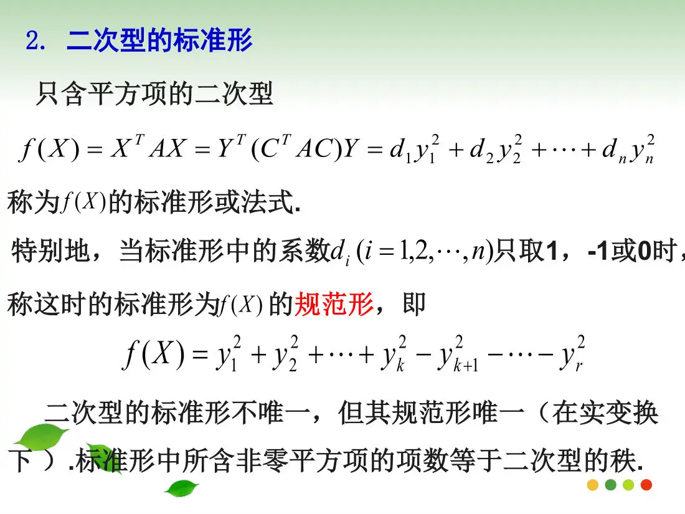

原文：

2. 二次型的标准形

只含平方项的二次型

$f(X) = X^TAX = Y^T(C^TAC)Y = d_1y_1^2 +d_2y_2^2 +\dots +d_ny_n^2$ 称为 $f(X)$ 的标准形或法式.

特别地，当标准形中的系数 $d_{i}(i=1,2,\cdots,n)$ 只取1，-1或0时，称这时的标准形为 $f(X)$ 的规范形，即

$$
f (X) = y _ {1} ^ {2} + y _ {2} ^ {2} + \dots + y _ {k} ^ {2} - y _ {k + 1} ^ {2} - \dots - y _ {r} ^ {2}
$$

二次型的标准形不唯一，但其规范形唯一（在实变换下）.标准形中所含非零平方项的项数等于二次型的秩.

### 3. 合同变换

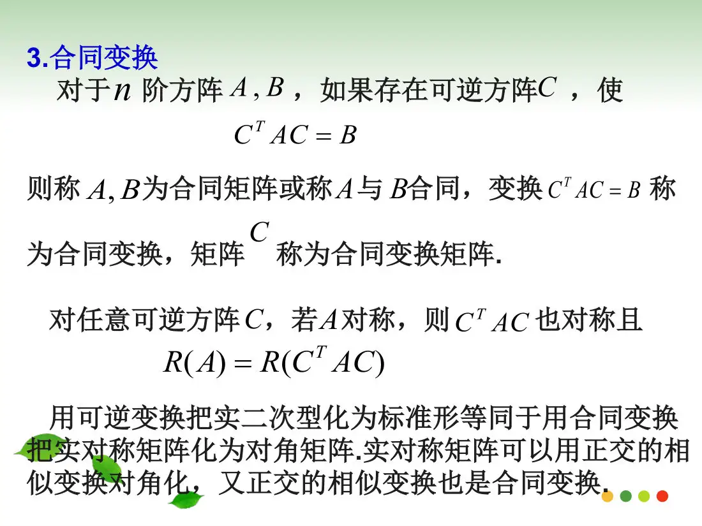

原文：

3. 合同变换

对于 $n$ 阶方阵 $A, B$ ，如果存在可逆方阵 $C$ ，使

$$
C ^ {T} A C = B
$$

则称 A, B 为合同矩阵或称 A 与 B 合同，变换 $C^{T}AC = B$ 称为合同变换，矩阵 $C^{C}$ 称为合同变换矩阵.

对任意可逆方阵 $C$ ，若 $A$ 对称，则 $C^T A C$ 也对称且

$$
R (A) = R (C ^ {T} A C)
$$

用可逆变换把实二次型化为标准形等同于用合同变换把实对称矩阵化为对角矩阵.实对称矩阵可以用正交的相似变换对角化，又正交的相似变换也是合同变换.

### 4.化二次型为标准型方法和步骤

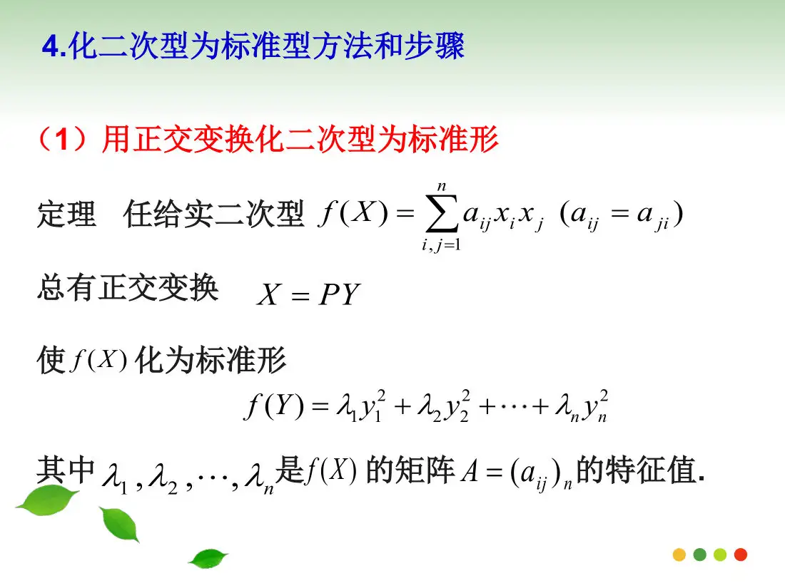

原文：

4.化二次型为标准型方法和步骤

(1) 用正交变换化二次型为标准形

定理 任给实二次型 $f(X) = \sum_{i,j=1}^{n} a_{ij} x_i x_j (a_{ij} = a_{ji})$ 总有正交变换 X = PY

使 $f(X)$ 化为标准形

$$
f (Y) = \lambda_ {1} y _ {1} ^ {2} + \lambda_ {2} y _ {2} ^ {2} + \dots + \lambda_ {n} y _ {n} ^ {2}
$$

其中 $\lambda_{1},\lambda_{2},\cdots,\lambda_{n}$ 是 $f(X)$ 的矩阵 $A=(a_{ij})_{n}$ 的特征值.

### 步骤：

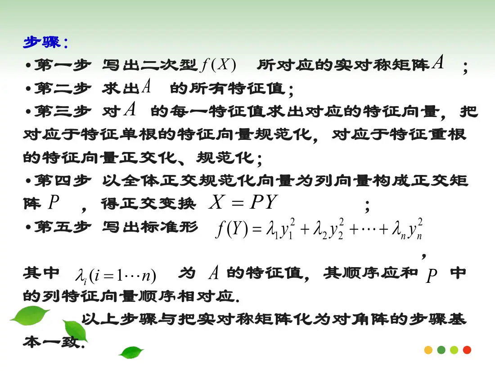

原文：

步骤：

·第一步 写出二次型 $f(X)$ 所对应的实对称矩阵 $A$ ；

·第二步 求出 $A$ 的所有特征值；

·第三步 对 $A$ 的每一特征值求出对应的特征向量，把对应于特征单根的特征向量规范化，对应于特征重根的特征向量正交化、规范化；

·第四步 以全体正交规范化向量为列向量构成正交矩阵 P ，得正交变换 X = PY ;

·第五步 写出标准形 $f(Y) = \lambda_{1}y_{1}^{2} + \lambda_{2}y_{2}^{2} + \dots +\lambda_{n}y_{n}^{2}$

其中 $\lambda_{i}(i=1\cdots n)$ 为 A 的特征值，其顺序应和 P 中的列特征向量顺序相对应.

以上步骤与把实对称矩阵化为对角阵的步骤基本一致。

### (2) 用配方法化二次型为标准形

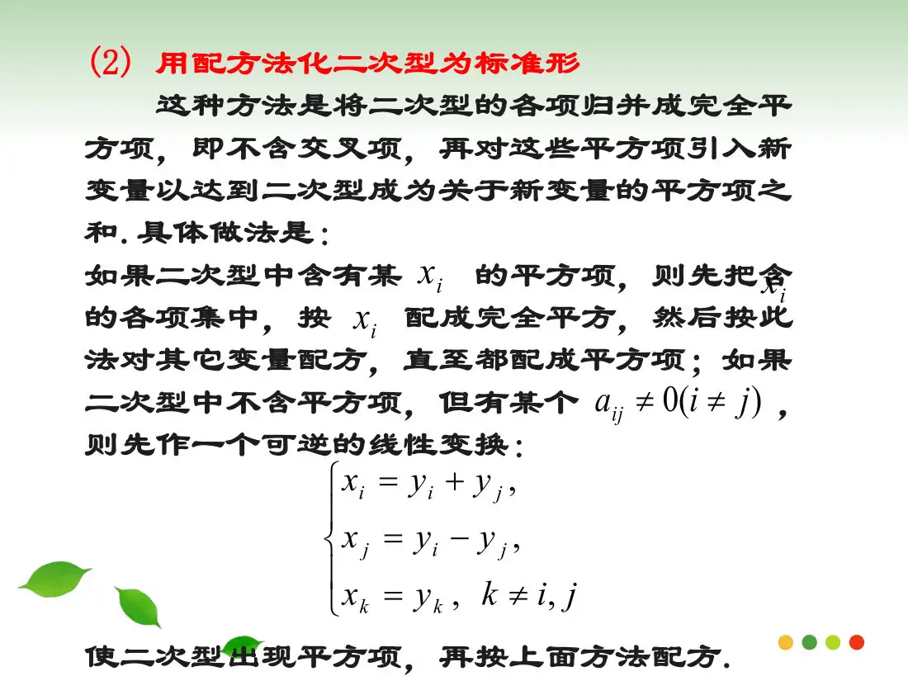

原文：

(2) 用配方法化二次型为标准形

这种方法是将二次型的各项归并成完全平方项，即不含交叉项，再对这些平方项引入新变量以达到二次型成为关于新变量的平方项之和。具体做法是：

如果二次型中含有某 $x_{i}$ 的平方项，则先把含的各项集中，按 $x_{i}$ 配成完全平方，然后按此法对其它变量配方，直至都配成平方项；如果二次型中不含平方项，但有某个 $a_{ij} \neq 0 (i \neq j)$ ，则先作一个可逆的线性变换：

$$
\left\{ \begin{array}{l} x _ {i} = y _ {i} + y _ {j}, \\ x _ {j} = y _ {i} - y _ {j}, \\ x _ {k} = y _ {k}, k \neq i, j \end{array} \right.
$$

使二次型出现平方项，再按上面方法配方.

### 5. 惯性定理

原文：

5. 惯性定理

一个二次型的标准形是不唯一的，但其所含非零项的项数是确定的（即二次型的秩）.不仅如此，在限定变换为实变换时，标准形中正平方项的个数是不变的（从而负平方项的个数也是不变的）.

### 6. 正定二次型

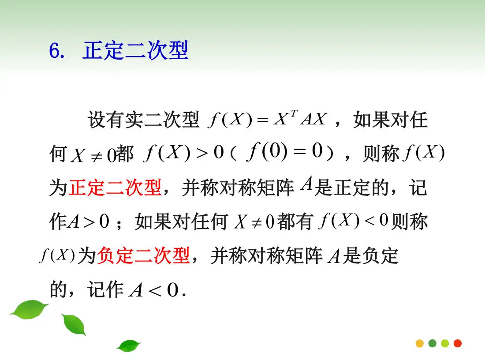

原文：

6. 正定二次型

设有实二次型 $f(X) = X^T A X$ ，如果对任何 $X \neq 0$ 都 $f(X) > 0 (f(0) = 0)$ ，则称 $f(X)$ 为正定二次型，并称对称矩阵 $A$ 是正定的，记作 $A > 0$ ；如果对任何 $X \neq 0$ 都有 $f(X) < 0$ 则称 $f(X)$ 为负定二次型，并称对称矩阵 $A$ 是负定的，记作 $A < 0$ 。

### 判断实二次型正定的充要条件

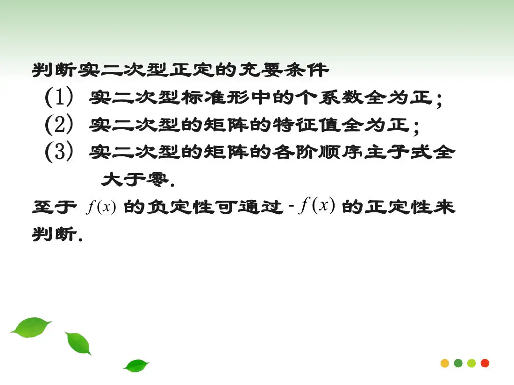

原文：

判断实二次型正定的充要条件

(1) 实二次型标准形中的个系数全为正;

(2) 实二次型的矩阵的特征值全为正;

(3) 实二次型的矩阵的各阶顺序主子式全大于零.

至于 $f(x)$ 的负定性可通过 $-f(x)$ 的正定性来判断.

### \- 各阶顺序主子式大于0的矩阵为正定矩阵;

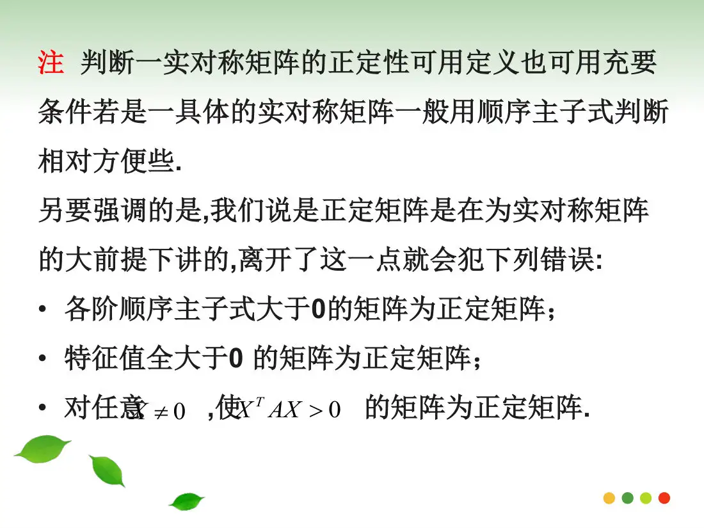

原文：

注 判断一实对称矩阵的正定性可用定义也可用充要条件若是一具体的实对称矩阵一般用顺序主子式判断相对方便些.

另要强调的是,我们说是正定矩阵是在为实对称矩阵的大前提下讲的,离开了这一点就会犯下列错误:

\- 各阶顺序主子式大于0的矩阵为正定矩阵;

\- 特征值全大于0的矩阵为正定矩阵;

\- 对任意 $X \neq 0$ ，使 $X^T A X > 0$ 的矩阵为正定矩阵.

### 典型例题介绍

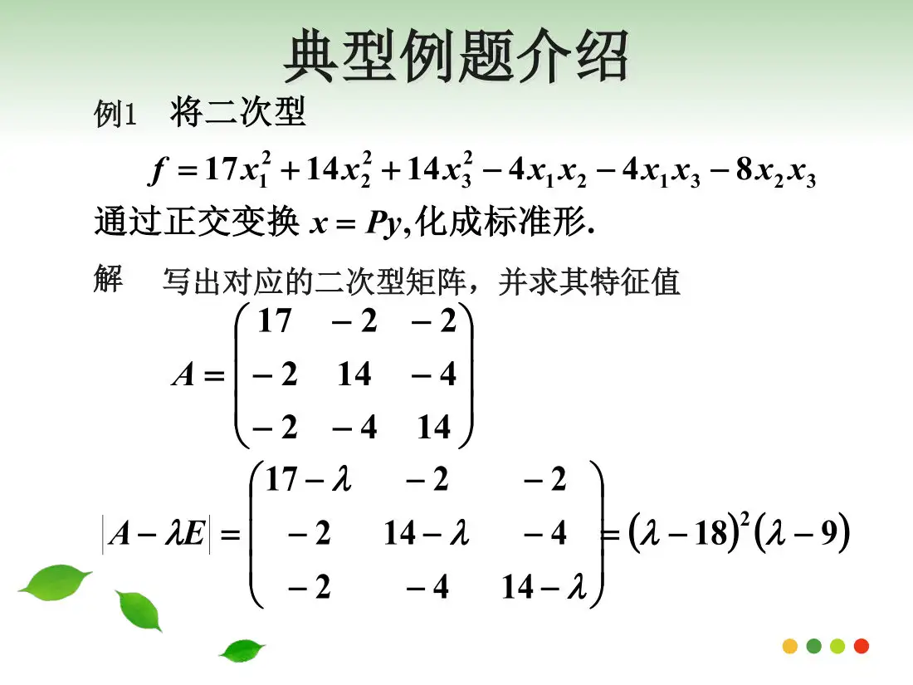

原文：

典型例题介绍

例1 将二次型

$$
f = 1 7 x _ {1} ^ {2} + 1 4 x _ {2} ^ {2} + 1 4 x _ {3} ^ {2} - 4 x _ {1} x _ {2} - 4 x _ {1} x _ {3} - 8 x _ {2} x _ {3}
$$

通过正交变换 x = Py, 化成标准形.

解 写出对应的二次型矩阵，并求其特征值

$$
A = \left( \begin{array}{l l l} 1 7 & - 2 & - 2 \\ - 2 & 1 4 & - 4 \\ - 2 & - 4 & 1 4 \end{array} \right)
$$

$$
| A - \lambda E | = \left( \begin{array}{c c c} 1 7 - \lambda & - 2 & - 2 \\ - 2 & 1 4 - \lambda & - 4 \\ - 2 & - 4 & 1 4 - \lambda \end{array} \right) = (\lambda - 1 8) ^ {2} (\lambda - 9)
$$

### 求特征向量

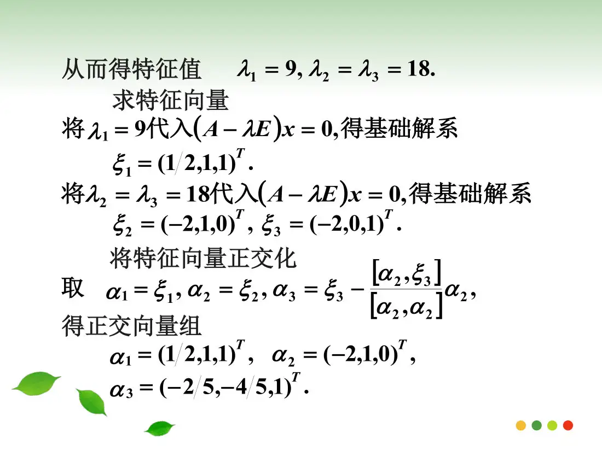

原文：

从而得特征值 $\lambda_{1}=9,\lambda_{2}=\lambda_{3}=18.$

求特征向量

将 $\lambda_{1} = 9$ 代入 $(A - \lambda E)x = 0$ ，得基础解系

$$
\xi_ {1} = (1 / 2, 1, 1) ^ {T}.
$$

将 $\lambda_{2} = \lambda_{3} = 18$ 代入 $(A - \lambda E)x = 0,$ 得基础解系

$$
\xi_ {2} = (- 2, \mathbf {1}, \mathbf {0}) ^ {T}, \xi_ {3} = (- 2, \mathbf {0}, \mathbf {1}) ^ {T}
$$

将特征向量正交化

将特征向量正文化取 $\alpha_{1} = \xi_{1},\alpha_{2} = \xi_{2},\alpha_{3} = \xi_{3} - \frac{[\alpha_{2},\xi_{3}]}{[\alpha_{2},\alpha_{2}]}\alpha_{2},$ 得正交向量组

$$
\alpha_ {1} = (1 / 2, 1, 1) ^ {T}, \quad \alpha_ {2} = (- 2, 1, 0) ^ {T},
$$

$$
\alpha_ {3} = (- 2 / 5, - 4 / 5, 1) ^ {T}
$$

### 将正交向量组单位化，得正交矩阵 P

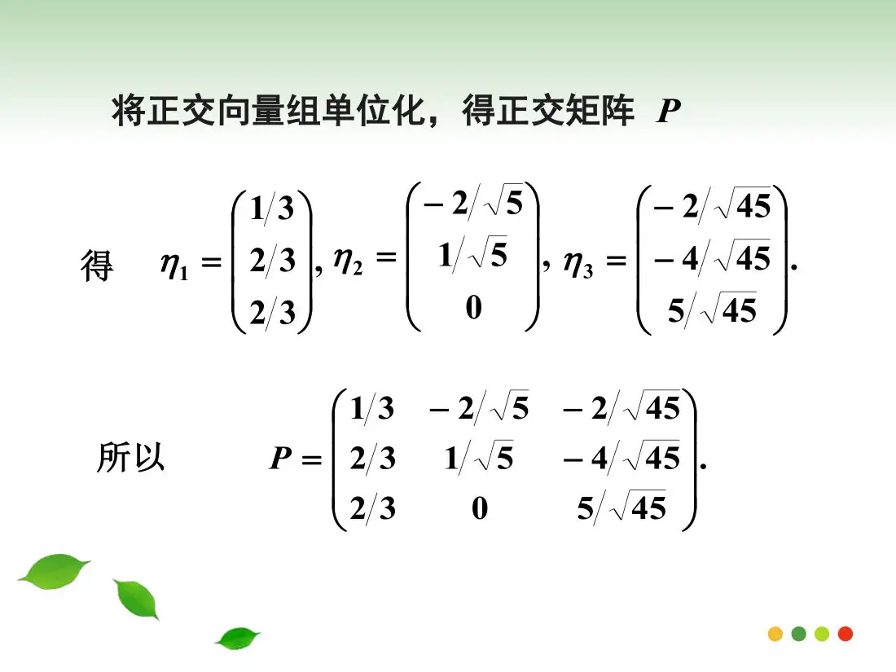

原文：

将正交向量组单位化，得正交矩阵 P

得

$$
\eta_ {1} = \left( \begin{array}{c} 1 / 3 \\ 2 / 3 \\ 2 / 3 \end{array} \right), \eta_ {2} = \left( \begin{array}{c} - 2 / \sqrt {5} \\ 1 / \sqrt {5} \\ 0 \end{array} \right), \eta_ {3} = \left( \begin{array}{c} - 2 / \sqrt {4 5} \\ - 4 / \sqrt {4 5} \\ 5 / \sqrt {4 5} \end{array} \right).
$$

所以

$$
P = \left( \begin{array}{c c c} 1 / 3 & - 2 / \sqrt {5} & - 2 / \sqrt {4 5} \\ 2 / 3 & 1 / \sqrt {5} & - 4 / \sqrt {4 5} \\ 2 / 3 & 0 & 5 / \sqrt {4 5} \end{array} \right).
$$

### 于是所求正交变换为

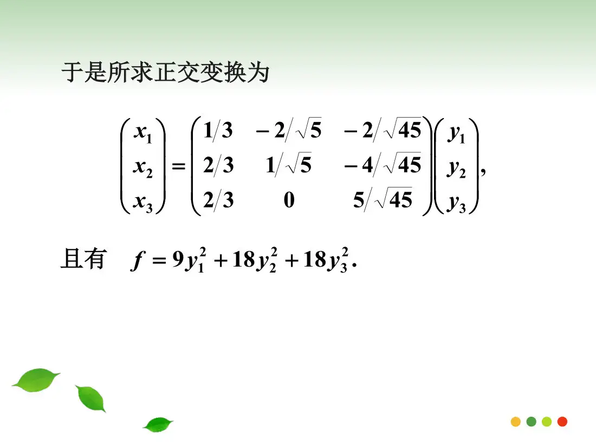

原文：

于是所求正交变换为

$$
\left( \begin{array}{c} x _ {1} \\ x _ {2} \\ x _ {3} \end{array} \right) = \left( \begin{array}{c c c} 1 / 3 & - 2 / \sqrt {5} & - 2 / \sqrt {4 5} \\ 2 / 3 & 1 / \sqrt {5} & - 4 / \sqrt {4 5} \\ 2 / 3 & 0 & 5 / \sqrt {4 5} \end{array} \right) \left( \begin{array}{c} y _ {1} \\ y _ {2} \\ y _ {3} \end{array} \right),
$$

且有 $f = 9y_{1}^{2} + 18y_{2}^{2} + 18y_{3}^{2}$

### 例2 判别二次型

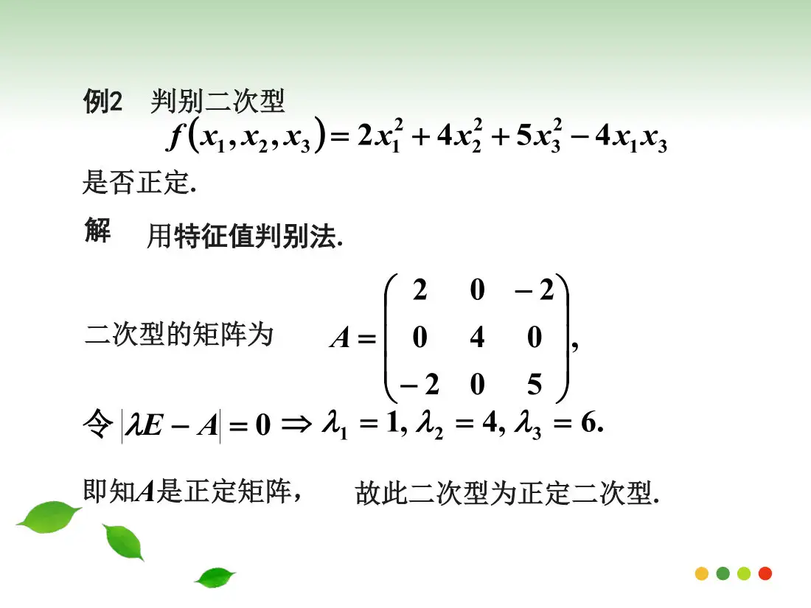

原文：

例2 判别二次型

$$
f (x _ {1}, x _ {2}, x _ {3}) = 2 x _ {1} ^ {2} + 4 x _ {2} ^ {2} + 5 x _ {3} ^ {2} - 4 x _ {1} x _ {3}
$$

是否正定.

解 用特征值判别法.

二次型的矩阵为 $A = \begin{pmatrix} 2 & 0 & -2 \\ 0 & 4 & 0 \\ -2 & 0 & 5 \end{pmatrix},$

令 $|\lambda E - A| = 0 \Rightarrow \lambda_1 = 1, \lambda_2 = 4, \lambda_3 = 6.$

即知 $A$ 是正定矩阵，故此二次型为正定二次型.

### 例3 判别二次型

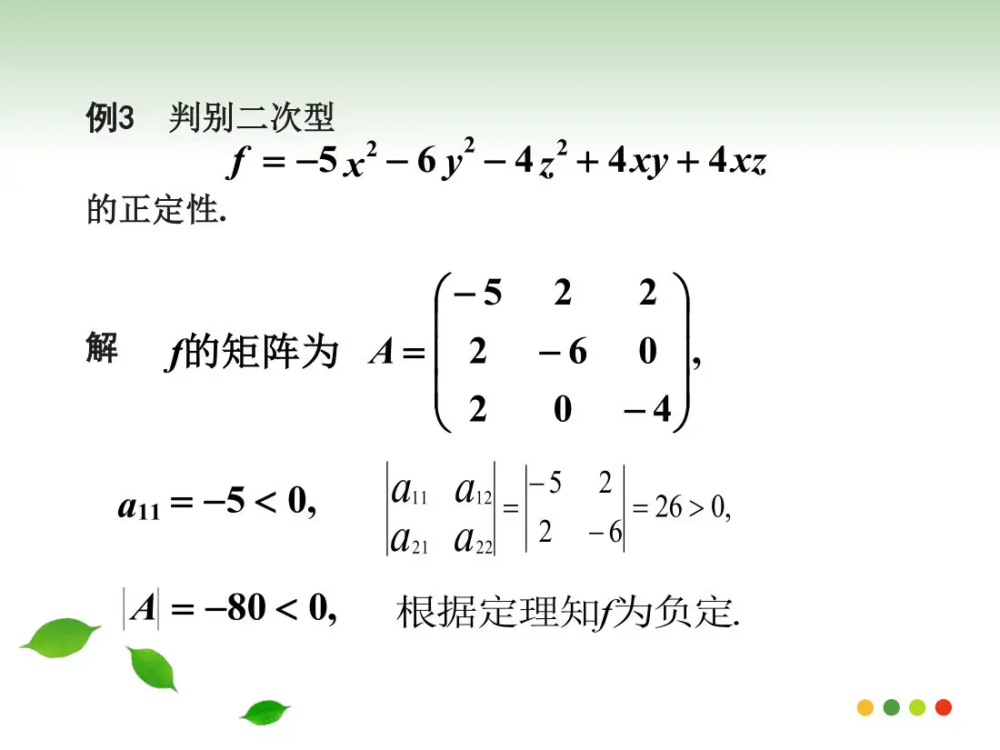

原文：

例3 判别二次型

$$
f = - 5 x ^ {2} - 6 y ^ {2} - 4 z ^ {2} + 4 x y + 4 x z
$$

的正定性.

解 $f$ 的矩阵为 $A = \begin{pmatrix} -5 & 2 & 2 \\ 2 & -6 & 0 \\ 2 & 0 & -4 \end{pmatrix}$ ,

$$
\boldsymbol {a} _ {1 1} = - \boldsymbol {5} <   \boldsymbol {0}, \quad \left| \begin{array}{c c} a _ {1 1} & a _ {1 2} \\ a _ {2 1} & a _ {2 2} \end{array} \right| = \left| \begin{array}{c c} - 5 & 2 \\ 2 & - 6 \end{array} \right| = 2 6 > 0,
$$

根据定理知f为负定.

### 证 由题设已知 $A$ 为实对称矩阵，所以 $A^T = A$

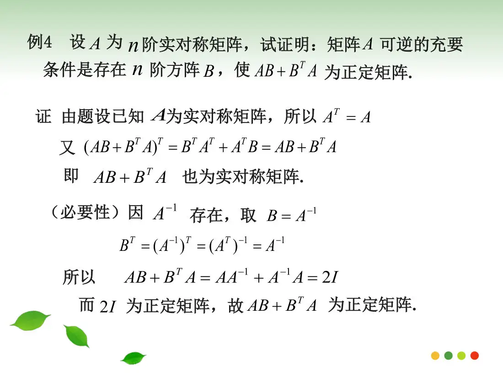

原文：

例4 设 A 为 n 阶实对称矩阵，试证明：矩阵 A 可逆的充要条件是存在 n 阶方阵 B，使 $AB + B^{T}A$ 为正定矩阵.

证 由题设已知 $A$ 为实对称矩阵，所以 $A^T = A$

又 $(AB + B^{T}A)^{T} = B^{T}A^{T} + A^{T}B = AB + B^{T}A$

即 $AB + B^{T}A$ 也为实对称矩阵.

（必要性）因 $A^{-1}$ 存在，取 $B = A^{-1}$

$$
B ^ {T} = (A ^ {- 1}) ^ {T} = (A ^ {T}) ^ {- 1} = A ^ {- 1}
$$

所以 $AB + B^{T}A = AA^{-1} + A^{-1}A = 2I$

而 2I 为正定矩阵，故 $AB + B^{T}A$ 为正定矩阵.

### （充分性）用两种方法证明：

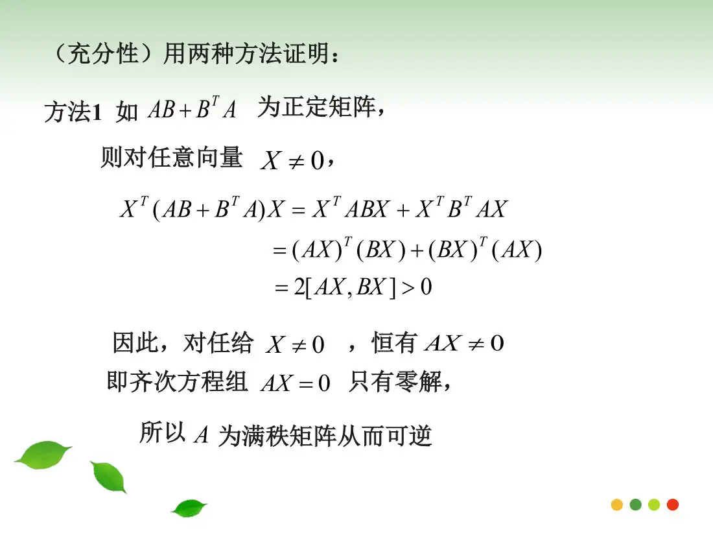

原文：

（充分性）用两种方法证明：

方法1 如 $AB + B^T A$ 为正定矩阵，

则对任意向量 $X \neq 0$ ，

$$
\begin{array}{r l} & X ^ {T} (A B + B ^ {T} A) X = X ^ {T} A B X + X ^ {T} B ^ {T} A X \\ & \qquad = (A X) ^ {T} (B X) + (B X) ^ {T} (A X) \\ & \qquad = 2 [ A X, B X ] > 0 \end{array}
$$

因此，对任给 $X \neq 0$ ，恒有 $AX \neq 0$

即齐次方程组 AX=0 只有零解，

所以 $A$ 为满秩矩阵从而可逆

● ● ● ●

### 方法2 (反证法) 若 A 不可逆，则齐次方程组 AX = 0

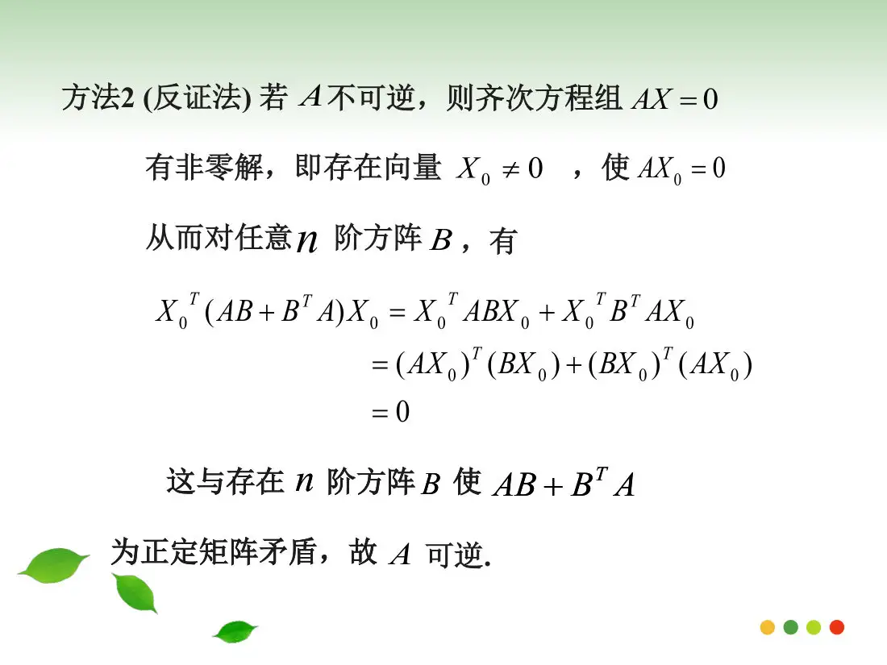

原文：

方法2 (反证法) 若 A 不可逆，则齐次方程组 AX = 0

有非零解，即存在向量 $X_0 \neq 0$ ，使 $AX_0 = 0$

从而对任意 $n$ 阶方阵 $B$ ，有

$$
\begin{array}{r l} & {X _ {0} ^ {T} (A B + B ^ {T} A) X _ {0} = X _ {0} ^ {T} A B X _ {0} + X _ {0} ^ {T} B ^ {T} A X _ {0}} \\ & {\qquad = (A X _ {0}) ^ {T} (B X _ {0}) + (B X _ {0}) ^ {T} (A X _ {0})} \\ & {\qquad = 0} \end{array}
$$

这与存在 $n$ 阶方阵 $B$ 使 $AB + B^T A$

为正定矩阵矛盾，故 A 可逆.

● ● ● ●
