# 《线性代数与解析几何》第6章 特征值与特征向量习题课（课件）

原件的每一页，下面附识别出的文字。

### 一、特征值与特征向量的求法

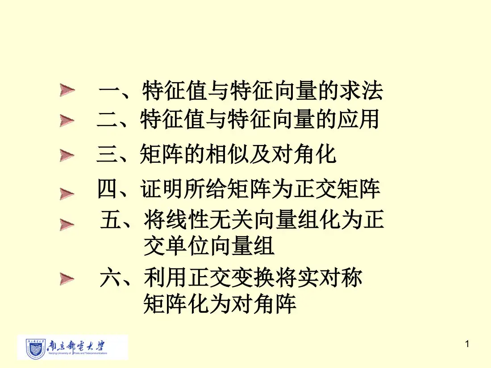

原文：

一、特征值与特征向量的求法
二、特征值与特征向量的应用
三、矩阵的相似及对角化
四、证明所给矩阵为正交矩阵
五、将线性无关向量组化为正交单位向量组
六、利用正交变换将实对称矩阵化为对角阵

南京邮电大学
Nanjing University of Posts and Telecommunications

1

### 第6章 习题课

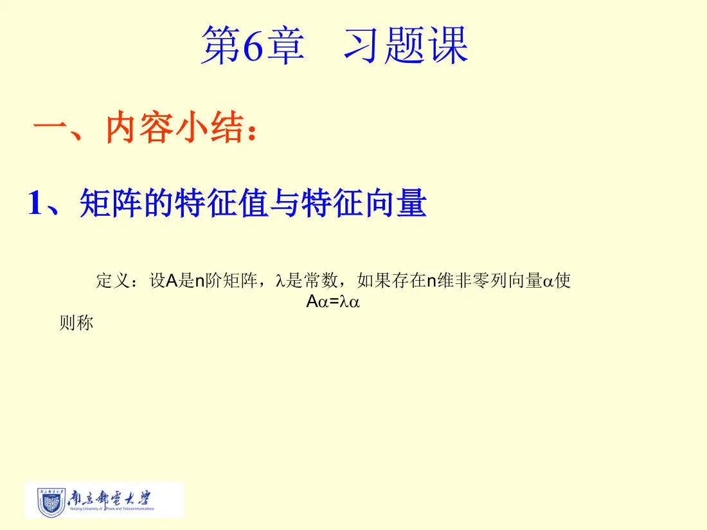

原文：

第6章 习题课

一、内容小结:

1、矩阵的特征值与特征向量

定义：设A是n阶矩阵， $\lambda$ 是常数，如果存在n维非零列向量 $\alpha$ 使 $A\alpha=\lambda\alpha$ 则称

南京邮电大学
Nanjing University of Posts and Telecommunications

### 求特征值和特征向量的步骤:

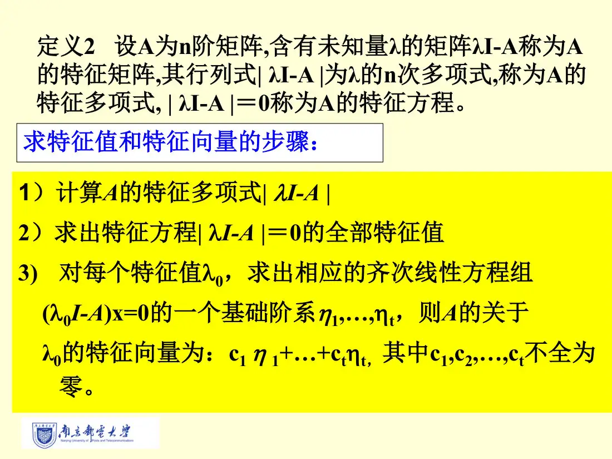

原文：

定义2 设A为n阶矩阵,含有未知量 $\lambda$ 的矩阵 $\lambda I-A$ 称为A的特征矩阵,其行列式 $|\lambda I-A|$ 为 $\lambda$ 的n次多项式,称为A的特征多项式, $|\lambda I-A|=0$ 称为A的特征方程。

求特征值和特征向量的步骤:

1) 计算 $A$ 的特征多项式 $\left|\lambda I - A\right|$

2）求出特征方程 $|\lambda I - A| = 0$ 的全部特征值

3) 对每个特征值 $\lambda_0$ ，求出相应的齐次线性方程组 $(\lambda_0 I - A)x = 0$ 的一个基础阶系 $\eta_1, \ldots, \eta_t$ ，则 $A$ 的关于 $\lambda_0$ 的特征向量为： $c_1 \eta_1 + \ldots + c_t \eta_t$ ，其中 $c_1, c_2, \ldots, c_t$ 不全为零。

南京邮电大学
Nanjing University of Posts and Telecommunications

### 特征值性质:

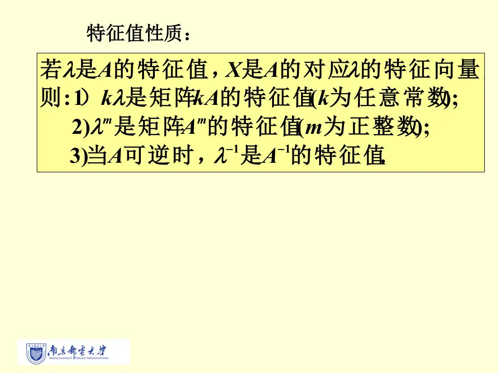

原文：

特征值性质:

若 $\lambda$ 是 $A$ 的特征值， $X$ 是 $A$ 的对应 $\lambda$ 的特征向量

则:1) $k\lambda$ 是矩阵 kA 的特征值 (k 为任意常数);

2) $\lambda^{m}$ 是矩阵 $A^{m}$ 的特征值 ( $m$ 为正整数);

3)当A可逆时， $\lambda^{-1}$ 是 $A^{-1}$ 的特征值。

南京邮电大学
Nanjing University of Posts and Telecommunications

### 2、相似矩阵

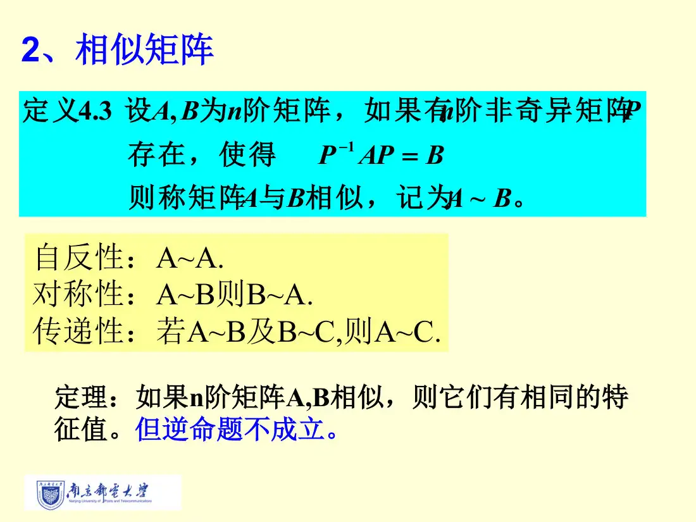

原文：

2、相似矩阵

定义4.3 设A,B为n阶矩阵，如果有n阶非奇异矩阵存在，使得 $P^{-1}AP = B$ 则称矩阵A与B相似，记为 $A \sim B$ 。

自反性：A\~A.

对称性：A\~B则B\~A.

传递性：若A\~B及B\~C,则A\~C.

定理：如果n阶矩阵A,B相似，则它们有相同的特征值。但逆命题不成立。

南京邮电大学
Nanjing University of Posts and Telecommunications

### 相似矩阵的性质:

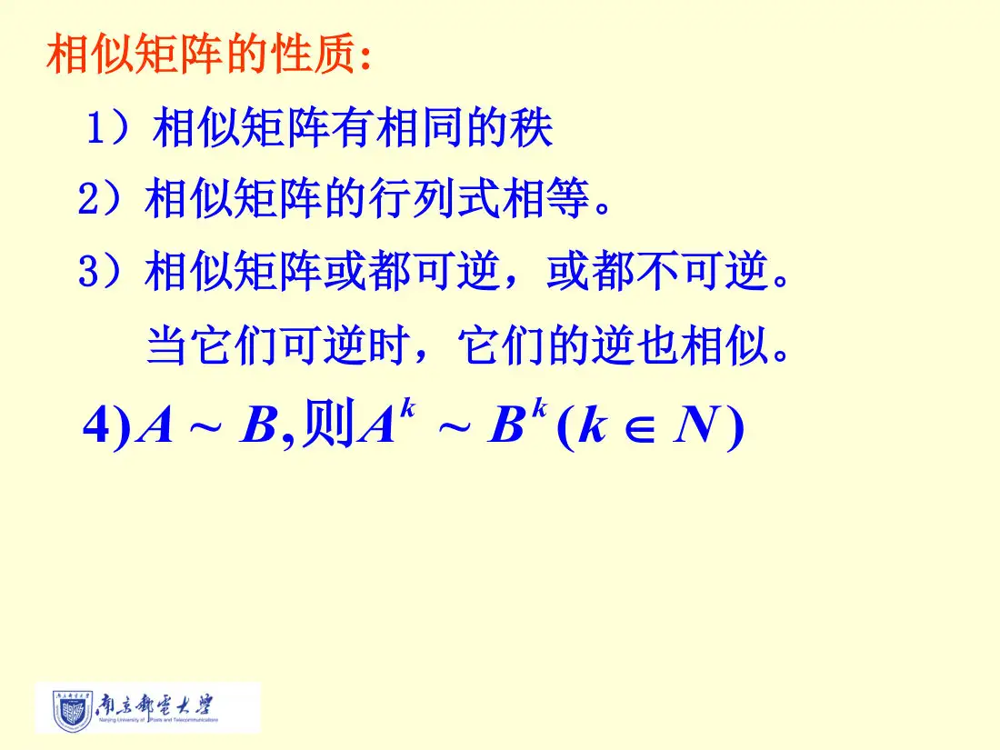

原文：

相似矩阵的性质:

1）相似矩阵有相同的秩

2）相似矩阵的行列式相等。

3）相似矩阵或都可逆，或都不可逆。
当它们可逆时，它们的逆也相似。

4) $A \sim B$ , 则 $A^k \sim B^k (k \in N)$

南京邮电大学
Nanjing University of Posts and Telecommunications

### 矩阵与对角矩阵相似的条件

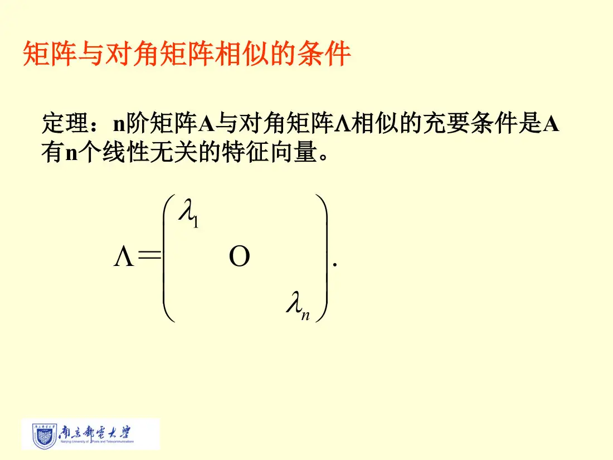

原文：

矩阵与对角矩阵相似的条件

定理：n阶矩阵A与对角矩阵 $\Lambda$ 相似的充要条件是A有n个线性无关的特征向量。

$$
\Lambda = \left( \begin{array}{c c c} \lambda_ {1} & & \\ & \text {O} & \\ & & \lambda_ {n} \end{array} \right).
$$

南京邮电大学
Nanjing University of Posts and Telecommunications

### 是充分条件，而不是必要条件

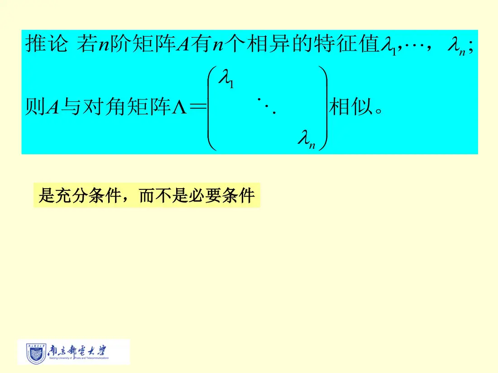

原文：

推论 若n阶矩阵A有n个相异的特征值 $\lambda_{1},\cdots,\lambda_{n};$

则 $A$ 与对角矩阵 $\Lambda = \begin{pmatrix} \lambda_1 & & \\ & \ddots & \\ & & \lambda_n \end{pmatrix}$ 相似。

是充分条件，而不是必要条件

南京邮电大学
Nanjing University of Posts and Telecommunications

### 向量内积

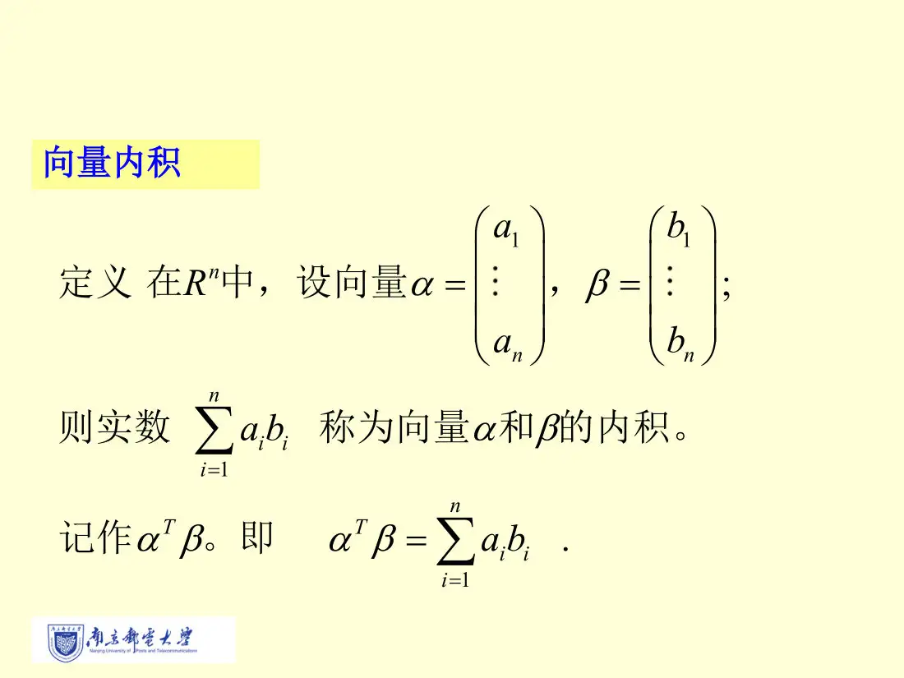

原文：

向量内积

定义 在 $R^n$ 中，设向量 $\alpha = \begin{pmatrix} a_1 \\ \vdots \\ a_n \end{pmatrix}$ ， $\beta = \begin{pmatrix} b_1 \\ \vdots \\ b_n \end{pmatrix}$ ；则实数 $\sum_{i=1}^{n} a_i b_i$ 称为向量 $\alpha$ 和 $\beta$ 的内积。记作 $\alpha^T \beta$ 。即 $\alpha^T \beta = \sum_{i=1}^{n} a_i b_i$ 。

南京邮电大学
Nanjing University of Posts and Telecommunications

### 2、内积的性质

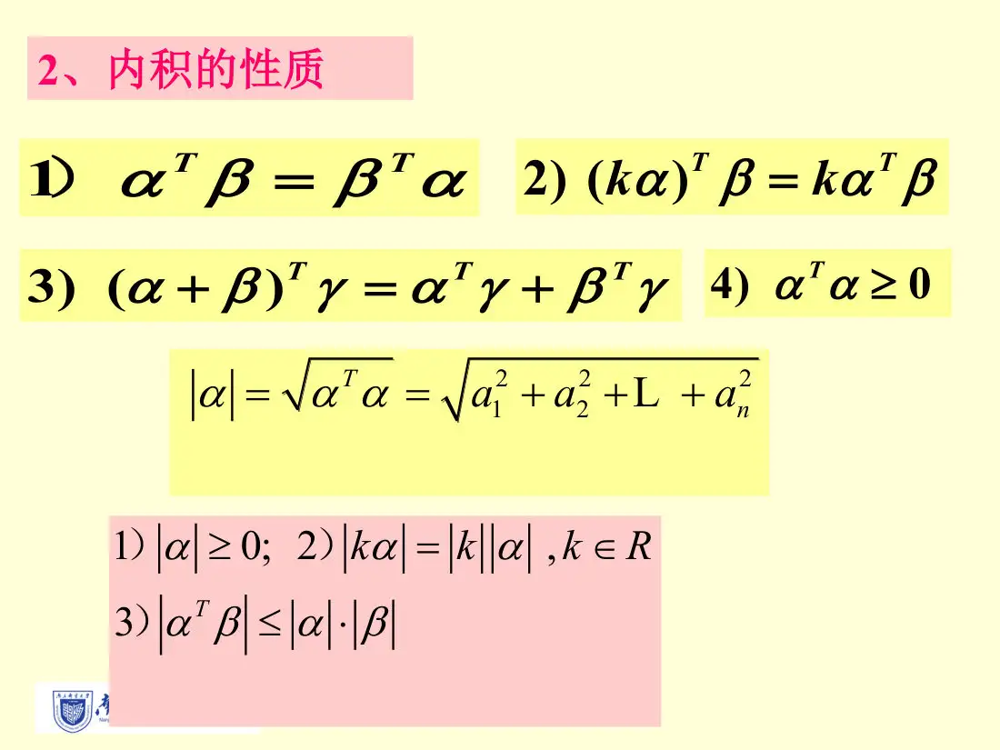

原文：

2、内积的性质

1) $\alpha^{T}\beta=\beta^{T}\alpha$ 2) $(k\alpha)^{T}\beta=k\alpha^{T}\beta$

3) $(\alpha + \beta)^{T} \gamma = \alpha^{T} \gamma + \beta^{T} \gamma$ 4) $\alpha^{T} \alpha \geq 0$

$$
\left| \alpha \right| = \sqrt {\alpha^ {T} \alpha} = \sqrt {a _ {1} ^ {2} + a _ {2} ^ {2} + \mathrm{L} + a _ {n} ^ {2}}
$$

1) $|\alpha| \geq 0$ ; 2) $|k\alpha| = |k||\alpha$ , $k \in R$

3) $\left|\alpha^{T}\beta\right|\leq\left|\alpha\right|\cdot\left|\beta\right|$

南京邮电大学
Nanjing University of Poems and Telecommunications

### 施密特(Gram-Schmidt)正交化方法:

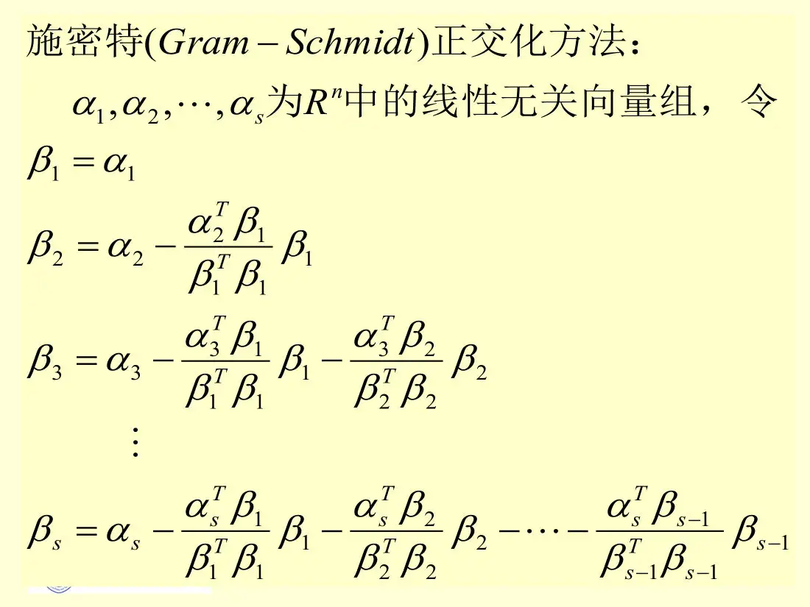

原文：

施密特(Gram-Schmidt)正交化方法:

$\alpha_{1}, \alpha_{2}, \dots, \alpha_{s}$ 为 $R^{n}$ 中的线性无关向量组，令 $\beta_{1} = \alpha_{1}$

$$
\beta_ {2} = \alpha_ {2} - \frac {\alpha_ {2} ^ {T} \beta_ {1}}{\beta_ {1} ^ {T} \beta_ {1}} \beta_ {1}
$$

$$
\begin{array}{c} \beta_ {3} = \alpha_ {3} - \frac {\alpha_ {3} ^ {T} \beta_ {1}}{\beta_ {1} ^ {T} \beta_ {1}} \beta_ {1} - \frac {\alpha_ {3} ^ {T} \beta_ {2}}{\beta_ {2} ^ {T} \beta_ {2}} \beta_ {2} \\ \vdots \end{array}
$$

$$
\beta_ {s} = \alpha_ {s} - \frac {\alpha_ {s} ^ {T} \beta_ {1}}{\beta_ {1} ^ {T} \beta_ {1}} \beta_ {1} - \frac {\alpha_ {s} ^ {T} \beta_ {2}}{\beta_ {2} ^ {T} \beta_ {2}} \beta_ {2} - \dots - \frac {\alpha_ {s} ^ {T} \beta_ {s - 1}}{\beta_ {s - 1} ^ {T} \beta_ {s - 1}} \beta_ {s - 1}
$$

### 正交矩阵

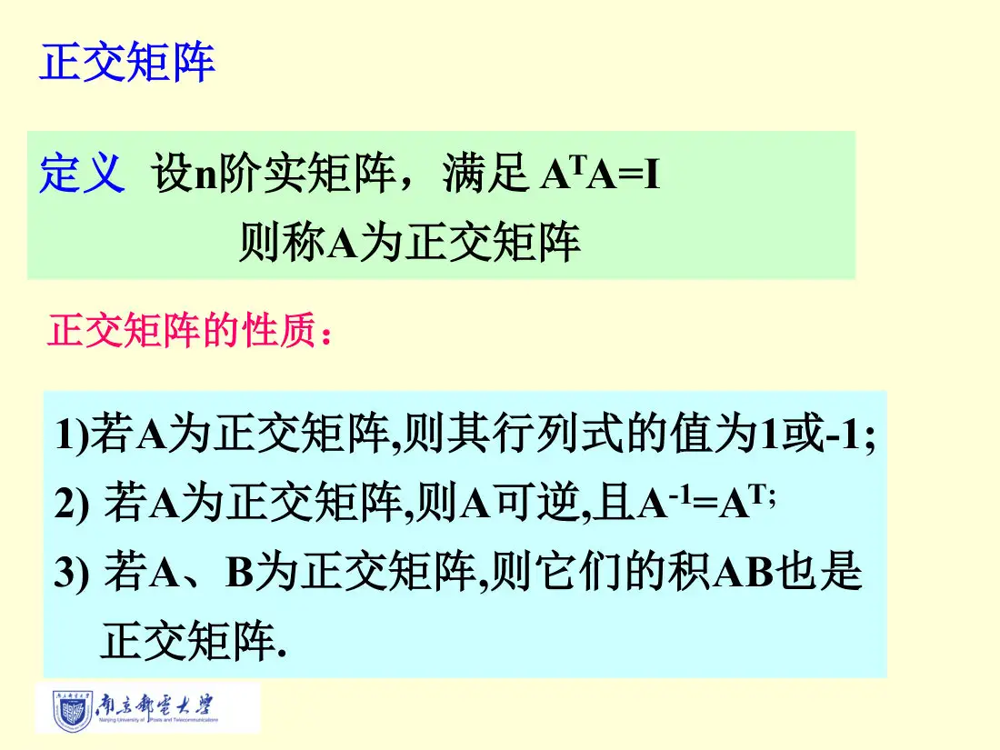

原文：

正交矩阵

定义 设n阶实矩阵，满足 $A^{T}A=I$

正交矩阵的性质:

1) 若 A 为正交矩阵, 则其行列式的值为 1 或 -1;

2) 若A为正交矩阵,则A可逆,且 $A^{-1}=A^{T}$ ;

3) 若A、B为正交矩阵,则它们的积AB也是正交矩阵.

南京邮电大学
Nanjing University of Posts and Telecommunications

### 定理：设Q为n阶实矩阵，则Q为正交矩阵

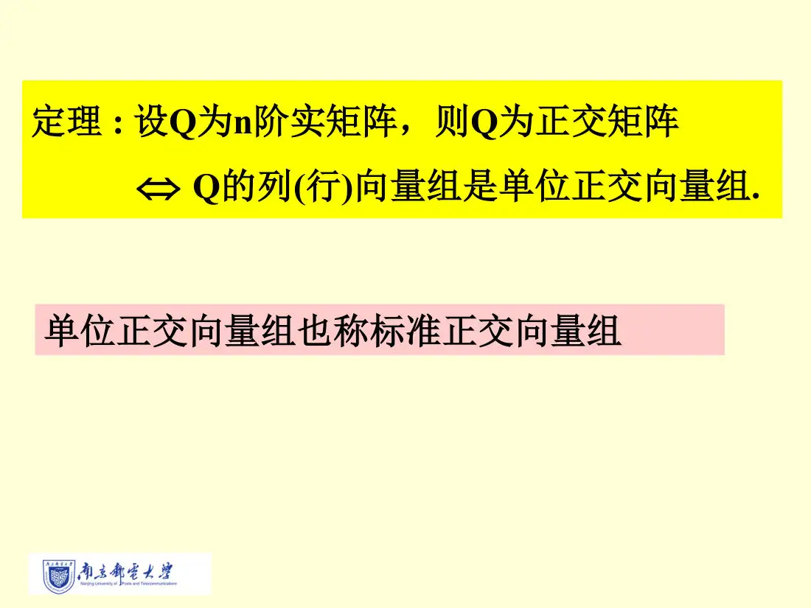

原文：

定理：设Q为n阶实矩阵，则Q为正交矩阵

$\Leftrightarrow$ Q的列(行)向量组是单位正交向量组.

单位正交向量组也称标准正交向量组

南京邮电大学
Nanjing University of Posts and Telecommunications

### 实对称矩阵的特征值和特征向量

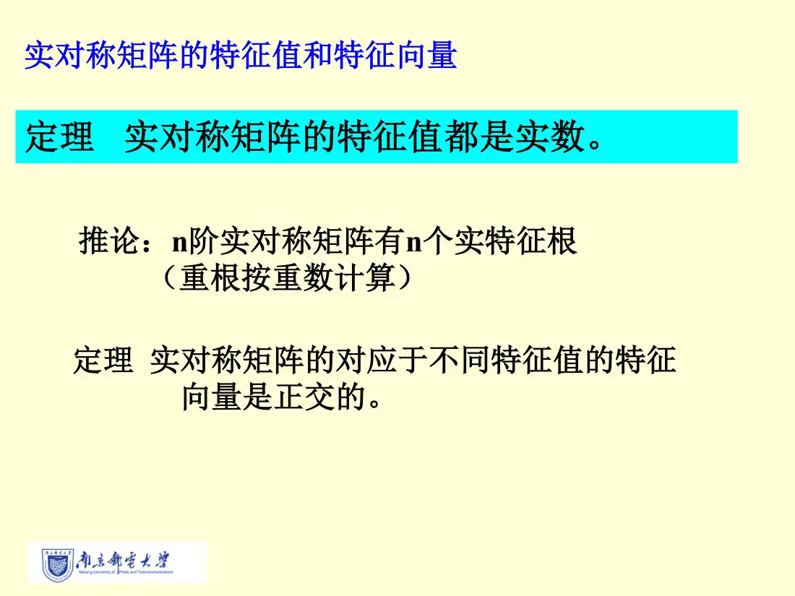

原文：

实对称矩阵的特征值和特征向量

定理 实对称矩阵的特征值都是实数。

推论：n阶实对称矩阵有n个实特征根（重根按重数计算）

定理 实对称矩阵的对应于不同特征值的特征向量是正交的。

南京邮电大学
Nanjing University of Posts and Telecommunications

### 南京邮电大学

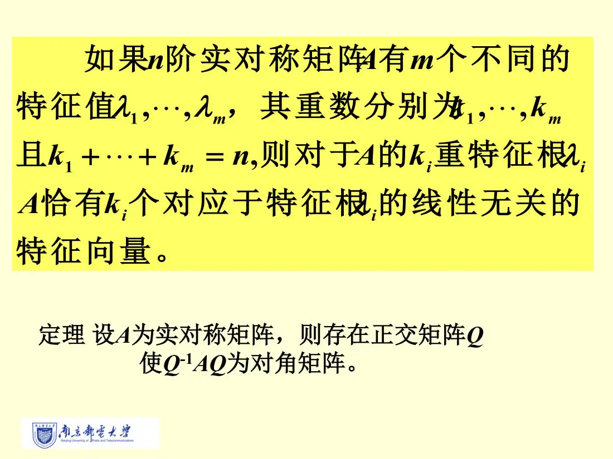

原文：

如果n阶实对称矩阵A有m个不同的特征值 $\lambda_{1},\cdots,\lambda_{m}$ ，其重数分别为 $k_{1},\cdots,k_{m}$ 且 $k_{1}+\cdots+k_{m}=n$ ，则对于A的 $k_{i}$ 重特征根 $\lambda_{i}$ A恰有 $k_{i}$ 个对应于特征根 $_{i}$ 的线性无关的特征向量。

定理 设 $A$ 为实对称矩阵，则存在正交矩阵 $Q$ 使 $Q^{-1}AQ$ 为对角矩阵。

南京邮电大学
Nanjing University of Posts and Telecommunications

### 一、特征值与特征向量的计算

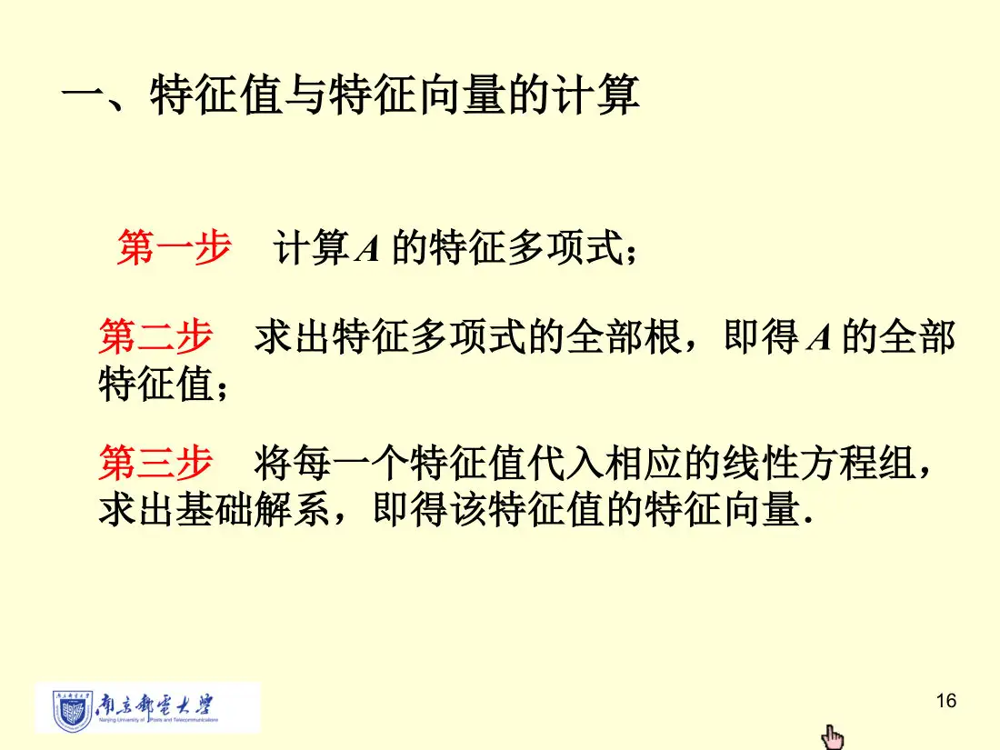

原文：

一、特征值与特征向量的计算

第一步 计算 A 的特征多项式;

第二步 求出特征多项式的全部根，即得 A 的全部特征值；

第三步 将每一个特征值代入相应的线性方程组，求出基础解系，即得该特征值的特征向量。

南京邮电大学
Nanjing University of Posts and Telecommunications

16

### 解 第一步 计算 $A$ 的特征多项式

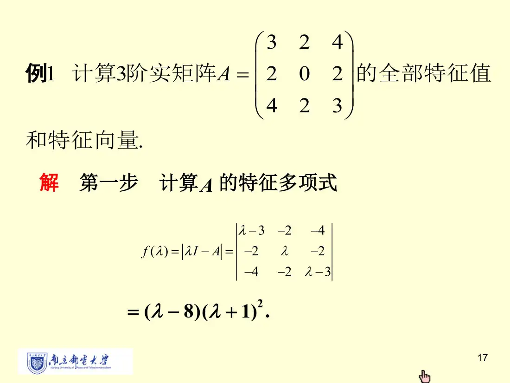

原文：

例1 计算3阶实矩阵 $A=\begin{pmatrix}3&2&4\\2&0&2\\4&2&3\end{pmatrix}$ 的全部特征值和特征向量.

解 第一步 计算 $A$ 的特征多项式

$$
\begin{array}{r l} & f (\lambda) = | \lambda I - A | = \left| \begin{array}{c c c} \lambda - 3 & - 2 & - 4 \\ - 2 & \lambda & - 2 \\ - 4 & - 2 & \lambda - 3 \end{array} \right| \\ & = (\lambda - 8) (\lambda + 1) ^ {2}. \end{array}
$$

南京邮电大学
Nanjing University of Posts and Telecommunications

17

### 第二步 求出特征多项式 $f(\lambda)$ 的全部根,即A的全部特征值.

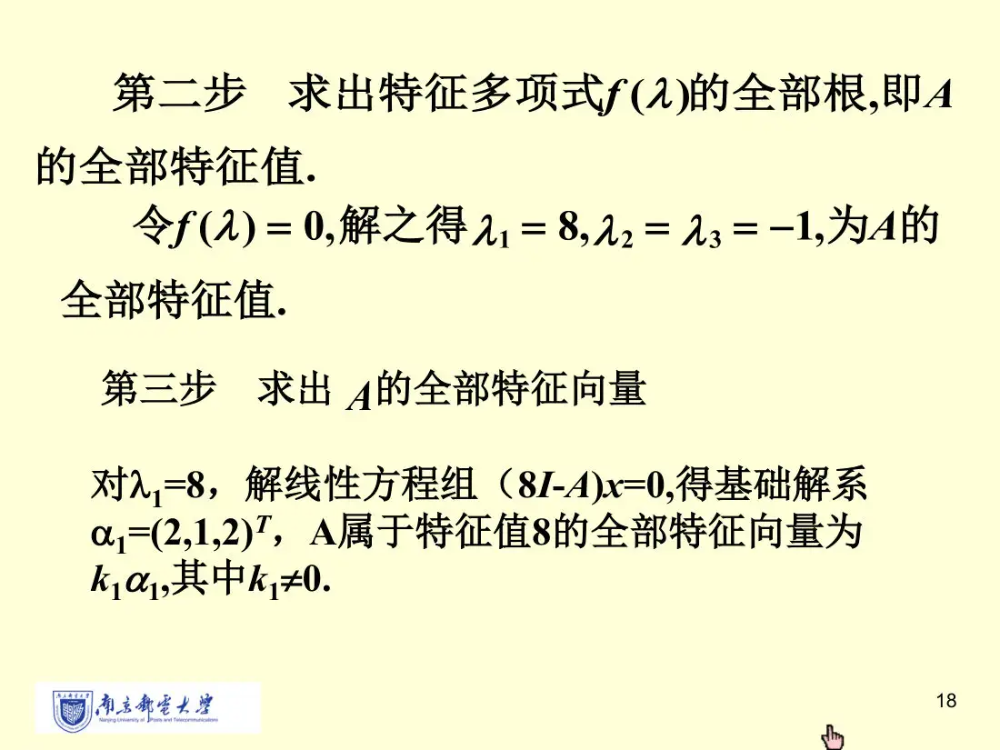

原文：

第二步 求出特征多项式 $f(\lambda)$ 的全部根,即A的全部特征值.

令 $f(\lambda)=0$ , 解之得 $\lambda_{1}=8, \lambda_{2}=\lambda_{3}=-1$ , 为 A 的全部特征值.

第三步 求出 A 的全部特征向量

对 $\lambda_{1}=8$ ，解线性方程组（8I-A)x=0,得基础解系 $\alpha_{1}=(2,1,2)^{T}$ ，A属于特征值8的全部特征向量为 $k_{1}\alpha_{1}$ ，其中 $k_{1}\neq0$ .

南京邮电大学
Nanjing University of Posts and Telecommunications

18

### 南京邮电大学

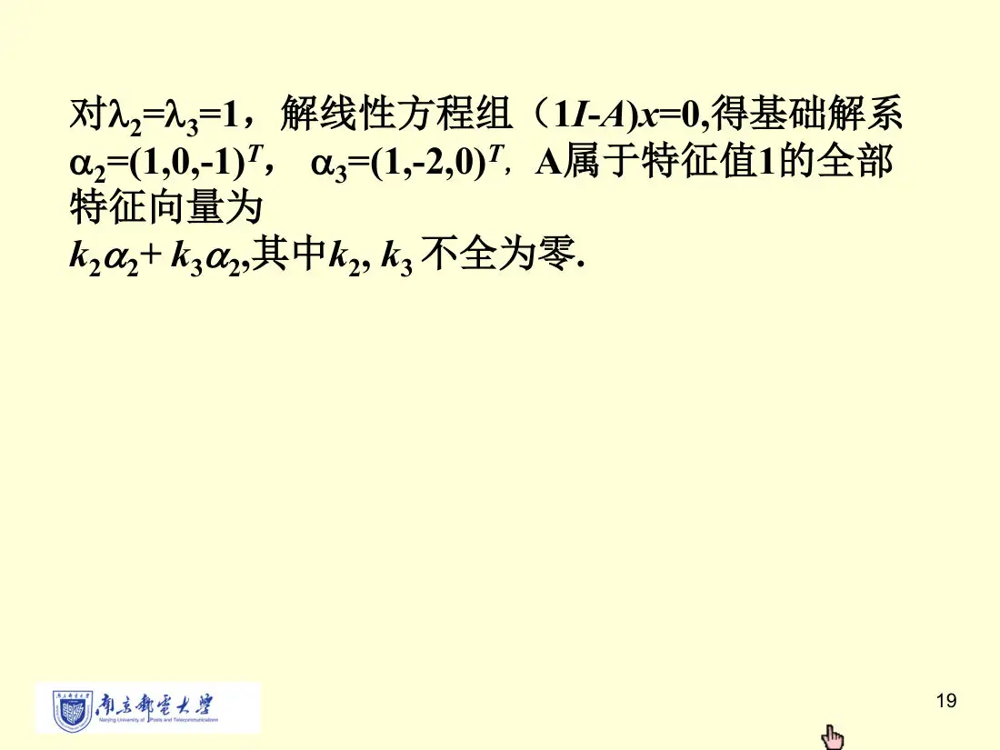

原文：

对 $\lambda_{2}=\lambda_{3}=1$ ，解线性方程组（1I-A)x=0,得基础解系 $\alpha_{2}=(1,0,-1)^{T},\quad\alpha_{3}=(1,-2,0)^{T}$ ，A属于特征值1的全部特征向量为 $k_{2}\alpha_{2}+k_{3}\alpha_{2}$ ，其中 $k_{2},k_{3}$ 不全为零.

南京邮电大学
Nanjing University of Posts and Telecommunications

19

### $$

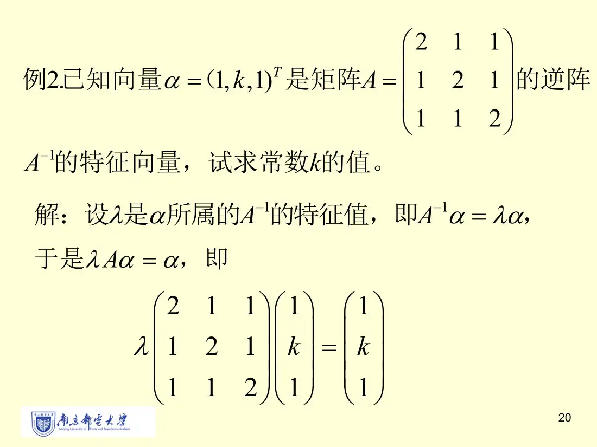

原文：

例2.已知向量 $\alpha = (1,k,1)^T$ 是矩阵 $A = \begin{pmatrix} 2 & 1 & 1 \\ 1 & 2 & 1 \\ 1 & 1 & 2 \end{pmatrix}$ 的逆阵 $A^{-1}$ 的特征向量，试求常数 $k$ 的值。

解：设 $\lambda$ 是 $\alpha$ 所属的 $A^{-1}$ 的特征值，即 $A^{-1}\alpha = \lambda \alpha$ 于是 $\lambda A\alpha = \alpha$ ，即

$$
\lambda \left( \begin{array}{c c c} 2 & 1 & 1 \\ 1 & 2 & 1 \\ 1 & 1 & 2 \end{array} \right) \left( \begin{array}{c} 1 \\ k \\ 1 \end{array} \right) = \left( \begin{array}{c} 1 \\ k \\ 1 \end{array} \right)
$$

南京邮电大学
Nanjing University of Posts and Telecommunications

20

### 南京邮电大学

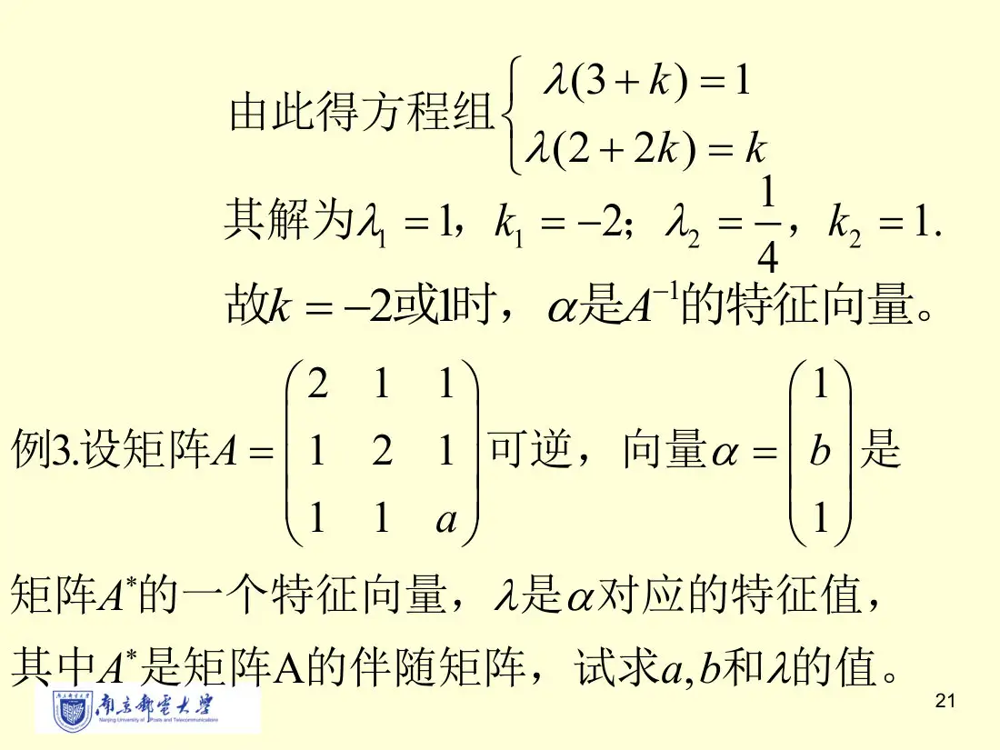

原文：

由此得方程组 $\left\{ \begin{array}{l} \lambda (3 + k) = 1 \\ \lambda (2 + 2k) = k \end{array} \right.$ 其解为 $\lambda_{1} = 1, k_{1} = -2; \lambda_{2} = \frac{1}{4}, k_{2} = 1.$ 故 $k = -2$ 或1时， $\alpha$ 是 $A^{-1}$ 的特征向量。

例3.设矩阵 $A=\begin{pmatrix}2&1&1\\1&2&1\\1&1&a\end{pmatrix}$ 可逆，向量 $\alpha=\begin{pmatrix}1\\b\\1\end{pmatrix}$ 是矩阵 $A^{*}$ 的一个特征向量， $\lambda$ 是 $\alpha$ 对应的特征值，其中 $A^{*}$ 是矩阵A的伴随矩阵，试求a,b和 $\lambda$ 的值。

南京邮电大学
Nanjing University of Posts and Telecommunications

21

### 两边同时左乘矩阵A，得 $AA*\alpha=\lambda A\alpha,$

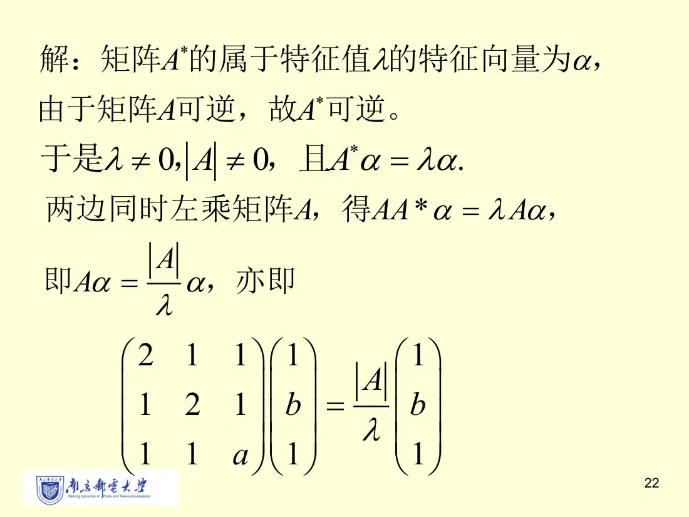

原文：

解：矩阵 $A^{*}$ 的属于特征值 $\lambda$ 的特征向量为 $\alpha$ ，由于矩阵A可逆，故 $A^{*}$ 可逆。

于是 $\lambda \neq 0, |A| \neq 0$ ，且 $A^{*}\alpha = \lambda \alpha$ .

两边同时左乘矩阵A，得 $AA*\alpha=\lambda A\alpha,$

即 $A\alpha = \frac{|A|}{\lambda}\alpha$ ，亦即

$$
\left( \begin{array}{c c c} 2 & 1 & 1 \\ 1 & 2 & 1 \\ 1 & 1 & a \end{array} \right) \left( \begin{array}{c} 1 \\ b \\ 1 \end{array} \right) = \frac {| A |}{\lambda} \left( \begin{array}{c} 1 \\ b \\ 1 \end{array} \right)
$$

南京邮电大学
Nanjing University of Posts and Telecommunications

22

### $$

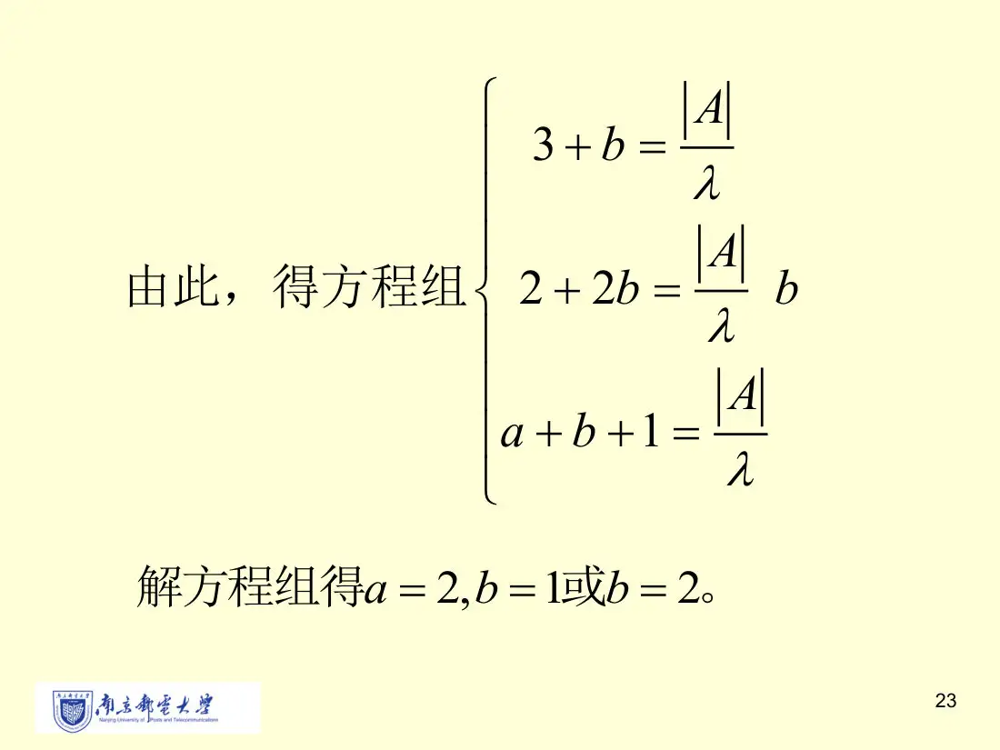

原文：

$$
3 + b = \frac {| A |}{\lambda}
$$

$$
2 + 2 b = \frac {| A |}{\lambda} b
$$

$$
a + b + 1 = \frac {| A |}{\lambda}
$$

解方程组得a=2,b=1或b=2。

南京邮电大学
Nanjing University of Posts and Telecommunications

23

### 南京邮电大学

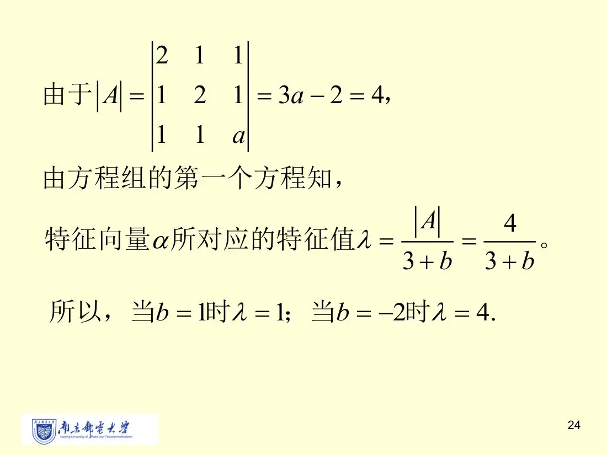

原文：

由于 $|A|=\begin{vmatrix}2&1&1\\ 1&2&1\\ 1&1&a\end{vmatrix}=3a-2=4,$ 由方程组的第一个方程知，
特征向量 $\alpha$ 所对应的特征值 $\lambda=\frac{|A|}{3+b}=\frac{4}{3+b}$ 。
所以，当b=1时 $\lambda=1$ ; 当b=-2时 $\lambda=4$ .

南京邮电大学
Nanjing University of Posts and Telecommunications

24

### 例4.设n阶方阵A满足 $A^{T}A=I$ ，试证：

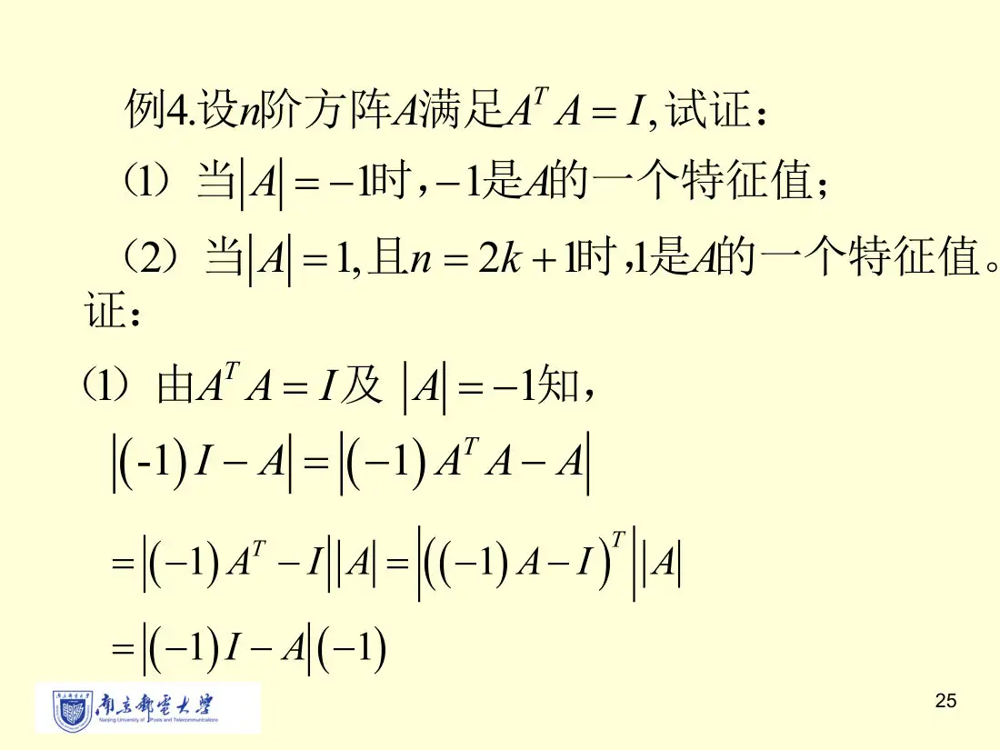

原文：

例4.设n阶方阵A满足 $A^{T}A=I$ ，试证：

(1) 当 $|A| = -1$ 时，-1是A的一个特征值；

(2) 当 $|A|=1$ , 且 $n=2k+1$ 时, 1是A的一个特征值。
证:

(1) 由 $A^T A = I$ 及 $|A| = -1$ 知，

$$
\begin{array}{r l} & {\left| (- 1) I - A \right| = \left| (- 1) A ^ {T} A - A \right|} \\ & {= \left| (- 1) A ^ {T} - I \right| | A | = \left| ((- 1) A - I) ^ {T} \right| | A |} \\ & {= \left| (- 1) I - A \right| (- 1)} \end{array}
$$

南京邮电大学
Nanjing University of Posts and Telecommunications

25

### (2) 当 $|A|=1$ 且 $n=2k+1$ 时，

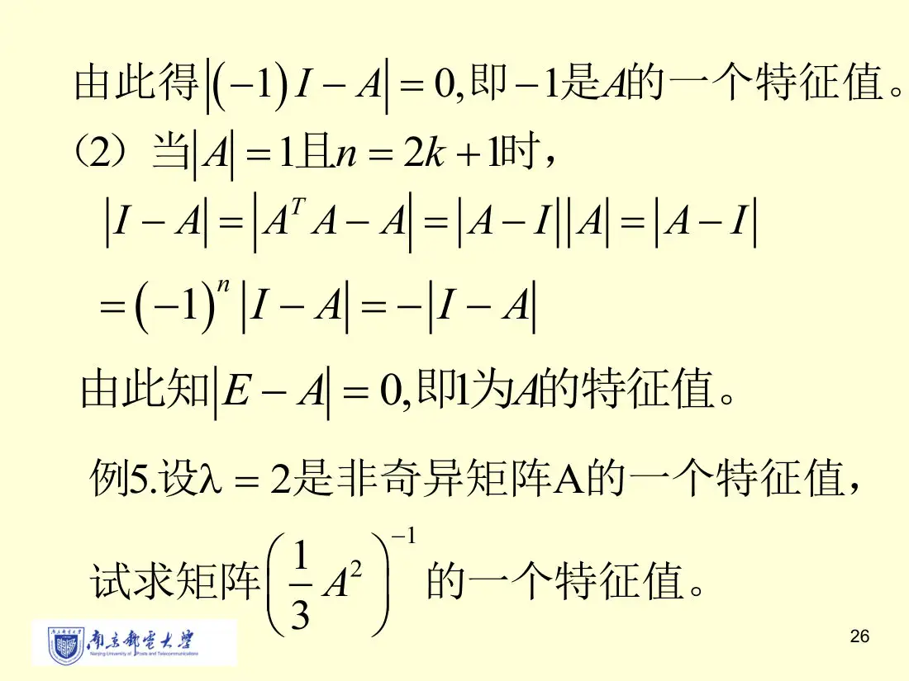

原文：

由此得 $\left|(-1)I-A\right|=0$ ，即-1是A的一个特征值。

(2) 当 $|A|=1$ 且 $n=2k+1$ 时，

$$
\begin{array}{l} \left| I - A \right| = \left| A ^ {T} A - A \right| = \left| A - I \right| \left| A \right| = \left| A - I \right| \\ = (- 1) ^ {n} \left| I - A \right| = - \left| I - A \right| \end{array}
$$

由此知 $|E-A|=0$ ，即1为A的特征值。

例5.设 $\lambda = 2$ 是非奇异矩阵A的一个特征值，试求矩阵 $\left(\frac{1}{3} A^{2}\right)^{-1}$ 的一个特征值。

南京邮电大学
Nanjing University of Posts and Telecommunications

26

### 解：设α是A的对应于λ=2的一个特征向量，

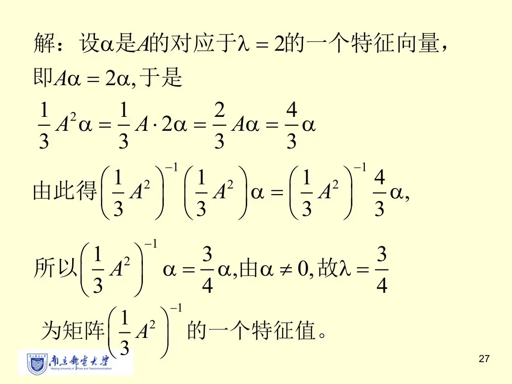

原文：

解：设α是A的对应于λ=2的一个特征向量，
即 $A\alpha=2\alpha$ ，于是 $\frac{1}{3}A^{2}\alpha=\frac{1}{3}A\cdot2\alpha=\frac{2}{3}A\alpha=\frac{4}{3}\alpha$ 由此得 $\left(\frac{1}{3}A^{2}\right)^{-1}\left(\frac{1}{3}A^{2}\right)\alpha=\left(\frac{1}{3}A^{2}\right)^{-1}\frac{4}{3}\alpha,$ 所以 $\left(\frac{1}{3}A^{2}\right)^{-1}\alpha=\frac{3}{4}\alpha,$ 由 $\alpha\neq0,$ 故 $\lambda=\frac{3}{4}$ 为矩阵 $\left(\frac{1}{3}A^{2}\right)^{-1}$ 的一个特征值。

南京邮电大学
Nanjing University of Posts and Telecommunications

27

### 南京邮电大学

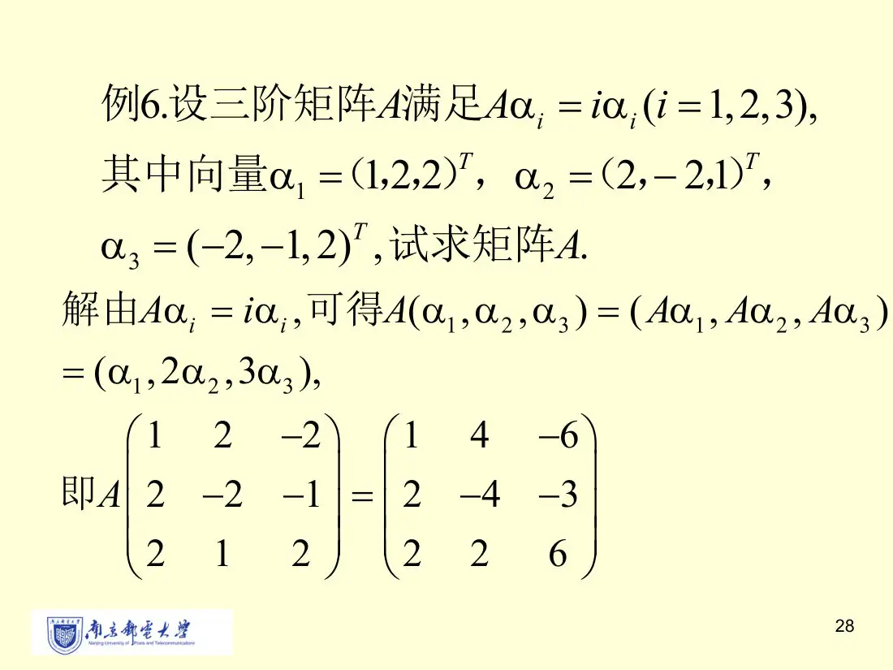

原文：

例6.设三阶矩阵A满足 $A\alpha_{i}=i\alpha_{i}(i=1,2,3)$ ,
其中向量 $\alpha_{1}=(1,2,2)^{T},\quad\alpha_{2}=(2,-2,1)^{T}$ , $\alpha_{3}=(-2,-1,2)^{T}$ ，试求矩阵A.
解由 $A\alpha_{i}=i\alpha_{i}$ ，可得 $A(\alpha_{1},\alpha_{2},\alpha_{3})=(A\alpha_{1},A\alpha_{2},A\alpha_{3})=(\alpha_{1},2\alpha_{2},3\alpha_{3})$ , $A\left(\begin{matrix}1&2&-2\\ 2&-2&-1\\ 2&1&2\end{matrix}\right)=\left(\begin{matrix}1&4&-6\\ 2&-4&-3\\ 2&2&6\end{matrix}\right)$

南京邮电大学
Nanjing University of Posts and Telecommunications

28

### 故A

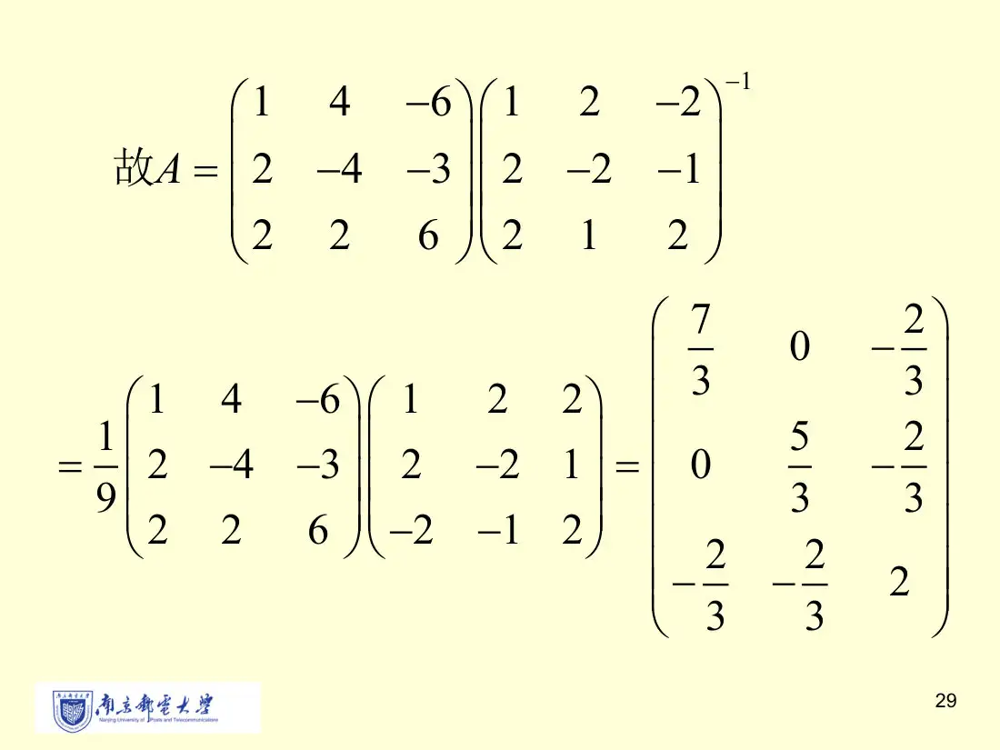

原文：

故A

$$
A = \left( \begin{array}{c c c} 1 & 4 & - 6 \\ 2 & - 4 & - 3 \\ 2 & 2 & 6 \end{array} \right) \left( \begin{array}{c c c} 1 & 2 & - 2 \\ 2 & - 2 & - 1 \\ 2 & 1 & 2 \end{array} \right) ^ {- 1}
$$

$$
= \frac {1}{9} \left( \begin{array}{r r r} 1 & 4 & - 6 \\ 2 & - 4 & - 3 \\ 2 & 2 & 6 \end{array} \right) \left( \begin{array}{r r r} 1 & 2 & 2 \\ 2 & - 2 & 1 \\ - 2 & - 1 & 2 \end{array} \right) = \left( \begin{array}{r r r} \frac {7}{3} & 0 & - \frac {2}{3} \\ 0 & \frac {5}{3} & - \frac {2}{3} \\ - \frac {2}{3} & - \frac {2}{3} & 2 \end{array} \right)
$$

南京邮电大学
Nanjing University of Posts and Telecommunications

29

### $$

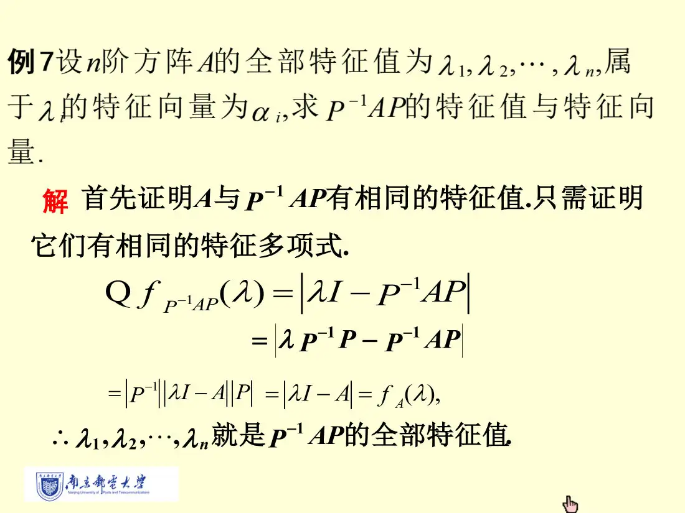

原文：

例7设n阶方阵A的全部特征值为 $\lambda_{1},\lambda_{2},\cdots,\lambda_{n}$ ，属于 $\lambda_{i}$ 的特征向量为 $\alpha_{i}$ ，求 $P^{-1}AP$ 的特征值与特征向量.

解 首先证明 $A$ 与 $p^{-1}AP$ 有相同的特征值.只需证明它们有相同的特征多项式.

$$
\begin{array}{r} Q f _ {P ^ {- 1} A P} (\lambda) = \left| \lambda I - P ^ {- 1} A P \right| \\ = \left| \lambda P ^ {- 1} P - P ^ {- 1} A P \right| \end{array}
$$

$$
= \left| P ^ {- 1} \right| \left| \lambda I - A \right| \left| P \right| = \left| \lambda I - A \right| = f _ {A} (\lambda),
$$

$\therefore \lambda_{1},\lambda_{2},\cdots,\lambda_{n}$ 就是 $P^{-1}AP$ 的全部特征值.

南京邮电大学
Nanjing University of Posts and Telecommunications

### 其次求 $P^{-1}AP$ 属于 $\lambda_{i}$ 的特征向量.

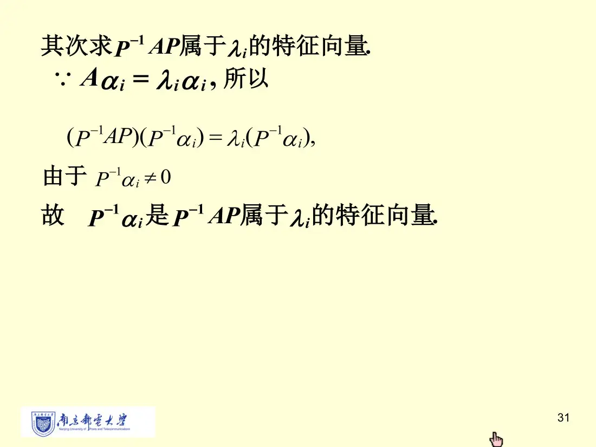

原文：

其次求 $P^{-1}AP$ 属于 $\lambda_{i}$ 的特征向量.

$\because A \alpha_{i} = \lambda_{i} \alpha_{i}$ , 所以

$$
(P ^ {- 1} A P) (P ^ {- 1} \alpha_ {i}) = \lambda_ {i} (P ^ {- 1} \alpha_ {i}),
$$

由于 $P^{-1}\alpha_{i}\neq 0$

故 $P^{-1}\alpha_{i}$ 是 $P^{-1}AP$ 属于 $\lambda_{i}$ 的特征向量.

南京邮电大学
Nanjing University of Posts and Telecommunications

31

### 二、特征值与特征向量的应用

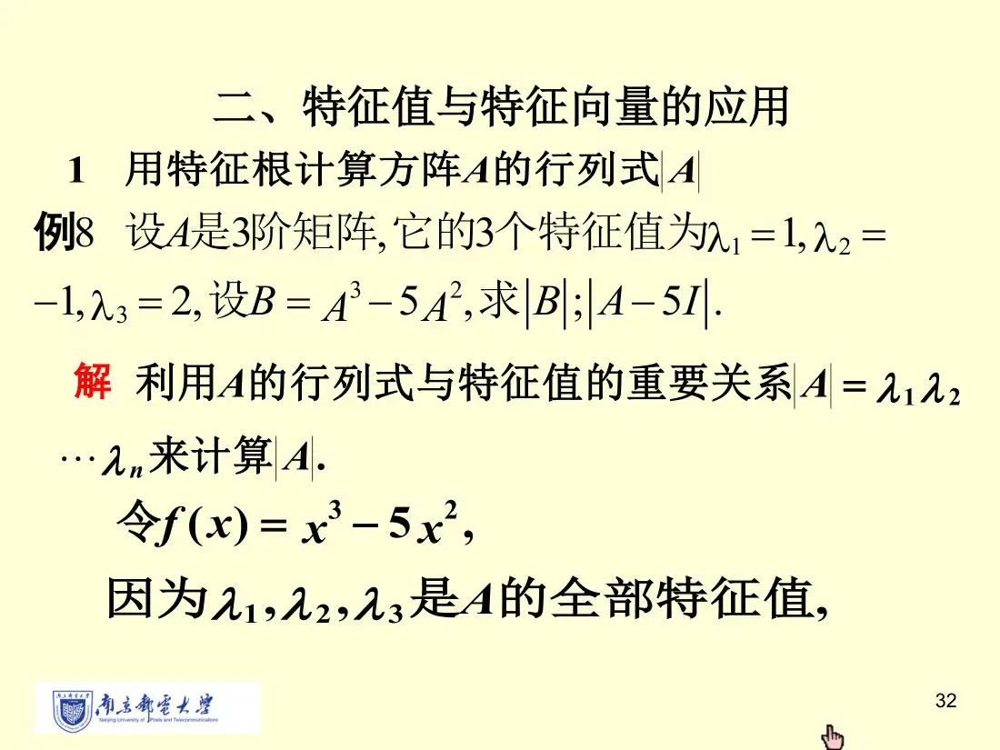

原文：

二、特征值与特征向量的应用

1 用特征根计算方阵A的行列式 $|A|$

例8 设A是3阶矩阵,它的3个特征值为 $\lambda_{1}=1,\lambda_{2}=-1,\lambda_{3}=2$ ,设 $B=A^{3}-5A^{2}$ ,求 $|B|;|A-5I|$ .

解 利用A的行列式与特征值的重要关系 $|A|=\lambda_{1}\lambda_{2}$ $\cdots\lambda_{n}$ 来计算 $|A|$ .

令 $f(x)=x^{3}-5x^{2}$ ,

因为 $\lambda_{1},\lambda_{2},\lambda_{3}$ 是A的全部特征值，

南京邮电大学
Nanjing University of Posts and Telecommunications

32

### $$

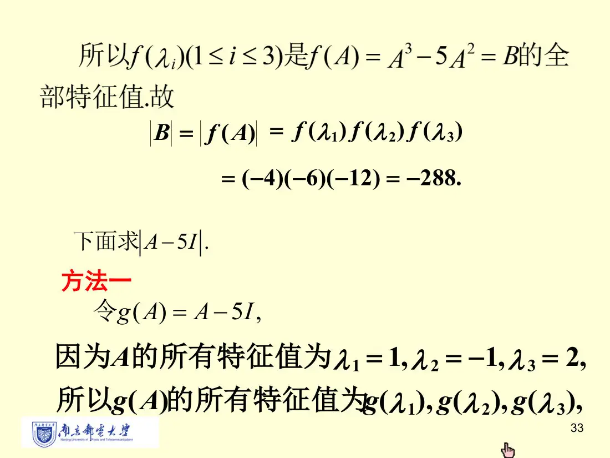

原文：

所以 $f(\lambda_{i})(1 \leq i \leq 3)$ 是 $f(A) = A^{3} - 5A^{2} = B$ 的全部特征值.故

$$
\begin{array}{r l} \left| B \right| = & \left| f (A) \right| = f (\lambda_ {1}) f (\lambda_ {2}) f (\lambda_ {3}) \\ & = (- 4) (- 6) (- 1 2) = - 2 8 8. \end{array}
$$

下面求 $|A-5I|$ .

方法一

令 $g(A)=A-5I,$

因为A的所有特征值为 $\lambda_{1}=1,\lambda_{2}=-1,\lambda_{3}=2,$ 所以 $g(A)$ 的所有特征值为 $g(\lambda_{1}), g(\lambda_{2}), g(\lambda_{3})$ ,

南京邮电大学
Nanjing University of Posts and Telecommunications

### $$

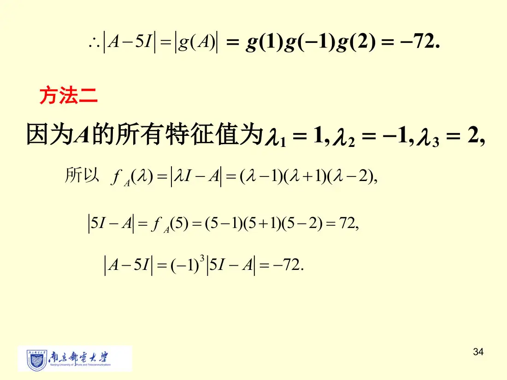

原文：

$$
\therefore | A - 5 I | = | g (A) | = g (1) g (- 1) g (2) = - 7 2.
$$

方法二

因为A的所有特征值为 $\lambda_{1}=1,\lambda_{2}=-1,\lambda_{3}=2,$

所以 $f_{A}(\lambda) = |\lambda I - A| = (\lambda -1)(\lambda +1)(\lambda -2),$

$$
\left| 5 I - A \right| = f _ {A} (5) = (5 - 1) (5 + 1) (5 - 2) = 7 2,
$$

$$
\left| A - 5 I \right| = (- 1) ^ {3} \left| 5 I - A \right| = - 7 2.
$$

南京邮电大学
Nanjing University of Posts and Telecommunications

34

### 2.用方阵A的特征值来讨论矩阵kI-A的可逆性

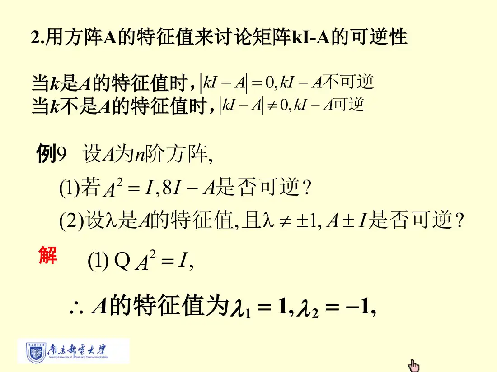

原文：

2.用方阵A的特征值来讨论矩阵kI-A的可逆性

当k是A的特征值时， $|kI-A|=0, kI-A$ 不可逆
当k不是A的特征值时， $|kI-A| \neq 0, kI-A$ 可逆

例9 设A为n阶方阵,

(1)若 $A^2 = I,8I - A$ 是否可逆？

(2)设 $\lambda$ 是 $A$ 的特征值,且 $\lambda \neq \pm 1, A \pm I$ 是否可逆?

解 (1) $Q A^{2} = I$ ,

∴ A 的特征值为 $\lambda_{1}=1, \lambda_{2}=-1,$ 故k=8不是A的特征值, 8I-A可逆
一般地，当 $k\neq\pm1$ 时，kI-A可逆

南京邮电大学
Nanjing University of Posts and Telecommunications

### $$

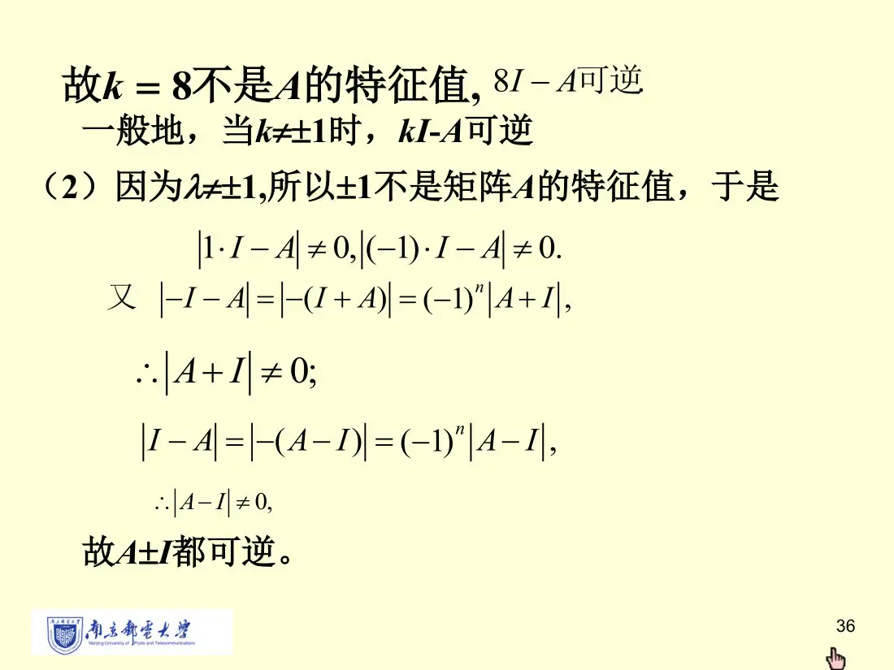

原文：

(2) 因为 $\lambda \neq \pm 1$ , 所以 $\pm 1$ 不是矩阵 $A$ 的特征值, 于是

$$
\begin{array}{r l} & {\left| 1 \cdot I - A \right| \neq 0, \left| (- 1) \cdot I - A \right| \neq 0.} \\ {\text {又}} & {\left| - I - A \right| = \left| - (I + A) \right| = (- 1) ^ {n} \left| A + I \right|,} \\ & {\therefore \left| A + I \right| \neq 0;} \\ & {\left| I - A \right| = \left| - (A - I) \right| = (- 1) ^ {n} \left| A - I \right|,} \\ & {\therefore \left| A - I \right| \neq 0,} \end{array}
$$

故 $A \pm I$ 都可逆。

南京邮电大学
Nanjing University of Posts and Telecommunications

36

### 例10.设n阶方阵A的n个特征值相同，求证： $nA-(trA)I$ 为奇异阵。

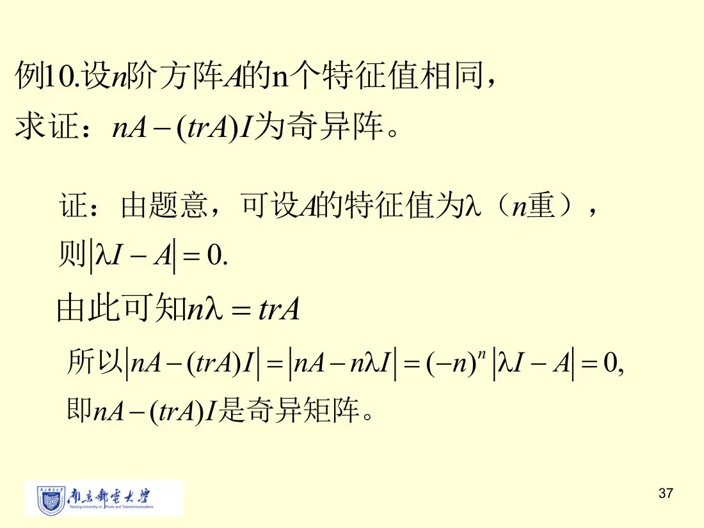

原文：

例10.设n阶方阵A的n个特征值相同，求证： $nA-(trA)I$ 为奇异阵。

证：由题意，可设A的特征值为 $\lambda$ （n重），则 $|\lambda I-A|=0$ .

由此可知 $n\lambda = trA$

所以 $\left|nA-(trA)I\right|=\left|nA-n\lambda I\right|=(-n)^{n}\left|\lambda I-A\right|=0,$ 即 $nA-(trA)I$ 是奇异矩阵。

南京邮电大学
Nanjing University of Posts and Telecommunications

37

### 三、矩阵的对角化

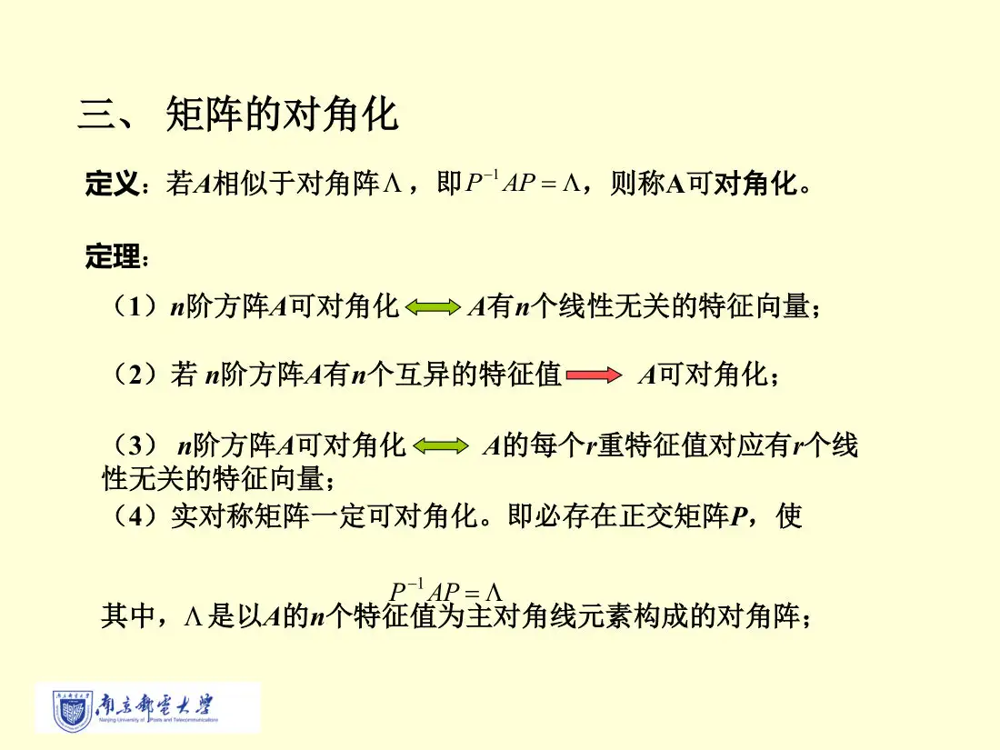

原文：

三、矩阵的对角化

定义：若 $A$ 相似于对角阵 $\Lambda$ ，即 $P^{-1}AP = \Lambda$ ，则称A可对角化。

定理:

(1) $n$ 阶方阵 $A$ 可对角化 $\Longleftrightarrow A$ 有 $n$ 个线性无关的特征向量;

(2) 若 $n$ 阶方阵 $A$ 有 $n$ 个互异的特征值 $\rightarrow A$ 可对角化;

(3) $n$ 阶方阵 $A$ 可对角化 $\Longleftrightarrow A$ 的每个 $r$ 重特征值对应有 $r$ 个线性无关的特征向量;

(4) 实对称矩阵一定可对角化。即必存在正交矩阵 $P$ , 使

其中， $\Lambda$ 是以 $A$ 的 $n$ 个特征值为主对角线元素构成的对角阵；

南京邮电大学
Nanjing University of Posts and Telecommunications

### （5）实对称矩阵的特征值均为实数，对应的特征向量可以取实向量；

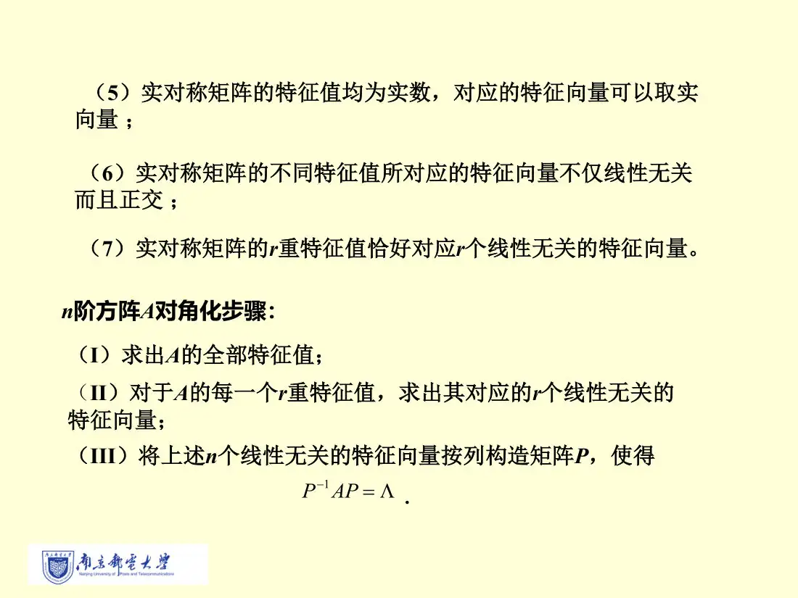

原文：

（5）实对称矩阵的特征值均为实数，对应的特征向量可以取实向量；

（6）实对称矩阵的不同特征值所对应的特征向量不仅线性无关而且正交；

(7) 实对称矩阵的 $r$ 重特征值恰好对应 $r$ 个线性无关的特征向量。

$n$ 阶方阵 $A$ 对角化步骤：

(I) 求出 $A$ 的全部特征值;

（II）对于 $A$ 的每一个 $r$ 重特征值，求出其对应的 $r$ 个线性无关的特征向量；

（III）将上述 $n$ 个线性无关的特征向量按列构造矩阵 $P$ ，使得

$$
P ^ {- 1} A P = \Lambda
$$

南京邮电大学
Nanjing University of Posts and Telecommunications

### 矩阵相似对角化问题

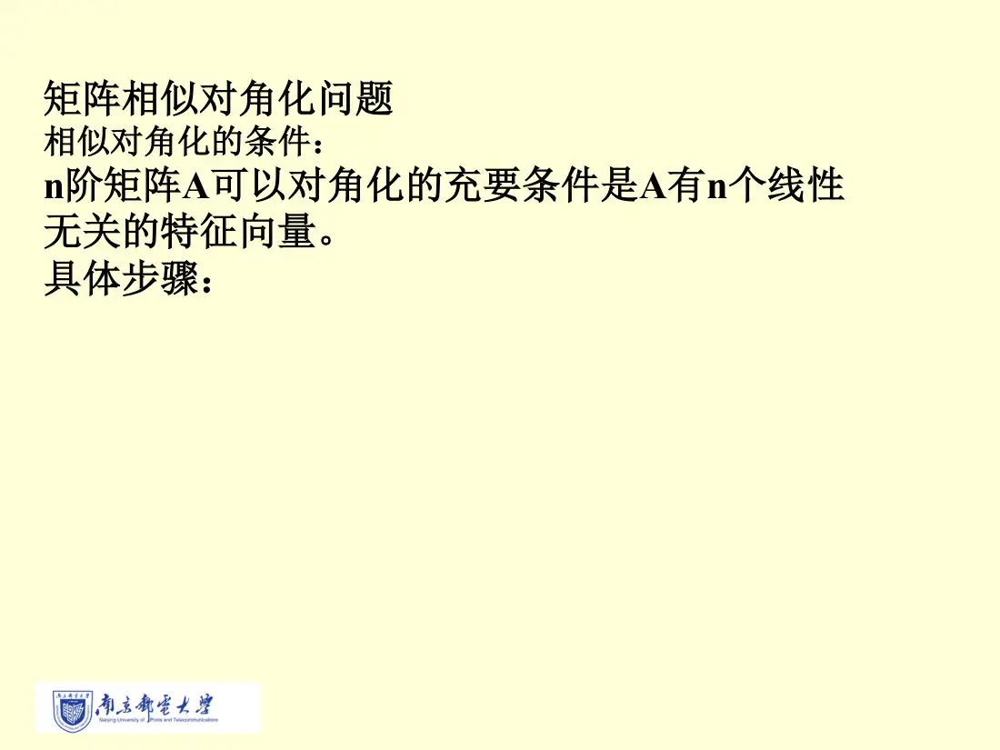

原文：

矩阵相似对角化问题

相似对角化的条件:

n阶矩阵A可以对角化的充要条件是A有n个线性无关的特征向量。

具体步骤:

南京邮电大学
Nanjing University of Posts and Telecommunications

### 矩阵相似对角化问题

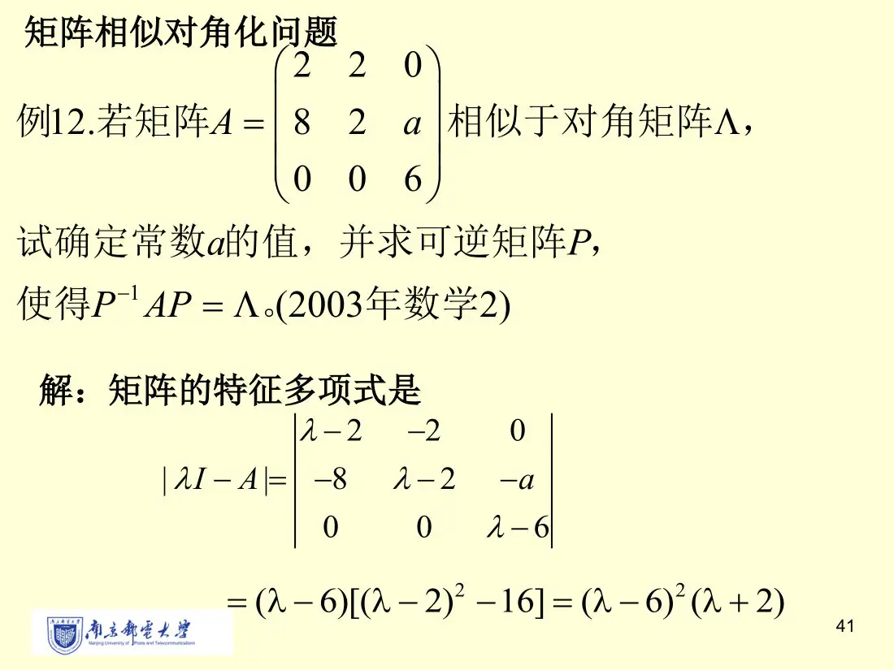

原文：

矩阵相似对角化问题
例12.若矩阵 $A=\begin{pmatrix}2&2&0\\8&2&a\\0&0&6\end{pmatrix}$ 相似于对角矩阵 $\Lambda$ ,
试确定常数a的值，并求可逆矩阵P，
使得 $P^{-1}AP=\Lambda$ 。(2003年数学2)

解：矩阵的特征多项式是

$$
| \lambda I - A | = \left| \begin{array}{c c c} \lambda - 2 & - 2 & 0 \\ - 8 & \lambda - 2 & - a \\ 0 & 0 & \lambda - 6 \end{array} \right|
$$

$$
= (\lambda - 6) [ (\lambda - 2) ^ {2} - 1 6 ] = (\lambda - 6) ^ {2} (\lambda + 2)
$$

南京邮电大学
Nanjing University of Posts and Telecommunications

41

### 应有两个线性无关的特征向量,

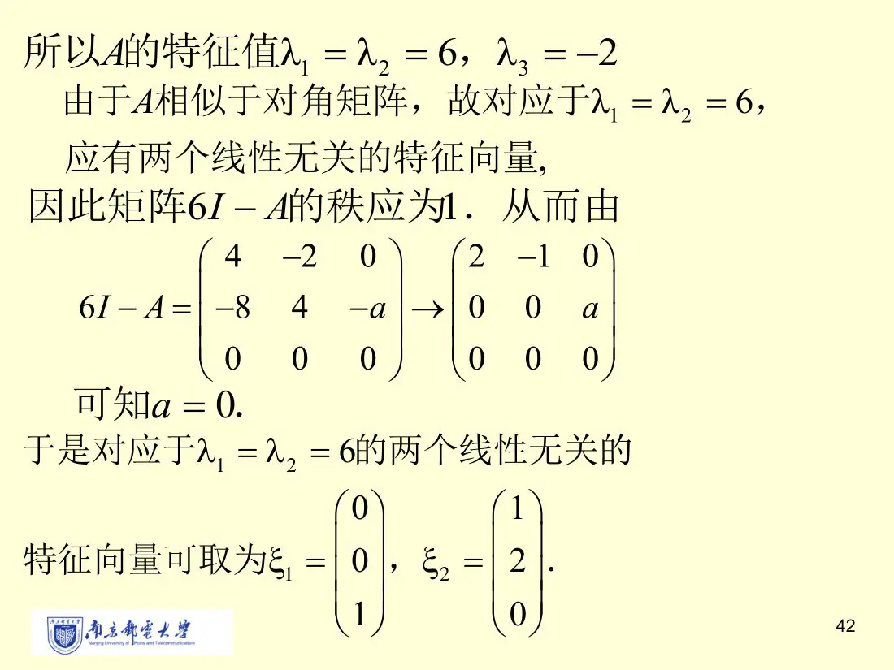

原文：

所以 $A$ 的特征值 $\lambda_{1} = \lambda_{2} = 6, \lambda_{3} = -2$

由于A相似于对角矩阵，故对应于 $\lambda_{1}=\lambda_{2}=6$ ，

应有两个线性无关的特征向量,

因此矩阵6I - A的秩应为1．从而由

$$
6 I - A = \left(\begin{array}{c c c}4&- 2&0\\- 8&4&- a\\0&0&0\end{array}\right)\rightarrow \left(\begin{array}{c c c}2&- 1&0\\0&0&a\\0&0&0\end{array}\right)
$$

可知a=0.

于是对应于 $\lambda_{1} = \lambda_{2} = 6$ 的两个线性无关的

特征向量可取为 $\xi_{1} = \begin{pmatrix} 0 \\ 0 \\ 1 \end{pmatrix}$ , $\xi_{2} = \begin{pmatrix} 1 \\ 2 \\ 0 \end{pmatrix}$ .

42

### 当 $\lambda_{3}=-2$ 时,

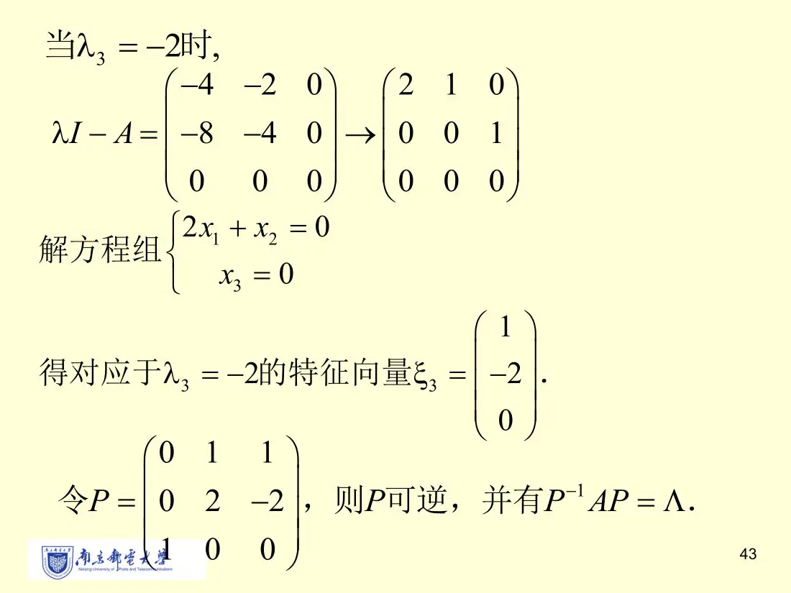

原文：

当 $\lambda_{3}=-2$ 时,

$$
\lambda I - A = \left(\begin{array}{c c c}- 4&- 2&0\\- 8&- 4&0\\0&0&0\end{array}\right)\rightarrow \left(\begin{array}{c c c}2&1&0\\0&0&1\\0&0&0\end{array}\right)
$$

解方程组 $\left\{ \begin{array}{l} 2x_{1} + x_{2} = 0 \\ x_{3} = 0 \end{array} \right.$

$$
\lambda_ {3} = - 2
$$

$$
\xi_ {3} = \left( \begin{array}{c} 1 \\ - 2 \\ 0 \end{array} \right)
$$

令 $P=\begin{pmatrix}0&1&1\\0&2&-2\\1&0&0\end{pmatrix}$ ，则P可逆，并有 $P^{-1}AP=\Lambda$ .

43

### 若B的特征值为-5,1,7，且 $B=(A^{-1})^{2}-6A$ ，

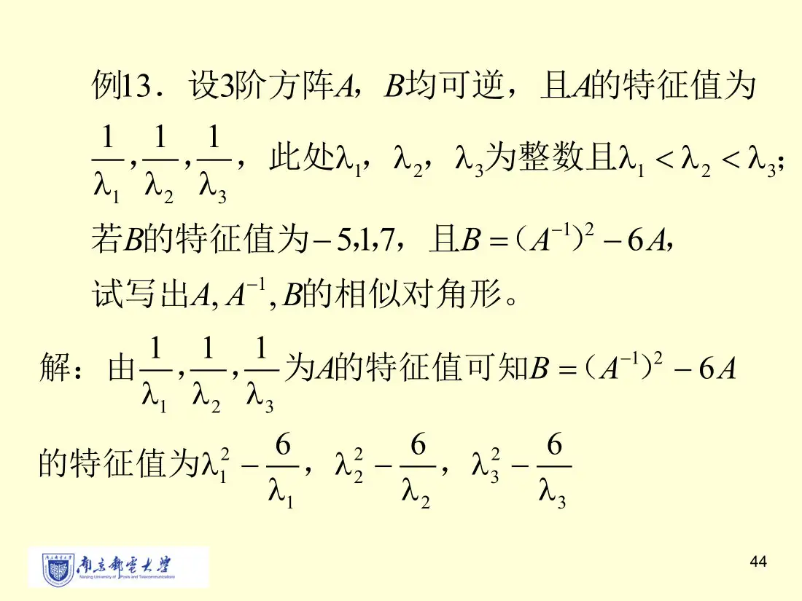

原文：

例13. 设3阶方阵A, B均可逆, 且A的特征值为 $\frac{1}{\lambda_{1}}, \frac{1}{\lambda_{2}}, \frac{1}{\lambda_{3}}$ ，此处 $\lambda_{1}, \lambda_{2}, \lambda_{3}$ 为整数且 $\lambda_{1} < \lambda_{2} < \lambda_{3}$ ;
若B的特征值为-5,1,7，且 $B=(A^{-1})^{2}-6A$ ，

试写出 $A, A^{-1}, B$ 的相似对角形。

解：由 $\frac{1}{\lambda_1}, \frac{1}{\lambda_2}, \frac{1}{\lambda_3}$ 为 $A$ 的特征值可知 $B = (A^{-1})^2 - 6A$ 的特征值为 $\lambda_1^2 - \frac{6}{\lambda_1}$ ， $\lambda_2^2 - \frac{6}{\lambda_2}$ ， $\lambda_3^2 - \frac{6}{\lambda_3}$

南京邮电大学
Nanjing University of Posts and Telecommunications

44

### 由题设，有

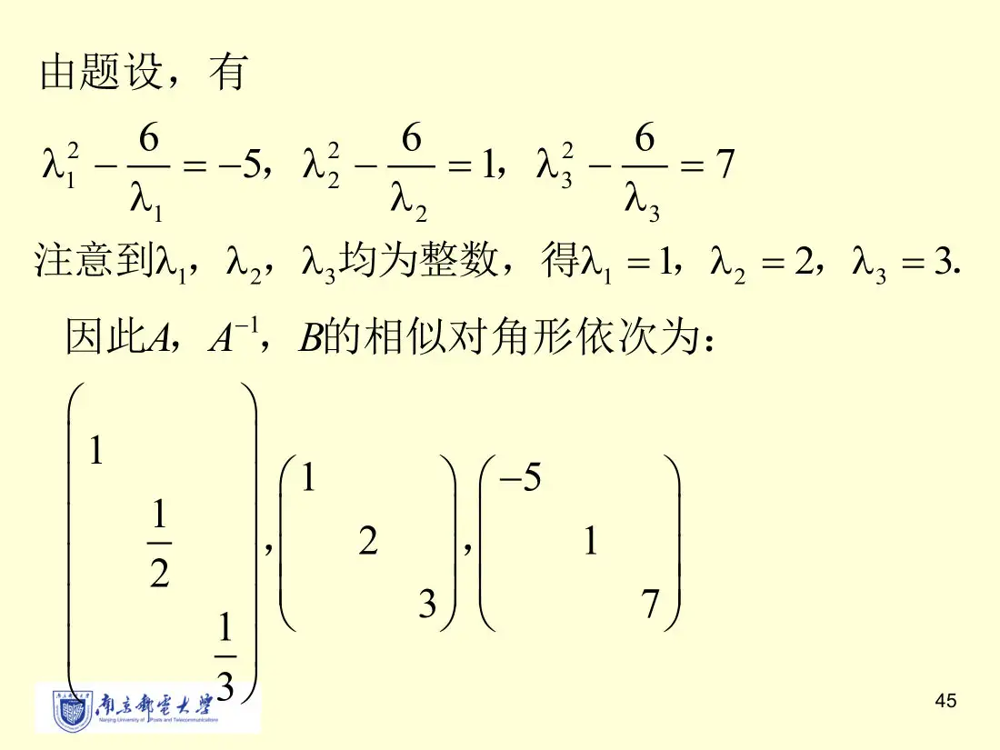

原文：

由题设，有

$$
\lambda_ {1} ^ {2} - \frac {6}{\lambda_ {1}} = - 5, \quad \lambda_ {2} ^ {2} - \frac {6}{\lambda_ {2}} = 1, \quad \lambda_ {3} ^ {2} - \frac {6}{\lambda_ {3}} = 7
$$

注意到 $\lambda_{1}$ ， $\lambda_{2}$ ， $\lambda_{3}$ 均为整数，得 $\lambda_{1} = 1$ ， $\lambda_{2} = 2$ ， $\lambda_{3} = 3$

因此 $A, A^{-1}, B$ 的相似对角形依次为：

$$
\left( \begin{array}{c c c} 1 & & \\ & \frac {1}{2} & \\ & & \frac {1}{3} \end{array} \right), \left( \begin{array}{c c c} 1 & & \\ & 2 & \\ & & 3 \end{array} \right), \left( \begin{array}{c c c} - 5 & & \\ & 1 & \\ & & 7 \end{array} \right)
$$

45

### 例14. 设n阶阵A满足 $A^{2}=2A$ ，试证：A可对角化.

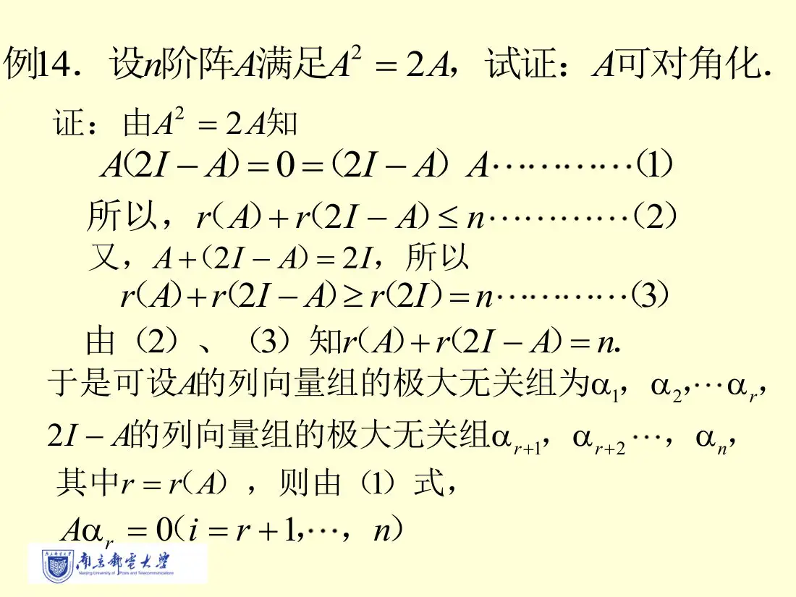

原文：

例14. 设n阶阵A满足 $A^{2}=2A$ ，试证：A可对角化.

证：由 $A^2 = 2A$ 知

$$
A (2 I - A) = 0 = (2 I - A) \quad A \dots\dots(1)
$$

$$
r (A) + r (2 I - A) \leq n \dots\dots(2)
$$

又， $A+(2I-A)=2I$ ，所以

$$
r (A) + r (2 I - A) \geq r (2 I) = n \cdot \cdot \cdot (3)
$$

$$
\left| r (A) + r (2 I - A) = n. \right.
$$

$$
\alpha_ {1}, \quad \alpha_ {2}, \dots \alpha_ {r},
$$

$$
\alpha_ {r + 1}, \alpha_ {r + 2} \dots , \alpha_ {n},
$$

$$
r = r (A)
$$

$$
A \alpha_ {r} = 0 (i = r + 1, \dots , n)
$$

南京邮电大学
Nanjing University of Posts and Telecommunications

### $$

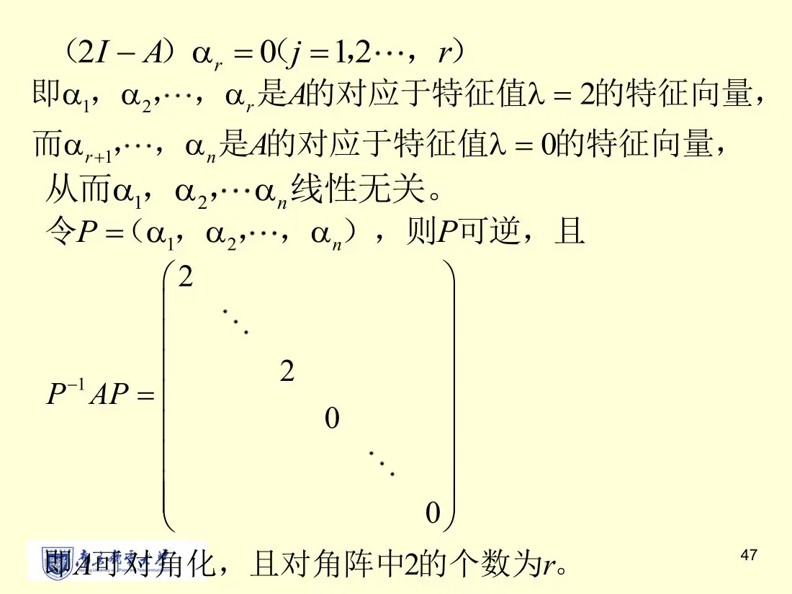

原文：

$$
(2 I - A) \alpha_ {r} = 0 (j = 1, 2 \dots , r)
$$

即 $\alpha_{1}, \alpha_{2}, \cdots, \alpha_{r}$ 是 $A$ 的对应于特征值 $\lambda = 2$ 的特征向量，而 $\alpha_{r+1}, \cdots, \alpha_{n}$ 是 $A$ 的对应于特征值 $\lambda = 0$ 的特征向量，从而 $\alpha_{1}, \alpha_{2}, \cdots, \alpha_{n}$ 线性无关。

令 $P=(\alpha_{1},\alpha_{2},\cdots,\alpha_{n})$ ，则P可逆，且

$$
P ^ {- 1} A P = \left( \begin{array}{c c c c c c c c c} 2 & & & & & & \\ & \ddots & & & & & \\ & & 2 & & & & \\ & & & 0 & & & \\ & & & & \ddots & & \\ & & & & & & 0 \end{array} \right)
$$

即4可对角化，且对角阵中2的个数为r。

47

### 试证：A可对角化的充要条件是

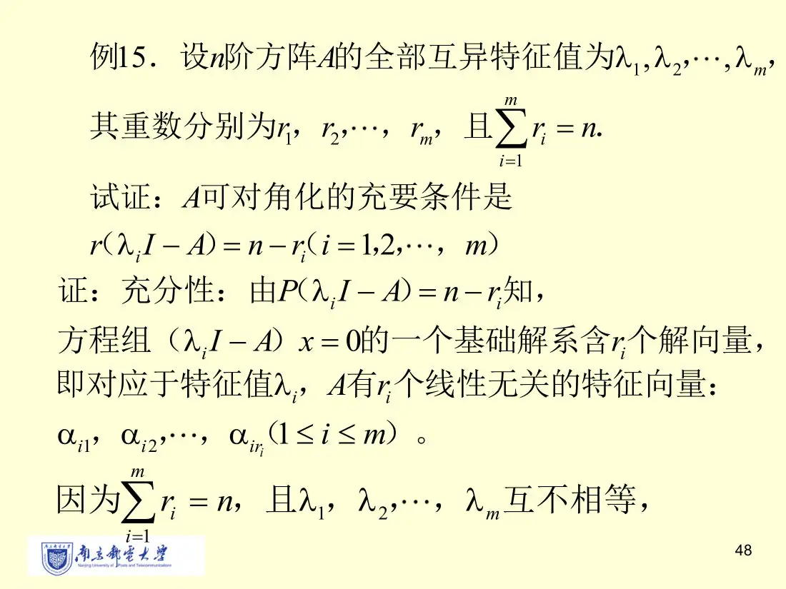

原文：

例15. 设n阶方阵A的全部互异特征值为 $\lambda_{1},\lambda_{2},\cdots,\lambda_{m}$ ，其重数分别为 $r_{1},r_{2},\cdots,r_{m}$ ，且 $\sum_{i=1}^{m}r_{i}=n$ .

试证：A可对角化的充要条件是

$$
r (\lambda_ {i} I - A) = n - r _ {i} (i = 1, 2, \dots , m)
$$

证：充分性：由 $P(\lambda_{i}I-A)=n-r_{i}$ 知，

方程组 $(\lambda_{i}I - A)x = 0$ 的一个基础解系含 $r_i$ 个解向量，即对应于特征值 $\lambda_{i}$ ， $A$ 有 $r_i$ 个线性无关的特征向量：

$$
\alpha_ {i 1}, \alpha_ {i 2}, \dots , \alpha_ {i r _ {i}} (1 \leq i \leq m)
$$

因为 $\sum_{i=1}^{m} r_{i} = n$ ，且 $\lambda_{1}, \lambda_{2}, \ldots, \lambda_{m}$ 互不相等，

南京邮电大学
Nanjing University of Posts and Telecommunications

48

### 所以A有n个线性无关的特征向量:

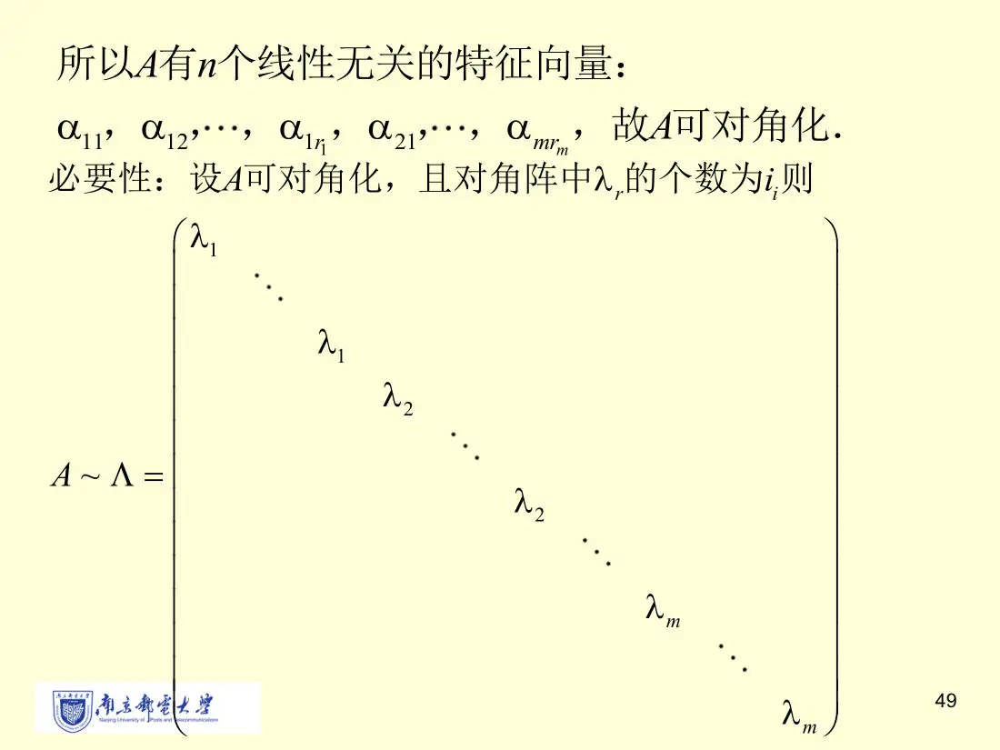

原文：

所以A有n个线性无关的特征向量:

$\alpha_{11}, \alpha_{12}, \cdots, \alpha_{1r_{1}}, \alpha_{21}, \cdots, \alpha_{mr_{m}}$ ，故A可对角化.
必要性：设A可对角化，且对角阵中 $\lambda_{r}$ 的个数为 $i_{i}$ 则

$$
A \sim \Lambda = \left( \begin{array}{c c c c c c c c c c} \lambda_ {1} & & & & & & & & \\ & \ddots & & & & & & & \\ & & \lambda_ {1} & & & & & & \\ & & & \lambda_ {2} & & & & & \\ & & & & \ddots & & & & \\ & & & & \lambda_ {2} & & & & \\ & & & & & \ddots & & \\ & & & & & \lambda_ {m} & \\ & & & & & & \ddots & \\ & & & & & & \lambda_ {m} \end{array} \right)
$$

49

### (1)在什么条件下A可对角化?

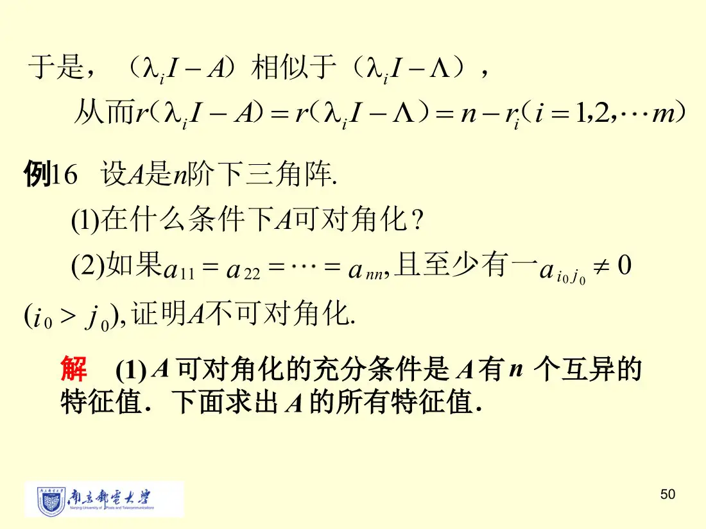

原文：

于是， $(\lambda_{i}I-A)$ 相似于 $(\lambda_{i}I-\Lambda)$ ，

从而 $r(\lambda_{i}I-A)=r(\lambda_{i}I-\Lambda)=n-r_{i}(i=1,2,\cdots m)$ 例16 设A是n阶下三角阵.

(1)在什么条件下A可对角化?

(2)如果 $a_{11}=a_{22}=\cdots=a_{nn}$ ，且至少有一 $a_{i_{0}j_{0}}\neq0$ $(i_{0}>j_{0})$ , 证明 A 不可对角化.

解 (1) $A$ 可对角化的充分条件是 $A$ 有 $n$ 个互异的特征值。下面求出 $A$ 的所有特征值。

南京邮电大学
Nanjing University of Posts and Telecommunications

50

### $$

原文：

$$
\because A = \left( \begin{array}{c c c c} a _ {1 1} & & & 0 \\ & a _ {2 2} & & \\ & & \ddots & \\ & & & a _ {n n} \end{array} \right),
$$

$\therefore f_{A}(\lambda) = |\lambda I - A| = (\lambda - a_{11})(\lambda - a_{22}) \cdots (\lambda - a_{nn}).$ 令 $f_{A}(\lambda) = 0$ , 即 $(\lambda - a_{11})(\lambda - a_{22}) \cdots (\lambda - a_{nn}) = 0,$ 得 $A$ 的所有特征值 $\lambda_{i} = a_{ii}(1 \leq i \leq n)$ .

当 $\lambda_{i}\neq\lambda_{j}(i\neq j,i,j=1,2,\cdots,n)$ 时, 即当 $a_{ii}\neq a_{jj}$ 时, A 可对角化.

南京邮电大学
Nanjing University of Posts and Telecommunications

51

### (2)用反证法.

原文：

(2)用反证法.

若A可对角化,则存在可逆矩阵P,使

$$
P ^ {- 1} A P = \operatorname{diag} \left(\lambda_ {1}, \lambda_ {2}, \dots , \lambda_ {n}\right), \lambda_ {i} (1 \leq i \leq n)
$$

是A的特征值.

由(1)可知 $\lambda_{i}=a_{ii}=a_{11}$ ，所以

$$
P ^ {- 1} A P = \left( \begin{array}{c c c c} a _ {1 1} & & & \\ & a _ {1 1} & & \\ & & \mathrm{O} & \\ & & & a _ {1 1} \end{array} \right) = a _ {1 1} I.
$$

$$
A = P a _ {1 1} I P ^ {- 1} = a _ {1 1} P P ^ {- 1} = a _ {1 1} I,
$$

这与至少有一个 $a_{i_0j_0} \neq 0 (i_0 > j_0)$ 矛盾, 故 $A$ 不可
对角化.

### 四、证明所给矩阵为正交矩阵

原文：

四、证明所给矩阵为正交矩阵

方法1 证明矩阵的各列(或行)元素满足正交条件

$$
\sum_ {k = 1} ^ {n} a _ {k i} a _ {k j} = \delta_ {i j} (\text {或} \sum_ {k = 1} ^ {n} a _ {i k} a _ {j k} = \delta_ {i j}), i, j = 1, 2, \dots , n;
$$

方法2: 根据正交矩阵的定义, 先求出 $A^{T}$ , 再证明 $AA^{T}=I$ .

南京邮电大学
Nanjing University of Posts and Telecommunications

53

### 证明

原文：

例17 设a是n维列向量,I为n阶单位矩阵,证明 $A = I - [2 / (a^{T}a)]aa^{T}$ 为正交矩阵.

证明

根据正交矩阵的定义验证 $AA^{T}=I$

$$
Q A ^ {T} = [ I - (2 / a ^ {T} a) \cdot a a ^ {T} ] ^ {T} I - (2 / a ^ {T} a) a a ^ {T} = A
$$

$$
\therefore \boldsymbol {A} ^ {T} \boldsymbol {A} = \boldsymbol {A A} = [ I - (2 / a ^ {T} a) \cdot a a ^ {T} ] [ I - (2 / a ^ {T} a) \cdot a a ^ {T} ]
$$

南京邮电大学
Nanjing University of Posts and Telecommunications

54

### $$

原文：

$$
\begin{array}{r l} & = I - [ 2 / (a ^ {T} a) ] \cdot a a ^ {T} - [ 2 / (a ^ {T} a) ] \cdot a a ^ {T} \\ & + [ 4 / (a ^ {T} a) ^ {2} ] a (a ^ {T} a) a ^ {T}. \end{array}
$$

$\because a\neq0,\therefore a^{T}a$ 为一非零数,

故 $a(a^{T}a)a^{T}=(a^{T}a)(aa^{T})$ ,

$$
\therefore A ^ {T} A = I - [ 4 / (a ^ {T} a) ] a a ^ {T} + [ 4 / (a ^ {T} a) ] a a ^ {T} = I,
$$

故A是正交矩阵.

南京邮电大学
Nanjing University of Posts and Telecommunications

55

### 五、将线性无关向量组化为正交单位向量组

原文：

五、将线性无关向量组化为正交单位向量组

将线性无关向量组化为正交单位向量组，可以先正交化，再单位化；也可同时进行正交化与单位化。

例18 已知向量 $\alpha_{1} = \begin{pmatrix} 1 \\ 1 \\ 0 \\ 0 \end{pmatrix}, \alpha_{2} = \begin{pmatrix} 1 \\ 0 \\ 1 \\ 0 \end{pmatrix}, \alpha_{3} = \begin{pmatrix} -1 \\ 0 \\ 0 \\ 1 \end{pmatrix}$ 是线性

无关向量组,求与之等价的正交单位向量组.

南京邮电大学
Nanjing University of Posts and Telecommunications

56

### 解一 先正交化，再单位化

原文：

解一 先正交化，再单位化

$$
\text {取} \beta_ {1} = \alpha_ {1} = \left( \begin{array}{c} 1 \\ 1 \\ 0 \\ 0 \end{array} \right) \quad \beta_ {2} = \alpha_ {2} - \frac {\left(\alpha_ {2} , \beta_ {1}\right)}{\left(\beta_ {1} , \beta_ {1}\right)} \beta_ {1} = \left( \begin{array}{c} 1 / 2 \\ - 1 / 2 \\ 1 \\ 0 \end{array} \right);
$$

$$
\beta_ {3} = \alpha_ {3} - \frac {\left(\alpha_ {3} , \beta_ {1}\right)}{\left(\beta_ {1} , \beta_ {1}\right)} \beta_ {1} - \frac {\left(\alpha_ {3} , \beta_ {2}\right)}{\left(\beta_ {2} , \beta_ {2}\right)} \beta_ {2} = = \left( \begin{array}{c} - 1 / 3 \\ 1 / 3 \\ 1 / 3 \\ 1 \end{array} \right) \text {.};
$$

南京邮电大学
Nanjing University of Posts and Telecommunications

57

### $$

原文：

将 $\beta_{1},\beta_{2},\beta_{3}$ 单位化，即为所求的向量组。

$$
\gamma_ {1} = \frac {\beta_ {1}}{| \beta_ {1} |} = \left( \begin{array}{c} 1 / \sqrt {2} \\ 1 / \sqrt {2} \\ \mathbf {0} \\ \mathbf {0} \end{array} \right); \quad \gamma_ {2} = \frac {\beta_ {2}}{| \beta_ {2} |} = \left( \begin{array}{c} 1 / \sqrt {6} \\ - 1 / \sqrt {6} \\ 2 / \sqrt {6} \\ \mathbf {0} \end{array} \right);
$$

$$
\gamma_ {3} = \frac {\beta_ {3}}{\left| \beta_ {3} \right|} = \left( \begin{array}{c} - 1 / (2 \sqrt {3}) \\ 1 / (2 \sqrt {3}) \\ 1 / (2 \sqrt {3}) \\ \sqrt {3} / 2 \end{array} \right).
$$

南京邮电大学
Nanjing University of Posts and Telecommunications

58

### 六.利用正交变换将实对称矩阵化为对角阵

原文：

六.利用正交变换将实对称矩阵化为对角阵
例19 设实对称阵 $A=\begin{pmatrix}2&-2&0\\-2&1&-2\\0&-2&0\end{pmatrix}$ ，求正交变换
Q,使 $Q^{-1}AQ$ 为对角阵.

解 第一步 求A的特征值．由

$$
\left| \lambda I - A \right| = \left| \begin{array}{c c c} \lambda - 2 & 2 & 0 \\ 2 & \lambda - 1 & 2 \\ 0 & 2 & \lambda \end{array} \right|
$$

南京邮电大学
Nanjing University of Posts and Telecommunications

59

### $$

原文：

$$
= (\lambda - 4) (\lambda - 1) (\lambda + 2) = 0,
$$

得 $\lambda_{1}=4,\quad\lambda_{2}=1,\quad\lambda_{3}=-2.$

第二步 由 $(\lambda_{i}I-A)x=0$ , 求出A的特征向量.

对 $\lambda_{1}=4,$ 解 $(4I-A)x=0,$ 得

$\left\{ \begin{array}{l} 2x_{1} + 2x_{2} = 0, \\ 2x_{1} + 3x_{2} + 2x_{3} = 0, \\ 2x_{2} + 4x_{3} = 0, \end{array} \right.$ 解之得基础解系 $\alpha_{1} = \begin{pmatrix} -2 \\ 2 \\ 1 \end{pmatrix}$ .

南京邮电大学
Nanjing University of Posts and Telecommunications

60

### 对 $\lambda_{2}=1,$ 解 $(I-A)x=0,$ 得

原文：

对 $\lambda_{2}=1,$ 解 $(I-A)x=0,$ 得

$$
\left\{ \begin{array}{l l} - x _ {1} + 2 x _ {2} & = 0, \\ 2 x _ {1} & + 2 x _ {3} = 0, \\ 2 x _ {2} + x _ {3} = 0, \end{array} \right.
$$

解之得基础解系 $\alpha_{2}=\begin{pmatrix}2\\1\\-2\end{pmatrix}.$

对 $\lambda_{3}=-2,$ 解 $(-2I-A)x=0,$ 得

南京邮电大学
Nanjing University of Posts and Telecommunications

61

### 解之得基础解系

原文：

解之得基础解系

$$
\begin{array}{r l} & {\left\{ \begin{array}{l l} {- 4 x _ {1} + 2 x _ {2}} & {= 0,} \\ {2 x _ {1} - 3 x _ {2} + 2 x _ {3} = 0,} \\ {2 x _ {2} - 2 x _ {3} = 0,} \end{array} \right.} \\ & {\text {础解系} \quad \alpha_ {3} = \left( \begin{array}{l} {1} \\ {2} \\ {2} \end{array} \right).} \end{array}
$$

第三步 将特征向量正交化.因为 $\alpha_{1},\alpha_{2},\alpha_{3}$ 是属于 $A$ 的3个不同特征值的特征向量,故它们必两两正交.

南京邮电大学
Nanjing University of Posts and Telecommunications

62

### 第四步 将特征向量单位化.

原文：

第四步 将特征向量单位化.

令 $\eta_{i} = \frac{\alpha_{i}}{|\alpha_{i}|}, i = 1,2,3,$ 得

$$
\eta_ {1} = \left( \begin{array}{c} - 2 / 3 \\ 2 / 3 \\ - 1 / 3 \end{array} \right), \quad \eta_ {2} = \left( \begin{array}{c} 2 / 3 \\ 1 / 3 \\ - 2 / 3 \end{array} \right), \quad \eta_ {3} = \left( \begin{array}{c} 1 / 3 \\ 2 / 3 \\ 2 / 3 \end{array} \right).
$$

南京邮电大学
Nanjing University of Posts and Telecommunications

63

### $$

原文：

令

$$
Q = (\eta_ {1}, \eta_ {2}, \eta_ {3}) = \frac {1}{3} \left( \begin{array}{c c c} - 2 & 2 & 1 \\ 2 & 1 & 2 \\ - 1 & - 2 & 2 \end{array} \right),
$$

$$
Q ^ {- 1} A Q = \left( \begin{array}{c c c} 4 & 0 & 0 \\ 0 & 1 & 0 \\ 0 & 0 & - 2 \end{array} \right).
$$

南京邮电大学
Nanjing University of Posts and Telecommunications

64

### 求x和y之值,并求正交阵Q,使 $Q^{T}AQ=\Lambda$ .

原文：

例20.设 $A = \begin{pmatrix} 1 & -2 & -4 \\ -2 & x & -2 \\ -4 & -2 & 1 \end{pmatrix} \sim \Lambda = \begin{pmatrix} 5 & & \\ & y & \\ & & -4 \end{pmatrix},$

求x和y之值,并求正交阵Q,使 $Q^{T}AQ=\Lambda$ .

解：因为 $A \sim B$ ，所以 $\left|A\right| = \left|B\right|$ ,tr $A = trB$ ，由此得方程组

$$
\left\{ \begin{array}{l} - 1 5 x - 4 0 = - 2 0 y \\ x + 2 = y + 1 \end{array} \right.
$$

解之得x=4,y=5.

于是 $A = \begin{pmatrix} 1 & -2 & -4 \\ -2 & 4 & -2 \\ -4 & -2 & 1 \end{pmatrix}, \Lambda = \begin{pmatrix} 5 & & \\ & 5 & \\ & & -4 \end{pmatrix}$ .

南京邮电大学
Nanjing University of Posts and Telecommunications

65

### $$

原文：

由 $A \sim \Lambda$ 及 $\Lambda$ 的结构知 $A$ 的特征值 $\lambda_1 = 5$ (二重), $\lambda_2 = -4$ . 易求得对应于 $\lambda = 5$ 的两个正交的单位特征向量为

$$
\eta_ {1} = \left( \begin{array}{c} \frac {1}{2} \sqrt {2} \\ 0 \\ - \frac {1}{2} \sqrt {2} \end{array} \right), \eta_ {2} = \left( \begin{array}{c} - \frac {1}{6} \sqrt {2} \\ \frac {2}{3} \sqrt {2} \\ - \frac {1}{6} \sqrt {2} \end{array} \right)
$$

对应于 $\lambda = -4$ 的单位特征向量为 $\eta_{3} = \left(\frac{2}{3},\frac{1}{3},\frac{2}{3}\right)^{T}$

南京邮电大学
Nanjing University of Posts and Telecommunications

66

### $$

原文：

由于A为实对称阵,故 $\eta_{1},\eta_{2},\eta_{3}$ 为正交单位向量组,从而

$$
Q = \left( \begin{array}{c c c} \frac {1}{2} \sqrt {2} & - \frac {1}{6} \sqrt {2} & \frac {2}{3} \\ 0 & \frac {2}{3} \sqrt {2} & \frac {1}{3} \\ - \frac {1}{2} \sqrt {2} & - \frac {1}{6} \sqrt {2} & \frac {2}{3} \end{array} \right)
$$

为正交阵且 $Q^{T}AQ=\Lambda.$

南京邮电大学
Nanjing University of Posts and Telecommunications

67

### 因为A是实对称阵,对应于不同特征值的特征向量相互正交.

原文：

例21.设3阶实对称阵A的特征值为6,3,3,与6对应的一个特征向量为 $P_{1}=(1,1,1)^{T}$ ，试求A.

解：设 $P=(x_{1},x_{2},x_{3})^{T}$ 是A的对应与 $\lambda=3$ （二重）的特征向量，

因为A是实对称阵,对应于不同特征值的特征向量相互正交.

故P必与 $P_{1}$ 正交,即 $x_{1}+x_{2}+x_{3}=0$ ,

由此得A的对应于 $\lambda=3$ (二重)的两个正交的特征向量:

南京邮电大学
Nanjing University of Posts and Telecommunications

68

### 它仍是对应于 $\lambda = 6$ 的特征向量,

原文：

$\eta_{2} = \left(\frac{1}{\sqrt{2}}, 0, -\frac{1}{\sqrt{2}}\right)^{T}, \eta_{3} = \left(\frac{1}{\sqrt{6}}, -\frac{2}{\sqrt{6}}, \frac{1}{\sqrt{6}}\right)^{T}$ 将 $P_{1}$ 单位化得 $\eta_{1} = \left(\frac{1}{\sqrt{3}}, \frac{1}{\sqrt{3}}, \frac{1}{\sqrt{3}}\right)^{T}$ ,

它仍是对应于 $\lambda = 6$ 的特征向量,

于是, 得正交阵 $Q = (\eta_{1}, \eta_{2}, \eta_{3})$ , 且 $T^{T} A T = \begin{pmatrix} 6 & & \\ & 3 & \\ & & 3 \end{pmatrix} = \Lambda$

南京邮电大学
Nanjing University of Posts and Telecommunications

69

### 故 $A = Q\Lambda Q^T$

原文：

故 $A = Q\Lambda Q^T$

$$
= \left( \begin{array}{c c c} \frac {1}{\sqrt {3}} & \frac {1}{\sqrt {2}} & \frac {1}{\sqrt {6}} \\ \frac {1}{\sqrt {3}} & 0 & - \frac {2}{\sqrt {6}} \\ \frac {1}{\sqrt {3}} & - \frac {1}{\sqrt {2}} & \frac {1}{\sqrt {6}} \end{array} \right) \left( \begin{array}{c c c} 6 & & \\ & 3 & \\ & & 3 \end{array} \right) \left( \begin{array}{c c c} \frac {1}{\sqrt {3}} & \frac {1}{\sqrt {3}} & \frac {1}{\sqrt {3}} \\ \frac {1}{\sqrt {2}} & 0 & - \frac {1}{\sqrt {2}} \\ \frac {1}{\sqrt {6}} & - \frac {2}{\sqrt {6}} & \frac {1}{\sqrt {6}} \end{array} \right)
$$

$$
= \left( \begin{array}{c c c} 4 & 1 & 1 \\ 1 & 4 & 1 \\ 1 & 1 & 4 \end{array} \right)
$$

南京邮电大学
Nanjing University of Posts and Telecommunications

70

### $$

原文：

$$
T = \left( \begin{array}{c c c} \frac {1}{\sqrt {3}} & \frac {2}{\sqrt {6}} & 0 \\ - \frac {1}{\sqrt {3}} & \frac {1}{\sqrt {6}} & \frac {1}{\sqrt {2}} \\ \frac {1}{\sqrt {3}} & - \frac {1}{\sqrt {6}} & \frac {1}{\sqrt {2}} \end{array} \right)
$$

是正交阵，且 $T^{T}AT=\begin{pmatrix}1& & \\ &2& \\ & &0\end{pmatrix}$ ，由此得

$$
A = T \left( \begin{array}{c c c} 1 & & \\ & 2 & \\ & & 0 \end{array} \right) T ^ {T} = \frac {1}{3} \left( \begin{array}{c c c} 5 & 1 & - 1 \\ 1 & 2 & - 2 \\ - 1 & - 2 & 2 \end{array} \right)
$$

南京邮电大学
Nanjing University of Posts and Telecommunications

71
