# 《线性代数与解析几何》第6章 矩阵相似对角化（课件）

原件的每一页，下面附识别出的文字。

### 第6章 矩阵相似对角化

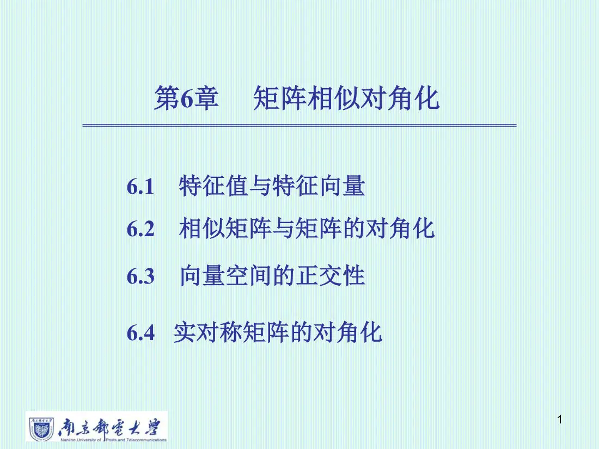

原文：

第6章 矩阵相似对角化

6.1 特征值与特征向量
6.2 相似矩阵与矩阵的对角化
6.3 向量空间的正交性
6.4 实对称矩阵的对角化

南京邮电大学
Nanjing University of Posts and Telecommunications

1

### 6.4 实对称矩阵的对角化

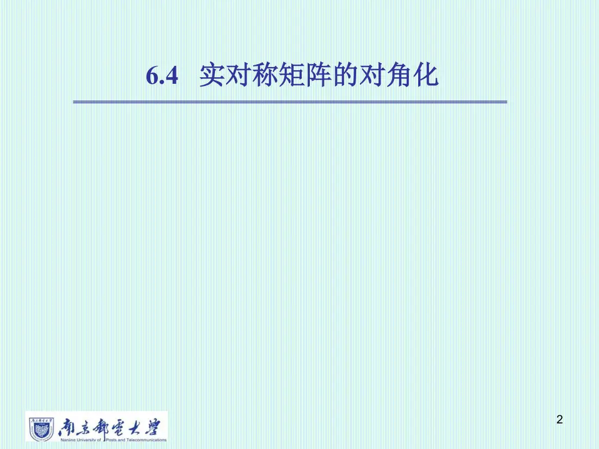

原文：

6.4 实对称矩阵的对角化

南京邮电大学
Nanjing University of Posts and Telecommunications

2

### 一、实对称矩阵的特征值与特征向量

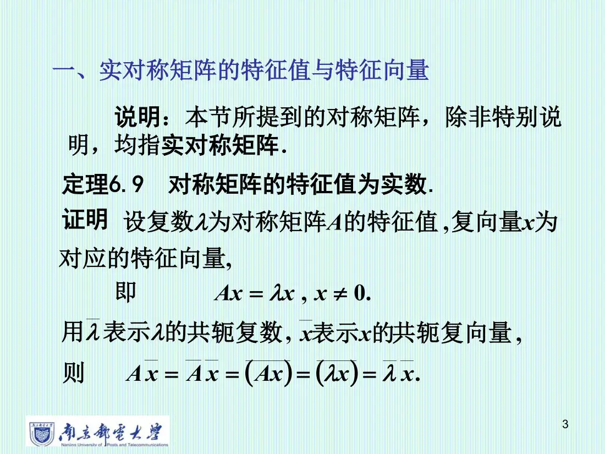

原文：

一、实对称矩阵的特征值与特征向量

说明：本节所提到的对称矩阵，除非特别说明，均指实对称矩阵。

定理6.9 对称矩阵的特征值为实数.

证明 设复数 $\lambda$ 为对称矩阵A的特征值,复向量x为对应的特征向量,

即

$$
A x = \lambda x, x \neq 0.
$$

用 $\overline{\lambda}$ 表示 $\lambda$ 的共轭复数， $\overline{x}$ 表示 x 的共轭复向量，
则 $A\overline{x}=A\overline{x}=(Ax)=(\lambda x)=\overline{\lambda}\overline{x}.$

南京邮电大学
Nanjing University of Posts and Telecommunications

3

### $$

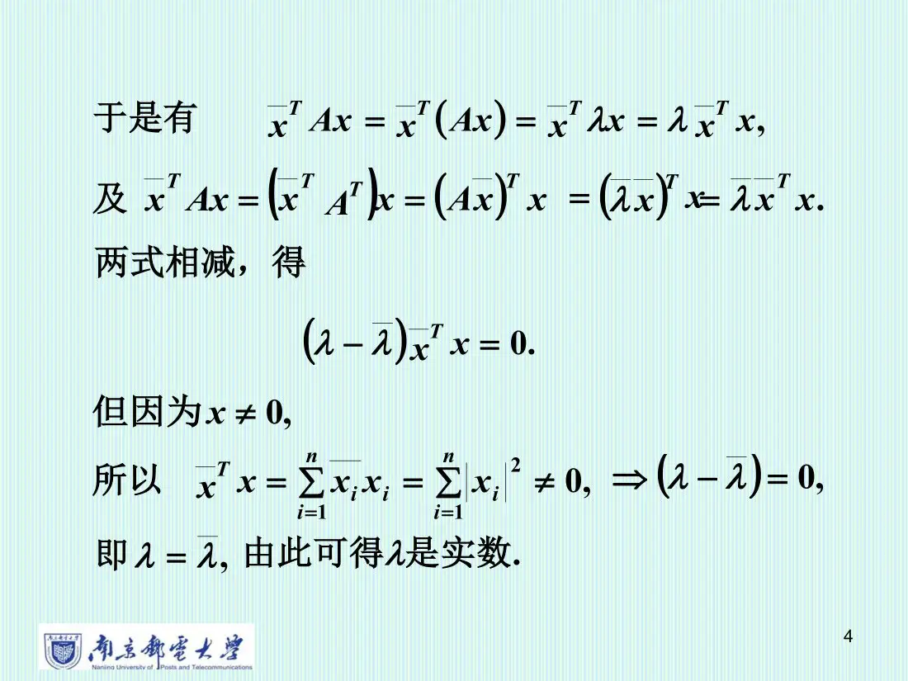

原文：

于是有 $\overline{x}^{T}Ax=\overline{x}^{T}(Ax)=\overline{x}^{T}\lambda x=\lambda\overline{x}^{T}x,$ 及 $\overline{x}^{T}Ax=\left(\overline{x}^{T}A^{T}\right)x=\left(A\overline{x}\right)^{T}x=\left(\overline{\lambda}\overline{x}\right)^{T}x=\overline{\lambda}x^{T}x.$ 两式相减，得

$$
\left(\lambda - \overline {{\lambda}}\right) _ {x} ^ {- T} x = 0.
$$

但因为 $x \neq 0$ ,

所以 $\overline{x}^{T}x=\sum_{i=1}^{n}\overline{x}_{i}x_{i}=\sum_{i=1}^{n}\left|x_{i}\right|^{2}\neq0,\Rightarrow(\lambda-\overline{\lambda})=0,$ 即 $\lambda = \overline{\lambda}$ ，由此可得 $\lambda$ 是实数。

南京邮电大学
Nanjing University of Posts and Telecommunications

4

### 南京邮电大学

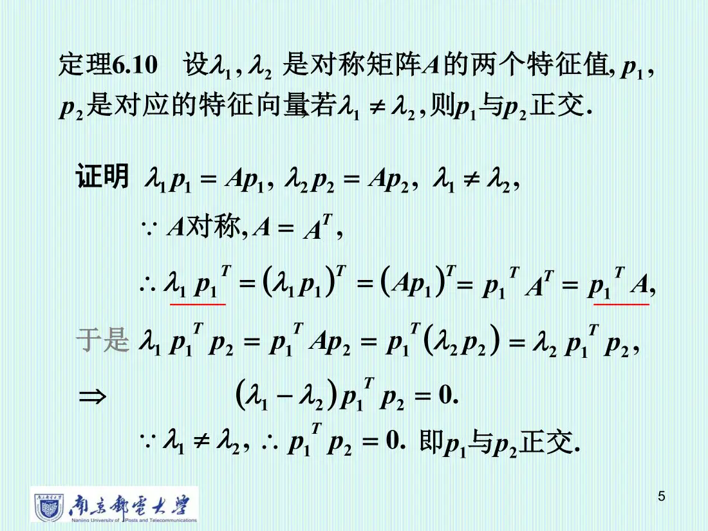

原文：

定理6.10 设 $\lambda_{1}, \lambda_{2}$ 是对称矩阵 $A$ 的两个特征值, $p_{1}$ , $p_{2}$ 是对应的特征向量若 $\lambda_{1} \neq \lambda_{2}$ , 则 $p_{1}$ 与 $p_{2}$ 正交.

证明 $\lambda_1p_1 = Ap_1, \lambda_2p_2 = Ap_2, \lambda_1 \neq \lambda_2,$ $\because A$ 对称, $A = A^T$ , $\therefore \underline{\lambda_1 p_1^T} = (\lambda_1 p_1)^T = (Ap_1)^T = p_1^T A^T = p_1^T A,$ 于是 $\lambda_1 p_1^T p_2 = p_1^T Ap_2 = p_1^T (\lambda_2 p_2) = \lambda_2 p_1^T p_2,$ $\Rightarrow (\lambda_1 - \lambda_2)p_1^T p_2 = 0.$ $\because \lambda_1 \neq \lambda_2, \therefore p_1^T p_2 = 0.$ 即 $p_1$ 与 $p_2$ 正交.

南京邮电大学
Nanjing University of Posts and Telecommunications

5

### $$

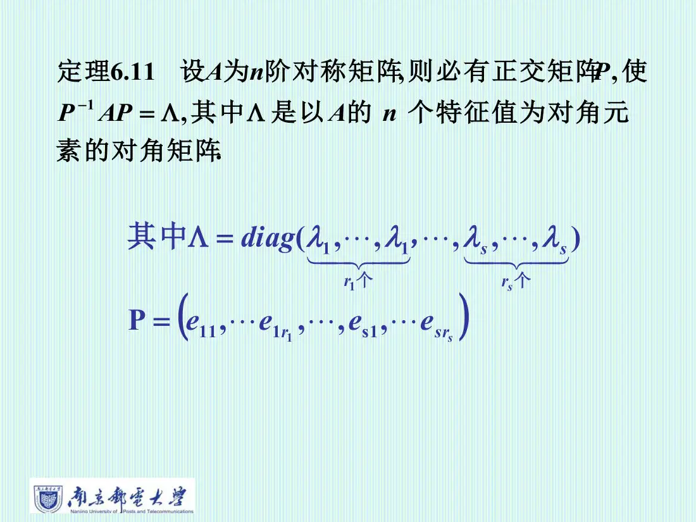

原文：

定理6.11 设A为n阶对称矩阵,则必有正交矩阵P,使 $P^{-1}AP=\Lambda$ ,其中 $\Lambda$ 是以A的n个特征值为对角元素的对角矩阵

$$
\begin{array}{l} \text {其中} \Lambda = d i a g (\underbrace {\lambda_ {1} , \cdots , \lambda_ {1}} _ {r _ {1} \text {个}}, \dots , \underbrace {\lambda_ {s} , \cdots , \lambda_ {s}} _ {r _ {s} \text {个}}) \\ \mathbf {P} = \left(e _ {1 1}, \dots e _ {1 r _ {1}}, \dots , e _ {s 1}, \dots e _ {s r _ {s}}\right) \end{array}
$$

南京邮电大学
Nanjing University of Posts and Telecommunications

### 利用正交矩阵将对称矩阵对角化的方法

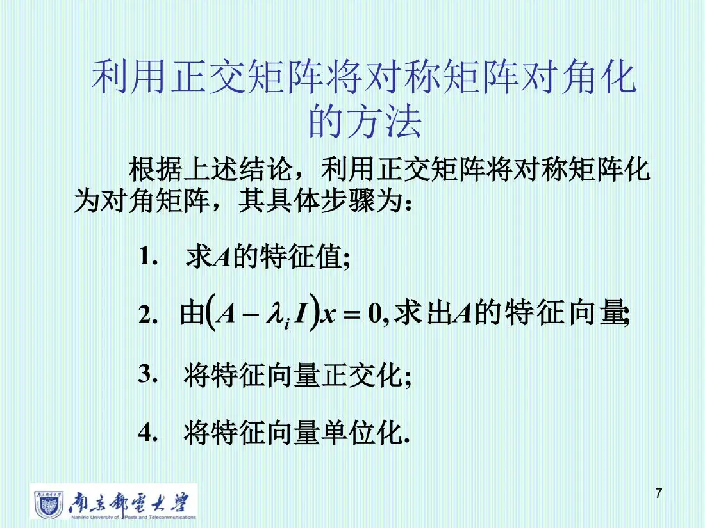

原文：

利用正交矩阵将对称矩阵对角化的方法

根据上述结论，利用正交矩阵将对称矩阵化为对角矩阵，其具体步骤为：

1. 求A的特征值;

2. 由 $(A-\lambda_{i}I)x=0$ , 求出A的特征向量;

3. 将特征向量正交化;

4. 将特征向量单位化.

南京邮电大学
Nanjing University of Posts and Telecommunications

7

### (1)

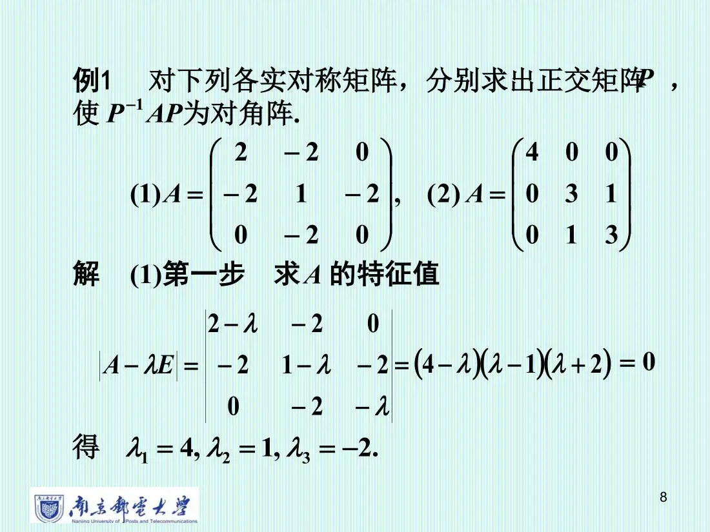

原文：

(1)

例1 对下列各实对称矩阵，分别求出正交矩阵 $P$ ，使 $P^{-1}AP$ 为对角阵。

$$
A = \left( \begin{array}{c c c} 2 & - 2 & 0 \\ - 2 & 1 & - 2 \\ 0 & - 2 & 0 \end{array} \right),
$$

(2)

$$
A = \left( \begin{array}{c c c} 4 & 0 & 0 \\ 0 & 3 & 1 \\ 0 & 1 & 3 \end{array} \right)
$$

解 (1)第一步 求 $A$ 的特征值

$$
| \boldsymbol {A} - \lambda \boldsymbol {E} | = \left| \begin{array}{c c c} 2 - \lambda & - 2 & \mathbf {0} \\ - 2 & 1 - \lambda & - 2 \\ \mathbf {0} & - 2 & - \lambda \end{array} \right| = (4 - \lambda) (\lambda - 1) (\lambda + 2) = \mathbf {0}
$$

得 $\lambda_{1} = 4, \lambda_{2} = 1, \lambda_{3} = -2.$

南京邮电大学
Nanjing University of Posts and Telecommunications

8

### 南京邮电大学

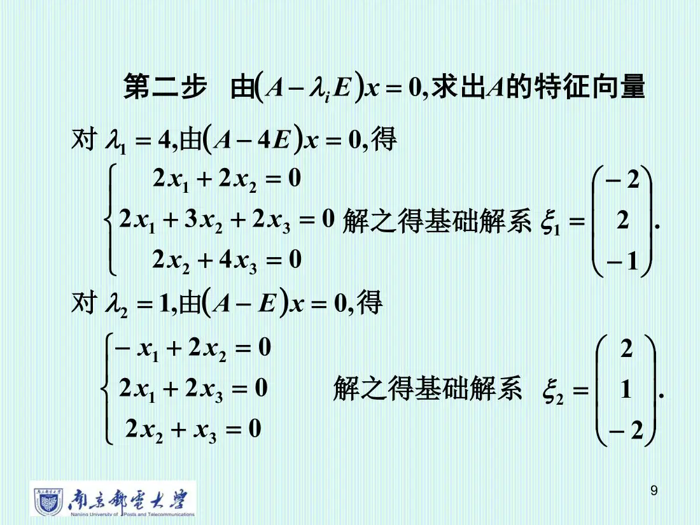

原文：

第二步 由 $(A - \lambda_{i}E)x = 0$ ，求出 $A$ 的特征向量对 $\lambda_1 = 4$ ，由 $(A - 4E)x = 0$ ，得 $\left\{ \begin{array}{l}2x_{1} + 2x_{2} = 0\\ 2x_{1} + 3x_{2} + 2x_{3} = 0\text{解之得基础解系}\xi_{1} = \left( \begin{array}{c} - 2\\ 2\\ -1 \end{array} \right).\\ 2x_{2} + 4x_{3} = 0 \end{array} \right.$ 对 $\lambda_2 = 1$ ，由 $(A - E)x = 0$ ，得 $\left\{ \begin{array}{ll} - x_1 + 2x_2 = 0\\ 2x_1 + 2x_3 = 0\\ 2x_2 + x_3 = 0 \end{array} \right.$ 解之得基础解系 $\xi_{2} = \left( \begin{array}{c}2\\ 1\\ -2 \end{array} \right).$

南京邮电大学
Nanjing University of Posts and Telecommunications

9

### 第三步 将特征向量正交化

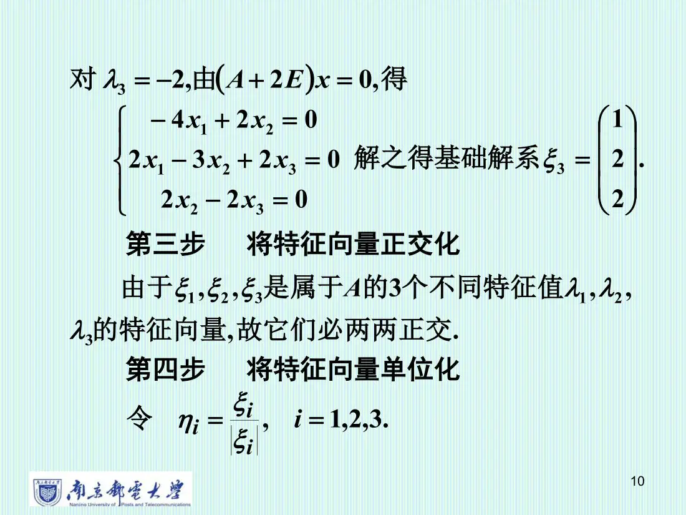

原文：

对 $\lambda_{3}=-2$ , 由 $(A+2E)x=0$ , 得 $\left\{\begin{aligned}-4x_{1}+2x_{2}&=0\\2x_{1}-3x_{2}+2x_{3}&=0\end{aligned}\right.$ 解之得基础解系 $\xi_{3}=\begin{pmatrix}1\\2\\2\end{pmatrix}.$

第三步 将特征向量正交化

由于 $\xi_{1}, \xi_{2}, \xi_{3}$ 是属于 $A$ 的 3 个不同特征值 $\lambda_{1}, \lambda_{2}, \lambda_{3}$ 的特征向量, 故它们必两两正交.

第四步 将特征向量单位化

令 $\eta_{i} = \frac{\xi_{i}}{|\xi_{i}|},\quad i = 1,2,3.$

南京邮电大学
Nanjing University of Posts and Telecommunications

10

### $$

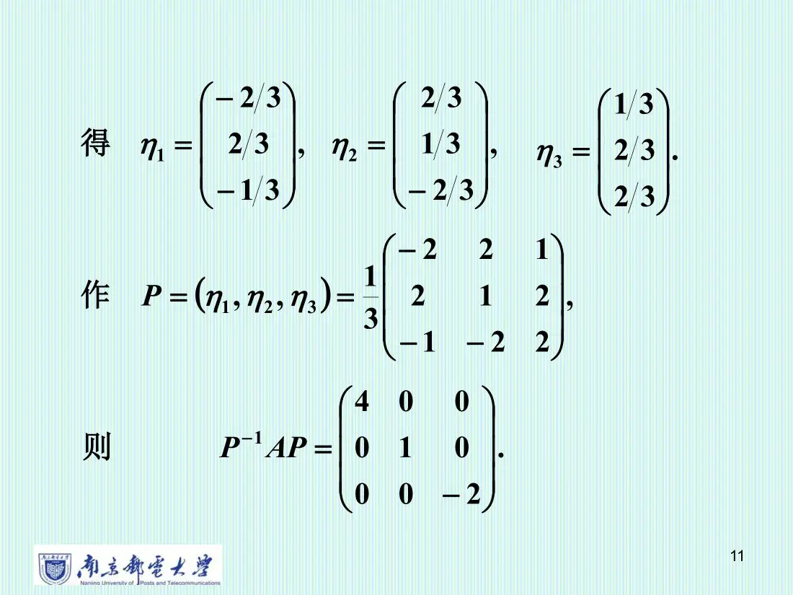

原文：

得

$$
\eta_ {1} = \left( \begin{array}{c} - 2 / 3 \\ 2 / 3 \\ - 1 / 3 \end{array} \right), \quad \eta_ {2} = \left( \begin{array}{c} 2 / 3 \\ 1 / 3 \\ - 2 / 3 \end{array} \right), \quad \eta_ {3} = \left( \begin{array}{c} 1 / 3 \\ 2 / 3 \\ 2 / 3 \end{array} \right).
$$

作

$$
P = (\eta_ {1}, \eta_ {2}, \eta_ {3}) = \frac {1}{3} \left( \begin{array}{c c c} - 2 & 2 & 1 \\ 2 & 1 & 2 \\ - 1 & - 2 & 2 \end{array} \right),
$$

则

$$
\boldsymbol {P} ^ {- 1} \boldsymbol {A} \boldsymbol {P} = \left( \begin{array}{l l l} 4 & \mathbf {0} & \mathbf {0} \\ \mathbf {0} & 1 & \mathbf {0} \\ \mathbf {0} & \mathbf {0} & - 2 \end{array} \right).
$$

南京邮电大学
Nanjing University of Posts and Telecommunications

11

### $$

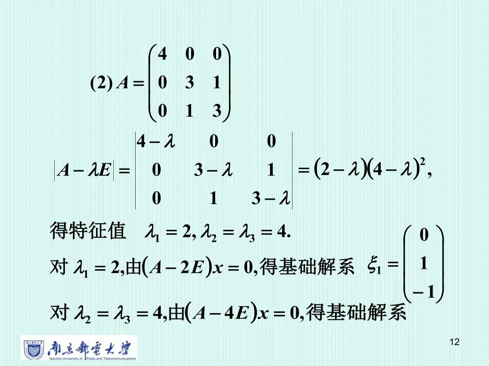

原文：

$$
A = \left( \begin{array}{c c c} 4 & 0 & 0 \\ 0 & 3 & 1 \\ 0 & 1 & 3 \end{array} \right)\tag{2}
$$

$$
| A - \lambda E | = \left| \begin{array}{c c c} 4 - \lambda & 0 & 0 \\ 0 & 3 - \lambda & 1 \\ 0 & 1 & 3 - \lambda \end{array} \right| = (2 - \lambda) (4 - \lambda) ^ {2},
$$

得特征值 $\lambda_{1}=2,\lambda_{2}=\lambda_{3}=4.$ 对 $\lambda_{1}=2$ , 由 $(A-2E)x=0$ , 得基础解系 $\xi_{1}=\begin{pmatrix}0\\1\\-1\end{pmatrix}$ 对 $\lambda_{2}=\lambda_{3}=4$ , 由 $(A-4E)x=0$ , 得基础解系

南京邮电大学 Nanjing University of Posts and Telecommunications

12

### 所以 $\xi_{1}, \xi_{2}, \xi_{3}$ 两两正交.

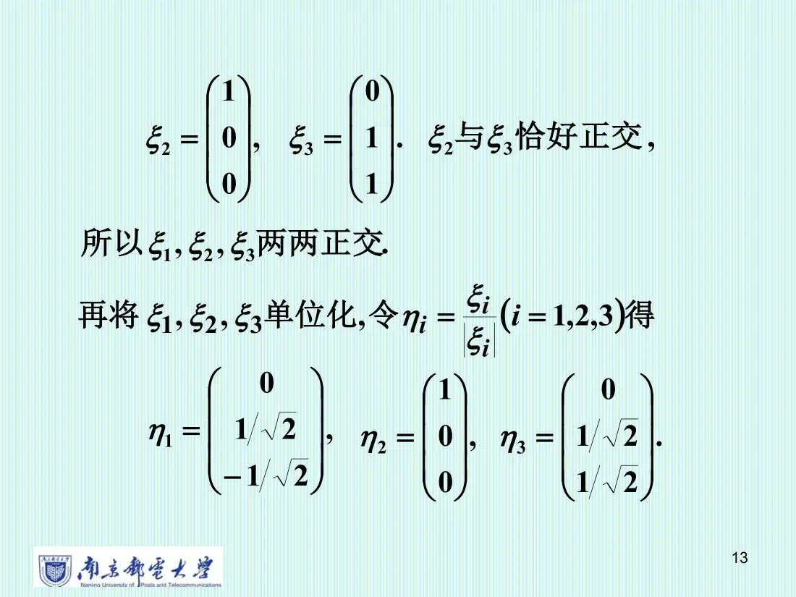

原文：

$\xi_{2} = \begin{pmatrix} 1 \\ 0 \\ 0 \end{pmatrix}, \quad \xi_{3} = \begin{pmatrix} 0 \\ 1 \\ 1 \end{pmatrix}. \quad \xi_{2}$ 与 $\xi_{3}$ 恰好正交，

所以 $\xi_{1}, \xi_{2}, \xi_{3}$ 两两正交.

再将 $\xi_1, \xi_2, \xi_3$ 单位化，令 $\eta_i = \frac{\xi_i}{|\xi_i|} (i = 1,2,3)$ 得

$$
\eta_ {1} = \left( \begin{array}{c} 0 \\ 1 / \sqrt {2} \\ - 1 / \sqrt {2} \end{array} \right), \quad \eta_ {2} = \left( \begin{array}{c} 1 \\ 0 \\ 0 \end{array} \right), \quad \eta_ {3} = \left( \begin{array}{c} 0 \\ 1 / \sqrt {2} \\ 1 / \sqrt {2} \end{array} \right).
$$

南京邮电大学
Nanjing University of Posts and Telecommunications

13

### 于是得正交阵

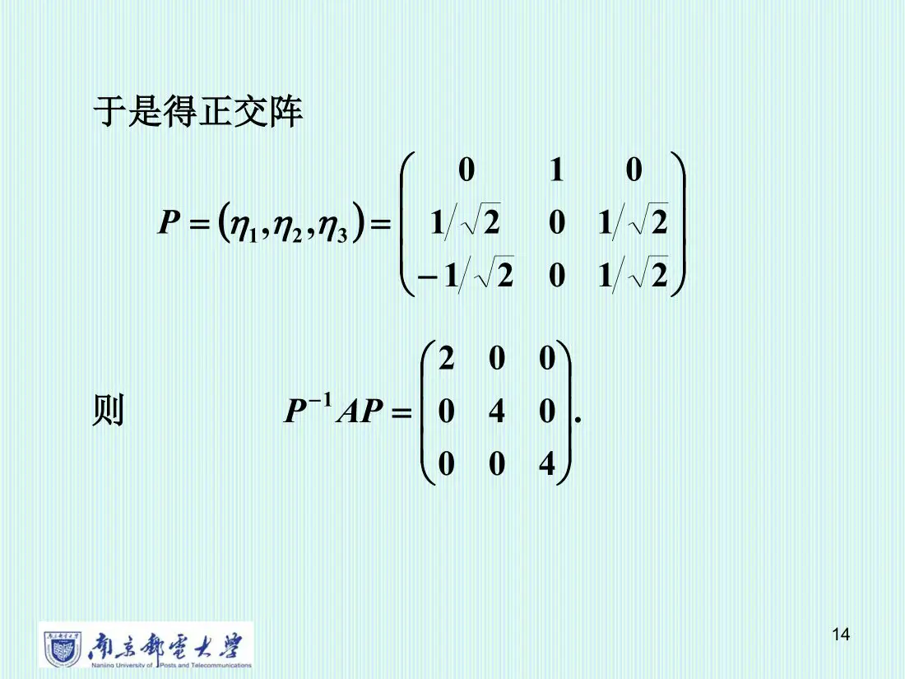

原文：

于是得正交阵

$$
P = (\eta_ {1}, \eta_ {2}, \eta_ {3}) = \left( \begin{array}{c c c} \mathbf {0} & \mathbf {1} & \mathbf {0} \\ \mathbf {1} / \sqrt {2} & \mathbf {0} & \mathbf {1} / \sqrt {2} \\ - \mathbf {1} / \sqrt {2} & \mathbf {0} & \mathbf {1} / \sqrt {2} \end{array} \right)
$$

则

$$
\boldsymbol {P} ^ {- 1} \boldsymbol {A} \boldsymbol {P} = \left( \begin{array}{c c c} \boldsymbol {2} & \boldsymbol {0} & \boldsymbol {0} \\ \boldsymbol {0} & \boldsymbol {4} & \boldsymbol {0} \\ \boldsymbol {0} & \boldsymbol {0} & \boldsymbol {4} \end{array} \right).
$$

南京邮电大学
Nanjing University of Posts and Telecommunications

14

### 因为X与 $P_{1}$ 正交，

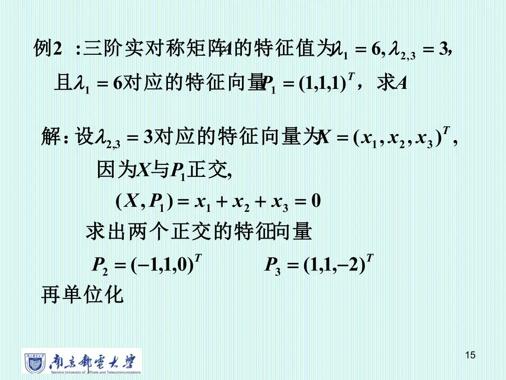

原文：

例2 :三阶实对称矩阵A的特征值为 $\lambda_{1}=6,\lambda_{2,3}=3,$ 且 $\lambda_{1}=6$ 对应的特征向量 $P_{1}=(1,1,1)^{T}$ ，求A

解: 设 $\lambda_{2,3}=3$ 对应的特征向量为 $X=(x_{1},x_{2},x_{3})^{T}$ ,
因为X与 $P_{1}$ 正交，

$$
(X, P _ {1}) = x _ {1} + x _ {2} + x _ {3} = 0
$$

求出两个正交的特征向量

$$
P _ {2} = (- 1, 1, 0) ^ {T} \quad P _ {3} = (1, 1, - 2) ^ {T}
$$

再单位化

南京邮电大学
Nanjing University of Posts and Telecommunications

15

### $$

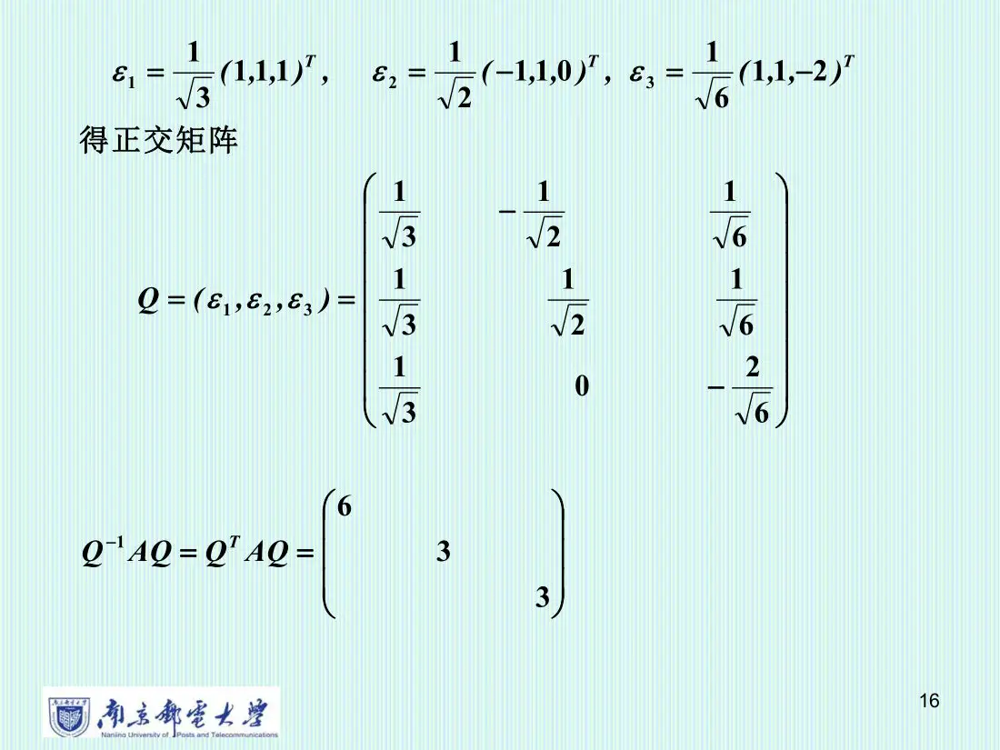

原文：

$$
\varepsilon_ {1} = \frac {1}{\sqrt {3}} (1, 1, 1) ^ {T}, \quad \varepsilon_ {2} = \frac {1}{\sqrt {2}} (- 1, 1, 0) ^ {T}, \varepsilon_ {3} = \frac {1}{\sqrt {6}} (1, 1, - 2) ^ {T}
$$

得正交矩阵

$$
Q = (\varepsilon_ {1}, \varepsilon_ {2}, \varepsilon_ {3}) = \left( \begin{array}{c c c c} \frac {1}{\sqrt {3}} & - \frac {1}{\sqrt {2}} & & \frac {1}{\sqrt {6}} \\ \frac {1}{\sqrt {3}} & \frac {1}{\sqrt {2}} & & \frac {1}{\sqrt {6}} \\ \frac {1}{\sqrt {3}} & 0 & & - \frac {2}{\sqrt {6}} \end{array} \right)
$$

$$
Q ^ {- 1} A Q = Q ^ {T} A Q = \left( \begin{array}{c c c c} 6 & & & \\ & 3 & & \\ & & & 3 \end{array} \right)
$$

南京邮电大学
Nanjing University of Posts and Telecommunications

16

### $$

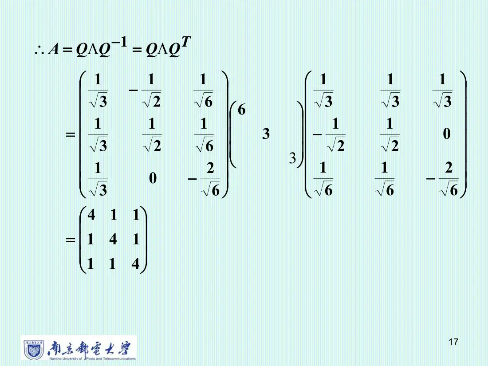

原文：

$$
\begin{array}{r l} & {\therefore A = Q \Lambda Q ^ {- 1} = Q \Lambda Q ^ {T}} \\ & {\qquad = \left( \begin{array}{l l l} 1 & - \frac {1}{\sqrt {2}} & \frac {1}{\sqrt {6}} \\ \frac {1}{\sqrt {3}} & \frac {1}{\sqrt {2}} & \frac {1}{\sqrt {6}} \\ \frac {1}{\sqrt {3}} & 0 & - \frac {2}{\sqrt {6}} \\ \end{array} \right) \left( \begin{array}{l l l} 6 & & \\ & 3 & \\ & & 3 \end{array} \right) \left( \begin{array}{l l l} \frac {1}{\sqrt {3}} & \frac {1}{\sqrt {3}} & \frac {1}{\sqrt {3}} \\ - \frac {1}{\sqrt {2}} & \frac {1}{\sqrt {2}} & 0 \\ \frac {1}{\sqrt {6}} & \frac {1}{\sqrt {6}} & - \frac {2}{\sqrt {6}} \\ \end{array} \right)} \\ & {\qquad = \left( \begin{array}{l l l} 4 & 1 & 1 \\ 1 & 4 & 1 \\ 1 & 1 & 4 \\ \end{array} \right)} \end{array}
$$

南京邮电大学
Nanjing University of Posts and Telecommunications

17

### $$

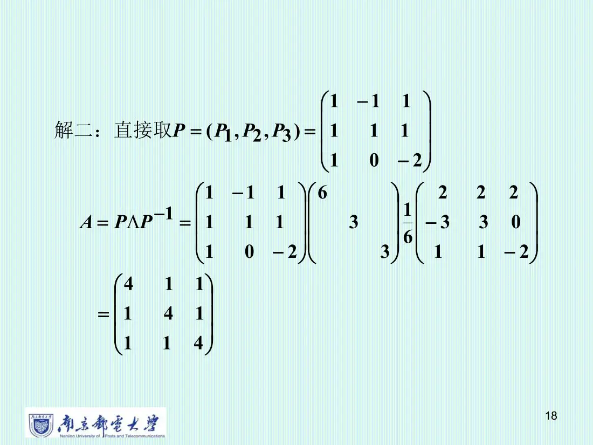

原文：

解二：直接取 $P = (P_{1}, P_{2}, P_{3}) = \begin{pmatrix} 1 & -1 & 1 \\ 1 & 1 & 1 \\ 1 & 0 & -2 \end{pmatrix}$

$$
\begin{array}{r l} A = P \Lambda P ^ {- 1} & = \left( \begin{array}{c c c} 1 & - 1 & 1 \\ 1 & 1 & 1 \\ 1 & 0 & - 2 \end{array} \right) \left( \begin{array}{c c c} 6 & & \\ & 3 & \\ & & 3 \end{array} \right) \frac {1}{6} \left( \begin{array}{c c c} 2 & 2 & 2 \\ - 3 & 3 & 0 \\ 1 & 1 & - 2 \end{array} \right) \\ & = \left( \begin{array}{c c c} 4 & 1 & 1 \\ 1 & 4 & 1 \\ 1 & 1 & 4 \end{array} \right) \end{array}
$$

南京邮电大学
Nanjing University of Posts and Telecommunications

18

### 三、小结

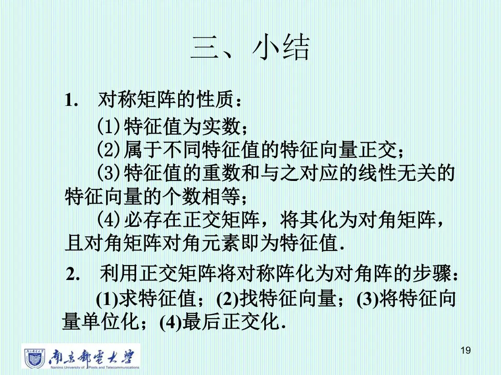

原文：

三、小结

1. 对称矩阵的性质:

(1) 特征值为实数;

(2) 属于不同特征值的特征向量正交;

(3) 特征值的重数和与之对应的线性无关的特征向量的个数相等;

(4)必存在正交矩阵，将其化为对角矩阵，且对角矩阵对角元素即为特征值。

2. 利用正交矩阵将对称阵化为对角阵的步骤:

(1)求特征值；(2)找特征向量；(3)将特征向量单位化；(4)最后正交化。

南京邮电大学
Nanjing University of Posts and Telecommunications

19

### 思考题

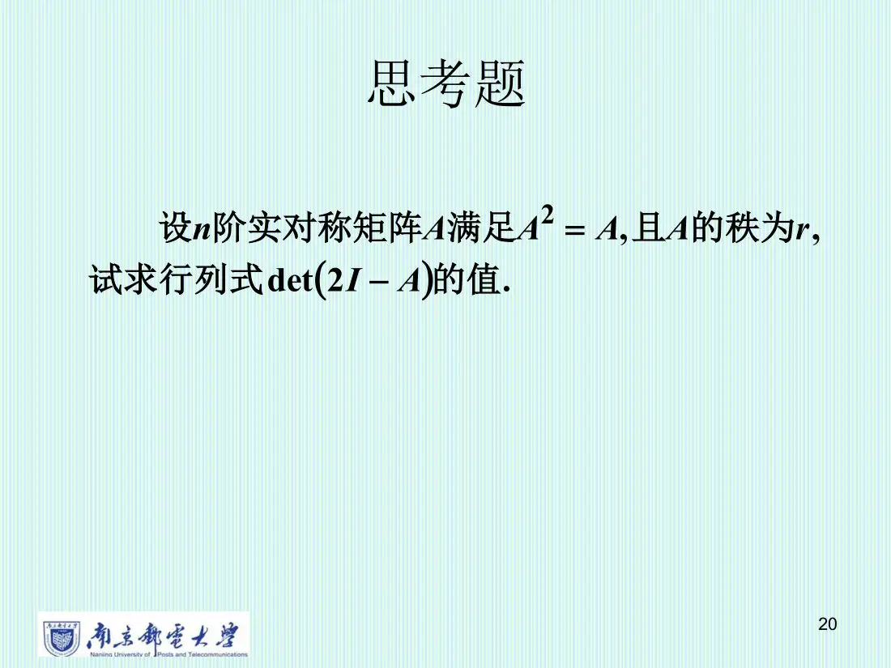

原文：

思考题

设n阶实对称矩阵A满足 $A^{2}=A$ ，且A的秩为r，
试求行列式 $\det(2I-A)$ 的值.

南京邮电大学
Nanjing University of Posts and Telecommunications

20

### $$

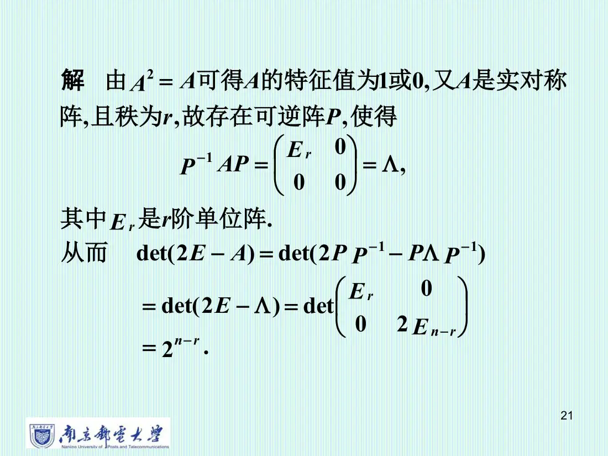

原文：

解 由 $A^2 = A$ 可得 $A$ 的特征值为1或0, 又 $A$ 是实对称阵, 且秩为 $r$ , 故存在可逆阵 $P$ , 使得

$$
\boldsymbol {P} ^ {- 1} \boldsymbol {A} \boldsymbol {P} = \left( \begin{array}{c c} \boldsymbol {E} _ {r} & \boldsymbol {0} \\ \boldsymbol {0} & \boldsymbol {0} \end{array} \right) = \boldsymbol {\Lambda},
$$

其中 $E_{r}$ 是r阶单位阵.

从而

$$
\begin{array}{r l} & {\det (2 E - A) = \det (2 P P ^ {- 1} - P \Lambda P ^ {- 1})} \\ & {= \det (2 E - \Lambda) = \det \left( \begin{array}{l l} E _ {r} & 0 \\ 0 & 2 E _ {n - r} \end{array} \right)} \\ & {= 2 ^ {n - r}.} \end{array}
$$

南京邮电大学
Nanjing University of Posts and Telecommunications

21
