# 《线性代数与解析几何》第7章 二次型（课件）

原件的每一页，下面附识别出的文字。

### 7.1.1 二次型及其表示

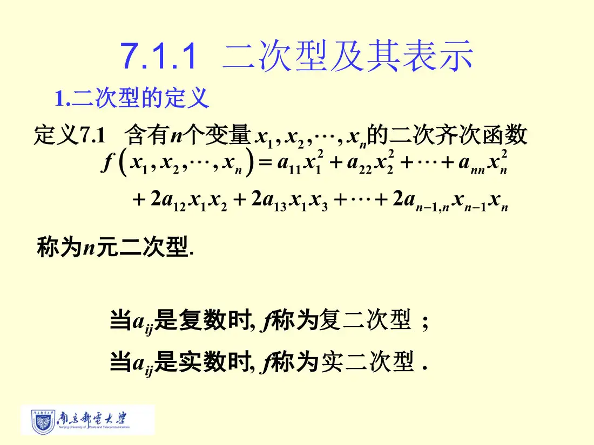

原文：

7.1.1 二次型及其表示

1.二次型的定义

定义7.1 含有n个变量 $x_{1},x_{2},\cdots,x_{n}$ 的二次齐次函数

$$
\begin{array}{r} f (x _ {1}, x _ {2}, \dots , x _ {n}) = a _ {1 1} x _ {1} ^ {2} + a _ {2 2} x _ {2} ^ {2} + \dots + a _ {n n} x _ {n} ^ {2} \\ + 2 a _ {1 2} x _ {1} x _ {2} + 2 a _ {1 3} x _ {1} x _ {3} + \dots + 2 a _ {n - 1, n} x _ {n - 1} x _ {n} \end{array}
$$

称为n元二次型.

当 $a_{ij}$ 是复数时, f称为复二次型;

当 $a_{ij}$ 是实数时, f称为实二次型.

南京邮电大学
Nanjing University of Posts and Telecommunications

### 2 二次型的表示方法

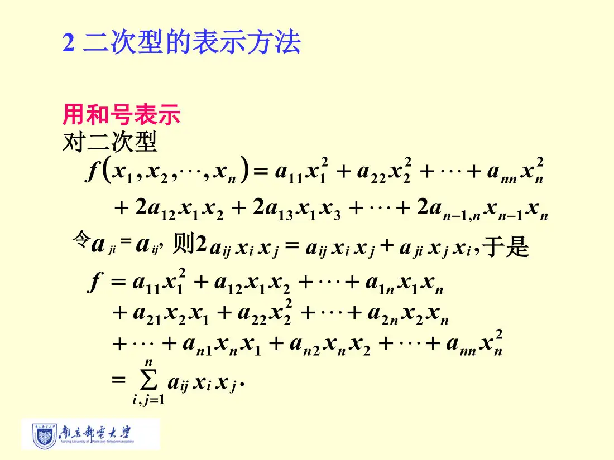

原文：

2 二次型的表示方法

用和号表示

对二次型

$$
\begin{array}{r} f (x _ {1}, x _ {2}, \dots , x _ {n}) = a _ {1 1} x _ {1} ^ {2} + a _ {2 2} x _ {2} ^ {2} + \dots + a _ {n n} x _ {n} ^ {2} \\ + 2 a _ {1 2} x _ {1} x _ {2} + 2 a _ {1 3} x _ {1} x _ {3} + \dots + 2 a _ {n - 1, n} x _ {n - 1} x _ {n} \end{array}
$$

令 $a_{ji}=a_{ij}$ ，则 $2a_{ij}x_{i}x_{j}=a_{ij}x_{i}x_{j}+a_{ji}x_{j}x_{i}$ ，于是

$$
\begin{array}{r l} & f = a _ {1 1} x _ {1} ^ {2} + a _ {1 2} x _ {1} x _ {2} + \dots + a _ {1 n} x _ {1} x _ {n} \\ & + a _ {2 1} x _ {2} x _ {1} + a _ {2 2} x _ {2} ^ {2} + \dots + a _ {2 n} x _ {2} x _ {n} \\ & + \dots + a _ {n 1} x _ {n} x _ {1} + a _ {n 2} x _ {n} x _ {2} + \dots + a _ {n n} x _ {n} ^ {2} \\ & = \sum_ {i, j = 1} ^ {n} a _ {i j} x _ {i} x _ {j}. \end{array}
$$

南京邮电大学
Nanjing University of Posts and Telecommunications

### 用矩阵表示

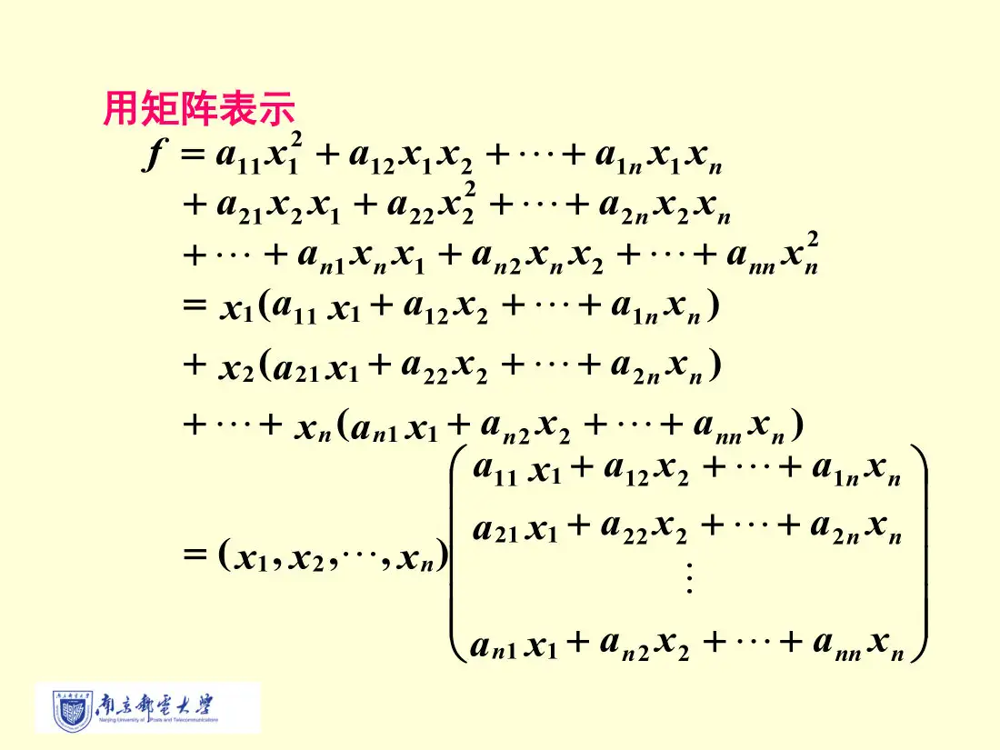

原文：

用矩阵表示

$$
\begin{array}{r l} & f = a _ {1 1} x _ {1} ^ {2} + a _ {1 2} x _ {1} x _ {2} + \dots + a _ {1 n} x _ {1} x _ {n} \\ & + a _ {2 1} x _ {2} x _ {1} + a _ {2 2} x _ {2} ^ {2} + \dots + a _ {2 n} x _ {2} x _ {n} \\ & + \dots + a _ {n 1} x _ {n} x _ {1} + a _ {n 2} x _ {n} x _ {2} + \dots + a _ {n n} x _ {n} ^ {2} \\ & = x _ {1} (a _ {1 1} x _ {1} + a _ {1 2} x _ {2} + \dots + a _ {1 n} x _ {n}) \\ & + x _ {2} (a _ {2 1} x _ {1} + a _ {2 2} x _ {2} + \dots + a _ {2 n} x _ {n}) \\ & + \dots + x _ {n} (a _ {n 1} x _ {1} + a _ {n 2} x _ {2} + \dots + a _ {n n} x _ {n}) \\ & = (x _ {1}, x _ {2}, \dots , x _ {n}) \left( \begin{array}{c} a _ {1 1} x _ {1} + a _ {1 2} x _ {2} + \dots + a _ {1 n} x _ {n} \\ a _ {2 1} x _ {1} + a _ {2 2} x _ {2} + \dots + a _ {2 n} x _ {n} \\ \vdots \\ a _ {n 1} x _ {1} + a _ {n 2} x _ {2} + \dots + a _ {n n} x _ {n} \end{array} \right) \end{array}
$$

南京邮电大学
Nanjing University of Posts and Telecommunications

### $$

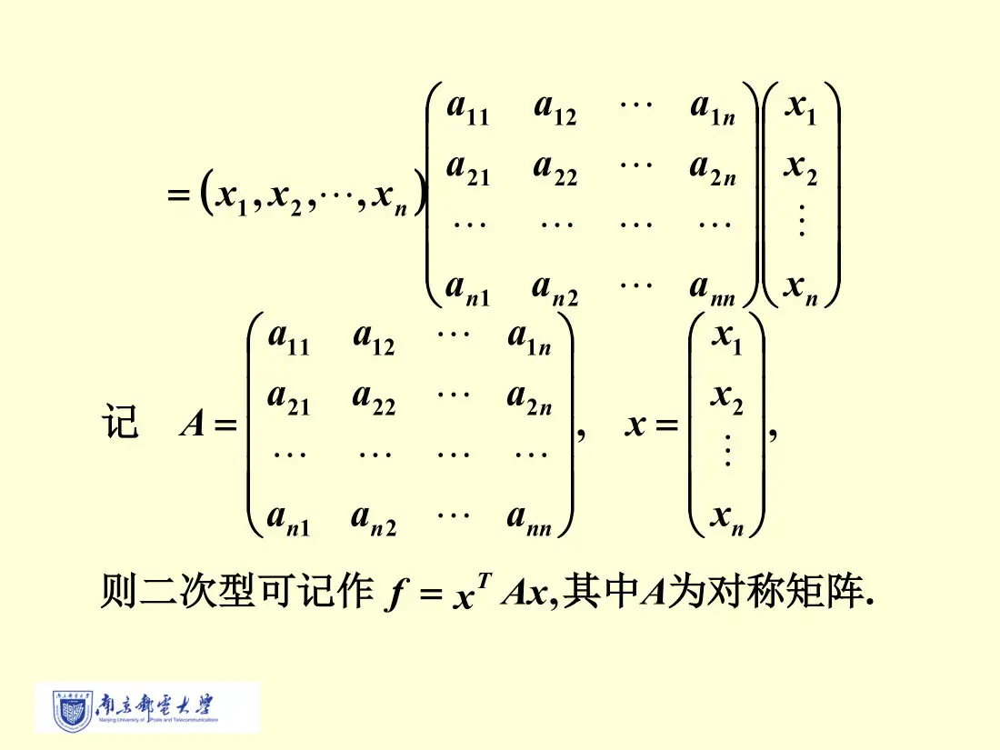

原文：

$$
\begin{array}{r l} & {= (x _ {1}, x _ {2}, \dots , x _ {n}) \left( \begin{array}{l l l l} a _ {1 1} & a _ {1 2} & \dots & a _ {1 n} \\ a _ {2 1} & a _ {2 2} & \dots & a _ {2 n} \\ \dots & \dots & \dots & \dots \\ a _ {n 1} & a _ {n 2} & \dots & a _ {n n} \end{array} \right) \left( \begin{array}{l} x _ {1} \\ x _ {2} \\ \vdots \\ x _ {n} \end{array} \right)} \\ & {A = \left( \begin{array}{l l l l} a _ {1 1} & a _ {1 2} & \dots & a _ {1 n} \\ a _ {2 1} & a _ {2 2} & \dots & a _ {2 n} \\ \dots & \dots & \dots & \dots \\ a _ {n 1} & a _ {n 2} & \dots & a _ {nn} \end{array} \right), \quad x = \left( \begin{array}{l} x _ {1} \\ x _ {2} \\ \vdots \\ x _ {n} \end{array} \right),} \end{array}
$$

记

则二次型可记作 $f = x^{T} Ax$ ，其中 A 为对称矩阵。

南京邮电大学
Nanjing University of Posts and Telecommunications

### 对称矩阵A叫做二次型f的矩阵;

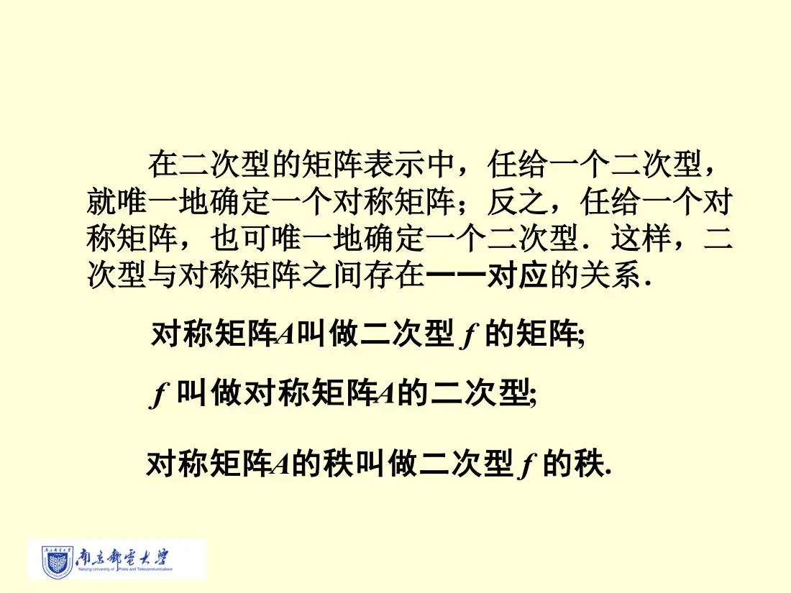

原文：

在二次型的矩阵表示中，任给一个二次型，就唯一地确定一个对称矩阵；反之，任给一个对称矩阵，也可唯一地确定一个二次型。这样，二次型与对称矩阵之间存在一一对应的关系。

对称矩阵A叫做二次型f的矩阵;

f 叫做对称矩阵A的二次型;

对称矩阵A的秩叫做二次型f的秩.

南京邮电大学
Nanjing University of Posts and Telecommunications

### 例7.1 写出二次型

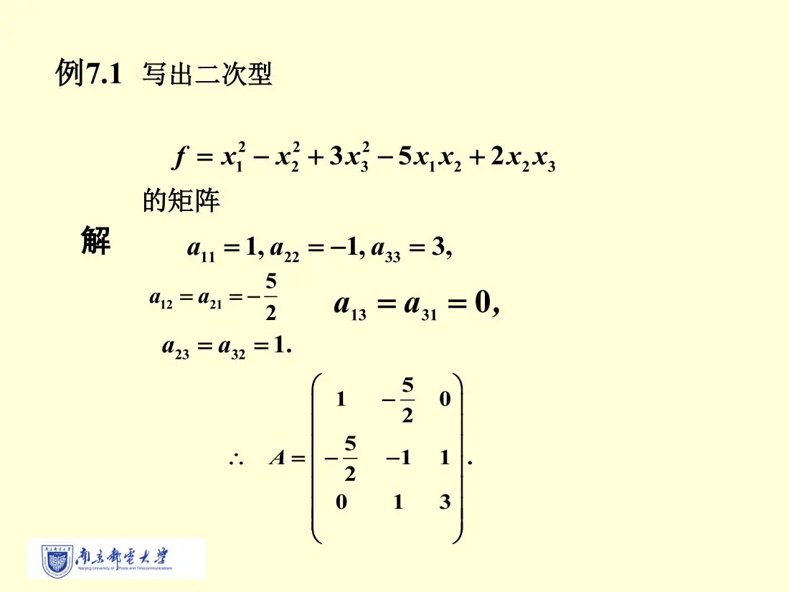

原文：

例7.1 写出二次型

$$
f = x _ {1} ^ {2} - x _ {2} ^ {2} + 3 x _ {3} ^ {2} - 5 x _ {1} x _ {2} + 2 x _ {2} x _ {3}
$$

的矩阵

解

$$
a _ {1 1} = 1, a _ {2 2} = - 1, a _ {3 3} = 3,
$$

$$
a _ {1 2} = a _ {2 1} = - \frac {5}{2} \quad a _ {1 3} = a _ {3 1} = 0,
$$

$$
a _ {2 3} = a _ {3 2} = 1.
$$

$$
\therefore \quad A = \left( \begin{array}{c c c} 1 & - \frac {5}{2} & 0 \\ - \frac {5}{2} & - 1 & 1 \\ 0 & 1 & 3 \end{array} \right).
$$

南京邮电大学
Nanjing University of Posts and Telecommunications

### 例7.2 写出矩阵

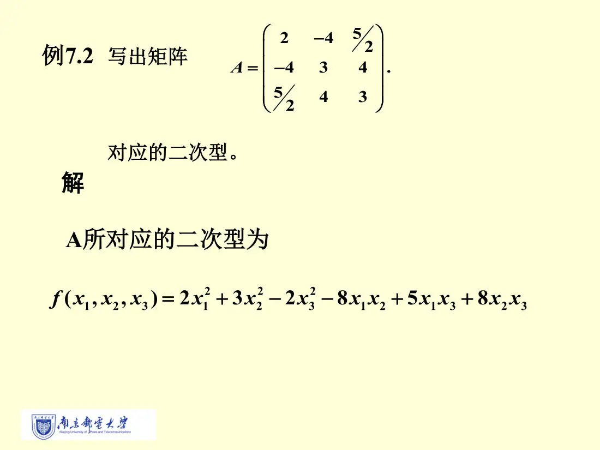

原文：

例7.2 写出矩阵

$$
A = \left( \begin{array}{c c c} 2 & - 4 & \frac {5}{2} \\ - 4 & 3 & 4 \\ \frac {5}{2} & 4 & 3 \end{array} \right).
$$

对应的二次型。

解

A所对应的二次型为

$$
f (x _ {1}, x _ {2}, x _ {3}) = 2 x _ {1} ^ {2} + 3 x _ {2} ^ {2} - 2 x _ {3} ^ {2} - 8 x _ {1} x _ {2} + 5 x _ {1} x _ {3} + 8 x _ {2} x _ {3}
$$

南京邮电大学
Nanjing University of Posts and Telecommunications

### 二次型的变换

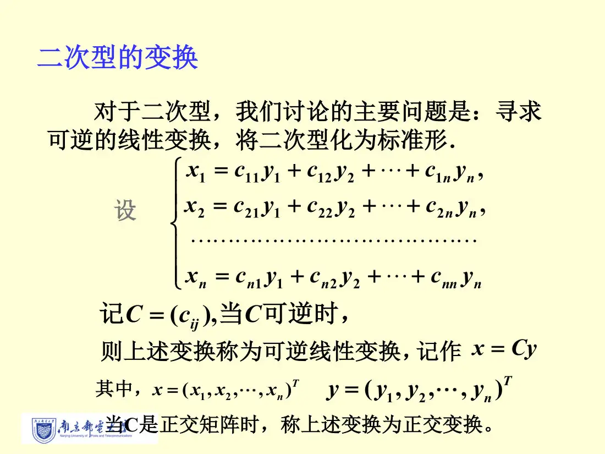

原文：

二次型的变换

对于二次型，我们讨论的主要问题是：寻求可逆的线性变换，将二次型化为标准形。

设

$$
\left\{ \begin{array}{l} x _ {1} = c _ {1 1} y _ {1} + c _ {1 2} y _ {2} + \dots + c _ {1 n} y _ {n}, \\ x _ {2} = c _ {2 1} y _ {1} + c _ {2 2} y _ {2} + \dots + c _ {2 n} y _ {n}, \\ \dots \\ x _ {n} = c _ {n 1} y _ {1} + c _ {n 2} y _ {2} + \dots + c _ {n n} y _ {n} \end{array} \right.
$$

记 $C=(c_{ij})$ , 当C可逆时,

则上述变换称为可逆线性变换, 记作 $x = Cy$

其中， $x=(x_{1},x_{2},\cdots,x_{n})^{T}\quad y=(y_{1},y_{2},\cdots,y_{n})^{T}$

当C是正交矩阵时，称上述变换为正交变换。

### 研究线性变换的目的是为了将二次型化为只含平方项的所谓标准形。

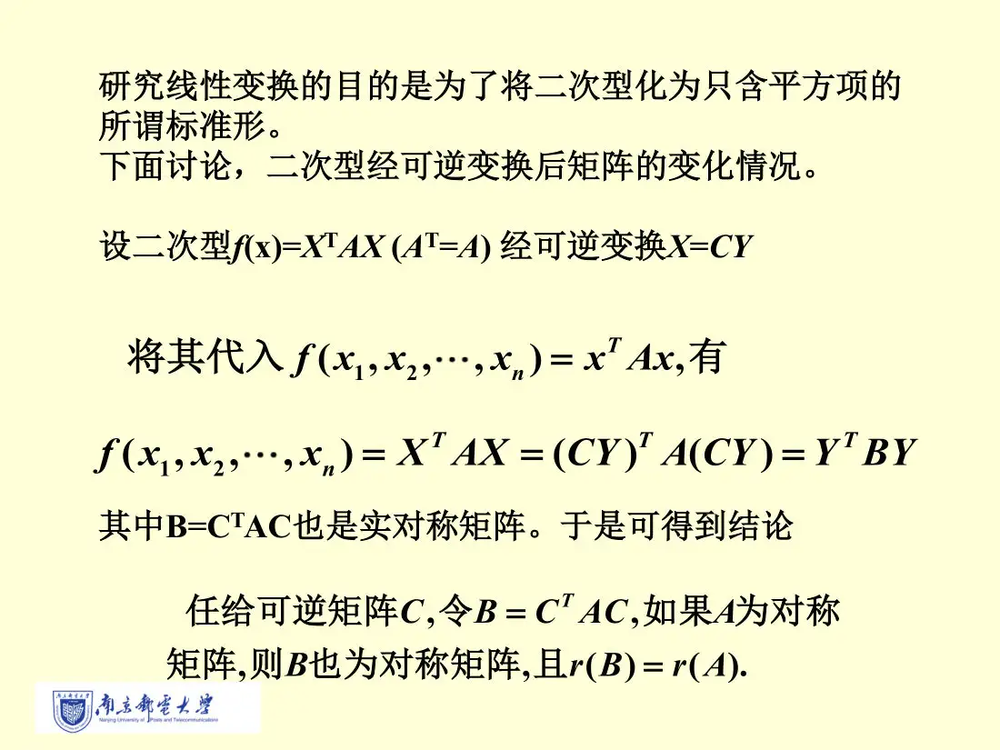

原文：

研究线性变换的目的是为了将二次型化为只含平方项的所谓标准形。

下面讨论，二次型经可逆变换后矩阵的变化情况。

设二次型 $f(x)=X^{T}AX(A^{T}=A)$ 经可逆变换X=CY

将其代入 $f(x_{1},x_{2},\cdots,x_{n})=x^{T}Ax$ ，有

$$
f (x _ {1}, x _ {2}, \dots , x _ {n}) = X ^ {T} A X = (C Y) ^ {T} A (C Y) = Y ^ {T} B Y
$$

其中 $\mathbf{B} = \mathbf{C}^{\mathrm{T}}\mathbf{A}\mathbf{C}$ 也是实对称矩阵。于是可得到结论

任给可逆矩阵C,令 $B=C^{T}AC$ ,如果A为对称矩阵,则B也为对称矩阵,且 $r(B)=r(A)$ .

南京邮电大学
Nanjing University of Posts and Telecommunications

### 7.1.2 矩阵的合同

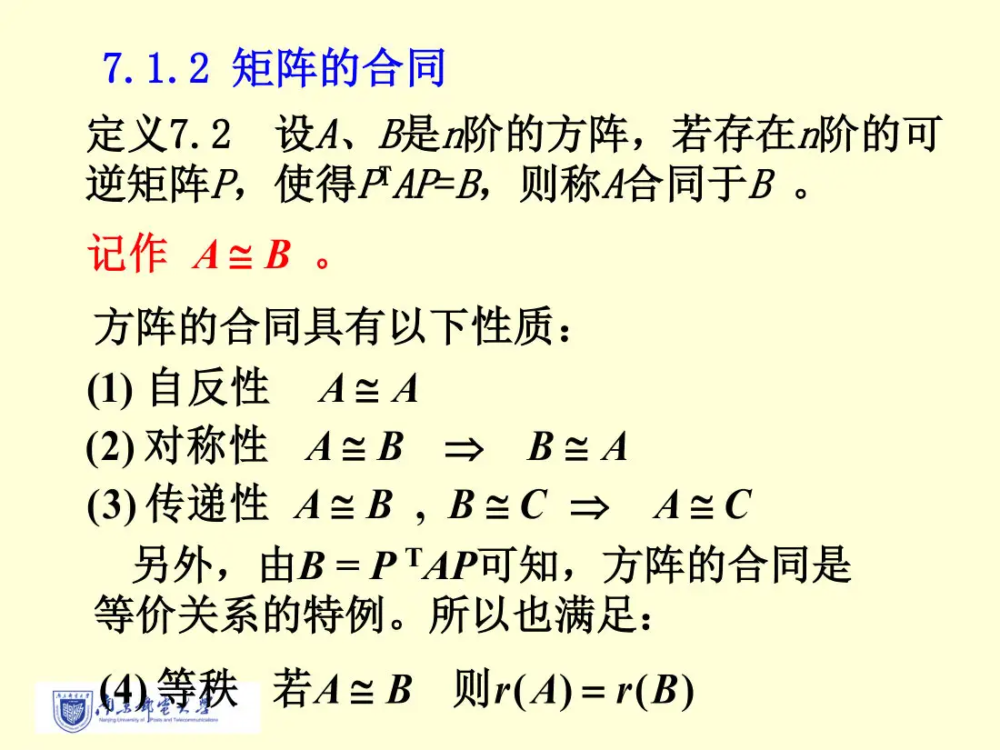

原文：

7.1.2 矩阵的合同

定义7.2 设 $A$ 、 $B$ 是 $n$ 阶的方阵，若存在 $n$ 阶的可逆矩阵 $P$ ，使得 $P^{\mathrm{T}}AP = B$ ，则称 $A$ 合同于 $B$ 。

记作 $A \cong B$ 。

方阵的合同具有以下性质：

(1) 自反性 $A \cong A$

(2) 对称性 $A \cong B \Rightarrow B \cong A$

(3) 传递性 $A \cong B$ ， $B \cong C \Rightarrow A \cong C$

另外，由 $B = P^{\mathrm{T}}AP$ 可知，方阵的合同是等价关系的特例。所以也满足：

(4) 等秩 若 $A \cong B$ 则 $r(A) = r(B)$

### (1) 等价 B = PAQ (P、Q 可逆)

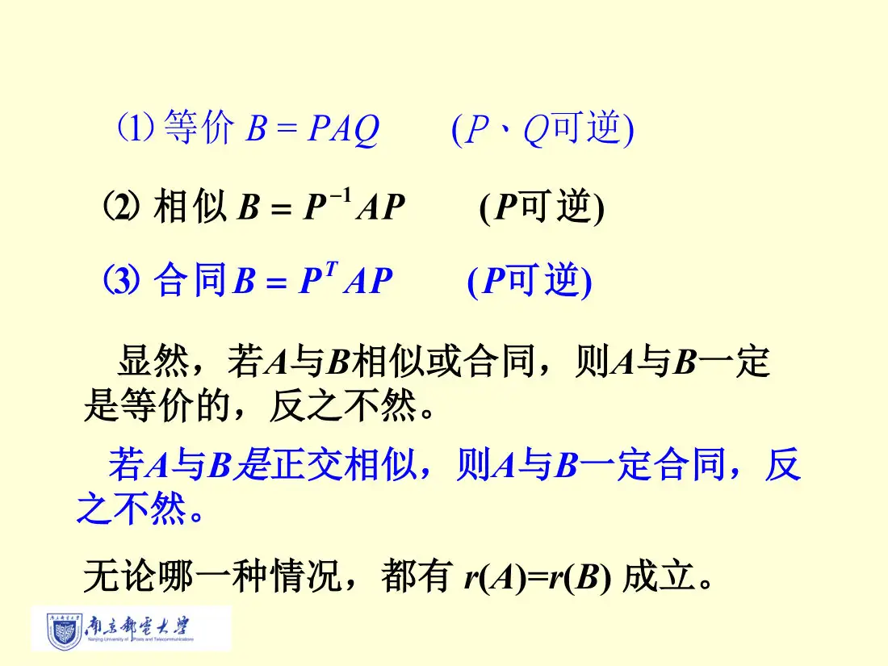

原文：

(1) 等价 B = PAQ (P、Q 可逆)

(2) 相似 $B = P^{-1}AP$ (P可逆)

(3) 合同 $B = P^{T} AP$ (P 可逆)

显然，若 $A$ 与 $B$ 相似或合同，则 $A$ 与 $B$ 一定是等价的，反之不然。

若 $A$ 与 $B$ 是正交相似，则 $A$ 与 $B$ 一定合同，反之不然。

无论哪一种情况，都有 $r(A)=r(B)$ 成立。

南京邮电大学
Nanjing University of Posts and Telecommunications

### 7.2 二次型的标准形

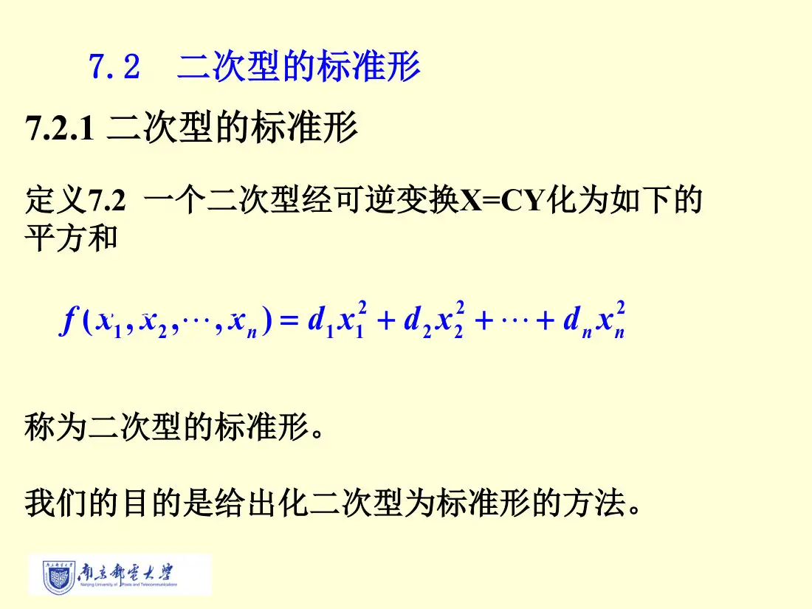

原文：

7.2 二次型的标准形

7.2.1 二次型的标准形

定义7.2 一个二次型经可逆变换X=CY化为如下的平方和

$$
f (x _ {1}, x _ {2}, \dots , x _ {n}) = d _ {1} x _ {1} ^ {2} + d _ {2} x _ {2} ^ {2} + \dots + d _ {n} x _ {n} ^ {2}
$$

称为二次型的标准形。

我们的目的是给出化二次型为标准形的方法。

南京邮电大学
Nanjing University of Posts and Telecommunications

### 7.2.2 二次型化为标准形的方法

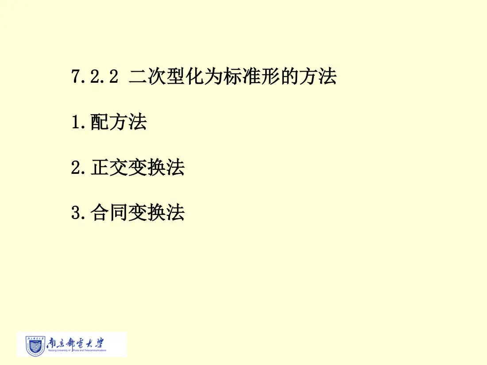

原文：

7.2.2 二次型化为标准形的方法
1. 配方法
2. 正交变换法
3. 合同变换法

南京邮电大学
Nanjing University of Posts and Telecommunications

### 2. 正交变换法

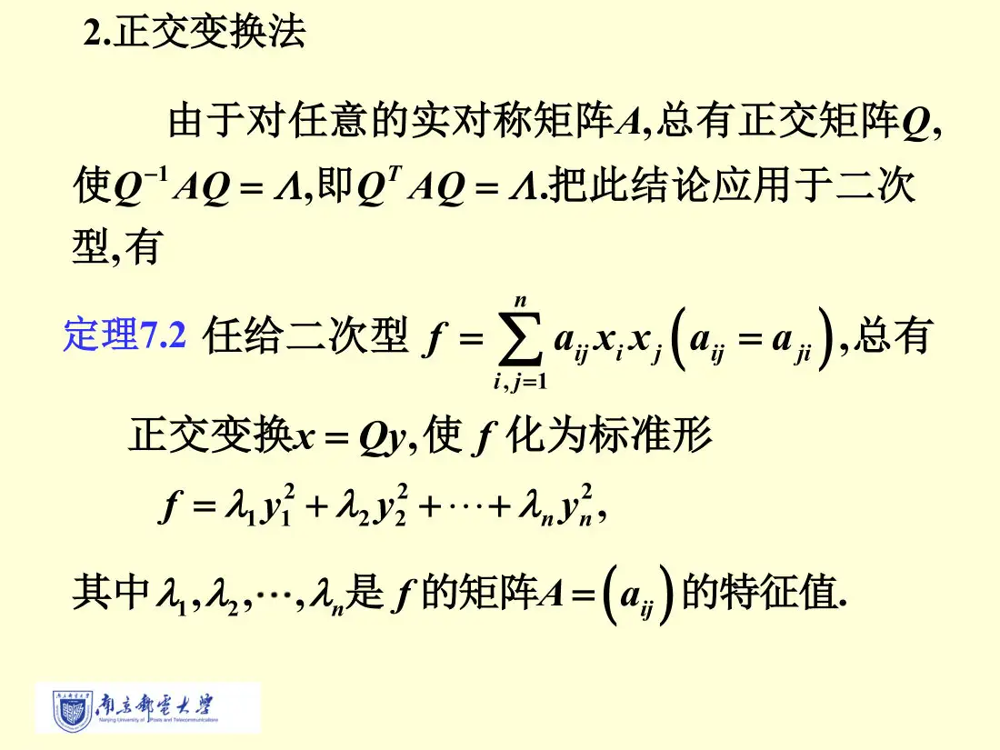

原文：

2. 正交变换法

由于对任意的实对称矩阵A,总有正交矩阵Q,
使 $Q^{-1}AQ=\Lambda$ ,即 $Q^{T}AQ=\Lambda$ .把此结论应用于二次
型,有
定理7.2 任给二次型 $f=\sum_{i,j=1}^{n}a_{ij}x_{i}x_{j}\left(a_{ij}=a_{ji}\right)$ ,总有
正交变换x=Qy,使f化为标准形 $f=\lambda_{1}y_{1}^{2}+\lambda_{2}y_{2}^{2}+\cdots+\lambda_{n}y_{n}^{2}$ 其中 $\lambda_{1},\lambda_{2},\cdots,\lambda_{n}$ 是 f 的矩阵 $A=(a_{ij})$ 的特征值.

南京邮电大学
Nanjing University of Posts and Telecommunications

### 用正交变换化二次型为标准形的具体步骤

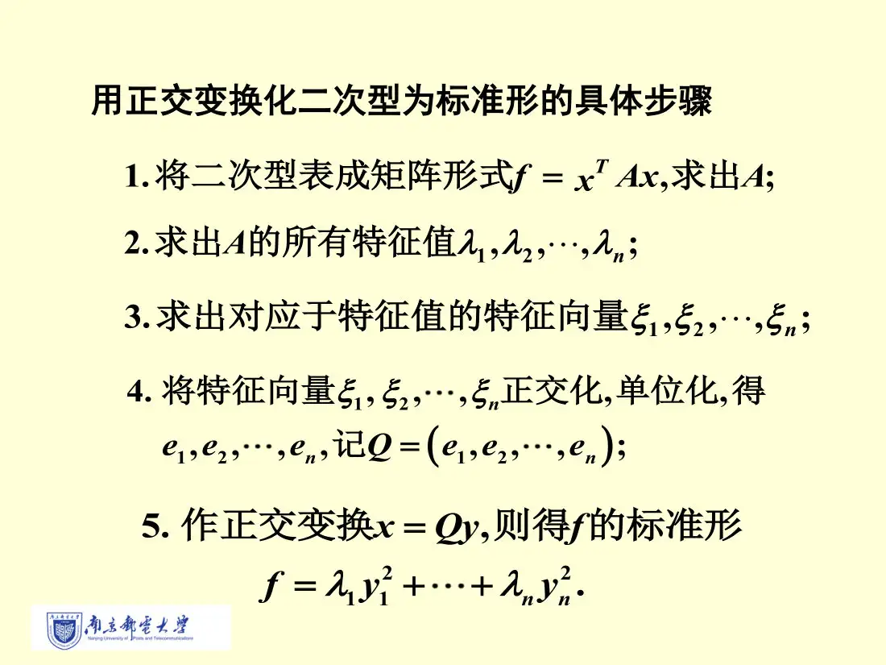

原文：

用正交变换化二次型为标准形的具体步骤

1. 将二次型表成矩阵形式 $f = x^{T} Ax$ ，求出 A;

2. 求出A的所有特征值 $\lambda_{1},\lambda_{2},\cdots,\lambda_{n}$ ;

3. 求出对应于特征值的特征向量 $\xi_{1}, \xi_{2}, \cdots, \xi_{n}$ ;

4. 将特征向量 $\xi_{1}, \xi_{2}, \cdots, \xi_{n}$ 正交化, 单位化, 得 $e_{1}, e_{2}, \cdots, e_{n}$ , 记 $Q = (e_{1}, e_{2}, \cdots, e_{n})$ ;

5. 作正交变换 $x = Qy$ , 则得 $f$ 的标准形

$$
f = \lambda_ {1} y _ {1} ^ {2} + \dots + \lambda_ {n} y _ {n} ^ {2}.
$$

南京邮电大学
Nanjing University of Posts and Telecommunications

### 例7.6 将二次型

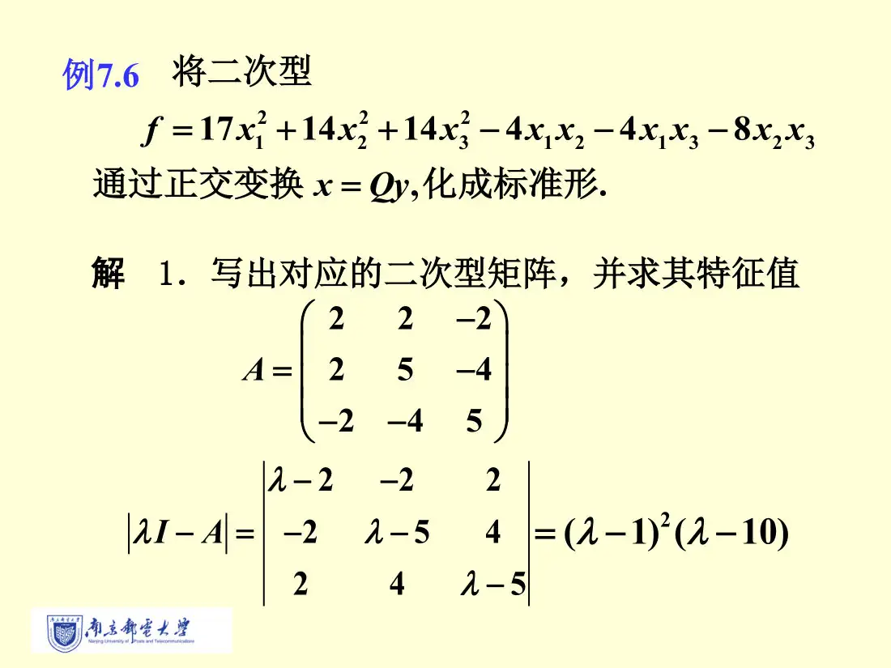

原文：

例7.6 将二次型

$f = 17x_{1}^{2} + 14x_{2}^{2} + 14x_{3}^{2} - 4x_{1}x_{2} - 4x_{1}x_{3} - 8x_{2}x_{3}$ 通过正交变换 $x = Qy$ ，化成标准形.

解 1. 写出对应的二次型矩阵，并求其特征值

$$
A = \left( \begin{array}{c c c} 2 & 2 & - 2 \\ 2 & 5 & - 4 \\ - 2 & - 4 & 5 \end{array} \right)
$$

$$
\left| \lambda I - A \right| = \left| \begin{array}{c c c} \lambda - 2 & - 2 & 2 \\ - 2 & \lambda - 5 & 4 \\ 2 & 4 & \lambda - 5 \end{array} \right| = (\lambda - 1) ^ {2} (\lambda - 1 0)
$$

南京邮电大学
Nanjing University of Posts and Telecommunications

### 2. 求特征向量

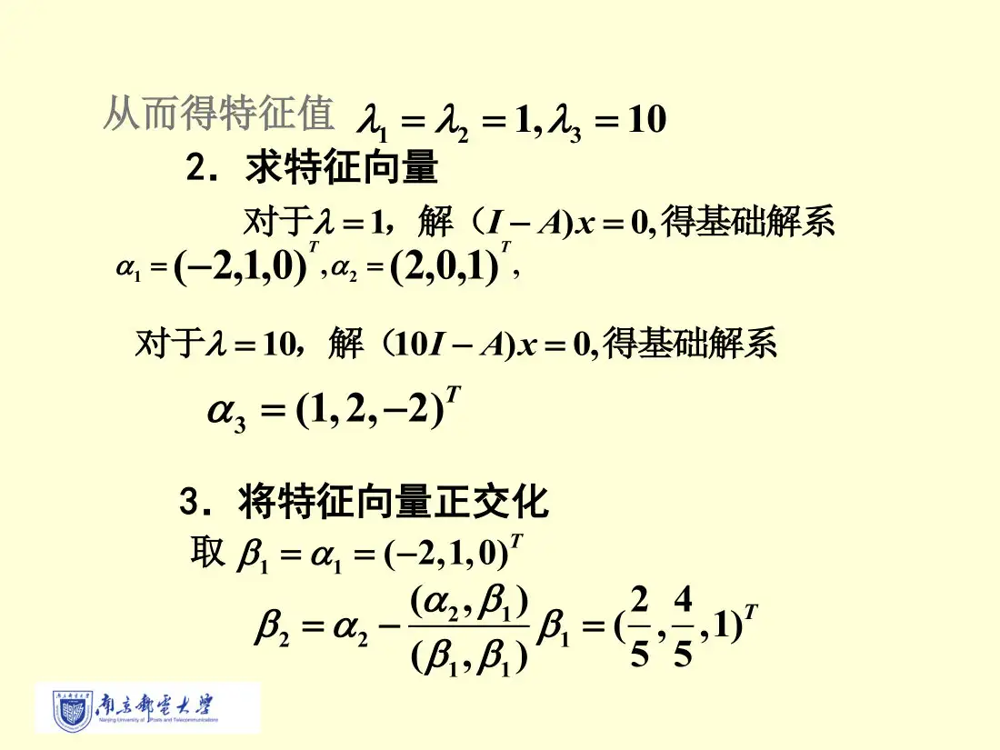

原文：

从而得特征值 $\lambda_{1}=\lambda_{2}=1,\lambda_{3}=10$

2. 求特征向量

对于 $\lambda = 1$ ，解 $(I - A)x = 0$ ，得基础解系 $\alpha_{1} = (-2,1,0)^{T},\alpha_{2} = (2,0,1)^{T},$

对于 $\lambda=10$ ，解 $(10I-A)x=0$ ，得基础解系

$$
\alpha_ {3} = (1, 2, - 2) ^ {T}
$$

3. 将特征向量正交化

取 $\beta_{1} = \alpha_{1} = (-2,1,0)^{T}$

$$
\beta_ {2} = \alpha_ {2} - \frac {(\alpha_ {2} , \beta_ {1})}{(\beta_ {1} , \beta_ {1})} \beta_ {1} = (\frac {2}{5}, \frac {4}{5}, 1) ^ {T}
$$

南京邮电大学
Nanjing University of Posts and Telecommunications

### $$

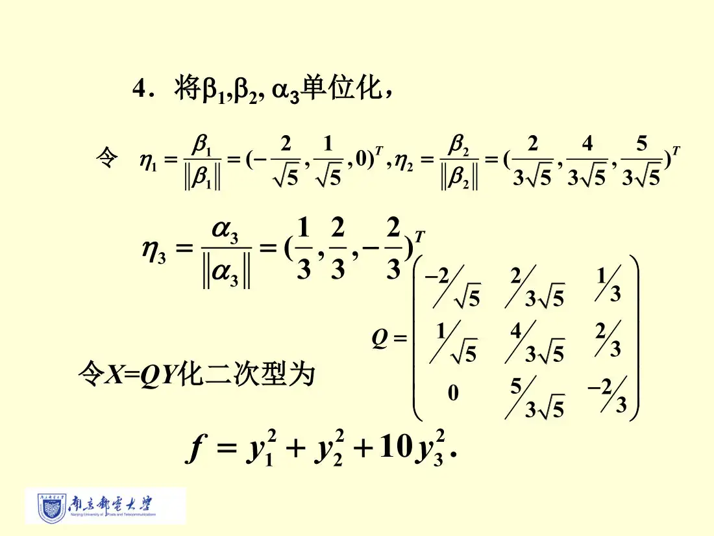

原文：

4. 将 $\beta_{1}, \beta_{2}, \alpha_{3}$ 单位化，

令

$$
\eta_ {1} = \frac {\beta_ {1}}{\| \beta_ {1} \|} = (- \frac {2}{\sqrt {5}}, \frac {1}{\sqrt {5}}, 0) ^ {T}, \eta_ {2} = \frac {\beta_ {2}}{\| \beta_ {2} \|} = (\frac {2}{3 \sqrt {5}}, \frac {4}{3 \sqrt {5}}, \frac {5}{3 \sqrt {5}}) ^ {T}
$$

$$
\begin{array}{l} \eta_ {3} = \frac {\alpha_ {3}}{\| \alpha_ {3} \|} = (\frac {1}{3}, \frac {2}{3}, - \frac {2}{3}) ^ {T} \\ = Q Y \text {化二次型为} \end{array} Q = \left( \begin{array}{c c c} - 2 / \sqrt {5} & 2 / 3 \sqrt {5} & 1 / 3 \\ 1 / \sqrt {5} & 4 / 3 \sqrt {5} & 2 / 3 \\ 0 & 5 / 3 \sqrt {5} & - 2 / 3 \end{array} \right)
$$

$$
f = y _ {1} ^ {2} + y _ {2} ^ {2} + 1 0 y _ {3} ^ {2}.
$$

南京邮电大学
Nanjing University of Posts and Telecommunications

### 例7.7 求一正交变换，将二次型

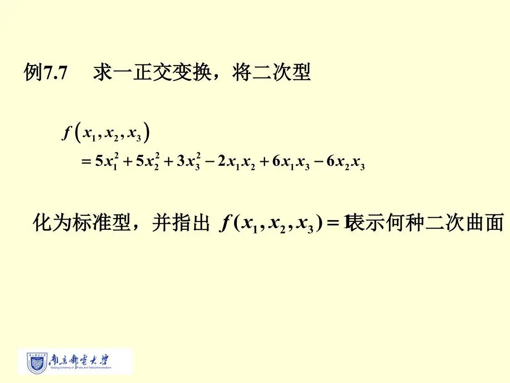

原文：

例7.7 求一正交变换，将二次型

$$
\begin{array}{r l} & f (x _ {1}, x _ {2}, x _ {3}) \\ & \qquad = 5 x _ {1} ^ {2} + 5 x _ {2} ^ {2} + 3 x _ {3} ^ {2} - 2 x _ {1} x _ {2} + 6 x _ {1} x _ {3} - 6 x _ {2} x _ {3} \end{array}
$$

化为标准型，并指出 $f(x_{1},x_{2},x_{3}) =$ 表示何种二次曲面解 二次型的矩阵为 $A = \begin{pmatrix} 5 & -1 & 3 \\ -1 & 5 & -3 \\ 3 & -3 & 3 \end{pmatrix}$ , 可求得 $|\lambda I - A| = \lambda (\lambda - 4)(\lambda - 9)$ 于是 $A$ 的特征值为 $\lambda_1 = 0, \lambda_2 = 4, \lambda_3 = 9,$

南京邮电大学
Nanjing University of Posts and Telecommunications

### 对应特征向量为

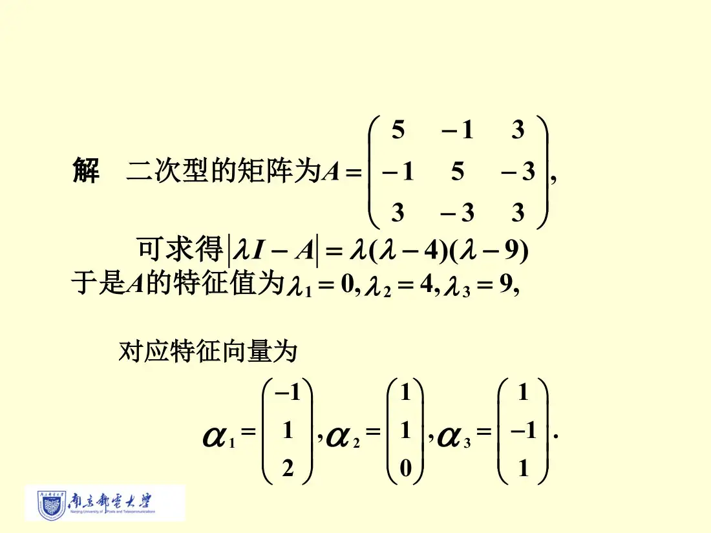

原文：

对应特征向量为

$$
\boldsymbol {\alpha} _ {1} = \left( \begin{array}{c} - 1 \\ 1 \\ 2 \end{array} \right), \boldsymbol {\alpha} _ {2} = \left( \begin{array}{c} 1 \\ 1 \\ 0 \end{array} \right), \boldsymbol {\alpha} _ {3} = \left( \begin{array}{c} 1 \\ - 1 \\ 1 \end{array} \right).
$$

南京邮电大学
Nanjing University of Posts and Telecommunications

### 将其单位化得

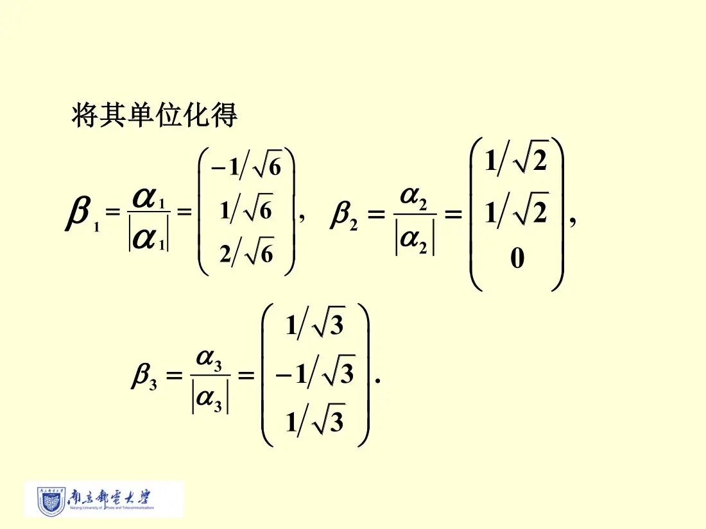

原文：

将其单位化得

$$
\boldsymbol {\beta} _ {1} = \frac {\alpha_ {1}}{| \alpha_ {1} |} = \left( \begin{array}{c} - 1 / \sqrt {6} \\ 1 / \sqrt {6} \\ 2 / \sqrt {6} \end{array} \right), \quad \boldsymbol {\beta} _ {2} = \frac {\alpha_ {2}}{| \alpha_ {2} |} = \left( \begin{array}{c} 1 / \sqrt {2} \\ 1 / \sqrt {2} \\ 0 \end{array} \right),
$$

$$
\beta_ {3} = \frac {\alpha_ {3}}{| \alpha_ {3} |} = \left( \begin{array}{c} 1 / \sqrt {3} \\ - 1 / \sqrt {3} \\ 1 / \sqrt {3} \end{array} \right).
$$

南京邮电大学
Nanjing University of Posts and Telecommunications

### 故正交变换为

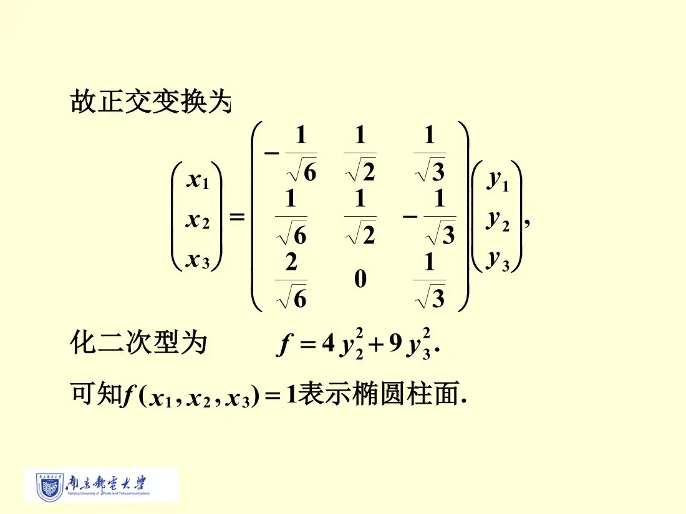

原文：

故正交变换为

$$
\left( \begin{array}{c} x _ {1} \\ x _ {2} \\ x _ {3} \end{array} \right) = \left( \begin{array}{c c c} - \frac {1}{\sqrt {6}} & \frac {1}{\sqrt {2}} & \frac {1}{\sqrt {3}} \\ \frac {1}{\sqrt {6}} & \frac {1}{\sqrt {2}} & - \frac {1}{\sqrt {3}} \\ \frac {2}{\sqrt {6}} & 0 & \frac {1}{\sqrt {3}} \end{array} \right) \left( \begin{array}{c} y _ {1} \\ y _ {2} \\ y _ {3} \end{array} \right),
$$

化二次型为 $f = 4y_{2}^{2} + 9y_{3}^{2}$

可知 $f(x_{1},x_{2},x_{3})=1$ 表示椭圆柱面.

南京邮电大学
Nanjing University of Posts and Telecommunications

### 7.3 二次型的规范形与正定

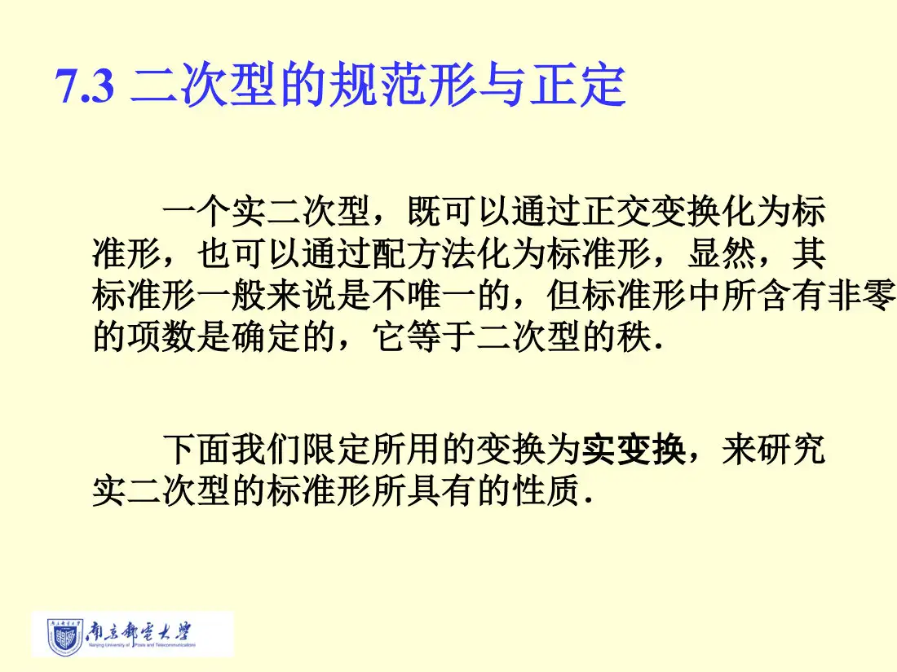

原文：

7.3 二次型的规范形与正定

一个实二次型，既可以通过正交变换化为标准形，也可以通过配方法化为标准形，显然，其标准形一般来说是不唯一的，但标准形中所含有非零的项数是确定的，它等于二次型的秩。

下面我们限定所用的变换为实变换，来研究实二次型的标准形所具有的性质。

南京邮电大学
Nanjing University of Posts and Telecommunications

### 定义7.4 形如

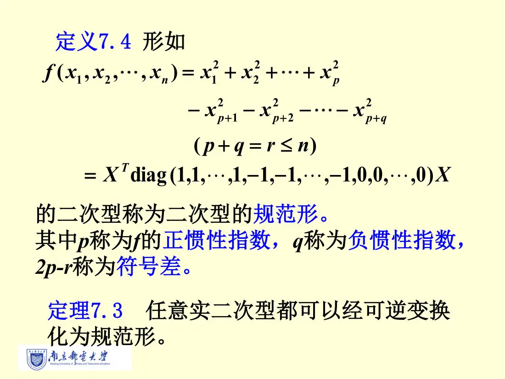

原文：

定义7.4 形如

$$
\begin{array}{r l} & f (x _ {1}, x _ {2}, \dots , x _ {n}) = x _ {1} ^ {2} + x _ {2} ^ {2} + \dots + x _ {p} ^ {2} \\ & \qquad - x _ {p + 1} ^ {2} - x _ {p + 2} ^ {2} - \dots - x _ {p + q} ^ {2} \\ & \qquad (p + q = r \leq n) \\ & \qquad = X ^ {T} \mathbf {d i a g} (1, 1, \dots , 1, - 1, - 1, \dots , - 1, 0, 0, \dots , 0) X \end{array}
$$

的二次型称为二次型的规范形。

其中p称为f的正惯性指数，q称为负惯性指数，2p-r称为符号差。

定理7.3 任意实二次型都可以经可逆变换化为规范形。

南京邮电大学
Nanjing University of Posts and Telecommunications

### 7.3.2 正定二次型

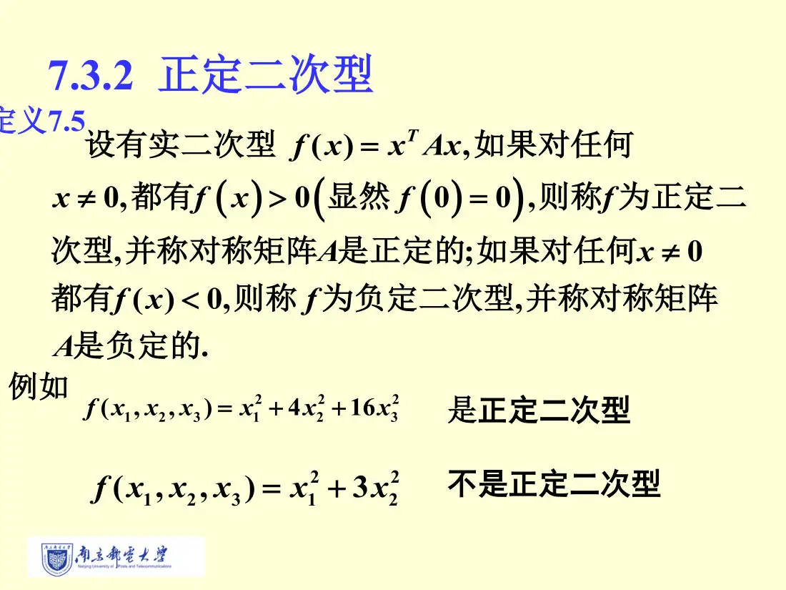

原文：

7.3.2 正定二次型

设有实二次型 $f(x)=x^{T}Ax$ ，如果对任何 $x\neq0$ ，都有 $f(x)>0$ （显然 $f(0)=0$ ），则称 f 为正定二次型，并称对称矩阵 A 是正定的；如果对任何 $x\neq0$ 都有 $f(x)<0$ ，则称 f 为负定二次型，并称对称矩阵 A 是负定的。

例如 $f(x_{1},x_{2},x_{3}) = x_{1}^{2} + 4x_{2}^{2} + 16x_{3}^{2}$ 是正定二次型

$$
f (x _ {1}, x _ {2}, x _ {3}) = x _ {1} ^ {2} + 3 x _ {2} ^ {2} \quad \text {不是正定二次型}
$$

南京邮电大学
Nanjing University of Posts and Telecommunications

### 7.3.3 正定二次型的判别

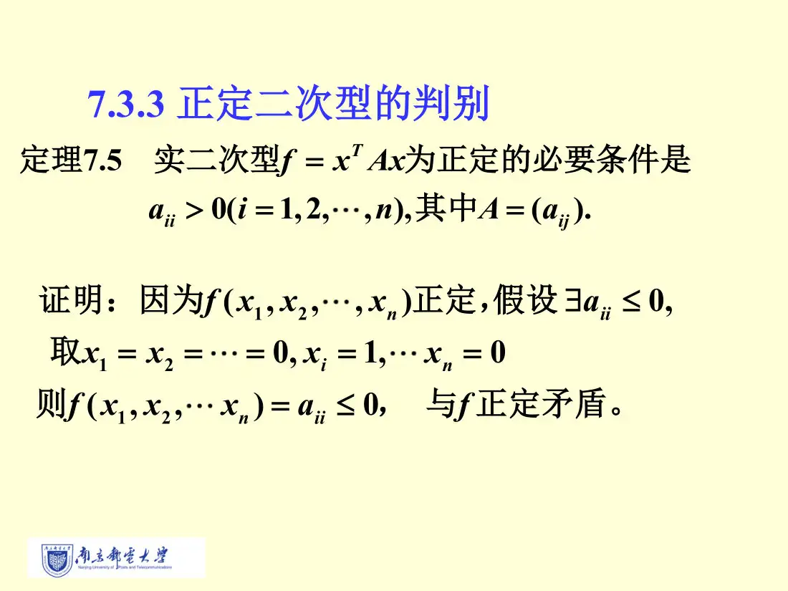

原文：

7.3.3 正定二次型的判别

定理7.5 实二次型 $f = x^{T}Ax$ 为正定的必要条件是 $a_{ii} > 0 (i = 1, 2, \cdots, n)$ , 其中 $A = (a_{ij})$ .

证明：因为 $f(x_{1}, x_{2}, \cdots, x_{n})$ 正定，假设 $\exists a_{ii} \leq 0$ ,

取 $x_{1} = x_{2} = \cdots = 0, x_{i} = 1, \cdots, x_{n} = 0$ 则 $f(x_{1}, x_{2}, \cdots, x_{n}) = a_{ii} \leq 0$ ，与f正定矛盾。

南京邮电大学
Nanjing University of Posts and Telecommunications

### 南京邮电大学

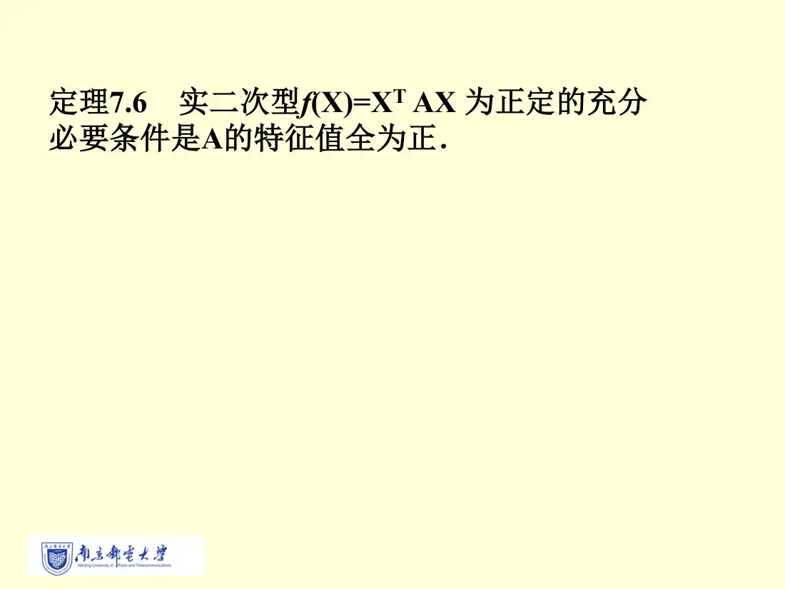

原文：

定理7.6 实二次型 $f(X)=X^{T}AX$ 为正定的充分必要条件是A的特征值全为正.

南京邮电大学
Nanjing University of Posts and Telecommunications

### 证明 设可逆变换 $x = Cy$ 使

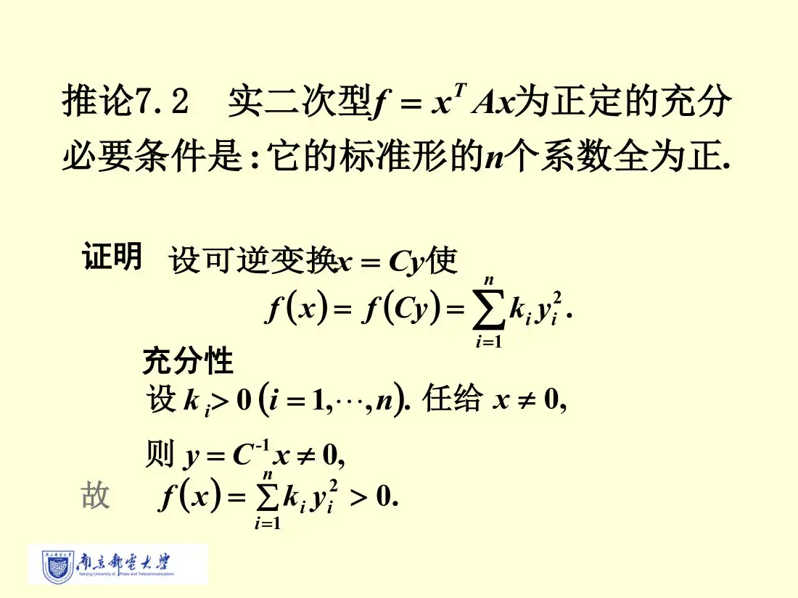

原文：

推论7.2 实二次型 $f = x^{T}Ax$ 为正定的充分必要条件是:它的标准形的n个系数全为正.

证明 设可逆变换 $x = Cy$ 使

$$
f (x) = f (C y) = \sum_ {i = 1} ^ {n} k _ {i} y _ {i} ^ {2}.
$$

充分性

设 $k_{i}>0(i=1,\cdots,n)$ . 任给 $x\neq0$ ,

则 $y = C^{-1}x \neq 0,$

故 $f(x) = \sum_{i=1}^{n} k_i y_i^2 > 0.$

南京邮电大学
Nanjing University of Posts and Telecommunications

### 必要性

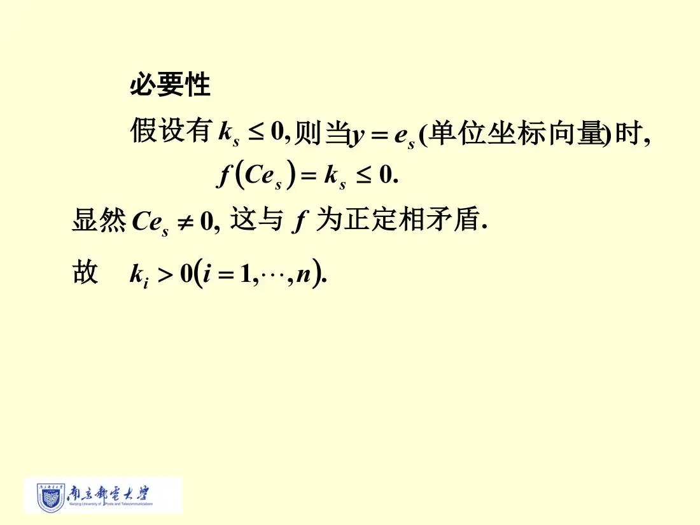

原文：

必要性

假设有 $k_{s} \leq 0$ ，则当 $y = e_{s}$ (单位坐标向量)时，

$$
f \left(C e _ {s}\right) = k _ {s} \leq 0.
$$

显然 $Ce_{s} \neq 0$ ，这与 f 为正定相矛盾。

故 $k_{i}>0(i=1,\cdots,n)$ .

南京邮电大学
Nanjing University of Posts and Telecommunications

### 南京邮电大学

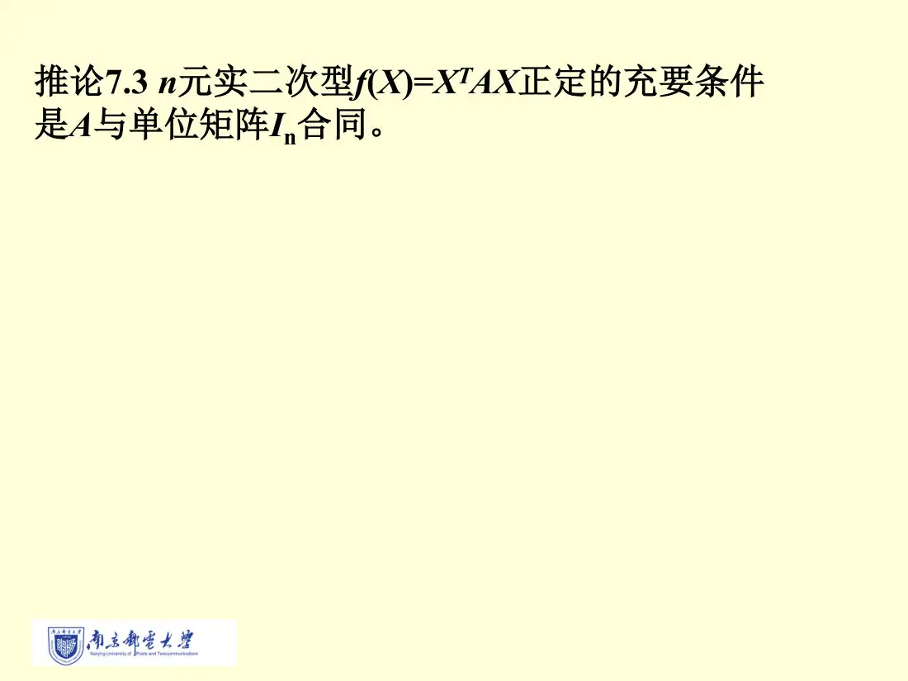

原文：

推论7.3 n元实二次型 $f(X)=X^{T}AX$ 正定的充要条件是A与单位矩阵 $I_{n}$ 合同。

南京邮电大学
Nanjing University of Posts and Telecommunications

### 定义7.6 设 $A=(a_{ij})_{n\times n}$ 为实对称矩阵,

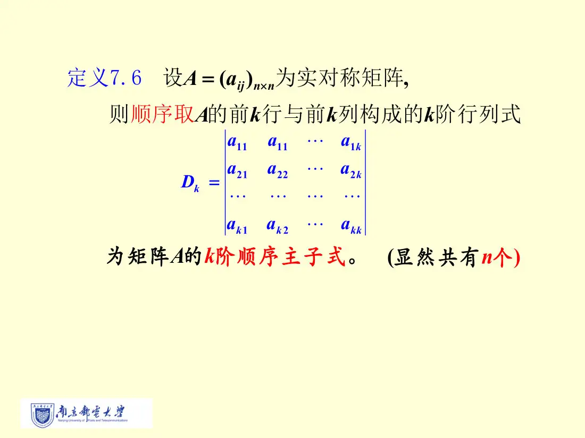

原文：

定义7.6 设 $A=(a_{ij})_{n\times n}$ 为实对称矩阵,

则顺序取A的前k行与前k列构成的k阶行列式

$$
D _ {k} = \left| \begin{array}{c c c c} a _ {1 1} & a _ {1 1} & \dots & a _ {1 k} \\ a _ {2 1} & a _ {2 2} & \dots & a _ {2 k} \\ \dots & \dots & \dots & \dots \\ a _ {k 1} & a _ {k 2} & \dots & a _ {k k} \end{array} \right|
$$

为矩阵A的k阶顺序主子式。(显然共有n个)

南京邮电大学
Nanjing University of Posts and Telecommunications

### 正定矩阵具有以下一些简单性质

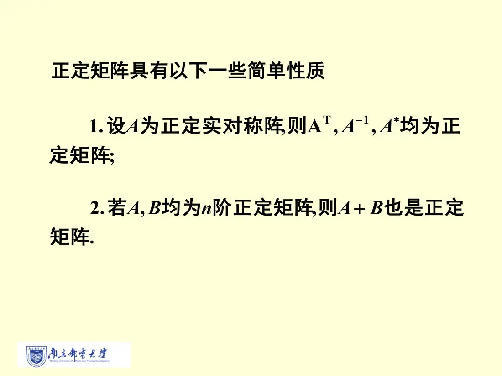

原文：

正定矩阵具有以下一些简单性质

1. 设 $A$ 为正定实对称阵, 则 $\mathbf{A}^{\mathrm{T}}, A^{-1}, A^{*}$ 均为正定矩阵;

2. 若 A, B 均为 n 阶正定矩阵, 则 $A + B$ 也是正定矩阵.

南京邮电大学
Nanjing University of Posts and Telecommunications

### 南京邮电大学

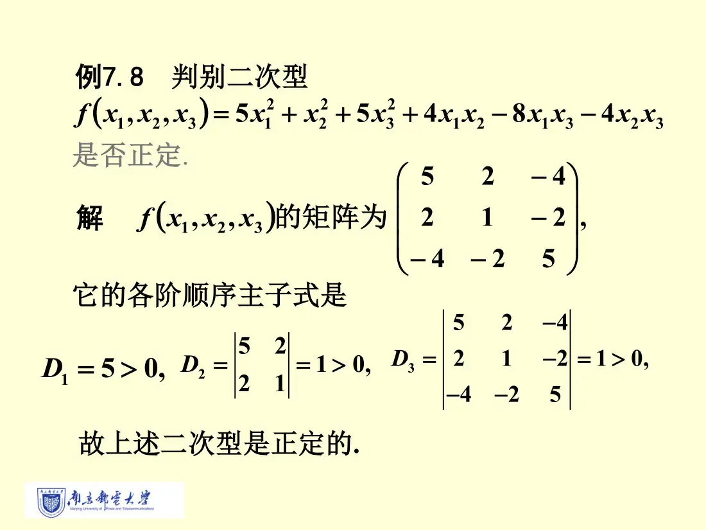

原文：

例7.8 判别二次型 $f(x_{1},x_{2},x_{3})=5x_{1}^{2}+x_{2}^{2}+5x_{3}^{2}+4x_{1}x_{2}-8x_{1}x_{3}-4x_{2}x_{3}$ 是否正定.
解 $f(x_{1},x_{2},x_{3})$ 的矩阵为 $\begin{pmatrix}5&2&-4\\ 2&1&-2\\ -4&-2&5\end{pmatrix}$ 它的各阶顺序主子式是 $D_{1}=5>0,\quad D_{2}=\begin{vmatrix}5&2\\ 2&1\end{vmatrix}=1>0,\quad D_{3}=\begin{vmatrix}5&2&-4\\ 2&1&-2\\ -4&-2&5\end{vmatrix}=1>0,$ 故上述二次型是正定的.

南京邮电大学
Nanjing University of Posts and Telecommunications

### 例7.8 确定 $\lambda$ 的取值范围,使二次型

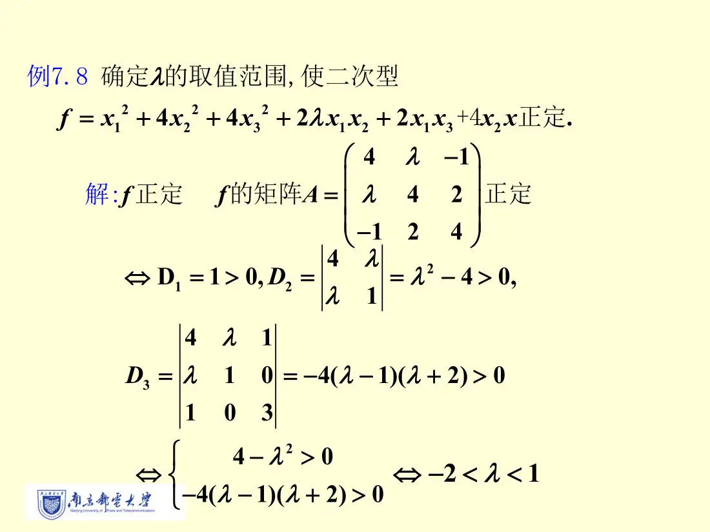

原文：

例7.8 确定 $\lambda$ 的取值范围,使二次型

$$
f = x _ {1} ^ {2} + 4 x _ {2} ^ {2} + 4 x _ {3} ^ {2} + 2 \lambda x _ {1} x _ {2} + 2 x _ {1} x _ {3} + 4 x _ {2} x \text {正定.}
$$

解: f 正定    f 的矩阵 $A = \begin{pmatrix} 4 & \lambda & -1 \\ \lambda & 4 & 2 \\ -1 & 2 & 4 \end{pmatrix}$ 正定

$$
\Leftrightarrow \mathbf {D} _ {1} = 1 > 0, D _ {2} = \left| \begin{array}{c c} 4 & \lambda \\ \lambda & 1 \end{array} \right| = \lambda^ {2} - 4 > 0,
$$

$$
D _ {3} = \left| \begin{array}{c c c} 4 & \lambda & 1 \\ \lambda & 1 & 0 \\ 1 & 0 & 3 \end{array} \right| = - 4 (\lambda - 1) (\lambda + 2) > 0
$$

$$
\Leftrightarrow \left\{ \begin{array}{c} 4 - \lambda^ {2} > 0 \\ - 4 (\lambda - 1) (\lambda + 2) > 0 \end{array} \Leftrightarrow - 2 <   \lambda <   1 \right.
$$

南京邮电大学
Nanjing University of Posts and Telecommunications

### 实二次型 $f = x^{T}Ax$ 正定

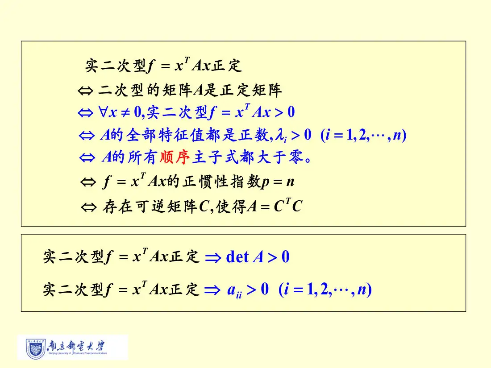

原文：

实二次型 $f = x^{T}Ax$ 正定

$\Leftrightarrow$ 二次型的矩阵 $A$ 是正定矩阵

$\Leftrightarrow \forall x \neq 0$ , 实二次型 $f = x^{T}Ax > 0$

$\Leftrightarrow A$ 的全部特征值都是正数, $\lambda_{i}>0(i=1,2,\cdots,n)$

$\Leftrightarrow A$ 的所有顺序主子式都大于零。

$\Leftrightarrow f = x^{T}Ax$ 的正惯性指数 $p = n$

$\Leftrightarrow$ 存在可逆矩阵 $C$ ，使得 $A = C^T C$

实二次型 $f=x^{T}Ax$ 正定 $\Rightarrow\det A>0$

实二次型 $f=x^{T}Ax$ 正定 $\Rightarrow a_{ii}>0(i=1,2,\cdots,n)$

南京邮电大学
Nanjing University of Posts and Telecommunications

### 故 $A^{-1}$ 也是正定矩阵。

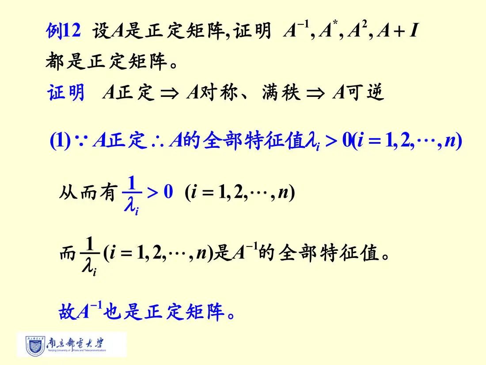

原文：

例12 设A是正定矩阵,证明 $A^{-1}, A^{*}, A^{2}, A + I$ 都是正定矩阵。

证明 $A$ 正定 $\Rightarrow A$ 对称、满秩 $\Rightarrow A$ 可逆

(1)∵ A正定∴ A的全部特征值 $\lambda_{i}>0(i=1,2,\cdots,n)$

从而有 $\frac{1}{\lambda_{i}}>0(i=1,2,\cdots,n)$

而 $\frac{1}{\lambda_{i}}(i=1,2,\cdots,n)$ 是 $A^{-1}$ 的全部特征值。

故 $A^{-1}$ 也是正定矩阵。

南京邮电大学
Nanjing University of Posts and Telecommunications

### 类似地可证明其它结论。

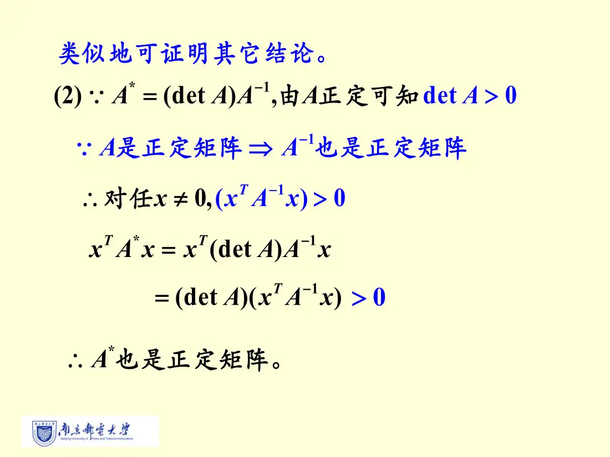

原文：

类似地可证明其它结论。

(2) $\because A^{*} = (\det A)A^{-1}$ , 由 $A$ 正定可知 $\det A > 0$

$\because A$ 是正定矩阵 $\Rightarrow A^{-1}$ 也是正定矩阵

∴ 对任 $x \neq 0, (x^{T} A^{-1} x) > 0$

$$
\begin{array}{r l} \boldsymbol {x} ^ {T} \boldsymbol {A} ^ {*} \boldsymbol {x} & = \boldsymbol {x} ^ {T} (\det \boldsymbol {A}) \boldsymbol {A} ^ {- 1} \boldsymbol {x} \\ & = (\det \boldsymbol {A}) (\boldsymbol {x} ^ {T} \boldsymbol {A} ^ {- 1} \boldsymbol {x}) > 0 \end{array}
$$

$\therefore A^{*}$ 也是正定矩阵。

南京邮电大学
Nanjing University of Posts and Telecommunications

### (3) $A^{2} = A \cdot A$

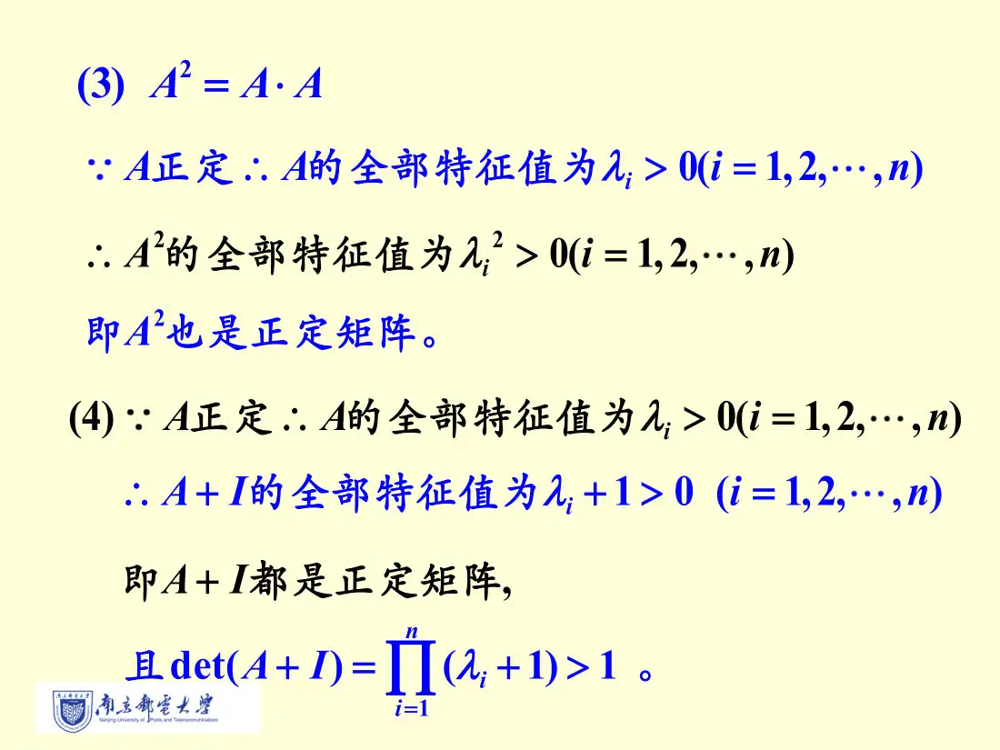

原文：

(3) $A^{2} = A \cdot A$

∵ A正定 ∴ A的全部特征值为 $\lambda_{i} > 0 (i = 1, 2, \cdots, n)$ ∴ $A^{2}$ 的全部特征值为 $\lambda_{i}^{2} > 0 (i = 1, 2, \cdots, n)$ 即 $A^{2}$ 也是正定矩阵。

(4) ∵ A 正定 ∴ A 的全部特征值为 $\lambda_{i} > 0 (i = 1, 2, \cdots, n)$ ∴ A + I 的全部特征值为 $\lambda_{i} + 1 > 0 (i = 1, 2, \cdots, n)$ 即 A + I 都是正定矩阵，

且 $\det(A + I) = \prod_{i=1}^{n} (\lambda_{i} + 1) > 1$ 。

### 例17 求 k 的值,使

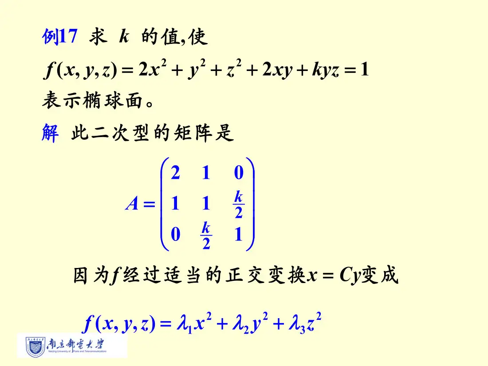

原文：

例17 求 k 的值,使

$$
f (x, y, z) = 2 x ^ {2} + y ^ {2} + z ^ {2} + 2 x y + k y z = 1
$$

表示椭球面。

解 此二次型的矩阵是

$$
A = \left( \begin{array}{c c c} 2 & 1 & 0 \\ 1 & 1 & \frac {k}{2} \\ 0 & \frac {k}{2} & 1 \end{array} \right)
$$

因为 $f$ 经过适当的正交变换 $x = Cy$ 变成

$$
f (x, y, z) = \lambda_ {1} x ^ {2} + \lambda_ {2} y ^ {2} + \lambda_ {3} z ^ {2}
$$

南京邮电大学
Nanjing University of Posts and Telecommunications

### 由正定性的判别定理得：

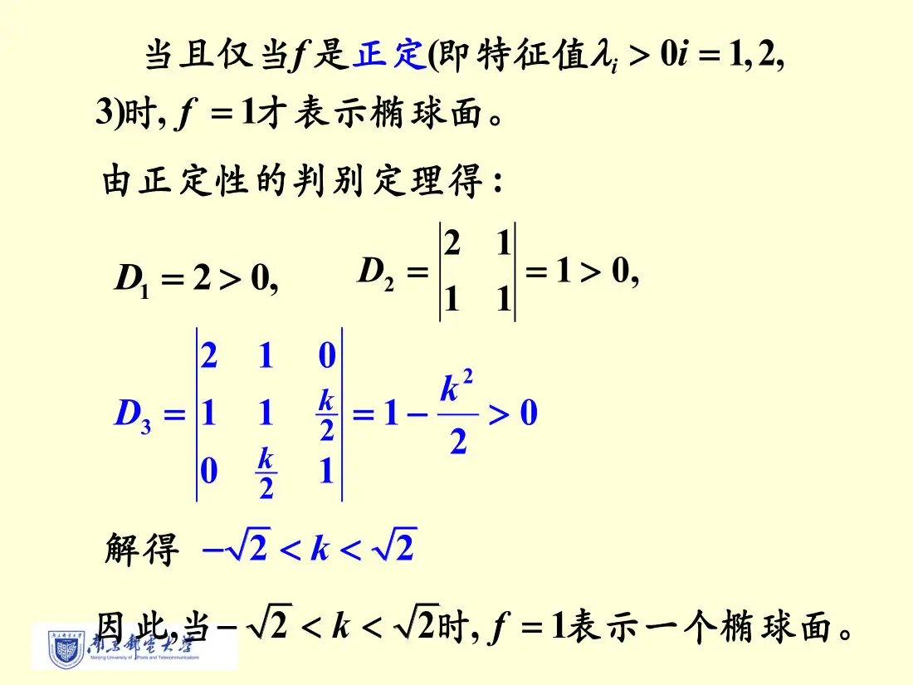

原文：

当且仅当f是正定(即特征值 $\lambda_{i}>0i=1,2,3$ )时,f=1才表示椭球面。

由正定性的判别定理得：

$$
D _ {1} = 2 > 0, \qquad D _ {2} = \left| \begin{array}{c c} 2 & 1 \\ 1 & 1 \end{array} \right| = 1 > 0,
$$

$$
D _ {3} = \left| \begin{array}{c c c} 2 & 1 & 0 \\ 1 & 1 & \frac {k}{2} \\ 0 & \frac {k}{2} & 1 \end{array} \right| = 1 - \frac {k ^ {2}}{2} > 0
$$

解得 $-\sqrt{2} < k < \sqrt{2}$

因此,当 $-\sqrt{2}<k<\sqrt{2}$ 时,f=1 表示一个椭球面。

南京邮电大学
Nanjing University of Posts and Telecommunications

### 例19 设A,B是n阶正定矩阵,且AB=BA,证明AB是n阶正定矩阵。

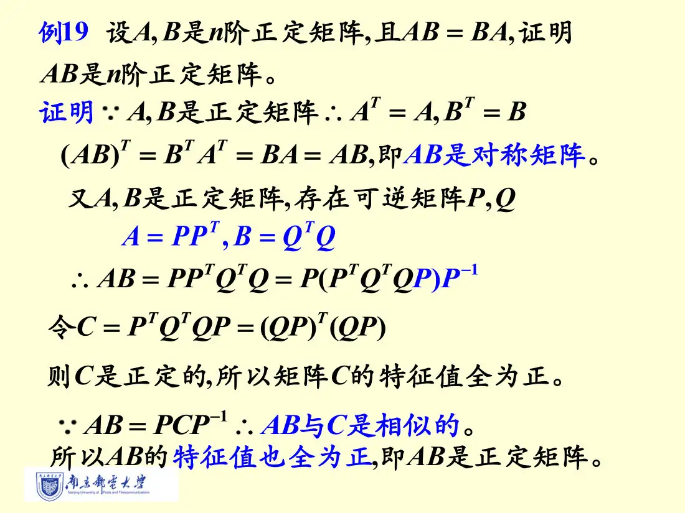

原文：

例19 设A,B是n阶正定矩阵,且AB=BA,证明AB是n阶正定矩阵。

证明 $\because A, B$ 是正定矩阵 $\therefore A^T = A, B^T = B$

$(AB)^{T} = B^{T}A^{T} = BA = AB$ ，即 $AB$ 是对称矩阵。

又A,B是正定矩阵,存在可逆矩阵P,Q

$$
A = P P ^ {T}, B = Q ^ {T} Q
$$

$$
\therefore A B = P P ^ {T} Q ^ {T} Q = P (P ^ {T} Q ^ {T} Q P) P ^ {- 1}
$$

令 $C = P^{T}Q^{T}QP = (QP)^{T}(QP)$

则C是正定的,所以矩阵C的特征值全为正。

$\because AB = PCP^{-1} \therefore AB$ 与 $C$ 是相似的。

所以AB的特征值也全为正,即AB是正定矩阵。

南京邮电大学
Nanjing University of Posts and Telecommunications

### 思考题

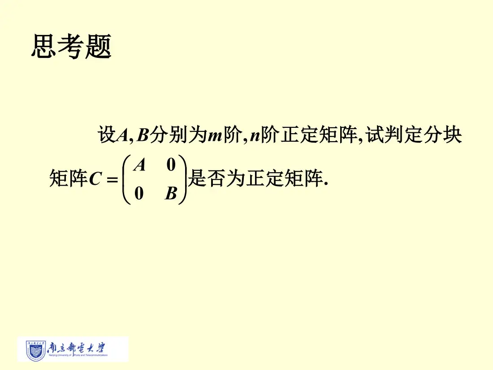

原文：

思考题

设A,B分别为m阶,n阶正定矩阵,试判定分块
矩阵 $C=\begin{pmatrix}A&0\\0&B\end{pmatrix}$ 是否为正定矩阵.

南京邮电大学
Nanjing University of Posts and Telecommunications

### 思考题解答

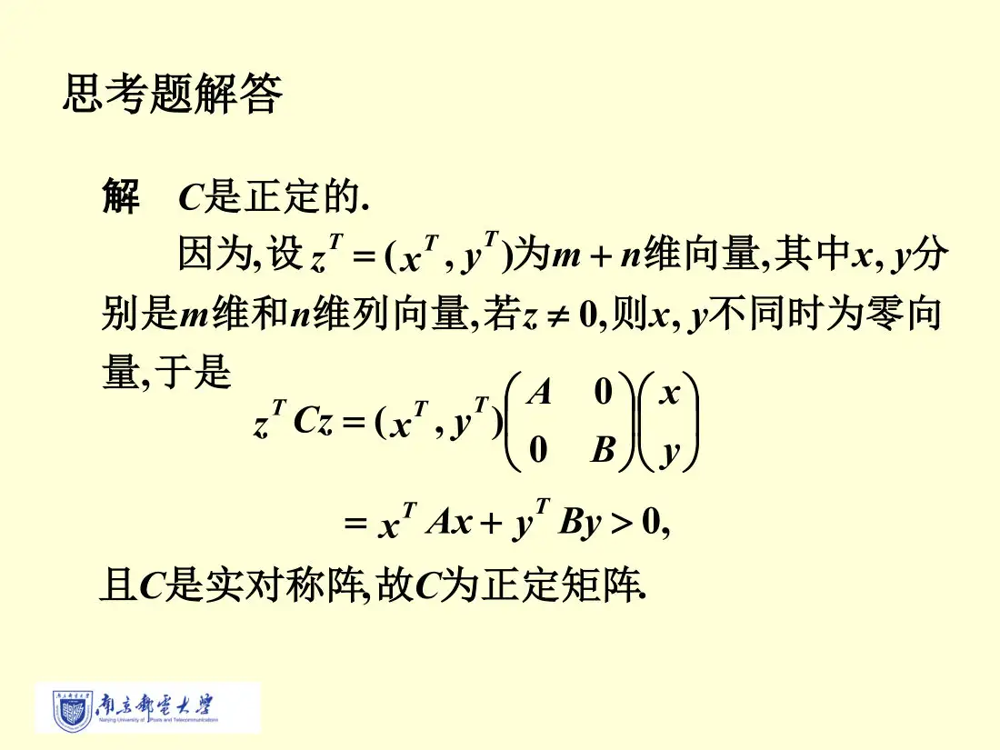

原文：

思考题解答

解 C是正定的.

因为,设 $z^{T}=(x^{T},y^{T})$ 为 $m+n$ 维向量,其中 x,y 分别是 m 维和 n 维列向量,若 $z\neq0$ ,则 x,y 不同时为零向量,于是
(4,0)(x)

$$
\begin{array}{r} \mathbf {z} ^ {T} C \mathbf {z} = (\mathbf {x} ^ {T}, \mathbf {y} ^ {T}) \left( \begin{array}{l l} A & \mathbf {0} \\ \mathbf {0} & B \end{array} \right) \left( \begin{array}{l} x \\ y \end{array} \right) \\ = \mathbf {x} ^ {T} A \mathbf {x} + \mathbf {y} ^ {T} B \mathbf {y} > \mathbf {0}, \end{array}
$$

且C是实对称阵,故C为正定矩阵.

南京邮电大学
Nanjing University of Posts and Telecommunications
