# 《线性代数与解析几何》第一章 行列式习题课（课件）

原件的每一页，下面附识别出的文字。

### 第一章 行列式习题课

原文：

第一章 行列式习题课

● ● ● ●

### 第一章 行列式

原文：

第一章 行列式

一、要点复习

二、典型例题介绍

● ● ● ●

### 一、要点复习

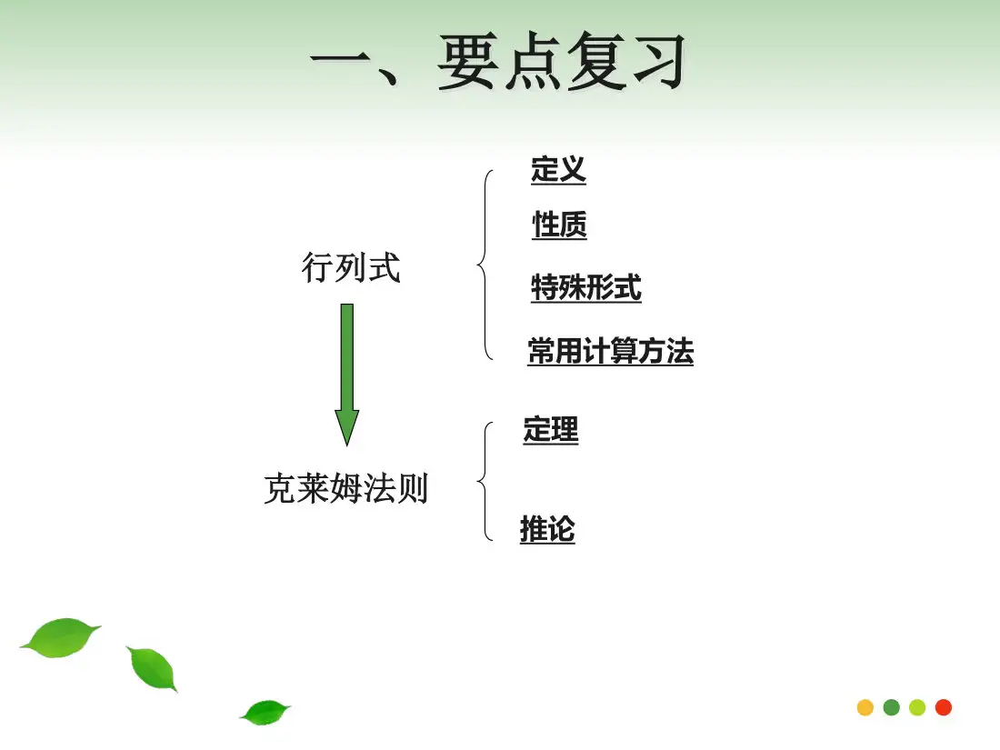

原文：

一、要点复习

定义

行列式

性质

特殊形式

常用计算方法

定理

克莱姆法则

推论

● ● ● ●

### 1. 排列与逆序数

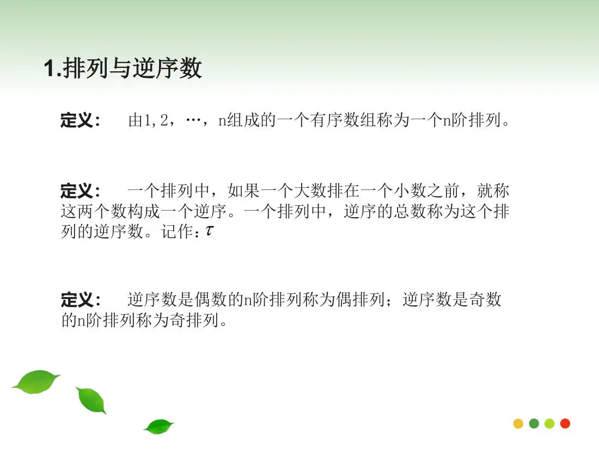

原文：

1. 排列与逆序数

定义：由1,2，…，n组成的一个有序数组称为一个n阶排列。

定义: 一个排列中, 如果一个大数排在一个小数之前, 就称这两个数构成一个逆序。一个排列中, 逆序的总数称为这个排列的逆序数。记作: $\tau$

定义：逆序数是偶数的n阶排列称为偶排列；逆序数是奇数的n阶排列称为奇排列。

### 定理：排列经过1次对换，其奇偶性改变。

原文：

定义：在排列中，将任意两个元素对调，其余的元素不动，叫做对换。将相邻两个元素对换，叫做相邻对换。

定理：排列经过1次对换，其奇偶性改变。

推论：奇排列调成自然排列的对换次数为奇数，偶排列调成自然排列的对换次数为偶数。

### 2.行列式的定义

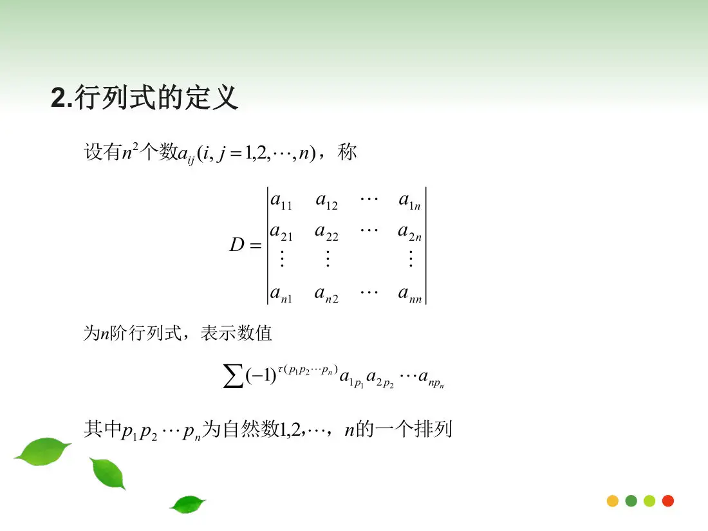

原文：

2.行列式的定义

设有 $n^{2}$ 个数 $a_{ij}(i,j=1,2,\cdots,n)$ ，称

$$
D = \left| \begin{array}{c c c c} a _ {1 1} & a _ {1 2} & \dots & a _ {1 n} \\ a _ {2 1} & a _ {2 2} & \dots & a _ {2 n} \\ \vdots & \vdots & & \vdots \\ a _ {n 1} & a _ {n 2} & \dots & a _ {n n} \end{array} \right|
$$

为n阶行列式，表示数值

$$
\sum (- 1) ^ {\tau (p _ {1} p _ {2} \dots p _ {n})} a _ {1 p _ {1}} a _ {2 p _ {2}} \dots a _ {n p _ {n}}
$$

其中 $p_{1}p_{2}\cdots p_{n}$ 为自然数 $1,2,\cdots,n$ 的一个排列

● ● ● ●

### $n$ 阶行列式 $D$ 也可定义为

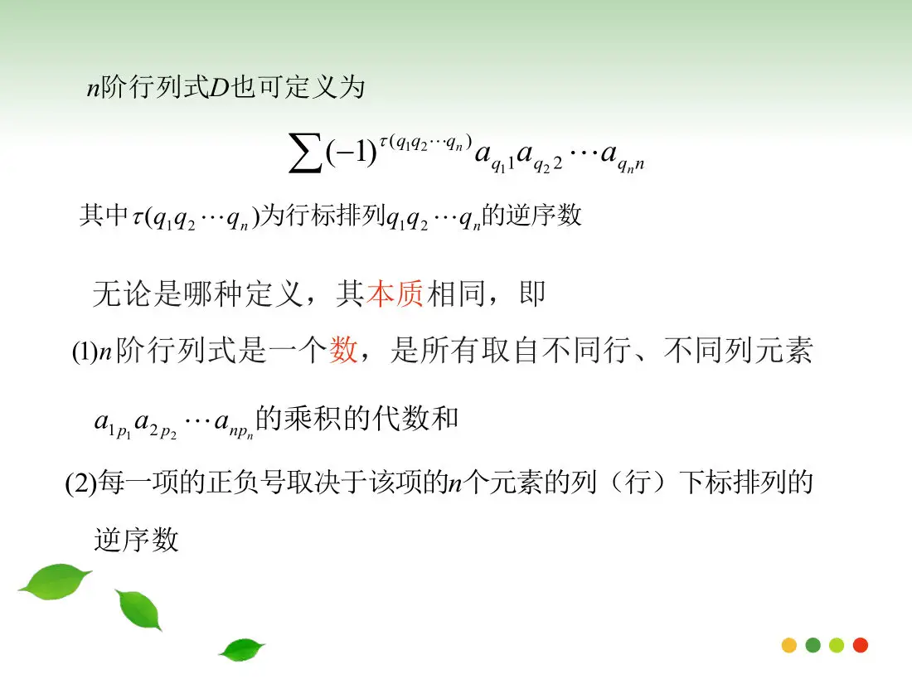

原文：

$n$ 阶行列式 $D$ 也可定义为

$$
\sum (- 1) ^ {\tau (q _ {1} q _ {2} \dots q _ {n})} a _ {q _ {1} 1} a _ {q _ {2} 2} \dots a _ {q _ {n} n}
$$

其中 $\tau(q_{1}q_{2}\cdots q_{n})$ 为行标排列 $q_{1}q_{2}\cdots q_{n}$ 的逆序数

无论是哪种定义，其本质相同，即

(1)n阶行列式是一个数，是所有取自不同行、不同列元素 $a_{1p_{1}}a_{2p_{2}}\cdots a_{np_{n}}$ 的乘积的代数和

(2)每一项的正负号取决于该项的n个元素的列（行）下标排列的逆序数

### 3.行列式的性质

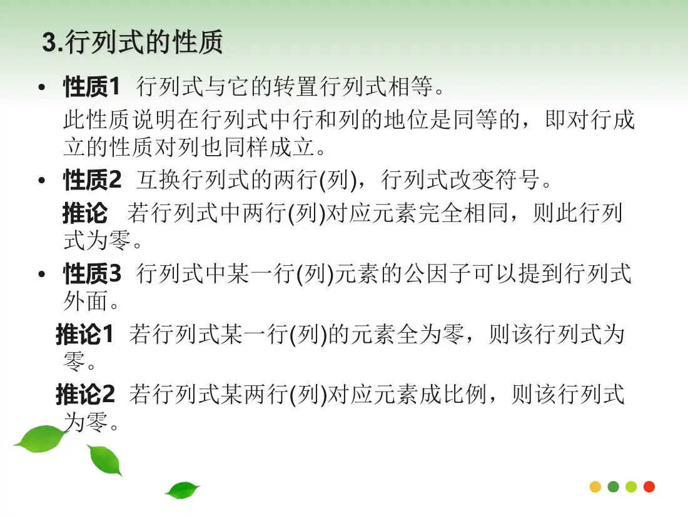

原文：

3.行列式的性质

\- 性质1 行列式与它的转置行列式相等。

此性质说明在行列式中行和列的地位是同等的，即对行成立的性质对列也同样成立。

\- 性质2 互换行列式的两行(列)，行列式改变符号。

推论 若行列式中两行(列)对应元素完全相同，则此行列式为零。

\- 性质3 行列式中某一行(列)元素的公因子可以提到行列式外面。

推论1 若行列式某一行(列)的元素全为零，则该行列式为零。

推论2 若行列式某两行(列)对应元素成比例，则该行列式为零。

### 性质6 (Laplace展开法则)

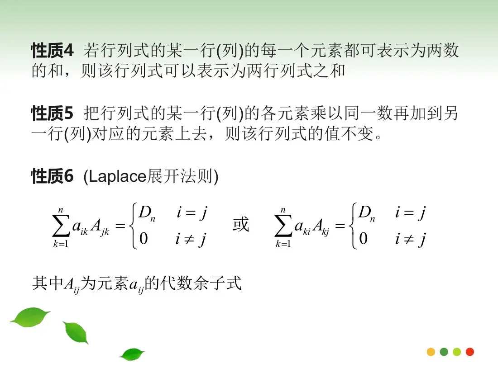

原文：

性质4 若行列式的某一行(列)的每一个元素都可表示为两数的和，则该行列式可以表示为两行列式之和

性质5 把行列式的某一行(列)的各元素乘以同一数再加到另一行(列)对应的元素上去，则该行列式的值不变。

性质6 (Laplace展开法则)

$$
\sum_ {k = 1} ^ {n} a _ {i k} A _ {j k} = \left\{ \begin{array}{l l} D _ {n} & i = j \\ 0 & i \neq j \end{array} \right. \quad \text {或} \quad \sum_ {k = 1} ^ {n} a _ {k i} A _ {k j} = \left\{ \begin{array}{l l} D _ {n} & i = j \\ 0 & i \neq j \end{array} \right.
$$

其中 $A_{ij}$ 为元素 $a_{ij}$ 的代数余子式

### 4.几种常见的行列式

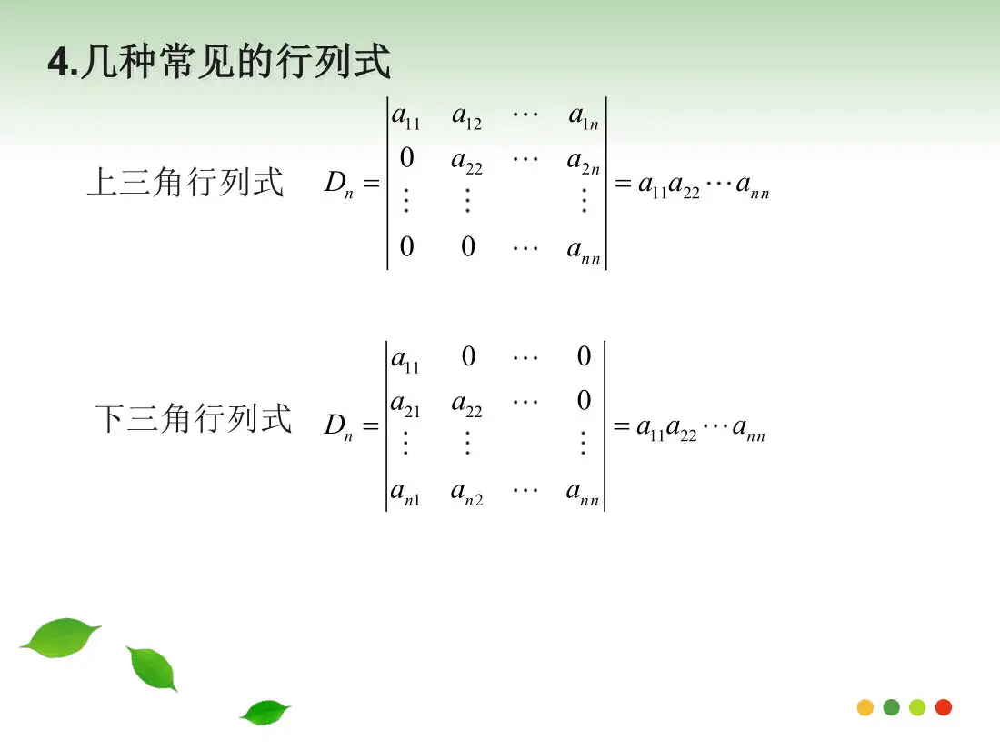

原文：

4.几种常见的行列式

上三角行列式 $D_{n}=\left|\begin{matrix}a_{11}&a_{12}&\cdots&a_{1n}\\0&a_{22}&\cdots&a_{2n}\\\vdots&\vdots&&\vdots\\0&0&\cdots&a_{nn}\end{matrix}\right|=a_{11}a_{22}\cdots a_{nn}$

下三角行列式 $D_{n}=\begin{vmatrix}a_{11}&0&\cdots&0\\a_{21}&a_{22}&\cdots&0\\\vdots&\vdots&&\vdots\\a_{n1}&a_{n2}&\cdots&a_{nn}\end{vmatrix}=a_{11}a_{22}\cdots a_{nn}$

### 对角行列式

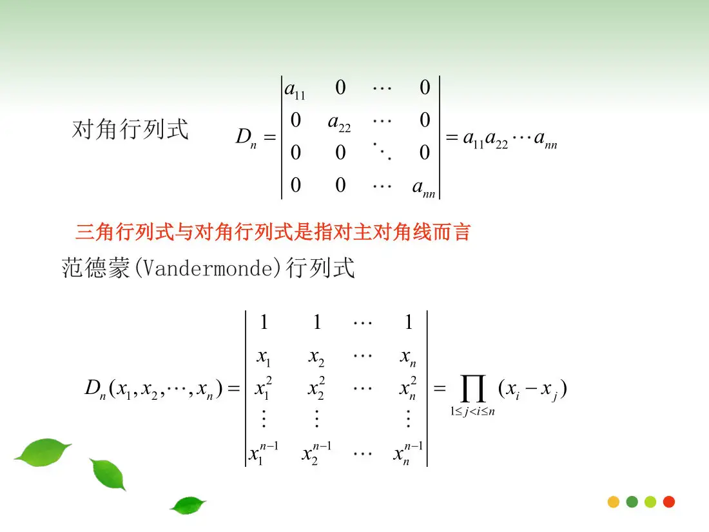

原文：

对角行列式

$$
D _ {n} = \left| \begin{array}{c c c c} a _ {1 1} & 0 & \dots & 0 \\ 0 & a _ {2 2} & \dots & 0 \\ 0 & 0 & \ddots & 0 \\ 0 & 0 & \dots & a _ {n n} \end{array} \right| = a _ {1 1} a _ {2 2} \dots a _ {n n}
$$

三角行列式与对角行列式是指对主对角线而言

范德蒙(Vandermonde)行列式

$$
D _ {n} (x _ {1}, x _ {2}, \dots , x _ {n}) = \left| \begin{array}{c c c c} 1 & 1 & \dots & 1 \\ x _ {1} & x _ {2} & \dots & x _ {n} \\ x _ {1} ^ {2} & x _ {2} ^ {2} & \dots & x _ {n} ^ {2} \\ \vdots & \vdots & & \vdots \\ x _ {1} ^ {n - 1} & x _ {2} ^ {n - 1} & \dots & x _ {n} ^ {n - 1} \end{array} \right| = \prod_ {1 \leq j <   i \leq n} (x _ {i} - x _ {j})
$$

### 5.行列式常用计算方法

原文：

5.行列式常用计算方法

首先观察行列式元素的规律（数字规律与排列规律），

常用计算方法有:

\- 利用行列式的定义;

\- 利用行列式的性质化为三角形行列式;

\- 利用行列式的性质做恒等变形化简,使行列式中出现尽量多的零元素，然后按零元素最多的行或列展开；

\- 拆行列式为几个行列式的和;

\- 递推公式法;

\- 数学归纳法;

\- 应用范德蒙行列式;

加边法。

### 6.克莱姆法则

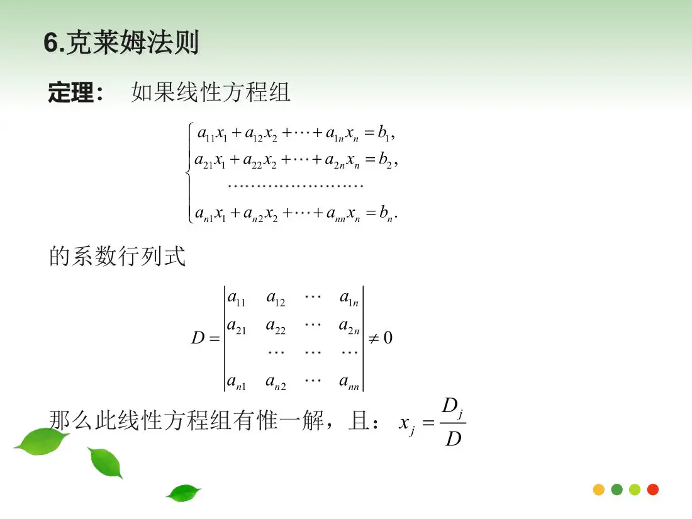

原文：

6.克莱姆法则

定理：如果线性方程组

$$
\left\{ \begin{array}{l} a _ {1 1} x _ {1} + a _ {1 2} x _ {2} + \dots + a _ {1 n} x _ {n} = b _ {1}, \\ a _ {2 1} x _ {1} + a _ {2 2} x _ {2} + \dots + a _ {2 n} x _ {n} = b _ {2}, \\ \dots\dots\\ a _ {n 1} x _ {1} + a _ {n 2} x _ {2} + \dots + a _ {n n} x _ {n} = b _ {n}. \end{array} \right.
$$

的系数行列式

$$
D = \left| \begin{array}{c c c c} a _ {1 1} & a _ {1 2} & \dots & a _ {1 n} \\ a _ {2 1} & a _ {2 2} & \dots & a _ {2 n} \\ & \dots & \dots & \dots \\ a _ {n 1} & a _ {n 2} & \dots & a _ {n n} \end{array} \right| \neq 0
$$

那么此线性方程组有惟一解，且： $x_{j}=\frac{D_{j}}{D}$

### 推论：如果齐次线性方程组

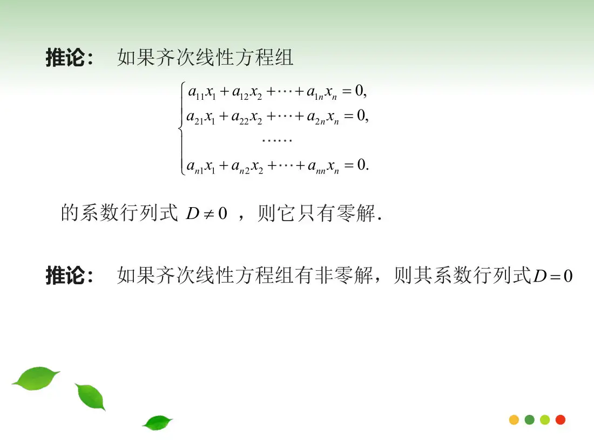

原文：

推论：如果齐次线性方程组

$$
\left\{ \begin{array}{l} a _ {1 1} x _ {1} + a _ {1 2} x _ {2} + \dots + a _ {1 n} x _ {n} = 0, \\ a _ {2 1} x _ {1} + a _ {2 2} x _ {2} + \dots + a _ {2 n} x _ {n} = 0, \\ \qquad \dots \dots \\ a _ {n 1} x _ {1} + a _ {n 2} x _ {2} + \dots + a _ {n n} x _ {n} = 0. \end{array} \right.
$$

的系数行列式 $D \neq 0$ ，则它只有零解.

推论：如果齐次线性方程组有非零解，则其系数行列式 $D = 0$

### 二、典型例题

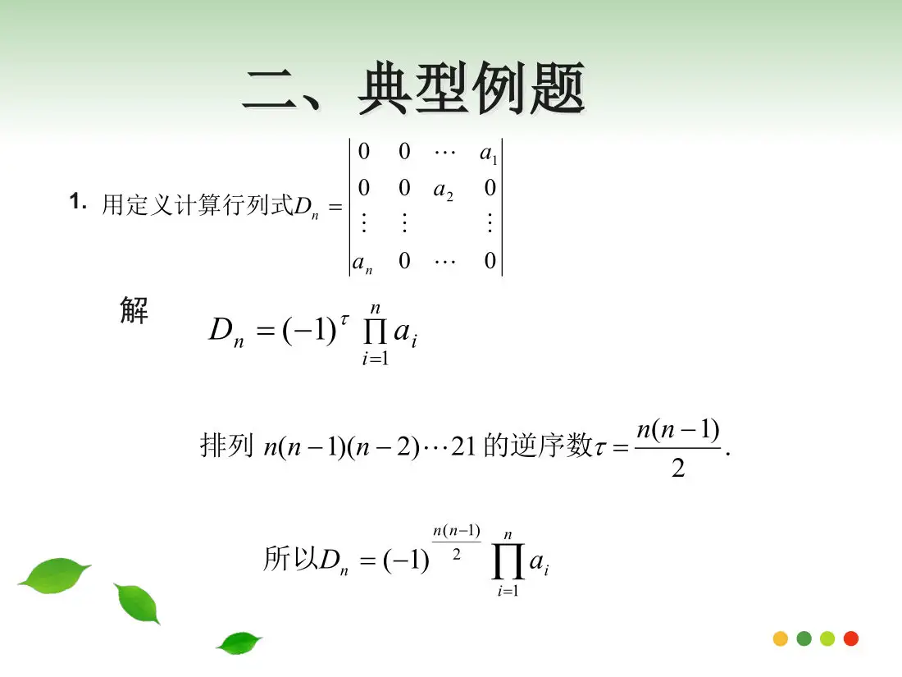

原文：

二、典型例题

1. 用定义计算行列式 $D_{n}=\left|\begin{matrix}0&0&\cdots&a_{1}\\ 0&0&a_{2}&0\\\vdots&\vdots&&\vdots\\ a_{n}&0&\cdots&0\end{matrix}\right|$

解

$$
D _ {n} = (- 1) ^ {\tau} \prod_ {i = 1} ^ {n} a _ {i}
$$

排列 $n(n-1)(n-2)\cdots21$ 的逆序数 $\tau=\frac{n(n-1)}{2}$ .

$$
\text {所以} D _ {n} = (- 1) ^ {\frac {n (n - 1)}{2}} \prod_ {i = 1} ^ {n} a _ {i}
$$

### $$

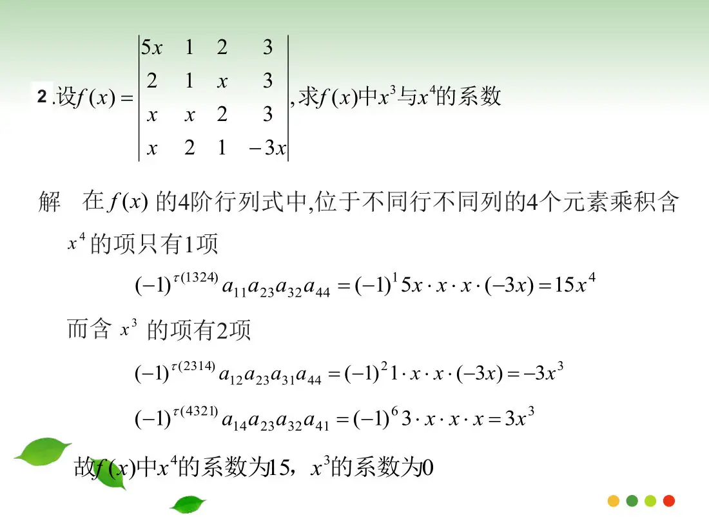

原文：

2. 设 $f(x) = \begin{vmatrix} 5x & 1 & 2 & 3 \\ 2 & 1 & x & 3 \\ x & x & 2 & 3 \\ x & 2 & 1 & -3x \end{vmatrix}$ ，求 $f(x)$ 中 $x^3$ 与 $x^4$ 的系数

解 在 $f(x)$ 的4阶行列式中,位于不同行不同列的4个元素乘积含 $x^4$ 的项只有1项

$$
(- 1) ^ {\tau (1 3 2 4)} a _ {1 1} a _ {2 3} a _ {3 2} a _ {4 4} = (- 1) ^ {1} 5 x \cdot x \cdot x \cdot (- 3 x) = 1 5 x ^ {4}
$$

而含 $x^{3}$ 的项有2项

$$
(- 1) ^ {\tau (2 3 1 4)} a _ {1 2} a _ {2 3} a _ {3 1} a _ {4 4} = (- 1) ^ {2} 1 \cdot x \cdot x \cdot (- 3 x) = - 3 x ^ {3}
$$

$$
(- 1) ^ {\tau (4 3 2 1)} a _ {1 4} a _ {2 3} a _ {3 2} a _ {4 1} = (- 1) ^ {6} 3 \cdot x \cdot x \cdot x = 3 x ^ {3}
$$

故 $f(x)$ 中 $x^{4}$ 的系数为15， $x^{3}$ 的系数为0

### 3、

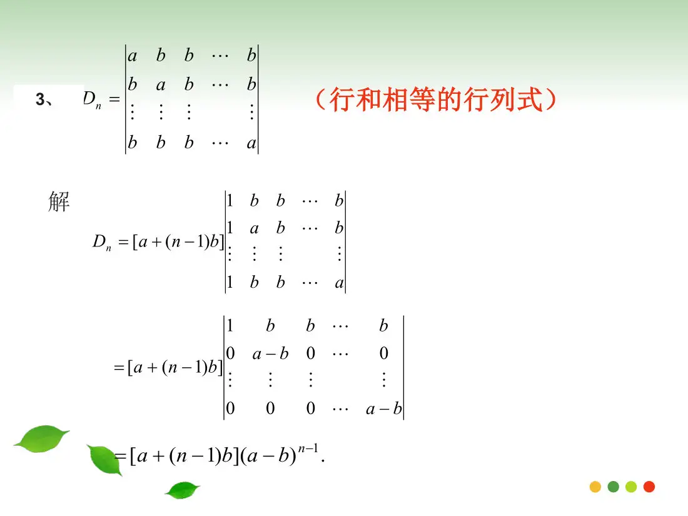

原文：

3、

$$
D _ {n} = \left| \begin{array}{c c c c c} a & b & b & \dots & b \\ b & a & b & \dots & b \\ \vdots & \vdots & \vdots & & \vdots \\ b & b & b & \dots & a \end{array} \right|
$$

(行和相等的行列式)

解

$$
D _ {n} = [ a + (n - 1) b ] \left| \begin{array}{c c c c c} 1 & b & b & \dots & b \\ 1 & a & b & \dots & b \\ \vdots & \vdots & \vdots & & \vdots \\ 1 & b & b & \dots & a \end{array} \right|
$$

$$
= [ a + (n - 1) b ] \left| \begin{array}{c c c c c} 1 & b & b & \dots & b \\ 0 & a - b & 0 & \dots & 0 \\ \vdots & \vdots & \vdots & & \vdots \\ 0 & 0 & 0 & \dots & a - b \end{array} \right|
$$

$$
= [ a + (n - 1) b ] (a - b) ^ {n - 1}.
$$

### $$

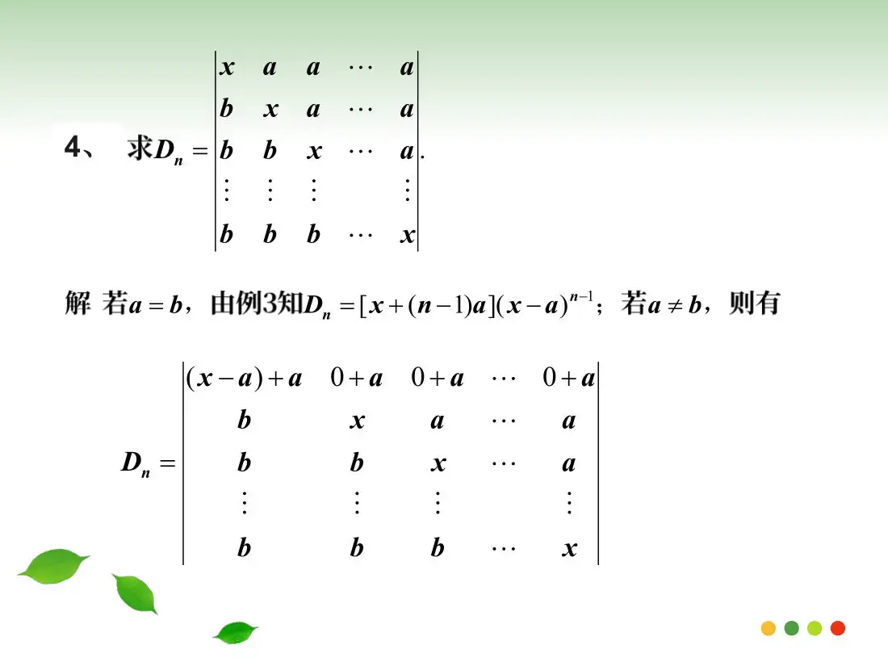

原文：

$$
\boldsymbol {D} _ {n} = \left| \begin{array}{c c c c c} x & a & a & \dots & a \\ b & x & a & \dots & a \\ b & b & x & \dots & a \\ \vdots & \vdots & \vdots & & \vdots \\ b & b & b & \dots & x \end{array} \right|.
$$

解 若 $a = b$ ，由例3知 $D_{n} = [x + (n - 1)a](x - a)^{n - 1}$ ；若 $a \neq b$ ，则有

$$
D _ {n} = \left| \begin{array}{c c c c c} (x - a) + a & 0 + a & 0 + a & \dots & 0 + a \\ b & x & a & \dots & a \\ b & b & x & \dots & a \\ \vdots & \vdots & \vdots & & \vdots \\ b & b & b & \dots & x \end{array} \right|
$$

### $$

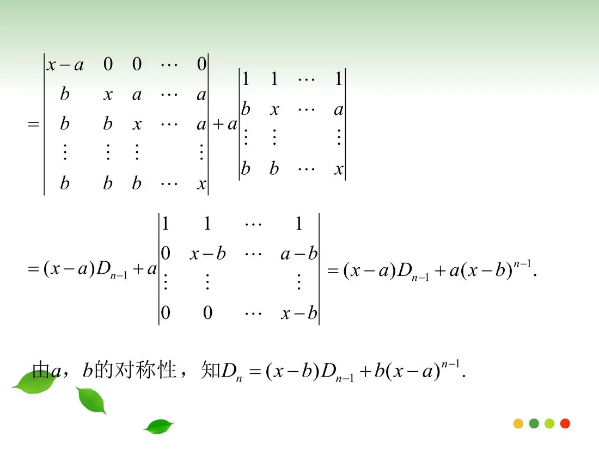

原文：

$$
= \left| \begin{array}{c c c c c} x - a & 0 & 0 & \dots & 0 \\ b & x & a & \dots & a \\ b & b & x & \dots & a \\ \vdots & \vdots & \vdots & & \vdots \\ b & b & b & \dots & x \end{array} \right| + a \left| \begin{array}{c c c c} 1 & 1 & \dots & 1 \\ b & x & \dots & a \\ \vdots & \vdots & & \vdots \\ b & b & \dots & x \end{array} \right|
$$

$$
= (x - a) D _ {n - 1} + a \left| \begin{array}{c c c c} 1 & 1 & \dots & 1 \\ 0 & x - b & \dots & a - b \\ \vdots & \vdots & & \vdots \\ 0 & 0 & \dots & x - b \end{array} \right| = (x - a) D _ {n - 1} + a (x - b) ^ {n - 1}.
$$

由 $a$ ， $b$ 的对称性，知 $D_{n} = (x - b)D_{n - 1} + b(x - a)^{n - 1}$

### 第 20 页

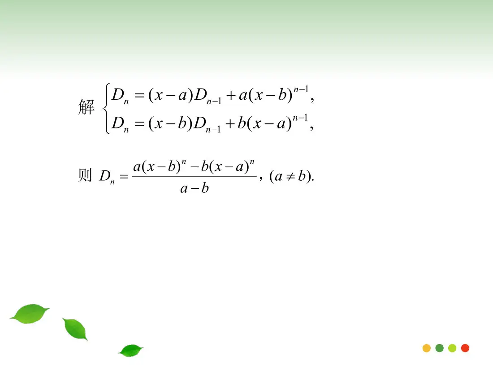

原文：

解 $\left\{ \begin{array}{l} D_{n} = (x - a)D_{n - 1} + a(x - b)^{n - 1},\\ D_{n} = (x - b)D_{n - 1} + b(x - a)^{n - 1}, \end{array} \right.$

则 $D_{n} = \frac{a(x - b)^{n} - b(x - a)^{n}}{a - b}, (a \neq b)$ .

### 解：将 $D_{n}$ 按第1列展开，则

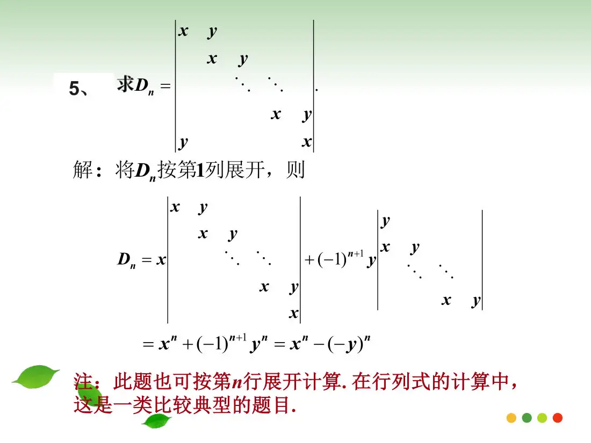

原文：

5、求 $D_{n}=\left|\begin{matrix}x&y&\\ &x&y&\\ &\ddots&\ddots&\\ &&x&y\\ y&\end{matrix}\right|$

解：将 $D_{n}$ 按第1列展开，则

$$
\begin{array}{r l} & D _ {n} = x \left| \begin{array}{c c c c c} x & y & & & \\ & x & y & & \\ & & \ddots & \ddots & \\ & & & x & y \\ & & & & x \end{array} \right| + (- 1) ^ {n + 1} y \left| \begin{array}{c c c c c} y & & & & \\ x & y & & \\ & \ddots & \ddots & \\ & & x & y \end{array} \right| \\ & = x ^ {n} + (- 1) ^ {n + 1} y ^ {n} = x ^ {n} - (- y) ^ {n} \end{array}
$$

注: 此题也可按第 $n$ 行展开计算. 在行列式的计算中, 这是一类比较典型的题目.

### $$

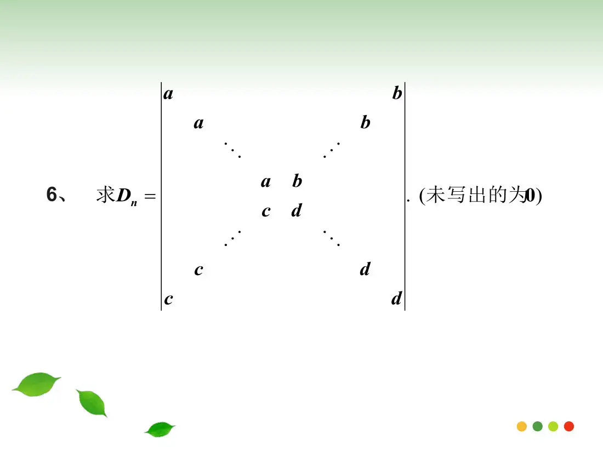

原文：

$$
6 、 \quad \text {求} D _ {n} = \left| \begin{array}{c c c c c c c c} a & & & & & & b \\ & a & & & & b \\ & & \ddots & & \ddots & \\ & & & a & b & & \\ & & & c & d & \\ & & \ddots & & \ddots & \\ & c & & & & d \\ c & & & & & d \end{array} \right|. (\text {未写出的为} 0)
$$

### 解 将 $D_{2n}$ 按第1行展开，则

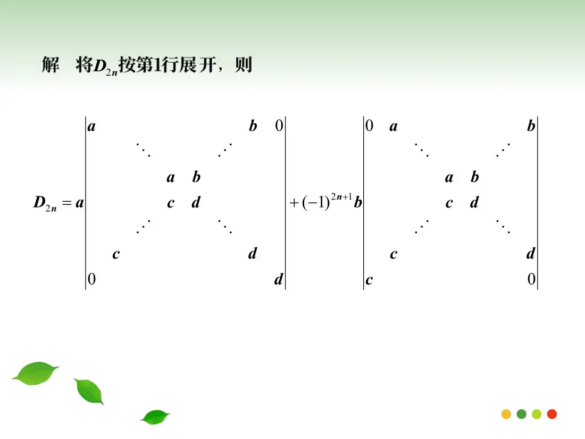

原文：

解 将 $D_{2n}$ 按第1行展开，则

$$
\boldsymbol {D} _ {2 n} = \boldsymbol {a} \left| \begin{array}{c c c c c c c c c} \boldsymbol {a} & & & & & & \boldsymbol {b} & 0 \\ & & \ddots & & & \ddots & & \\ & & & \boldsymbol {a} & \boldsymbol {b} & & \\ & & & \boldsymbol {c} & \boldsymbol {d} & & \\ & & \ddots & & & \ddots & \\ & \boldsymbol {c} & & & & \boldsymbol {d} \\ 0 & & & & & & \boldsymbol {d} \end{array} \right| + (- 1) ^ {2 n + 1} \boldsymbol {b} \left| \begin{array}{c c c c c c c c c} 0 & \boldsymbol {a} & & & & & & \boldsymbol {b} \\ & & \ddots & & & & \ddots \\ & & & \boldsymbol {a} & \boldsymbol {b} \\ & & & \boldsymbol {c} & \boldsymbol {d} \\ & \ddots & & & \ddots \\ \boldsymbol {c} & & & & & \boldsymbol {d} \\ \boldsymbol {c} & & & & & 0 \end{array} \right|
$$

### 由此递推式及 $D_{2}=ad-bc$ ，得

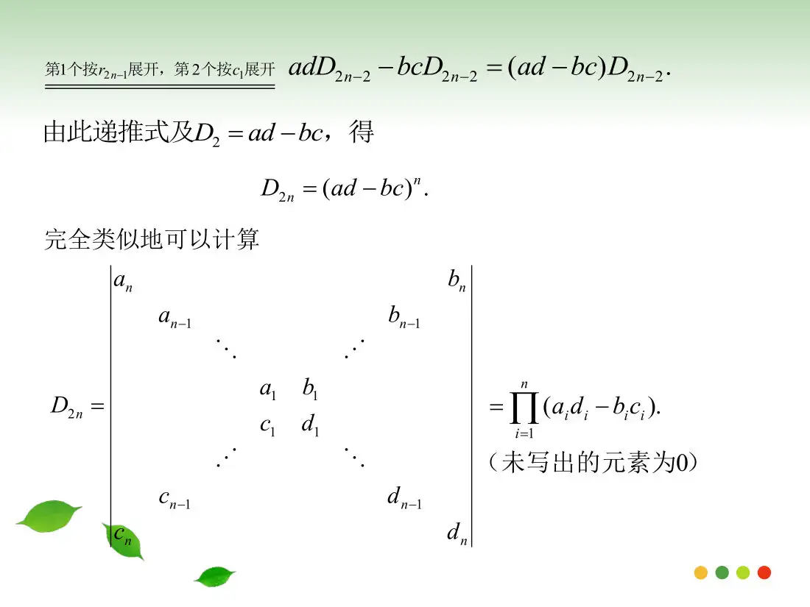

原文：

第1个按 $r_{2n-1}$ 展开，第2个按 $c_{1}$ 展开 $adD_{2n-2}-bcD_{2n-2}=(ad-bc)D_{2n-2}$ .

由此递推式及 $D_{2}=ad-bc$ ，得

$$
D _ {2 n} = (a d - b c) ^ {n}.
$$

完全类似地可以计算

$$
D _ {2 n} = \left| \begin{array}{c c c c c c c} a _ {n} & & & & & & b _ {n} \\ & a _ {n - 1} & & & & b _ {n - 1} \\ & & \ddots & & \ddots & & \\ & & a _ {1} & b _ {1} & & \\ & & c _ {1} & d _ {1} & & \\ & \ddots & & \ddots & & \\ c _ {n - 1} & & & & d _ {n - 1} \\ c _ {n} & & & & & d _ {n} \end{array} \right| = \prod_ {i = 1} ^ {n} (a _ {i} d _ {i} - b _ {i} c _ {i}). (\text {未写出的元素为0})
$$

### $$

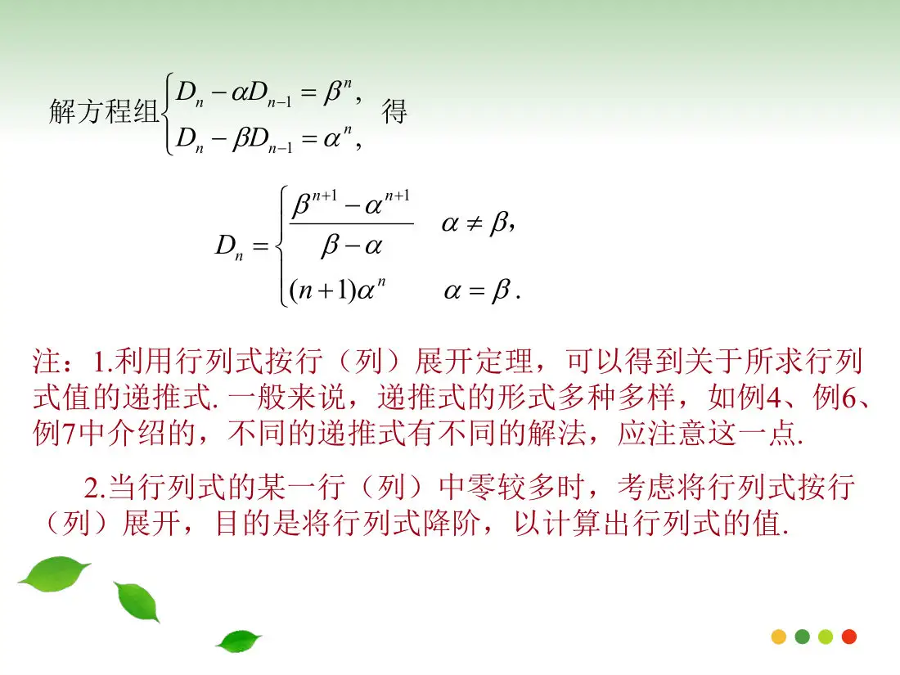

原文：

解方程组 $\left\{\begin{aligned}D_{n}-\alpha D_{n-1}&=\beta^{n},\\ D_{n}-\beta D_{n-1}&=\alpha^{n},\end{aligned}\right.$ 得

$$
D _ {n} = \left\{ \begin{array}{l l} \frac {\beta^ {n + 1} - \alpha^ {n + 1}}{\beta - \alpha} & \alpha \neq \beta , \\ (n + 1) \alpha^ {n} & \alpha = \beta . \end{array} \right.
$$

注：1. 利用行列式按行（列）展开定理，可以得到关于所求行列式值的递推式。一般来说，递推式的形式多种多样，如例4、例6、例7中介绍的，不同的递推式有不同的解法，应注意这一点。

2. 当行列式的某一行（列）中零较多时，考虑将行列式按行（列）展开，目的是将行列式降阶，以计算出行列式的值。

### 利用矩阵的一些性质，可简化方阵行列式的计算.

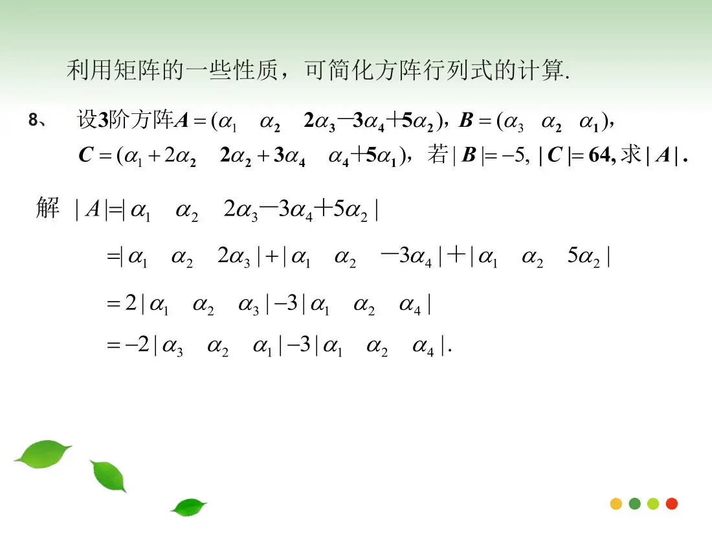

原文：

利用矩阵的一些性质，可简化方阵行列式的计算.

$$
\begin{array}{r l} & {\text {8、设3阶方阵} A = (\alpha_ {1} \quad \alpha_ {2} \quad 2 \alpha_ {3} - 3 \alpha_ {4} + 5 \alpha_ {2}), B = (\alpha_ {3} \quad \alpha_ {2} \quad \alpha_ {1}),} \\ & {\qquad C = (\alpha_ {1} + 2 \alpha_ {2} \quad 2 \alpha_ {2} + 3 \alpha_ {4} \quad \alpha_ {4} + 5 \alpha_ {1}), \text {若} | B | = - 5, | C | = 6 4, \text {求} | A |.} \end{array}
$$

解

$$
\begin{array}{r l} & {| A | = | \alpha_ {1} \quad \alpha_ {2} \quad 2 \alpha_ {3} - 3 \alpha_ {4} + 5 \alpha_ {2} |} \\ & {\qquad = | \alpha_ {1} \quad \alpha_ {2} \quad 2 \alpha_ {3} | + | \alpha_ {1} \quad \alpha_ {2} \quad - 3 \alpha_ {4} | + | \alpha_ {1} \quad \alpha_ {2} \quad 5 \alpha_ {2} |} \\ & {\qquad = 2 | \alpha_ {1} \quad \alpha_ {2} \quad \alpha_ {3} | - 3 | \alpha_ {1} \quad \alpha_ {2} \quad \alpha_ {4} |} \\ & {\qquad = - 2 | \alpha_ {3} \quad \alpha_ {2} \quad \alpha_ {1} | - 3 | \alpha_ {1} \quad \alpha_ {2} \quad \alpha_ {4} |.} \end{array}
$$

### $$

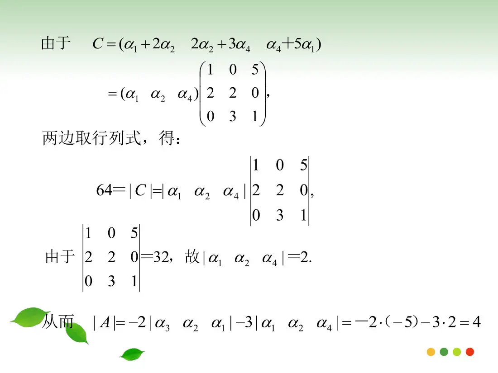

原文：

$$
\begin{array}{r l} C & = (\alpha_ {1} + 2 \alpha_ {2} - 2 \alpha_ {2} + 3 \alpha_ {4} - \alpha_ {4} + 5 \alpha_ {1}) \\ & = (\alpha_ {1} - \alpha_ {2} - \alpha_ {4}) \left( \begin{array}{c c c} 1 & 0 & 5 \\ 2 & 2 & 0 \\ 0 & 3 & 1 \end{array} \right), \end{array}
$$

两边取行列式，得:

$$
6 4 = | C | = \left| \begin{array}{l l l} \alpha_ {1} & \alpha_ {2} & \alpha_ {4} \end{array} \right| \left| \begin{array}{c c c} 1 & 0 & 5 \\ 2 & 2 & 0 \\ 0 & 3 & 1 \end{array} \right|,
$$

由于 $\begin{vmatrix}1&0&5\\2&2&0\\0&3&1\end{vmatrix}=32$ ，故 $\left|\alpha_{1}\quad\alpha_{2}\quad\alpha_{4}\right|=2.$

$$
\mid A \mid = - 2 \mid \alpha_ {3} \quad \alpha_ {2} \quad \alpha_ {1} \mid - 3 \mid \alpha_ {1} \quad \alpha_ {2} \quad \alpha_ {4} \mid = - 2 \cdot (- 5) - 3 \cdot 2 = 4
$$

### 第 28 页

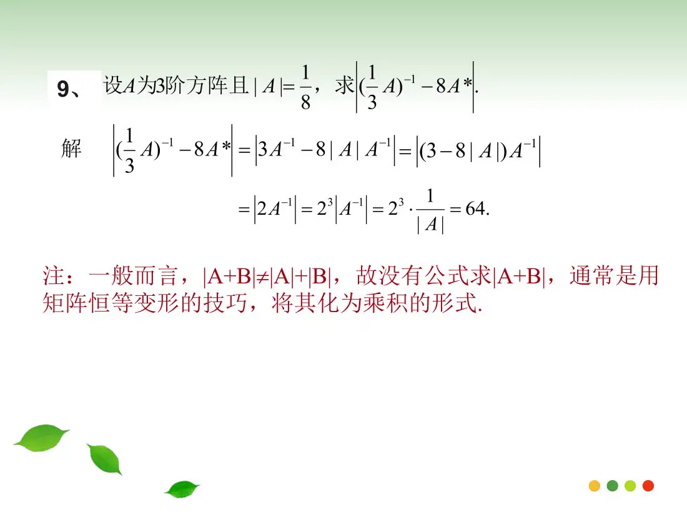

原文：

9、设A为3阶方阵且 $|A|=\frac{1}{8}$ ，求 $\left|\left(\frac{1}{3}A\right)^{-1}-8A^{*}\right|$ .
解 $\left|\left(\frac{1}{3}A\right)^{-1}-8A^{*}\right|=\left|3A^{-1}-8\left|A\right|A^{-1}\right|=\left|(3-8\left|A\right|)A^{-1}\right|$ $=\left|2A^{-1}\right|=2^{3}\left|A^{-1}\right|=2^{3}\cdot\frac{1}{\left|A\right|}=64.$

注：一般而言， $|A+B|\neq|A|+|B|$ ，故没有公式求 $|A+B|$ ，通常是用矩阵恒等变形的技巧，将其化为乘积的形式.

### 10、 计算

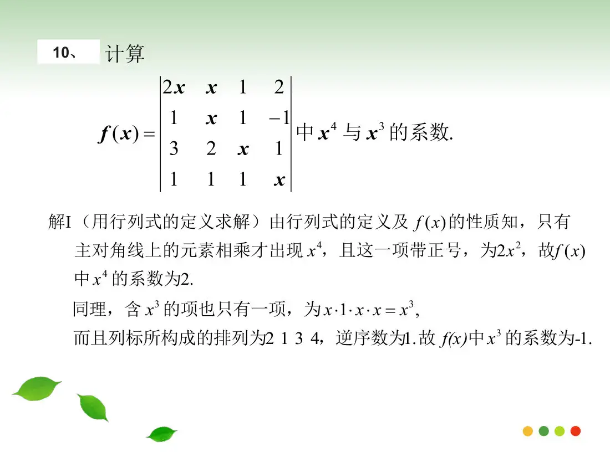

原文：

10、 计算

$f(x)=\left|\begin{matrix}2x&x&1&2\\ 1&x&1&-1\\ 3&2&x&1\\ 1&1&1&x\end{matrix}\right|$ 中 $x^{4}$ 与 $x^{3}$ 的系数.

解I（用行列式的定义求解）由行列式的定义及 $f(x)$ 的性质知，只有主对角线上的元素相乘才出现 $x^{4}$ ，且这一项带正号，为 $2x^{2}$ ，故 $f(x)$ 中 $x^{4}$ 的系数为2.

同理，含 $x^{3}$ 的项也只有一项，为 $x \cdot 1 \cdot x \cdot x = x^{3}$ ，

而且列标所构成的排列为2134，逆序数为1.故 $f(x)$ 中 $x^{3}$ 的系数为-1.

### 解II（用行列式的性质求解）

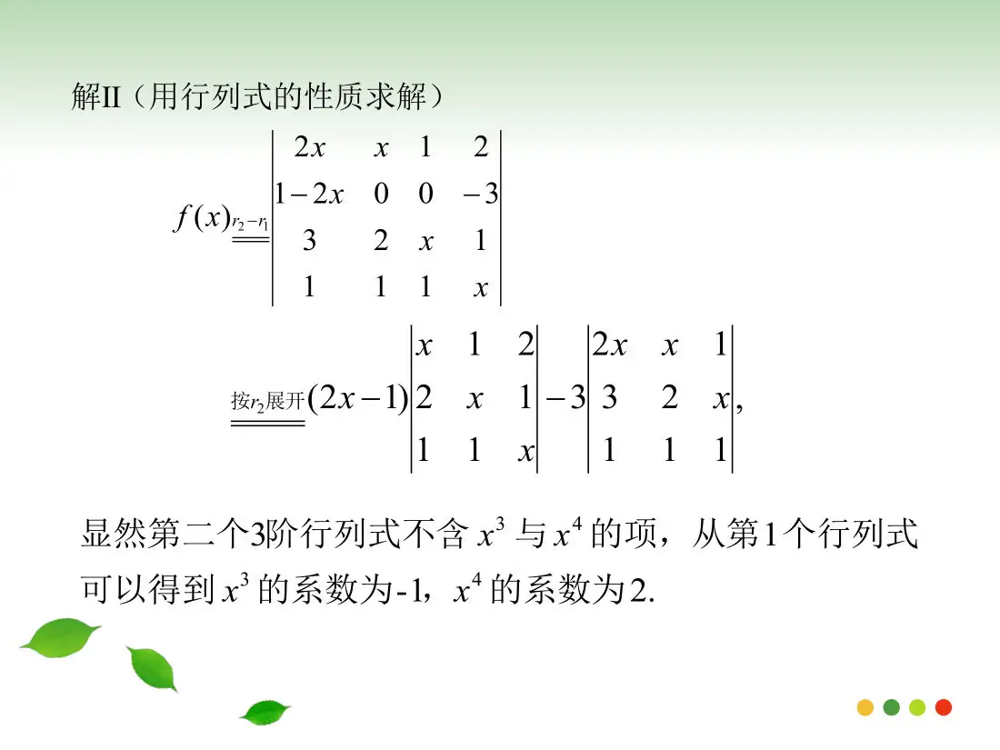

原文：

解II（用行列式的性质求解）

$$
f (x) _ {\underline {{r _ {2} - r _ {1}}}} \left| \begin{array}{c c c c} 2 x & x & 1 & 2 \\ 1 - 2 x & 0 & 0 & - 3 \\ 3 & 2 & x & 1 \\ 1 & 1 & 1 & x \end{array} \right|
$$

$$
\underline {{{\underline {{{\text {按} r _ {2} \text {展开}}}}}}} (2 x - 1) \left| \begin{array}{c c c} x & 1 & 2 \\ 2 & x & 1 \\ 1 & 1 & x \end{array} \right| - 3 \left| \begin{array}{c c c} 2 x & x & 1 \\ 3 & 2 & x \\ 1 & 1 & 1 \end{array} \right|,
$$

显然第二个3阶行列式不含 $x^{3}$ 与 $x^{4}$ 的项，从第1个行列式可以得到 $x^{3}$ 的系数为-1， $x^{4}$ 的系数为2.

### $$

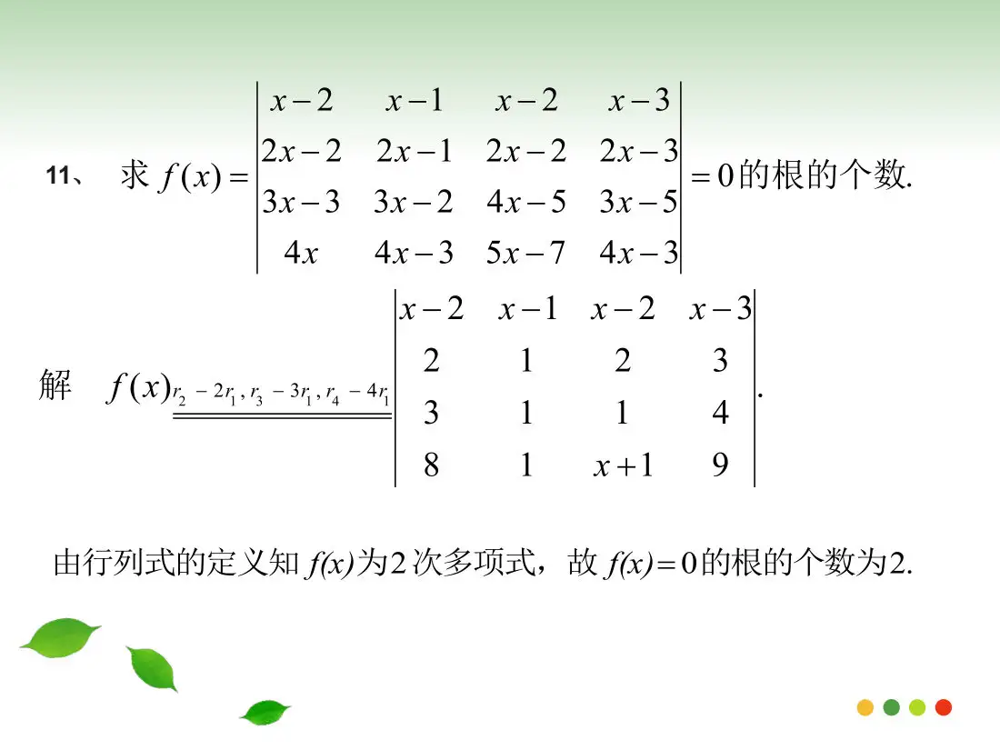

原文：

$$
f (x) = \left| \begin{array}{c c c c} x - 2 & x - 1 & x - 2 & x - 3 \\ 2 x - 2 & 2 x - 1 & 2 x - 2 & 2 x - 3 \\ 3 x - 3 & 3 x - 2 & 4 x - 5 & 3 x - 5 \\ 4 x & 4 x - 3 & 5 x - 7 & 4 x - 3 \end{array} \right| = 0
$$

)的根的个数.

解

$$
f (x) \underline {{\underline {{r _ {2} - 2 r _ {1} , r _ {3} - 3 r _ {1} , r _ {4} - 4 r _ {1}}}}} \left| \begin{array}{c c c c} x - 2 & x - 1 & x - 2 & x - 3 \\ 2 & 1 & 2 & 3 \\ 3 & 1 & 1 & 4 \\ 8 & 1 & x + 1 & 9 \end{array} \right|.
$$

由行列式的定义知 $f(x)$ 为2次多项式，故 $f(x)=0$ 的根的个数为2.

### 12 已知1998, 2196, 2394, 1818都能被18整除.

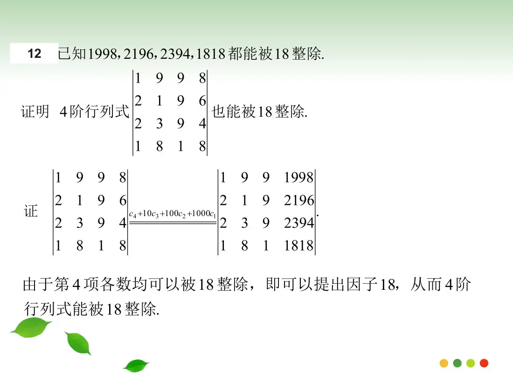

原文：

12 已知1998, 2196, 2394, 1818都能被18整除.

证明 4阶行列式 $\begin{vmatrix}1&9&9&8\\2&1&9&6\\2&3&9&4\\1&8&1&8\end{vmatrix}$ 也能被18整除.

证

$$
\left| \begin{array}{c c c c} 1 & 9 & 9 & 8 \\ 2 & 1 & 9 & 6 \\ 2 & 3 & 9 & 4 \\ 1 & 8 & 1 & 8 \end{array} \right| \xlongequal {c _ {4} + 1 0 c _ {3} + 1 0 0 c _ {2} + 1 0 0 0 c _ {1}} \left| \begin{array}{c c c c} 1 & 9 & 9 & 1 9 9 8 \\ 2 & 1 & 9 & 2 1 9 6 \\ 2 & 3 & 9 & 2 3 9 4 \\ 1 & 8 & 1 & 1 8 1 8 \end{array} \right|.
$$

由于第4项各数均可以被18整除，即可以提出因子18，从而4阶行列式能被18整除.

### $$

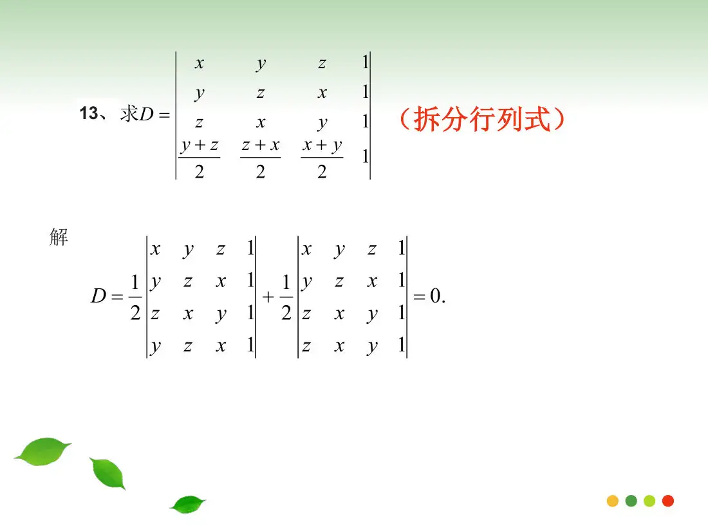

原文：

$$
D = \left| \begin{array}{c c c c} x & y & z & 1 \\ y & z & x & 1 \\ z & x & y & 1 \\ \frac {y + z}{2} & \frac {z + x}{2} & \frac {x + y}{2} & 1 \end{array} \right|
$$

(拆分行列式)

$$
D = \frac {1}{2} \left| \begin{array}{c c c c} x & y & z & 1 \\ y & z & x & 1 \\ z & x & y & 1 \\ y & z & x & 1 \end{array} \right| + \frac {1}{2} \left| \begin{array}{c c c c} x & y & z & 1 \\ y & z & x & 1 \\ z & x & y & 1 \\ z & x & y & 1 \end{array} \right| = 0.
$$

解

### $$

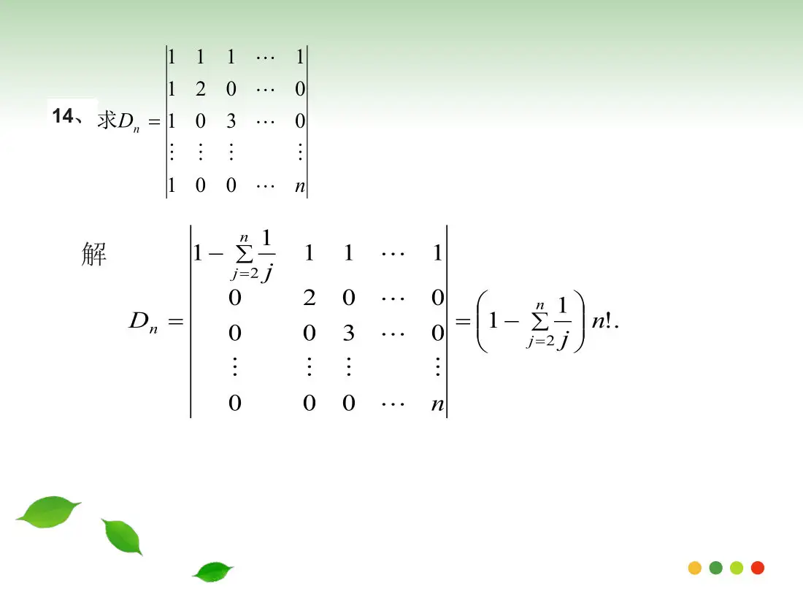

原文：

$$
D _ {n} = \left| \begin{array}{c c c c c} 1 & 1 & 1 & \dots & 1 \\ 1 & 2 & 0 & \dots & 0 \\ 1 & 0 & 3 & \dots & 0 \\ \vdots & \vdots & \vdots & & \vdots \\ 1 & 0 & 0 & \dots & n \end{array} \right|
$$

解

$$
D _ {n} = \left| \begin{array}{c c c c c} 1 - \sum_ {j = 2} ^ {n} \frac {1}{j} & 1 & 1 & \dots & 1 \\ 0 & 2 & 0 & \dots & 0 \\ 0 & 0 & 3 & \dots & 0 \\ \vdots & \vdots & \vdots & & \vdots \\ 0 & 0 & 0 & \dots & n \end{array} \right| = \left(1 - \sum_ {j = 2} ^ {n} \frac {1}{j}\right) n!.
$$

### 15、.求D

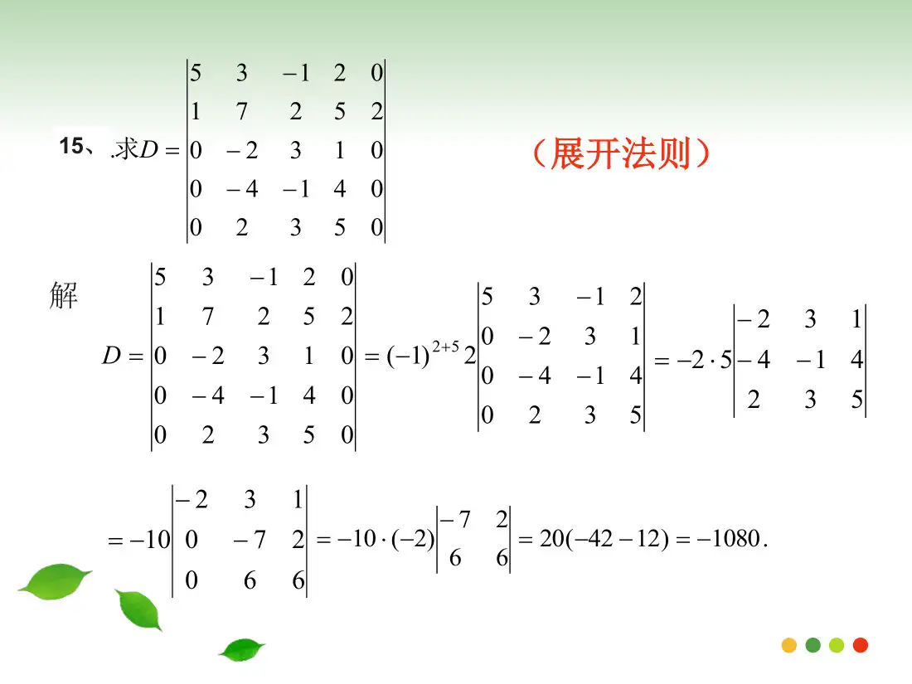

原文：

15、.求D

$$
D = \left| \begin{array}{c c c c c} 5 & 3 & - 1 & 2 & 0 \\ 1 & 7 & 2 & 5 & 2 \\ 0 & - 2 & 3 & 1 & 0 \\ 0 & - 4 & - 1 & 4 & 0 \\ 0 & 2 & 3 & 5 & 0 \end{array} \right|
$$

(展开法则)

解

$$
D = \left| \begin{array}{r r r r r} 5 & 3 & - 1 & 2 & 0 \\ 1 & 7 & 2 & 5 & 2 \\ 0 & - 2 & 3 & 1 & 0 \\ 0 & - 4 & - 1 & 4 & 0 \\ 0 & 2 & 3 & 5 & 0 \end{array} \right| = (- 1) ^ {2 + 5} 2 \left| \begin{array}{r r r r} 5 & 3 & - 1 & 2 \\ 0 & - 2 & 3 & 1 \\ 0 & - 4 & - 1 & 4 \\ 0 & 2 & 3 & 5 \end{array} \right| = - 2 \cdot 5 \left| \begin{array}{r r r} - 2 & 3 & 1 \\ - 4 & - 1 & 4 \\ 2 & 3 & 5 \end{array} \right|
$$

$$
= - 1 0 \left| \begin{array}{c c c} - 2 & 3 & 1 \\ 0 & - 7 & 2 \\ 0 & 6 & 6 \end{array} \right| = - 1 0 \cdot (- 2) \left| \begin{array}{c c} - 7 & 2 \\ 6 & 6 \end{array} \right| = 2 0 (- 4 2 - 1 2) = - 1 0 8 0.
$$

### $$

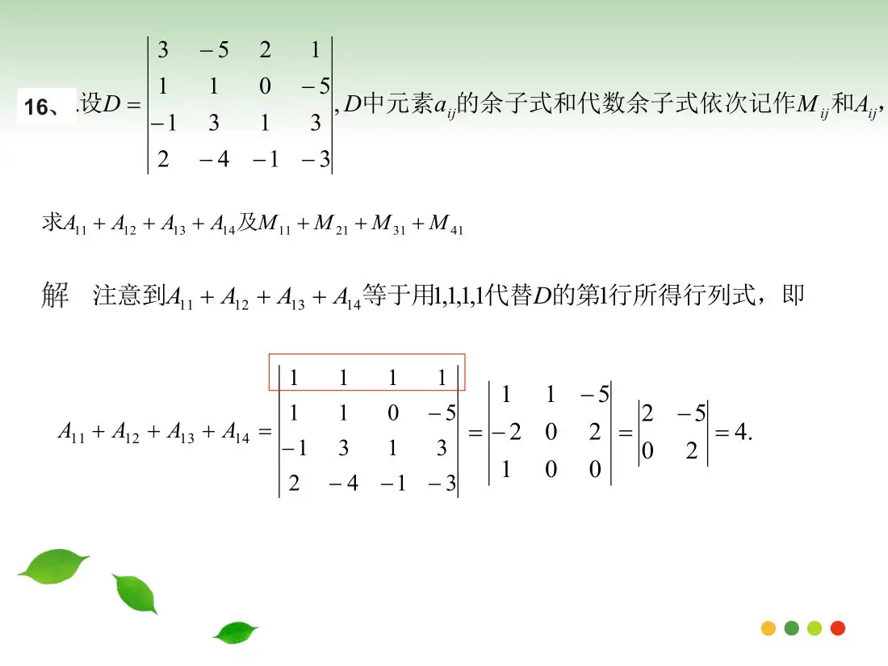

原文：

16、.设 $D = \left| \begin{array}{cccc}3 & -5 & 2 & 1\\ 1 & 1 & 0 & -5\\ -1 & 3 & 1 & 3\\ 2 & -4 & -1 & -3 \end{array} \right|$ ， $D$ 中元素 $a_{ij}$ 的余子式和代数余子式依次记作 $M_{ij}$ 和 $A_{ij}$ ，求 $A_{11} + A_{12} + A_{13} + A_{14}$ 及 $M_{11} + M_{21} + M_{31} + M_{41}$ 解注意到 $A_{11} + A_{12} + A_{13} + A_{14}$ 等于用1,1,1,1代替 $D$ 的第1行所得行列式，即

$$
A _ {1 1} + A _ {1 2} + A _ {1 3} + A _ {1 4} = \boxed {\left| \begin{array}{c c c c} 1 & 1 & 1 & 1 \\ 1 & 1 & 0 & - 5 \\ - 1 & 3 & 1 & 3 \\ 2 & - 4 & - 1 & - 3 \end{array} \right|} = \left| \begin{array}{c c c} 1 & 1 & - 5 \\ - 2 & 0 & 2 \\ 1 & 0 & 0 \end{array} \right| = \left| \begin{array}{c c} 2 & - 5 \\ 0 & 2 \end{array} \right| = 4.
$$

### 又按定义知，

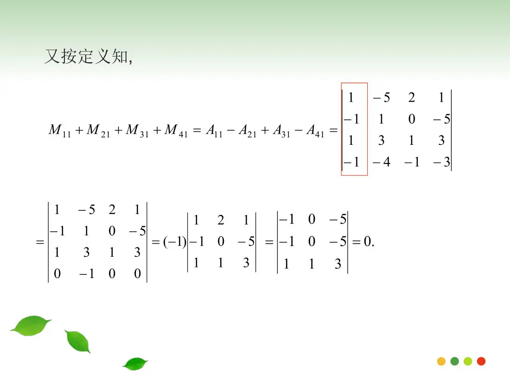

原文：

又按定义知，

$$
M _ {1 1} + M _ {2 1} + M _ {3 1} + M _ {4 1} = A _ {1 1} - A _ {2 1} + A _ {3 1} - A _ {4 1} = \left| \begin{array}{r r r r} 1 & - 5 & 2 & 1 \\ - 1 & 1 & 0 & - 5 \\ 1 & 3 & 1 & 3 \\ - 1 & - 4 & - 1 & - 3 \end{array} \right|
$$

$$
= \left| \begin{array}{r r r r} 1 & - 5 & 2 & 1 \\ - 1 & 1 & 0 & - 5 \\ 1 & 3 & 1 & 3 \\ 0 & - 1 & 0 & 0 \end{array} \right| = (- 1) \left| \begin{array}{r r r} 1 & 2 & 1 \\ - 1 & 0 & - 5 \\ 1 & 1 & 3 \end{array} \right| = \left| \begin{array}{r r r} - 1 & 0 & - 5 \\ - 1 & 0 & - 5 \\ 1 & 1 & 3 \end{array} \right| = 0.
$$

### 证 利用行列式性质,有

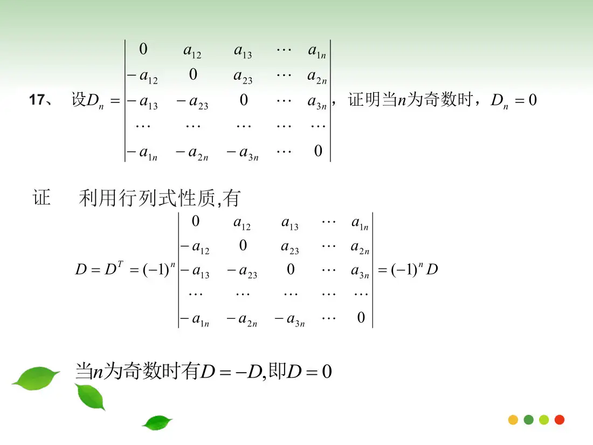

原文：

17、设 $D_{n} = \left| \begin{array}{cccc}0 & a_{12} & a_{13} & \dots & a_{1n}\\ -a_{12} & 0 & a_{23} & \dots & a_{2n}\\ -a_{13} & -a_{23} & 0 & \dots & a_{3n}\\ \dots & \dots & \dots & \dots & \dots \\ -a_{1n} & -a_{2n} & -a_{3n} & \dots & 0 \end{array} \right|$ ，证明当 $n$ 为奇数时， $D_{n} = 0$

证 利用行列式性质,有

$$
D = D ^ {T} = (- 1) ^ {n} \left| \begin{array}{c c c c c} 0 & a _ {1 2} & a _ {1 3} & \dots & a _ {1 n} \\ - a _ {1 2} & 0 & a _ {2 3} & \dots & a _ {2 n} \\ - a _ {1 3} & - a _ {2 3} & 0 & \dots & a _ {3 n} \\ \dots & \dots & \dots & \dots & \dots \\ - a _ {1 n} & - a _ {2 n} & - a _ {3 n} & \dots & 0 \end{array} \right| = (- 1) ^ {n} D
$$

当 $n$ 为奇数时有 $D = -D$ , 即 $D = 0$

● ● ● ●

### 解 推论：若齐次线性方程组的系数行列式 $D \neq 0$ ，则方程组仅有零解

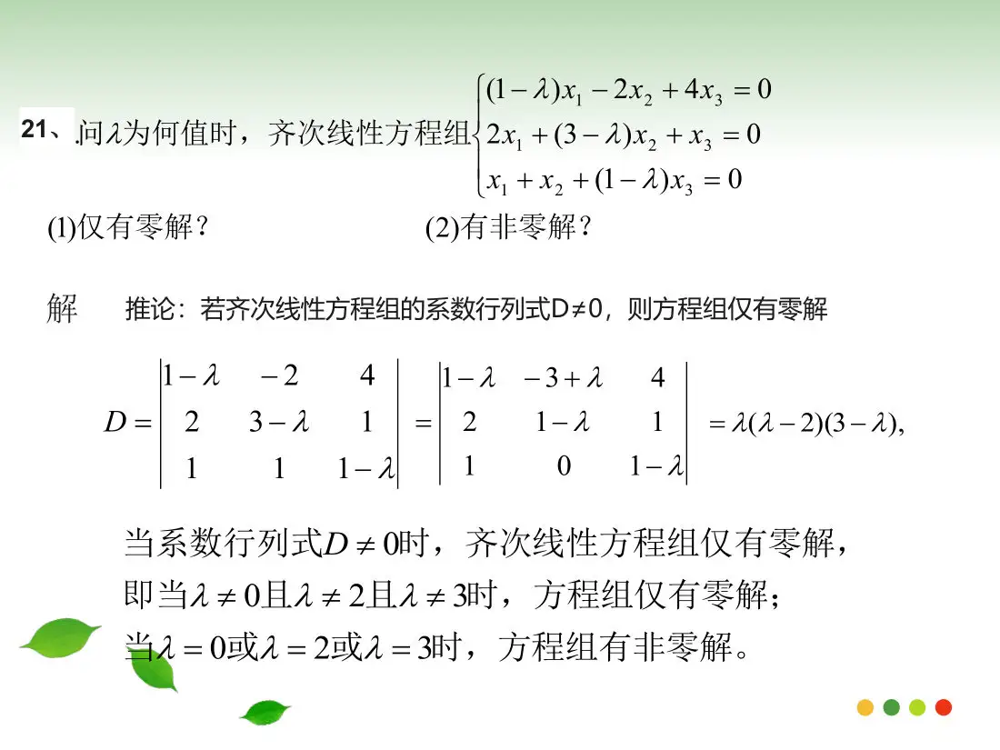

原文：

21、问 $\lambda$ 为何值时，齐次线性方程组 $\left\{ \begin{array}{l} (1 - \lambda)x_{1} - 2x_{2} + 4x_{3} = 0 \\ 2x_{1} + (3 - \lambda)x_{2} + x_{3} = 0 \\ x_{1} + x_{2} + (1 - \lambda)x_{3} = 0 \end{array} \right.$ (1)仅有零解？ (2)有非零解？

解 推论：若齐次线性方程组的系数行列式 $D \neq 0$ ，则方程组仅有零解

$$
D = \left| \begin{array}{c c c} 1 - \lambda & - 2 & 4 \\ 2 & 3 - \lambda & 1 \\ 1 & 1 & 1 - \lambda \end{array} \right| = \left| \begin{array}{c c c} 1 - \lambda & - 3 + \lambda & 4 \\ 2 & 1 - \lambda & 1 \\ 1 & 0 & 1 - \lambda \end{array} \right| = \lambda (\lambda - 2) (3 - \lambda),
$$

当系数行列式 $D \neq 0$ 时，齐次线性方程组仅有零解，即当 $\lambda \neq 0$ 且 $\lambda \neq 2$ 且 $\lambda \neq 3$ 时，方程组仅有零解；当 $\lambda = 0$ 或 $\lambda = 2$ 或 $\lambda = 3$ 时，方程组有非零解。

### $$

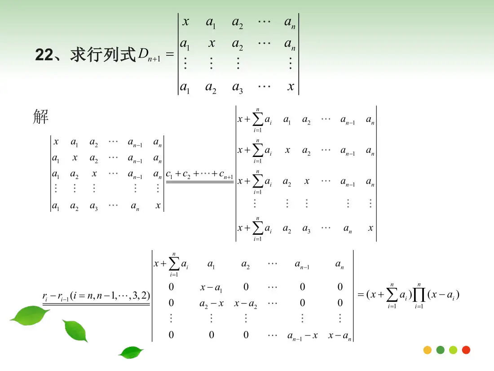

原文：

22、求行列式 $D_{n + 1} = \left| \begin{array}{cccc}x & a_1 & a_2 & \dots & a_n\\ a_1 & x & a_2 & \dots & a_n\\ \vdots & \vdots & \vdots & & \vdots \\ a_1 & a_2 & a_3 & \dots & x \end{array} \right|$

解

$$
\left| \begin{array}{c c c c c c} x & a _ {1} & a _ {2} & \dots & a _ {n - 1} & a _ {n} \\ a _ {1} & x & a _ {2} & \dots & a _ {n - 1} & a _ {n} \\ a _ {1} & a _ {2} & x & \dots & a _ {n - 1} & a _ {n} \\ \vdots & \vdots & \vdots & & \vdots & \vdots \\ a _ {1} & a _ {2} & a _ {3} & \dots & a _ {n} & x \end{array} \right| \xlongequal {c _ {1} + c _ {2} + \dots + c _ {n + 1}} \left| \begin{array}{c c c c c c} x + \sum_ {i = 1} ^ {n} a _ {i} & a _ {1} & a _ {2} & \dots & a _ {n - 1} & a _ {n} \\ x + \sum_ {i = 1} ^ {n} a _ {i} & x & a _ {2} & \dots & a _ {n - 1} & a _ {n} \\ x + \sum_ {i = 1} ^ {n} a _ {i} & a _ {2} & x & \dots & a _ {n - 1} & a _ {n} \\ \vdots & \vdots & \vdots & & \vdots & \vdots \\ x + \sum_ {i = 1} ^ {n} a _ {i} & a _ {2} & a _ {3} & \dots & a _ {n} & x \end{array} \right|
$$

$$
\frac {r _ {i} - r _ {i - 1} (i = n , n - 1 , \cdots , 3 , 2)}{\text {绿色}} \left| \begin{array}{c c c c c c} x + \sum_ {i = 1} ^ {n} a _ {i} & a _ {1} & a _ {2} & \dots & a _ {n - 1} & a _ {n} \\ 0 & x - a _ {1} & 0 & \dots & 0 & 0 \\ 0 & a _ {2} - x & x - a _ {2} & \dots & 0 & 0 \\ \vdots & \vdots & \vdots & & \vdots & \vdots \\ 0 & 0 & 0 & \dots & a _ {n - 1} - x & x - a _ {n} \end{array} \right| = (x + \sum_ {i = 1} ^ {n} a _ {i}) \prod_ {i = 1} ^ {n} (x - a _ {i})
$$

### 解 按第一列展开,得

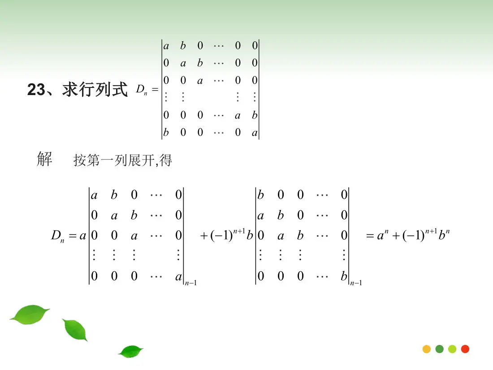

原文：

23、求行列式 $D_{n}=\begin{vmatrix}a&b&0&\cdots&0&0\\0&a&b&\cdots&0&0\\0&0&a&\cdots&0&0\\\vdots&\vdots&&\vdots&\vdots\\0&0&0&\cdots&a&b\\b&0&0&\cdots&0&a\end{vmatrix}$

解 按第一列展开,得

$$
D _ {n} = a \left| \begin{array}{c c c c c} a & b & 0 & \dots & 0 \\ 0 & a & b & \dots & 0 \\ 0 & 0 & a & \dots & 0 \\ \vdots & \vdots & \vdots & & \vdots \\ 0 & 0 & 0 & \dots & a \end{array} \right| _ {n - 1} + (- 1) ^ {n + 1} b \left| \begin{array}{c c c c c} b & 0 & 0 & \dots & 0 \\ a & b & 0 & \dots & 0 \\ 0 & a & b & \dots & 0 \\ \vdots & \vdots & \vdots & & \vdots \\ 0 & 0 & 0 & \dots & b \end{array} \right| _ {n - 1} = a ^ {n} + (- 1) ^ {n + 1} b ^ {n}
$$

### $$

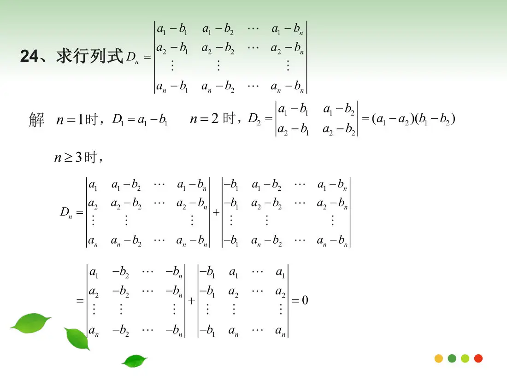

原文：

24、求行列式 $D_{n} = \left| \begin{array}{cccc}a_{1} - b_{1} & a_{1} - b_{2} & \dots & a_{1} - b_{n}\\ a_{2} - b_{1} & a_{2} - b_{2} & \dots & a_{2} - b_{n}\\ \vdots & \vdots & & \vdots \\ a_{n} - b_{1} & a_{n} - b_{2} & \dots & a_{n} - b_{n} \end{array} \right|$

解 $n = 1$ 时， $D_{1} = a_{1} - b_{1}$ $\quad n = 2$ 时， $D_{2} = \left| \begin{array}{ll}a_{1} - b_{1} & a_{1} - b_{2}\\ a_{2} - b_{1} & a_{2} - b_{2} \end{array} \right| = (a_{1} - a_{2})(b_{1} - b_{2})$ $n\geq 3$ 时，

$$
D _ {n} = \left| \begin{array}{c c c c} a _ {1} & a _ {1} - b _ {2} & \dots & a _ {1} - b _ {n} \\ a _ {2} & a _ {2} - b _ {2} & \dots & a _ {2} - b _ {n} \\ \vdots & \vdots & & \vdots \\ a _ {n} & a _ {n} - b _ {2} & \dots & a _ {n} - b _ {n} \end{array} \right| + \left| \begin{array}{c c c c} - b _ {1} & a _ {1} - b _ {2} & \dots & a _ {1} - b _ {n} \\ - b _ {1} & a _ {2} - b _ {2} & \dots & a _ {2} - b _ {n} \\ \vdots & \vdots & & \vdots \\ - b _ {1} & a _ {n} - b _ {2} & \dots & a _ {n} - b _ {n} \end{array} \right|
$$

$$
= \left| \begin{array}{c c c c} a _ {1} & - b _ {2} & \dots & - b _ {n} \\ a _ {2} & - b _ {2} & \dots & - b _ {n} \\ \vdots & \vdots & & \vdots \\ a _ {n} & - b _ {2} & \dots & - b _ {n} \end{array} \right| + \left| \begin{array}{c c c c} - b _ {1} & a _ {1} & \dots & a _ {1} \\ - b _ {1} & a _ {2} & \dots & a _ {2} \\ \vdots & \vdots & & \vdots \\ - b _ {1} & a _ {n} & \dots & a _ {n} \end{array} \right| = 0
$$

### 25、证明

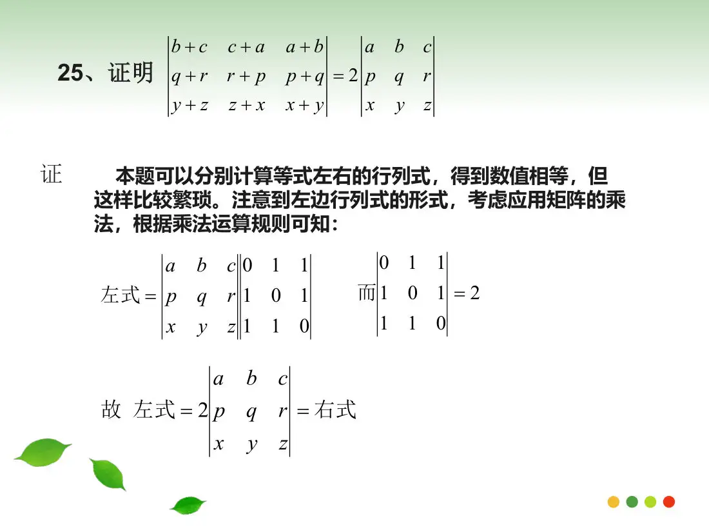

原文：

25、证明

$$
\left| \begin{array}{c c c} b + c & c + a & a + b \\ q + r & r + p & p + q \\ y + z & z + x & x + y \end{array} \right| = 2 \left| \begin{array}{c c c} a & b & c \\ p & q & r \\ x & y & z \end{array} \right|
$$

证 本题可以分别计算等式左右的行列式，得到数值相等，但这样比较繁琐。注意到左边行列式的形式，考虑应用矩阵的乘法，根据乘法运算规则可知：

左式

$$
= \left| \begin{array}{c c c} {a} & {b} & {c} \\ {p} & {q} & {r} \\ {x} & {y} & {z} \end{array} \right| \left| \begin{array}{c c c} {0} & {1} & {1} \\ {1} & {0} & {1} \\ {1} & {1} & {0} \end{array} \right| \quad \text {而} \left| \begin{array}{c c c} {0} & {1} & {1} \\ {1} & {0} & {1} \\ {1} & {1} & {0} \end{array} \right| = 2
$$

故左式 $= 2\left| \begin{array}{ccc}a & b & c\\ p & q & r\\ x & y & z \end{array} \right| =$ 右式

### 26、证明

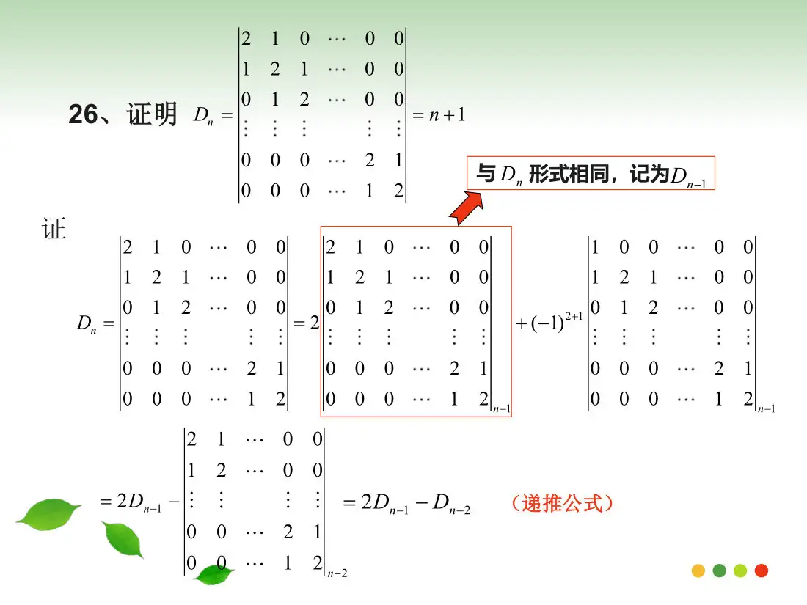

原文：

26、证明

$$
D _ {n} = \left| \begin{array}{c c c c c c} 2 & 1 & 0 & \dots & 0 & 0 \\ 1 & 2 & 1 & \dots & 0 & 0 \\ 0 & 1 & 2 & \dots & 0 & 0 \\ \vdots & \vdots & \vdots & & \vdots & \vdots \\ 0 & 0 & 0 & \dots & 2 & 1 \\ 0 & 0 & 0 & \dots & 1 & 2 \end{array} \right| = n + 1
$$

与 $D_{n}$ 形式相同，记为 $D_{n - 1}$

证

$$
D _ {n} = \left| \begin{array}{c c c c c c} 2 & 1 & 0 & \dots & 0 & 0 \\ 1 & 2 & 1 & \dots & 0 & 0 \\ 0 & 1 & 2 & \dots & 0 & 0 \\ \vdots & \vdots & \vdots & & \vdots & \vdots \\ 0 & 0 & 0 & \dots & 2 & 1 \\ 0 & 0 & 0 & \dots & 1 & 2 \end{array} \right| = 2 \left| \begin{array}{c c c c c c} 2 & 1 & 0 & \dots & 0 & 0 \\ 1 & 2 & 1 & \dots & 0 & 0 \\ 0 & 1 & 2 & \dots & 0 & 0 \\ \vdots & \vdots & \vdots & & \vdots & \vdots \\ 0 & 0 & 0 & {\dots} & 2 & 1 \\ 0 & 0 & 0 & \dots & 1 & 2 \end{array} \right| _ {n - 1} + (- 1) ^ {2 + 1} \left| \begin{array}{c c c c c c} 1 & 0 & 0 & \dots & 0 & 0 \\ 1 & 2 & 1 & \dots & 0 & 0 \\ 0 & 1 & 2 & \dots & 0 & 0 \\ \vdots & \vdots & \vdots & & \vdots & \vdots \\ 0 & 0 & 0 & \dots & 2 & 1 \\ 0 & 0 & 0 & \dots . & 1 & 2 \end{array} \right| _ {n - 1}
$$

$$
= 2 D _ {n - 1} - \left| \begin{array}{c c c c c} 2 & 1 & \dots & 0 & 0 \\ 1 & 2 & \dots & 0 & 0 \\ \vdots & \vdots & & \vdots & \vdots \\ 0 & 0 & \dots & 2 & 1 \\ 0 & 0 & \dots & 1 & 2 \end{array} \right| _ {n - 2} = 2 D _ {n - 1} - D _ {n - 2}
$$

(递推公式)

### 根据递推公式

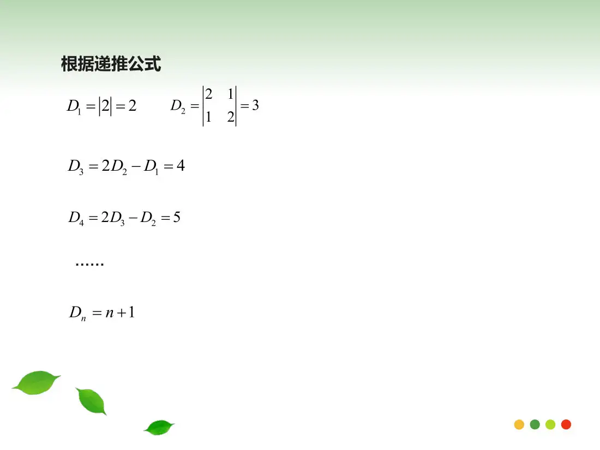

原文：

根据递推公式

$$
D _ {1} = | 2 | = 2 \quad D _ {2} = \left| \begin{array}{c c} 2 & 1 \\ 1 & 2 \end{array} \right| = 3
$$

$$
D _ {3} = 2 D _ {2} - D _ {1} = 4
$$

$$
D _ {4} = 2 D _ {3} - D _ {2} = 5
$$

■ ■ ■ ■ ■ ■

$$
D _ {n} = n + 1
$$

### 27、证明

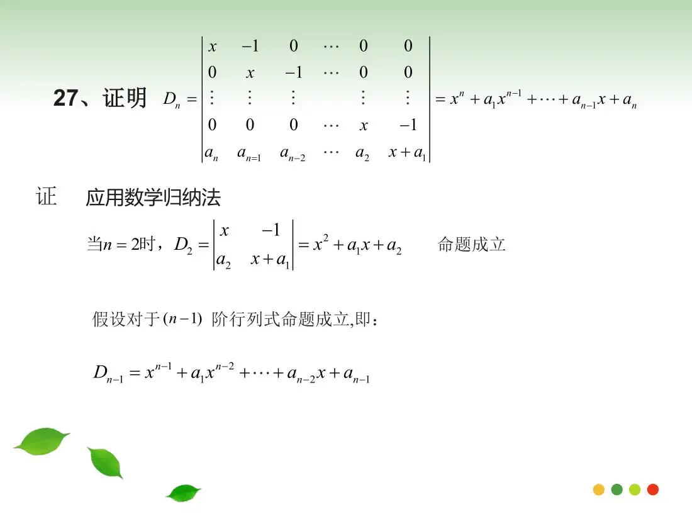

原文：

27、证明

$$
D _ {n} = \left| \begin{array}{c c c c c c} x & - 1 & 0 & \dots & 0 & 0 \\ 0 & x & - 1 & \dots & 0 & 0 \\ \vdots & \vdots & \vdots & & \vdots & \vdots \\ 0 & 0 & 0 & \dots & x & - 1 \\ a _ {n} & a _ {n = 1} & a _ {n - 2} & \dots & a _ {2} & x + a _ {1} \end{array} \right| = x ^ {n} + a _ {1} x ^ {n - 1} + \dots + a _ {n - 1} x + a _ {n}
$$

证 应用数学归纳法

当 $n = 2$ 时， $D_{2} = \left| \begin{array}{cc}x & -1\\ a_{2} & x + a_{1} \end{array} \right| = x^{2} + a_{1}x + a_{2}$ 命题成立

假设对于 $(n-1)$ 阶行列式命题成立,即:

$$
D _ {n - 1} = x ^ {n - 1} + a _ {1} x ^ {n - 2} + \dots + a _ {n - 2} x + a _ {n - 1}
$$

### 则 $D_{n}$ 按第一列展开:

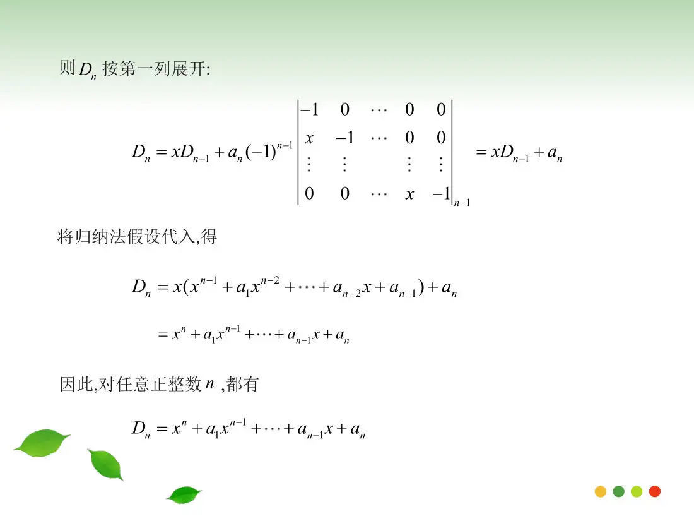

原文：

则 $D_{n}$ 按第一列展开:

$$
D _ {n} = x D _ {n - 1} + a _ {n} (- 1) ^ {n - 1} \left| \begin{array}{c c c c c} - 1 & 0 & \dots & 0 & 0 \\ x & - 1 & \dots & 0 & 0 \\ \vdots & \vdots & & \vdots & \vdots \\ 0 & 0 & \dots & x & - 1 \end{array} \right| _ {n - 1} = x D _ {n - 1} + a _ {n}
$$

将归纳法假设代入,得

$$
\begin{array}{r l} & D _ {n} = x (x ^ {n - 1} + a _ {1} x ^ {n - 2} + \dots + a _ {n - 2} x + a _ {n - 1}) + a _ {n} \\ & \qquad = x ^ {n} + a _ {1} x ^ {n - 1} + \dots + a _ {n - 1} x + a _ {n} \end{array}
$$

因此,对任意正整数 n ,都有

$$
D _ {n} = x ^ {n} + a _ {1} x ^ {n - 1} + \dots + a _ {n - 1} x + a _ {n}
$$

● ● ● ●

### 28、证明

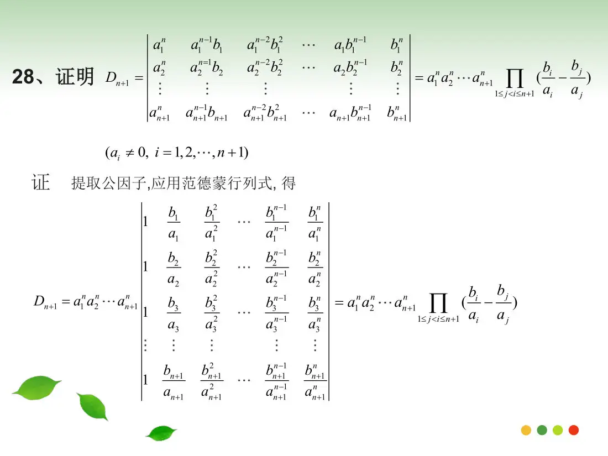

原文：

28、证明

$$
D _ {n + 1} = \left| \begin{array}{c c c c c c} a _ {1} ^ {n} & a _ {1} ^ {n - 1} b _ {1} & a _ {1} ^ {n - 2} b _ {1} ^ {2} & \dots & a _ {1} b _ {1} ^ {n - 1} & b _ {1} ^ {n} \\ a _ {2} ^ {n} & a _ {2} ^ {n = 1} b _ {2} & a _ {2} ^ {n - 2} b _ {2} ^ {2} & \dots & a _ {2} b _ {2} ^ {n - 1} & b _ {2} ^ {n} \\ \vdots & \vdots & \vdots & & \vdots & \vdots \\ a _ {n + 1} ^ {n} & a _ {n + 1} ^ {n - 1} b _ {n + 1} & a _ {n + 1} ^ {n - 2} b _ {n + 1} ^ {2} & \dots & a _ {n + 1} b _ {n + 1} ^ {n - 1} & b _ {n + 1} ^ {n} \end{array} \right| = a _ {1} ^ {n} a _ {2} ^ {n} \dots a _ {n + 1} ^ {n} \prod_ {1 \leq j <   i \leq n + 1} (\frac {b _ {i}}{a _ {i}} - \frac {b _ {j}}{a _ {j}})
$$

$$
(a _ {i} \neq 0, i = 1, 2, \dots , n + 1)
$$

证 提取公因子,应用范德蒙行列式,得

$$
D _ {n + 1} = a _ {1} ^ {n} a _ {2} ^ {n} \dots a _ {n + 1} ^ {n} \left| \begin{array}{c c c c c c} 1 & \frac {b _ {1}}{a _ {1}} & \frac {b _ {1} ^ {2}}{a _ {1} ^ {2}} & \dots & \frac {b _ {1} ^ {n - 1}}{a _ {1} ^ {n - 1}} & \frac {b _ {1} ^ {n}}{a _ {1} ^ {n}} \\ 1 & \frac {b _ {2}}{a _ {2}} & \frac {b _ {2} ^ {2}}{a _ {2} ^ {2}} & \dots & \frac {b _ {2} ^ {n - 1}}{a _ {2} ^ {n - 1}} & \frac {b _ {2} ^ {n}}{a _ {2} ^ {n}} \\ 1 & \frac {b _ {3}}{a _ {3}} & \frac {b _ {3} ^ {2}}{a _ {3} ^ {2}} & \dots & \frac {b _ {3} ^ {n - 1}}{a _ {3} ^ {n - 1}} & \frac {b _ {3} ^ {n}}{a _ {3} ^ {n}} \\ \vdots & \vdots & \vdots & & \vdots & \vdots \\ 1 & \frac {b _ {n + 1}}{a _ {n + 1}} & \frac {b _ {n + 1} ^ {2}}{a _ {n + 1} ^ {2}} & \dots & \frac {b _ {n + 1} ^ {n - 1}}{a _ {n + 1} ^ {n - 1}} & \frac {b _ {n + 1} ^ {n}}{a _ {n + 1} ^ {n}} \end{array} \right| = a _ {1} ^ {n} a _ {2} ^ {n} \dots a _ {n + 1} ^ {n} \prod_ {1 \leq j <   i \leq n + 1} (\frac {b _ {i}}{a _ {i}} - \frac {b _ {j}}{a _ {j}})
$$

### 证 应用加边法,得

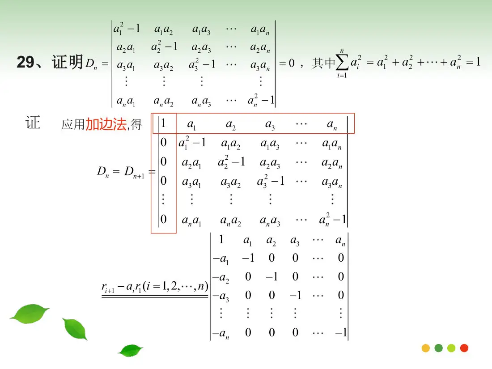

原文：

29、证明 $D_{n} = \left| \begin{array}{cccc}a_{1}^{2} - 1 & a_{1}a_{2} & a_{1}a_{3} & \dots & a_{1}a_{n}\\ a_{2}a_{1} & a_{2}^{2} - 1 & a_{2}a_{3} & \dots & a_{2}a_{n}\\ a_{3}a_{1} & a_{3}a_{2} & a_{3}^{2} - 1 & \dots & a_{3}a_{n}\\ \vdots & \vdots & \vdots & & \vdots \\ a_{n}a_{1} & a_{n}a_{2} & a_{n}a_{3} & \dots & a_{n}^{2} - 1 \end{array} \right| = 0$ ，其中 $\sum_{i = 1}^{n}a_i^2 = a_1^2 +a_2^2 +\dots +a_n^2 = 1$

证 应用加边法,得

$$
D _ {n} = D _ {n + 1} = \left| \begin{array}{c c c c c c} 1 & a _ {1} & a _ {2} & a _ {3} & \dots & a _ {n} \\ \hline 0 & a _ {1} ^ {2} - 1 & a _ {1} a _ {2} & a _ {1} a _ {3} & \dots & a _ {1} a _ {n} \\ 0 & a _ {2} a _ {1} & a _ {2} ^ {2} - 1 & a _ {2} a _ {3} & \dots & a _ {2} a _ {n} \\ 0 & a _ {3} a _ {1} & a _ {3} a _ {2} & a _ {3} ^ {2} - 1 & \dots & a _ {3} a _ {n} \\ \vdots & \vdots & \vdots & \vdots & & \vdots \\ 0 & a _ {n} a _ {1} & a _ {n} a _ {2} & a _ {n} a _ {3} & \dots & a _ {n} ^ {2} - 1 \end{array} \right|
$$

$$
\underline {{{\underline {{r _ {i + 1} - a _ {i} r _ {1} (i = 1 , 2 , \cdots , n)}}}}} \left| \begin{array}{c c c c c c} 1 & a _ {1} & a _ {2} & a _ {3} & \dots & a _ {n} \\ - a _ {1} & - 1 & 0 & 0 & \dots & 0 \\ - a _ {2} & 0 & - 1 & 0 & \dots & 0 \\ - a _ {3} & 0 & 0 & - 1 & \dots & 0 \\ \vdots & \vdots & \vdots & \vdots & & \vdots \\ - a _ {n} & 0 & 0 & 0 & \dots & - 1 \end{array} \right|
$$

### $$

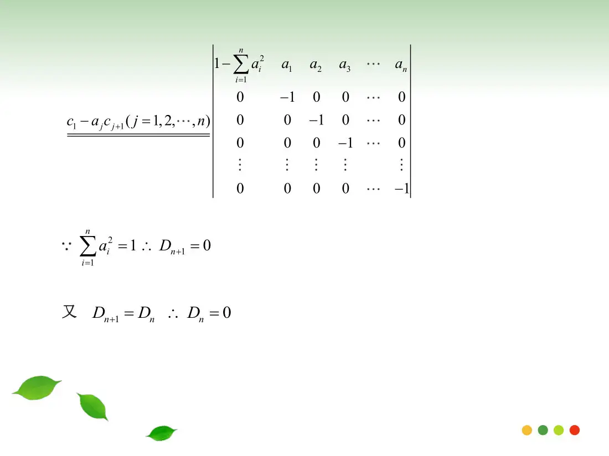

原文：

$$
\underline {{c _ {1} - a _ {j} c _ {j + 1} (j = 1 , 2 , \cdots , n)}} \left| \begin{array}{c c c c c c} 1 - \sum_ {i = 1} ^ {n} a _ {i} ^ {2} & a _ {1} & a _ {2} & a _ {3} & \dots & a _ {n} \\ 0 & - 1 & 0 & 0 & \dots & 0 \\ 0 & 0 & - 1 & 0 & \dots & 0 \\ 0 & 0 & 0 & - 1 & \dots & 0 \\ \vdots & \vdots & \vdots & \vdots & & \vdots \\ 0 & 0 & 0 & 0 & \dots & - 1 \end{array} \right|
$$

$$
\because \sum_ {i = 1} ^ {n} a _ {i} ^ {2} = 1 \therefore D _ {n + 1} = 0
$$

又 $D_{n + 1} = D_n\therefore D_n = 0$

### 第 51 页

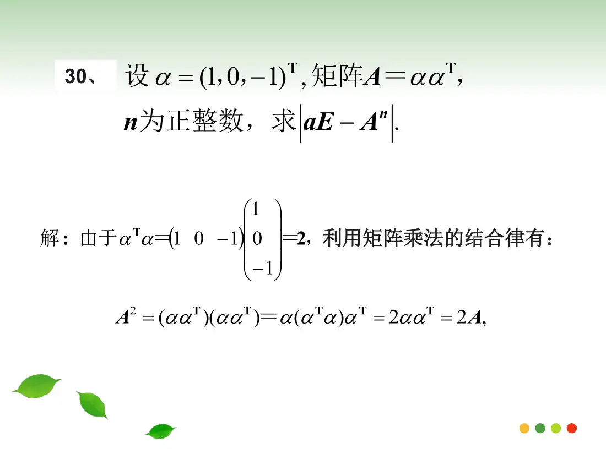

原文：

30、设 $\alpha=(1,0,-1)^{\mathrm{T}}$ ，矩阵 $A=\alpha\alpha^{T}$ ，n 为正整数，求 $\left|aE-A^{n}\right|$ .

解：由于 $\alpha^{\mathrm{T}}\alpha = (10 - 1)\begin{pmatrix} 1\\ 0\\ -1 \end{pmatrix} = 2$ ，利用矩阵乘法的结合律有： $A^2 = (\alpha \alpha^{\mathrm{T}})(\alpha \alpha^{\mathrm{T}}) = \alpha (\alpha^{\mathrm{T}}\alpha)\alpha^{\mathrm{T}} = 2\alpha \alpha^{\mathrm{T}} = 2A,$

### 依次类推，有 $A^{n}=2^{n-1}A.$

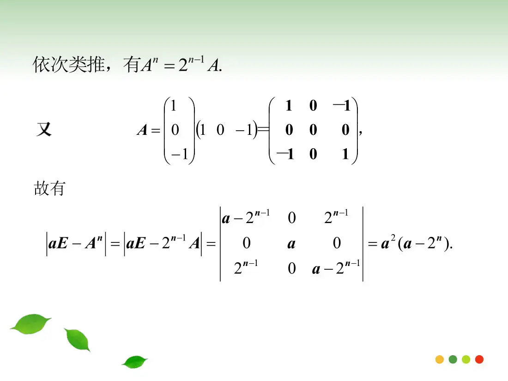

原文：

依次类推，有 $A^{n}=2^{n-1}A.$

又

$$
\boldsymbol {A} = \left( \begin{array}{c} 1 \\ 0 \\ - 1 \end{array} \right) \left( \begin{array}{c c c} 1 & 0 & - 1 \end{array} \right) = \left( \begin{array}{c c c} \mathbf {1} & \mathbf {0} & - \mathbf {1} \\ \mathbf {0} & \mathbf {0} & \mathbf {0} \\ - \mathbf {1} & \mathbf {0} & \mathbf {1} \end{array} \right),
$$

故有

$$
\left| \boldsymbol {a} \boldsymbol {E} - \boldsymbol {A} ^ {n} \right| = \left| \boldsymbol {a} \boldsymbol {E} - 2 ^ {n - 1} \boldsymbol {A} \right| = \left| \begin{array}{c c c} \boldsymbol {a} - 2 ^ {n - 1} & 0 & 2 ^ {n - 1} \\ 0 & \boldsymbol {a} & 0 \\ 2 ^ {n - 1} & 0 & \boldsymbol {a} - 2 ^ {n - 1} \end{array} \right| = \boldsymbol {a} ^ {2} (\boldsymbol {a} - 2 ^ {n}).
$$
