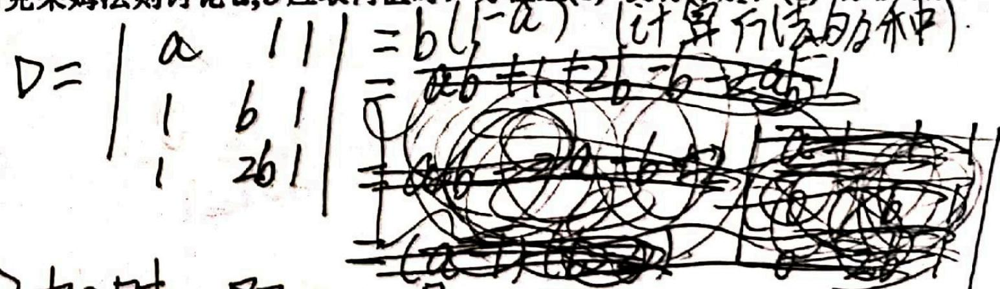

# 《线性代数与解析几何》第一章复习题2 答案

原件经识别和整理；“参考解答”是我们补的。

$$
\begin{array}{r l}
2.\ D &= \left| \begin{array}{l l l l} 1 & -1 & 1 & -1 \\ 1 & 2 & 4 & 8 \\ 1 & -2 & 4 & -8 \\ 1 & 3 & 9 & 27 \end{array} \right| \\
&= (3+1)(-2+1)(2+1)(3-2)(-2-2)(3+2) \\
&= 4 \cdot (-1) \cdot 3 \cdot 1 \cdot (-4) \cdot 5 = 240
\end{array}
$$

$$
\begin{array}{r l}
3.\ D &= \left| \begin{array}{l l l l l l} 1 & n & 0 & \dots & 0 & 0 \\ 0 & 2 & n-1 & \dots & 0 & 0 \\ 0 & 0 & 3 & \dots & 0 & 0 \\ \vdots & \vdots & \vdots & \ddots & \vdots & \vdots \\ 0 & 0 & 0 & \dots & n-1 & 2 \\ 1 & 0 & 0 & \dots & 0 & n \end{array} \right| \\
&= (-1)^{n+1} \left| \begin{array}{l l l l} 2 & n-1 & \dots & 0 \\ 0 & 3 & \dots & 0 \\ 0 & 0 & \dots & n \end{array} \right| + (-1)^{n+1} \left| \begin{array}{l l l l} n & \dots & 0 \\ 0 & n-1 & \dots & 0 \\ 0 & \dots & 2 \end{array} \right| \\
&= n! + (-1)^{n+1} \cdot n!
\end{array}
$$

4. 设行列式 $D_{n} = \left| \begin{array}{cccc} x & a & \cdots & a \\ a & x & \ddots & \vdots \\ \vdots & \ddots & \ddots & a \\ a & \cdots & a & x \end{array} \right|$，$n \geq 2$，求 $D_{n}$ 第 $n$ 行元素的代数余子式之和 $A_{n1} + A_{n2} + \cdots + A_{nn}$。

$$
D_n = \left| \begin{array}{cccc} x & a & \cdots & a \\ a & x & \cdots & a \\ \vdots & \vdots & \ddots & \vdots \\ a & a & \cdots & x \end{array} \right| = \frac{1}{a} \left| \begin{array}{cccc} x-a & 0 & \cdots & 0 \\ 0 & x-a & \cdots & 0 \\ \vdots & \vdots & \ddots & \vdots \\ a & a & \cdots & a \end{array} \right| = \frac{1}{a}(x-a)^{n-1} \cdot a = (x-a)^{n-1}
$$

5. 设齐次线性方程组为
$$
\left\{
\begin{aligned}
ax_{1} + x_{2} + x_{3} &= 0, \\
x_{1} + bx_{2} + x_{3} &= 0, \\
x_{1} + 2bx_{2} + x_{3} &= 0.
\end{aligned}
\right.
$$
用克莱姆法则讨论 $a,b$ 应取何值时，方程组 (1) 仅有零解；(2) 有非零解。

(2) $D \neq 0$ 时，即 $a \neq 1$ 时 $b = (a-1)|b|$，$b = 0$ 时；(2) $D=0$ 时，即 $a=1$ 或 $b=0$ 时，有 nothing

《线性代数与解析几何》同步练习册 专业及班级

姓名

学号

评分
