# 《线性代数与解析几何》第三章 矩阵的初等变换与线性方程组 习题课（课件）

原件的每一页，下面附识别出的文字。

### 第三章 矩阵的初等变换

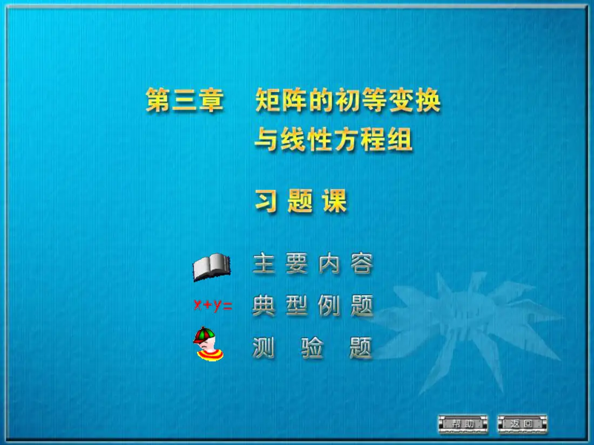

原文：

第三章 矩阵的初等变换
与线性方程组
习题课
主要内容
x+y=典型例题
测验题

帮助

返回

### 初等变换

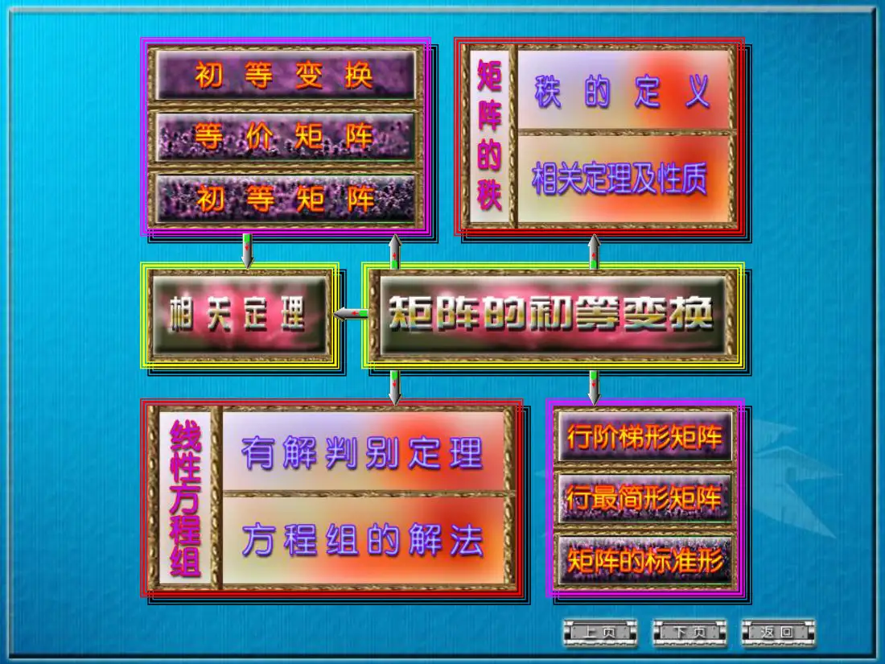

原文：

初等变换

秩的定义

等价矩阵

初等矩阵

相关定理及性质

相关定理

矩阵的初等变换

有解判别定理

行阶梯形矩阵

行最简形矩阵

方程组的解法

矩阵的标准形

### 1 初等变换的定义

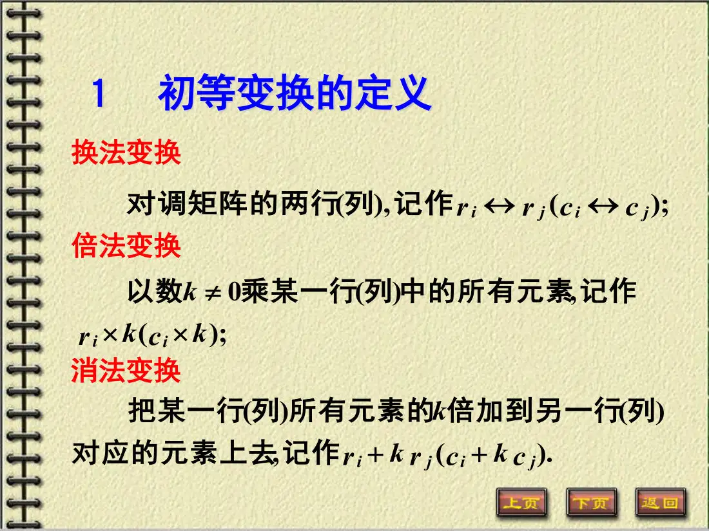

原文：

1 初等变换的定义

换法变换

对调矩阵的两行(列),记作 $r_i \leftrightarrow r_j (c_i \leftrightarrow c_j)$ ; 倍法变换

以数 $k \neq 0$ 乘某一行(列)中的所有元素,记作 $r_i \times k(c_i \times k);$

消法变换

把某一行(列)所有元素的k倍加到另一行(列)对应的元素上去,记作 $r_i + k r_j (c_i + k c_j)$ .

上页 下页 返回

### 三种初等变换都是可逆的，且其逆变换是同一类型的初等变换.

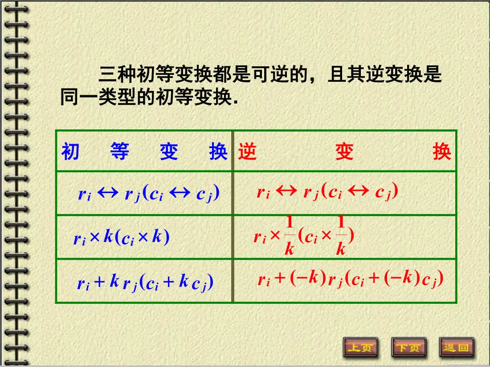

原文：

三种初等变换都是可逆的，且其逆变换是同一类型的初等变换.

<table><tr><td>初等变换</td><td>逆变换</td></tr><tr><td> $r_i \leftrightarrow r_j (c_i \leftrightarrow c_j)$ </td><td> $r_i \leftrightarrow r_j (c_i \leftrightarrow c_j)$ </td></tr><tr><td> $r_i \times k (c_i \times k)$ </td><td> $r_i \times \frac{1}{k} (c_i \times \frac{1}{k})$ </td></tr><tr><td> $r_i + k r_j (c_i + k c_j)$ </td><td> $r_i + (-k) r_j (c_i + (-k)c_j)$ </td></tr></table>

上页 下页 返回

### 2 矩阵的等价

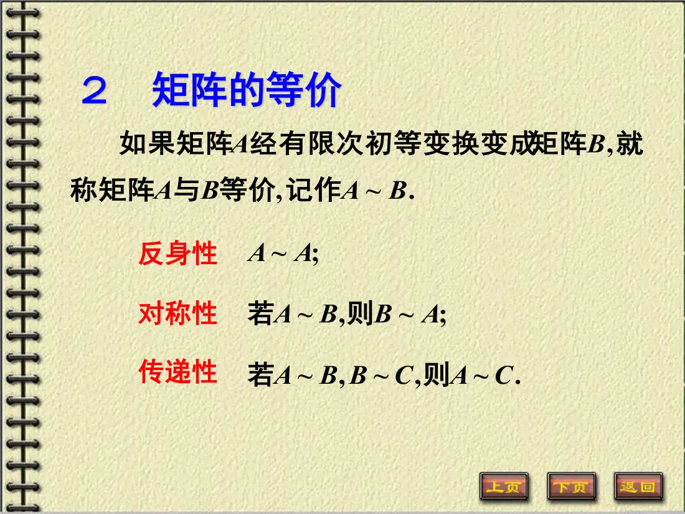

原文：

2 矩阵的等价

如果矩阵A经有限次初等变换变成矩阵B,就称矩阵A与B等价,记作A\~B.

反身性 $A \sim A$ ;

对称性 若 $A \sim B$ , 则 $B \sim A$ ;

传递性 若 $A \sim B, B \sim C$ , 则 $A \sim C$ .

H
H
H
H
H
H
H

上页 下页 返回

### 3 初等矩阵

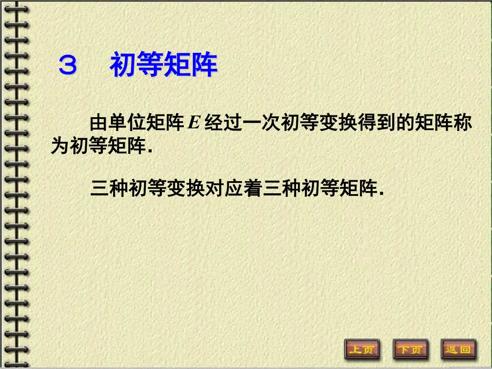

原文：

3 初等矩阵

由单位矩阵 $E$ 经过一次初等变换得到的矩阵称为初等矩阵.

三种初等变换对应着三种初等矩阵.

上页 下页 返回

### (1) 换法变换: 对调两行 (列), 得初等矩阵 $E(i, j)$ .

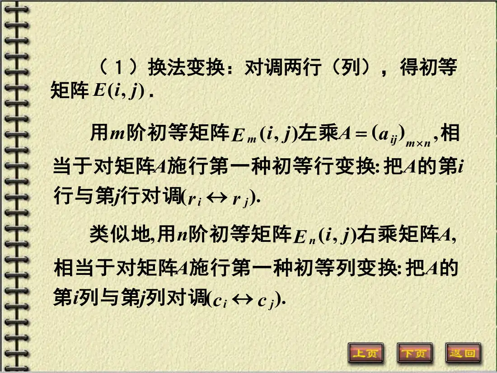

原文：

(1) 换法变换: 对调两行 (列), 得初等矩阵 $E(i, j)$ .

用m阶初等矩阵 $E_{m}(i,j)$ 左乘 $A=(a_{ij})_{m\times n}$ ，相当于对矩阵A施行第一种初等行变换:把A的第i行与第j行对调( $r_{i}\leftrightarrow r_{j}$ ).

类似地,用n阶初等矩阵 $E_{n}(i,j)$ 右乘矩阵A,相当于对矩阵A施行第一种初等列变换:把A的第i列与第j列对调( $c_{i} \leftrightarrow c_{j}$ ).

上页 下页 返回

### 上页 下页 返回

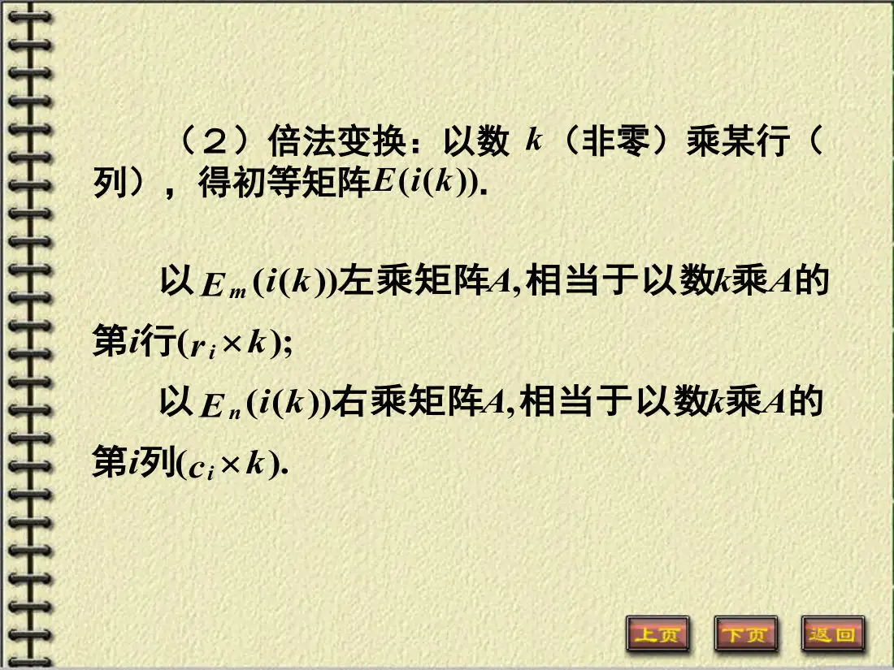

原文：

(2) 倍法变换: 以数 $k$ (非零) 乘某行 (列), 得初等矩阵 $E(i(k))$ .

以 $E_{m}(i(k))$ 左乘矩阵 $A$ , 相当于以数 $k$ 乘 $A$ 的第 $i$ 行 $(r_i \times k)$ ;

以 $E_{n}(i(k))$ 右乘矩阵 $A$ , 相当于以数 $k$ 乘 $A$ 的第 $i$ 列 $(c_{i} \times k)$ .

上页 下页 返回

### 上页 下页 返回

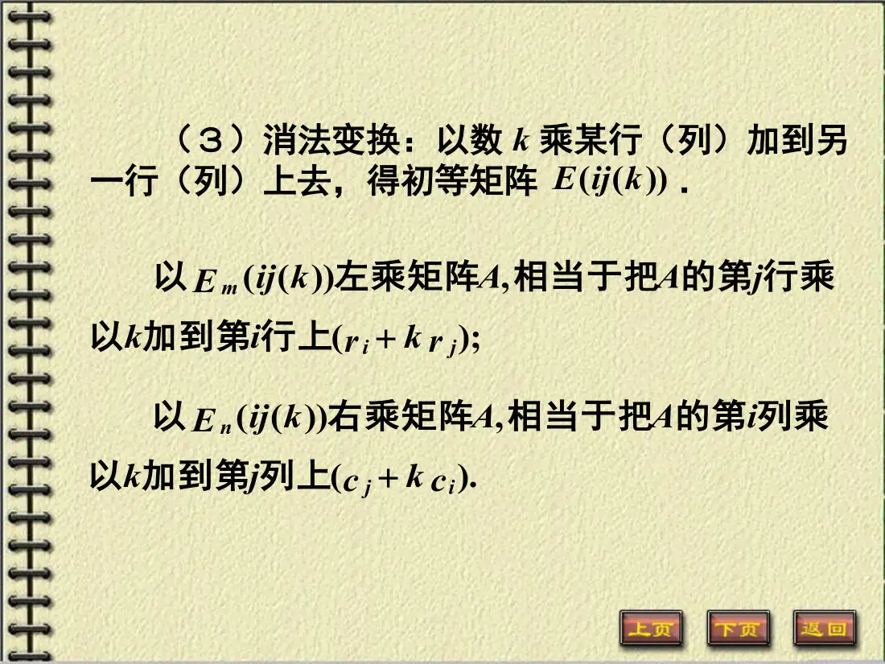

原文：

(3) 消法变换: 以数 $k$ 乘某行 (列) 加到另一行 (列) 上去, 得初等矩阵 $E(ij(k))$ .

以 $E_{m}(ij(k))$ 左乘矩阵 A, 相当于把 A 的第 j 行乘以 k 加到第 i 行上 $(r_{i} + k r_{j})$ ;

以 $E_{n}(ij(k))$ 右乘矩阵 $A$ , 相当于把 $A$ 的第 $i$ 列乘以 $k$ 加到第 $j$ 列上 $(c_{j} + k c_{i})$ .

上页 下页 返回

### 4 行阶梯形矩阵

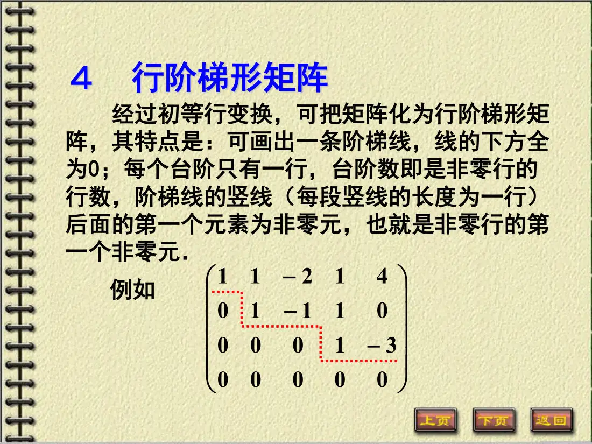

原文：

4 行阶梯形矩阵

经过初等行变换，可把矩阵化为行阶梯形矩阵，其特点是：可画出一条阶梯线，线的下方全为0；每个台阶只有一行，台阶数即是非零行的行数，阶梯线的竖线（每段竖线的长度为一行）后面的第一个元素为非零元，也就是非零行的第一个非零元。

例如

$$
\left( \begin{array}{c c c c c} 1 & 1 & - 2 & 1 & 4 \\ \hline 0 & 1 & - 1 & 1 & 0 \\ 0 & 0 & 0 & 1 & - 3 \\ 0 & 0 & 0 & 0 & 0 \end{array} \right)
$$

上页 下页 返回

### 5 行最简形矩阵

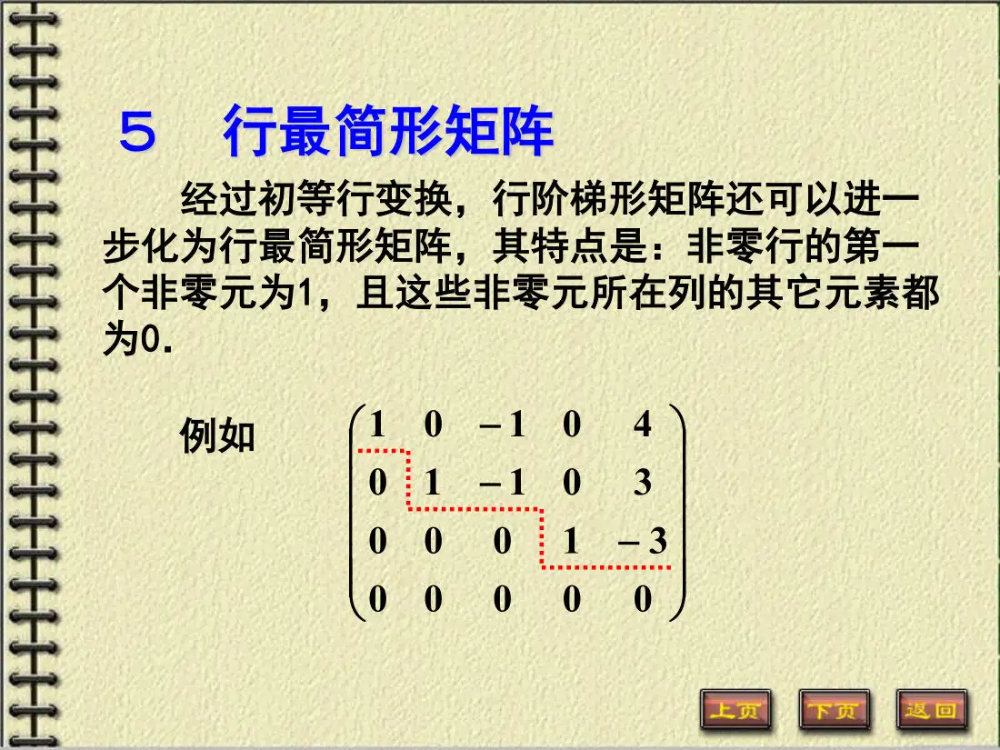

原文：

5 行最简形矩阵

经过初等行变换，行阶梯形矩阵还可以进一步化为行最简形矩阵，其特点是：非零行的第一个非零元为1，且这些非零元所在列的其它元素都为0.

例如

$$
\left( \begin{array}{c c c c c} 1 & 0 & - 1 & 0 & 4 \\ \vdots & 0 & 1 & - 1 & 0 \\ 0 & 0 & 0 & 1 & - 3 \\ 0 & 0 & 0 & 0 & 0 \end{array} \right)
$$

上页 下页 返回

### 6 矩阵的标准形

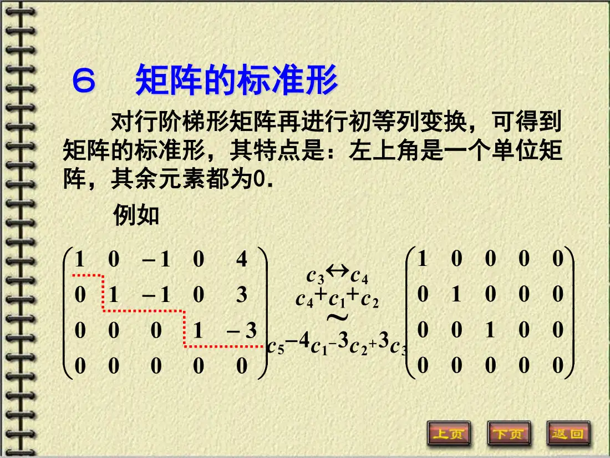

原文：

6 矩阵的标准形

对行阶梯形矩阵再进行初等列变换，可得到矩阵的标准形，其特点是：左上角是一个单位矩阵，其余元素都为0.

例如

$$
\left( \begin{array}{c c c c c} 1 & 0 & - 1 & 0 & 4 \\ \vdots & & & & \\ 0 & 1 & - 1 & 0 & 3 \\ 0 & 0 & 0 & 1 & - 3 \\ 0 & 0 & 0 & 0 & 0 \end{array} \right) \overset {c _ {3} \leftrightarrow c _ {4}} {\underset {c _ {4} + c _ {1} + c _ {2}} {\sim}} c _ {5} - 4 c _ {1} - 3 c _ {2} + 3 c _ {3} \left( \begin{array}{c c c c c} 1 & 0 & 0 & 0 & 0 \\ 0 & 1 & 0 & 0 & 0 \\ 0 & 0 & 1 & 0 & 0 \\ 0 & 0 & 0 & 0 & 0 \end{array} \right)
$$

上页 下页 返回

### $$

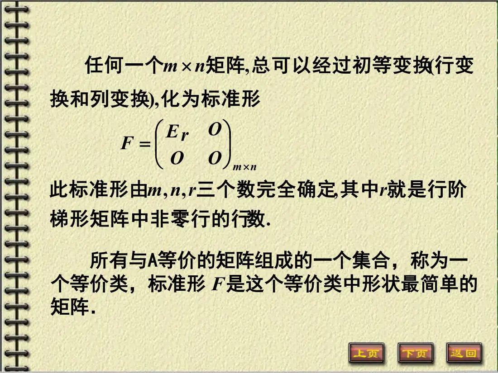

原文：

任何一个 $m \times n$ 矩阵, 总可以经过初等变换(行变换和列变换), 化为标准形

$$
\boldsymbol {F} = \left( \begin{array}{c c} \boldsymbol {E r} & \boldsymbol {O} \\ \boldsymbol {O} & \boldsymbol {O} \end{array} \right) _ {\boldsymbol {m} \times \boldsymbol {n}}
$$

此标准形由m,n,r三个数完全确定,其中r就是行阶梯形矩阵中非零行的行数.

所有与A等价的矩阵组成的一个集合，称为一个等价类，标准形 $F$ 是这个等价类中形状最简单的矩阵.

上页 下页 返回

### 7 矩阵的秩

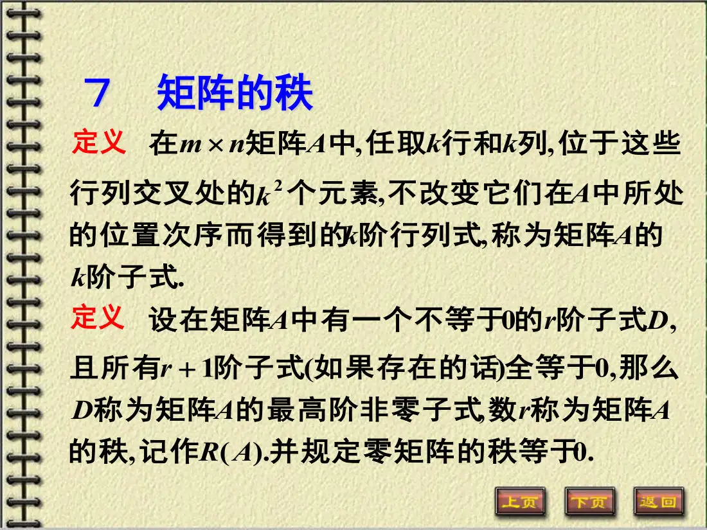

原文：

7 矩阵的秩

定义 在 $m \times n$ 矩阵 $A$ 中, 任取 $k$ 行和 $k$ 列, 位于这些行列交叉处的 $k^2$ 个元素, 不改变它们在 $A$ 中所处的位置次序而得到的 $k$ 阶行列式, 称为矩阵 $A$ 的 $k$ 阶子式.

定义 设在矩阵A中有一个不等于0的r阶子式D,且所有 $r+1$ 阶子式(如果存在的话)全等于0,那么D称为矩阵A的最高阶非零子式,数r称为矩阵A的秩,记作R(A).并规定零矩阵的秩等于0.

上页 下页 返回

### 8 矩阵秩的性质及定理

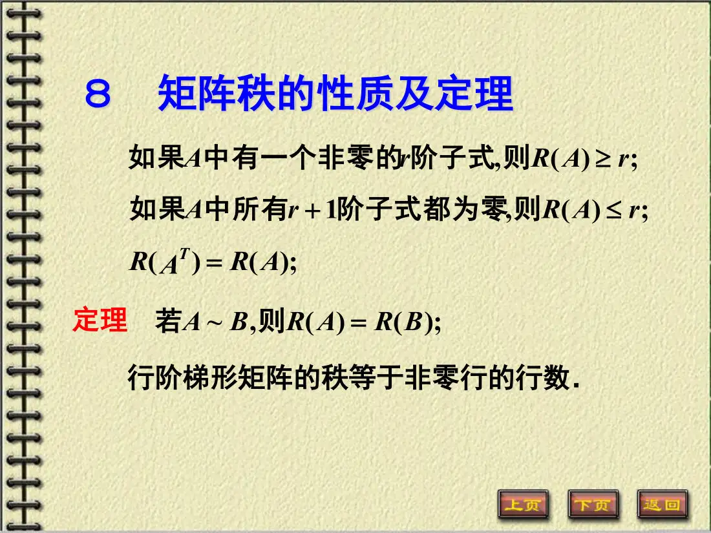

原文：

8 矩阵秩的性质及定理

如果A中有一个非零的r阶子式,则 $R(A)\geq r$ ;
如果A中所有 $r+1$ 阶子式都为零,则 $R(A)\leq r;$ $R(A^{T}) = R(A);$

定理 若 $A \sim B$ , 则 $R(A) = R(B)$ ;

行阶梯形矩阵的秩等于非零行的行数.

上页 下页 返回

### 若A为n阶可逆矩阵,则

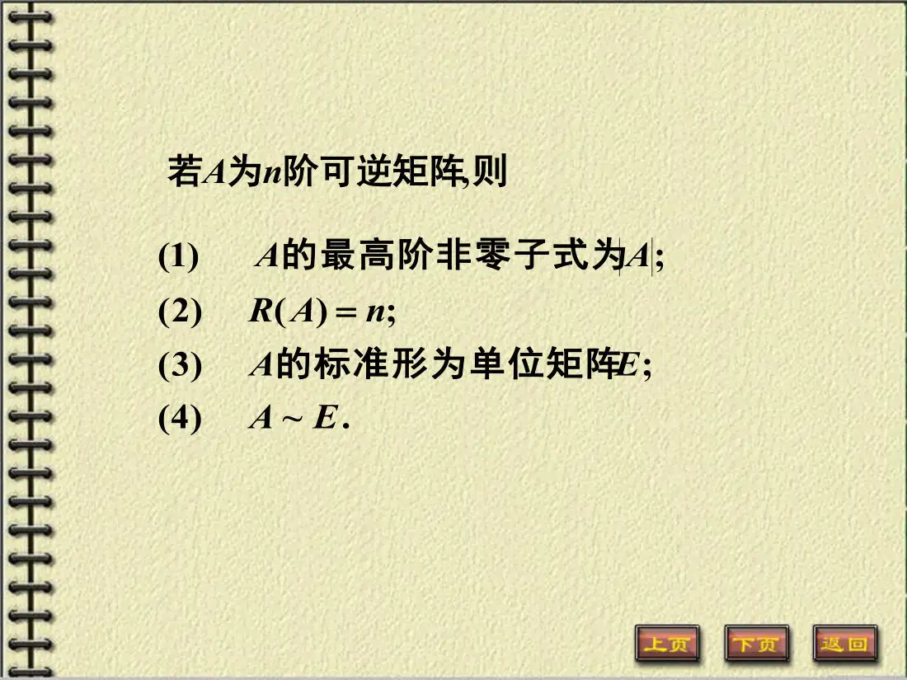

原文：

若A为n阶可逆矩阵,则

(1) $A$ 的最高阶非零子式为 $A$ ;

(2) $R(A) = n$ ;

(3) $A$ 的标准形为单位矩阵 $E$ ;

(4) $A \sim E$ .

上页 下页 返回

### 9 线性方程组有解判别定理

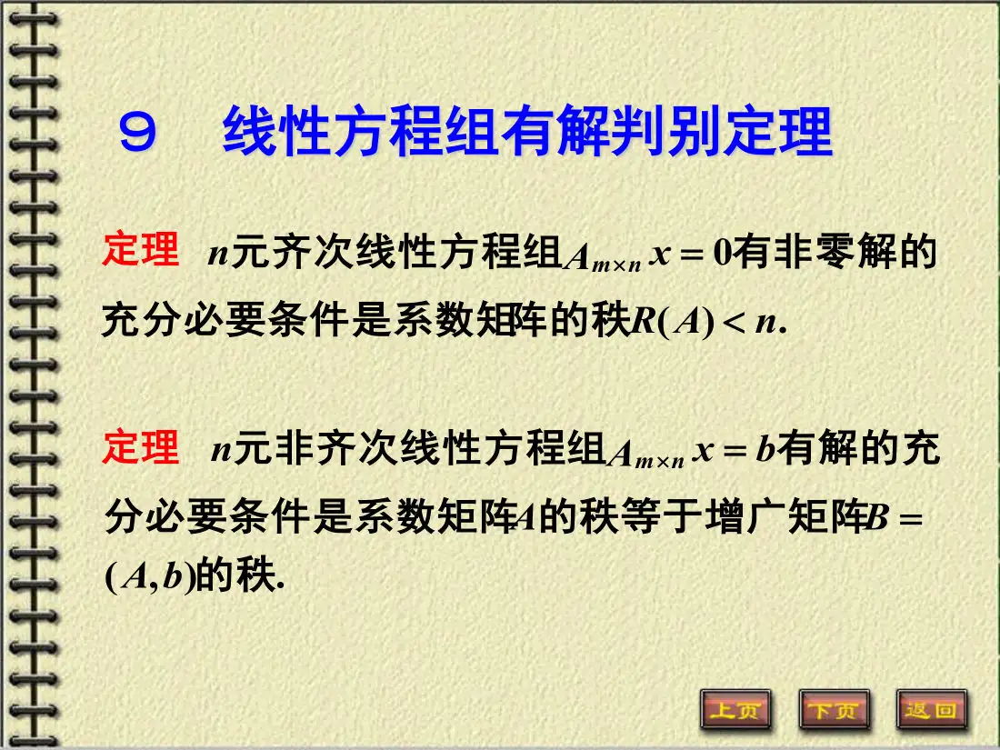

原文：

9 线性方程组有解判别定理

定理 $n$ 元齐次线性方程组 $A_{m \times n} x = 0$ 有非零解的充分必要条件是系数矩阵的秩 $R(A) < n$ .

定理 $n$ 元非齐次线性方程组 $A_{m \times n} x = b$ 有解的充分必要条件是系数矩阵 $A$ 的秩等于增广矩阵 $B = (A, b)$ 的秩.

上页 下页 返回

### 10 线性方程组的解法

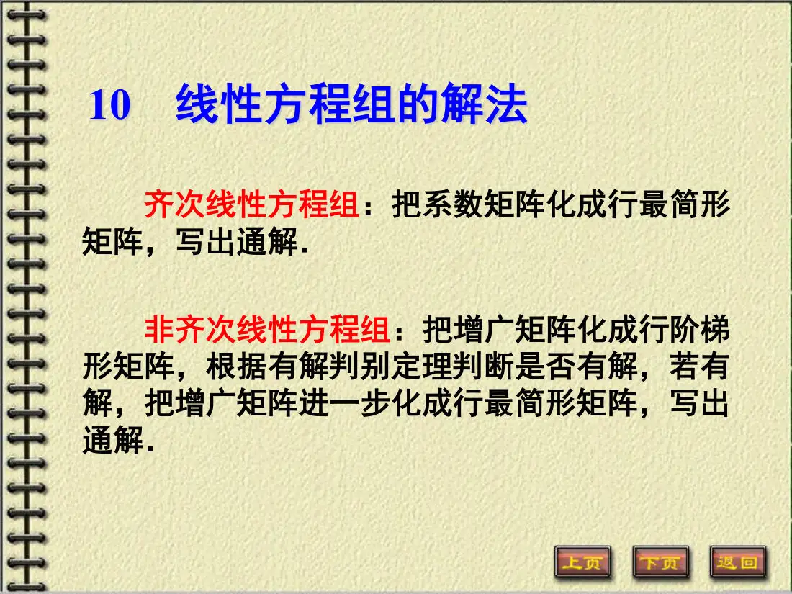

原文：

10 线性方程组的解法

齐次线性方程组：把系数矩阵化成行最简形矩阵，写出通解。

非齐次线性方程组：把增广矩阵化成行阶梯形矩阵，根据有解判别定理判断是否有解，若有解，把增广矩阵进一步化成行最简形矩阵，写出通解。

上页 下页 返回

### 11 初等矩阵与初等变换的关系

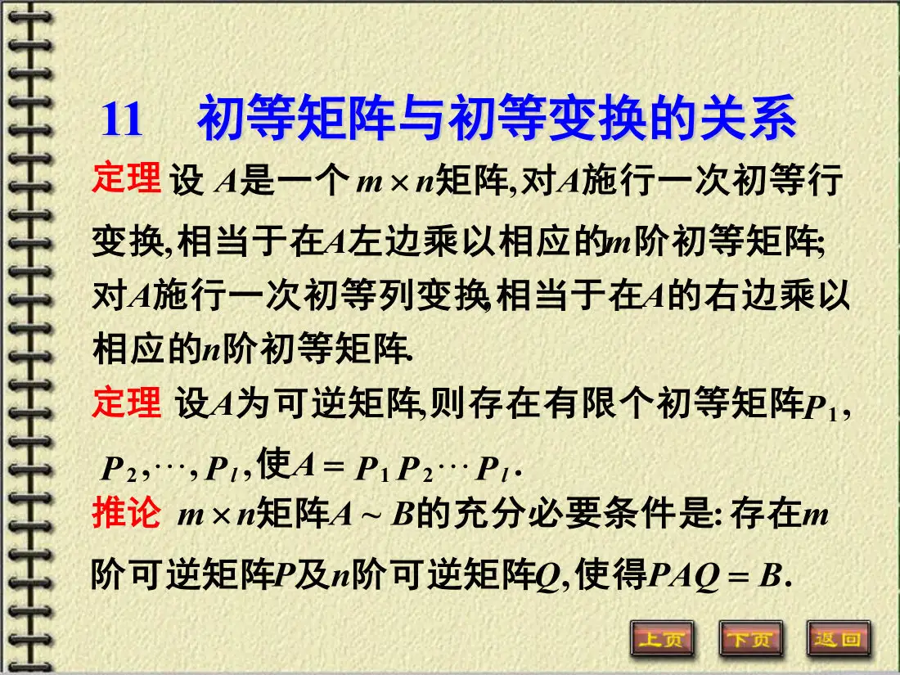

原文：

11 初等矩阵与初等变换的关系

定理设 A 是一个 $m \times n$ 矩阵, 对 A 施行一次初等行变换, 相当于在 A 左边乘以相应的 m 阶初等矩阵; 对 A 施行一次初等列变换, 相当于在 A 的右边乘以相应的 n 阶初等矩阵.

定理 设A为可逆矩阵,则存在有限个初等矩阵 $P_{1}$ , $P_{2},\cdots,P_{l}$ ,使 $A=P_{1}P_{2}\cdots P_{l}$ .

推论 $m \times n$ 矩阵 $A \sim B$ 的充分必要条件是: 存在 $m$ 阶可逆矩阵 $P$ 及 $n$ 阶可逆矩阵 $Q$ , 使得 $PAQ = B$ .

上页 下页 返回

### 一、求矩阵的秩

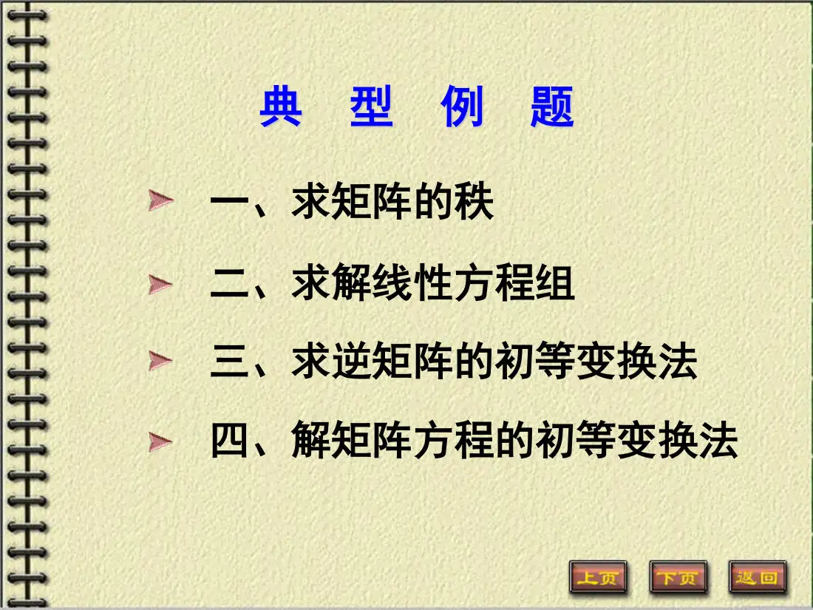

原文：

一、求矩阵的秩
二、求解线性方程组
三、求逆矩阵的初等变换法
四、解矩阵方程的初等变换法

典型例题

上页 下页 返回

### 一、求矩阵的秩

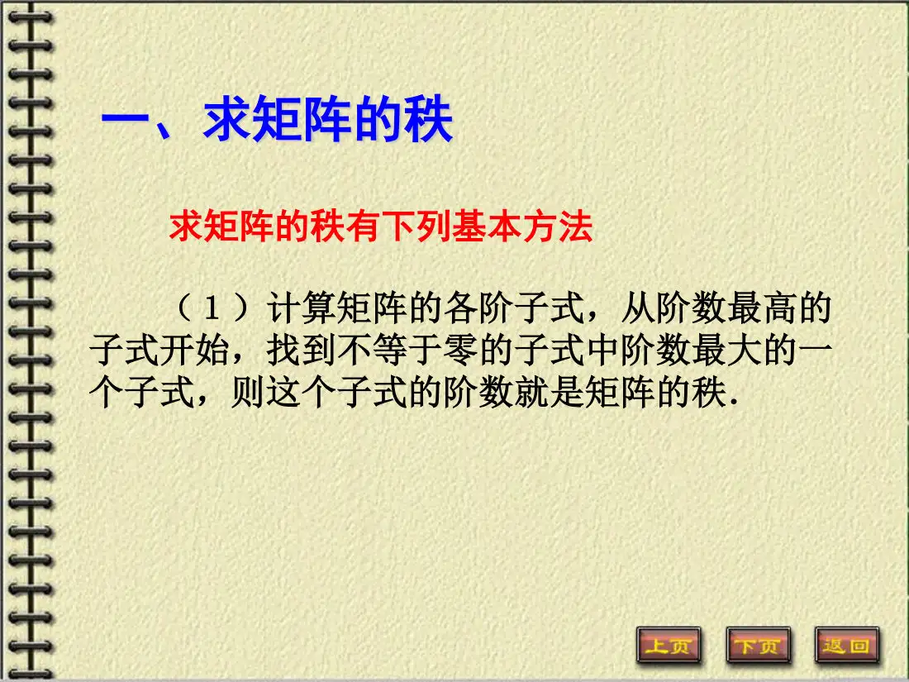

原文：

一、求矩阵的秩

求矩阵的秩有下列基本方法

(1) 计算矩阵的各阶子式, 从阶数最高的子式开始, 找到不等于零的子式中阶数最大的一个子式, 则这个子式的阶数就是矩阵的秩.

上页 下页 返回

### 第一种方法当矩阵的行数与列数较高时，计算量很大，第二种方法则较为简单实用。

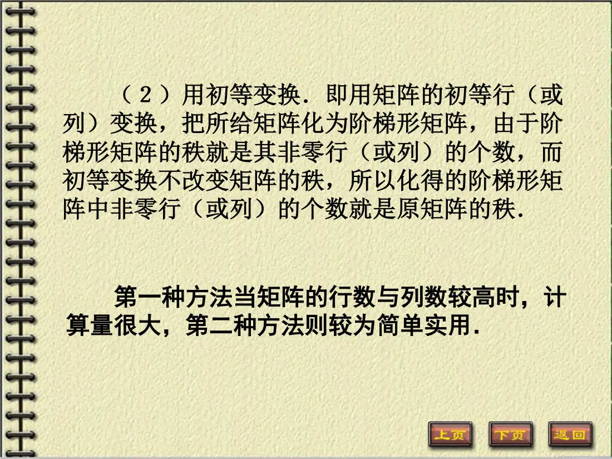

原文：

(2) 用初等变换。即用矩阵的初等行（或列）变换，把所给矩阵化为阶梯形矩阵，由于阶梯形矩阵的秩就是其非零行（或列）的个数，而初等变换不改变矩阵的秩，所以化得的阶梯形矩阵中非零行（或列）的个数就是原矩阵的秩。

第一种方法当矩阵的行数与列数较高时，计算量很大，第二种方法则较为简单实用。

上页 下页 返回

### 例 1 求下列矩阵的秩

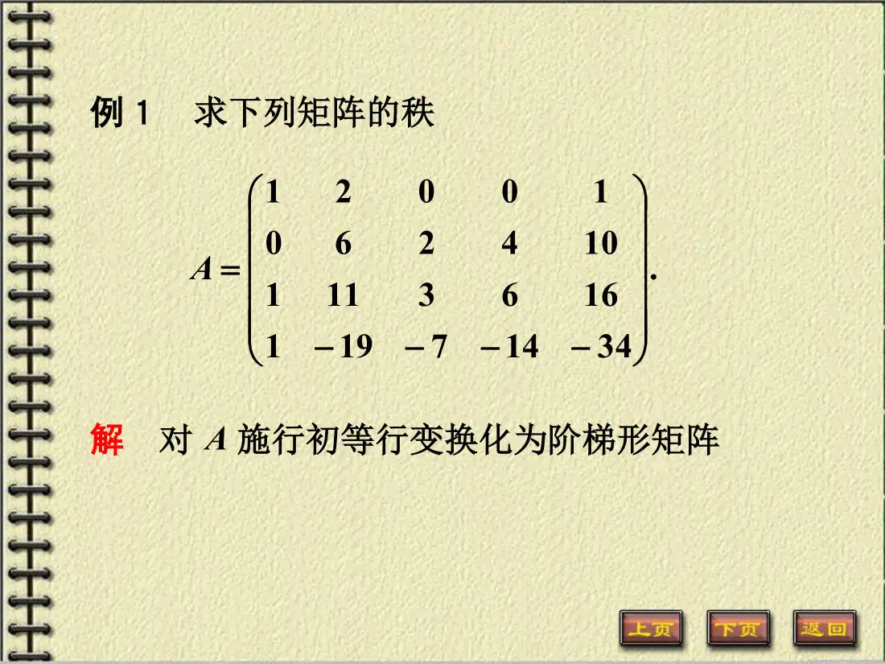

原文：

例 1 求下列矩阵的秩

$$
A = \left( \begin{array}{c c c c c} 1 & 2 & 0 & 0 & 1 \\ 0 & 6 & 2 & 4 & 1 0 \\ 1 & 1 1 & 3 & 6 & 1 6 \\ 1 & - 1 9 & - 7 & - 1 4 & - 3 4 \end{array} \right).
$$

解 对 $A$ 施行初等行变换化为阶梯形矩阵

上页 下页 返回

### $$

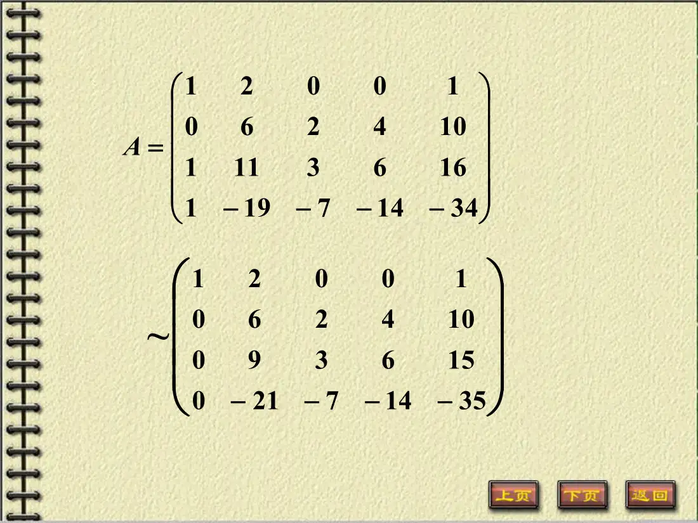

原文：

$$
A = \left( \begin{array}{c c c c c} 1 & 2 & 0 & 0 & 1 \\ 0 & 6 & 2 & 4 & 1 0 \\ 1 & 1 1 & 3 & 6 & 1 6 \\ 1 & - 1 9 & - 7 & - 1 4 & - 3 4 \end{array} \right)
$$

$$
\sim \left( \begin{array}{c c c c c} 1 & 2 & 0 & 0 & 1 \\ 0 & 6 & 2 & 4 & 1 0 \\ 0 & 9 & 3 & 6 & 1 5 \\ 0 & - 2 1 & - 7 & - 1 4 & - 3 5 \end{array} \right)
$$

上页 下页 返回

### $$

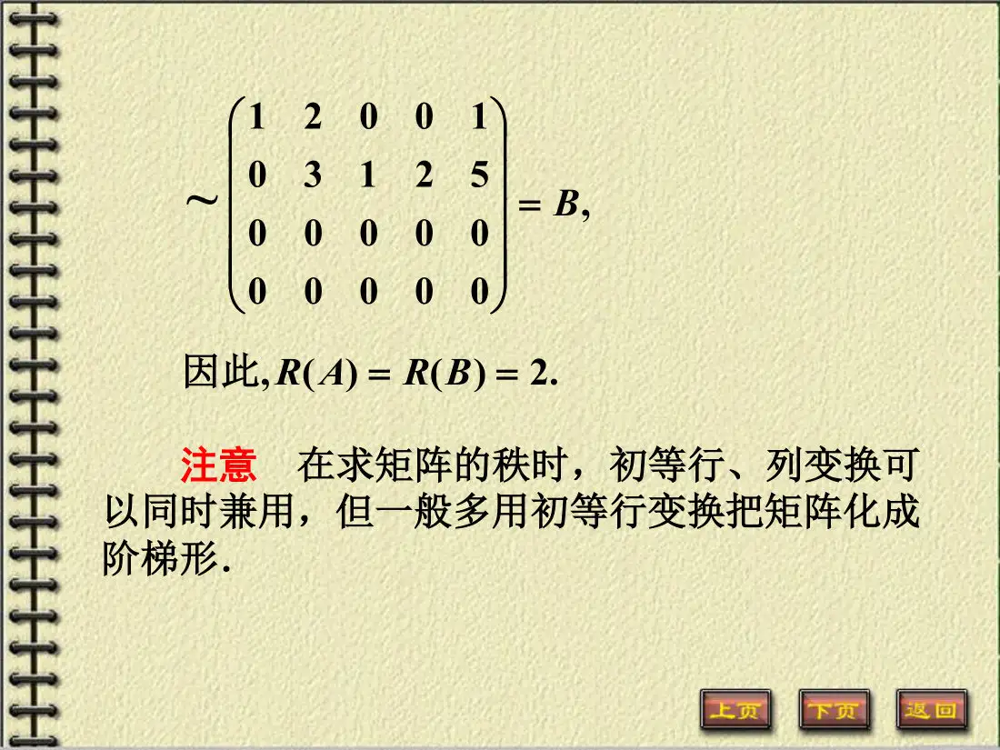

原文：

$$
\sim \left( \begin{array}{c c c c c} 1 & 2 & 0 & 0 & 1 \\ 0 & 3 & 1 & 2 & 5 \\ 0 & 0 & 0 & 0 & 0 \\ 0 & 0 & 0 & 0 & 0 \end{array} \right) = B,
$$

因此, $R(A)=R(B)=2.$

注意 在求矩阵的秩时，初等行、列变换可以同时兼用，但一般多用初等行变换把矩阵化成阶梯形.

上页 下页 返回

### 二、求解线性方程组

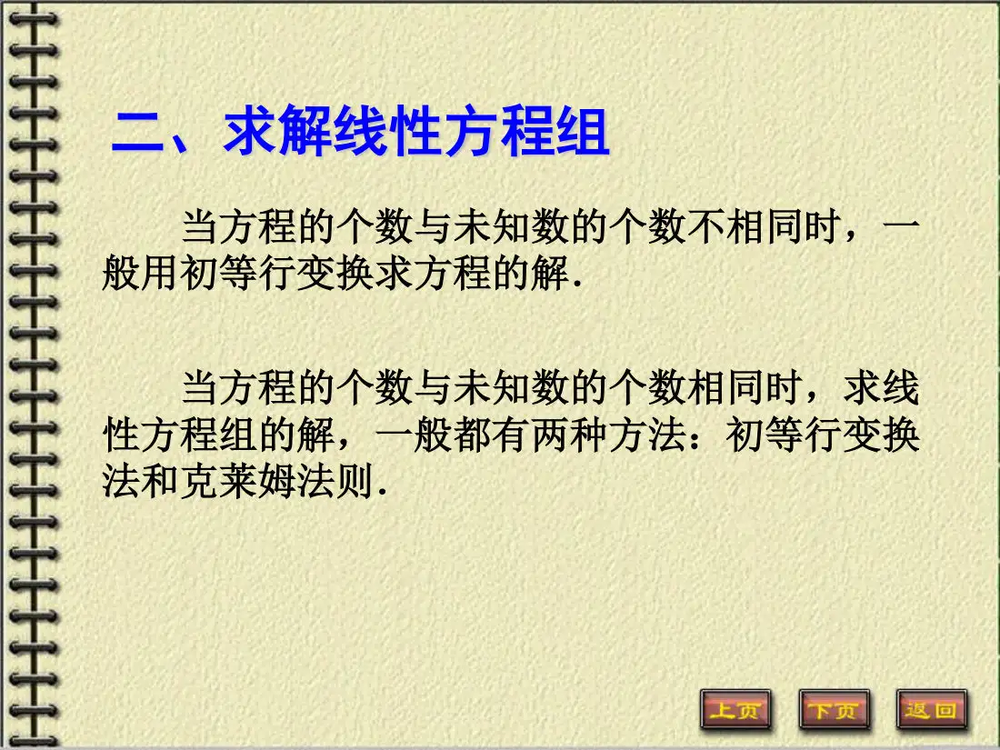

原文：

二、求解线性方程组

当方程的个数与未知数的个数不相同时，一般用初等行变换求方程的解。

当方程的个数与未知数的个数相同时，求线性方程组的解，一般都有两种方法：初等行变换法和克莱姆法则。

上页 下页 返回

### 例 2 求非齐次线性方程组的通解.

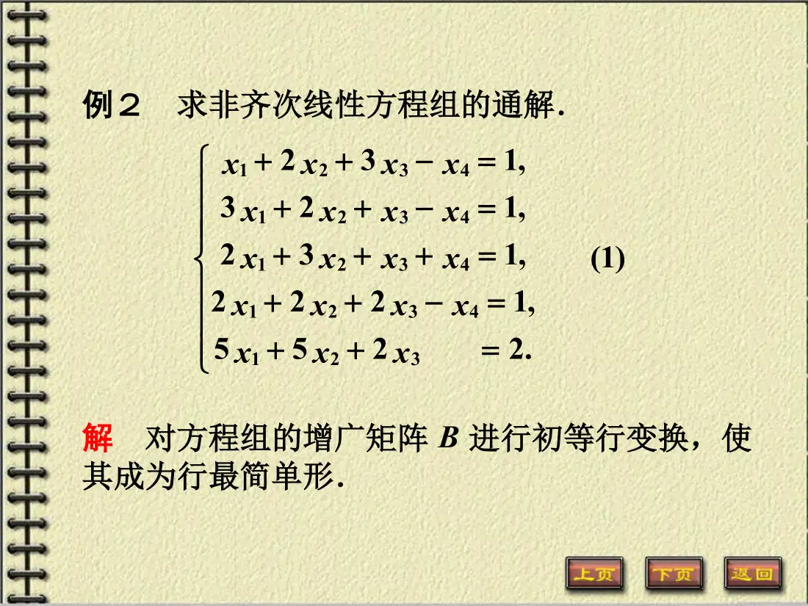

原文：

例 2 求非齐次线性方程组的通解.

$$
\left\{ \begin{array}{l l} x _ {1} + 2 x _ {2} + 3 x _ {3} - x _ {4} = 1, \\ 3 x _ {1} + 2 x _ {2} + x _ {3} - x _ {4} = 1, \\ 2 x _ {1} + 3 x _ {2} + x _ {3} + x _ {4} = 1, \\ 2 x _ {1} + 2 x _ {2} + 2 x _ {3} - x _ {4} = 1, \\ 5 x _ {1} + 5 x _ {2} + 2 x _ {3} = 2. \end{array} \right.\tag{1}
$$

解 对方程组的增广矩阵 B 进行初等行变换，使其成为行最简单形.

上页 下页 返回

### $$

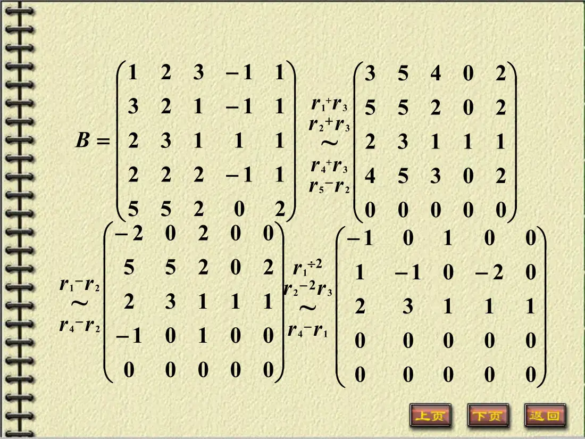

原文：

$$
\begin{array}{r} B = \left( \begin{array}{c c c c c} 1 & 2 & 3 & - 1 & 1 \\ 3 & 2 & 1 & - 1 & 1 \\ 2 & 3 & 1 & 1 & 1 \\ 2 & 2 & 2 & - 1 & 1 \\ 5 & 5 & 2 & 0 & 2 \end{array} \right) \sim \left( \begin{array}{c c c c c} r _ {1} ^ {+} r _ {3} & 3 & 5 & 4 & 0 & 2 \\ r _ {2} ^ {+} r _ {3} & 5 & 5 & 2 & 0 & 2 \\ r _ {4} ^ {+} r _ {3} & 2 & 3 & 1 & 1 & 1 \\ r _ {5} ^ {-} r _ {2} & 4 & 5 & 3 & 0 & 2 \\ 0 & 0 & 0 & 0 & 0 \end{array} \right) \\ r _ {1} ^ {-} r _ {2} \sim \left( \begin{array}{c c c c c} - 2 & 0 & 2 & 0 & 0 \\ 5 & 5 & 2 & 0 & 2 \\ 2 & 3 & 1 & 1 & 1 \\ - 1 & 0 & 1 & 0 & 0 \\ 0 & 0 & 0 & 0 & 0 \end{array} \right) \sim \left( \begin{array}{c c c c c} r _ {1} ^ {\div 2} & - 1 & 0 & 1 & 0 \\ r _ {2} ^ {- 2} r _ {3} & - 1 & - 1 & 0 & - 2 \\ r _ {4} ^ {-} r _ {1} & 2 & 3 & 1 & 1 \\ 0 & 0 & 0 & 0 & 0 \\ 0 & 0 & 0 & 0 & 0 \end{array} \right) \end{array}
$$

上页 下页 返回

### $$

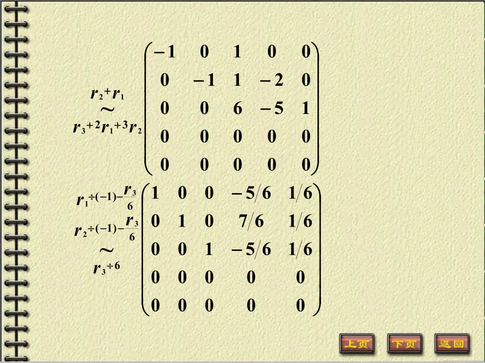

原文：

$$
\underset {r _ {3} + 2 r _ {1} + 3 r _ {2}} {\overset {r _ {2} + r _ {1}} {\sim}} \left( \begin{array}{c c c c c} - 1 & 0 & 1 & 0 & 0 \\ 0 & - 1 & 1 & - 2 & 0 \\ 0 & 0 & 6 & - 5 & 1 \\ 0 & 0 & 0 & 0 & 0 \\ 0 & 0 & 0 & 0 & 0 \end{array} \right)
$$

$$
\begin{array}{c} r _ {1} \div (- 1) - \frac {r _ {3}}{6} \\ r _ {2} \div (- 1) - \frac {r _ {3}}{6} \\ \sim \\ r _ {3} \div^ {6} \end{array} \left( \begin{array}{c c c c c} 1 & 0 & 0 & - 5 / 6 & 1 / 6 \\ 0 & 1 & 0 & 7 / 6 & 1 / 6 \\ 0 & 0 & 1 & - 5 / 6 & 1 / 6 \\ 0 & 0 & 0 & 0 & 0 \\ 0 & 0 & 0 & 0 & 0 \end{array} \right)
$$

上页 下页 返回

### 令自由未知量 $x_{4}=k$ , 可得方程组(1)的通解是

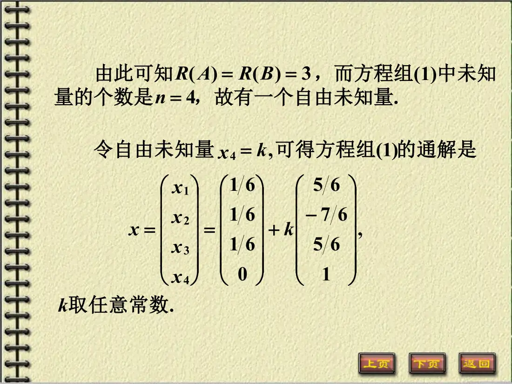

原文：

由此可知 $R(A)=R(B)=3$ ，而方程组(1)中未知量的个数是n=4，故有一个自由未知量.

令自由未知量 $x_{4}=k$ , 可得方程组(1)的通解是

$$
\boldsymbol {x} = \left( \begin{array}{c} x _ {1} \\ x _ {2} \\ x _ {3} \\ x _ {4} \end{array} \right) = \left( \begin{array}{c} 1 / 6 \\ 1 / 6 \\ 1 / 6 \\ 0 \end{array} \right) + k \left( \begin{array}{c} 5 / 6 \\ - 7 / 6 \\ 5 / 6 \\ 1 \end{array} \right),
$$

k取任意常数.

上页 下页 返回

### 例3 当 $a$ 取何值时, 下述齐次线性方程组有非零解, 并且求出它的通解.

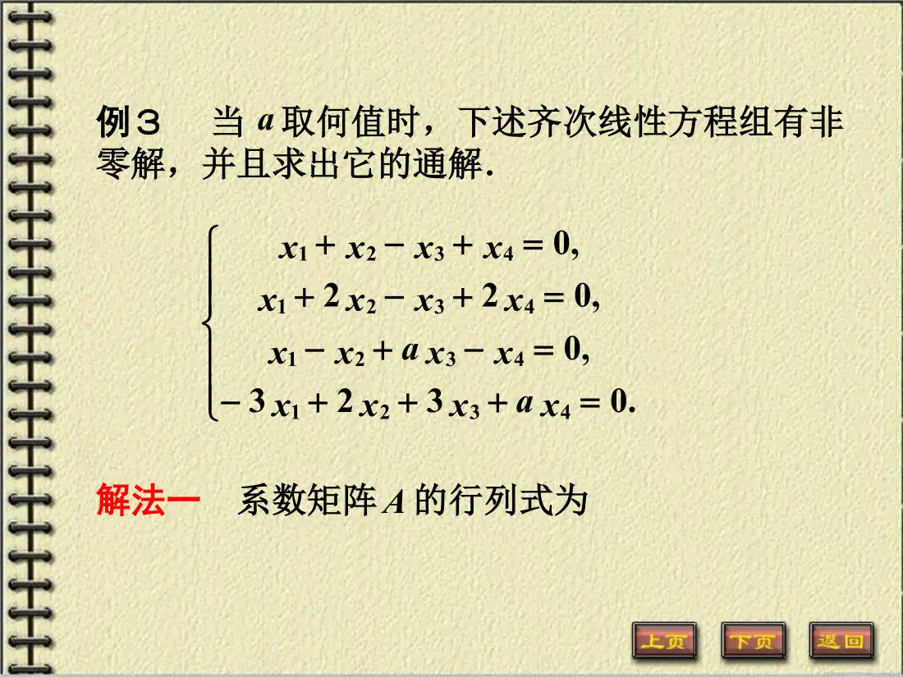

原文：

例3 当 $a$ 取何值时, 下述齐次线性方程组有非零解, 并且求出它的通解.

$$
\left\{ \begin{array}{c} x _ {1} + x _ {2} - x _ {3} + x _ {4} = 0, \\ x _ {1} + 2 x _ {2} - x _ {3} + 2 x _ {4} = 0, \\ x _ {1} - x _ {2} + a x _ {3} - x _ {4} = 0, \\ - 3 x _ {1} + 2 x _ {2} + 3 x _ {3} + a x _ {4} = 0. \end{array} \right.
$$

解法一 系数矩阵 $A$ 的行列式为

上页 下页 返回

### $$

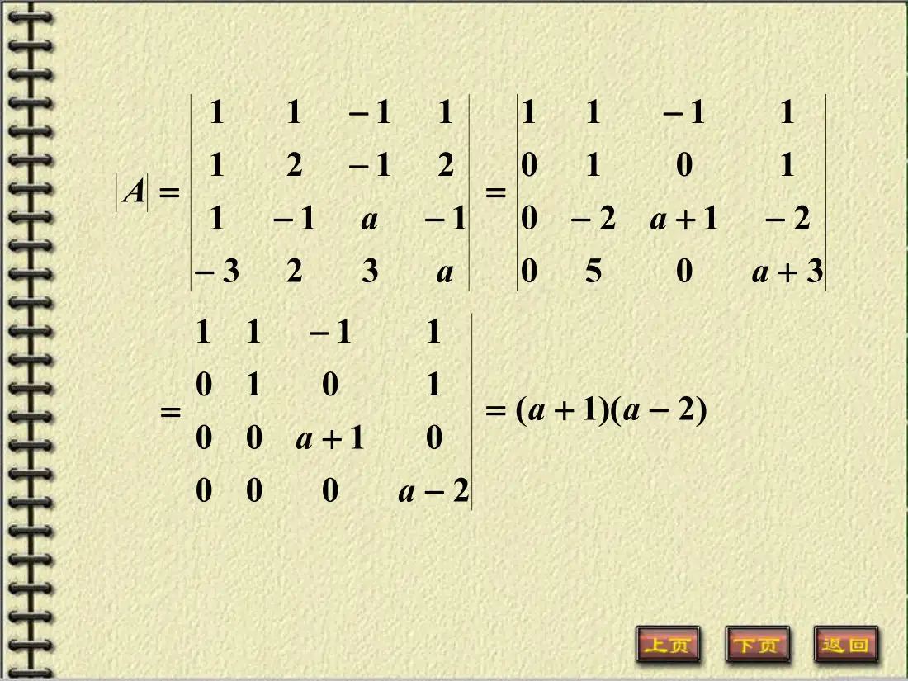

原文：

$$
\begin{array}{r l} & {| A | = \left| \begin{array}{c c c c} 1 & 1 & - 1 & 1 \\ 1 & 2 & - 1 & 2 \\ 1 & - 1 & a & - 1 \\ - 3 & 2 & 3 & a \end{array} \right| = \left| \begin{array}{c c c c} 1 & 1 & - 1 & 1 \\ 0 & 1 & 0 & 1 \\ 0 & - 2 & a + 1 & - 2 \\ 0 & 5 & 0 & a + 3 \end{array} \right|} \\ & {= \left| \begin{array}{c c c c} 1 & 1 & - 1 & 1 \\ 0 & 1 & 0 & 1 \\ 0 & 0 & a + 1 & 0 \\ 0 & 0 & 0 & a - 2 \end{array} \right| = (a + 1) (a - 2)} \end{array}
$$

上页 下页 返回

### $$

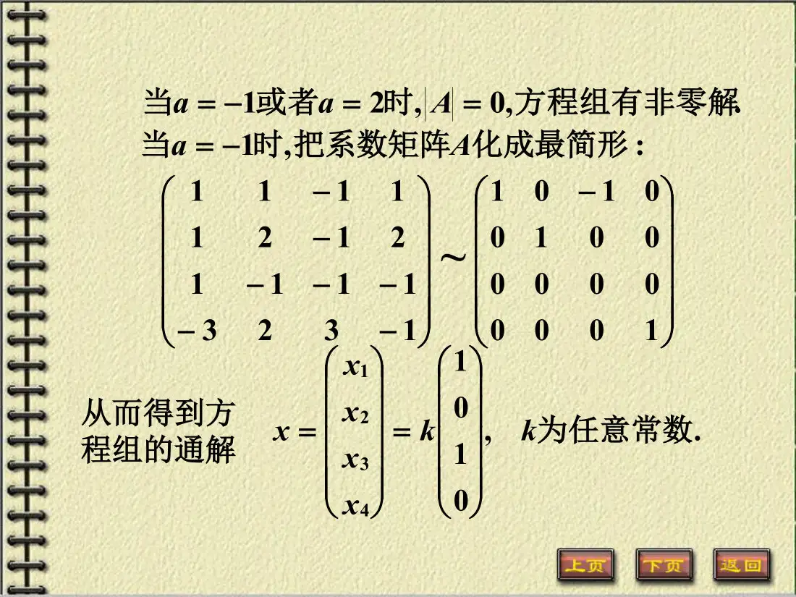

原文：

当 $a = -1$ 或者 $a = 2$ 时， $|A| = 0$ ，方程组有非零解。当 $a = -1$ 时，把系数矩阵 $A$ 化成最简形：

$$
\left( \begin{array}{c c c c} 1 & 1 & - 1 & 1 \\ 1 & 2 & - 1 & 2 \\ 1 & - 1 & - 1 & - 1 \\ - 3 & 2 & 3 & - 1 \end{array} \right) \sim \left( \begin{array}{c c c c} 1 & 0 & - 1 & 0 \\ 0 & 1 & 0 & 0 \\ 0 & 0 & 0 & 0 \\ 0 & 0 & 0 & 1 \end{array} \right)
$$

从而得到方
程组的通解

$$
\boldsymbol {x} = \left( \begin{array}{c} x _ {1} \\ x _ {2} \\ x _ {3} \\ x _ {4} \end{array} \right) = k \left( \begin{array}{c} 1 \\ 0 \\ 1 \\ 0 \end{array} \right),
$$

k为任意常数.

上页 下页 返回

### 当 $a = 2$ 时,由计算 $|A|$ 之变换可把 $A$ 化为

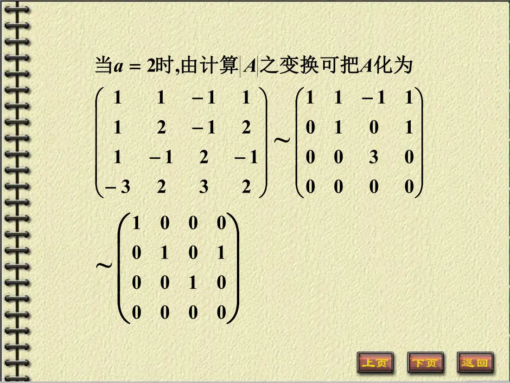

原文：

当 $a = 2$ 时,由计算 $|A|$ 之变换可把 $A$ 化为

$$
\left( \begin{array}{r r r r} 1 & 1 & - 1 & 1 \\ 1 & 2 & - 1 & 2 \\ 1 & - 1 & 2 & - 1 \\ - 3 & 2 & 3 & 2 \end{array} \right) \sim \left( \begin{array}{r r r r} 1 & 1 & - 1 & 1 \\ 0 & 1 & 0 & 1 \\ 0 & 0 & 3 & 0 \\ 0 & 0 & 0 & 0 \end{array} \right)
$$

$$
\sim \left( \begin{array}{l l l l} 1 & 0 & 0 & 0 \\ 0 & 1 & 0 & 1 \\ 0 & 0 & 1 & 0 \\ 0 & 0 & 0 & 0 \end{array} \right)
$$

上页 下页 返回

### 从而得到方程组的通解为

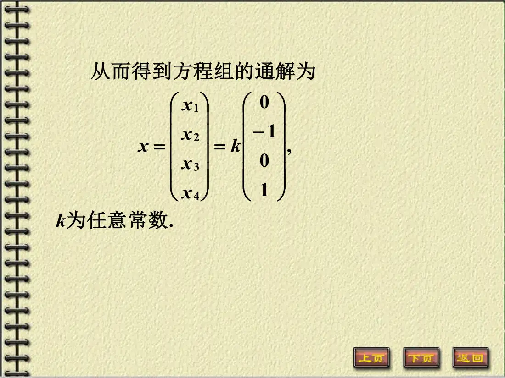

原文：

从而得到方程组的通解为

$$
\boldsymbol {x} = \left( \begin{array}{c} x _ {1} \\ x _ {2} \\ x _ {3} \\ x _ {4} \end{array} \right) = k \left( \begin{array}{c} \boldsymbol {0} \\ - \boldsymbol {1} \\ \boldsymbol {0} \\ \boldsymbol {1} \end{array} \right),
$$

k为任意常数.

上页 下页 返回

### 解法二 用初等行变换把系数矩阵 $A$ 化为阶梯形

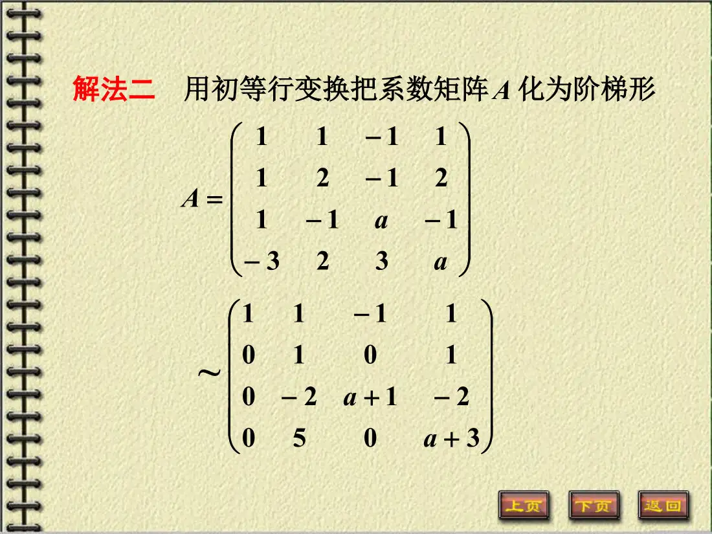

原文：

解法二 用初等行变换把系数矩阵 $A$ 化为阶梯形

$$
A = \left( \begin{array}{r r r r} 1 & 1 & - 1 & 1 \\ 1 & 2 & - 1 & 2 \\ 1 & - 1 & a & - 1 \\ - 3 & 2 & 3 & a \end{array} \right)
$$

$$
\sim \left( \begin{array}{c c c c} 1 & 1 & - 1 & 1 \\ 0 & 1 & 0 & 1 \\ 0 & - 2 & a + 1 & - 2 \\ 0 & 5 & 0 & a + 3 \end{array} \right)
$$

上页 下页 返回

### $$

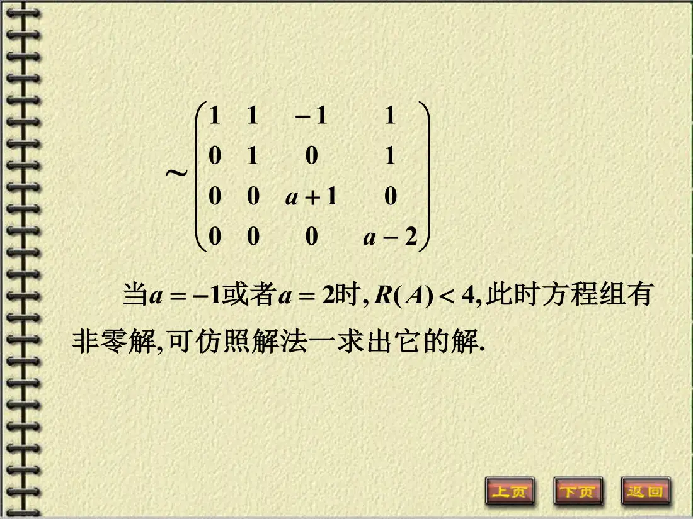

原文：

$$
\sim \left( \begin{array}{c c c c} 1 & 1 & - 1 & 1 \\ \mathbf {0} & \mathbf {1} & \mathbf {0} & 1 \\ \mathbf {0} & \mathbf {0} & a + 1 & \mathbf {0} \\ \mathbf {0} & \mathbf {0} & \mathbf {0} & a - 2 \end{array} \right)
$$

当 $a = -1$ 或者 $a = 2$ 时, $R(A) < 4$ , 此时方程组有非零解, 可仿照解法一求出它的解.

上页 下页 返回

### 三、求逆矩阵的初等变换法

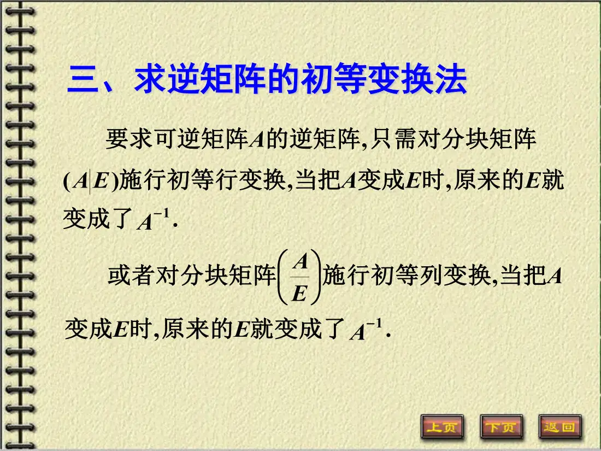

原文：

三、求逆矩阵的初等变换法

要求可逆矩阵A的逆矩阵,只需对分块矩阵 $(A|E)$ 施行初等行变换,当把A变成E时,原来的E就变成了 $A^{-1}$ .

或者对分块矩阵 $\left(\frac{A}{E}\right)$ 施行初等列变换,当把A变成E时,原来的E就变成了 $A^{-1}$ .

上页 下页 返回

### 例 4 求下述矩阵的逆矩阵.

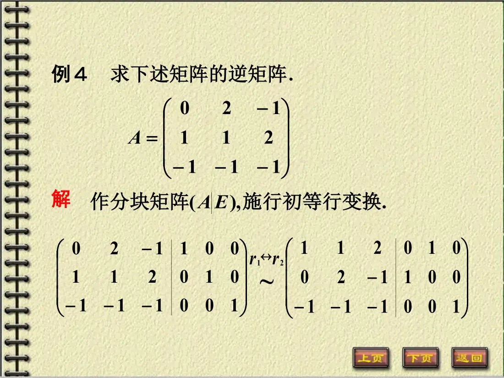

原文：

例 4 求下述矩阵的逆矩阵.

$$
A = \left( \begin{array}{c c c} 0 & 2 & - 1 \\ 1 & 1 & 2 \\ - 1 & - 1 & - 1 \end{array} \right)
$$

解 作分块矩阵 $(A|E)$ ，施行初等行变换.

$$
\left( \begin{array}{c c c c c c} \mathbf {0} & 2 & - 1 & 1 & \mathbf {0} & \mathbf {0} \\ 1 & 1 & 2 & \mathbf {0} & 1 & \mathbf {0} \\ - 1 & - 1 & - 1 & \mathbf {0} & \mathbf {0} & 1 \end{array} \right) \overset {r _ {1} \leftrightarrow r _ {2}} {\sim} \left( \begin{array}{c c c c c c} 1 & 1 & 2 & \mathbf {0} & 1 & \mathbf {0} \\ \mathbf {0} & 2 & - 1 & 1 & \mathbf {0} & \mathbf {0} \\ - 1 & - 1 & - 1 & \mathbf {0} & \mathbf {0} & 1 \end{array} \right)
$$

上页 下页 返回

### $$

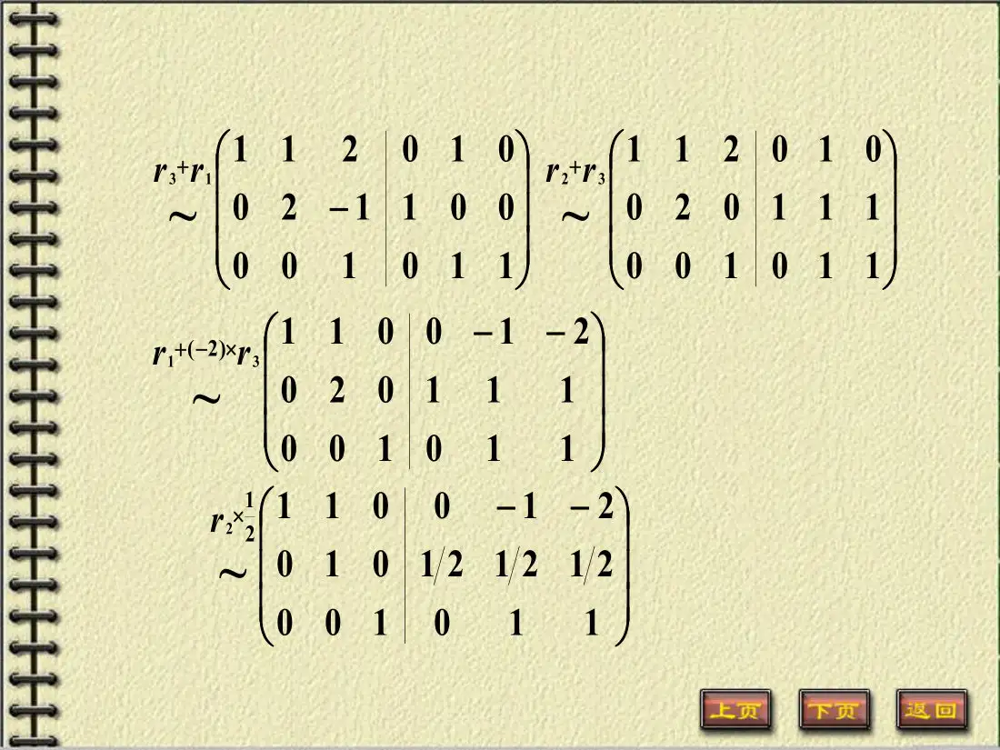

原文：

$$
\underset {\sim} {r _ {3} + r _ {1}} \left( \begin{array}{c c c c c c} 1 & 1 & 2 & 0 & 1 & 0 \\ 0 & 2 & - 1 & 1 & 0 & 0 \\ 0 & 0 & 1 & 0 & 1 & 1 \end{array} \right) \underset {\sim} {r _ {2} + r _ {3}} \left( \begin{array}{c c c c c c} 1 & 1 & 2 & 0 & 1 & 0 \\ 0 & 2 & 0 & 1 & 1 & 1 \\ 0 & 0 & 1 & 0 & 1 & 1 \end{array} \right)
$$

$$
r _ {1} ^ {+ (- 2) \times r _ {3}} \sim \left( \begin{array}{c c c c c c} 1 & 1 & 0 & 0 & - 1 & - 2 \\ 0 & 2 & 0 & 1 & 1 & 1 \\ 0 & 0 & 1 & 0 & 1 & 1 \end{array} \right)
$$

$$
\sim \left( \begin{array}{c c c c c c} 1 & 1 & 0 & 0 & - 1 & - 2 \\ 0 & 1 & 0 & 1 / 2 & 1 / 2 & 1 / 2 \\ 0 & 0 & 1 & 0 & 1 & 1 \end{array} \right)
$$

上页 下页 返回

### $$

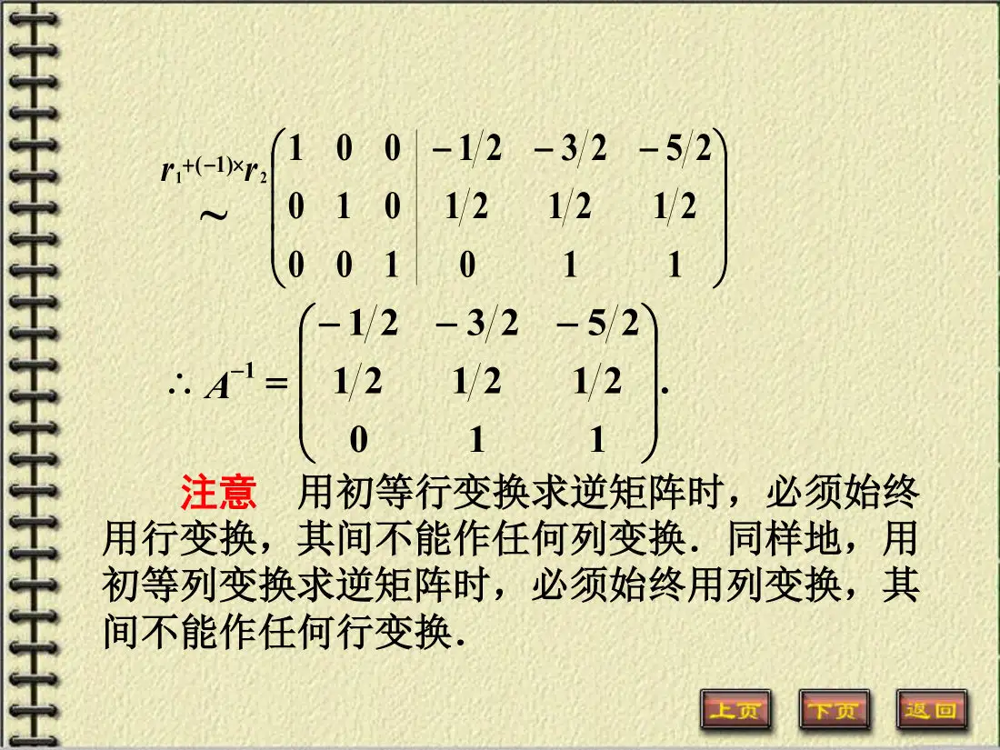

原文：

$$
\begin{array}{l} r _ {1} ^ {+ (- 1) \times} r _ {2} \\ \sim \left( \begin{array}{c c c c c c} 1 & 0 & 0 & - 1 / 2 & - 3 / 2 & - 5 / 2 \\ 0 & 1 & 0 & 1 / 2 & 1 / 2 & 1 / 2 \\ 0 & 0 & 1 & 0 & 1 & 1 \end{array} \right) \\ \therefore A ^ {- 1} = \left( \begin{array}{c c c} - 1 / 2 & - 3 / 2 & - 5 / 2 \\ 1 / 2 & 1 / 2 & 1 / 2 \\ 0 & 1 & 1 \end{array} \right). \end{array}
$$

注意 用初等行变换求逆矩阵时，必须始终用行变换，其间不能作任何列变换。同样地，用初等列变换求逆矩阵时，必须始终用列变换，其间不能作任何行变换。

上页 下页 返回

### 四、解矩阵方程的初等变换法

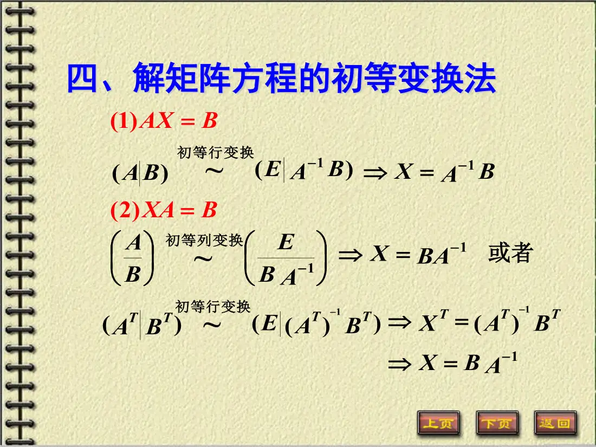

原文：

四、解矩阵方程的初等变换法

(1) $AX = B$

初等行变换 $(A|B)\sim (E|A^{-1}B)\Rightarrow X = A^{-1}B$

(2) $XA = B$

$\left(\frac{A}{B}\right) \sim \left(\frac{E}{BA^{-1}}\right) \Rightarrow X = BA^{-1}$ 或者

$(A^T|B^T)\stackrel {\text{初等行变换}}{\sim}(E|(A^T)^{-1}B^T)\Rightarrow X^T = (A^T)^{-1}B^T$ $\Rightarrow X = BA^{-1}$ 例5 设 $A=\begin{pmatrix}3&0&1\\1&1&0\\0&1&4\end{pmatrix}$ ，且 $AX=A+2X$ ，求矩阵 X.
解 $\because AX = A + 2X,$ $\therefore (A - 2E)X = A,$ 又 $A - 2E = \begin{pmatrix} 1 & 0 & 1 \\ 1 & -1 & 0 \\ 0 & 1 & 2 \end{pmatrix},$

上页 下页 返回

### 上页 下页 返回

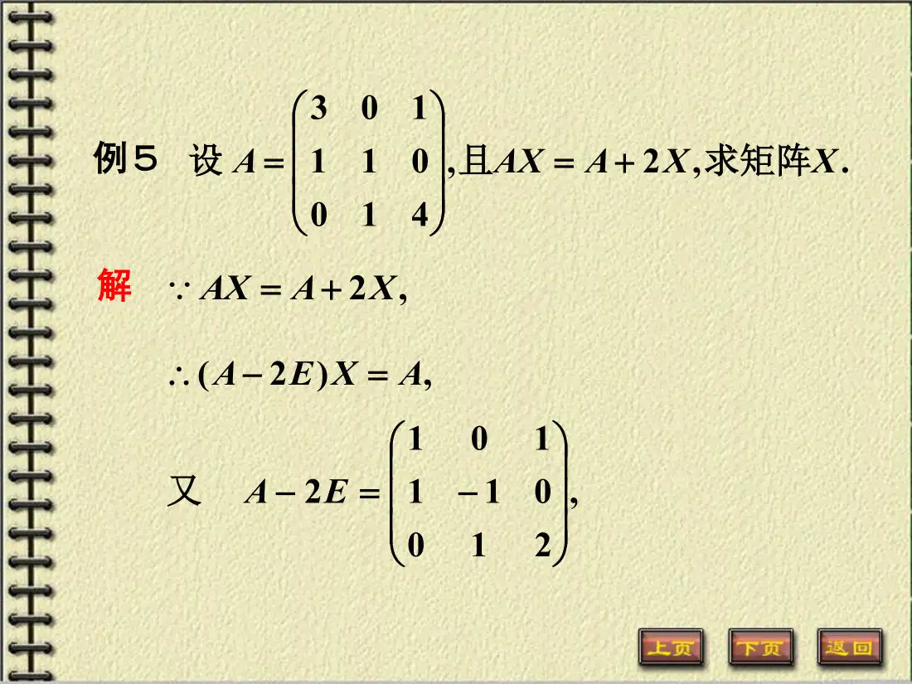

原文：

上页 下页 返回

### 由于 $(A - 2E$

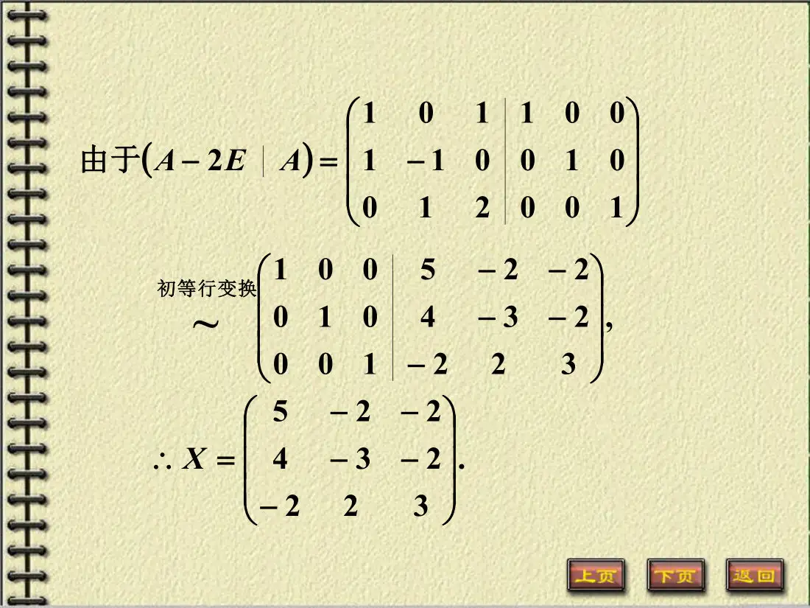

原文：

由于 $(A - 2E$

$$
A) = \left( \begin{array}{c c c c c c} 1 & 0 & 1 & 1 & 0 & 0 \\ 1 & - 1 & 0 & 0 & 1 & 0 \\ 0 & 1 & 2 & 0 & 0 & 1 \end{array} \right)
$$

初等行变换

$$
\text {选} \left( \begin{array}{c c c c c c} 1 & 0 & 0 & 5 & - 2 & - 2 \\ 0 & 1 & 0 & 4 & - 3 & - 2 \\ 0 & 0 & 1 & - 2 & 2 & 3 \end{array} \right),
$$

$$
\therefore X = \left( \begin{array}{r r r} 5 & - 2 & - 2 \\ 4 & - 3 & - 2 \\ - 2 & 2 & 3 \end{array} \right).
$$

上页 下页 返回
