# 《线性代数与解析几何》第二章 矩阵及其运算（习题课）

原件的每一页，下面附识别出的文字。

### 第二章 矩阵及其运算

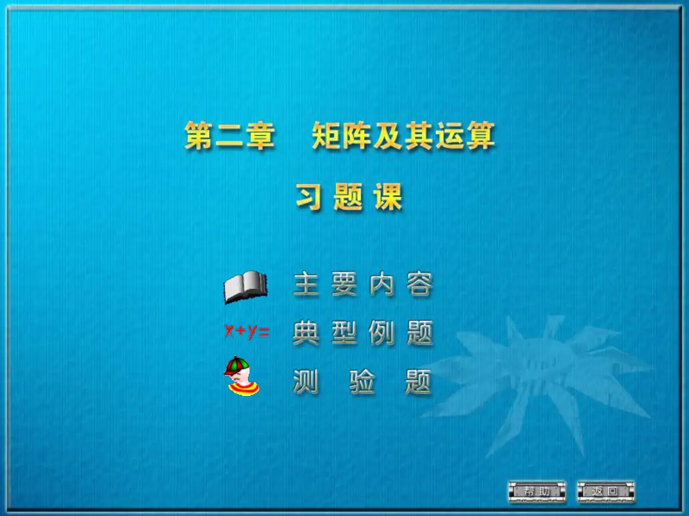

原文：

第二章 矩阵及其运算

习题课

主要内容

$x+y=$ 典型例题

测验题

帮助

返回

### 第 2 页

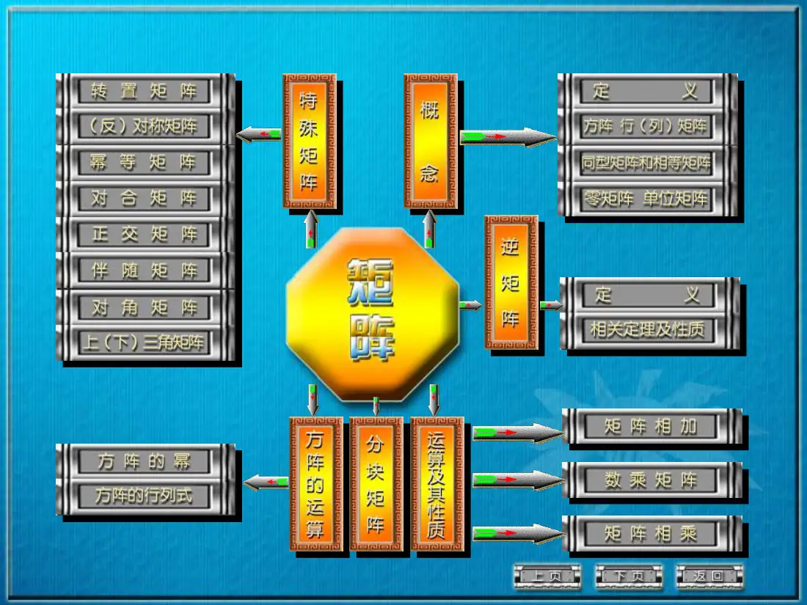

### 1 矩阵的定义

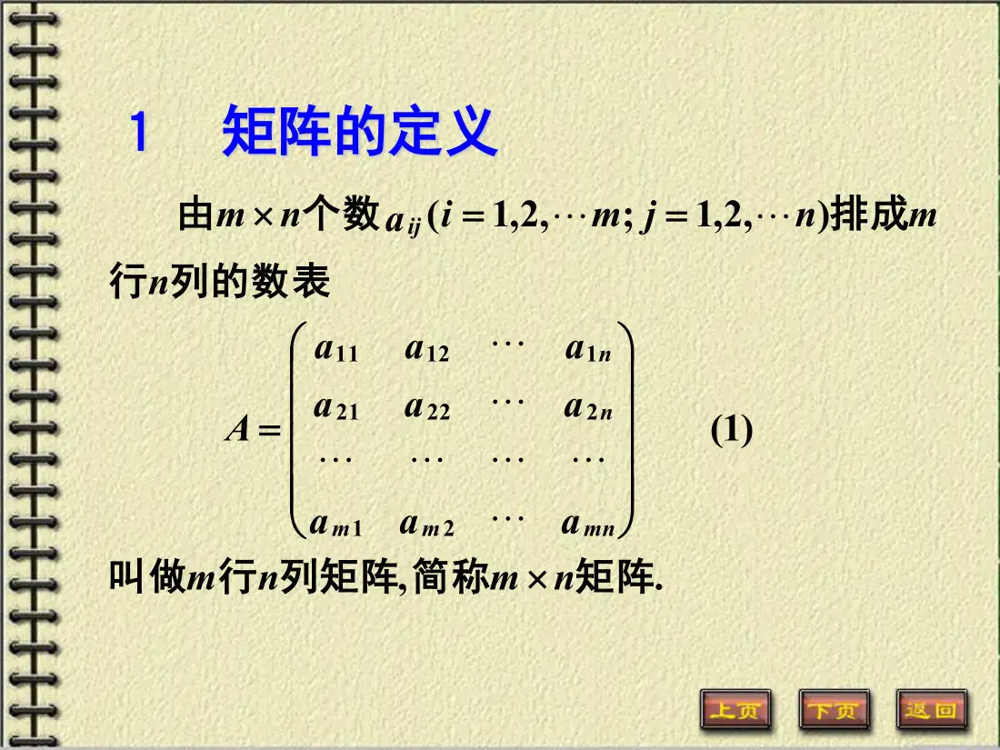

原文：

1 矩阵的定义

由 $m \times n$ 个数 $a_{ij} (i = 1,2,\cdots m; j = 1,2,\cdots n)$ 排成m行n列的数表

$$
A = \left( \begin{array}{c c c c} a _ {1 1} & a _ {1 2} & \dots & a _ {1 n} \\ a _ {2 1} & a _ {2 2} & \dots & a _ {2 n} \\ \dots & \dots & \dots & \dots \\ a _ {m 1} & a _ {m 2} & \dots & a _ {m n} \end{array} \right)\tag{1}
$$

叫做m行n列矩阵,简称 $m \times n$ 矩阵.

上页 下页 返回

### 元素是实数的矩阵叫做实矩阵.

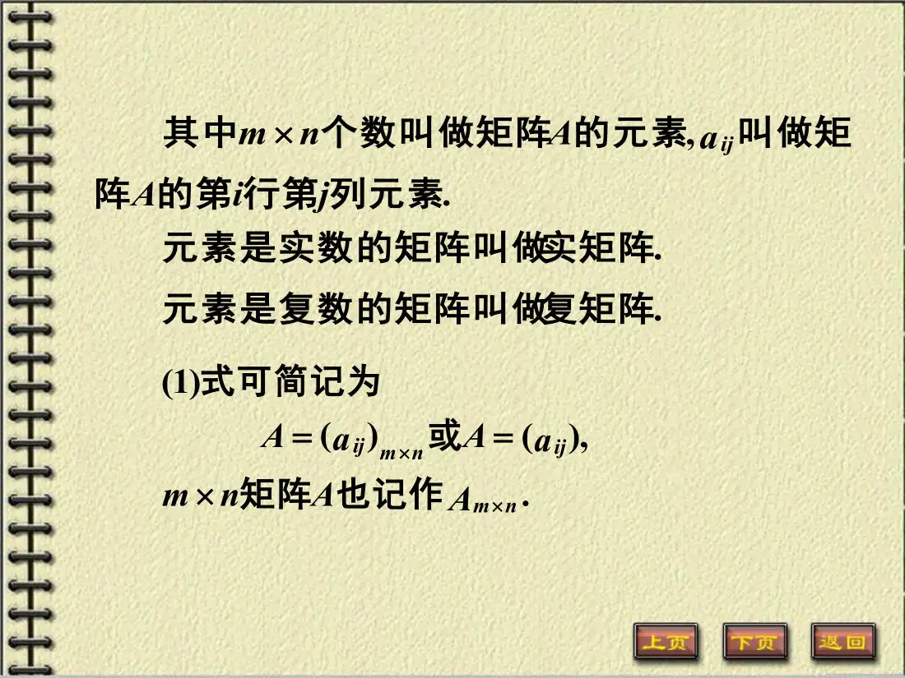

原文：

其中 $m \times n$ 个数叫做矩阵A的元素, $a_{ij}$ 叫做矩阵A的第i行第j列元素.

元素是实数的矩阵叫做实矩阵.

元素是复数的矩阵叫做复矩阵.

(1)式可简记为

$$
A = (a _ {i j}) _ {m \times n} \text {或} A = (a _ {i j}),
$$

$m \times n$ 矩阵A也记作 $A_{m \times n}$ ·

上页 下页 返回

### 2 方阵 列矩阵 行矩阵

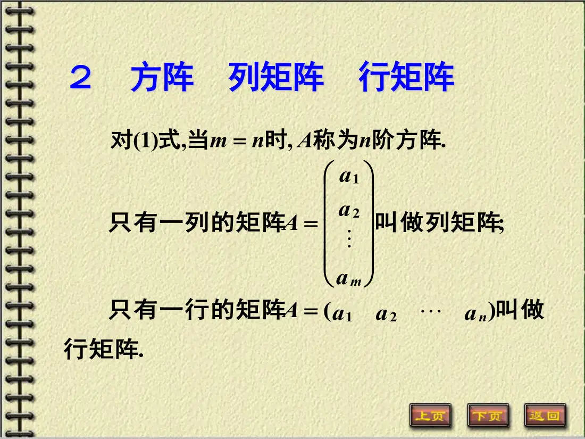

原文：

2 方阵 列矩阵 行矩阵

对(1)式,当m=n时,A称为n阶方阵.

只有一列的矩阵 $A = \begin{pmatrix} a_{1} \\ a_{2} \\ \vdots \\ a_{m} \end{pmatrix}$ 叫做列矩阵;

只有一行的矩阵 $A=(a_{1}\quad a_{2}\quad\cdots\quad a_{n})$ 叫做行矩阵.

上页 下页 返回

### 3 同型矩阵和相等矩阵

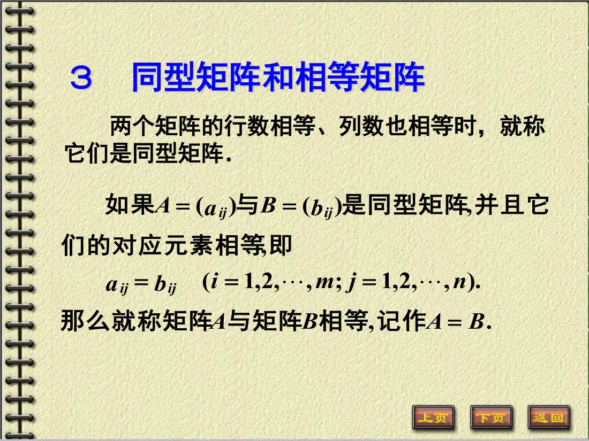

原文：

3 同型矩阵和相等矩阵

两个矩阵的行数相等、列数也相等时，就称它们是同型矩阵.

如果 $A=(a_{ij})$ 与 $B=(b_{ij})$ 是同型矩阵,并且它们的对应元素相等,即

$$
a _ {i j} = b _ {i j} \quad (i = 1, 2, \dots , m; j = 1, 2, \dots , n).
$$

那么就称矩阵A与矩阵B相等,记作A = B.

上页 下页 返回

### 4 零矩阵 单位矩阵

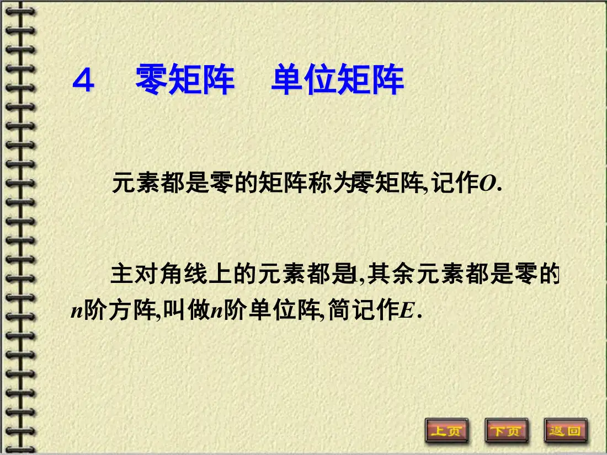

原文：

4 零矩阵 单位矩阵

元素都是零的矩阵称为零矩阵,记作O.

主对角线上的元素都是,其余元素都是零的n阶方阵,叫做n阶单位阵,简记作E.

上页 下页 返回

### 5 矩阵相加

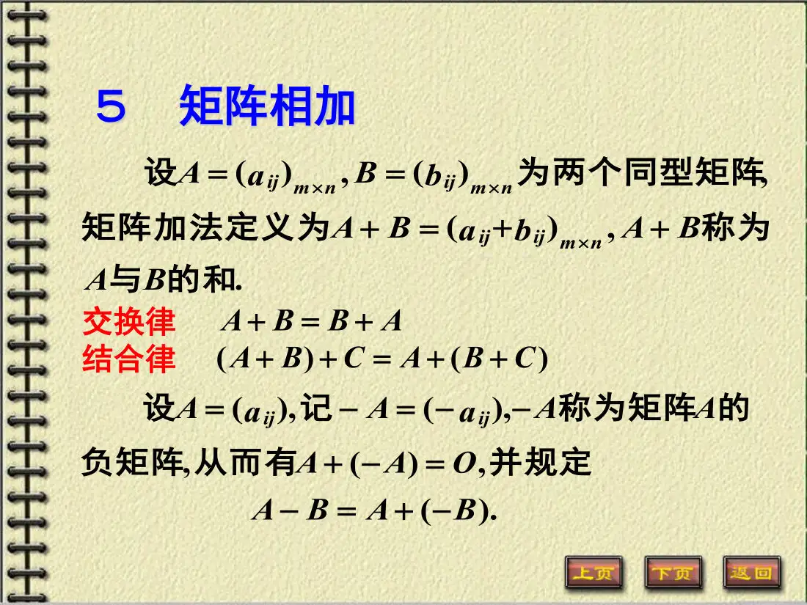

原文：

5 矩阵相加

设 $A=(a_{ij})_{m\times n},B=(b_{ij})_{m\times n}$ 为两个同型矩阵，矩阵加法定义为 $A+B=(a_{ij}+b_{ij})_{m\times n},A+B$ 称为A与B的和.

交换律 $A + B = B + A$ 结合律 $(A + B) + C = A + (B + C)$

设 $A = (a_{ij})$ ，记 $-A = (-a_{ij}), - A$ 称为矩阵 $A$ 的负矩阵,从而有 $A + (-A) = O$ ，并规定

$$
A - B = A + (- B).
$$

上页 下页 返回

### 6 数乘矩阵

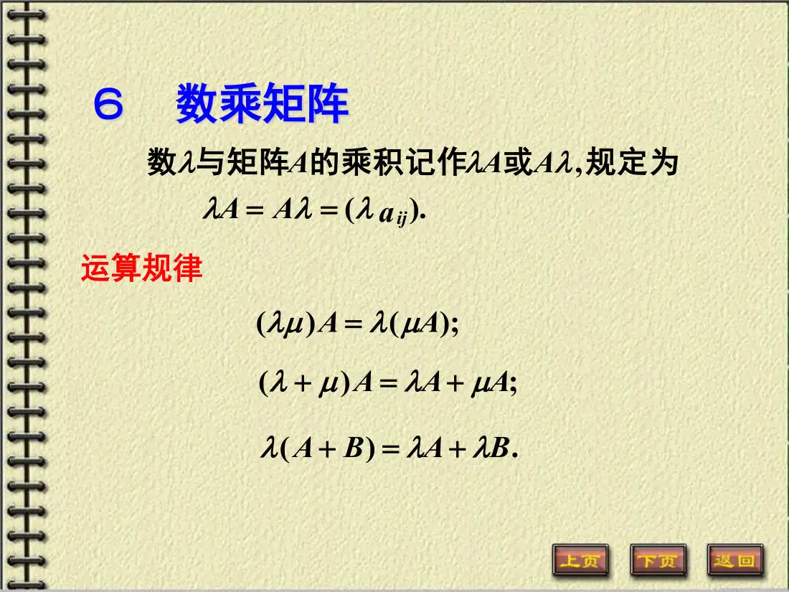

原文：

6 数乘矩阵

数 $\lambda$ 与矩阵 $A$ 的乘积记作 $\lambda A$ 或 $A\lambda$ , 规定为

$$
\lambda A = A \lambda = (\lambda a _ {i j}).
$$

运算规律

$$
(\lambda \mu) A = \lambda (\mu A);
$$

$$
(\lambda + \mu) A = \lambda A + \mu A;
$$

$$
\lambda (A + B) = \lambda A + \lambda B.
$$

上页 下页 返回

### 7 矩阵相乘

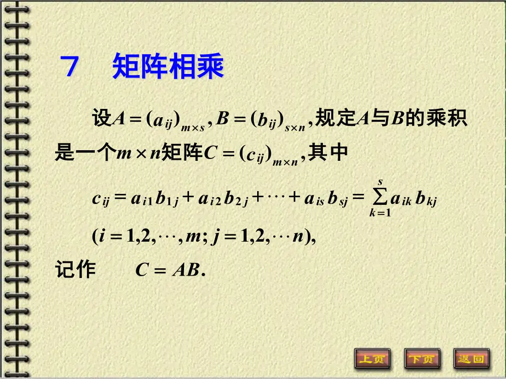

原文：

7 矩阵相乘

设 $A = (a_{ij})_{m\times s},B = (b_{ij})_{s\times n}$ ，规定 $A$ 与 $B$ 的乘积是一个 $m\times n$ 矩阵 $C = (c_{ij})_{m\times n}$ ，其中

$$
c _ {i j} = a _ {i 1} b _ {1 j} + a _ {i 2} b _ {2 j} + \dots + a _ {i s} b _ {s j} = \sum_ {k = 1} ^ {s} a _ {i k} b _ {k j}
$$

$$
(i = 1, 2, \dots , m; j = 1, 2, \dots n),
$$

记作 $C = AB$ .

上页 下页 返回

### 运算规律

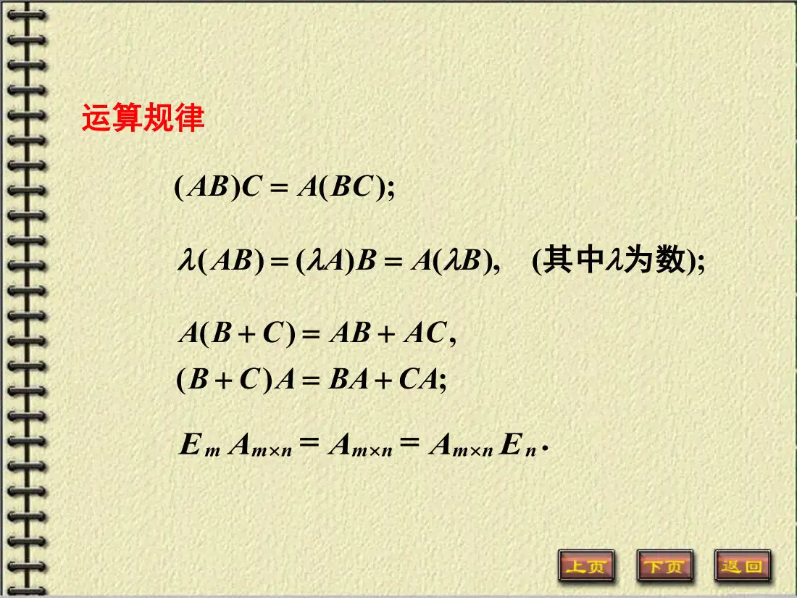

原文：

运算规律

$$
(A B) C = A (B C);
$$

$\lambda(AB)=(\lambda A)B=A(\lambda B),\quad(\text{其中}\lambda\text{为数});$

$$
A (B + C) = A B + A C,
$$

$$
(B + C) A = B A + C A;
$$

$$
E _ {m} A _ {m \times n} = A _ {m \times n} = A _ {m \times n} E _ {n}.
$$

上页 下页 返回

### 8 方阵的运算

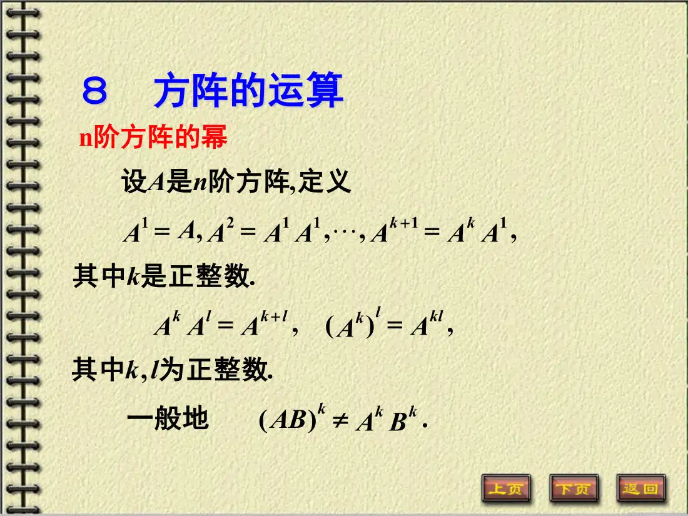

原文：

8 方阵的运算

n阶方阵的幂

设A是n阶方阵,定义

$A^{1}=A,A^{2}=A^{1}A^{1},\cdots,A^{k+1}=A^{k}A^{1}$ 其中k是正整数.

$$
A ^ {k} A ^ {l} = A ^ {k + l}, (A ^ {k}) ^ {l} = A ^ {k l},
$$

其中k,l为正整数.

一般地 $(AB)^{k} \neq A^{k} B^{k}$ .

上页 下页 返回

### 方阵的行列式

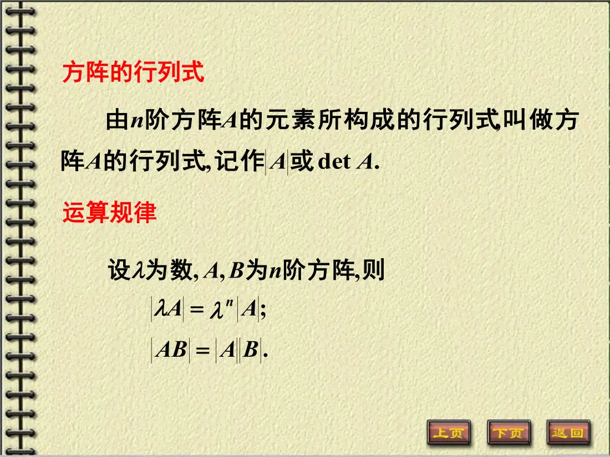

原文：

方阵的行列式

由n阶方阵A的元素所构成的行列式,叫做方阵A的行列式,记作|A|或det A.

运算规律

设 $\lambda$ 为数, $A, B$ 为 $n$ 阶方阵, 则

$$
| \lambda A | = \lambda^ {n} | A |;
$$

$$
\left| \boldsymbol {A} \boldsymbol {B} \right| = \left| \boldsymbol {A} \right\lVert \boldsymbol {B} |.
$$

上页 下页 返回

### 9 一些特殊的矩阵

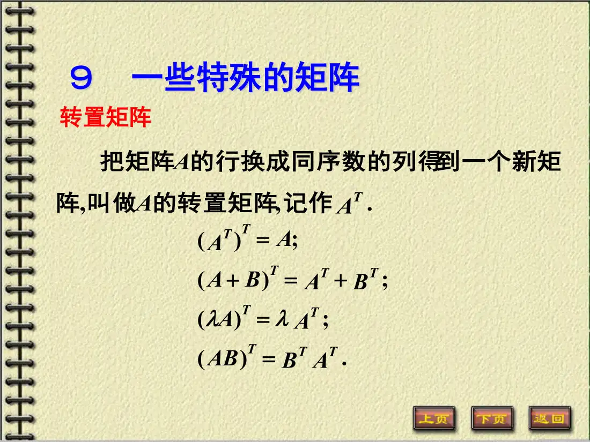

原文：

9 一些特殊的矩阵

转置矩阵

把矩阵A的行换成同序数的列得到一个新矩阵,叫做A的转置矩阵,记作 $A^{T}$ .

$$
\begin{array}{l} \left(\boldsymbol {A} ^ {T}\right) ^ {T} = \boldsymbol {A}; \\ \left(\boldsymbol {A} + \boldsymbol {B}\right) ^ {T} = \boldsymbol {A} ^ {T} + \boldsymbol {B} ^ {T}; \\ \left(\lambda \boldsymbol {A}\right) ^ {T} = \lambda \boldsymbol {A} ^ {T}; \\ \left(\boldsymbol {A B}\right) ^ {T} = \boldsymbol {B} ^ {T} \boldsymbol {A} ^ {T}. \end{array}
$$

上页 下页 返回

### 对称矩阵

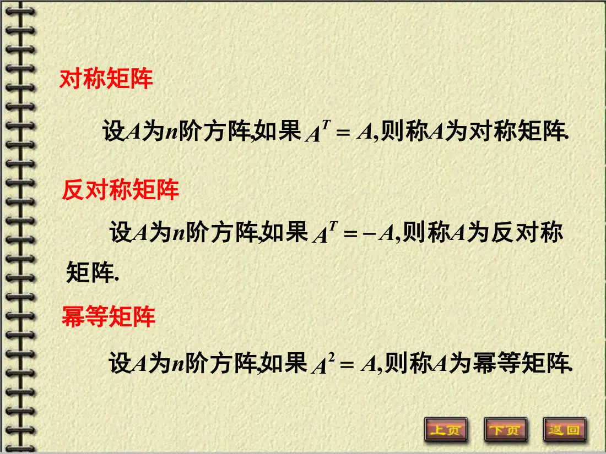

原文：

对称矩阵

设A为n阶方阵,如果 $A^{T}=A$ ,则称A为对称矩阵.

反对称矩阵

设A为n阶方阵,如果 $A^{T}=-A$ ,则称A为反对称矩阵.

幂等矩阵

设A为n阶方阵,如果 $A^{2}=A$ ,则称A为幂等矩阵.

上页 下页 返回

### 对合矩阵

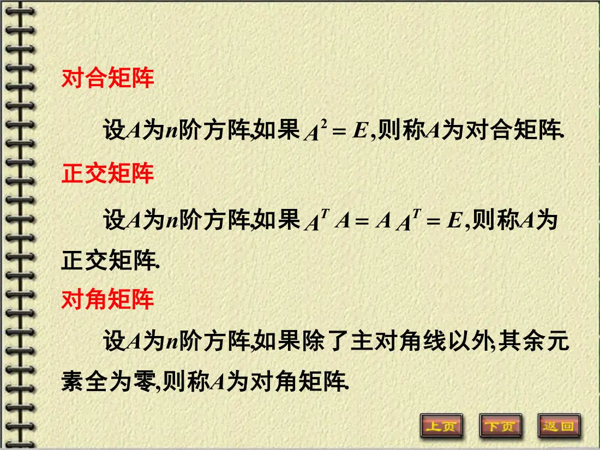

原文：

对合矩阵

设A为n阶方阵,如果 $A^{2}=E$ ,则称A为对合矩阵正交矩阵

设A为n阶方阵,如果 $A^{T}A=A A^{T}=E$ ,则称A为正交矩阵.

对角矩阵

设A为n阶方阵,如果除了主对角线以外,其余元素全为零,则称A为对角矩阵.

上页 下页 返回

### 上三角矩阵

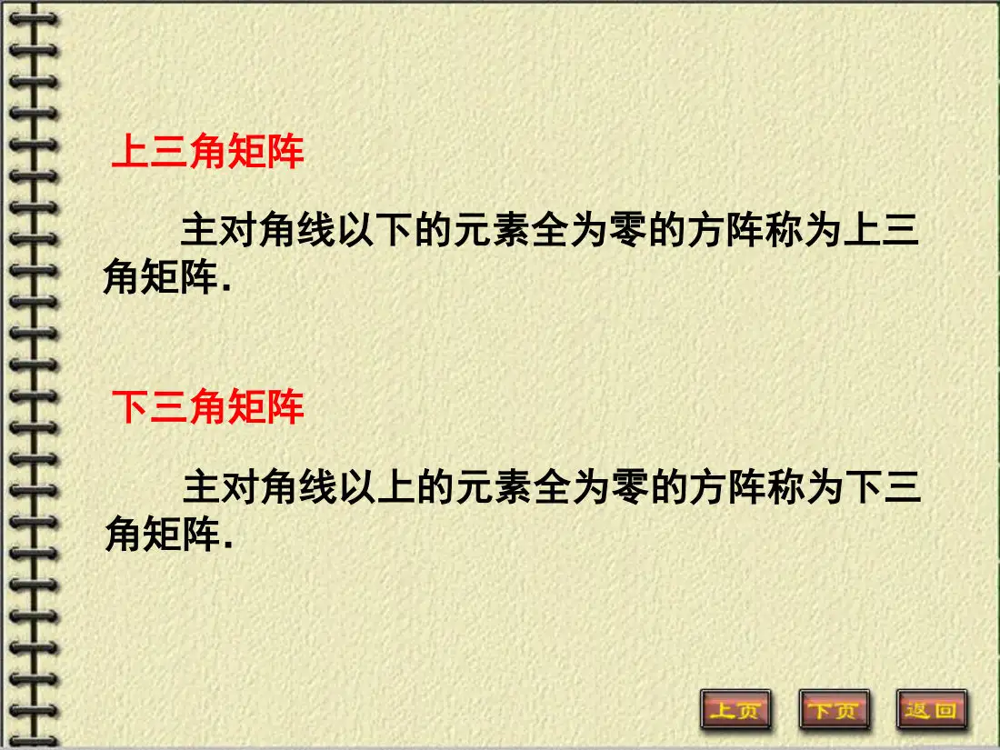

原文：

上三角矩阵

主对角线以下的元素全为零的方阵称为上三角矩阵.

下三角矩阵

主对角线以上的元素全为零的方阵称为下三角矩阵.

上页 下页 返回

### 伴随矩阵

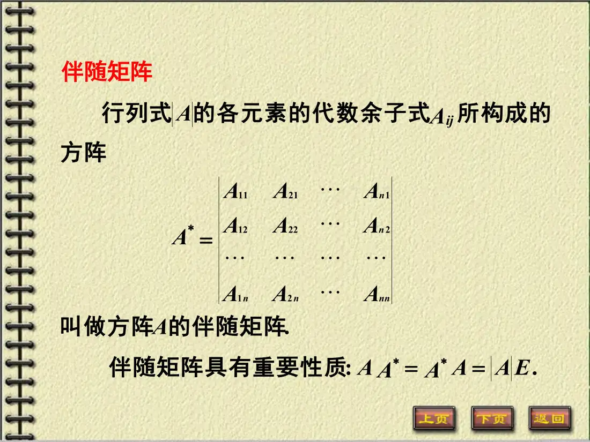

原文：

伴随矩阵

行列式 $|A|$ 的各元素的代数余子式 $A_{ij}$ 所构成的方阵

$$
A ^ {*} = \left| \begin{array}{c c c c} A _ {1 1} & A _ {2 1} & \dots & A _ {n 1} \\ A _ {1 2} & A _ {2 2} & \dots & A _ {n 2} \\ \dots & \dots & \dots & \dots \\ A _ {1 n} & A _ {2 n} & \dots & A _ {n n} \end{array} \right|
$$

叫做方阵A的伴随矩阵.

伴随矩阵具有重要性质: $A A^{*} = A^{*} A = |A| E$ .

上页 下页 返回

### 10 逆矩阵

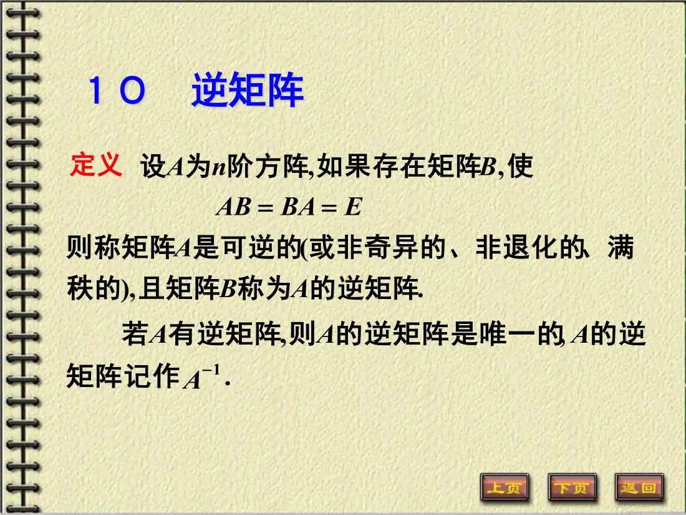

原文：

10 逆矩阵

定义 设A为n阶方阵,如果存在矩阵B,使

$$
A B = B A = E
$$

则称矩阵A是可逆的(或非奇异的、非退化的、满秩的),且矩阵B称为A的逆矩阵.

若A有逆矩阵,则A的逆矩阵是唯一的,A的逆矩阵记作 $A^{-1}$ .

上页 下页 返回

### 相关定理及性质

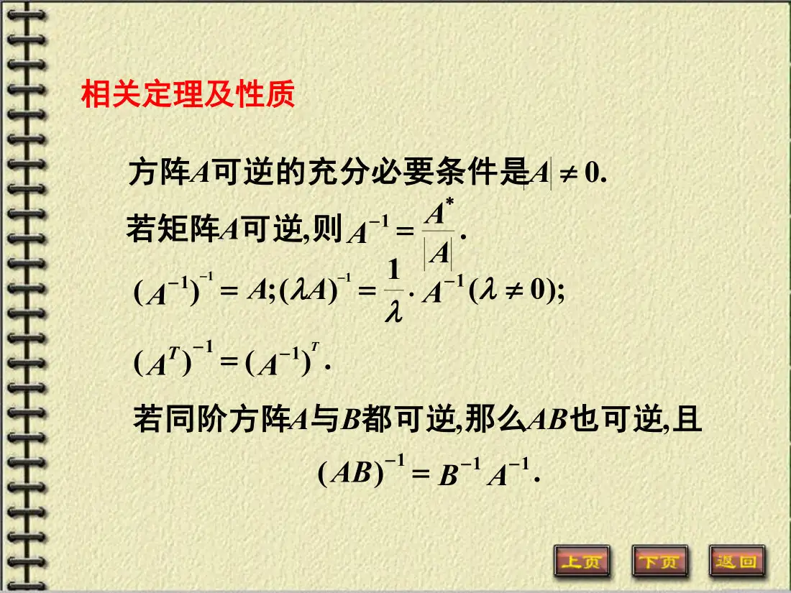

原文：

相关定理及性质

方阵A可逆的充分必要条件是 $A\mid\neq0$ .
若矩阵A可逆,则 $A^{-1}=\frac{A^{*}}{|A|}$ . $(A^{-1})^{-1}=A;(\lambda A)^{-1}=\frac{1}{\lambda}\cdot A^{-1}(\lambda\neq0);$ $(A^{T})^{-1}=(A^{-1})^{T}.$

若同阶方阵A与B都可逆,那么AB也可逆,且

$$
(A B) ^ {- 1} = B ^ {- 1} A ^ {- 1}
$$

上页 下页 返回

### 1 1 分块矩阵

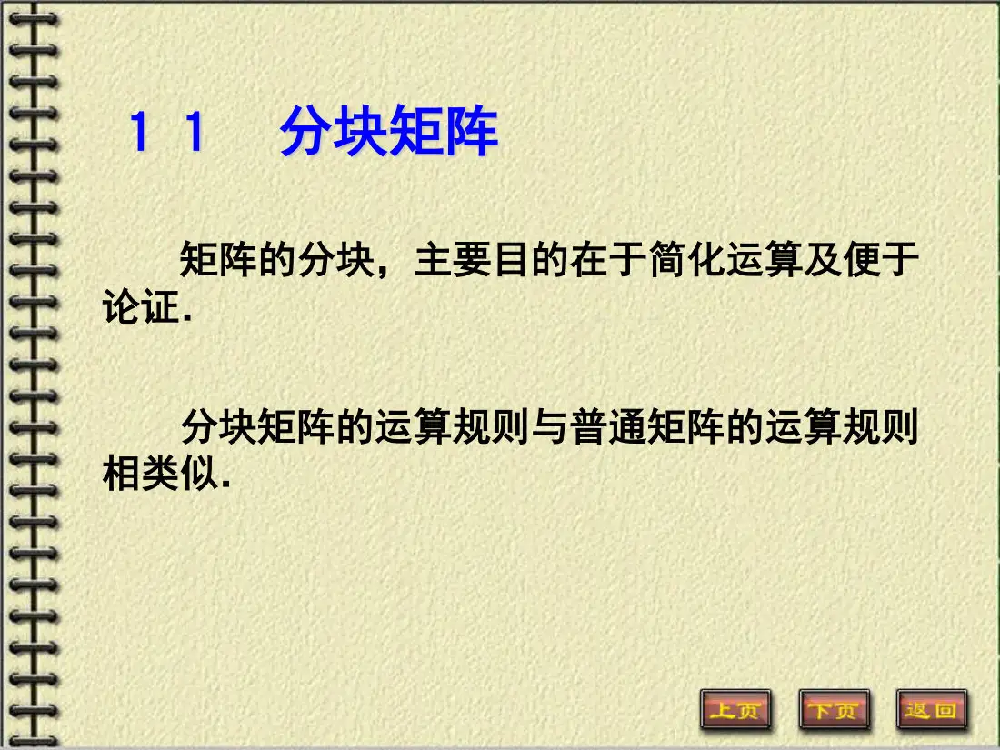

原文：

1 1 分块矩阵

矩阵的分块，主要目的在于简化运算及便于论证.

分块矩阵的运算规则与普通矩阵的运算规则相类似.

上页 下页 返回

### 典型例题

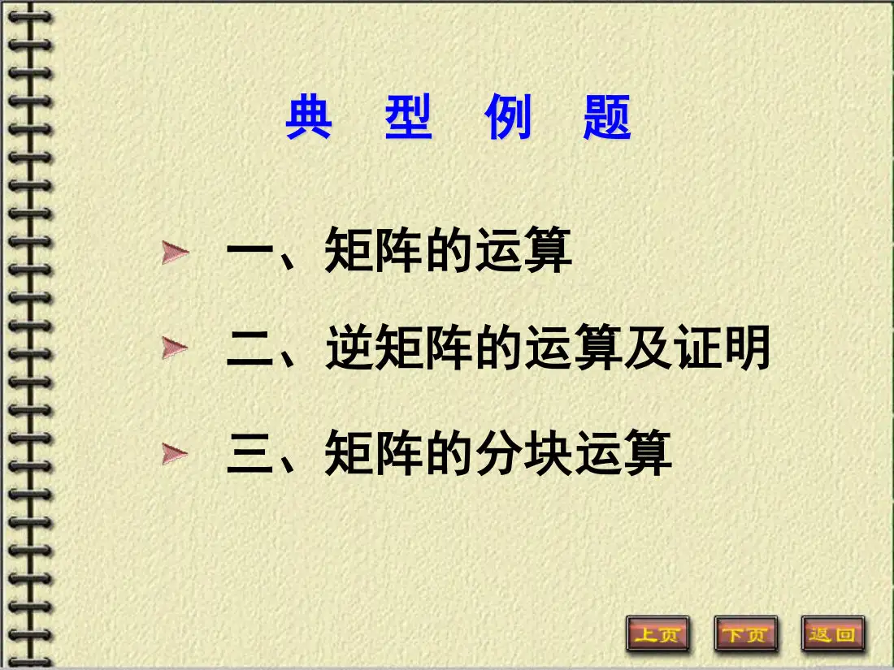

原文：

典型例题

一、矩阵的运算
二、逆矩阵的运算及证明
三、矩阵的分块运算

上页 下页 返回

### 一、矩阵的运算

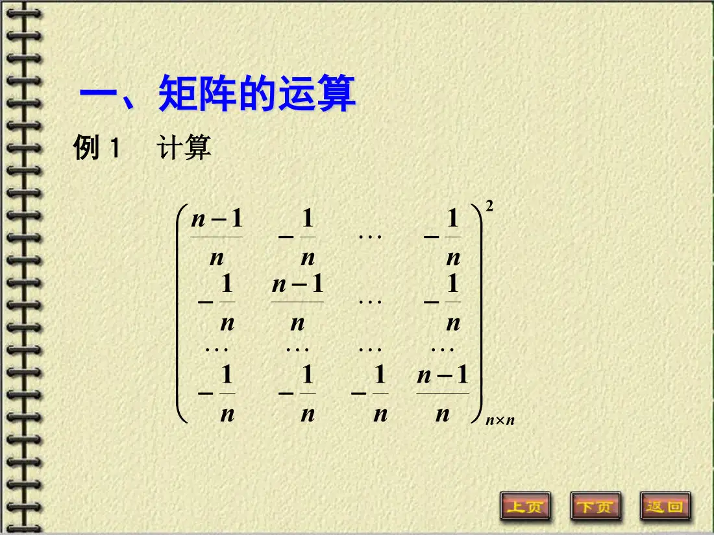

原文：

一、矩阵的运算

例 1 计算

$$
\left( \begin{array}{c c c c} \frac {n - 1}{n} & - \frac {1}{n} & \dots & - \frac {1}{n} \\ - \frac {1}{n} & \frac {n - 1}{n} & \dots & - \frac {1}{n} \\ \dots & \dots & \dots & \dots \\ - \frac {1}{n} & - \frac {1}{n} & - \frac {1}{n} & \frac {n - 1}{n} \end{array} \right) _ {n \times n} ^ {2}
$$

上页 下页 返回

### $$

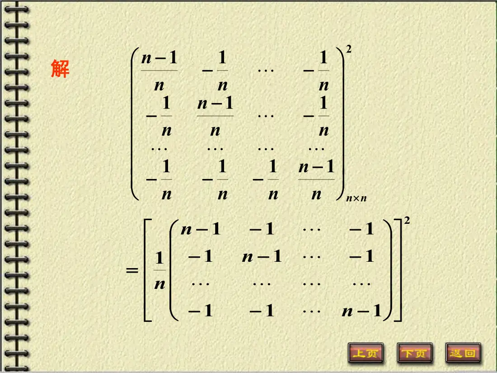

原文：

解

$$
\left( \begin{array}{c c c c} \frac {n - 1}{n} & - \frac {1}{n} & \dots & - \frac {1}{n} \\ - \frac {1}{n} & \frac {n - 1}{n} & \dots & - \frac {1}{n} \\ \dots & \dots & \dots & \dots \\ - \frac {1}{n} & - \frac {1}{n} & - \frac {1}{n} & \frac {n - 1}{n} \end{array} \right) _ {n \times n} ^ {2}
$$

$$
= \left[ \frac {1}{n} \left( \begin{array}{c c c c} n - 1 & - 1 & \dots & - 1 \\ - 1 & n - 1 & \dots & - 1 \\ \dots & \dots & \dots & \dots \\ - 1 & - 1 & \dots & n - 1 \end{array} \right) \right] ^ {2}
$$

上页 下页 返回

### $$

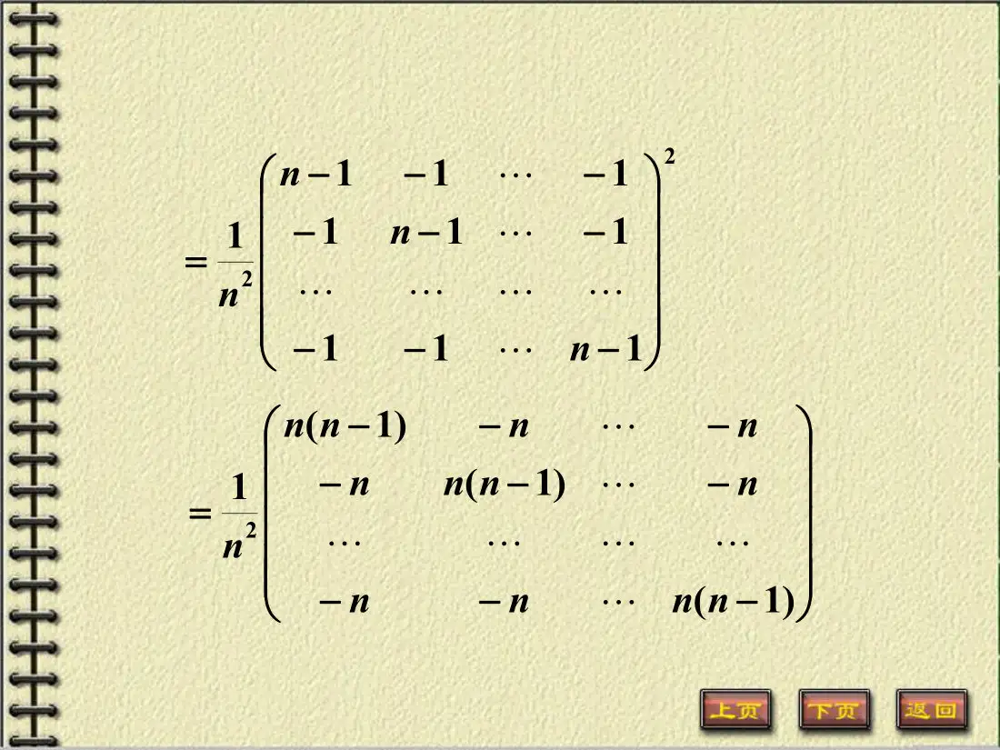

原文：

$$
= \frac {1}{n ^ {2}} \left( \begin{array}{c c c c} n - 1 & - 1 & \dots & - 1 \\ - 1 & n - 1 & \dots & - 1 \\ \dots & \dots & \dots & \dots \\ - 1 & - 1 & \dots & n - 1 \end{array} \right) ^ {2}
$$

$$
= \frac {1}{n ^ {2}} \left( \begin{array}{c c c c} n (n - 1) & - n & \dots & - n \\ - n & n (n - 1) & \dots & - n \\ \dots & \dots & \dots & \dots \\ - n & - n & \dots & n (n - 1) \end{array} \right)
$$

上页 下页 返回

### $$

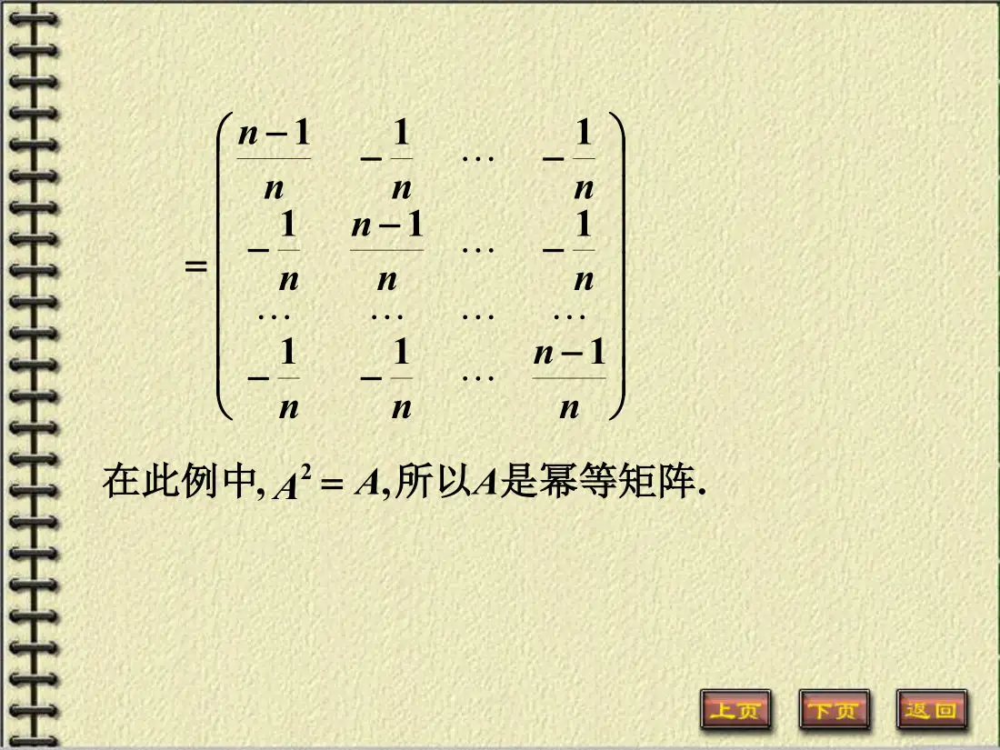

原文：

$$
= \left( \begin{array}{c c c c} \frac {n - 1}{n} & - \frac {1}{n} & \dots & - \frac {1}{n} \\ - \frac {1}{n} & \frac {n - 1}{n} & \dots & - \frac {1}{n} \\ \dots & \dots & \dots & \dots \\ - \frac {1}{n} & - \frac {1}{n} & \dots & \frac {n - 1}{n} \end{array} \right)
$$

在此例中, $A^{2}=A$ ,所以A是幂等矩阵.

上页 下页 返回

### $$

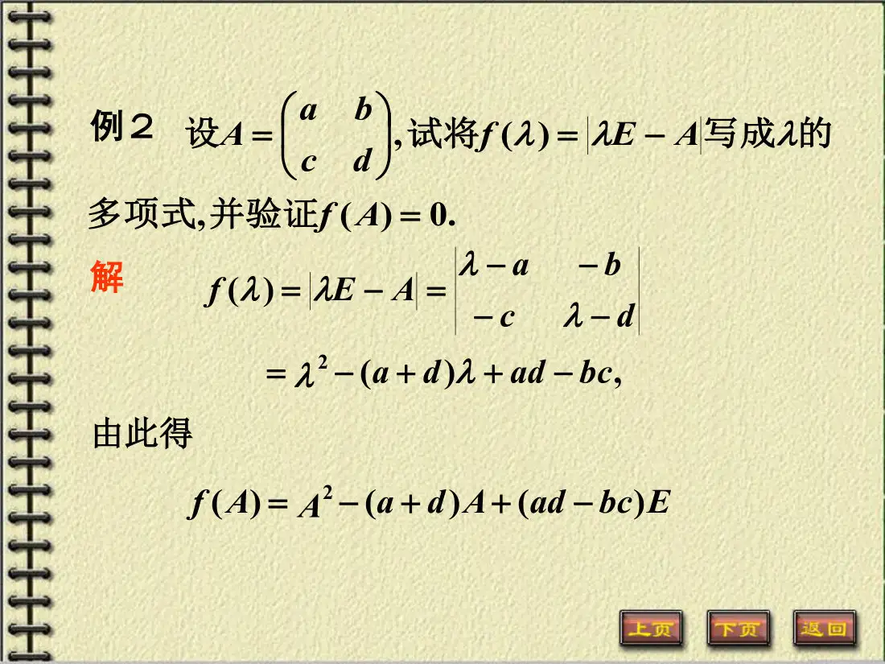

原文：

例2 设 $A = \begin{pmatrix} a & b \\ c & d \end{pmatrix}$ , 试将 $f(\lambda) = |\lambda E - A|$ 写成 $\lambda$ 的多项式, 并验证 $f(A) = 0$ .

解

$$
\begin{array}{r l} & f (\lambda) = | \lambda E - A | = \left| \begin{array}{c c} \lambda - a & - b \\ - c & \lambda - d \end{array} \right| \\ & \qquad = \lambda^ {2} - (a + d) \lambda + a d - b c, \end{array}
$$

由此得

$$
f (A) = A ^ {2} - (a + d) A + (a d - b c) E
$$

上页 下页 返回

### $$

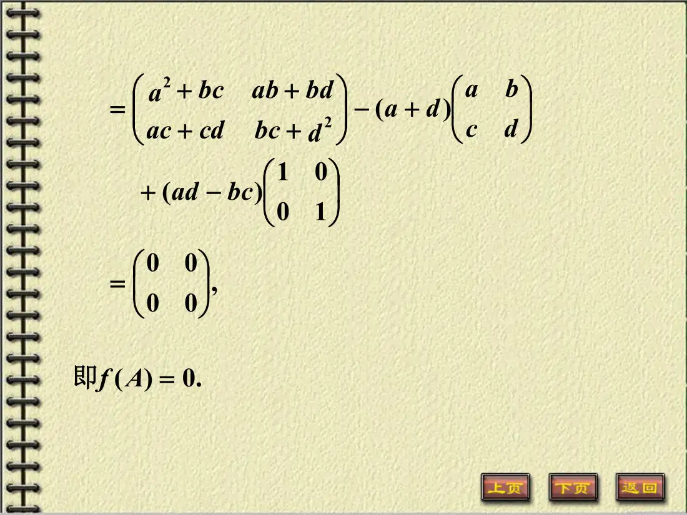

原文：

$$
\begin{array}{r l} & {= \left( \begin{array}{l l} a ^ {2} + b c & a b + b d \\ a c + c d & b c + d ^ {2} \end{array} \right) - (a + d) \left( \begin{array}{l l} a & b \\ c & d \end{array} \right)} \\ & {\quad + (a d - b c) \left( \begin{array}{l l} 1 & 0 \\ 0 & 1 \end{array} \right)} \\ & {= \left( \begin{array}{l l} 0 & 0 \\ 0 & 0 \end{array} \right),} \end{array}
$$

即 $f(A)=0.$

上页 下页 返回

### 二、逆矩阵的运算及证明

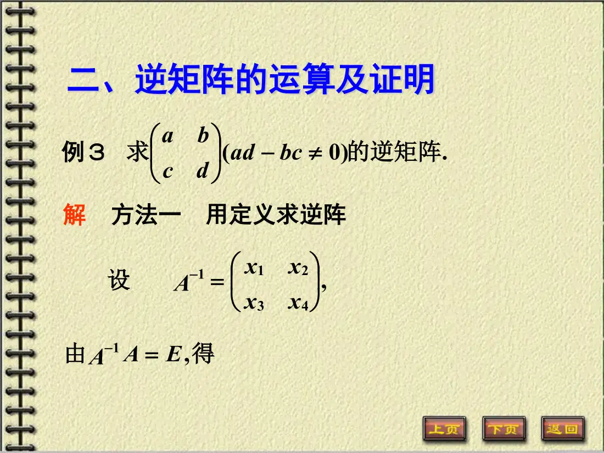

原文：

二、逆矩阵的运算及证明

例3 求 $\begin{pmatrix}a & b \\ c & d\end{pmatrix}(ad - bc \neq 0)$ 的逆矩阵.

解 方法一 用定义求逆阵

设 $A^{-1} = \left( \begin{array}{ll}x_{1} & x_{2}\\ x_{3} & x_{4} \end{array} \right),$

由 $A^{-1}A=E$ ,得

上页 下页 返回

### $$

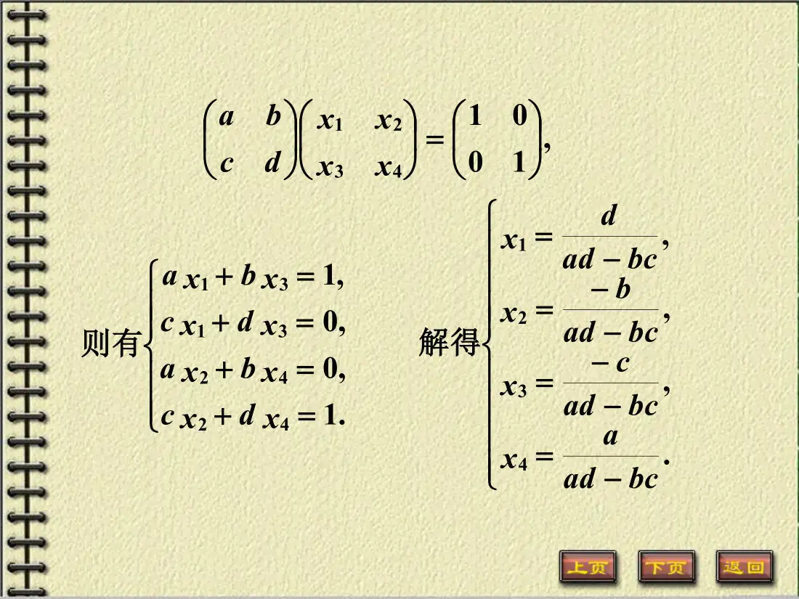

原文：

$$
\left( \begin{array}{l l} a & b \\ c & d \end{array} \right) \left( \begin{array}{l l} x _ {1} & x _ {2} \\ x _ {3} & x _ {4} \end{array} \right) = \left( \begin{array}{l l} 1 & 0 \\ 0 & 1 \end{array} \right),
$$

则有

$$
\left\{ \begin{array}{l} a x _ {1} + b x _ {3} = 1, \\ c x _ {1} + d x _ {3} = 0, \\ a x _ {2} + b x _ {4} = 0, \\ c x _ {2} + d x _ {4} = 1. \end{array} \right.
$$

解得

$$
\left\{ \begin{array}{l} x _ {1} = \frac {d}{a d - b c}, \\ x _ {2} = \frac {- b}{a d - b c}, \\ x _ {3} = \frac {- c}{a d - b c}, \\ x _ {4} = \frac {a}{a d - b c}. \end{array} \right.
$$

上页 下页 返回

### $$

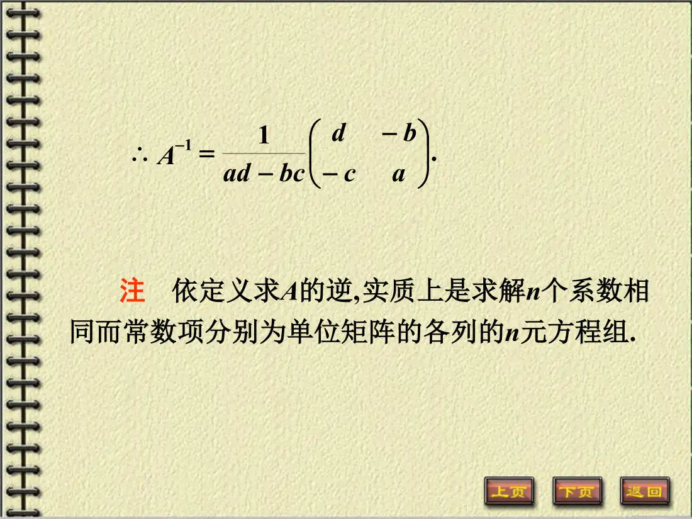

原文：

$$
\therefore A ^ {- 1} = \frac {1}{a d - b c} \left( \begin{array}{c c} d & - b \\ - c & a \end{array} \right).
$$

注 依定义求A的逆,实质上是求解n个系数相同而常数项分别为单位矩阵的各列的n元方程组.

上页 下页 返回

### 方法二

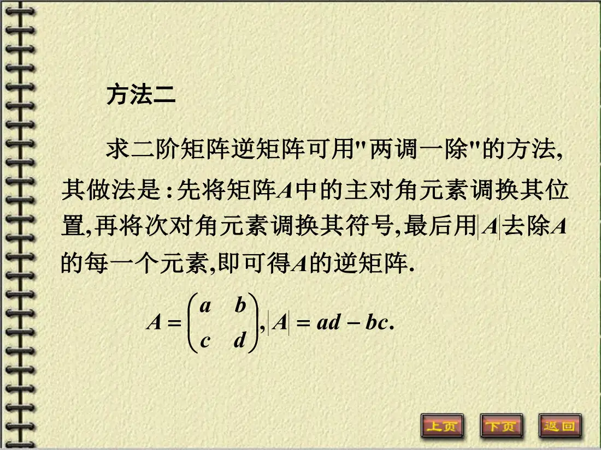

原文：

方法二

求二阶矩阵逆矩阵可用"两调一除"的方法,其做法是:先将矩阵A中的主对角元素调换其位置,再将次对角元素调换其符号,最后用|A|去除A的每一个元素,即可得A的逆矩阵.

$$
A = \left( \begin{array}{c c} a & b \\ c & d \end{array} \right), | A | = a d - b c.
$$

上页 下页 返回

### $$

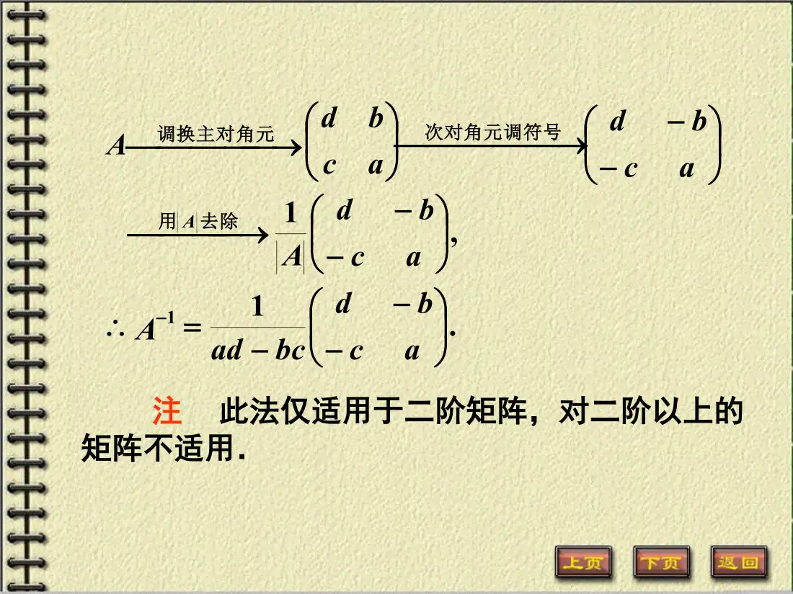

原文：

$$
\begin{array}{r l} & {A \xrightarrow {\text {调换主对角元}} \left( \begin{array}{l l} {{d}} & {{b}} \\ {{c}} & {{a}} \end{array} \right) \xrightarrow {\text {次对角元调符号}} \left( \begin{array}{l l} {{d}} & {{- b}} \\ {{- c}} & {{a}} \end{array} \right)} \\ & {\xrightarrow {\text {用} | A | \text {去除}} \frac {1}{| A |} \left( \begin{array}{l l} {{d}} & {{- b}} \\ {{- c}} & {{a}} \end{array} \right),} \\ & {\therefore A ^ {- 1} = \frac {1}{a d - b c} \left( \begin{array}{l l} {{d}} & {{- b}} \\ {{- c}} & {{a}} \end{array} \right).} \end{array}
$$

注 此法仅适用于二阶矩阵，对二阶以上的矩阵不适用.

上页 下页 返回

### $A^{-1}AX = A^{-1}B,$ 即 $X = A^{-1}B,$

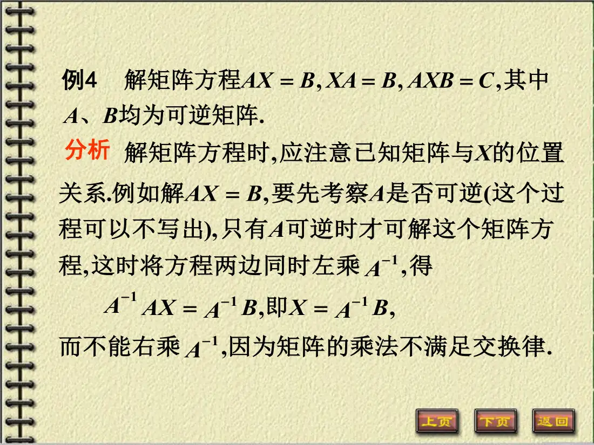

原文：

例4 解矩阵方程 $AX = B, XA = B, AXB = C$ , 其中 $A 、 B$ 均为可逆矩阵.

分析 解矩阵方程时,应注意已知矩阵与X的位置关系.例如解AX = B,要先考察A是否可逆(这个过程可以不写出),只有A可逆时才可解这个矩阵方程,这时将方程两边同时左乘 $A^{-1}$ ,得

$A^{-1}AX = A^{-1}B,$ 即 $X = A^{-1}B,$

而不能右乘 $A^{-1}$ , 因为矩阵的乘法不满足交换律.

上页 下页 返回

### 矩阵方程解AX=BX=A-1BXA=BX=BA-1AXB=CX=A-1CB-1

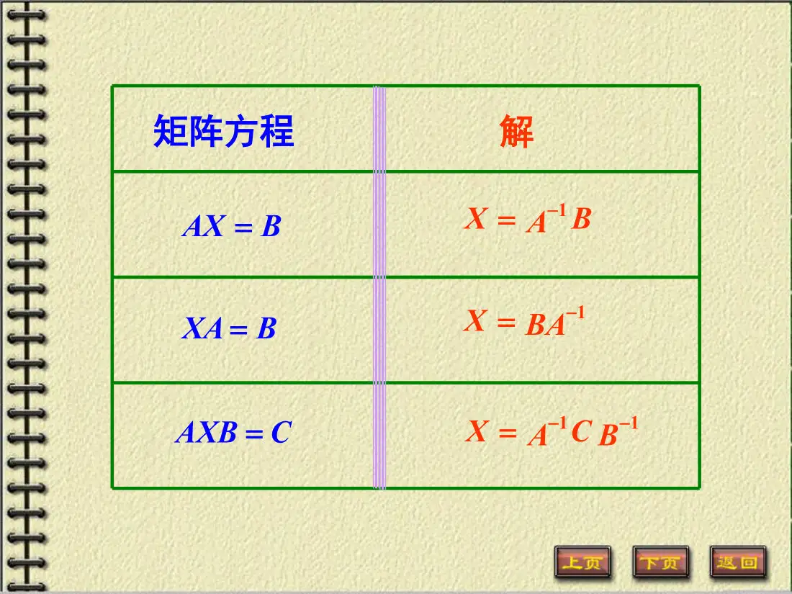

原文：

<table><tr><td>矩阵方程</td><td>解</td></tr><tr><td>AX=B</td><td>X=A-1B</td></tr><tr><td>XA=B</td><td>X=BA-1</td></tr><tr><td>AXB=C</td><td>X=A-1CB-1</td></tr></table>

上页 下页 返回

### 三、矩阵的分块运算

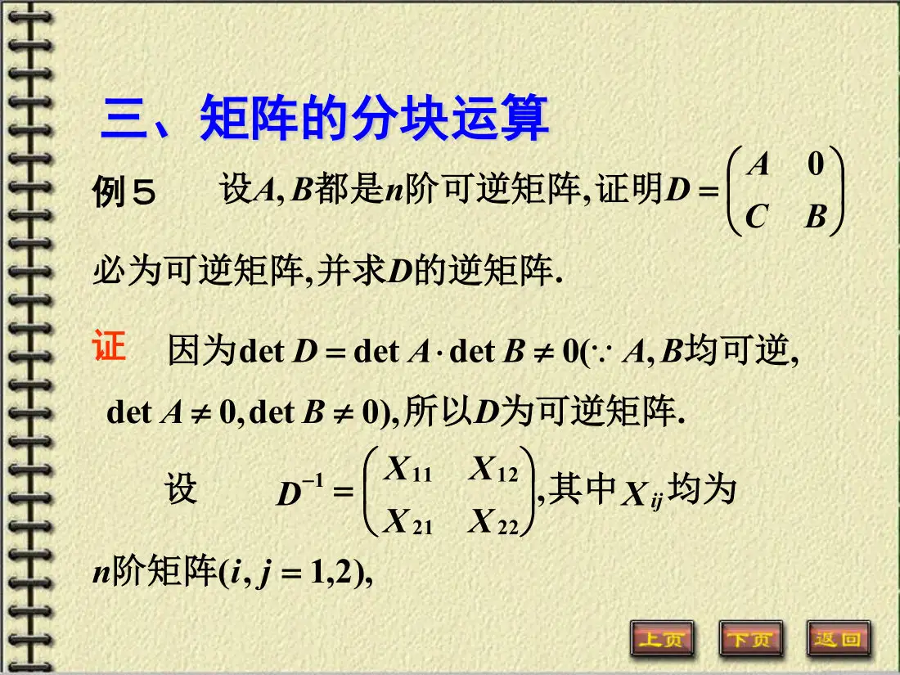

原文：

三、矩阵的分块运算

例5 设A,B都是n阶可逆矩阵,证明 $D=\begin{pmatrix}A&0\\C&B\end{pmatrix}$ 必为可逆矩阵,并求D的逆矩阵.

证 因为 $\det D = \det A \cdot \det B \neq 0 (\because A, B$ 均可逆, $\det A \neq 0, \det B \neq 0)$ , 所以D为可逆矩阵.

设 $D^{-1}=\begin{pmatrix}X_{11}&X_{12}\\X_{21}&X_{22}\end{pmatrix}$ ，其中 $X_{ij}$ 均为n阶矩阵 $(i,j=1,2)$ ,

上页 下页 返回

### $$

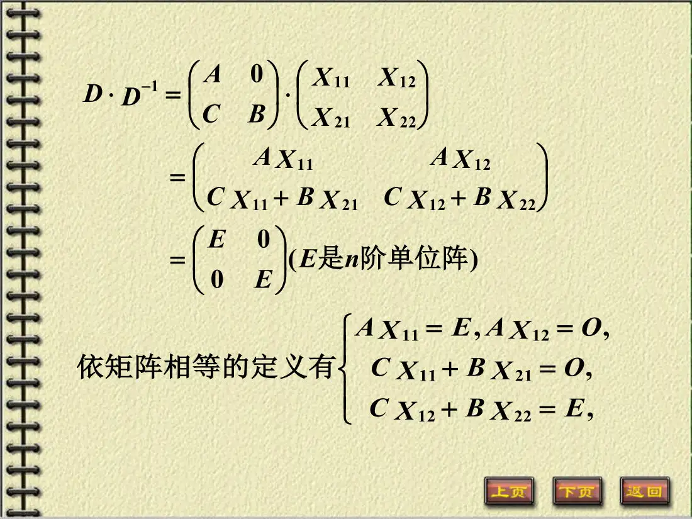

原文：

$$
\begin{array}{r l} \boldsymbol {D} \cdot \boldsymbol {D} ^ {- 1} & = \left( \begin{array}{c c} \boldsymbol {A} & \boldsymbol {0} \\ \boldsymbol {C} & \boldsymbol {B} \end{array} \right) \cdot \left( \begin{array}{c c} X _ {1 1} & X _ {1 2} \\ X _ {2 1} & X _ {2 2} \end{array} \right) \\ & = \left( \begin{array}{c c} A X _ {1 1} & A X _ {1 2} \\ C X _ {1 1} + B X _ {2 1} & C X _ {1 2} + B X _ {2 2} \end{array} \right) \\ & = \left( \begin{array}{c c} \boldsymbol {E} & \boldsymbol {0} \\ \boldsymbol {0} & \boldsymbol {E} \end{array} \right) (\boldsymbol {E} \text {是} n \text {阶单位阵}) \end{array}
$$

依矩阵相等的定义有 $\left\{ \begin{array}{l} A X_{11} = E, A X_{12} = O, \\ C X_{11} + B X_{21} = O, \\ C X_{12} + B X_{22} = E, \end{array} \right.$

上页 下页 返回

### 从而得 $X_{11} = A^{-1},\quad X_{12} = O,$

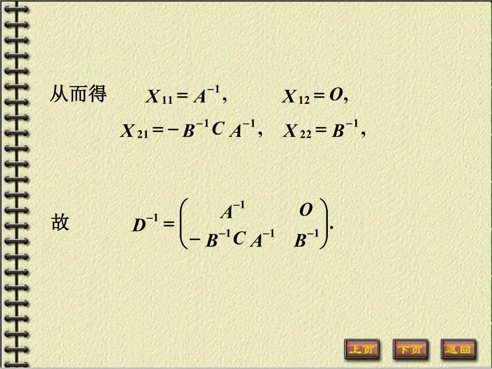

原文：

从而得 $X_{11} = A^{-1},\quad X_{12} = O,$

$$
X _ {2 1} = - B ^ {- 1} C A ^ {- 1}, \quad X _ {2 2} = B ^ {- 1},
$$

故

$$
\pmb {D} ^ {- 1} = \left( \begin{array}{c c} \pmb {A} ^ {- 1} & \pmb {O} \\ - \pmb {B} ^ {- 1} \pmb {C A} ^ {- 1} & \pmb {B} ^ {- 1} \end{array} \right).
$$

上页 下页 返回

### 同理可得：

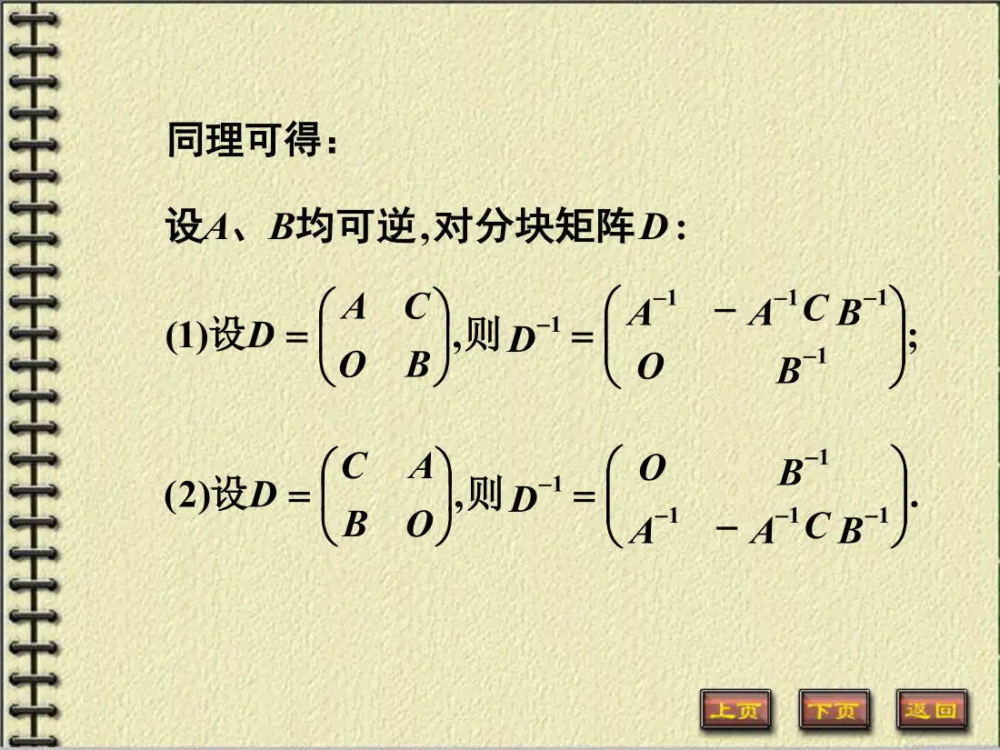

原文：

同理可得：

设A、B均可逆,对分块矩阵D:

(1)设 $D=\begin{pmatrix}A&C\\O&B\end{pmatrix}$ ，则 $D^{-1}=\begin{pmatrix}A^{-1}&-A^{-1}CB^{-1}\\O&B^{-1}\end{pmatrix}$ ;

(2)设 $D=\begin{pmatrix}C&A\\B&O\end{pmatrix}$ ，则 $D^{-1}=\begin{pmatrix}O&B^{-1}\\A^{-1}&-A^{-1}CB^{-1}\end{pmatrix}.$

上页 下页 返回

### $$

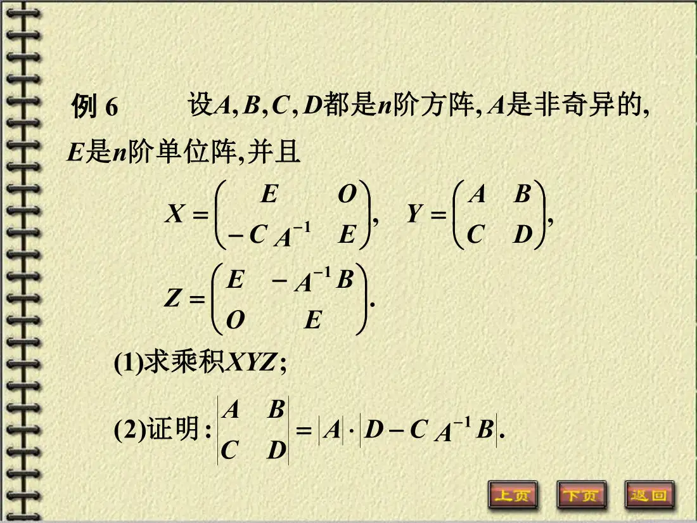

原文：

例 6 设 $A, B, C, D$ 都是 $n$ 阶方阵, $A$ 是非奇异的, $E$ 是 $n$ 阶单位阵, 并且

$$
\begin{array}{r l} & {X = \left( \begin{array}{l l} E & O \\ - C A ^ {- 1} & E \end{array} \right), \quad Y = \left( \begin{array}{l l} A & B \\ C & D \end{array} \right),} \\ & {Z = \left( \begin{array}{l l} E & - A ^ {- 1} B \\ O & E \end{array} \right).} \end{array}
$$

(1)求乘积XYZ;

(2)证明: $\left| \begin{array}{ll}A & B\\ C & D \end{array} \right| = |A|\cdot |D - CA^{-1}B|$ .

上页 下页 返回

### 解 (1) 根据分块矩阵的乘法, 得

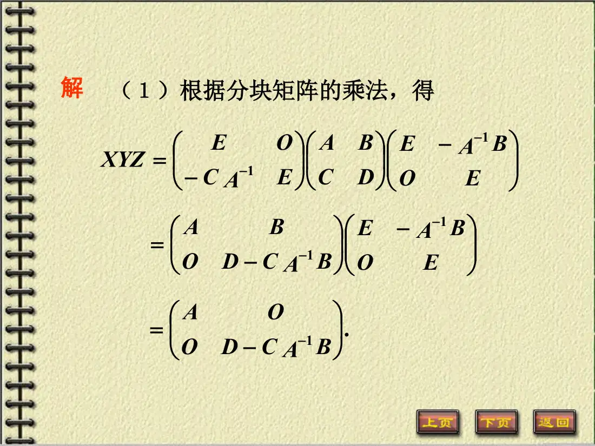

原文：

解 (1) 根据分块矩阵的乘法, 得

$$
\begin{array}{r l} & {X Y Z = \left( \begin{array}{l l} E & O \\ - C A ^ {- 1} & E \end{array} \right) \left( \begin{array}{l l} A & B \\ C & D \end{array} \right) \left( \begin{array}{l l} E & - A ^ {- 1} B \\ O & E \end{array} \right)} \\ & {\qquad = \left( \begin{array}{l l} A & B \\ O & D - C A ^ {- 1} B \end{array} \right) \left( \begin{array}{l l} E & - A ^ {- 1} B \\ O & E \end{array} \right)} \\ & {\qquad = \left( \begin{array}{l l} A & O \\ O & D - C A ^ {- 1} B \end{array} \right).} \end{array}
$$

上页 下页 返回

### (2) 由 (1) 可得

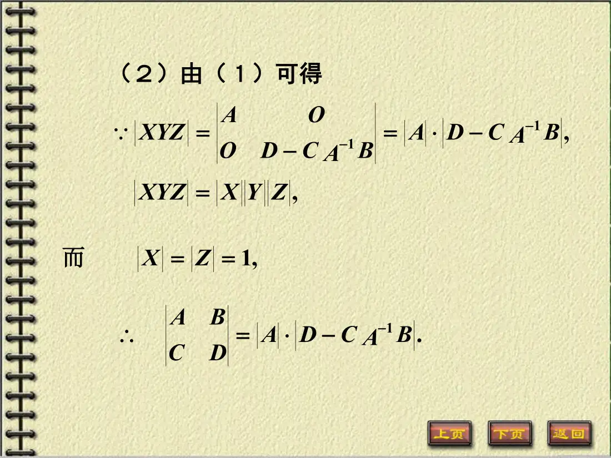

原文：

(2) 由 (1) 可得

$$
\because | X Y Z | = \left| \begin{array}{c c} A & O \\ O & D - C A ^ {- 1} B \end{array} \right| = | A | \cdot | D - C A ^ {- 1} B |,
$$

$$
| X Y Z | = | X | | Y | | Z |,
$$

而

$$
| X | = | Z | = 1,
$$

$$
\therefore \quad \left| \begin{array}{c c} A & B \\ C & D \end{array} \right| = | A | \cdot | D - C A ^ {- 1} B |.
$$

上页 下页 返回
