# 《线性代数与解析几何》第二章 矩阵（课件）

原件的每一页，下面附识别出的文字。

### 线性代数与解析几何

原文：

线性代数与解析几何

October 16, 2017

更多资讯请关注“学术墙”微信公众号

黄小龙 (NJUPT)

请勿用作商业用途

线性代数

October 16, 2017

1 / 288

### 目录

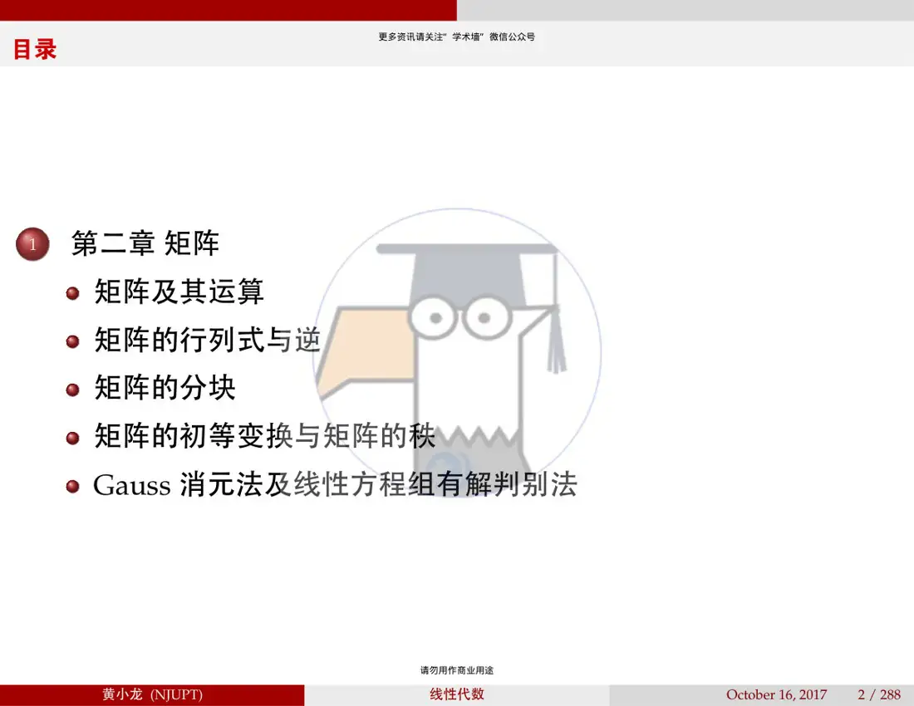

原文：

目录

第二章 矩阵

\- 矩阵及其运算

\- 矩阵的行列式与逆

\- 矩阵的分块

\- 矩阵的初等变换与矩阵的秩

\- Gauss 消元法及线性方程组有解判别法

更多资讯请关注“学术墙”微信公众号

黄小龙 (NJUPT)

请勿用作商业用途

线性代数

October 16, 2017

2 / 288

### 第二章

原文：

第二章

矩阵

第二章 矩阵

更多资讯请关注“学术墙”微信公众号

黄小龙 (NJUPT)

请勿用作商业用途

线性代数

October 16, 2017

3 / 288

### 矩阵的定义

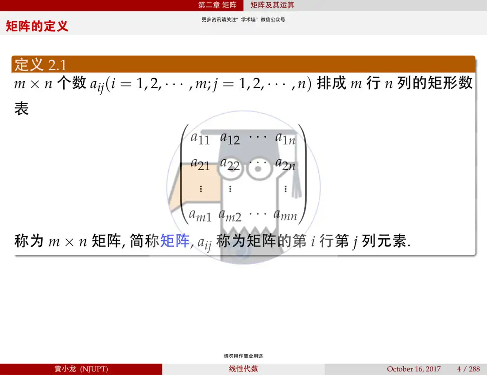

原文：

矩阵的定义

定义 2.1

$m \times n$ 个数 $a_{ij}(i = 1, 2, \cdots, m; j = 1, 2, \cdots, n)$ 排成 m 行 n 列的矩形数表

$$
\left( \begin{array}{c c c c} a _ {1 1} & a _ {1 2} & \dots & a _ {1 n} \\ a _ {2 1} & a _ {2 2} & \dots & a _ {2 n} \\ \vdots & \vdots & & \vdots \\ a _ {m 1} & a _ {m 2} & \dots & a _ {m n} \end{array} \right)
$$

称为 $m \times n$ 矩阵, 简称矩阵, $a_{ij}$ 称为矩阵的第 i 行第 j 列元素.

第二章 矩阵 矩阵及其运算

更多资讯请关注“学术墙”微信公众号

黄小龙 (NJUPT)

请勿用作商业用途

线性代数

October 16, 2017

4 / 288

### 矩阵的定义

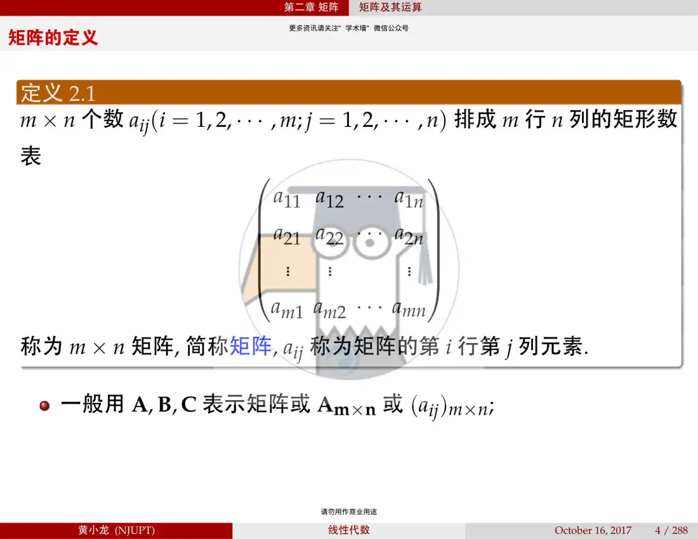

原文：

矩阵的定义

定义 2.1

$m \times n$ 个数 $a_{ij}(i = 1, 2, \cdots, m; j = 1, 2, \cdots, n)$ 排成 m 行 n 列的矩形数表

$$
\left( \begin{array}{c c c c} a _ {1 1} & a _ {1 2} & \dots & a _ {1 n} \\ a _ {2 1} & a _ {2 2} & \dots & a _ {2 n} \\ \vdots & \vdots & & \vdots \\ a _ {m 1} & a _ {m 2} & \dots & a _ {m n} \end{array} \right)
$$

称为 $m \times n$ 矩阵, 简称矩阵, $a_{ij}$ 称为矩阵的第 i 行第 j 列元素.

\- 一般用 A, B, C 表示矩阵或 $\mathbf{A}_{\mathbf{m} \times \mathbf{n}}$ 或 $(a_{ij})_{m \times n}$ ;

第二章 矩阵 矩阵及其运算

更多资讯请关注“学术墙”微信公众号

黄小龙 (NJUPT)

请勿用作商业用途

线性代数

October 16, 2017

4 / 288

### 矩阵的定义

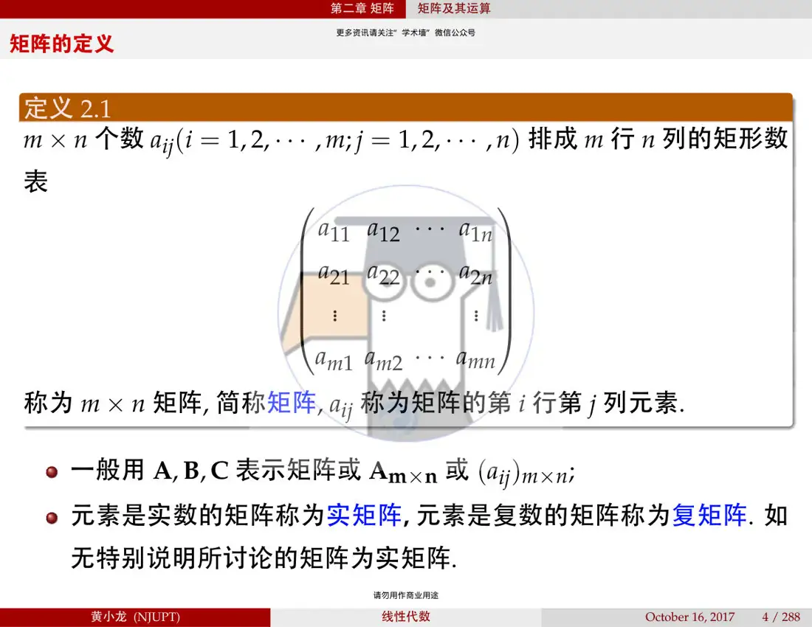

原文：

矩阵的定义

定义 2.1

$m \times n$ 个数 $a_{ij}(i = 1, 2, \cdots, m; j = 1, 2, \cdots, n)$ 排成 m 行 n 列的矩形数表

$$
\left( \begin{array}{c c c c} a _ {1 1} & a _ {1 2} & \dots & a _ {1 n} \\ a _ {2 1} & a _ {2 2} & \dots & a _ {2 n} \\ \vdots & \vdots & & \vdots \\ a _ {m 1} & a _ {m 2} & \dots & a _ {m n} \end{array} \right)
$$

称为 $m \times n$ 矩阵, 简称矩阵, $a_{ij}$ 称为矩阵的第 i 行第 j 列元素.

\- 一般用 A, B, C 表示矩阵或 $\mathbf{A}_{\mathbf{m} \times \mathbf{n}}$ 或 $(a_{ij})_{m \times n}$ ;

\- 元素是实数的矩阵称为实矩阵, 元素是复数的矩阵称为复矩阵. 如无特别说明所讨论的矩阵为实矩阵.

第二章 矩阵 矩阵及其运算

更多资讯请关注“学术墙”微信公众号

黄小龙 (NJUPT)

请勿用作商业用途

线性代数

October 16, 2017

4 / 288

### 常见矩阵

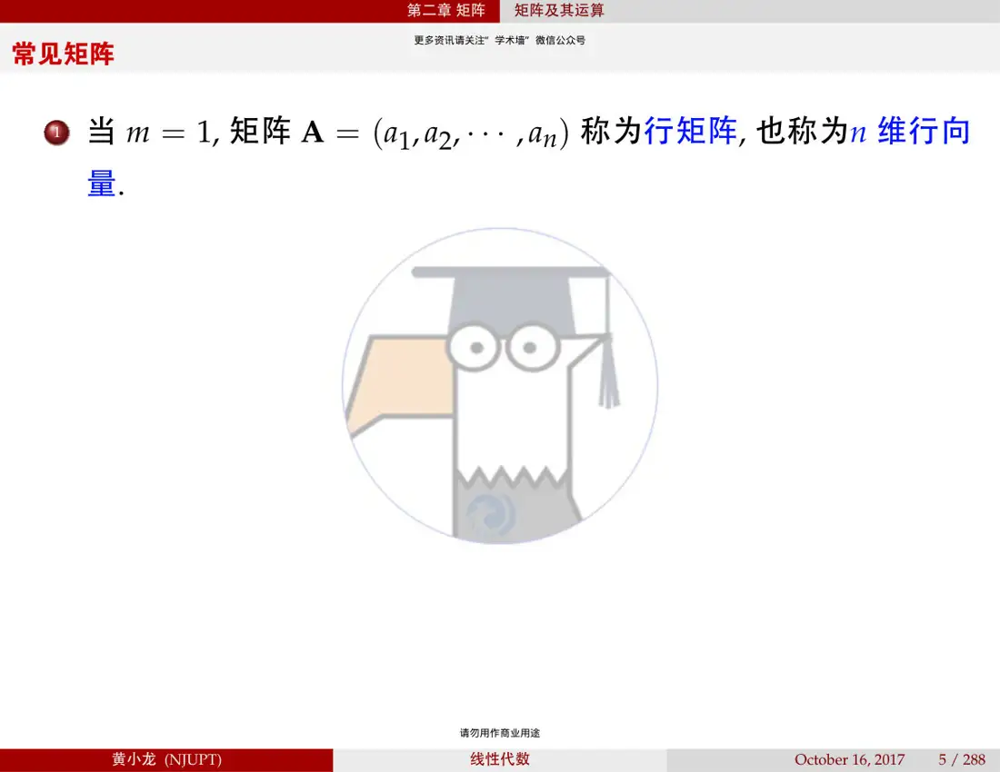

原文：

常见矩阵

① 当 m = 1, 矩阵 $\mathbf{A} = (a_{1}, a_{2}, \cdots, a_{n})$ 称为行矩阵, 也称为 n 维行向量.

第二章 矩阵 矩阵及其运算

更多资讯请关注“学术墙”微信公众号

黄小龙 (NJUPT)

请勿用作商业用途

线性代数

October 16, 2017

5 / 288

### 常见矩阵

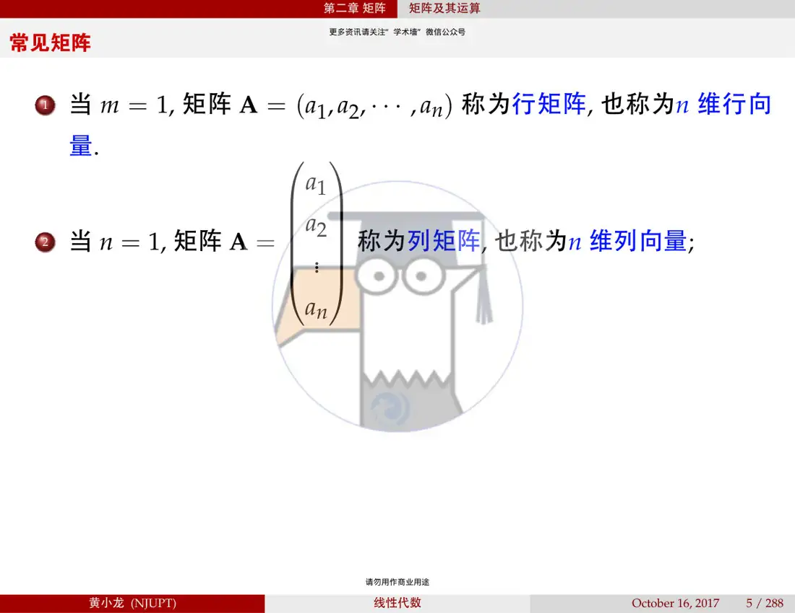

原文：

常见矩阵

① 当 m = 1, 矩阵 $\mathbf{A} = (a_{1}, a_{2}, \cdots, a_{n})$ 称为行矩阵, 也称为 n 维行向量.

第二章 矩阵 矩阵及其运算

更多资讯请关注“学术墙”微信公众号

黄小龙 (NJUPT)

请勿用作商业用途

线性代数

October 16, 2017

5 / 288

### 常见矩阵

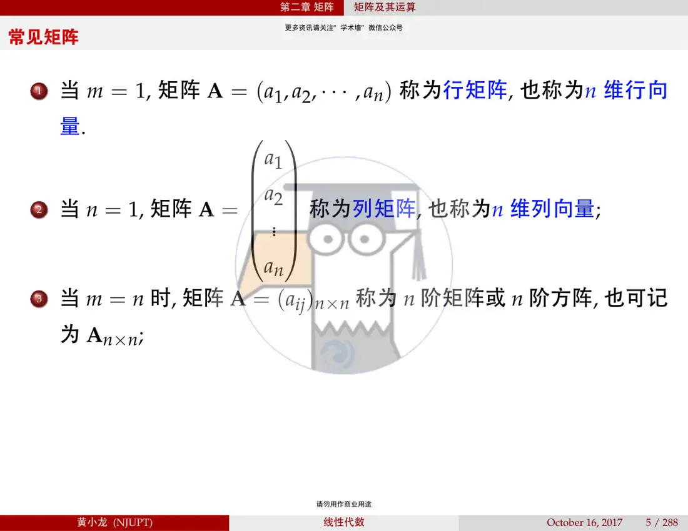

原文：

常见矩阵

① 当 m = 1, 矩阵 $\mathbf{A} = (a_{1}, a_{2}, \cdots, a_{n})$ 称为行矩阵, 也称为 n 维行向量.

② 当 n=1, 矩阵 $A=\begin{pmatrix}a_{1}\\a_{2}\\ \vdots\\ a_{n}\end{pmatrix}$ 称为列矩阵, 也称为 n 维列向量;

③ 当 m = n 时, 矩阵 $\mathbf{A} = (a_{ij})_{n \times n}$ 称为 n 阶矩阵或 n 阶方阵, 也可记为 $A_{n \times n}$ ;

第二章 矩阵 矩阵及其运算

更多资讯请关注“学术墙”微信公众号

黄小龙 (NJUPT)

请勿用作商业用途

线性代数

October 16, 2017

5 / 288

### 常见矩阵

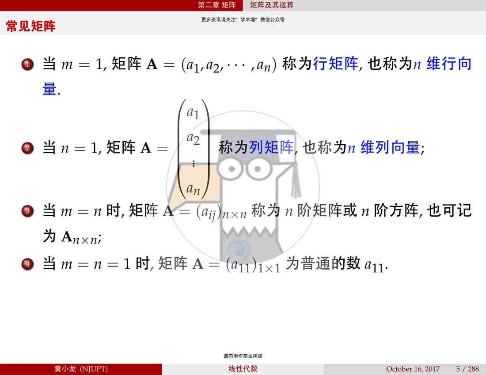

原文：

常见矩阵

① 当 m = 1, 矩阵 $\mathbf{A} = (a_{1}, a_{2}, \cdots, a_{n})$ 称为行矩阵, 也称为 n 维行向量.

② 当 n=1, 矩阵 $A=\begin{pmatrix}a_{1}\\ a_{2}\\ \vdots\\ a_{n}\end{pmatrix}$ 称为列矩阵, 也称为 n 维列向量;

③ 当 m = n 时, 矩阵 $\mathbf{A} = (a_{ij})_{n \times n}$ 称为 n 阶矩阵或 n 阶方阵, 也可记为 $A_{n \times n}$ ;

④ 当 m = n = 1 时, 矩阵 $\mathbf{A} = (a_{11})_{1 \times 1}$ 为普通的数 $a_{11}$ .

第二章 矩阵 矩阵及其运算

更多资讯请关注“学术墙”微信公众号

黄小龙 (NJUPT)

请勿用作商业用途

线性代数

October 16, 2017

5 / 288

### 常见矩阵

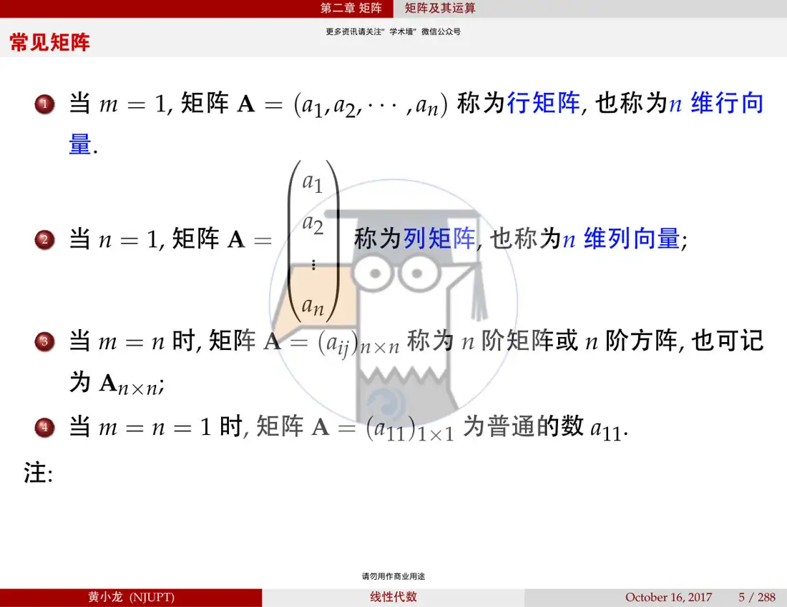

原文：

常见矩阵

① 当 m = 1, 矩阵 $\mathbf{A} = (a_{1}, a_{2}, \cdots, a_{n})$ 称为行矩阵, 也称为 n 维行向量.

② 当 n = 1, 矩阵 $A = \begin{pmatrix} a_{1} \\ a_{2} \\ \vdots \\ a_{n} \end{pmatrix}$ 称为列矩阵, 也称为 n 维列向量;

③ 当 m = n 时, 矩阵 $\mathbf{A} = (a_{ij})_{n \times n}$ 称为 n 阶矩阵或 n 阶方阵, 也可记为 $A_{n \times n}$ ;

4 当 m = n = 1 时, 矩阵 $\mathbf{A} = (a_{11})_{1 \times 1}$ 为普通的数 $a_{11}$ .

注：

第二章 矩阵 矩阵及其运算

更多资讯请关注“学术墙”微信公众号

黄小龙 (NJUPT)

请勿用作商业用途

线性代数

October 16, 2017

5 / 288

### 常见矩阵

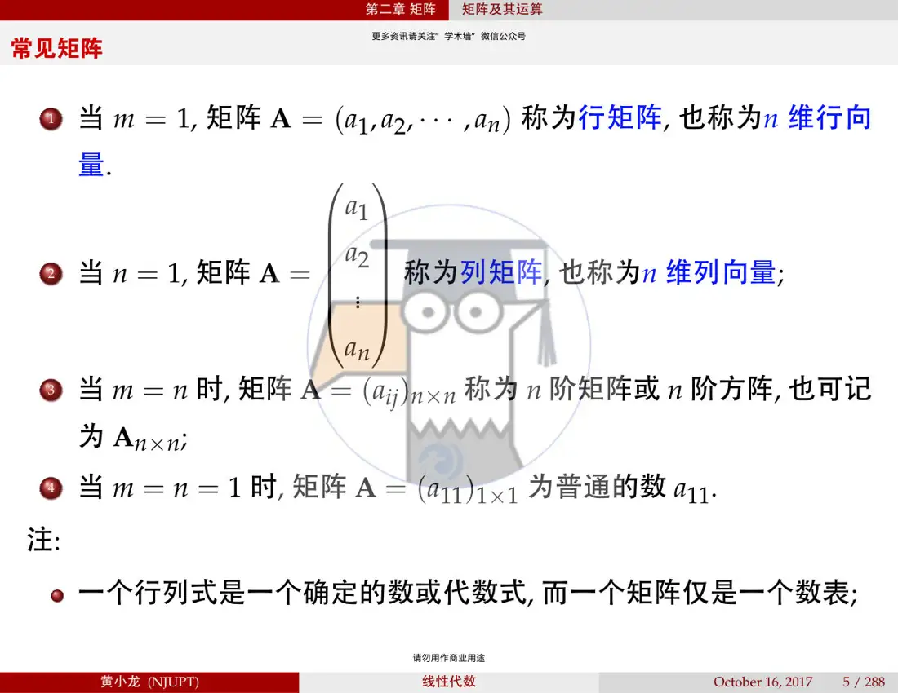

原文：

常见矩阵

① 当 m = 1, 矩阵 $\mathbf{A} = (a_{1}, a_{2}, \cdots, a_{n})$ 称为行矩阵, 也称为 n 维行向量.

② 当 n=1, 矩阵 $A=\begin{pmatrix}a_{1}\\a_{2}\\ \vdots\\ a_{n}\end{pmatrix}$ 称为列矩阵, 也称为 n 维列向量;

③ 当 m = n 时, 矩阵 $\mathbf{A} = (a_{ij})_{n \times n}$ 称为 n 阶矩阵或 n 阶方阵, 也可记为 $A_{n \times n}$ ;

4 当 m = n = 1 时, 矩阵 $\mathbf{A} = (a_{11})_{1 \times 1}$ 为普通的数 $a_{11}$ .

注：

\- 一个行列式是一个确定的数或代数式, 而一个矩阵仅是一个数表;

第二章 矩阵 矩阵及其运算

更多资讯请关注“学术墙”微信公众号

黄小龙 (NJUPT)

请勿用作商业用途

线性代数

October 16, 2017

5 / 288

### 常见矩阵

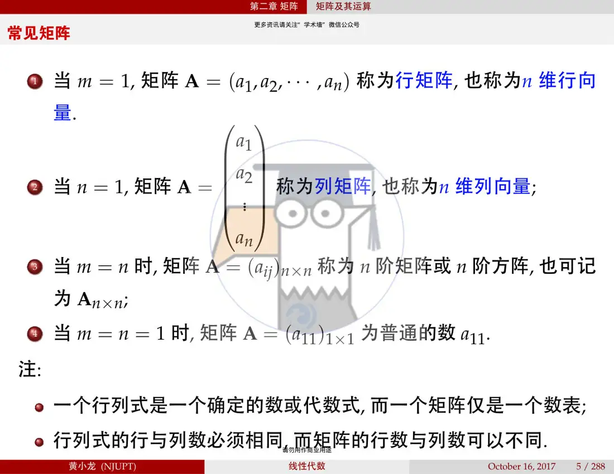

原文：

常见矩阵

① 当 m = 1, 矩阵 $\mathbf{A} = (a_{1}, a_{2}, \cdots, a_{n})$ 称为行矩阵, 也称为 n 维行向量.

② 当 n = 1, 矩阵 $A = \begin{pmatrix} a_{1} \\ a_{2} \\ \vdots \\ a_{n} \end{pmatrix}$ 称为列矩阵, 也称为 n 维列向量;

③ 当 m = n 时, 矩阵 $\mathbf{A} = (a_{ij})_{n \times n}$ 称为 n 阶矩阵或 n 阶方阵, 也可记为 $A_{n \times n}$ ;

④ 当 m = n = 1 时, 矩阵 $\mathbf{A} = (a_{11})_{1 \times 1}$ 为普通的数 $a_{11}$ .

注：

\- 一个行列式是一个确定的数或代数式, 而一个矩阵仅是一个数表;

\- 行列式的行与列数必须相同,而矩阵的行数与列数可以不同.

第二章 矩阵 矩阵及其运算

更多资讯请关注“学术墙”微信公众号

黄小龙 (NJUPT)

线性代数

October 16, 2017

5 / 288

### 矩阵的定义

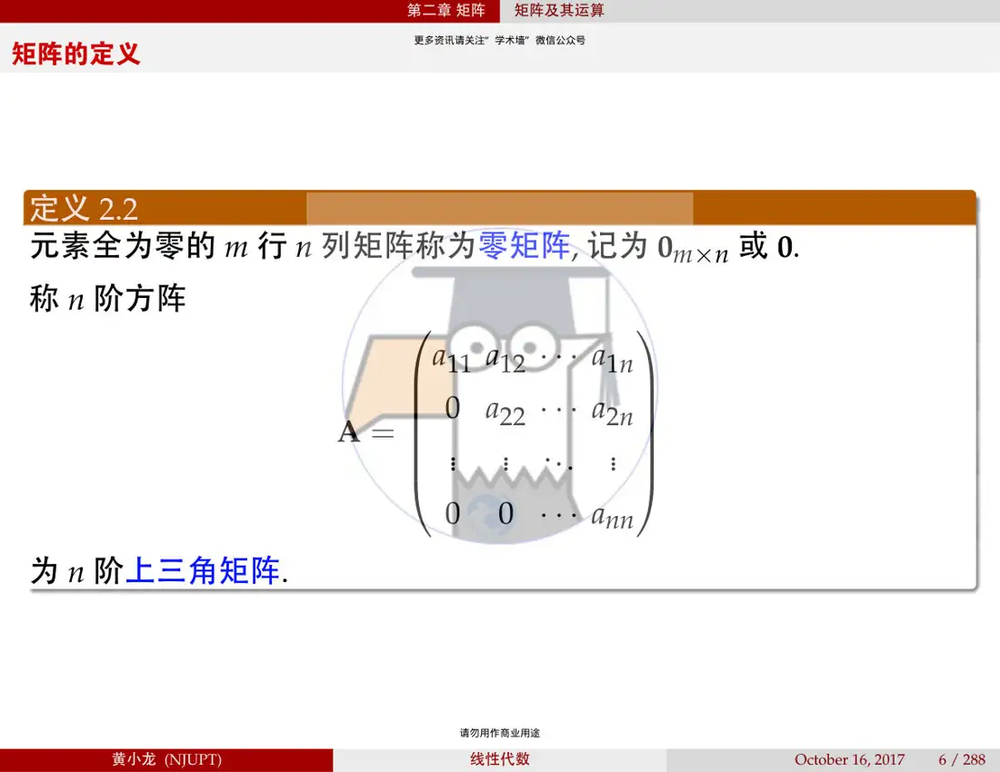

原文：

矩阵的定义

更多资讯请关注“学术墙”微信公众号

定义 2.2

元素全为零的 m 行 n 列矩阵称为零矩阵, 记为 $0_{m \times n}$ 或 0.

称 $n$ 阶方阵

为 n 阶上三角矩阵.

第二章 矩阵 矩阵及其运算

黄小龙 (NJUPT)

请勿用作商业用途

线性代数

October 16, 2017

6 / 288

### 矩阵的定义

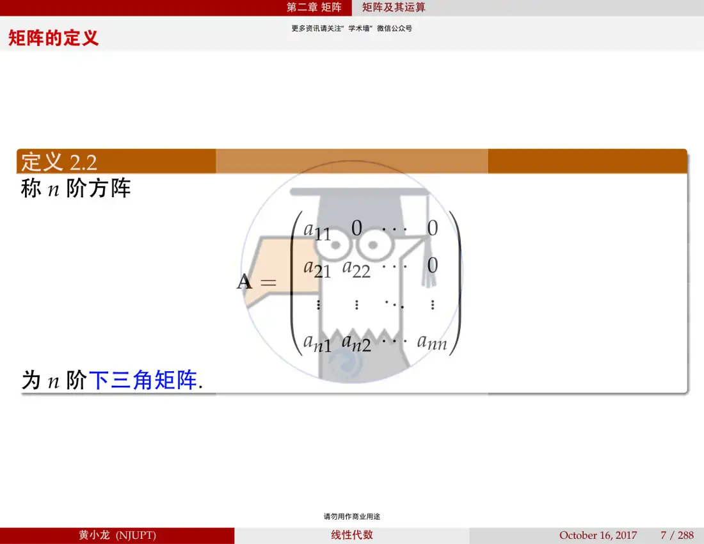

原文：

矩阵的定义

定义 2.2

称 $n$ 阶方阵

为 n 阶下三角矩阵.

第二章 矩阵 矩阵及其运算

更多资讯请关注“学术墙”微信公众号

黄小龙 (NJUPT)

请勿用作商业用途

线性代数

October 16, 2017

7 / 288

### 矩阵的定义

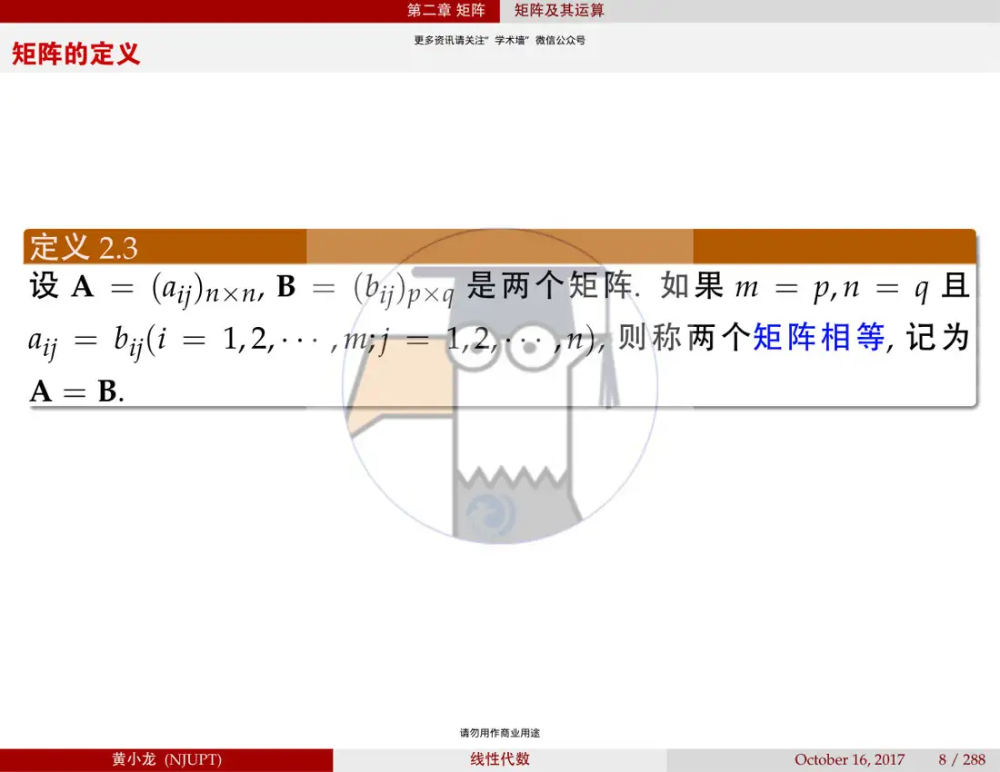

原文：

<table><tr><td>定义2.3</td></tr><tr><td>设 $\mathbf{A} = (a_{ij})_{n \times n}, \mathbf{B} = (b_{ij})_{p \times q}$ 是两个矩阵。如果m=p,n=q且 $a_{ij} = b_{ij}(i=1,2,\cdots,m;j=1,2,\cdots,n)$ ,则称两个矩阵相等,记为 $\mathbf{A} = \mathbf{B}$ 。</td></tr></table>

矩阵的定义

第二章 矩阵 矩阵及其运算

更多资讯请关注“学术墙”微信公众号

黄小龙 (NJUPT)

请勿用作商业用途

线性代数

October 16, 2017

8 / 288

### 矩阵的定义

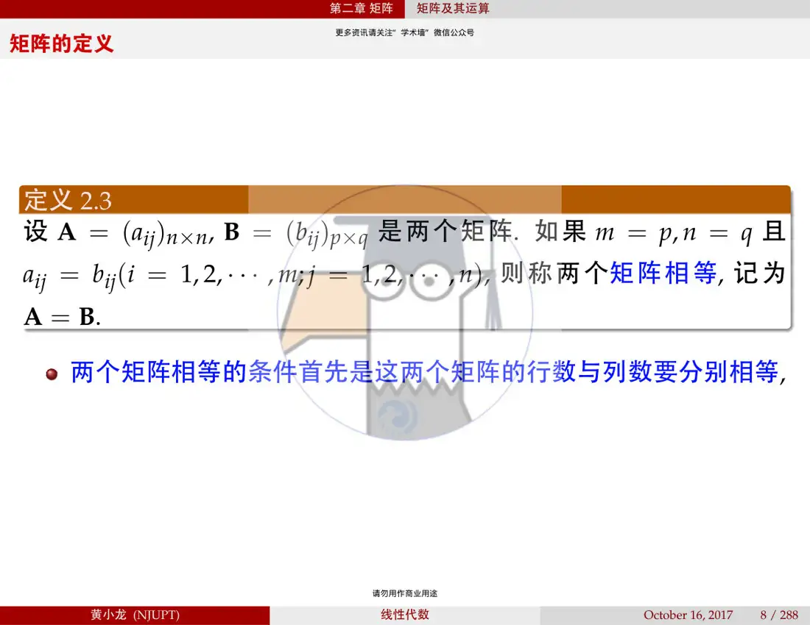

原文：

矩阵的定义

更多资讯请关注“学术墙”微信公众号

定义 2.3
设 $\mathbf{A} = (a_{ij})_{n \times n}, \mathbf{B} = (b_{ij})_{p \times q}$ 是两个矩阵。如果 m = p, n = q 且 $a_{ij} = b_{ij} (i = 1, 2, \cdots, m; j = 1, 2, \cdots, n)$ ，则称两个矩阵相等，记为 A = B。

\- 两个矩阵相等的条件首先是这两个矩阵的行数与列数要分别相等，

第二章 矩阵 矩阵及其运算

黄小龙 (NJUPT)

请勿用作商业用途

线性代数

October 16, 2017

8 / 288

### 矩阵的定义

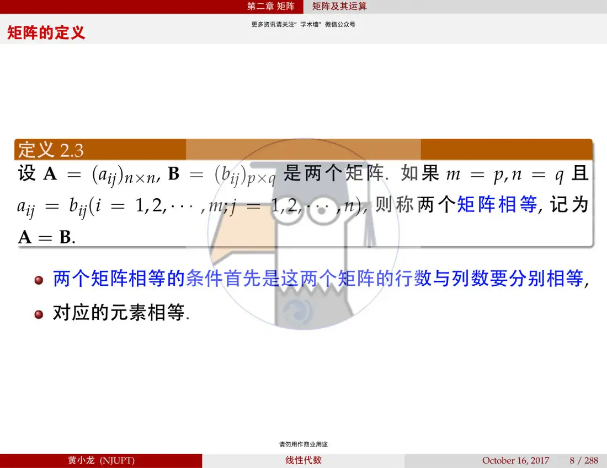

原文：

<table><tr><td>定义2.3</td></tr><tr><td>设 $\mathbf{A} = (a_{ij})_{n \times n}, \mathbf{B} = (b_{ij})_{p \times q}$ 是两个矩阵。如果m=p,n=q且 $a_{ij} = b_{ij}(i = 1,2,\cdots,m;j = 1,2,\cdots,n)$ ,则称两个矩阵相等,记为 $\mathbf{A} = \mathbf{B}$ 。</td></tr></table>

矩阵的定义

\- 两个矩阵相等的条件首先是这两个矩阵的行数与列数要分别相等，

\- 对应的元素相等.

第二章 矩阵 矩阵及其运算

更多资讯请关注“学术墙”微信公众号

黄小龙 (NJUPT)

请勿用作商业用途

线性代数

October 16, 2017

8 / 288

### 矩阵的定义

原文：

矩阵的定义

例 2.1

更多资讯请关注“学术墙”微信公众号

第二章 矩阵 矩阵及其运算

黄小龙 (NJUPT)

请勿用作商业用途

线性代数

October 16, 2017

9 / 288

### 矩阵的定义

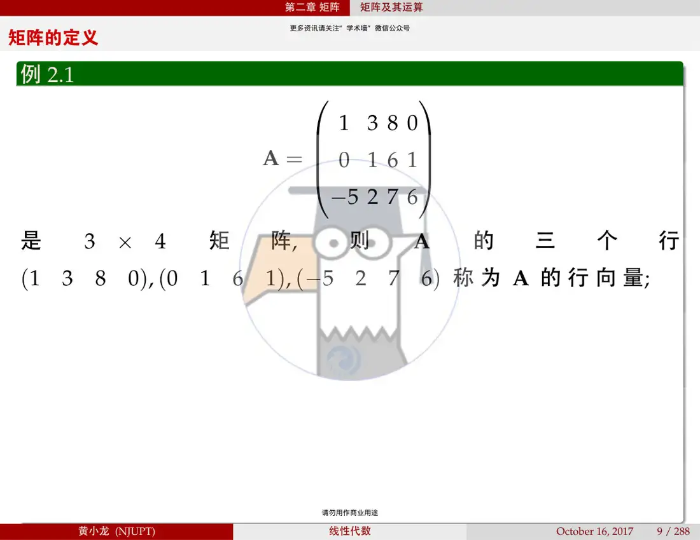

原文：

矩阵的定义

例 2.1

$$
\begin{array}{c c c} 3 & \times & 4 \end{array}
$$

矩

$$
\mathbf {A} = \left( \begin{array}{r r r r} 1 & 3 & 8 & 0 \\ 0 & 1 & 6 & 1 \\ - 5 & 2 & 7 & 6 \end{array} \right)
$$

的 三个 行称为 A 的行向量;

第二章 矩阵 矩阵及其运算

更多资讯请关注“学术墙”微信公众号

黄小龙 (NJUPT)

请勿用作商业用途

线性代数

October 16, 2017

9 / 288

### 矩阵的定义

原文：

矩阵的定义

例 2.1

$$
\begin{array}{c c c} 3 & \times & 4 \end{array}
$$

矩

$$
\mathbf {A} = \left( \begin{array}{r r r r} 1 & 3 & 8 & 0 \\ 0 & 1 & 6 & 1 \\ - 5 & 2 & 7 & 6 \end{array} \right)
$$

的 三个 行称为 A 的行向量;

第二章 矩阵 矩阵及其运算

更多资讯请关注“学术墙”微信公众号

黄小龙 (NJUPT)

请勿用作商业用途

线性代数

October 16, 2017

9 / 288

### 矩阵的定义

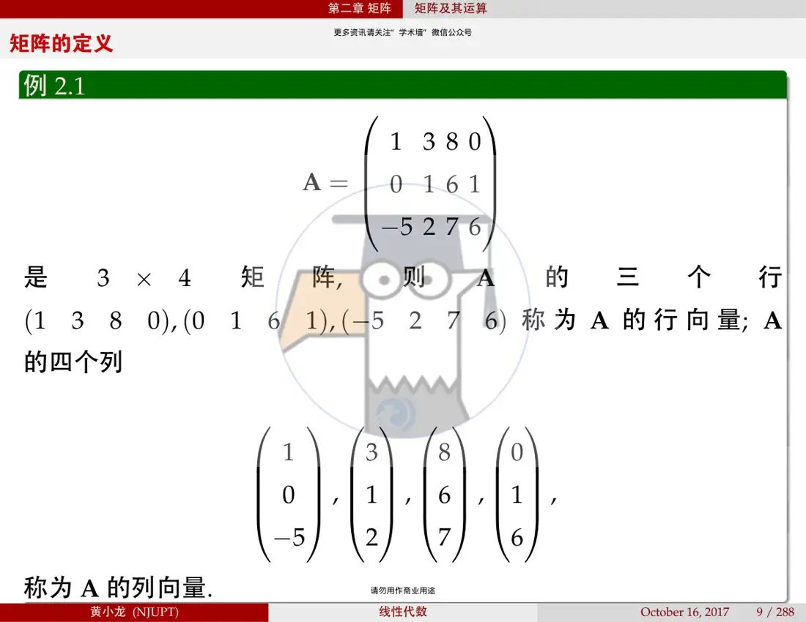

原文：

矩阵的定义

例 2.1

$$
\begin{array}{c c c} 3 & \times & 4 \end{array}
$$

$$
\mathbf {A} = \left( \begin{array}{r r r r} 1 & 3 & 8 & 0 \\ 0 & 1 & 6 & 1 \\ - 5 & 2 & 7 & 6 \end{array} \right)
$$

矩

的 三个 行
称为 A 的行向量; A

$$
\left( \begin{array}{c} 1 \\ 0 \\ - 5 \end{array} \right), \left( \begin{array}{c} 3 \\ 1 \\ 2 \end{array} \right), \left( \begin{array}{c} 8 \\ 6 \\ 7 \end{array} \right), \left( \begin{array}{c} 0 \\ 1 \\ 6 \end{array} \right),
$$

称为 A 的列向量.

请勿用作商业用途

第二章 矩阵 矩阵及其运算

更多资讯请关注“学术墙”微信公众号

黄小龙 (NJUPT)

线性代数

October 16, 2017

9 / 288

### 矩阵加法

原文：

矩阵加法

更多资讯请关注“学术墙”微信公众号

定义 2.4

第二章 矩阵 矩阵及其运算

黄小龙 (NJUPT)

请勿用作商业用途

线性代数

October 16, 2017

10 / 288

### 定义2.4

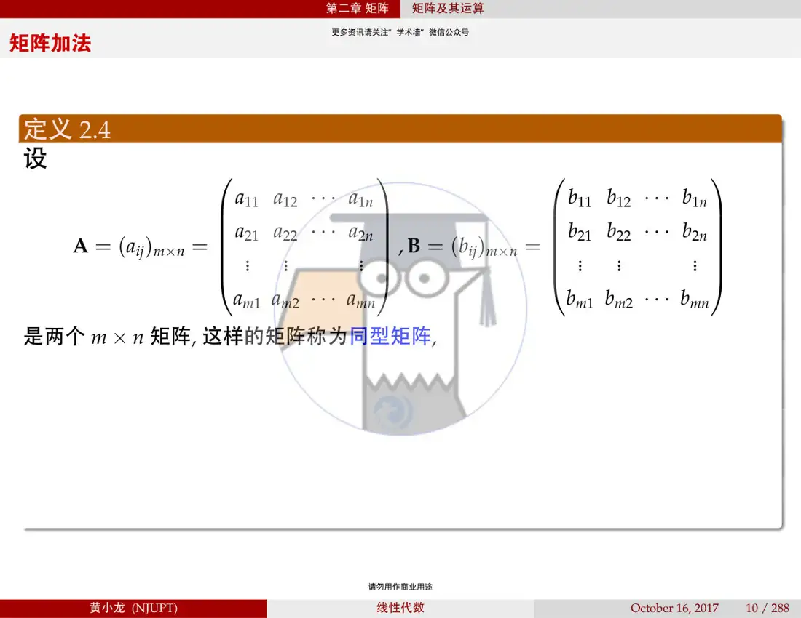

原文：

定义2.4

设

$$
\mathbf {A} = (a _ {i j}) _ {m \times n} = \left( \begin{array}{c c c c} a _ {1 1} & a _ {1 2} & \dots & a _ {1 n} \\ a _ {2 1} & a _ {2 2} & \dots & a _ {2 n} \\ \vdots & \vdots & & \vdots \\ a _ {m 1} & a _ {m 2} & \dots & a _ {m n} \end{array} \right), \mathbf {B} = (b _ {i j}) _ {m \times n} = \left( \begin{array}{c c c c} b _ {1 1} & b _ {1 2} & \dots & b _ {1 n} \\ b _ {2 1} & b _ {2 2} & \dots & b _ {2 n} \\ \vdots & \vdots & & \vdots \\ b _ {m 1} & b _ {m 2} & \dots & b _ {m n} \end{array} \right)
$$

是两个 $m \times n$ 矩阵, 这样的矩阵称为同型矩阵,

第二章 矩阵 矩阵及其运算

矩阵加法

更多资讯请关注“学术墙”微信公众号

黄小龙 (NJUPT)

请勿用作商业用途

线性代数

October 16, 2017

10 / 288

### 矩阵加法

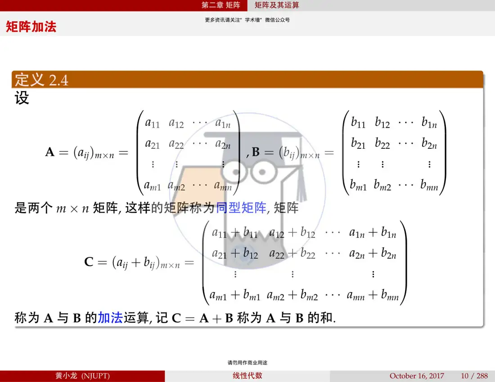

原文：

矩阵加法

定义 2.4

设

$$
\mathbf {A} = (a _ {i j}) _ {m \times n} = \left( \begin{array}{c c c c} a _ {1 1} & a _ {1 2} & \dots & a _ {1 n} \\ a _ {2 1} & a _ {2 2} & \dots & a _ {2 n} \\ \vdots & \vdots & & \vdots \\ a _ {m 1} & a _ {m 2} & \dots & a _ {m n} \end{array} \right), \mathbf {B} = (b _ {i j}) _ {m \times n} = \left( \begin{array}{c c c c} b _ {1 1} & b _ {1 2} & \dots & b _ {1 n} \\ b _ {2 1} & b _ {2 2} & \dots & b _ {2 n} \\ \vdots & \vdots & & \vdots \\ b _ {m 1} & b _ {m 2} & \dots & b _ {m n} \end{array} \right)
$$

是两个 $m \times n$ 矩阵, 这样的矩阵称为同型矩阵, 矩阵

$$
\mathbf {C} = (a _ {i j} + b _ {i j}) _ {m \times n} = \left( \begin{array}{c c c c} a _ {1 1} + b _ {1 1} & a _ {1 2} + b _ {1 2} & \dots & a _ {1 n} + b _ {1 n} \\ a _ {2 1} + b _ {1 2} & a _ {2 2} + b _ {2 2} & \dots & a _ {2 n} + b _ {2 n} \\ \vdots & \vdots & & \vdots \\ a _ {m 1} + b _ {m 1} & a _ {m 2} + b _ {m 2} & \dots & a _ {m n} + b _ {m n} \end{array} \right)
$$

称为 A 与 B 的加法运算, 记 C = A + B 称为 A 与 B 的和.

第二章 矩阵 矩阵及其运算

更多资讯请关注“学术墙”微信公众号

黄小龙 (NJUPT)

请勿用作商业用途

线性代数

October 16, 2017

10 / 288

### 矩阵加法

原文：

矩阵加法

\- 两个矩阵必须在行数和列数分别相等时才能相加, 即同型矩阵才能相加.

第二章 矩阵 矩阵及其运算

更多资讯请关注“学术墙”微信公众号

黄小龙 (NJUPT)

请勿用作商业用途

线性代数

October 16, 2017

11 / 288

### 矩阵加法

原文：

矩阵加法

\- 两个矩阵必须在行数和列数分别相等时才能相加, 即同型矩阵才能相加.

\- 和矩阵的每个元素分别是两个矩阵对应元素的和.

第二章 矩阵 矩阵及其运算

更多资讯请关注“学术墙”微信公众号

黄小龙 (NJUPT)

请勿用作商业用途

线性代数

October 16, 2017

11 / 288

### 矩阵加法

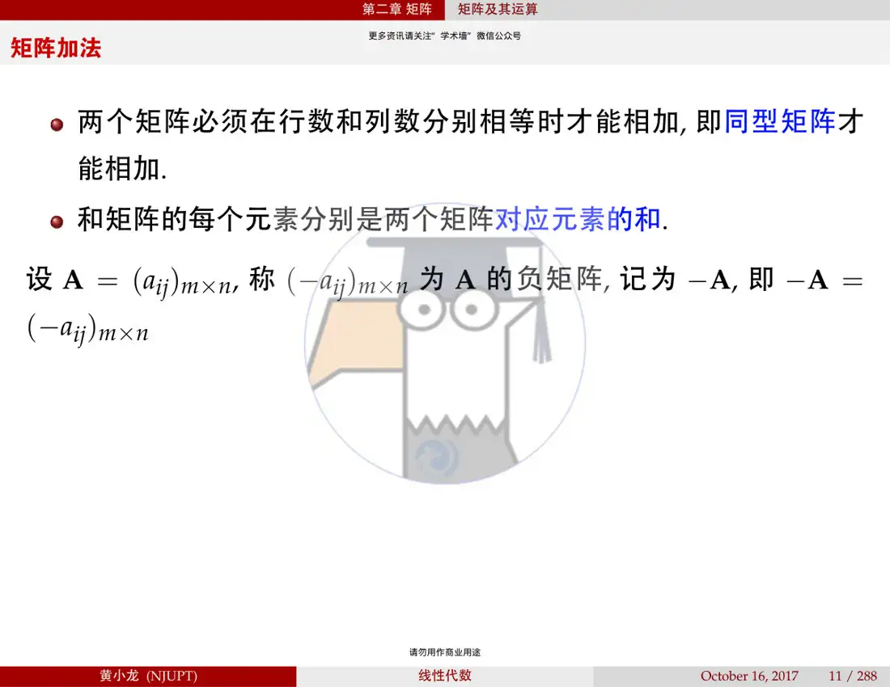

原文：

矩阵加法

\- 两个矩阵必须在行数和列数分别相等时才能相加, 即同型矩阵才能相加.

\- 和矩阵的每个元素分别是两个矩阵对应元素的和.

设 $\mathbf{A} = (a_{ij})_{m\times n}$ ，称 $(-a_{ij})_{m\times n}$ 为 $\mathbf{A}$ 的负矩阵，记为- $\mathbf{A}$ ，即- $\mathbf{A} =$ $(-a_{ij})_{m\times n}$

第二章 矩阵 矩阵及其运算

更多资讯请关注“学术墙”微信公众号

黄小龙 (NJUPT)

请勿用作商业用途

线性代数

October 16, 2017

11 / 288

### 矩阵加法

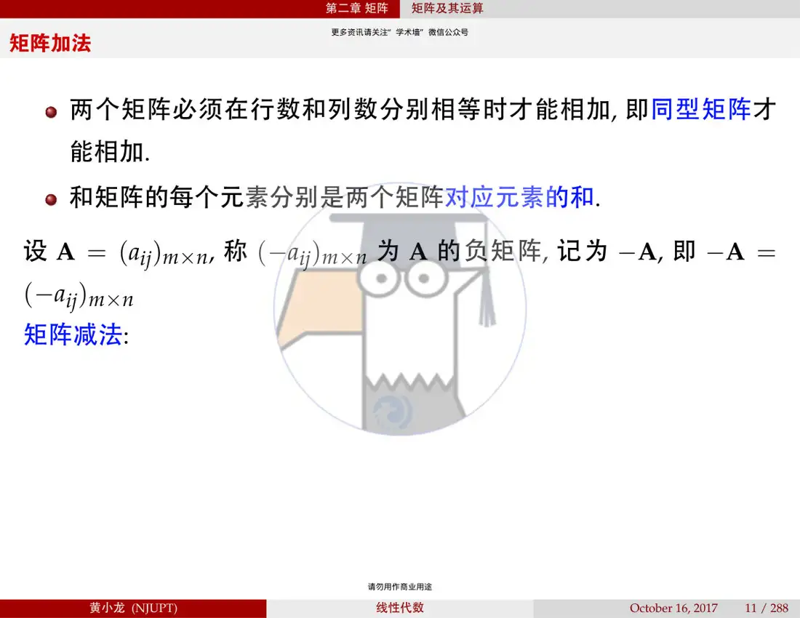

原文：

矩阵加法

\- 两个矩阵必须在行数和列数分别相等时才能相加, 即同型矩阵才能相加.

\- 和矩阵的每个元素分别是两个矩阵对应元素的和.

设 $\mathbf{A} = (a_{ij})_{m\times n}$ ，称 $(-a_{ij})_{m\times n}$ 为 $\mathbf{A}$ 的负矩阵，记为- $\mathbf{A}$ ，即- $\mathbf{A} =$ $(-a_{ij})_{m\times n}$

矩阵减法:

第二章 矩阵 矩阵及其运算

更多资讯请关注“学术墙”微信公众号

黄小龙 (NJUPT)

请勿用作商业用途

线性代数

October 16, 2017

11 / 288

### 矩阵加法

原文：

矩阵加法

\- 两个矩阵必须在行数和列数分别相等时才能相加, 即同型矩阵才能相加.

\- 和矩阵的每个元素分别是两个矩阵对应元素的和.

设 $\mathbf{A} = (a_{ij})_{m\times n}$ ，称 $(-a_{ij})_{m\times n}$ 为 $\mathbf{A}$ 的负矩阵，记为- $\mathbf{A}$ ，即- $\mathbf{A} =$ $(-a_{ij})_{m\times n}$

矩阵减法:

第二章 矩阵 矩阵及其运算

更多资讯请关注“学术墙”微信公众号

黄小龙 (NJUPT)

请勿用作商业用途

线性代数

October 16, 2017

11 / 288

### 矩阵加法

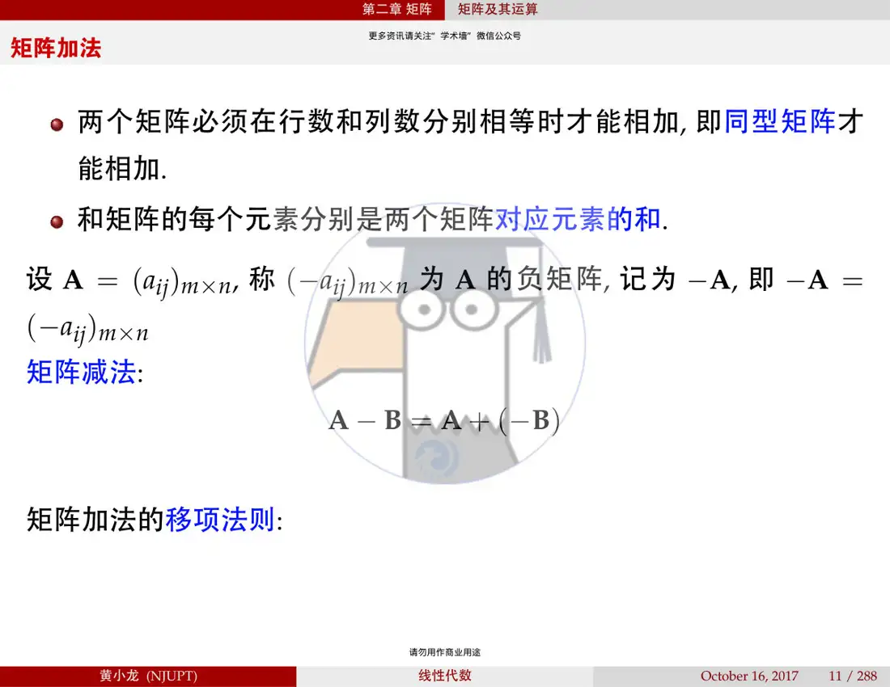

原文：

矩阵加法

\- 两个矩阵必须在行数和列数分别相等时才能相加, 即同型矩阵才能相加.

\- 和矩阵的每个元素分别是两个矩阵对应元素的和.

设 $\mathbf{A} = (a_{ij})_{m\times n}$ ，称 $(-a_{ij})_{m\times n}$ 为 $\mathbf{A}$ 的负矩阵，记为- $\mathbf{A}$ ，即- $\mathbf{A} =$ $(-a_{ij})_{m\times n}$

矩阵减法:

$$
\mathbf {A} - \mathbf {B} = \mathbf {A} + (- \mathbf {B})
$$

矩阵加法的移项法则:

第二章 矩阵 矩阵及其运算

更多资讯请关注“学术墙”微信公众号

黄小龙 (NJUPT)

请勿用作商业用途

线性代数

October 16, 2017

11 / 288

### 矩阵加法

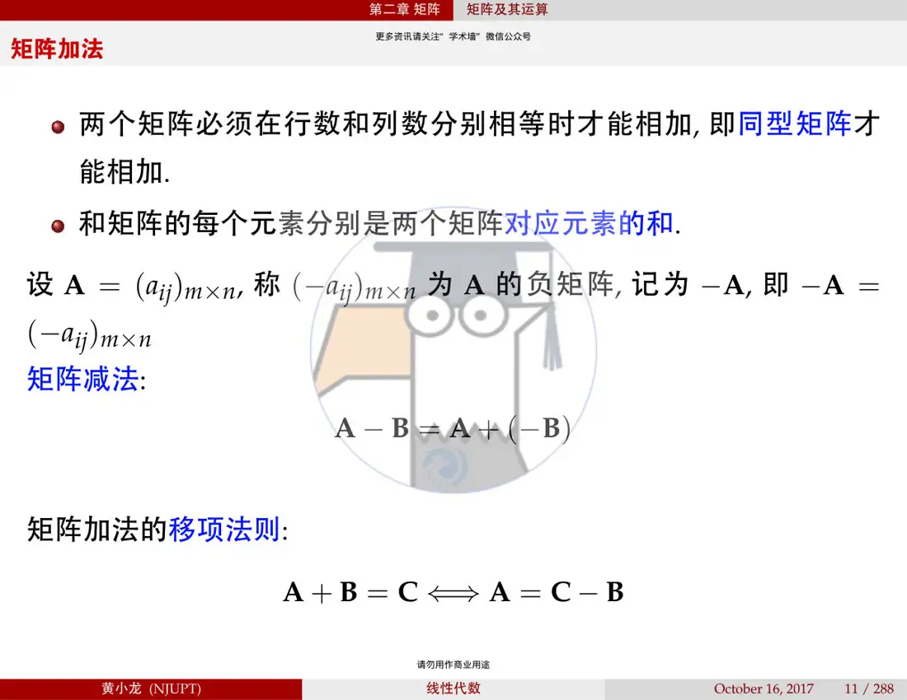

原文：

矩阵加法

\- 两个矩阵必须在行数和列数分别相等时才能相加, 即同型矩阵才能相加.

\- 和矩阵的每个元素分别是两个矩阵对应元素的和.

设 $\mathbf{A} = (a_{ij})_{m\times n}$ ，称 $(-a_{ij})_{m\times n}$ 为 $\mathbf{A}$ 的负矩阵，记为- $\mathbf{A}$ ，即- $\mathbf{A} =$ $(-a_{ij})_{m\times n}$

矩阵减法:

矩阵加法的移项法则:

$$
\mathbf {A} + \mathbf {B} = \mathbf {C} \Longleftrightarrow \mathbf {A} = \mathbf {C} - \mathbf {B}
$$

第二章 矩阵 矩阵及其运算

更多资讯请关注“学术墙”微信公众号

黄小龙 (NJUPT)

请勿用作商业用途

线性代数

October 16, 2017

11 / 288

### 矩阵数乘

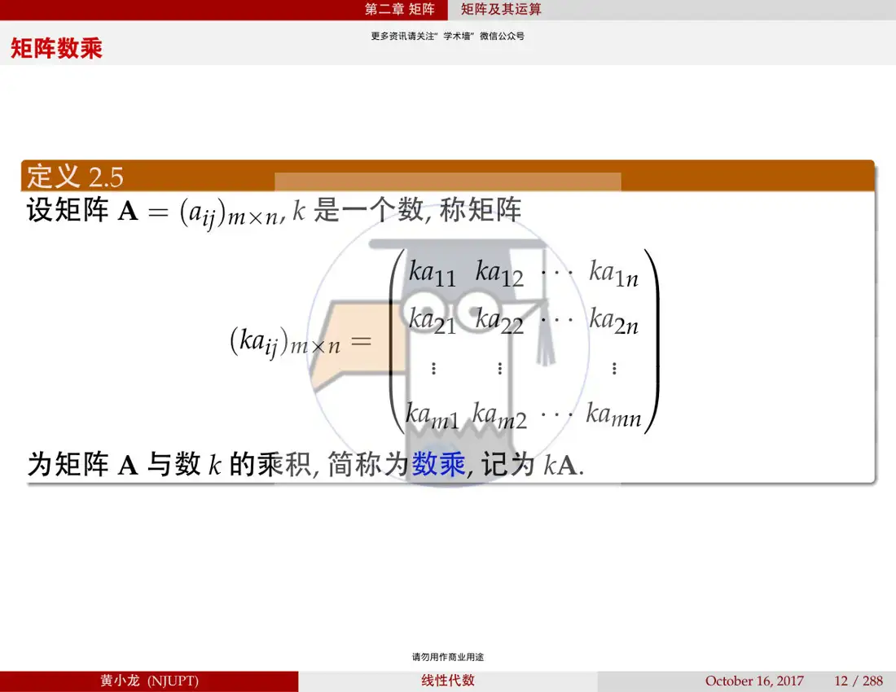

原文：

矩阵数乘

定义 2.5

设矩阵 $\mathbf{A} = (a_{ij})_{m\times n},k$ 是一个数，称矩阵

$$
(k a _ {i j}) _ {m \times n} = \left( \begin{array}{c c c c} k a _ {1 1} & k a _ {1 2} & \dots & k a _ {1 n} \\ k a _ {2 1} & k a _ {2 2} & \dots & k a _ {2 n} \\ \vdots & \vdots & & \vdots \\ k a _ {m 1} & k a _ {m 2} & \dots & k a _ {m n} \end{array} \right)
$$

为矩阵 A 与数 k 的乘积, 简称为数乘, 记为 kA.

第二章 矩阵 矩阵及其运算

更多资讯请关注“学术墙”微信公众号

黄小龙 (NJUPT)

请勿用作商业用途

线性代数

October 16, 2017

12 / 288

### 矩阵数乘

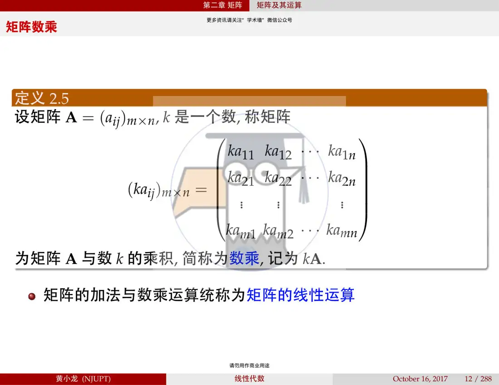

原文：

矩阵数乘

定义 2.5

设矩阵 $\mathbf{A} = (a_{ij})_{m\times n},k$ 是一个数，称矩阵

$$
(k a _ {i j}) _ {m \times n} = \left( \begin{array}{c c c c} k a _ {1 1} & k a _ {1 2} & \dots & k a _ {1 n} \\ k a _ {2 1} & k a _ {2 2} & \dots & k a _ {2 n} \\ \vdots & \vdots & & \vdots \\ k a _ {m 1} & k a _ {m 2} & \dots & k a _ {m n} \end{array} \right)
$$

为矩阵 A 与数 k 的乘积, 简称为数乘, 记为 kA.

\- 矩阵的加法与数乘运算统称为矩阵的线性运算

第二章 矩阵 矩阵及其运算

更多资讯请关注“学术墙”微信公众号

黄小龙 (NJUPT)

请勿用作商业用途

线性代数

October 16, 2017

12 / 288

### 矩阵数乘

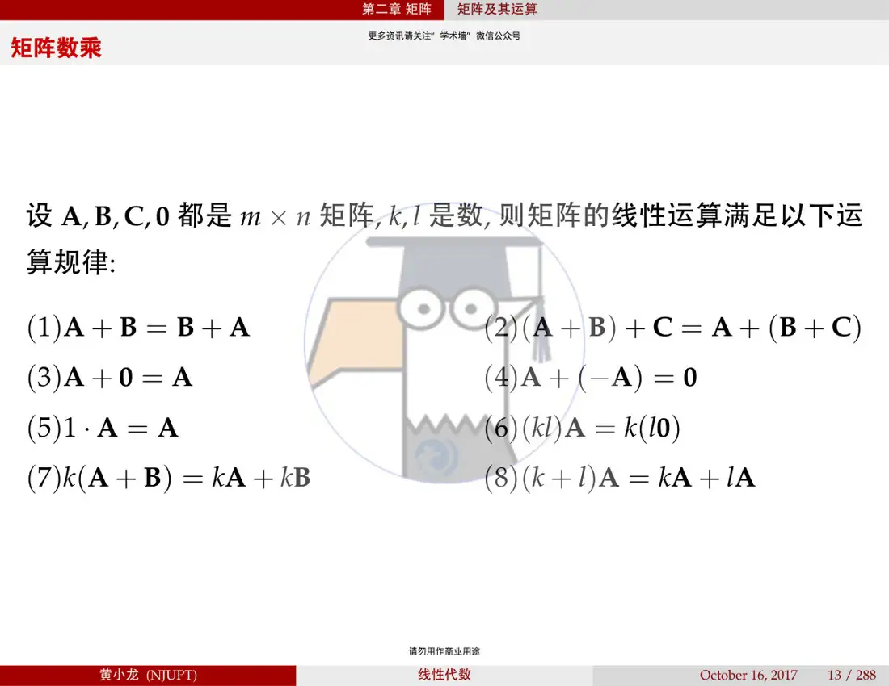

原文：

矩阵数乘

设 A,B,C,0 都是 $m \times n$ 矩阵, k,l 是数, 则矩阵的线性运算满足以下运

算规律:

(1) $\mathbf{A} + \mathbf{B} = \mathbf{B} + \mathbf{A}$

(3) $\mathbf{A} + \mathbf{0} = \mathbf{A}$

(5) $1 \cdot A = A$

(7) $k(\mathbf{A} + \mathbf{B}) = k\mathbf{A} + k\mathbf{B}$

(2) $(\mathbf{A}+\mathbf{B})+\mathbf{C}=\mathbf{A}+(\mathbf{B}+\mathbf{C})$

(4) $\mathbf{A}+(-\mathbf{A})=\mathbf{0}$

(6)(kl)A = k(l0)

(8) $(k + l)\mathbf{A} = k\mathbf{A} + l\mathbf{A}$

第二章 矩阵 矩阵及其运算

更多资讯请关注“学术墙”微信公众号

黄小龙 (NJUPT)

请勿用作商业用途

线性代数

October 16, 2017

13 / 288

### 矩阵数乘

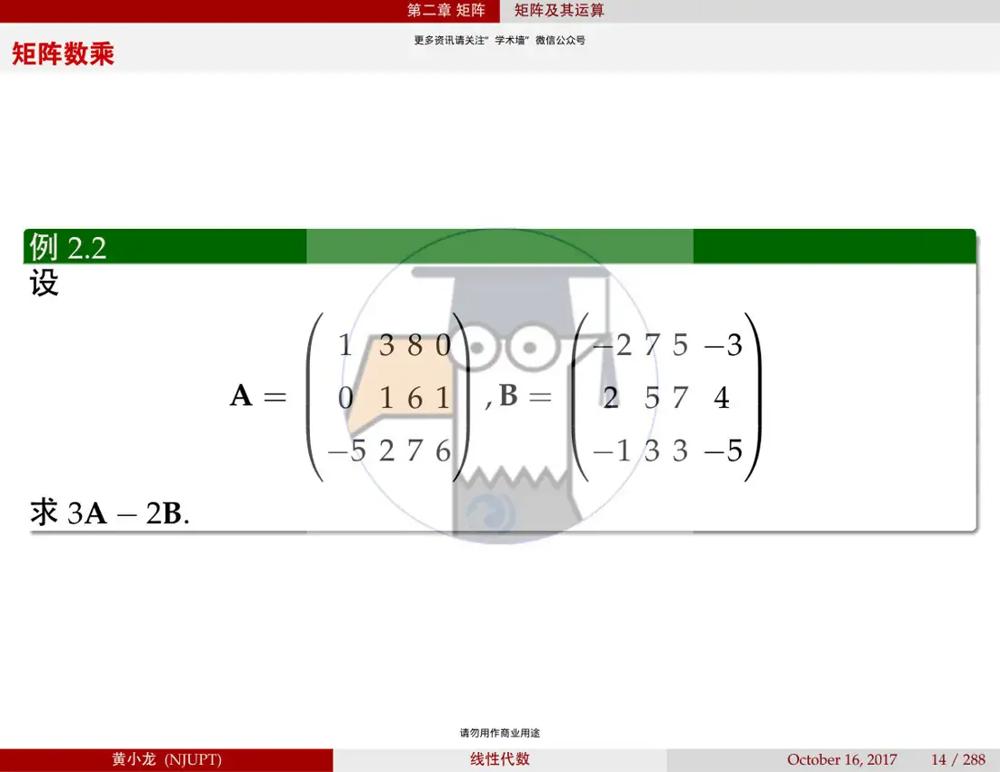

原文：

矩阵数乘

设

求 3A - 2B.

$$
\mathbf {A} = \left( \begin{array}{r r r r} 1 & 3 & 8 & 0 \\ 0 & 1 & 6 & 1 \\ - 5 & 2 & 7 & 6 \end{array} \right), \mathbf {B} = \left( \begin{array}{r r r r} - 2 & 7 & 5 & - 3 \\ 2 & 5 & 7 & 4 \\ - 1 & 3 & 3 & - 5 \end{array} \right)
$$

第二章 矩阵 矩阵及其运算

更多资讯请关注“学术墙”微信公众号

黄小龙 (NJUPT)

请勿用作商业用途

线性代数

October 16, 2017

14 / 288

### 矩阵数乘

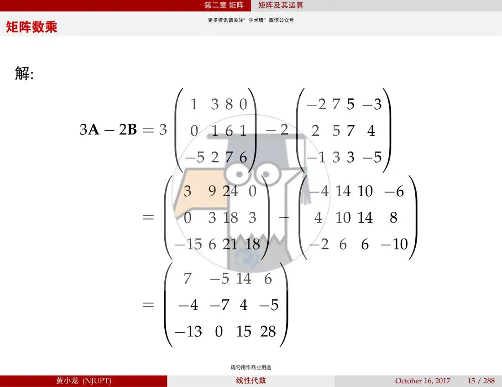

原文：

矩阵数乘

解:

更多资讯请关注“学术墙”微信公众号

$$
\begin{array}{r l} 3 \mathbf {A} - 2 \mathbf {B} & = 3 \left( \begin{array}{r r r r} 1 & 3 & 8 & 0 \\ 0 & 1 & 6 & 1 \\ - 5 & 2 & 7 & 6 \end{array} \right) - 2 \left( \begin{array}{r r r r} - 2 & 7 & 5 & - 3 \\ 2 & 5 & 7 & 4 \\ - 1 & 3 & 3 & - 5 \end{array} \right) \\ & = \left( \begin{array}{r r r r} 3 & 9 & 2 4 & 0 \\ 0 & 3 & 1 8 & 3 \\ - 1 5 & 6 & 2 1 & 1 8 \end{array} \right) - \left( \begin{array}{r r r r} - 4 & 1 4 & 1 0 & - 6 \\ 4 & 1 0 & 1 4 & 8 \\ - 2 & 6 & 6 & - 1 0 \end{array} \right) \\ & = \left( \begin{array}{r r r r} 7 & - 5 & 1 4 & 6 \\ - 4 & - 7 & 4 & - 5 \\ - 1 3 & 0 & 1 5 & 2 8 \end{array} \right) \end{array}
$$

请勿用作商业用途

第二章 矩阵 矩阵及其运算

黄小龙 (NJUPT)

线性代数

October 16, 2017

15 / 288

### 矩阵乘法

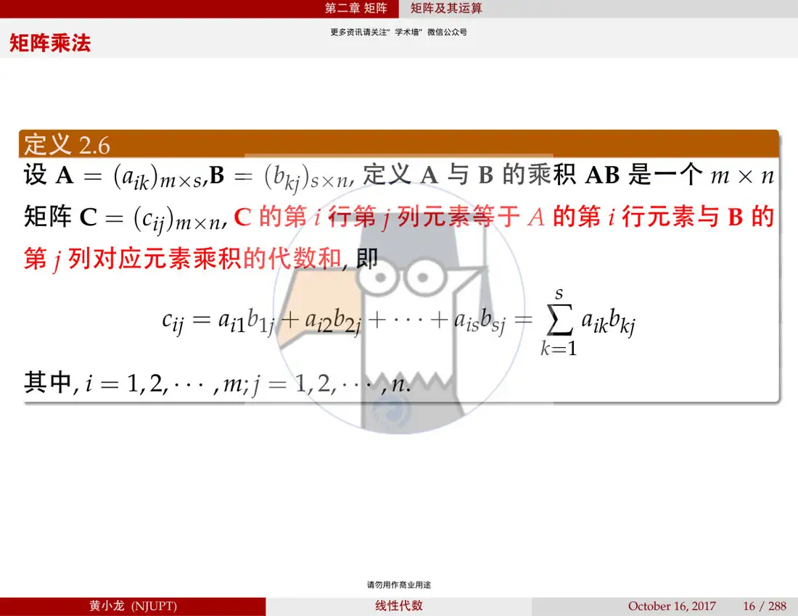

原文：

矩阵乘法

定义 2.6

设 $\mathbf{A} = (a_{ik})_{m \times s}, \mathbf{B} = (b_{kj})_{s \times n}$ , 定义 $\mathbf{A}$ 与 $\mathbf{B}$ 的乘积 $\mathbf{AB}$ 是一个 $m \times n$ 矩阵 $\mathbf{C} = (c_{ij})_{m \times n}, \mathbf{C}$ 的第 $i$ 行第 $j$ 列元素等于 $A$ 的第 $i$ 行元素与 $\mathbf{B}$ 的第 $j$ 列对应元素乘积的代数和, 即

$$
c _ {i j} = a _ {i 1} b _ {1 j} + a _ {i 2} b _ {2 j} + \dots + a _ {i s} b _ {s j} = \sum_ {k = 1} ^ {s} a _ {i k} b _ {k j}
$$

其中, $i=1,2,\cdots,m;j=1,2,\cdots,n.$

第二章 矩阵 矩阵及其运算

更多资讯请关注“学术墙”微信公众号

黄小龙 (NJUPT)

请勿用作商业用途

线性代数

October 16, 2017

16 / 288

### 矩阵乘法

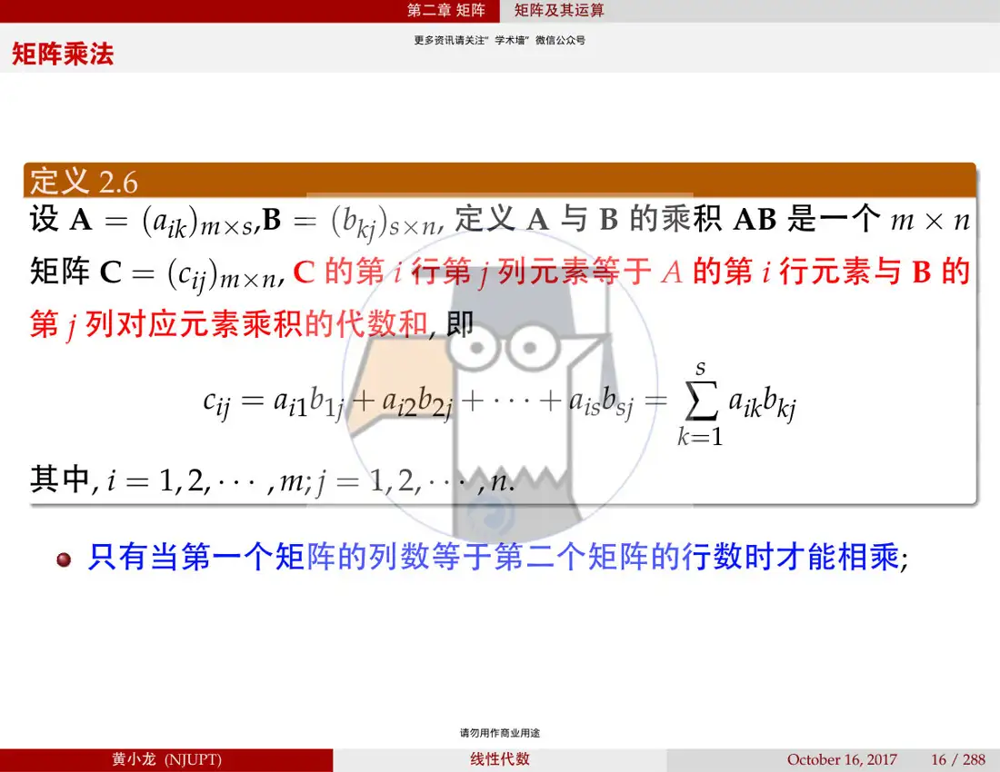

原文：

矩阵乘法

定义 2.6

设 $\mathbf{A} = (a_{ik})_{m \times s}, \mathbf{B} = (b_{kj})_{s \times n}$ , 定义 $\mathbf{A}$ 与 $\mathbf{B}$ 的乘积 $\mathbf{AB}$ 是一个 $m \times n$ 矩阵 $\mathbf{C} = (c_{ij})_{m \times n}$ , $\mathbf{C}$ 的第 $i$ 行第 $j$ 列元素等于 $\mathbf{A}$ 的第 $i$ 行元素与 $\mathbf{B}$ 的第 $j$ 列对应元素乘积的代数和, 即

$$
c _ {i j} = a _ {i 1} b _ {1 j} + a _ {i 2} b _ {2 j} + \dots + a _ {i s} b _ {s j} = \sum_ {k = 1} ^ {s} a _ {i k} b _ {k j}
$$

其中, $i=1,2,\cdots,m;j=1,2,\cdots,n.$

\- 只有当第一个矩阵的列数等于第二个矩阵的行数时才能相乘;

第二章 矩阵 矩阵及其运算

更多资讯请关注“学术墙”微信公众号

黄小龙 (NJUPT)

请勿用作商业用途

线性代数

October 16, 2017

16 / 288

### 矩阵乘法

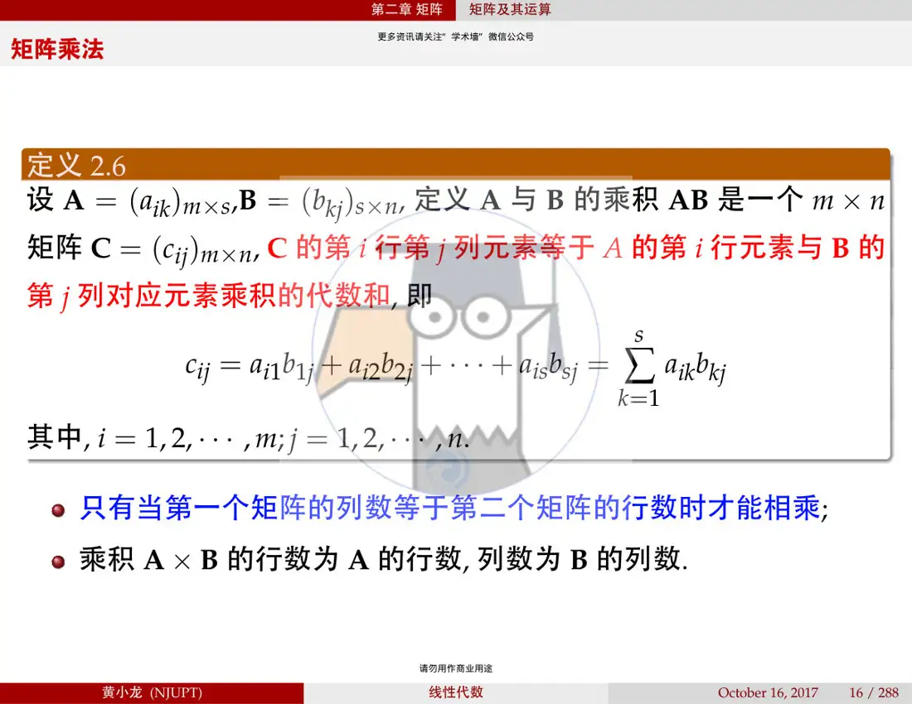

原文：

矩阵乘法

定义 2.6

设 $\mathbf{A} = (a_{ik})_{m \times s}, \mathbf{B} = (b_{kj})_{s \times n}$ , 定义 $\mathbf{A}$ 与 $\mathbf{B}$ 的乘积 $\mathbf{AB}$ 是一个 $m \times n$ 矩阵 $\mathbf{C} = (c_{ij})_{m \times n}, \mathbf{C}$ 的第 $i$ 行第 $j$ 列元素等于 $A$ 的第 $i$ 行元素与 $\mathbf{B}$ 的第 $j$ 列对应元素乘积的代数和, 即

$$
c _ {i j} = a _ {i 1} b _ {1 j} + a _ {i 2} b _ {2 j} + \dots + a _ {i s} b _ {s j} = \sum_ {k = 1} ^ {s} a _ {i k} b _ {k j}
$$

其中, $i=1,2,\cdots,m;j=1,2,\cdots,n.$

\- 只有当第一个矩阵的列数等于第二个矩阵的行数时才能相乘;

\- 乘积 $\mathbf{A} \times \mathbf{B}$ 的行数为 $\mathbf{A}$ 的行数, 列数为 $\mathbf{B}$ 的列数.

第二章 矩阵 矩阵及其运算

更多资讯请关注“学术墙”微信公众号

黄小龙 (NJUPT)

请勿用作商业用途

线性代数

October 16, 2017

16 / 288

### 矩阵乘法

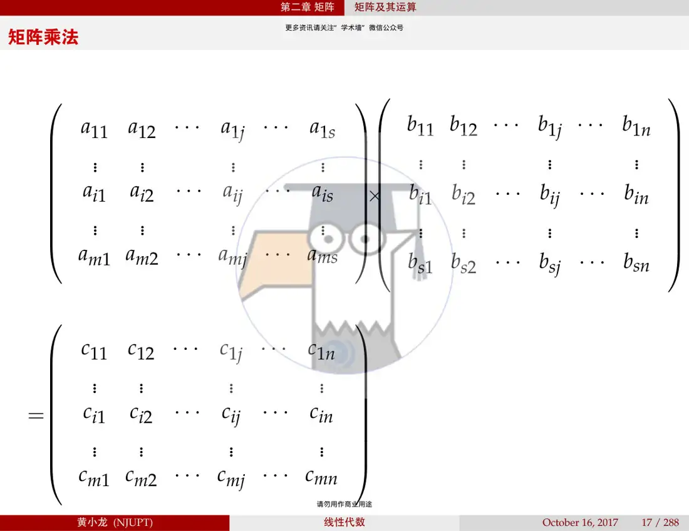

原文：

矩阵乘法

$$
\begin{array}{r l} & {\left( \begin{array}{c c c c c c} {a _ {1 1}} & {a _ {1 2}} & {\dots} & {a _ {1 j}} & {\dots} & {a _ {1 s}} \\ {\vdots} & {\vdots} & & {\vdots} & & {\vdots} \\ {a _ {i 1}} & {a _ {i 2}} & {\dots} & {a _ {i j}} & {\dots} & {a _ {i s}} \\ {\vdots} & {\vdots} & & {\vdots} & & {\vdots} \\ {a _ {m 1}} & {a _ {m 2}} & {\dots} & {a _ {m j}} & {\dots} & {a _ {m s}} \end{array} \right) \times \left( \begin{array}{c c c c c c} {b _ {1 1}} & {b _ {1 2}} & {\dots} & {b _ {1 j}} & {\dots} & {b _ {1 n}} \\ {\vdots} & {\vdots} & & {\vdots} & & {\vdots} \\ {b _ {i 1}} & {b _ {i 2}} & {\dots} & {b _ {i j}} & {\dots} & {b _ {i n}} \\ {\vdots} & {\vdots} & & {\vdots} & & {\vdots} \\ {b _ {s 1}} & {b _ {s 2}} & {\dots} & {b _ {s j}} & {\dots} & {b _ {s n}} \end{array} \right)} \\ & {= \left( \begin{array}{c c c c c c} {c _ {1 1}} & {c _ {1 2}} & {\dots} & {c _ {1 j}} & {\dots} & {c _ {1 n}} \\ {\vdots} & {\vdots} & & {\vdots} & & {\vdots} \\ {c _ {i 1}} & {c _ {i 2}} & {\dots} & {c _ {i j}} & {\dots} & {c _ {i n}} \\ {\vdots} & {\vdots} & & {\vdots} & & {\vdots} \\ {c _ {m 1}} & {c _ {m 2}} & {\dots} & {c _ {m j}} & {\dots} & {c _ {m n}} \end{array} \right)} \end{array}
$$

第二章 矩阵 矩阵及其运算

更多资讯请关注“学术墙”微信公众号

黄小龙 (NJUPT)

线性代数

October 16, 2017

17 / 288

### 矩阵乘法

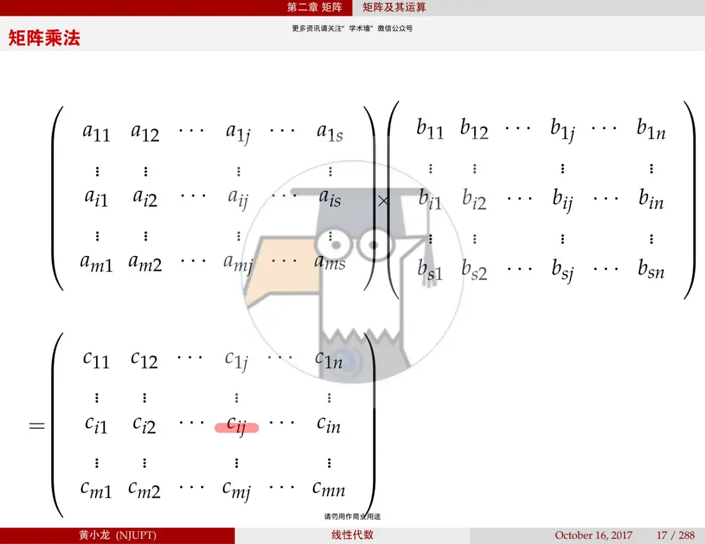

原文：

矩阵乘法

$$
\begin{array}{r l} & {\left( \begin{array}{c c c c c c} {a _ {1 1}} & {a _ {1 2}} & {\dots} & {a _ {1 j}} & {\dots} & {a _ {1 s}} \\ {\vdots} & {\vdots} & & {\vdots} & & {\vdots} \\ {a _ {i 1}} & {a _ {i 2}} & {\dots} & {a _ {i j}} & {\dots} & {a _ {i s}} \\ {\vdots} & {\vdots} & & {\vdots} & & {\vdots} \\ {a _ {m 1}} & {a _ {m 2}} & {\dots} & {a _ {m j}} & {\dots} & {a _ {m s}} \end{array} \right) \times \left( \begin{array}{c c c c c c} {b _ {1 1}} & {b _ {1 2}} & {\dots} & {b _ {1 j}} & {\dots} & {b _ {1 n}} \\ {\vdots} & {\vdots} & & {\vdots} & & {\vdots} \\ {b _ {i 1}} & {b _ {i 2}} & {\dots} & {b _ {i j}} & {\dots} & {b _ {i n}} \\ {\vdots} & {\vdots} & & {\vdots} & & {\vdots} \\ {b _ {s 1}} & {b _ {s 2}} & {\dots} & {b _ {s j}} & {\dots} & {b _ {s n}} \end{array} \right)} \\ & {= \left( \begin{array}{c c c c c c} {c _ {1 1}} & {c _ {1 2}} & {\dots} & {c _ {1 j}} & {\dots} & {c _ {1 n}} \\ {\vdots} & {\vdots} & & {\vdots} & & {\vdots} \\ {c _ {i 1}} & {c _ {i 2}} & {\dots} & {c _ {i j}} & {\dots} & {c _ {i n}} \\ {\vdots} & {\vdots} & & {\vdots} & & {\vdots} \\ {c _ {m 1}} & {c _ {m 2}} & {\dots} & {c _ {m j}} & {\dots} & {c _ {m n}} \end{array} \right)} \end{array}
$$

第二章 矩阵 矩阵及其运算

更多资讯请关注“学术墙”微信公众号

黄小龙 (NJUPT)

线性代数

October 16, 2017

17 / 288

### 矩阵乘法

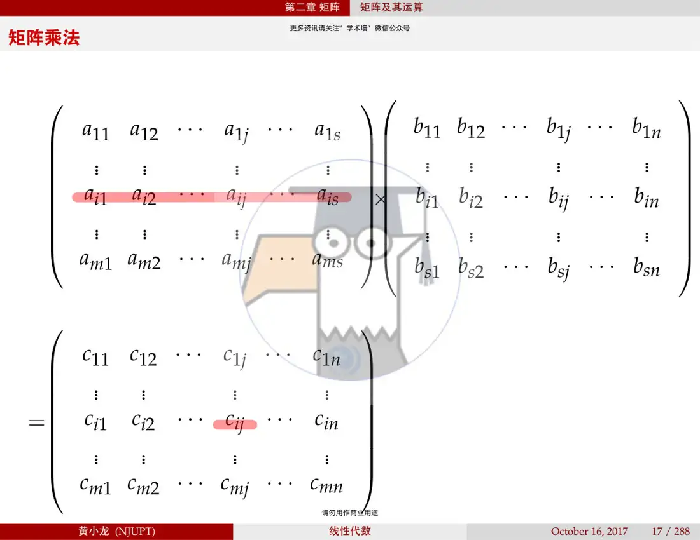

原文：

矩阵乘法

$$
\begin{array}{r l} & {\left( \begin{array}{c c c c c c} {a _ {1 1}} & {a _ {1 2}} & {\dots} & {a _ {1 j}} & {\dots} & {a _ {1 s}} \\ {\vdots} & {\vdots} & & {\vdots} & & {\vdots} \\ {a _ {i 1}} & {a _ {i 2}} & {\dots} & {a _ {i j}} & {\dots} & {a _ {i s}} \\ {\vdots} & {\vdots} & & {\vdots} & & {\vdots} \\ {a _ {m 1}} & {a _ {m 2}} & {\dots} & {a _ {m j}} & {\dots} & {a _ {m s}} \end{array} \right) \times \left( \begin{array}{c c c c c c} {b _ {1 1}} & {b _ {1 2}} & {\dots} & {b _ {1 j}} & {\dots} & {b _ {1 n}} \\ {\vdots} & {\vdots} & & {\vdots} & & {\vdots} \\ {b _ {i 1}} & {b _ {i 2}} & {\dots} & {b _ {i j}} & {\dots} & {b _ {i n}} \\ {\vdots} & {\vdots} & & {\vdots} & & {\vdots} \\ {b _ {s 1}} & {b _ {s 2}} & {\dots} & {b _ {s j}} & {\dots} & {b _ {s n}} \end{array} \right)} \\ & {= \left( \begin{array}{c c c c c c} {c _ {1 1}} & {c _ {1 2}} & {\dots} & {c _ {1 j}} & {\dots} & {c _ {1 n}} \\ {\vdots} & {\vdots} & & {\vdots} & & {\vdots} \\ {c _ {i 1}} & {c _ {i 2}} & {\dots} & {c _ {i j}} & {\dots} & {c _ {i n}} \\ {\vdots} & {\vdots} & & {\vdots} & & {\vdots} \\ {c _ {m 1}} & {c _ {m 2}} & {\dots} & {c _ {m j}} & {\dots} & {c _ {m n}} \end{array} \right)} \end{array}
$$

第二章 矩阵 矩阵及其运算

更多资讯请关注“学术墙”微信公众号

黄小龙 (NJUPT)

线性代数

October 16, 2017

17 / 288

### 矩阵乘法

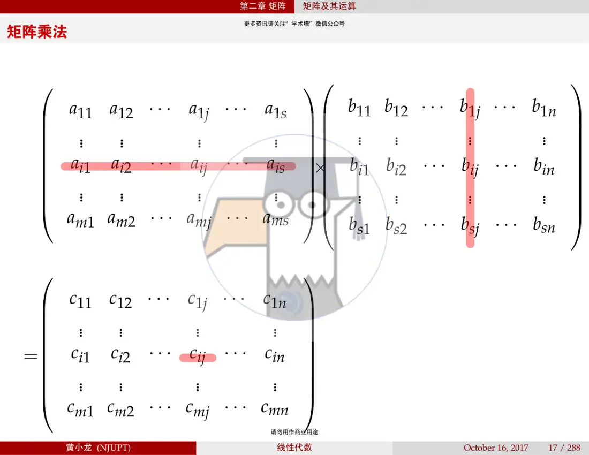

原文：

矩阵乘法

$$
\begin{array}{r l} & {\left( \begin{array}{c c c c c c} {a _ {1 1}} & {a _ {1 2}} & {\dots} & {a _ {1 j}} & {\dots} & {a _ {1 s}} \\ {\vdots} & {\vdots} & & {\vdots} & & {\vdots} \\ {a _ {i 1}} & {a _ {i 2}} & {\dots} & {a _ {i j}} & {\dots} & {a _ {i s}} \\ {\vdots} & {\vdots} & & {\vdots} & & {\vdots} \\ {a _ {m 1}} & {a _ {m 2}} & {\dots} & {a _ {m j}} & {\dots} & {a _ {m s}} \end{array} \right) \times \left( \begin{array}{c c c c c c} {b _ {1 1}} & {b _ {1 2}} & {\dots} & {b _ {1 j}} & {\dots} & {b _ {1 n}} \\ {\vdots} & {\vdots} & & {\vdots} & & {\vdots} \\ {b _ {i 1}} & {b _ {i 2}} & {\dots} & {b _ {i j}} & {\dots} & {b _ {i n}} \\ {\vdots} & {\vdots} & & {\vdots} & & {\vdots} \\ {b _ {s 1}} & {b _ {s 2}} & {\dots} & {b _ {s j}} & {\dots} & {b _ {s n}} \end{array} \right)} \\ & {= \left( \begin{array}{c c c c c c} {c _ {1 1}} & {c _ {1 2}} & {\dots} & {c _ {1 j}} & {\dots} & {c _ {1 n}} \\ {\vdots} & {\vdots} & & {\vdots} & & {\vdots} \\ {c _ {i 1}} & {c _ {i 2}} & {\dots} & {c _ {i j}} & {\dots} & {c _ {i n}} \\ {\vdots} & {\vdots} & & {\vdots} & & {\vdots} \\ {c _ {m 1}} & {c _ {m 2}} & {\dots} & {c _ {m j}} & {\dots} & {c _ {m n}} \end{array} \right)} \end{array}
$$

第二章 矩阵 矩阵及其运算

更多资讯请关注“学术墙”微信公众号

黄小龙 (NJUPT)

线性代数

October 16, 2017

17 / 288

### 矩阵乘法

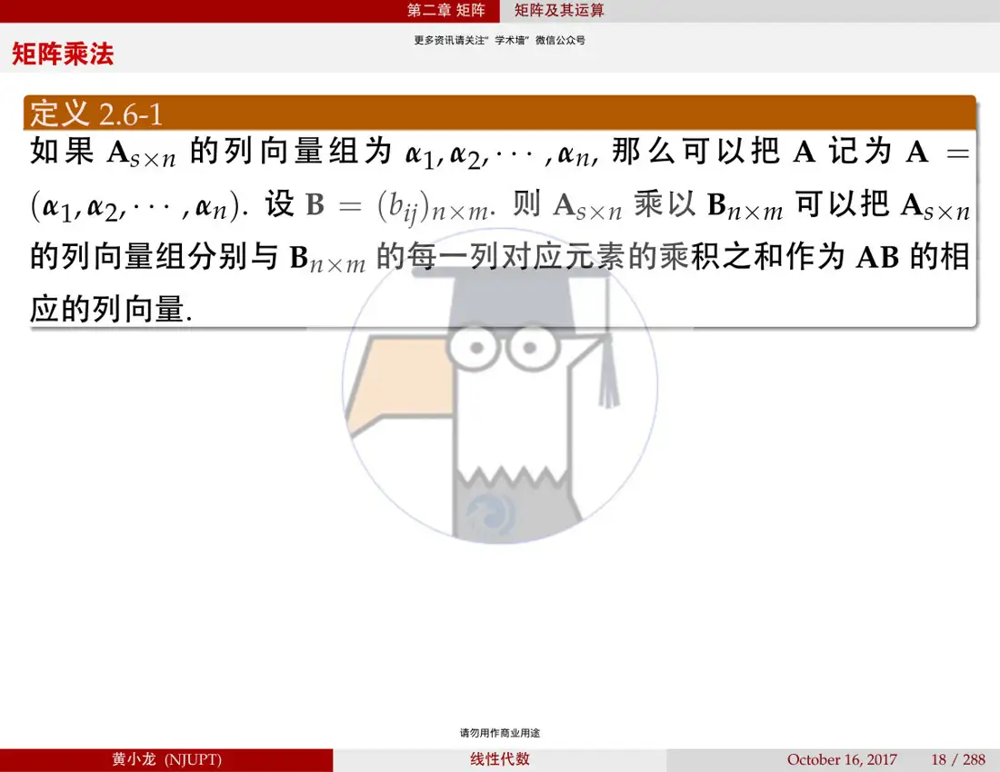

原文：

矩阵乘法

更多资讯请关注“学术墙”微信公众号

定义 2.6-1

如果 $A_{s \times n}$ 的列向量组为 $\alpha_{1}, \alpha_{2}, \cdots, \alpha_{n}$ ，那么可以把 A 记为 $A = (\alpha_{1}, \alpha_{2}, \cdots, \alpha_{n})$ 。设 $B = (b_{ij})_{n \times m}$ 。则 $A_{s \times n}$ 乘以 $B_{n \times m}$ 可以把 $A_{s \times n}$ 的列向量组分别与 $B_{n \times m}$ 的每一列对应元素的乘积之和作为 AB 的相应的列向量。

第二章 矩阵 矩阵及其运算

黄小龙 (NJUPT)

请勿用作商业用途

线性代数

October 16, 2017

18 / 288

### 矩阵乘法

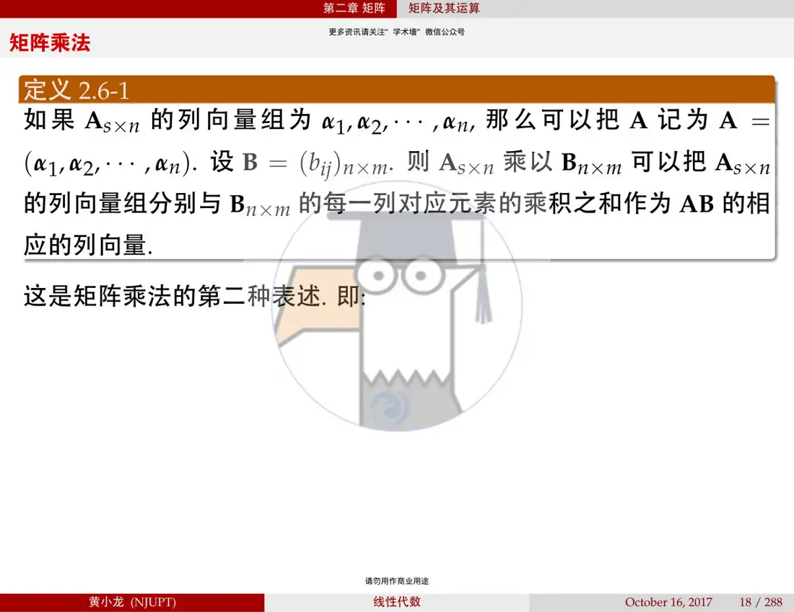

原文：

矩阵乘法

更多资讯请关注“学术墙”微信公众号

定义 2.6-1

如果 $A_{s \times n}$ 的列向量组为 $\alpha_{1}, \alpha_{2}, \cdots, \alpha_{n}$ ，那么可以把 A 记为 $A = (\alpha_{1}, \alpha_{2}, \cdots, \alpha_{n})$ 。设 $B = (b_{ij})_{n \times m}$ 。则 $A_{s \times n}$ 乘以 $B_{n \times m}$ 可以把 $A_{s \times n}$ 的列向量组分别与 $B_{n \times m}$ 的每一列对应元素的乘积之和作为 AB 的相应的列向量。

这是矩阵乘法的第二种表述. 即:

第二章 矩阵 矩阵及其运算

黄小龙 (NJUPT)

请勿用作商业用途

线性代数

October 16, 2017

18 / 288

### 矩阵乘法

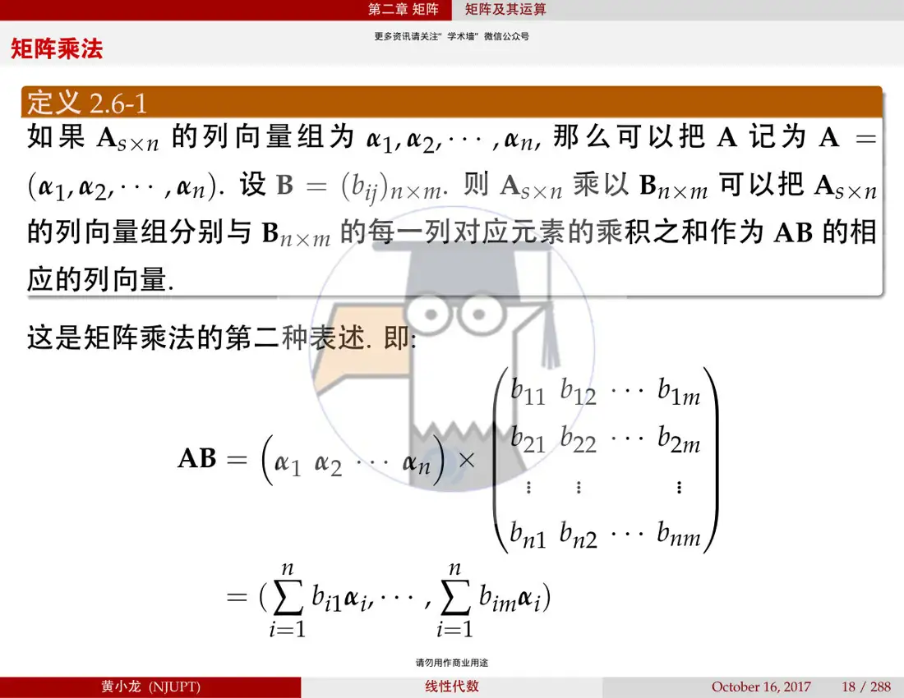

原文：

矩阵乘法

更多资讯请关注“学术墙”微信公众号

定义 2.6-1

如果 $A_{s \times n}$ 的列向量组为 $\alpha_{1}, \alpha_{2}, \cdots, \alpha_{n}$ ，那么可以把 A 记为 $A = (\alpha_{1}, \alpha_{2}, \cdots, \alpha_{n})$ 。设 $B = (b_{ij})_{n \times m}$ 。则 $A_{s \times n}$ 乘以 $B_{n \times m}$ 可以把 $A_{s \times n}$ 的列向量组分别与 $B_{n \times m}$ 的每一列对应元素的乘积之和作为 AB 的相应的列向量。

这是矩阵乘法的第二种表述. 即:

$$
\begin{array}{r l} & {\mathbf {A B} = \left( \begin{array}{l l l l} \alpha_ {1} & \alpha_ {2} & \dots & \alpha_ {n} \end{array} \right) \times \left( \begin{array}{l l l l} b _ {1 1} & b _ {1 2} & \dots & b _ {1 m} \\ b _ {2 1} & b _ {2 2} & \dots & b _ {2 m} \\ \vdots & \vdots & & \vdots \\ b _ {n 1} & b _ {n 2} & \dots & b _ {n m} \end{array} \right)} \\ & {\qquad = (\sum_ {i = 1} ^ {n} b _ {i 1} \alpha_ {i}, \dots , \sum_ {i = 1} ^ {n} b _ {i m} \alpha_ {i})} \end{array}
$$

第二章 矩阵 矩阵及其运算

黄小龙 (NJUPT)

请勿用作商业用途

线性代数

October 16, 2017

18 / 288

### 矩阵乘法

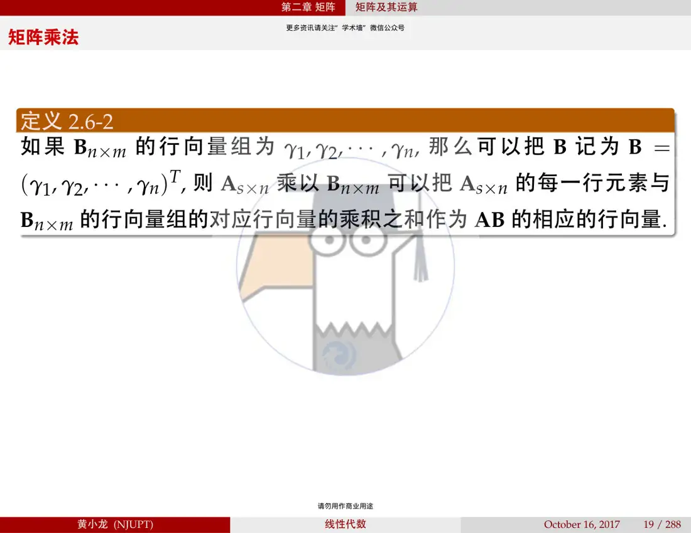

原文：

矩阵乘法

定义 2.6-2

如果 $B_{n\times m}$ 的行向量组为 $\gamma_{1},\gamma_{2},\cdots,\gamma_{n}$ ，那么可以把 B 记为 $\mathbf{B}=(\gamma_{1},\gamma_{2},\cdots,\gamma_{n})^{T}$ ，则 $A_{s\times n}$ 乘以 $B_{n\times m}$ 可以把 $A_{s\times n}$ 的每一行元素与 $B_{n\times m}$ 的行向量组的对应行向量的乘积之和作为 AB 的相应的行向量.

第二章 矩阵 矩阵及其运算

更多资讯请关注“学术墙”微信公众号

黄小龙 (NJUPT)

请勿用作商业用途

线性代数

October 16, 2017

19 / 288

### 矩阵乘法

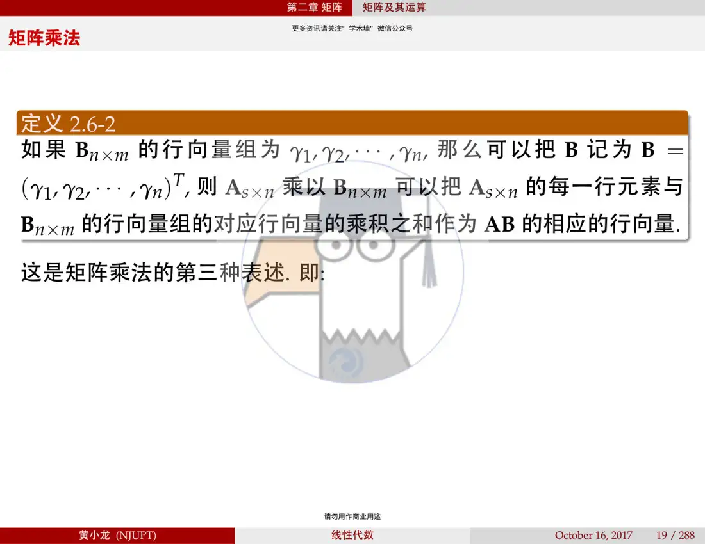

原文：

矩阵乘法

定义 2.6-2

如果 $B_{n\times m}$ 的行向量组为 $\gamma_{1},\gamma_{2},\cdots,\gamma_{n}$ ，那么可以把 B 记为 $\mathbf{B}=(\gamma_{1},\gamma_{2},\cdots,\gamma_{n})^{T}$ ，则 $A_{s\times n}$ 乘以 $B_{n\times m}$ 可以把 $A_{s\times n}$ 的每一行元素与 $B_{n\times m}$ 的行向量组的对应行向量的乘积之和作为 AB 的相应的行向量。这是矩阵乘法的第三种表述。即：

第二章 矩阵 矩阵及其运算

更多资讯请关注“学术墙”微信公众号

黄小龙 (NJUPT)

请勿用作商业用途

线性代数

October 16, 2017

19 / 288

### 矩阵乘法

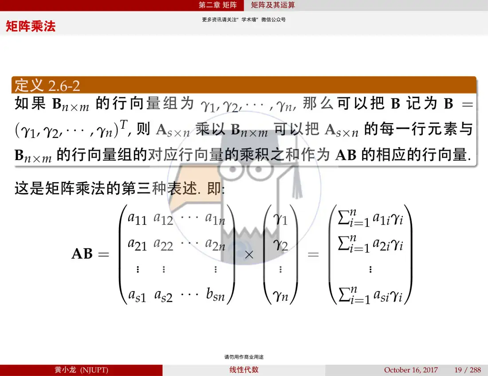

原文：

矩阵乘法

定义 2.6-2

如果 $B_{n\times m}$ 的行向量组为 $\gamma_{1},\gamma_{2},\cdots,\gamma_{n}$ ，那么可以把 B 记为 $\mathbf{B}=(\gamma_{1},\gamma_{2},\cdots,\gamma_{n})^{T}$ ，则 $A_{s\times n}$ 乘以 $B_{n\times m}$ 可以把 $A_{s\times n}$ 的每一行元素与 $B_{n\times m}$ 的行向量组的对应行向量的乘积之和作为 AB 的相应的行向量。这是矩阵乘法的第三种表述。即：

$$
\mathbf {A B} = \left( \begin{array}{c c c c} a _ {1 1} & a _ {1 2} & \dots & a _ {1 n} \\ a _ {2 1} & a _ {2 2} & \dots & a _ {2 n} \\ \vdots & \vdots & & \vdots \\ a _ {s 1} & a _ {s 2} & \dots & b _ {s n} \end{array} \right) \times \left( \begin{array}{c} \gamma_ {1} \\ \gamma_ {2} \\ \vdots \\ \gamma_ {n} \end{array} \right) = \left( \begin{array}{c} \sum_ {i = 1} ^ {n} a _ {1 i} \gamma_ {i} \\ \sum_ {i = 1} ^ {n} a _ {2 i} \gamma_ {i} \\ \vdots \\ \sum_ {i = 1} ^ {n} a _ {s i} \gamma_ {i} \end{array} \right)
$$

第二章 矩阵 矩阵及其运算

更多资讯请关注“学术墙”微信公众号

黄小龙 (NJUPT)

请勿用作商业用途

线性代数

October 16, 2017

19 / 288

### 矩阵乘法

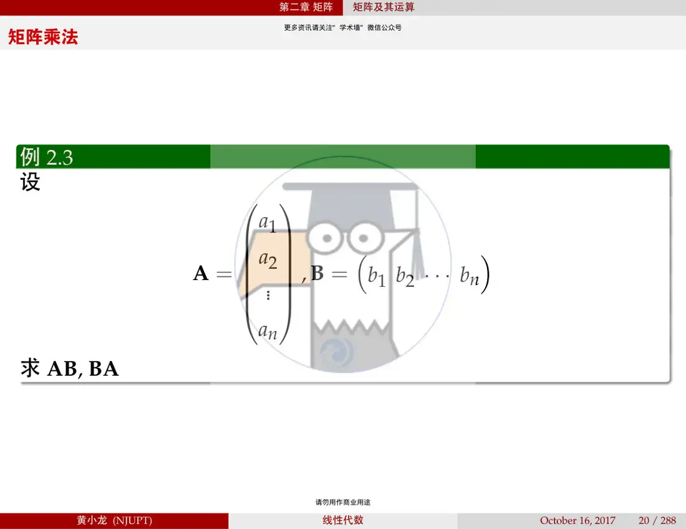

原文：

矩阵乘法

例 2.3

设

求 AB, BA

第二章 矩阵 矩阵及其运算

更多资讯请关注“学术墙”微信公众号

黄小龙 (NJUPT)

请勿用作商业用途

线性代数

October 16, 2017

20 / 288

### 矩阵乘法

原文：

矩阵乘法

第二章 矩阵 矩阵及其运算

更多资讯请关注“学术墙”微信公众号

黄小龙 (NJUPT)

请勿用作商业用途

线性代数

October 16, 2017

21 / 288

### 矩阵乘法

原文：

矩阵乘法

更多资讯请关注“学术墙”微信公众号

解:

第二章 矩阵 矩阵及其运算

黄小龙 (NJUPT)

请勿用作商业用途

线性代数

October 16, 2017

21 / 288

### 矩阵乘法

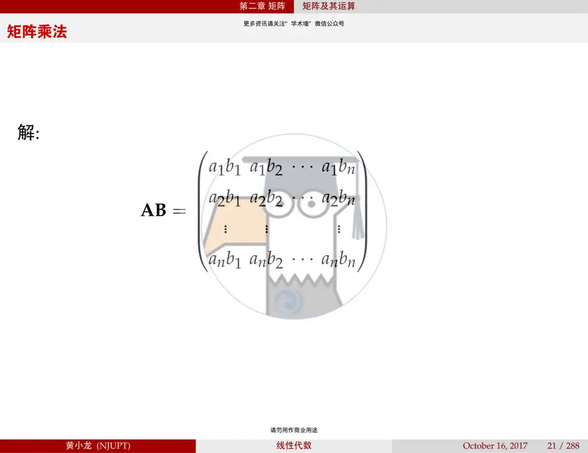

原文：

矩阵乘法

解:

$$
\mathbf {A B} = \left( \begin{array}{c c c c} a _ {1} b _ {1} & a _ {1} b _ {2} & \dots & a _ {1} b _ {n} \\ a _ {2} b _ {1} & a _ {2} b _ {2} & \dots & a _ {2} b _ {n} \\ \vdots & \vdots & & \vdots \\ a _ {n} b _ {1} & a _ {n} b _ {2} & \dots & a _ {n} b _ {n} \end{array} \right)
$$

第二章 矩阵 矩阵及其运算

更多资讯请关注“学术墙”微信公众号

黄小龙 (NJUPT)

请勿用作商业用途

线性代数

October 16, 2017

21 / 288

### 矩阵乘法

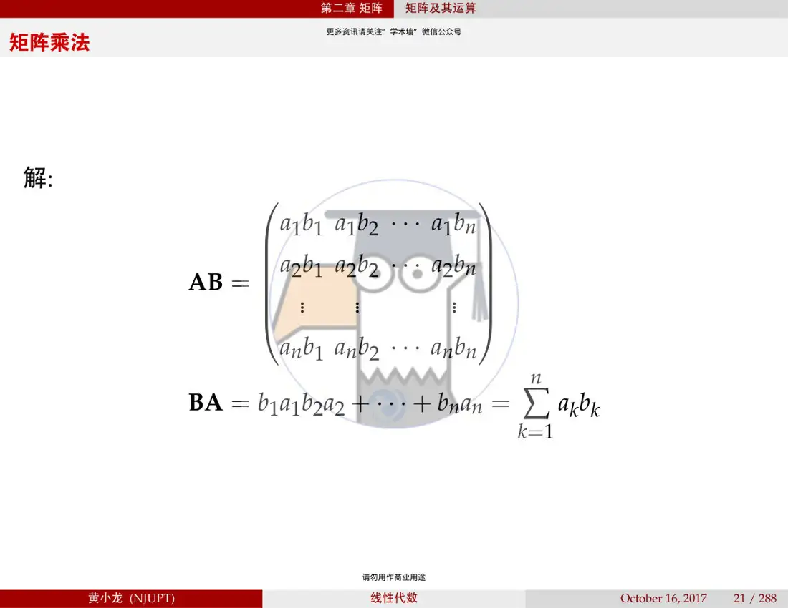

原文：

矩阵乘法

解:

$$
\mathbf {A B} = \left( \begin{array}{c c c c} a _ {1} b _ {1} & a _ {1} b _ {2} & \dots & a _ {1} b _ {n} \\ a _ {2} b _ {1} & a _ {2} b _ {2} & \dots & a _ {2} b _ {n} \\ \vdots & \vdots & & \vdots \\ a _ {n} b _ {1} & a _ {n} b _ {2} & \dots & a _ {n} b _ {n} \end{array} \right)
$$

$$
\mathbf {B A} = b _ {1} a _ {1} b _ {2} a _ {2} + \dots + b _ {n} a _ {n} = \sum_ {k = 1} ^ {n} a _ {k} b _ {k}
$$

第二章 矩阵 矩阵及其运算

更多资讯请关注“学术墙”微信公众号

黄小龙 (NJUPT)

请勿用作商业用途

线性代数

October 16, 2017

21 / 288

### 矩阵乘法

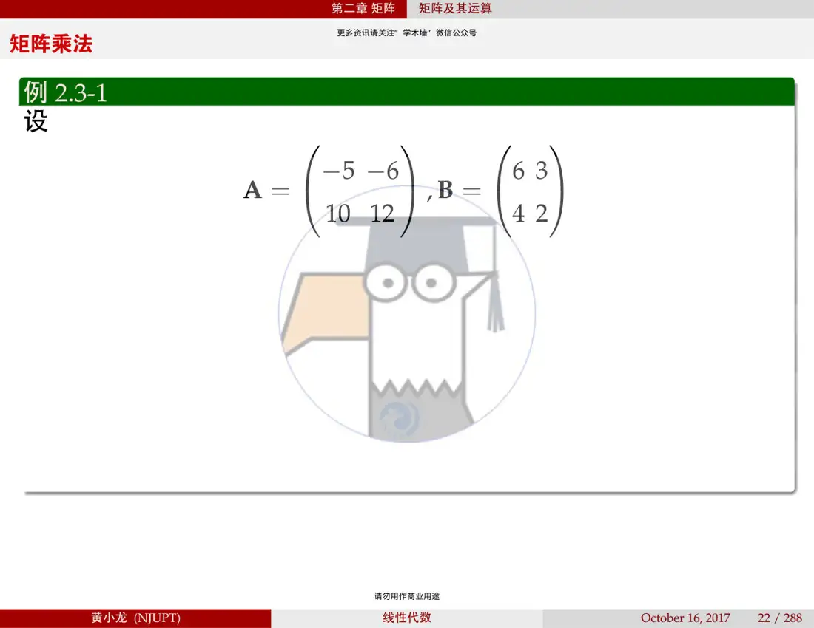

原文：

矩阵乘法

例 2.3-1

设

更多资讯请关注“学术墙”微信公众号

第二章 矩阵 矩阵及其运算

黄小龙 (NJUPT)

请勿用作商业用途

线性代数

October 16, 2017

22 / 288

### 矩阵乘法

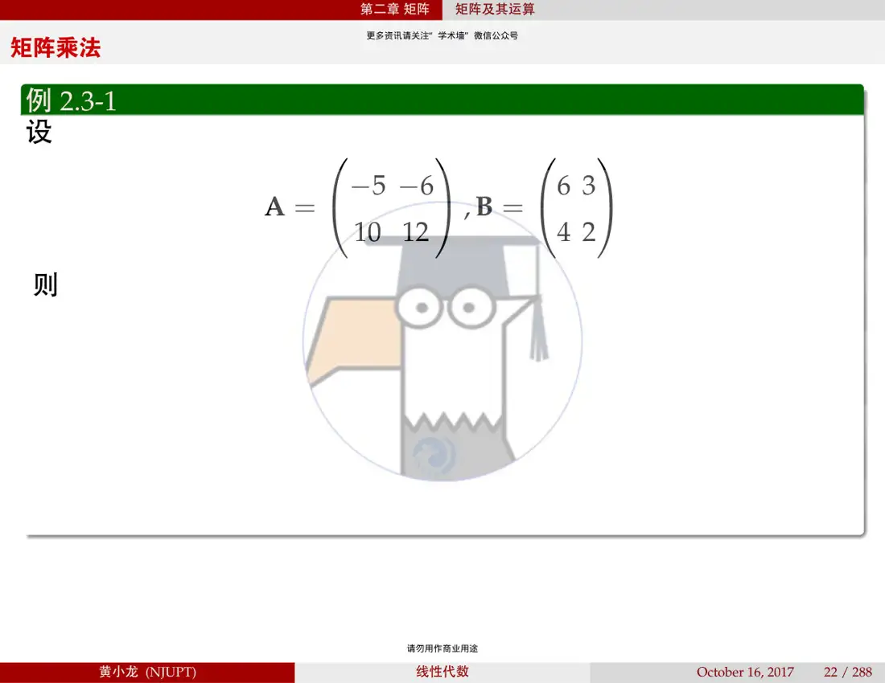

原文：

矩阵乘法

例 2.3-1

设

则

更多资讯请关注“学术墙”微信公众号

第二章 矩阵 矩阵及其运算

黄小龙 (NJUPT)

请勿用作商业用途

线性代数

October 16, 2017

22 / 288

### 矩阵乘法

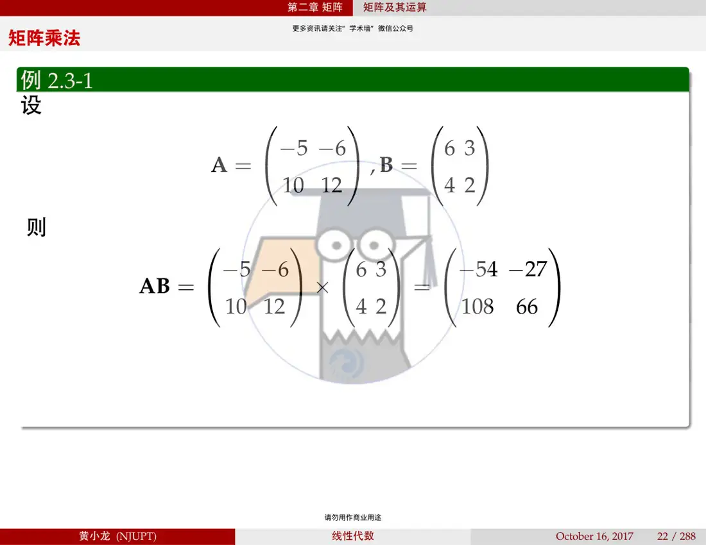

原文：

矩阵乘法

例 2.3-1

设

则

更多资讯请关注“学术墙”微信公众号

$$
\mathbf {A} = \left( \begin{array}{c c} - 5 & - 6 \\ 1 0 & 1 2 \end{array} \right), \mathbf {B} = \left( \begin{array}{c c} 6 & 3 \\ 4 & 2 \end{array} \right)
$$

$$
\mathbf {A B} = \left( \begin{array}{c c} - 5 & - 6 \\ 1 0 & 1 2 \end{array} \right) \times \left( \begin{array}{c c} 6 & 3 \\ 4 & 2 \end{array} \right) = \left( \begin{array}{c c} - 5 4 & - 2 7 \\ 1 0 8 & 6 6 \end{array} \right)
$$

第二章 矩阵 矩阵及其运算

黄小龙 (NJUPT)

请勿用作商业用途

线性代数

October 16, 2017

22 / 288

### 矩阵乘法

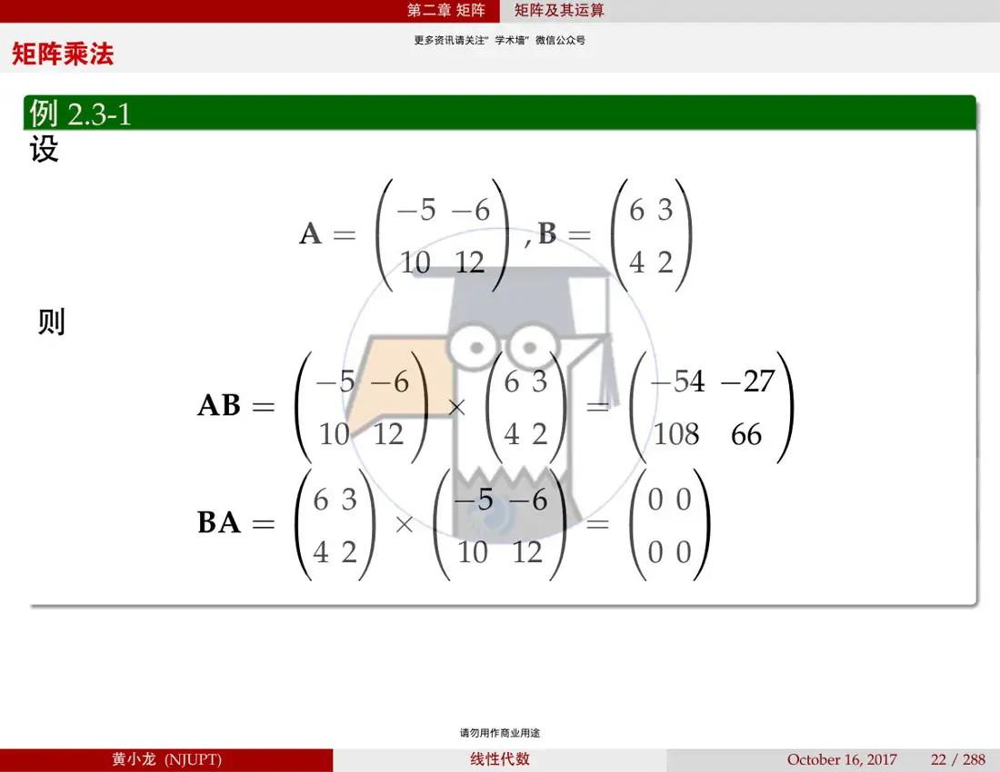

原文：

矩阵乘法

例 2.3-1

设

则

更多资讯请关注“学术墙”微信公众号

$$
\mathbf {A} = \left( \begin{array}{l l} - 5 & - 6 \\ 1 0 & 1 2 \end{array} \right), \mathbf {B} = \left( \begin{array}{l l} 6 & 3 \\ 4 & 2 \end{array} \right)
$$

$$
\mathbf {A B} = \left( \begin{array}{c c} - 5 & - 6 \\ 1 0 & 1 2 \end{array} \right) \times \left( \begin{array}{c c} 6 & 3 \\ 4 & 2 \end{array} \right) = \left( \begin{array}{c c} - 5 4 & - 2 7 \\ 1 0 8 & 6 6 \end{array} \right)
$$

$$
\mathbf {B A} = \left( \begin{array}{c c} 6 & 3 \\ 4 & 2 \end{array} \right) \times \left( \begin{array}{c c} - 5 & - 6 \\ 1 0 & 1 2 \end{array} \right) = \left( \begin{array}{c c} 0 & 0 \\ 0 & 0 \end{array} \right)
$$

第二章 矩阵 矩阵及其运算

黄小龙 (NJUPT)

请勿用作商业用途

线性代数

October 16, 2017

22 / 288

### 矩阵乘法

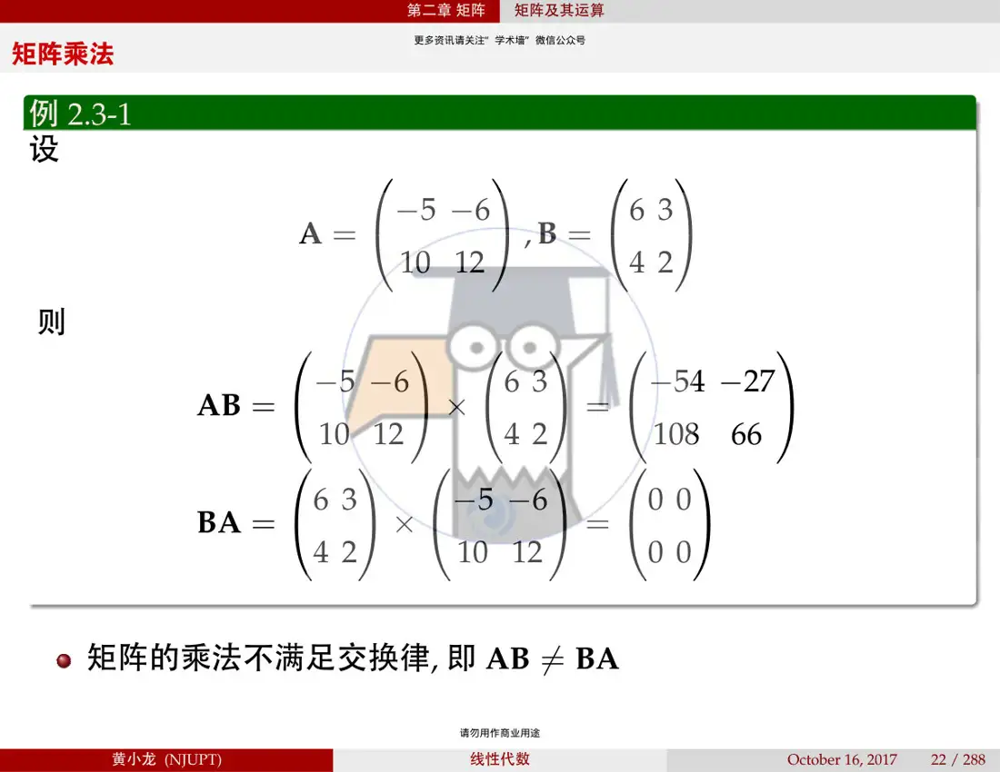

原文：

矩阵乘法

例 2.3-1

设

则

更多资讯请关注“学术墙”微信公众号

$$
\mathbf {A} = \left( \begin{array}{c c} - 5 & - 6 \\ 1 0 & 1 2 \end{array} \right), \mathbf {B} = \left( \begin{array}{c c} 6 & 3 \\ 4 & 2 \end{array} \right)
$$

$$
\mathbf {A B} = \left( \begin{array}{c c} - 5 & - 6 \\ 1 0 & 1 2 \end{array} \right) \times \left( \begin{array}{c c} 6 & 3 \\ 4 & 2 \end{array} \right) = \left( \begin{array}{c c} - 5 4 & - 2 7 \\ 1 0 8 & 6 6 \end{array} \right)
$$

$$
\mathbf {B A} = \left( \begin{array}{c c} 6 & 3 \\ 4 & 2 \end{array} \right) \times \left( \begin{array}{c c} - 5 & - 6 \\ 1 0 & 1 2 \end{array} \right) = \left( \begin{array}{c c} 0 & 0 \\ 0 & 0 \end{array} \right)
$$

\- 矩阵的乘法不满足交换律, 即 AB ≠ BA

第二章 矩阵 矩阵及其运算

黄小龙 (NJUPT)

请勿用作商业用途

线性代数

October 16, 2017

22 / 288

### 矩阵乘法

原文：

矩阵乘法

例 2.3-1

设

则

$$
\mathbf {A} = \left( \begin{array}{c c} - 5 & - 6 \\ 1 0 & 1 2 \end{array} \right), \mathbf {B} = \left( \begin{array}{c c} 6 & 3 \\ 4 & 2 \end{array} \right)
$$

$$
\mathbf {A B} = \left( \begin{array}{c c} - 5 & - 6 \\ 1 0 & 1 2 \end{array} \right) \times \left( \begin{array}{c c} 6 & 3 \\ 4 & 2 \end{array} \right) = \left( \begin{array}{c c} - 5 4 & - 2 7 \\ 1 0 8 & 6 6 \end{array} \right)
$$

$$
\mathbf {B A} = \left( \begin{array}{c c} 6 & 3 \\ 4 & 2 \end{array} \right) \times \left( \begin{array}{c c} - 5 & - 6 \\ 1 0 & 1 2 \end{array} \right) = \left( \begin{array}{c c} 0 & 0 \\ 0 & 0 \end{array} \right)
$$

\- 矩阵的乘法不满足交换律, 即 AB ≠ BA

\- 如果 $\mathbf{AB} = \mathbf{BA}$ , 则称 $\mathbf{A}$ 与 $\mathbf{B}$ 是可交换的.

第二章 矩阵 矩阵及其运算

更多资讯请关注“学术墙”微信公众号

黄小龙 (NJUPT)

线性代数

October 16, 2017

22 / 288

### 矩阵乘法

原文：

矩阵乘法

两个非零矩阵的乘积可以为零矩阵, 即矩阵乘法不满足消去律

第二章 矩阵 矩阵及其运算

更多资讯请关注“学术墙”微信公众号

黄小龙 (NJUPT)

请勿用作商业用途

线性代数

October 16, 2017

23 / 288

### 矩阵乘法

原文：

矩阵乘法

两个非零矩阵的乘积可以为零矩阵, 即矩阵乘法不满足消去律
• 由 AB = 0, 一般不能推出 A = 0 或 B = 0;

第二章 矩阵 矩阵及其运算

更多资讯请关注“学术墙”微信公众号

黄小龙 (NJUPT)

请勿用作商业用途

线性代数

October 16, 2017

23 / 288

### 矩阵乘法

原文：

矩阵乘法

两个非零矩阵的乘积可以为零矩阵, 即矩阵乘法不满足消去律

\- 由 $\mathbf{AB} = 0$ , 一般不能推出 $\mathbf{A} = 0$ 或 $\mathbf{B} = 0$ ;

\- 由 $\mathbf{AB} = \mathbf{AC}$ 且 $\mathbf{A} \neq 0$ 一般不能推出 $\mathbf{B} = \mathbf{C}$ .

第二章 矩阵 矩阵及其运算

更多资讯请关注“学术墙”微信公众号

黄小龙 (NJUPT)

请勿用作商业用途

线性代数

October 16, 2017

23 / 288

### 矩阵乘法

原文：

矩阵乘法

两个非零矩阵的乘积可以为零矩阵, 即矩阵乘法不满足消去律

\- 由 $\mathbf{AB} = 0$ , 一般不能推出 $\mathbf{A} = 0$ 或 $\mathbf{B} = 0$ ;

\- 由 $\mathbf{AB} = \mathbf{AC}$ 且 $\mathbf{A} \neq 0$ 一般不能推出 $\mathbf{B} = \mathbf{C}$ .

矩阵乘法满足以下运算律:

第二章 矩阵 矩阵及其运算

更多资讯请关注“学术墙”微信公众号

黄小龙 (NJUPT)

请勿用作商业用途

线性代数

October 16, 2017

23 / 288

### 矩阵乘法

原文：

矩阵乘法

两个非零矩阵的乘积可以为零矩阵, 即矩阵乘法不满足消去律

\- 由 $\mathbf{AB} = 0$ , 一般不能推出 $\mathbf{A} = 0$ 或 $\mathbf{B} = 0$ ;

\- 由 $\mathbf{AB} = \mathbf{AC}$ 且 $\mathbf{A} \neq 0$ 一般不能推出 $\mathbf{B} = \mathbf{C}$ .

矩阵乘法满足以下运算律:

1 (结合律)(AB)C = A(BC);

第二章 矩阵 矩阵及其运算

更多资讯请关注“学术墙”微信公众号

黄小龙 (NJUPT)

请勿用作商业用途

线性代数

October 16, 2017

23 / 288

### 矩阵乘法

原文：

矩阵乘法

两个非零矩阵的乘积可以为零矩阵, 即矩阵乘法不满足消去律

\- 由 $\mathbf{AB} = 0$ , 一般不能推出 $\mathbf{A} = 0$ 或 $\mathbf{B} = 0$ ;

\- 由 $\mathbf{AB} = \mathbf{AC}$ 且 $\mathbf{A} \neq 0$ 一般不能推出 $\mathbf{B} = \mathbf{C}$ .

矩阵乘法满足以下运算律:

1 (结合律)(AB)C = A(BC);

(左分配律) $A(B+C)=AB+AC$ , (右分配律) $(B+C)A=BA+CA;$

第二章 矩阵 矩阵及其运算

更多资讯请关注“学术墙”微信公众号

黄小龙 (NJUPT)

请勿用作商业用途

线性代数

October 16, 2017

23 / 288

### 矩阵乘法

原文：

矩阵乘法

两个非零矩阵的乘积可以为零矩阵, 即矩阵乘法不满足消去律

\- 由 $\mathbf{AB} = 0$ , 一般不能推出 $\mathbf{A} = 0$ 或 $\mathbf{B} = 0$ ;

\- 由 $\mathbf{AB} = \mathbf{AC}$ 且 $\mathbf{A} \neq 0$ 一般不能推出 $\mathbf{B} = \mathbf{C}$ .

矩阵乘法满足以下运算律:

1 (结合律)(AB)C = A(BC);

(左分配律) $A(B+C)=AB+AC$ , (右分配律) $(B+C)A=BA+CA;$

3 对任何数 k, 有 $k(\mathbf{AB}) = (k\mathbf{A})\mathbf{B} = \mathbf{A}(k\mathbf{B})$ .

第二章 矩阵 矩阵及其运算

更多资讯请关注“学术墙”微信公众号

黄小龙 (NJUPT)

请勿用作商业用途

线性代数

October 16, 2017

23 / 288

### 矩阵乘法

原文：

矩阵乘法

两个非零矩阵的乘积可以为零矩阵, 即矩阵乘法不满足消去律

\- 由 $\mathbf{AB} = 0$ , 一般不能推出 $\mathbf{A} = 0$ 或 $\mathbf{B} = 0$ ;

\- 由 $\mathbf{AB} = \mathbf{AC}$ 且 $\mathbf{A} \neq 0$ 一般不能推出 $\mathbf{B} = \mathbf{C}$ .

矩阵乘法满足以下运算律:

1 (结合律)(AB)C = A(BC);

(左分配律) $A(B+C)=AB+AC$ , (右分配律) $(B+C)A=BA+CA;$

3 对任何数 k, 有 $k(\mathbf{AB}) = (k\mathbf{A})\mathbf{B} = \mathbf{A}(k\mathbf{B})$ .

类似地有:

第二章 矩阵 矩阵及其运算

更多资讯请关注“学术墙”微信公众号

黄小龙 (NJUPT)

请勿用作商业用途

线性代数

October 16, 2017

23 / 288

### 矩阵乘法

原文：

矩阵乘法

两个非零矩阵的乘积可以为零矩阵, 即矩阵乘法不满足消去律

\- 由 $\mathbf{AB} = 0$ , 一般不能推出 $\mathbf{A} = 0$ 或 $\mathbf{B} = 0$ ;

\- 由 $\mathbf{AB} = \mathbf{AC}$ 且 $\mathbf{A} \neq 0$ 一般不能推出 $\mathbf{B} = \mathbf{C}$ .

矩阵乘法满足以下运算律:

1 (结合律)(AB)C = A(BC);

(左分配律) $A(B+C)=AB+AC$ , (右分配律) $(B+C)A=BA+CA;$

3 对任何数 k, 有 $k(\mathbf{AB}) = (k\mathbf{A})\mathbf{B} = \mathbf{A}(k\mathbf{B})$ .

类似地有:

• A(B - C) = AB - AC, (B - C)A = BA - CA;

第二章 矩阵 矩阵及其运算

更多资讯请关注“学术墙”微信公众号

黄小龙 (NJUPT)

请勿用作商业用途

线性代数

October 16, 2017

23 / 288

### 矩阵乘法

原文：

矩阵乘法

更多资讯请关注“学术墙”微信公众号

1 (结合律)(AB)C = A(BC);

第二章 矩阵 矩阵及其运算

黄小龙 (NJUPT)

请勿用作商业用途

线性代数

October 16, 2017

24 / 288

### 矩阵乘法

原文：

矩阵乘法

1 (结合律)(AB)C = A(BC);

证明: 设 $\mathbf{A} = (a_{ij})_{m \times s}, \mathbf{B} = (b_{ij})_{s \times r}, \mathbf{C} = (c_{ij})_{r \times n}$ ，则显然 $(\mathbf{AB})\mathbf{C}$ 与 $\mathbf{A}(\mathbf{BC})$ 都是 $m \times n$ 矩阵.

第二章 矩阵 矩阵及其运算

更多资讯请关注“学术墙”微信公众号

黄小龙 (NJUPT)

请勿用作商业用途

线性代数

October 16, 2017

24 / 288

### 矩阵乘法

原文：

矩阵乘法

1 (结合律)(AB)C = A(BC);

证明: 设 $\mathbf{A} = (a_{ij})_{m \times s}, \mathbf{B} = (b_{ij})_{s \times r}, \mathbf{C} = (c_{ij})_{r \times n}$ ，则显然 $(\mathbf{AB})\mathbf{C}$ 与 $\mathbf{A}(\mathbf{BC})$ 都是 $m \times n$ 矩阵。由于

第二章 矩阵 矩阵及其运算

更多资讯请关注“学术墙”微信公众号

黄小龙 (NJUPT)

请勿用作商业用途

线性代数

October 16, 2017

24 / 288

### 矩阵乘法

原文：

矩阵乘法

1 (结合律)(AB)C = A(BC);

证明: 设 $\mathbf{A} = (a_{ij})_{m \times s}, \mathbf{B} = (b_{ij})_{s \times r}, \mathbf{C} = (c_{ij})_{r \times n}$ ，则显然 $(\mathbf{AB})\mathbf{C}$ 与 $\mathbf{A}(\mathbf{BC})$ 都是 $m \times n$ 矩阵。由于

$$
[ (\mathbf {A B}) \mathbf {C} ] (i, j) = \sum_ {l = 1} ^ {r} [ (\mathbf {A B}) (i, l) ] c _ {l j} = \sum_ {l = 1} ^ {r} (\sum_ {k = 1} ^ {s} a _ {i k} b _ {k l}) c _ {i j} = \sum_ {l = 1} ^ {r} \sum_ {k = 1} ^ {s} a _ {i k} b _ {k l} c _ {i j}
$$

第二章 矩阵 矩阵及其运算

更多资讯请关注“学术墙”微信公众号

黄小龙 (NJUPT)

请勿用作商业用途

线性代数

October 16, 2017

24 / 288

### 矩阵乘法

原文：

矩阵乘法

1 (结合律)(AB)C = A(BC);

证明: 设 $\mathbf{A} = (a_{ij})_{m \times s}, \mathbf{B} = (b_{ij})_{s \times r}, \mathbf{C} = (c_{ij})_{r \times n}$ ，则显然 $(\mathbf{AB})\mathbf{C}$ 与 $\mathbf{A}(\mathbf{BC})$ 都是 $m \times n$ 矩阵。由于

$$
\begin{array}{l} \left[ (\mathbf {A B}) \mathbf {C} \right] (i, j) = \sum_ {l = 1} ^ {r} \left[ (\mathbf {A B}) (i, l) \right] c _ {l j} = \sum_ {l = 1} ^ {r} \left(\sum_ {k = 1} ^ {s} a _ {i k} b _ {k l}\right) c _ {i j} = \sum_ {l = 1} ^ {r} \sum_ {k = 1} ^ {s} a _ {i k} b _ {k l} c _ {i j} \\ \left[ \mathbf {A} (\mathbf {B C}) \right] (i, j) = \sum_ {k = 1} ^ {s} a _ {i k} \left[ (\mathbf {B C}) (k, j) \right] = \sum_ {k = 1} ^ {s} a _ {i k} \left(\sum_ {l = 1} ^ {r} b _ {k l} c _ {l j}\right) = \sum_ {k = 1} ^ {s} \left(\sum_ {l = 1} ^ {r} a _ {i k} b _ {k l} c _ {l j}\right) \end{array}
$$

第二章 矩阵 矩阵及其运算

更多资讯请关注“学术墙”微信公众号

黄小龙 (NJUPT)

请勿用作商业用途

线性代数

October 16, 2017

24 / 288

### 矩阵乘法

原文：

矩阵乘法

1 (结合律)(AB)C = A(BC);

证明: 设 $\mathbf{A} = (a_{ij})_{m \times s}, \mathbf{B} = (b_{ij})_{s \times r}, \mathbf{C} = (c_{ij})_{r \times n}$ ，则显然 $(\mathbf{AB})\mathbf{C}$ 与 $\mathbf{A}(\mathbf{BC})$ 都是 $m \times n$ 矩阵。由于

$$
[ (\mathbf {A B}) \mathbf {C} ] (i, j) = \sum_ {l = 1} ^ {r} [ (\mathbf {A B}) (i, l) ] c _ {l j} = \sum_ {l = 1} ^ {r} (\sum_ {k = 1} ^ {s} a _ {i k} b _ {k l}) c _ {i j} = \sum_ {l = 1} ^ {r} \sum_ {k = 1} ^ {s} a _ {i k} b _ {k l} c _ {i j}
$$

$$
\begin{array}{l} \left[ \mathbf {A} (\mathbf {B C}) \right] (i, j) = \sum_ {k = 1} ^ {s} a _ {i k} [ (\mathbf {B C}) (k, j) ] = \sum_ {k = 1} ^ {s} a _ {i k} (\sum_ {l = 1} ^ {r} b _ {k l} c _ {l j}) = \sum_ {k = 1} ^ {s} (\sum_ {l = 1} ^ {r} a _ {i k} b _ {k l} c _ {l j}) \\ = \sum_ {l = 1} ^ {r} \sum_ {k = 1} ^ {s} a _ {i k} b _ {k l} c _ {i j} \end{array}
$$

第二章 矩阵 矩阵及其运算

更多资讯请关注“学术墙”微信公众号

黄小龙 (NJUPT)

请勿用作商业用途

线性代数

October 16, 2017

24 / 288

### 矩阵乘法

原文：

矩阵乘法

1 (结合律)(AB)C = A(BC);

证明: 设 $\mathbf{A} = (a_{ij})_{m \times s}, \mathbf{B} = (b_{ij})_{s \times r}, \mathbf{C} = (c_{ij})_{r \times n}$ ，则显然 $(\mathbf{AB})\mathbf{C}$ 与 $\mathbf{A}(\mathbf{BC})$ 都是 $m \times n$ 矩阵。由于

$$
[ (\mathbf {A B}) \mathbf {C} ] (i, j) = \sum_ {l = 1} ^ {r} [ (\mathbf {A B}) (i, l) ] c _ {l j} = \sum_ {l = 1} ^ {r} (\sum_ {k = 1} ^ {s} a _ {i k} b _ {k l}) c _ {i j} = \sum_ {l = 1} ^ {r} \sum_ {k = 1} ^ {s} a _ {i k} b _ {k l} c _ {i j}
$$

$$
\begin{array}{l} \left[ \mathbf {A} (\mathbf {B C}) \right] (i, j) = \sum_ {k = 1} ^ {s} a _ {i k} [ (\mathbf {B C}) (k, j) ] = \sum_ {k = 1} ^ {s} a _ {i k} (\sum_ {l = 1} ^ {r} b _ {k l} c _ {l j}) = \sum_ {k = 1} ^ {s} (\sum_ {l = 1} ^ {r} a _ {i k} b _ {k l} c _ {l j}) \\ = \sum_ {l = 1} ^ {r} \sum_ {k = 1} ^ {s} a _ {i k} b _ {k l} c _ {i j} \end{array}
$$

因此 $\left[(\mathbf{A}\mathbf{B})\mathbf{C}\right](i,j)=\mathbf{A}(\mathbf{B}\mathbf{C})](i,j)$ ， $i=1,2,\cdots,m;j=1,2,\cdots,n.$

第二章 矩阵 矩阵及其运算

更多资讯请关注“学术墙”微信公众号

黄小龙 (NJUPT)

请勿用作商业用途

线性代数

October 16, 2017

24 / 288

### 矩阵乘法

原文：

矩阵乘法

1 (结合律)(AB)C = A(BC);

证明: 设 $\mathbf{A} = (a_{ij})_{m \times s}, \mathbf{B} = (b_{ij})_{s \times r}, \mathbf{C} = (c_{ij})_{r \times n}$ ，则显然 $(\mathbf{AB})\mathbf{C}$ 与 $\mathbf{A}(\mathbf{BC})$ 都是 $m \times n$ 矩阵。由于

$$
[ (\mathbf {A B}) \mathbf {C} ] (i, j) = \sum_ {l = 1} ^ {r} [ (\mathbf {A B}) (i, l) ] c _ {l j} = \sum_ {l = 1} ^ {r} (\sum_ {k = 1} ^ {s} a _ {i k} b _ {k l}) c _ {i j} = \sum_ {l = 1} ^ {r} \sum_ {k = 1} ^ {s} a _ {i k} b _ {k l} c _ {i j}
$$

$$
\begin{array}{l} \left[ \mathbf {A} (\mathbf {B C}) \right] (i, j) = \sum_ {k = 1} ^ {s} a _ {i k} [ (\mathbf {B C}) (k, j) ] = \sum_ {k = 1} ^ {s} a _ {i k} (\sum_ {l = 1} ^ {r} b _ {k l} c _ {l j}) = \sum_ {k = 1} ^ {s} (\sum_ {l = 1} ^ {r} a _ {i k} b _ {k l} c _ {l j}) \\ = \sum_ {l = 1} ^ {r} \sum_ {k = 1} ^ {s} a _ {i k} b _ {k l} c _ {i j} \end{array}
$$

因此 $\left[(\mathbf{A}\mathbf{B})\mathbf{C}\right](i,j)=\mathbf{A}(\mathbf{B}\mathbf{C})](i,j)$ ， $i=1,2,\cdots,m;j=1,2,\cdots,n.$ 从而

第二章 矩阵 矩阵及其运算

更多资讯请关注“学术墙”微信公众号

黄小龙 (NJUPT)

请勿用作商业用途

线性代数

October 16, 2017

24 / 288

### 矩阵乘法

原文：

矩阵乘法

1 (结合律)(AB)C = A(BC);

证明: 设 $\mathbf{A} = (a_{ij})_{m \times s}, \mathbf{B} = (b_{ij})_{s \times r}, \mathbf{C} = (c_{ij})_{r \times n}$ , 则显然 (AB)C 与 $\mathbf{A}(\mathbf{BC})$ 都是 $m \times n$ 矩阵. 由于

$$
[ (\mathbf {A B}) \mathbf {C} ] (i, j) = \sum_ {l = 1} ^ {r} [ (\mathbf {A B}) (i, l) ] c _ {l j} = \sum_ {l = 1} ^ {r} (\sum_ {k = 1} ^ {s} a _ {i k} b _ {k l}) c _ {i j} = \sum_ {l = 1} ^ {r} \sum_ {k = 1} ^ {s} a _ {i k} b _ {k l} c _ {i j}
$$

$$
\begin{array}{l} \left[ \mathbf {A} (\mathbf {B C}) \right] (i, j) = \sum_ {k = 1} ^ {s} a _ {i k} [ (\mathbf {B C}) (k, j) ] = \sum_ {k = 1} ^ {s} a _ {i k} (\sum_ {l = 1} ^ {r} b _ {k l} c _ {l j}) = \sum_ {k = 1} ^ {s} (\sum_ {l = 1} ^ {r} a _ {i k} b _ {k l} c _ {l j}) \\ = \sum_ {l = 1} ^ {r} \sum_ {k = 1} ^ {s} a _ {i k} b _ {k l} c _ {i j} \end{array}
$$

因此 $\left[(\mathbf{A}\mathbf{B})\mathbf{C}\right](i,j)=\mathbf{A}(\mathbf{B}\mathbf{C})](i,j)$ ， $i=1,2,\cdots,m;j=1,2,\cdots,n.$ 从而

$$
(\mathbf {A B}) \mathbf {C} = \mathbf {A} (\mathbf {B C})
$$

第二章 矩阵 矩阵及其运算

更多资讯请关注“学术墙”微信公众号

黄小龙 (NJUPT)

请勿用作商业用途

线性代数

October 16, 2017

24 / 288

### 矩阵乘法

原文：

矩阵乘法

定义 2.7

主对角元素都是 1, 其余元素都是 0 的 $n \times n$ 矩阵称为 $n$ 阶单位矩阵, 记为 $\mathbf{I}_n$ , 或简记为 $\mathbf{I}$ .

第二章 矩阵 矩阵及其运算

更多资讯请关注“学术墙”微信公众号

黄小龙 (NJUPT)

请勿用作商业用途

线性代数

October 16, 2017

25 / 288

### 矩阵乘法

原文：

矩阵乘法

更多资讯请关注“学术墙”微信公众号

定义 2.7

主对角元素都是 1, 其余元素都是 0 的 $n \times n$ 矩阵称为 $n$ 阶单位矩阵, 记为 $\mathbf{I}_n$ , 或简记为 I.

\- $\mathbf{I}_m\mathbf{A}_{m\times n} = \mathbf{A}_{m\times n},\mathbf{A}_{m\times n}\mathbf{I}_n = \mathbf{A}_{m\times n}$ , 特别地, $\mathbf{I}_n\mathbf{A}_{n\times n} = \mathbf{A}_{n\times n}\mathbf{I}_n = \mathbf{A}_{n\times n}$ .

第二章 矩阵 矩阵及其运算

黄小龙 (NJUPT)

请勿用作商业用途

线性代数

October 16, 2017

25 / 288

### 矩阵乘法

原文：

矩阵乘法

更多资讯请关注“学术墙”微信公众号

定义 2.8

形如

的 n 阶矩阵称为数量矩阵, 记为 $\lambda I_{n}$ .

矩阵及其运算

黄小龙 (NJUPT)

请勿用作商业用途

线性代数

October 16, 2017

26 / 288

### 矩阵乘法

原文：

矩阵乘法

第二章 矩阵 矩阵及其运算

更多资讯请关注“学术墙”微信公众号

黄小龙 (NJUPT)

请勿用作商业用途

线性代数

October 16, 2017

27 / 288

### 矩阵乘法

原文：

矩阵乘法

更多资讯请关注“学术墙”微信公众号

第二章 矩阵 矩阵及其运算

黄小龙 (NJUPT)

请勿用作商业用途

线性代数

October 16, 2017

27 / 288

### 矩阵乘法

原文：

矩阵乘法

$$
\begin{array}{l} \bullet (\lambda \mathbf {I} _ {n}) \mathbf {A} _ {n \times n} = \lambda (\mathbf {I} _ {n} \mathbf {A} _ {n \times n}) = \lambda \mathbf {A} _ {n \times n}, \mathbf {A} _ {n \times n} (\lambda \mathbf {I} _ {n}) = \lambda (\mathbf {A} _ {n \times n} \mathbf {I} _ {n}) = \\ \lambda \mathbf {A} _ {n \times n}. \end{array}
$$

\- $n$ 阶数量矩阵与所有 $n$ 阶矩阵做乘法是可交换的.

第二章 矩阵 矩阵及其运算

更多资讯请关注“学术墙”微信公众号

黄小龙 (NJUPT)

请勿用作商业用途

线性代数

October 16, 2017

27 / 288

### 矩阵乘法

原文：

矩阵乘法

$\cdot (\lambda \mathbf{I}_n)\mathbf{A}_{n\times n} = \lambda (\mathbf{I}_n\mathbf{A}_{n\times n}) = \lambda \mathbf{A}_{n\times n},\mathbf{A}_{n\times n}(\lambda \mathbf{I}_n) = \lambda (\mathbf{A}_{n\times n}\mathbf{I}_n) =$ $\lambda \mathbf{A}_{n\times n}$

\- $n$ 阶数量矩阵与所有 $n$ 阶矩阵做乘法是可交换的.

\- 与所有 $n$ 阶矩阵做乘法可交换的矩阵一定是 $n$ 阶数量矩阵.

第二章 矩阵 矩阵及其运算

更多资讯请关注“学术墙”微信公众号

黄小龙 (NJUPT)

请勿用作商业用途

线性代数

October 16, 2017

27 / 288

### 矩阵乘法

原文：

矩阵乘法

$\cdot (\lambda \mathbf{I}_n)\mathbf{A}_{n\times n} = \lambda (\mathbf{I}_n\mathbf{A}_{n\times n}) = \lambda \mathbf{A}_{n\times n},\mathbf{A}_{n\times n}(\lambda \mathbf{I}_n) = \lambda (\mathbf{A}_{n\times n}\mathbf{I}_n) =$ $\lambda \mathbf{A}_{n\times n}$

\- $n$ 阶数量矩阵与所有 $n$ 阶矩阵做乘法是可交换的.

\- 与所有 $n$ 阶矩阵做乘法可交换的矩阵一定是 $n$ 阶数量矩阵.

\- 数量矩阵 $(\lambda \mathbf{I}_n)$ 乘 $\mathbf{A}_{n\times n}$ 等于 $\lambda$ 乘 $\mathbf{A}_{n\times n}$ .

第二章 矩阵 矩阵及其运算

更多资讯请关注“学术墙”微信公众号

黄小龙 (NJUPT)

请勿用作商业用途

线性代数

October 16, 2017

27 / 288

### 基本矩阵

原文：

基本矩阵

定义: 只有一个元素是 1, 其余元素全为 0 的矩阵称为基本矩阵. $(i,j)$ 元为 1 的基本矩阵记作 $E_{ij}$ .

\- 分块矩阵的初等变换

请勿用作商业用途

第二章 矩阵 矩阵及其运算

更多资讯请关注“学术墙”微信公众号

黄小龙 (NJUPT)

线性代数

October 16, 2017

28 / 288

### 基本矩阵

原文：

基本矩阵

定义: 只有一个元素是 1, 其余元素全为 0 的矩阵称为基本矩阵. $(i,j)$ 元为 1 的基本矩阵记作 $E_{ij}$ .

设 $\mathbf{A} = (a_{ij})_{m\times n}$ ，则

\- 分块矩阵的初等变换

请勿用作商业用途

第二章 矩阵 矩阵及其运算

更多资讯请关注“学术墙”微信公众号

黄小龙 (NJUPT)

线性代数

October 16, 2017

28 / 288

### 基本矩阵

原文：

基本矩阵

定义: 只有一个元素是 1, 其余元素全为 0 的矩阵称为基本矩阵. $(i,j)$ 元为 1 的基本矩阵记作 $E_{ij}$ .

设 $\mathbf{A} = (a_{ij})_{m\times n}$ ，则

$$
\mathbf {A} = \left( \begin{array}{c c c c} a _ {1 1} & 0 & \dots & 0 \\ 0 & 0 & \dots & 0 \\ \vdots & \vdots & \ddots & \vdots \\ 0 & 0 & \dots & 0 \end{array} \right) + \left( \begin{array}{c c c c} 0 & a _ {1 2} & 0 & \dots & 0 \\ 0 & 0 & 0 & \dots & 0 \\ \vdots & \vdots & \vdots & \ddots & \vdots \\ 0 & 0 & 0 & \dots & 0 \end{array} \right) + \dots + \left( \begin{array}{c c c c c} 0 & 0 & 0 & \dots & 0 \\ 0 & 0 & 0 & \dots & 0 \\ \vdots & \vdots & \vdots & \ddots & \vdots \\ 0 & 0 & 0 & \dots & a _ {m n} \end{array} \right)
$$

\- 分块矩阵的初等变换

第二章 矩阵 矩阵及其运算

更多资讯请关注“学术墙”微信公众号

黄小龙 (NJUPT)

请勿用作商业用途

线性代数

October 16, 2017

28 / 288

### 基本矩阵

原文：

基本矩阵

定义: 只有一个元素是 1, 其余元素全为 0 的矩阵称为基本矩阵. $(i,j)$ 元为 1 的基本矩阵记作 $E_{ij}$ .

设 $\mathbf{A} = (a_{ij})_{m\times n}$ ，则

$$
\begin{array}{r l} & {\mathbf {A} = \left( \begin{array}{l l l l} a _ {1 1} & 0 & \dots & 0 \\ 0 & 0 & \dots & 0 \\ \vdots & \vdots & \ddots & \vdots \\ 0 & 0 & \dots & 0 \end{array} \right) + \left( \begin{array}{l l l l l} 0 & a _ {1 2} & 0 & \dots & 0 \\ 0 & 0 & 0 & \dots & 0 \\ \vdots & \vdots & \vdots & \ddots & \vdots \\ 0 & 0 & 0 & \dots & 0 \end{array} \right) + \dots + \left( \begin{array}{l l l l l} 0 & 0 & 0 & \dots & 0 \\ 0 & 0 & 0 & \dots & 0 \\ \vdots & \vdots & \vdots & \ddots & \vdots \\ 0 & 0 & 0 & \dots & a _ {m n} \end{array} \right)} \\ & {= a _ {1 1} \mathbf {E} _ {1 1} + a _ {1 2} \mathbf {E} _ {1 2} + \dots + a _ {m n} \mathbf {E} _ {m n}} \end{array}
$$

\- 分块矩阵的初等变换

第二章 矩阵 矩阵及其运算

更多资讯请关注“学术墙”微信公众号

黄小龙 (NJUPT)

请勿用作商业用途

线性代数

October 16, 2017

28 / 288

### 基本矩阵

原文：

基本矩阵

定义: 只有一个元素是 1, 其余元素全为 0 的矩阵称为基本矩阵. $(i,j)$ 元为 1 的基本矩阵记作 $E_{ij}$ .

$$
\begin{array}{r l} & {{\mathbf {\mathrm{设}} \mathbf {A} = (a _ {i j}) _ {m \times n}, \mathbf {\mathrm{则}}}} \\ & {{\mathbf {A} = \left( \begin{array}{l l l l} {{a _ {1 1}}} & {{0}} & {{\dots}} & {{0}} \\ {{0}} & {{0}} & {{\dots}} & {{0}} \\ {{\vdots}} & {{\vdots}} & {{\ddots}} & {{\vdots}} \\ {{0}} & {{0}} & {{\dots}} & {{0}} \end{array} \right) + \left( \begin{array}{l l l l l} {{0}} & {{a _ {1 2}}} & {{0}} & {{\dots}} & {{0}} \\ {{0}} & {{0}} & {{0}} & {{\dots}} & {{0}} \\ {{\vdots}} & {{\vdots}} & {{\vdots}} & {{\ddots}} & {{\vdots}} \\ {{0}} & {{0}} & {{0}} & {{\dots}} & {{0}} \end{array} \right) + \dots + \left( \begin{array}{l l l l l} {{0}} & {{0}} & {{0}} & {{\dots}} & {{0}} \\ {{0}} & {{0}} & {{0}} & {{\dots}} & {{0}} \\ {{\vdots}} & {{\vdots}} & {{\vdots}} & {{\ddots}} & {{\vdots}} \\ {{0}} & {{0}} & {{0}} & {{\dots}} & {{a _ {m n}}} \end{array} \right)}} \\ & {{= a _ {1 1} \mathbf {E} _ {1 1} + a _ {1 2} \mathbf {E} _ {1 2} + \dots + a _ {m n} \mathbf {E} _ {m n}}} \\ & {{= \sum_ {i = 1} ^ {m} \sum_ {j = 1} ^ {n} a _ {i j} \mathbf {E} _ {i j}}} \end{array}
$$

\- 分块矩阵的初等变换

第二章 矩阵 矩阵及其运算

更多资讯请关注“学术墙”微信公众号

请勿用作商业用途

黄小龙 (NJUPT)

线性代数

October 16, 2017

28 / 288

### 基本矩阵

原文：

基本矩阵

更多资讯请关注“学术墙”微信公众号

命题 2.1: 用 $E_{ij}$ 左乘一个矩阵 A, 相当于把 A 的第 j 行移到第 i 行的位置, 而乘积矩阵的其余行全为零行; 用 $E_{ij}$ 右乘一个矩阵 A, 相当于把 A 的第 i 列移到第 j 列的位置, 而乘积矩阵的其余列全为零列.

第二章 矩阵 矩阵及其运算

黄小龙 (NJUPT)

请勿用作商业用途

线性代数

October 16, 2017

29 / 288

### 基本矩阵

原文：

基本矩阵

更多资讯请关注“学术墙”微信公众号

命题 2.1: 用 $E_{ij}$ 左乘一个矩阵 A, 相当于把 A 的第 j 行移到第 i 行的位置, 而乘积矩阵的其余行全为零行; 用 $E_{ij}$ 右乘一个矩阵 A, 相当于把 A 的第 i 列移到第 j 列的位置, 而乘积矩阵的其余列全为零列.

证明: 设 A 是一个 $m \times n$ 的矩阵, 它的行向量组是 $\gamma_{1}, \gamma_{2}, \cdots, \gamma_{m}$ ; 列向量组是 $\alpha_{1}, \alpha_{2}, \cdots, \alpha_{n}$ . 则:

第二章 矩阵 矩阵及其运算

黄小龙 (NJUPT)

请勿用作商业用途

线性代数

October 16, 2017

29 / 288

### 基本矩阵

原文：

基本矩阵

命题 2.1: 用 $E_{ij}$ 左乘一个矩阵 A, 相当于把 A 的第 j 行移到第 i 行的位置, 而乘积矩阵的其余行全为零行; 用 $E_{ij}$ 右乘一个矩阵 A, 相当于把 A 的第 i 列移到第 j 列的位置, 而乘积矩阵的其余列全为零列.

证明: 设 A 是一个 $m \times n$ 的矩阵, 它的行向量组是 $\gamma_{1}, \gamma_{2}, \cdots, \gamma_{m}$ ; 列向量组是 $\alpha_{1}, \alpha_{2}, \cdots, \alpha_{n}$ . 则:

$$
\mathbf {E} _ {i j} \mathbf {A}
$$

第二章 矩阵 矩阵及其运算

更多资讯请关注“学术墙”微信公众号

黄小龙 (NJUPT)

请勿用作商业用途

线性代数

October 16, 2017

29 / 288

### 基本矩阵

原文：

基本矩阵

命题 2.1: 用 $E_{ij}$ 左乘一个矩阵 A, 相当于把 A 的第 j 行移到第 i 行的位置, 而乘积矩阵的其余行全为零行; 用 $E_{ij}$ 右乘一个矩阵 A, 相当于把 A 的第 i 列移到第 j 列的位置, 而乘积矩阵的其余列全为零列.

证明: 设 A 是一个 $m \times n$ 的矩阵, 它的行向量组是 $\gamma_{1}, \gamma_{2}, \cdots, \gamma_{m}$ ; 列向量组是 $\alpha_{1}, \alpha_{2}, \cdots, \alpha_{n}$ . 则:

第二章 矩阵 矩阵及其运算

更多资讯请关注“学术墙”微信公众号

黄小龙 (NJUPT)

请勿用作商业用途

线性代数

October 16, 2017

29 / 288

### 基本矩阵

原文：

基本矩阵

命题 2.1: 用 $E_{ij}$ 左乘一个矩阵 A, 相当于把 A 的第 j 行移到第 i 行的位置, 而乘积矩阵的其余行全为零行; 用 $E_{ij}$ 右乘一个矩阵 A, 相当于把 A 的第 i 列移到第 j 列的位置, 而乘积矩阵的其余列全为零列.

证明: 设 A 是一个 $m \times n$ 的矩阵, 它的行向量组是 $\gamma_{1}, \gamma_{2}, \cdots, \gamma_{m}$ ; 列向量组是 $\alpha_{1}, \alpha_{2}, \cdots, \alpha_{n}$ . 则:

第二章 矩阵 矩阵及其运算

更多资讯请关注“学术墙”微信公众号

黄小龙 (NJUPT)

请勿用作商业用途

线性代数

October 16, 2017

29 / 288

### 基本矩阵

原文：

基本矩阵

命题 2.1: 用 $E_{ij}$ 左乘一个矩阵 A, 相当于把 A 的第 j 行移到第 i 行的位置, 而乘积矩阵的其余行全为零行; 用 $E_{ij}$ 右乘一个矩阵 A, 相当于把 A 的第 i 列移到第 j 列的位置, 而乘积矩阵的其余列全为零列.

证明: 设 A 是一个 $m \times n$ 的矩阵, 它的行向量组是 $\gamma_{1}, \gamma_{2}, \cdots, \gamma_{m}$ ; 列向量组是 $\alpha_{1}, \alpha_{2}, \cdots, \alpha_{n}$ . 则:

第二章 矩阵 矩阵及其运算

更多资讯请关注“学术墙”微信公众号

请勿用作商业用途

黄小龙 (NJUPT)

线性代数

October 16, 2017

29 / 288

### 基本矩阵

原文：

基本矩阵

命题 2.1: 用 $E_{ij}$ 左乘一个矩阵 A, 相当于把 A 的第 j 行移到第 i 行的位置, 而乘积矩阵的其余行全为零行; 用 $E_{ij}$ 右乘一个矩阵 A, 相当于把 A 的第 i 列移到第 j 列的位置, 而乘积矩阵的其余列全为零列.

证明: 设 A 是一个 $m \times n$ 的矩阵, 它的行向量组是 $\gamma_{1}, \gamma_{2}, \cdots, \gamma_{m}$ ; 列向量组是 $\alpha_{1}, \alpha_{2}, \cdots, \alpha_{n}$ . 则:

$$
\mathbf {E} _ {i j} \mathbf {A} = \left( \begin{array}{c c} & \text {第} j \text {列} \\ & 1 \end{array} \right) \times \left( \begin{array}{c} \gamma_ {1} \\ \gamma_ {2} \\ \vdots \\ \gamma_ {m} \end{array} \right) = \left( \begin{array}{c} 0 \\ \vdots \\ 0 \\ \gamma_ {j} \\ \vdots \\ 0 \end{array} \right)
$$

第 $i$ 行

第二章 矩阵 矩阵及其运算

更多资讯请关注“学术墙”微信公众号

黄小龙 (NJUPT)

请勿用作商业用途

线性代数

October 16, 2017

29 / 288

### 基本矩阵

原文：

基本矩阵

命题 2.1: 用 $E_{ij}$ 左乘一个矩阵 A, 相当于把 A 的第 j 行移到第 i 行的位置, 而乘积矩阵的其余行全为零行; 用 $E_{ij}$ 右乘一个矩阵 A, 相当于把 A 的第 i 列移到第 j 列的位置, 而乘积矩阵的其余列全为零列.

第二章 矩阵 矩阵及其运算

更多资讯请关注“学术墙”微信公众号

黄小龙 (NJUPT)

请勿用作商业用途

线性代数

October 16, 2017

30 / 288

### 基本矩阵

原文：

基本矩阵

命题 2.1: 用 $E_{ij}$ 左乘一个矩阵 A, 相当于把 A 的第 j 行移到第 i 行的位置, 而乘积矩阵的其余行全为零行; 用 $E_{ij}$ 右乘一个矩阵 A, 相当于把 A 的第 i 列移到第 j 列的位置, 而乘积矩阵的其余列全为零列.

证明 (续):

第二章 矩阵 矩阵及其运算

更多资讯请关注“学术墙”微信公众号

黄小龙 (NJUPT)

请勿用作商业用途

线性代数

October 16, 2017

30 / 288

### 基本矩阵

原文：

基本矩阵

命题 2.1: 用 $E_{ij}$ 左乘一个矩阵 A, 相当于把 A 的第 j 行移到第 i 行的位置, 而乘积矩阵的其余行全为零行; 用 $E_{ij}$ 右乘一个矩阵 A, 相当于把 A 的第 i 列移到第 j 列的位置, 而乘积矩阵的其余列全为零列.

证明 (续):

$\mathbf{A}\mathbf{E}_{ij}$

第二章 矩阵 矩阵及其运算

更多资讯请关注“学术墙”微信公众号

黄小龙 (NJUPT)

请勿用作商业用途

线性代数

October 16, 2017

30 / 288

### 基本矩阵

原文：

基本矩阵

命题 2.1: 用 $E_{ij}$ 左乘一个矩阵 A, 相当于把 A 的第 j 行移到第 i 行的位置, 而乘积矩阵的其余行全为零行; 用 $E_{ij}$ 右乘一个矩阵 A, 相当于把 A 的第 i 列移到第 j 列的位置, 而乘积矩阵的其余列全为零列.

证明 (续):

$$
\mathbf {A} \mathbf {E} _ {i j} = \left(\alpha_ {1} \alpha_ {2} \dots \alpha_ {n}\right)
$$

第二章 矩阵 矩阵及其运算

更多资讯请关注“学术墙”微信公众号

黄小龙 (NJUPT)

请勿用作商业用途

线性代数

October 16, 2017

30 / 288

### 基本矩阵

原文：

基本矩阵

命题 2.1: 用 $E_{ij}$ 左乘一个矩阵 A, 相当于把 A 的第 j 行移到第 i 行的位置, 而乘积矩阵的其余行全为零行; 用 $E_{ij}$ 右乘一个矩阵 A, 相当于把 A 的第 i 列移到第 j 列的位置, 而乘积矩阵的其余列全为零列.

证明 (续):

第二章 矩阵 矩阵及其运算

更多资讯请关注“学术墙”微信公众号

黄小龙 (NJUPT)

请勿用作商业用途

线性代数

October 16, 2017

30 / 288

### 基本矩阵

原文：

基本矩阵

命题 2.1: 用 $E_{ij}$ 左乘一个矩阵 A, 相当于把 A 的第 j 行移到第 i 行的位置, 而乘积矩阵的其余行全为零行; 用 $E_{ij}$ 右乘一个矩阵 A, 相当于把 A 的第 i 列移到第 j 列的位置, 而乘积矩阵的其余列全为零列.

证明 (续):

第二章 矩阵 矩阵及其运算

更多资讯请关注“学术墙”微信公众号

黄小龙 (NJUPT)

请勿用作商业用途

线性代数

October 16, 2017

30 / 288

### 基本矩阵

原文：

基本矩阵

命题 2.1: 用 $E_{ij}$ 左乘一个矩阵 A, 相当于把 A 的第 j 行移到第 i 行的位置, 而乘积矩阵的其余行全为零行; 用 $E_{ij}$ 右乘一个矩阵 A, 相当于把 A 的第 i 列移到第 j 列的位置, 而乘积矩阵的其余列全为零列.

证明 (续):

其中 $E_{ij}$ 的未标出的元素都是 0.

第二章 矩阵 矩阵及其运算

更多资讯请关注“学术墙”微信公众号

黄小龙 (NJUPT)

请勿用作商业用途

线性代数

October 16, 2017

30 / 288

### 数量矩阵

原文：

数量矩阵

命题 2.2: 与所有 n 阶矩阵做乘法可交换的矩阵一定是 n 阶数量矩阵.

第二章 矩阵 矩阵及其运算

更多资讯请关注“学术墙”微信公众号

黄小龙 (NJUPT)

请勿用作商业用途

线性代数

October 16, 2017

31 / 288

### 数量矩阵

原文：

数量矩阵

命题 2.2: 与所有 n 阶矩阵做乘法可交换的矩阵一定是 n 阶数量矩阵.
证明:

第二章 矩阵 矩阵及其运算

更多资讯请关注“学术墙”微信公众号

黄小龙 (NJUPT)

请勿用作商业用途

线性代数

October 16, 2017

31 / 288

### 数量矩阵

原文：

数量矩阵

命题 2.2: 与所有 n 阶矩阵做乘法可交换的矩阵一定是 n 阶数量矩阵.
证明: 设矩阵 $\mathbf{A} = (a_{ij})$ 与所有 n 阶矩阵可交换, 则 A 必为 n 阶矩阵.

第二章 矩阵 矩阵及其运算

更多资讯请关注“学术墙”微信公众号

黄小龙 (NJUPT)

请勿用作商业用途

线性代数

October 16, 2017

31 / 288

### 数量矩阵

原文：

数量矩阵

命题 2.2: 与所有 n 阶矩阵做乘法可交换的矩阵一定是 n 阶数量矩阵.

证明: 设矩阵 $\mathbf{A} = (a_{ij})$ 与所有 n 阶矩阵可交换, 则 A 必为 n 阶矩阵. 特别地, A 与 n 阶基本矩阵 $\mathrm{E}_{1j}(j = 1, 2, \cdots, n)$ 可交换, 即 $E_{1j}A = AE_{1j}$ .

第二章 矩阵 矩阵及其运算

更多资讯请关注“学术墙”微信公众号

黄小龙 (NJUPT)

请勿用作商业用途

线性代数

October 16, 2017

31 / 288

### 数量矩阵

原文：

数量矩阵

命题 2.2: 与所有 n 阶矩阵做乘法可交换的矩阵一定是 n 阶数量矩阵.

证明: 设矩阵 $\mathbf{A} = (a_{ij})$ 与所有 n 阶矩阵可交换, 则 A 必为 n 阶矩阵. 特别地, A 与 n 阶基本矩阵 $\mathrm{E}_{1j}(j = 1, 2, \cdots, n)$ 可交换, 即 $E_{1j}A = AE_{1j}$ .

由此得出:

第二章 矩阵 矩阵及其运算

更多资讯请关注“学术墙”微信公众号

黄小龙 (NJUPT)

请勿用作商业用途

线性代数

October 16, 2017

31 / 288

### 数量矩阵

原文：

数量矩阵

命题 2.2: 与所有 n 阶矩阵做乘法可交换的矩阵一定是 n 阶数量矩阵.

证明: 设矩阵 $\mathbf{A} = (a_{ij})$ 与所有 n 阶矩阵可交换, 则 A 必为 n 阶矩阵. 特别地, A 与 n 阶基本矩阵 $\mathrm{E}_{1j}(j = 1, 2, \cdots, n)$ 可交换, 即 $E_{1j}A = AE_{1j}$ .

由此得出:

$$
\left( \begin{array}{c c c c c c} a _ {j 1} & a _ {j 2} & \dots & a _ {j j} & \dots & a _ {j n} \\ 0 & 0 & \dots & 0 & \dots & 0 \\ \vdots & \vdots & & \vdots & & \vdots \\ 0 & 0 & \dots & 0 & \dots & 0 \end{array} \right)
$$

第二章 矩阵 矩阵及其运算

更多资讯请关注“学术墙”微信公众号

黄小龙 (NJUPT)

请勿用作商业用途

线性代数

October 16, 2017

31 / 288

### 数量矩阵

原文：

数量矩阵

命题 2.2: 与所有 n 阶矩阵做乘法可交换的矩阵一定是 n 阶数量矩阵.

证明: 设矩阵 $\mathbf{A} = (a_{ij})$ 与所有 n 阶矩阵可交换, 则 A 必为 n 阶矩阵. 特别地, A 与 n 阶基本矩阵 $\mathrm{E}_{1j}(j = 1, 2, \cdots, n)$ 可交换, 即 $E_{1j}A = AE_{1j}$ .

由此得出:

$$
\left( \begin{array}{c c c c c c} a _ {j 1} & a _ {j 2} & \dots & a _ {j j} & \dots & a _ {j n} \\ 0 & 0 & \dots & 0 & \dots & 0 \\ \vdots & \vdots & & \vdots & & \vdots \\ 0 & 0 & \dots & 0 & \dots & 0 \end{array} \right) = \left( \begin{array}{c c c c c c} 0 & \dots & 0 & a _ {1 1} & 0 & \dots & 0 \\ 0 & \dots & 0 & a _ {2 1} & 0 & \dots & 0 \\ \vdots & & \vdots & \vdots & \vdots & & \vdots \\ 0 & \dots & 0 & a _ {n 1} & 0 & \dots & 0 \end{array} \right)
$$

第二章 矩阵 矩阵及其运算

更多资讯请关注“学术墙”微信公众号

黄小龙 (NJUPT)

请勿用作商业用途

线性代数

October 16, 2017

31 / 288

### 数量矩阵

原文：

数量矩阵

命题 2.2: 与所有 n 阶矩阵做乘法可交换的矩阵一定是 n 阶数量矩阵.

证明: 设矩阵 $\mathbf{A} = (a_{ij})$ 与所有 n 阶矩阵可交换, 则 A 必为 n 阶矩阵. 特别地, A 与 n 阶基本矩阵 $\mathrm{E}_{1j}(j = 1, 2, \cdots, n)$ 可交换, 即 $E_{1j}A = AE_{1j}$ .

由此得出:

$$
\left( \begin{array}{c c c c c c} a _ {j 1} & a _ {j 2} & \dots & a _ {j j} & \dots & a _ {j n} \\ 0 & 0 & \dots & 0 & \dots & 0 \\ \vdots & \vdots & & \vdots & & \vdots \\ 0 & 0 & \dots & 0 & \dots & 0 \end{array} \right) = \left( \begin{array}{c c c c c c} 0 & \dots & 0 & a _ {1 1} & 0 & \dots & 0 \\ 0 & \dots & 0 & a _ {2 1} & 0 & \dots & 0 \\ \vdots & & \vdots & \vdots & \vdots & & \vdots \\ 0 & \dots & 0 & a _ {n 1} & 0 & \dots & 0 \end{array} \right)
$$

第 $j$ 列

第二章 矩阵 矩阵及其运算

更多资讯请关注“学术墙”微信公众号

黄小龙 (NJUPT)

请勿用作商业用途

线性代数

October 16, 2017

31 / 288

### 数量矩阵

原文：

数量矩阵

命题 2.2: 与所有 n 阶矩阵做乘法可交换的矩阵一定是 n 阶数量矩阵.

第二章 矩阵 矩阵及其运算

更多资讯请关注“学术墙”微信公众号

黄小龙 (NJUPT)

请勿用作商业用途

线性代数

October 16, 2017

32 / 288

### 数量矩阵

原文：

数量矩阵

命题 2.2: 与所有 n 阶矩阵做乘法可交换的矩阵一定是 n 阶数量矩阵.
证明 (续):

第二章 矩阵 矩阵及其运算

更多资讯请关注“学术墙”微信公众号

黄小龙 (NJUPT)

请勿用作商业用途

线性代数

October 16, 2017

32 / 288

### 数量矩阵

原文：

数量矩阵

命题 2.2: 与所有 n 阶矩阵做乘法可交换的矩阵一定是 n 阶数量矩阵.
证明 (续):

第二章 矩阵 矩阵及其运算

更多资讯请关注“学术墙”微信公众号

黄小龙 (NJUPT)

请勿用作商业用途

线性代数

October 16, 2017

32 / 288

### 数量矩阵

原文：

数量矩阵

命题 2.2: 与所有 n 阶矩阵做乘法可交换的矩阵一定是 n 阶数量矩阵.
证明 (续):

$$
\begin{array}{l} {{\mathrm{于是}}} \\ {{a _ {j 1} = 0, \dots , a _ {j, j - 1}, a _ {j j} = a _ {1 1}, a _ {j, j + 1} = 0, \dots , a _ {j n} = 0, (j = 1, 2, \dots , n)}} \\ {{\mathrm{因此},}} \\ {{\left( \begin{array}{c c c c} {{a _ {1 1}}} & {{0}} & {{\dots}} & {{0}} \\ {{0}} & {{a _ {1 1}}} & {{\dots}} & {{0}} \\ {{\vdots}} & {{\vdots}} & {{\ddots}} & {{\vdots}} \\ {{0}} & {{0}} & {{\dots}} & {{a _ {1 1}}} \end{array} \right)}} \end{array}
$$

第二章 矩阵 矩阵及其运算

更多资讯请关注“学术墙”微信公众号

黄小龙 (NJUPT)

请勿用作商业用途

线性代数

October 16, 2017

32 / 288

### 数量矩阵

原文：

数量矩阵

命题 2.2: 与所有 n 阶矩阵做乘法可交换的矩阵一定是 n 阶数量矩阵.
证明 (续):

$$
\begin{array}{l} {{\mathrm{于是}}} \\ {{a _ {j 1} = 0, \dots , a _ {j, j - 1}, a _ {j j} = a _ {1 1}, a _ {j, j + 1} = 0, \dots , a _ {j n} = 0, (j = 1, 2, \dots , n)}} \\ {{\mathrm{因此},}} \\ {{\left( \begin{array}{c c c c} {{a _ {1 1}}} & {{0}} & {{\dots}} & {{0}} \\ {{0}} & {{a _ {1 1}}} & {{\dots}} & {{0}} \\ {{\vdots}} & {{\vdots}} & {{\ddots}} & {{\vdots}} \\ {{0}} & {{0}} & {{\dots}} & {{a _ {1 1}}} \end{array} \right)}} \end{array}
$$

即 A 是数量矩阵.

第二章 矩阵 矩阵及其运算

更多资讯请关注“学术墙”微信公众号

黄小龙 (NJUPT)

请勿用作商业用途

线性代数

October 16, 2017

32 / 288

### 数量矩阵

原文：

数量矩阵

更多资讯请关注“学术墙”微信公众号

数量矩阵还满足以下运算:

第二章 矩阵 矩阵及其运算

黄小龙 (NJUPT)

请勿用作商业用途

线性代数

October 16, 2017

33 / 288

### 数量矩阵

原文：

数量矩阵

更多资讯请关注“学术墙”微信公众号

数量矩阵还满足以下运算:

第二章 矩阵 矩阵及其运算

黄小龙 (NJUPT)

请勿用作商业用途

线性代数

October 16, 2017

33 / 288

### 数量矩阵

原文：

数量矩阵

更多资讯请关注“学术墙”微信公众号

数量矩阵还满足以下运算:

第二章 矩阵 矩阵及其运算

黄小龙 (NJUPT)

请勿用作商业用途

线性代数

October 16, 2017

33 / 288

### 数量矩阵

原文：

数量矩阵

数量矩阵还满足以下运算:

$$
\begin{array}{c} \alpha \mathbf {I} + \beta \mathbf {I} = (\alpha + \beta) \mathbf {I} \\ \alpha (\beta \mathbf {I}) = (\alpha \beta) \mathbf {I} \\ (\alpha \mathbf {I}) (\beta \mathbf {I}) = (\alpha \beta) \mathbf {I} \end{array}
$$

第二章 矩阵 矩阵及其运算

更多资讯请关注“学术墙”微信公众号

黄小龙 (NJUPT)

请勿用作商业用途

线性代数

October 16, 2017

33 / 288

### 数量矩阵

原文：

数量矩阵

数量矩阵还满足以下运算:

上述表明:

$$
\begin{array}{c} \alpha \mathbf {I} + \beta \mathbf {I} = (\alpha + \beta) \mathbf {I} \\ \alpha (\beta \mathbf {I}) = (\alpha \beta) \mathbf {I} \\ (\alpha \mathbf {I}) (\beta \mathbf {I}) = (\alpha \beta) \mathbf {I} \end{array}
$$

第二章 矩阵 矩阵及其运算

更多资讯请关注“学术墙”微信公众号

黄小龙 (NJUPT)

请勿用作商业用途

线性代数

October 16, 2017

33 / 288

### 数量矩阵

原文：

数量矩阵

数量矩阵还满足以下运算:

$$
\alpha \mathbf {I} + \beta \mathbf {I} = (\alpha + \beta) \mathbf {I}
$$

$$
\alpha (\beta \mathbf {I}) = (\alpha \beta) \mathbf {I}
$$

$$
(\alpha \mathbf {I}) (\beta \mathbf {I}) = (\alpha \beta) \mathbf {I}
$$

上述表明:

n 阶数量矩阵组成的集合对于矩阵的加法、数量乘法与乘法是封闭的

第二章 矩阵 矩阵及其运算

更多资讯请关注“学术墙”微信公众号

黄小龙 (NJUPT)

请勿用作商业用途

线性代数

October 16, 2017

33 / 288

### 矩阵乘法

原文：

矩阵乘法

定义 2.8-1

称矩阵

$$
\left( \begin{array}{c c c c} \lambda_ {1} & 0 & \dots & 0 \\ 0 & \lambda_ {2} & \dots & 0 \\ \vdots & \vdots & \ddots & \vdots \\ 0 & 0 & \dots & \lambda_ {n} \end{array} \right)
$$

为 n 阶对角矩阵, 记为 $\mathbf{A} = diag(\lambda_{1}, \lambda_{2}, \cdots, \lambda_{n})$ .

第二章 矩阵 矩阵及其运算

更多资讯请关注“学术墙”微信公众号

黄小龙 (NJUPT)

请勿用作商业用途

线性代数

October 16, 2017

34 / 288

### 定义 2.8-1

原文：

定义 2.8-1

称矩阵

$$
\left( \begin{array}{c c c c} \lambda_ {1} & 0 & \dots & 0 \\ 0 & \lambda_ {2} & \dots & 0 \\ \vdots & \vdots & \ddots & \vdots \\ 0 & 0 & \dots & \lambda_ {n} \end{array} \right)
$$

为 n 阶对角矩阵, 记为 $\mathbf{A} = diag(\lambda_{1}, \lambda_{2}, \cdots, \lambda_{n})$ .

\- 单位矩阵是数量矩阵 $\lambda \mathbf{I} (\lambda = 1)$

第二章 矩阵 矩阵及其运算

矩阵乘法

更多资讯请关注“学术墙”微信公众号

黄小龙 (NJUPT)

请勿用作商业用途

线性代数

October 16, 2017

34 / 288

### 定义 2.8-1

原文：

定义 2.8-1

称矩阵

$$
\left( \begin{array}{c c c c} \lambda_ {1} & 0 & \dots & 0 \\ 0 & \lambda_ {2} & \dots & 0 \\ \vdots & \vdots & \ddots & \vdots \\ 0 & 0 & \dots & \lambda_ {n} \end{array} \right)
$$

为 n 阶对角矩阵, 记为 A = diag( $\lambda_{1}, \lambda_{2}, \cdots, \lambda_{n}$ ).

\- 单位矩阵是数量矩阵 $\lambda \mathbf{I} (\lambda = 1)$

\- 数量矩阵是对角矩阵, 反之则不然.

第二章 矩阵 矩阵及其运算

矩阵乘法

更多资讯请关注“学术墙”微信公众号

黄小龙 (NJUPT)

请勿用作商业用途

线性代数

October 16, 2017

34 / 288

### 矩阵乘法

原文：

矩阵乘法

定义 2.8-1

称矩阵

$$
\left( \begin{array}{c c c c} \lambda_ {1} & 0 & \dots & 0 \\ 0 & \lambda_ {2} & \dots & 0 \\ \vdots & \vdots & \ddots & \vdots \\ 0 & 0 & \dots & \lambda_ {n} \end{array} \right)
$$

为 n 阶对角矩阵, 记为 $\mathbf{A} = diag(\lambda_{1}, \lambda_{2}, \cdots, \lambda_{n})$ .

\- 单位矩阵是数量矩阵 $\lambda \mathbf{I} (\lambda = 1)$

\- 数量矩阵是对角矩阵, 反之则不然.

\- $n$ 阶零矩阵也是数量矩阵 $\lambda \mathbf{I} (\lambda = 0)$ .

第二章 矩阵 矩阵及其运算

更多资讯请关注“学术墙”微信公众号

黄小龙 (NJUPT)

请勿用作商业用途

线性代数

October 16, 2017

34 / 288

### 对角矩阵

原文：

对角矩阵

命题 2.3 用一个对角矩阵左(右)乘一个矩阵 A, 就相当于用对角矩阵的主对角元素分别去乘 A 的相应的行(列).

第二章 矩阵 矩阵及其运算

更多资讯请关注“学术墙”微信公众号

黄小龙 (NJUPT)

请勿用作商业用途

线性代数

October 16, 2017

35 / 288

### 对角矩阵

原文：

对角矩阵

第二章 矩阵 矩阵及其运算

更多资讯请关注“学术墙”微信公众号

黄小龙 (NJUPT)

请勿用作商业用途

线性代数

October 16, 2017

36 / 288

### 对角矩阵

原文：

对角矩阵

证明:

更多资讯请关注“学术墙”微信公众号

第二章 矩阵 矩阵及其运算

黄小龙 (NJUPT)

请勿用作商业用途

线性代数

October 16, 2017

36 / 288

### 对角矩阵

原文：

对角矩阵

证明: 设 A 是一个 $m \times n$ 的矩阵, 它的行向量组是 $\gamma_{1}, \gamma_{2}, \cdots, \gamma_{m}$ ; 列向量组是 $\alpha_{1}, \alpha_{2}, \cdots, \alpha_{n}$ .

第二章 矩阵 矩阵及其运算

更多资讯请关注“学术墙”微信公众号

黄小龙 (NJUPT)

请勿用作商业用途

线性代数

October 16, 2017

36 / 288

### 对角矩阵

原文：

对角矩阵

证明: 设 A 是一个 $m \times n$ 的矩阵, 它的行向量组是 $\gamma_{1}, \gamma_{2}, \cdots, \gamma_{m}$ ; 列向量组是 $\alpha_{1}, \alpha_{2}, \cdots, \alpha_{n}$ . 则

第二章 矩阵 矩阵及其运算

更多资讯请关注“学术墙”微信公众号

黄小龙 (NJUPT)

请勿用作商业用途

线性代数

October 16, 2017

36 / 288

### 对角矩阵

原文：

对角矩阵

证明: 设 A 是一个 $m \times n$ 的矩阵, 它的行向量组是 $\gamma_{1}, \gamma_{2}, \cdots, \gamma_{m}$ ; 列向量组是 $\alpha_{1}, \alpha_{2}, \cdots, \alpha_{n}$ . 则

$$
\left( \begin{array}{c c c c} \lambda_ {1} & 0 & \dots & 0 \\ 0 & \lambda_ {2} & \dots & 0 \\ \vdots & \vdots & \ddots & \vdots \\ 0 & 0 & \dots & \lambda_ {m} \end{array} \right) \times \left( \begin{array}{c} \gamma_ {1} \\ \gamma_ {2} \\ \vdots \\ \gamma_ {m} \end{array} \right) = \left( \begin{array}{c} \lambda_ {1} \gamma_ {1} \\ \lambda_ {2} \gamma_ {2} \\ \vdots \\ \lambda_ {m} \gamma_ {m} \end{array} \right)
$$

第二章 矩阵 矩阵及其运算

更多资讯请关注“学术墙”微信公众号

黄小龙 (NJUPT)

请勿用作商业用途

线性代数

October 16, 2017

36 / 288

### 对角矩阵

原文：

对角矩阵

证明: 设 A 是一个 $m \times n$ 的矩阵, 它的行向量组是 $\gamma_{1}, \gamma_{2}, \cdots, \gamma_{m}$ ; 列向量组是 $\alpha_{1}, \alpha_{2}, \cdots, \alpha_{n}$ . 则

$$
\begin{array}{r l} & {\left( \begin{array}{l l l l} \lambda_ {1} & 0 & \dots & 0 \\ 0 & \lambda_ {2} & \dots & 0 \\ \vdots & \vdots & \ddots & \vdots \\ 0 & 0 & \dots & \lambda_ {m} \end{array} \right) \times \left( \begin{array}{l} \gamma_ {1} \\ \gamma_ {2} \\ \vdots \\ \gamma_ {m} \end{array} \right) = \left( \begin{array}{l} \lambda_ {1} \gamma_ {1} \\ \lambda_ {2} \gamma_ {2} \\ \vdots \\ \lambda_ {m} \gamma_ {m} \end{array} \right)} \\ & {\left(\alpha_ {1}   \alpha_ {2}   \dots   \alpha_ {n}\right) \times \left( \begin{array}{l l l l} \lambda_ {1} & 0 & \dots & 0 \\ 0 & \lambda_ {2} & \dots & 0 \\ \vdots & \vdots & \ddots & \vdots \\ 0 & 0 & \dots & \lambda_ {n} \end{array} \right) = \left( \begin{array}{l l l l} \lambda_ {1} \alpha_ {1} & \lambda_ {2} \alpha_ {2} & \dots & \lambda_ {n} \alpha_ {n} \end{array} \right)} \end{array}
$$

第二章 矩阵 矩阵及其运算

更多资讯请关注“学术墙”微信公众号

黄小龙 (NJUPT)

请勿用作商业用途

线性代数

October 16, 2017

36 / 288

### 对角矩阵

原文：

对角矩阵

证明: 设 A 是一个 $m \times n$ 的矩阵, 它的行向量组是 $\gamma_{1}, \gamma_{2}, \cdots, \gamma_{m}$ ; 列向量组是 $\alpha_{1}, \alpha_{2}, \cdots, \alpha_{n}$ . 则

$$
\begin{array}{r l} & {\left( \begin{array}{l l l l} \lambda_ {1} & 0 & \dots & 0 \\ 0 & \lambda_ {2} & \dots & 0 \\ \vdots & \vdots & \ddots & \vdots \\ 0 & 0 & \dots & \lambda_ {m} \end{array} \right) \times \left( \begin{array}{l} \gamma_ {1} \\ \gamma_ {2} \\ \vdots \\ \gamma_ {m} \end{array} \right) = \left( \begin{array}{l} \lambda_ {1} \gamma_ {1} \\ \lambda_ {2} \gamma_ {2} \\ \vdots \\ \lambda_ {m} \gamma_ {m} \end{array} \right)} \\ & {\left(\alpha_ {1}   \alpha_ {2}   \dots   \alpha_ {n}\right) \times \left( \begin{array}{l l l l} \lambda_ {1} & 0 & \dots & 0 \\ 0 & \lambda_ {2} & \dots & 0 \\ \vdots & \vdots & \ddots & \vdots \\ 0 & 0 & \dots & \lambda_ {n} \end{array} \right) = \left( \begin{array}{l l l l} \lambda_ {1} \alpha_ {1} & \lambda_ {2} \alpha_ {2} & \dots & \lambda_ {n} \alpha_ {n} \end{array} \right)} \end{array}
$$

第二章 矩阵 矩阵及其运算

更多资讯请关注“学术墙”微信公众号

黄小龙 (NJUPT)

请勿用作商业用途

线性代数

October 16, 2017

36 / 288

### 对角矩阵

原文：

对角矩阵

推论 2.3' 两个 n 阶对角矩阵的乘积还是一个 n 阶对角矩阵, 并且是把相应的主对角元相乘.

证明: (略)

第二章 矩阵 矩阵及其运算

更多资讯请关注“学术墙”微信公众号

黄小龙 (NJUPT)

请勿用作商业用途

线性代数

October 16, 2017

37 / 288

### 矩阵乘法

原文：

矩阵乘法

更多资讯请关注“学术墙”微信公众号

定义 2.9

设 A 为 n 阶矩阵, k 为正整数. 称 k 个 A 连乘积为 A 的 k 次幂, 记为 $A^{k}$ , 即

第二章 矩阵 矩阵及其运算

黄小龙 (NJUPT)

请勿用作商业用途

线性代数

October 16, 2017

38 / 288

### 矩阵乘法

原文：

矩阵乘法

定义 2.9

设 A 为 n 阶矩阵, k 为正整数. 称 k 个 A 连乘积为 A 的 k 次幂, 记为 $A^{k}$ , 即

特别地定义:

第二章 矩阵 矩阵及其运算

更多资讯请关注“学术墙”微信公众号

黄小龙 (NJUPT)

请勿用作商业用途

线性代数

October 16, 2017

38 / 288

### 矩阵乘法

原文：

矩阵乘法

更多资讯请关注“学术墙”微信公众号

第二章 矩阵 矩阵及其运算

黄小龙 (NJUPT)

请勿用作商业用途

线性代数

October 16, 2017

39 / 288

### 矩阵乘法

原文：

矩阵乘法

第二章 矩阵 矩阵及其运算

更多资讯请关注“学术墙”微信公众号

黄小龙 (NJUPT)

请勿用作商业用途

线性代数

October 16, 2017

39 / 288

### 矩阵乘法

原文：

矩阵乘法

• $A^{l}A^{k} = (\overbrace{AA\cdots A}^{l})(\overbrace{AA\cdots A}^{k}) = \overbrace{AA\cdots A}^{l+k} = A^{l+k}$

\- 方阵 $\mathbf{A}$ 的方幂乘法可换, 即 $\mathbf{A}^{k}\mathbf{A}^{l} = \mathbf{A}^{l}\mathbf{A}^{k}$

第二章 矩阵 矩阵及其运算

更多资讯请关注“学术墙”微信公众号

黄小龙 (NJUPT)

请勿用作商业用途

线性代数

October 16, 2017

39 / 288

### 矩阵乘法

原文：

矩阵乘法

• $A^{k}A^{l} = (\overbrace{AA\cdots A}^{k})(\overbrace{AA\cdots A}^{l}) = \overbrace{AA\cdots A}^{k+l} = A^{k+l}$

• $A^{l}A^{k} = (\overbrace{AA\cdots A}^{l})(\overbrace{AA\cdots A}^{k}) = \overbrace{AA\cdots A}^{l+k} = A^{l+k}$

\- 方阵 $\mathbf{A}$ 的方幂乘法可换, 即 $\mathbf{A}^{k}\mathbf{A}^{l} = \mathbf{A}^{l}\mathbf{A}^{k}$

$(\mathbf{A}^{k})^{l}=\mathbf{A}^{kl}$ (其中 k,l 是非负整数)

第二章 矩阵 矩阵及其运算

更多资讯请关注“学术墙”微信公众号

黄小龙 (NJUPT)

请勿用作商业用途

线性代数

October 16, 2017

39 / 288

### 矩阵乘法

原文：

矩阵乘法

如果 $f(x)=a_{m}x^{m}+a_{m-1}x^{m-1}+\cdots+a_{1}x+a_{0}$ 是 x 的 m 次多项式, A 是 n 阶方阵, 则称

$$
f (\mathbf {A}) = a _ {m} \mathbf {A} ^ {m} + a _ {m - 1} \mathbf {A} ^ {m - 1} + \cdot \cdot \cdot + a _ {1} \mathbf {A} + a _ {0} \mathbf {I} _ {n}
$$

为由多项式 $f(x)=a_{m}x^{m}+a_{m-1}x^{m-1}+\cdots+a_{1}x+a_{0}$ 构成的方阵 A 的多项式, 记为 $f(\mathbf{A})$ .

第二章 矩阵 矩阵及其运算

更多资讯请关注“学术墙”微信公众号

黄小龙 (NJUPT)

请勿用作商业用途

线性代数

October 16, 2017

40 / 288

### 矩阵乘法

原文：

矩阵乘法

如果 $f(x)=a_{m}x^{m}+a_{m-1}x^{m-1}+\cdots+a_{1}x+a_{0}$ 是 x 的 m 次多项式, A 是 n 阶方阵, 则称

$$
f (\mathbf {A}) = a _ {m} \mathbf {A} ^ {m} + a _ {m - 1} \mathbf {A} ^ {m - 1} + \cdot \cdot \cdot + a _ {1} \mathbf {A} + a _ {0} \mathbf {I} _ {n}
$$

为由多项式 $f(x)=a_{m}x^{m}+a_{m-1}x^{m-1}+\cdots+a_{1}x+a_{0}$ 构成的方阵 A 的多项式, 记为 $f(\mathbf{A})$ .

\- 显然方阵的多项式仍是一个 $n$ 阶方阵.

第二章 矩阵 矩阵及其运算

更多资讯请关注“学术墙”微信公众号

黄小龙 (NJUPT)

请勿用作商业用途

线性代数

October 16, 2017

40 / 288

### 矩阵乘法

原文：

矩阵乘法

如果 $f(x)=a_{m}x^{m}+a_{m-1}x^{m-1}+\cdots+a_{1}x+a_{0}$ 是 x 的 m 次多项式, A 是 n 阶方阵, 则称

$$
f (\mathbf {A}) = a _ {m} \mathbf {A} ^ {m} + a _ {m - 1} \mathbf {A} ^ {m - 1} + \cdot \cdot \cdot + a _ {1} \mathbf {A} + a _ {0} \mathbf {I} _ {n}
$$

为由多项式 $f(x)=a_{m}x^{m}+a_{m-1}x^{m-1}+\cdots+a_{1}x+a_{0}$ 构成的方阵 A 的多项式, 记为 $f(\mathbf{A})$ .

\- 显然方阵的多项式仍是一个 $n$ 阶方阵.

\- 当 $n$ 阶方阵 $\mathbf{A}, \mathbf{B}$ 可交换, 即 $\mathbf{AB} = \mathbf{BA}$ 时, 有

$$
(\mathbf {A} + \mathbf {B}) ^ {m} = \mathbf {A} ^ {m} + \binom {m} {1} \mathbf {A} ^ {m - 1} \mathbf {B} + \binom {m} {2} \mathbf {A} ^ {m - 2} \mathbf {B} ^ {2} + \dots + \binom {m} {m} \mathbf {B} ^ {m}
$$

第二章 矩阵 矩阵及其运算

更多资讯请关注“学术墙”微信公众号

黄小龙 (NJUPT)

请勿用作商业用途

线性代数

October 16, 2017

40 / 288

### 矩阵转置

原文：

矩阵转置

定义 2.10

设 $m \times n$ 矩阵

称 $n \times m$ 矩阵

$$
\mathbf {A} = \left( \begin{array}{c c c c} a _ {1 1} & a _ {1 2} & \dots & a _ {1 n} \\ a _ {2 1} & a _ {2 2} & \dots & a _ {2 n} \\ \vdots & \vdots & & \vdots \\ a _ {m 1} & a _ {m 2} & \dots & a _ {m n} \end{array} \right)
$$

为 A 的转置矩阵, 即把 A 的行依次变成列所得的矩阵. 记为 $A^{T}$ .

请勿用作商业用途

第二章 矩阵 矩阵及其运算

更多资讯请关注“学术墙”微信公众号

黄小龙 (NJUPT)

线性代数

October 16, 2017

41 / 288

### 矩阵转置

原文：

矩阵转置

设 $\mathbf{A} = (a_{ij})_{m\times n},\mathbf{A}^T = (b_{ij})_{n\times m}$ ，则有

请勿用作商业用途

第二章 矩阵 矩阵及其运算

更多资讯请关注“学术墙”微信公众号

黄小龙 (NJUPT)

线性代数

October 16, 2017

42 / 288

### 矩阵转置

原文：

矩阵转置

设 $\mathbf{A} = (a_{ij})_{m\times n},\mathbf{A}^T = (b_{ij})_{n\times m}$ ，则有

$$
b _ {i j} = a _ {j i}, \quad i, j = 1, 2, \dots , n, m
$$

矩阵的转置满足以下运算律:

第二章 矩阵 矩阵及其运算

更多资讯请关注“学术墙”微信公众号

黄小龙 (NJUPT)

请勿用作商业用途

线性代数

October 16, 2017

42 / 288

### 矩阵转置

原文：

矩阵转置

设 $\mathbf { A } = ( a _ { i j } ) _ { m \times n } , \mathbf { A } ^ { T } = ( b _ { i j } ) _ { n \times m }$ , 则有

$$
b _ {i j} = a _ {j i}, \quad i, j = 1, 2, \dots , n, m
$$

矩阵的转置满足以下运算律:

0 $( \mathbf { A } ^ { T } ) ^ { T } = \mathbf { A }$

$( \mathbf { A } + \mathbf { B } ) ^ { T } = \mathbf { A } ^ { T } + \dot { \mathbf { B } } ^ { \enspace }$ T

$$
(k \mathbf {A}) ^ {T} = k \mathbf {A} ^ {T}
$$

$$
\bullet \left(\mathbf {A B}\right) ^ {T} = \mathbf {B} ^ {T} \mathbf {A} ^ {T}
$$

第二章矩阵 矩阵及其运算

更多资讯请关注“学术墙”微信公众号

黄小龙 (NJUPT)

请勿用作商业用途

线性代数

October 16, 2017

42 / 288

### 矩阵转置

原文：

矩阵转置

设 $\mathbf { A } = ( a _ { i j } ) _ { m \times n } , \mathbf { A } ^ { T } = ( b _ { i j } ) _ { n \times m }$ , 则有

$$
b _ {i j} = a _ {j i}, \quad i, j = 1, 2, \dots , n, m
$$

矩阵的转置满足以下运算律:

$( \mathbf { A } ^ { T } ) ^ { T } = \mathbf { A }$

(A + B)T = AT + BT

$$
(k \mathbf {A}) ^ {T} = k \mathbf {A} ^ {T}
$$

$$
\bullet \quad (\mathbf {A B}) ^ {T} = \mathbf {B} ^ {T} \mathbf {A} ^ {T}
$$

一般地，有:

第二章矩阵 矩阵及其运算

更多资讯请关注“学术墙”微信公众号

黄小龙 (NJUPT)

请勿用作商业用途

线性代数

October 16, 2017

42 / 288

### 矩阵转置

原文：

矩阵转置

设 $\mathbf { A } = ( a _ { i j } ) _ { m \times n } , \mathbf { A } ^ { T } = ( b _ { i j } ) _ { n \times m }$ , 则有

$$
b _ {i j} = a _ {j i}, \quad i, j = 1, 2, \dots , n, m
$$

矩阵的转置满足以下运算律:

0 $( \mathbf { A } ^ { T } ) ^ { T } = \mathbf { A }$

(A + B)T = AT + BT

$$
(k \mathbf {A}) ^ {T} = k \mathbf {A} ^ {T}
$$

$$
\left(\mathbf {A B}\right) ^ {T} = \mathbf {B} ^ {T} \mathbf {A} ^ {T}
$$

一般地，有:

$$
(\mathbf {A} _ {1} + \mathbf {A} _ {2} + \dots + \mathbf {A} _ {k}) ^ {T} = \mathbf {A} _ {1} ^ {T} + \mathbf {A} _ {2} ^ {T} + \dots + \mathbf {A} _ {k} ^ {T}
$$

第二章矩阵 矩阵及其运算

更多资讯请关注“学术墙”微信公众号

黄小龙 (NJUPT)

请勿用作商业用途

线性代数

October 16, 2017

42 / 288

### 矩阵转置

原文：

矩阵转置

设 $\mathbf { A } = ( a _ { i j } ) _ { m \times n } , \mathbf { A } ^ { T } = ( b _ { i j } ) _ { n \times m }$ , 则有

$$
b _ {i j} = a _ {j i}, \quad i, j = 1, 2, \dots , n, m
$$

矩阵的转置满足以下运算律:

0 $( \mathbf { A } ^ { T } ) ^ { T } = \mathbf { A }$

(A + B)T = AT + BT

$$
(k \mathbf {A}) ^ {T} = k \mathbf {A} ^ {T}
$$

$$
\left(\mathbf {A B}\right) ^ {T} = \mathbf {B} ^ {T} \mathbf {A} ^ {T}
$$

一般地，有:

$$
(\mathbf {A} _ {1} + \mathbf {A} _ {2} + \dots + \mathbf {A} _ {k}) ^ {T} = \mathbf {A} _ {1} ^ {T} + \mathbf {A} _ {2} ^ {T} + \dots + \mathbf {A} _ {k} ^ {T}
$$

$$
(\mathbf {A} _ {1} \mathbf {A} _ {2} \cdot \cdot \cdot \mathbf {A} _ {k}) ^ {T} = \mathbf {A} _ {k} ^ {T} \cdot \cdot \cdot \mathbf {A} _ {2} ^ {T} \mathbf {A} _ {1} ^ {T}
$$

第二章矩阵 矩阵及其运算

更多资讯请关注“学术墙”微信公众号

黄小龙 (NJUPT)

请勿用作商业用途

线性代数

October 16, 2017

42 / 288

### 矩阵转置

原文：

矩阵转置

证明 (4):

更多资讯请关注“学术墙”微信公众号

第二章矩阵 矩阵及其运算

黄小龙 (NJUPT)

请勿用作商业用途

线性代数

October 16, 2017

43 / 288

### 矩阵转置

原文：

矩阵转置

证明 (4): 设

$$
\mathbf {A} = \left( \begin{array}{c c c c} {{a _ {1 1}}} & {{a _ {1 2}}} & {{\dots}} & {{a _ {1 s}}} \\ {{a _ {2 1}}} & {{a _ {2 2}}} & {{\dots}} & {{a _ {2 s}}} \\ {{\vdots}} & {{\vdots}} & {} & {{\vdots}} \\ {{a _ {m 1}}} & {{a _ {m 2}}} & {{\dots}} & {{a _ {m s}}} \end{array} \right), \mathbf {B} = \left( \begin{array}{c c c c} {{b _ {1 1}}} & {{b _ {1 2}}} & {{\dots}} & {{b _ {1 n}}} \\ {{b _ {2 1}}} & {{b _ {2 2}}} & {{\dots}} & {{b _ {2 n}}} \\ {{\vdots}} & {{\vdots}} & {} & {{\vdots}} \\ {{b _ {s 1}}} & {{b _ {s 2}}} & {{\dots}} & {{b _ {s n}}} \end{array} \right)
$$

第二章矩阵 矩阵及其运算

更多资讯请关注“学术墙”微信公众号

黄小龙 (NJUPT)

请勿用作商业用途

线性代数

October 16, 2017

43 / 288

### 矩阵转置

原文：

矩阵转置

第二章矩阵 矩阵及其运算

更多资讯请关注“学术墙”微信公众号

黄小龙 (NJUPT)

请勿用作商业用途

线性代数

October 16, 2017

44 / 288

### 矩阵转置

原文：

矩阵转置

首先 $( \mathbf { A B } ) ^ { T }$ 与 $\mathbf { B } ^ { T } \mathbf { A } ^ { T }$ 都是 $n \times m$ 矩阵,

第二章矩阵 矩阵及其运算

更多资讯请关注“学术墙”微信公众号

黄小龙 (NJUPT)

请勿用作商业用途

线性代数

October 16, 2017

44 / 288

### 矩阵转置

原文：

矩阵转置

首先 $( \mathbf { A B } ) ^ { T }$ 与 $\mathbf { B } ^ { T } \mathbf { A } ^ { T }$ 都是 $n \times m$ 矩阵,

其次AB的第i 行第 $j$ 列元素为 $\sum ^ { s } a _ { i k } b _ { k j } ,$

第二章矩阵 矩阵及其运算

更多资讯请关注“学术墙”微信公众号

黄小龙 (NJUPT)

请勿用作商业用途

线性代数

October 16, 2017

44 / 288

### 矩阵转置

原文：

矩阵转置

首先 $( \mathbf { A B } ) ^ { T }$ 与 $\mathbf { B } ^ { T } \mathbf { A } ^ { T }$ 都是 $n \times m$ 矩阵,

其次AB的第i 行第 $j$ 列元素为 $\sum _ { k = 1 } ^ { s } a _ { i k } b _ { k j } ,$

所以 $( \mathbf { A B } ) ^ { T }$ 的第 i 行第 j 列元素为 $\sum ^ { s } a _ { j k } b _ { k i } ^ { \phantom { } }$

第二章矩阵 矩阵及其运算

更多资讯请关注“学术墙”微信公众号

黄小龙 (NJUPT)

请勿用作商业用途

线性代数

October 16, 2017

44 / 288

### 矩阵转置

原文：

矩阵转置

首先 $( \mathbf { A B } ) ^ { T }$ 与 $\mathbf { B } ^ { T } \mathbf { A } ^ { T }$ 都是 $n \times m$ 矩阵,

其次AB的第i 行第j 列元素为 $\sum _ { k = 1 } ^ { s } a _ { i k } b _ { k j } ,$

所以 $( \mathbf { A B } ) ^ { T }$ 的第 i 行第 j 列元素为 $\sum ^ { s } a _ { j k } b _ { k i } ^ { \phantom { } }$

另一方面, $\mathbf { B } ^ { T }$ 第 i 行第 k 列元素为 $\mathit { \Delta } \mathit { b } _ { k i } , \mathbf { A } ^ { T }$ 第 k 行第 j 列元素为 ${ a } _ { j k } ,$

第二章矩阵 矩阵及其运算

更多资讯请关注“学术墙”微信公众号

黄小龙 (NJUPT)

请勿用作商业用途

线性代数

October 16, 2017

44 / 288

### 矩阵转置

原文：

矩阵转置

首先 $( \mathbf { A B } ) ^ { T }$ 与 $\mathbf { B } ^ { T } \mathbf { A } ^ { T }$ 都是 $n \times m$ 矩阵,

其次AB的第i 行第j 列元素为 $\sum _ { k = 1 } ^ { S } a _ { i k } b _ { k j } ,$

所以 $( \mathbf { A B } ) ^ { T }$ 的第 i 行第 j 列元素为 $\sum ^ { s } a _ { j k } b _ { k i } ^ { \phantom { } }$

另一方面, $\mathbf { B } ^ { T }$ 第i 行第k列元素为 $\mathit { \Delta } \mathit { b } _ { k i } , \mathbf { A } ^ { T }$ 第 k 行第 j 列元素为 ${ a } _ { j k } ,$ 因此 $\mathbf { B } ^ { T } \mathbf { A } ^ { T }$ 第 i 行第 j 列元素为

$$
\sum_ {k = 1} ^ {s} b _ {k i} a _ {j k} = \sum_ {k = 1} ^ {s} a _ {j k} b _ {k i}
$$

第二章矩阵 矩阵及其运算

更多资讯请关注“学术墙”微信公众号

黄小龙 (NJUPT)

请勿用作商业用途

线性代数

October 16, 2017

44 / 288

### 矩阵转置

原文：

矩阵转置

首先 $( \mathbf { A B } ) ^ { T }$ 与 $\mathbf { B } ^ { T } \mathbf { A } ^ { T }$ 都是 $n \times m$ 矩阵,

其次AB的第i 行第j 列元素为 $\sum _ { k = 1 } ^ { S } a _ { i k } b _ { k j } ,$

所以 $( \mathbf { A B } ) ^ { T }$ 的第 i 行第 j 列元素为 $\sum ^ { s } a _ { j k } b _ { k i } ^ { \phantom { } }$

另一方面, $\mathbf { B } ^ { T }$ 第i 行第k列元素为 $\mathit { \Delta } \mathit { b } _ { k i } , \mathbf { A } ^ { T }$ 第 k 行第 j 列元素为 ${ a } _ { j k } ,$ 因此 $\mathbf { B } ^ { T } \mathbf { A } ^ { T }$ 第 i 行第 j 列元素为

$$
\sum_ {k = 1} ^ {s} b _ {k i} a _ {j k} = \sum_ {k = 1} ^ {s} a _ {j k} b _ {k i}
$$

第二章矩阵 矩阵及其运算

更多资讯请关注“学术墙”微信公众号

黄小龙 (NJUPT)

请勿用作商业用途

线性代数

October 16, 2017

44 / 288

### 矩阵转置

原文：

矩阵转置

首先 $( \mathbf { A B } ) ^ { T }$ 与 $\mathbf { B } ^ { T } \mathbf { A } ^ { T }$ 都是 $n \times m$ 矩阵,

其次AB的第i 行第j 列元素为 $\sum _ { k = 1 } ^ { S } a _ { i k } b _ { k j } ,$

所以 $( \mathbf { A B } ) ^ { T }$ 的第 i 行第 j 列元素为 $\sum ^ { s } a _ { j k } b _ { k i } ^ { \phantom { } }$

另一方面, $\mathbf { B } ^ { T }$ 第i 行第k列元素为 $\mathit { \Delta } \mathit { b } _ { k i } , \mathbf { A } ^ { T }$ 第 k 行第 j 列元素为 ${ a } _ { j k } ,$ 因此 $\mathbf { B } ^ { T } \mathbf { A } ^ { T }$ 第 i 行第 j 列元素为

$$
\sum_ {k = 1} ^ {s} b _ {k i} a _ {j k} = \sum_ {k = 1} ^ {s} a _ {j k} b _ {k i}
$$

即

$$
\left(\mathbf {A B}\right) ^ {T} = \mathbf {B} ^ {T} \mathbf {A} ^ {T}
$$

第二章矩阵 矩阵及其运算

更多资讯请关注“学术墙”微信公众号

黄小龙 (NJUPT)

请勿用作商业用途

线性代数

October 16, 2017

44 / 288

### 矩阵转置

原文：

矩阵转置

更多资讯请关注“学术墙”微信公众号

定义 2.11

若n 阶矩阵 A满足 $\mathbf { A } ^ { T } = \mathbf { A }$ , 则称A是对称矩阵.

第二章矩阵 矩阵及其运算

黄小龙 (NJUPT)

请勿用作商业用途

线性代数

October 16, 2017

45 / 288

### 矩阵转置

原文：

矩阵转置

更多资讯请关注“学术墙”微信公众号

定义 2.11

若n 阶矩阵 A满足 $\mathbf { A } ^ { T } = \mathbf { A }$ , 则称A是对称矩阵.

若n 阶矩阵 A满足 $\mathbf { A } ^ { T } \Vdash - \mathbf { A }$ , 则称 $\bar { \bf A }$ 是反对称矩阵.

第二章矩阵 矩阵及其运算

黄小龙 (NJUPT)

请勿用作商业用途

线性代数

October 16, 2017

45 / 288

### 矩阵转置

原文：

矩阵转置

更多资讯请关注“学术墙”微信公众号

定义 2.11

若n 阶矩阵 A满足 $\mathbf { A } ^ { T } = \mathbf { A }$ , 则称A是对称矩阵.

若n 阶矩阵 A满足 $\mathbf { A } ^ { T } \big | \neq - \mathbf { A }$ , 则称 $\bar { \bf A }$ 是反对称矩阵.

设 $\mathbf { A } = ( a _ { i j } ) _ { n \times n }$

第二章矩阵 矩阵及其运算

黄小龙 (NJUPT)

请勿用作商业用途

线性代数

October 16, 2017

45 / 288

### 矩阵转置

原文：

矩阵转置

更多资讯请关注“学术墙”微信公众号

定义 2.11

若n 阶矩阵 A满足 $\mathbf { A } ^ { T } = \mathbf { A }$ , 则称A是对称矩阵.

若n 阶矩阵 A满足 ${ \bf A } ^ { T } \big | \neq - { \bf A } .$ , 则称 $\bar { \bf A }$ 是反对称矩阵.

设 $\mathbf { A } = ( a _ { i j } ) _ { n \times n }$

$$
\bullet \mathbf {A} ^ {T} = \mathbf {A} \Longleftrightarrow a _ {i j} = a _ {j i}, \quad i, j = 1, 2, \dots , n
$$

第二章矩阵 矩阵及其运算

黄小龙 (NJUPT)

请勿用作商业用途

线性代数

October 16, 2017

45 / 288

### 矩阵转置

原文：

矩阵转置

定义 2.11

若n 阶矩阵 A满足 $\mathbf { A } ^ { T } = \mathbf { A }$ , 则称A是对称矩阵.

若n 阶矩阵 A满足 $\mathbf { A } ^ { T } \big | \neq - \mathbf { A } ,$ , 则称 $\bar { \bf A }$ 是反对称矩阵.

设 $\mathbf { A } = ( a _ { i j } ) _ { n \times n }$

$$
\bullet \mathbf {A} ^ {T} = \mathbf {A} \Longleftrightarrow a _ {i j} = a _ {j i}, \quad i, j = 1, 2, \dots , n
$$

$$
\mathbf {A} ^ {T} = - \mathbf {A} \Longleftrightarrow a _ {i j} = - a _ {j i}, a _ {i i} = 0 \quad i, j = 1, 2, \dots , n
$$

第二章矩阵 矩阵及其运算

更多资讯请关注“学术墙”微信公众号

黄小龙 (NJUPT)

请勿用作商业用途

线性代数

October 16, 2017

45 / 288

### 矩阵转置

原文：

矩阵转置

第二章矩阵 矩阵及其运算

更多资讯请关注“学术墙”微信公众号

黄小龙 (NJUPT)

请勿用作商业用途

线性代数

October 16, 2017

46 / 288

### 矩阵转置

原文：

矩阵转置

更多资讯请关注“学术墙”微信公众号

命题 2.4: 设 A,B 为数域 K 上的 n 级对称矩阵, 则 $\mathbf { A } + \mathbf { B } , k \mathbf { A } ( k \in \mathbf { K } )$ 都是对称矩阵.

第二章矩阵 矩阵及其运算

黄小龙 (NJUPT)

请勿用作商业用途

线性代数

October 16, 2017

46 / 288

### 矩阵转置

原文：

矩阵转置

命题 2.4: 设 A,B 为数域 K 上的 n 级对称矩阵, 则 $\mathbf { A } + \mathbf { B } , k \mathbf { A } ( k \in \mathbf { K } )$ 都是对称矩阵.

命题2.5: 设A,B为数域K上的n级对称矩阵,则AB为对称矩阵的充分必要条件是A 与B 可交换.

第二章矩阵 矩阵及其运算

更多资讯请关注“学术墙”微信公众号

黄小龙 (NJUPT)

请勿用作商业用途

线性代数

October 16, 2017

46 / 288

### 矩阵转置

原文：

矩阵转置

更多资讯请关注“学术墙”微信公众号

例 2.4

设

$$
\mathbf {A} = \left( \begin{array}{r r r} 1 & 3 & 4 \\ 2 & 0 & - 1 \\ - 2 & 2 & 5 \end{array} \right), \mathbf {B} = \left( \begin{array}{r r} 2 & 1 \\ - 4 & 5 \\ 3 & 0 \end{array} \right)
$$

求 $\mathbf { A } ^ { T } , \mathbf { B } ^ { T } , ( \mathbf { A B } ) ^ { T } , \mathbf { B } ^ { T } \mathbf { A } ^ { T }$

第二章矩阵 矩阵及其运算

黄小龙 (NJUPT)

请勿用作商业用途

线性代数

October 16, 2017

47 / 288

### 矩阵转置

原文：

矩阵转置

例 2.4

设

$$
\mathbf {A} = \left( \begin{array}{r r r} 1 & 3 & 4 \\ 2 & 0 & - 1 \\ - 2 & 2 & 5 \end{array} \right), \mathbf {B} = \left( \begin{array}{r r} 2 & 1 \\ - 4 & 5 \\ 3 & 0 \end{array} \right)
$$

求 $\mathbf { A } ^ { T } , \mathbf { B } ^ { T } , ( \mathbf { A B } ) ^ { T } , \mathbf { B } ^ { T } \mathbf { A } ^ { T }$

解:

第二章矩阵 矩阵及其运算

更多资讯请关注“学术墙”微信公众号

黄小龙 (NJUPT)

请勿用作商业用途

线性代数

October 16, 2017

47 / 288

### 矩阵转置

原文：

矩阵转置

例 2.4

设

$$
\mathbf {A} = \left( \begin{array}{r r r} 1 & 3 & 4 \\ 2 & 0 & - 1 \\ - 2 & 2 & 5 \end{array} \right), \mathbf {B} = \left( \begin{array}{r r} 2 & 1 \\ - 4 & 5 \\ 3 & 0 \end{array} \right)
$$

.求 $\mathbf { A } ^ { T } , \mathbf { B } ^ { T } , ( \mathbf { A B } ) ^ { T } , \mathbf { B } ^ { T } \mathbf { A } ^ { T }$

解:

$$
\mathbf {A} ^ {T} = \left( \begin{array}{c c c} 1 & 2 & - 2 \\ 3 & 0 & 2 \\ 4 & - 1 & 5 \end{array} \right),
$$

第二章矩阵 矩阵及其运算

更多资讯请关注“学术墙”微信公众号

黄小龙 (NJUPT)

请勿用作商业用途

线性代数

October 16, 2017

47 / 288

### 矩阵转置

原文：

矩阵转置

例 2.4

设

$$
\mathbf {A} = \left( \begin{array}{r r r} 1 & 3 & 4 \\ 2 & 0 & - 1 \\ - 2 & 2 & 5 \end{array} \right), \mathbf {B} = \left( \begin{array}{r r} 2 & 1 \\ - 4 & 5 \\ 3 & 0 \end{array} \right)
$$

求 $\mathbf { A } ^ { T } , \mathbf { B } ^ { T } , ( \mathbf { A B } ) ^ { T } , \mathbf { B } ^ { T } \mathbf { A } ^ { \bar { f } }$

解:

$$
\mathbf {A} ^ {T} = \left( \begin{array}{c c c} 1 & 2 & - 2 \\ 3 & 0 & 2 \\ 4 & - 1 & 5 \end{array} \right)
$$

$$
\mathbf {, B} ^ {T} = \left( \begin{array}{l l l} 2 & - 4 & 3 \\ 1 & 5 & 0 \end{array} \right)
$$

第二章矩阵 矩阵及其运算

更多资讯请关注“学术墙”微信公众号

黄小龙 (NJUPT)

请勿用作商业用途

线性代数

October 16, 2017

47 / 288

### 解: 由于

原文：

解: 由于

第二章矩阵 矩阵及其运算

矩阵转置

更多资讯请关注“学术墙”微信公众号

黄小龙 (NJUPT)

请勿用作商业用途

线性代数

October 16, 2017

48 / 288

### 矩阵转置

原文：

矩阵转置

更多资讯请关注“学术墙”微信公众号

解: 由于

请勿用作商业用途

第二章矩阵 矩阵及其运算

黄小龙 (NJUPT)

线性代数

October 16, 2017

48 / 288

### 矩阵转置

原文：

矩阵转置

更多资讯请关注“学术墙”微信公众号

解: 由于

则

第二章矩阵 矩阵及其运算

黄小龙 (NJUPT)

请勿用作商业用途

线性代数

October 16, 2017

48 / 288

### 矩阵转置

原文：

矩阵转置

解: 由于

则

$$
\mathbf {A B} = \left( \begin{array}{r r r} 1 & 3 & 4 \\ 2 & 0 & - 1 \\ - 2 & 2 & 5 \end{array} \right) \times \left( \begin{array}{r r} 2 & 1 \\ - 4 & 5 \\ 3 & 0 \end{array} \right) = \left( \begin{array}{l l} 2 & 1 6 \\ 1 & 2 \\ 3 & 8 \end{array} \right)
$$

$$
(\mathbf {A B}) ^ {T} = \left( \begin{array}{l l l} 2 & 1 & 3 \\ 1 6 & 2 & 8 \end{array} \right)
$$

第二章矩阵 矩阵及其运算

更多资讯请关注“学术墙”微信公众号

黄小龙 (NJUPT)

请勿用作商业用途

线性代数

October 16, 2017

48 / 288

### 矩阵转置

原文：

矩阵转置

解: 由于

则

$$
\mathbf {A B} = \left( \begin{array}{r r r} 1 & 3 & 4 \\ 2 & 0 & - 1 \\ - 2 & 2 & 5 \end{array} \right) \times \left( \begin{array}{r r} 2 & 1 \\ - 4 & 5 \\ 3 & 0 \end{array} \right) = \left( \begin{array}{l l} 2 & 1 6 \\ 1 & 2 \\ 3 & 8 \end{array} \right)
$$

$$
(\mathbf {A B}) ^ {T} = \left( \begin{array}{l l l} 2 & 1 & 3 \\ 1 6 & 2 & 8 \end{array} \right)
$$

$$
\mathbf {B} ^ {T} \mathbf {A} ^ {T} = \left( \begin{array}{l l l} 2 & - 4 & 3 \\ 1 & 5 & 0 \end{array} \right) \times \left( \begin{array}{l l l} 1 & 2 & - 2 \\ 3 & 0 & 2 \\ 4 & - 1 & 5 \end{array} \right) = \left( \begin{array}{l l l} 2 & 1 & 3 \\ 1 6 & 2 & 8 \end{array} \right)
$$

第二章矩阵 矩阵及其运算

更多资讯请关注“学术墙”微信公众号

请勿用作商业用途

黄小龙 (NJUPT)

线性代数

October 16, 2017

48 / 288

### 矩阵转置

原文：

矩阵转置

例 2.5

.证明 (ABC)T = CTBTAT

第二章矩阵 矩阵及其运算

更多资讯请关注“学术墙”微信公众号

黄小龙 (NJUPT)

请勿用作商业用途

线性代数

October 16, 2017

49 / 288

### 矩阵转置

原文：

矩阵转置

例 2.5

$$
\text {证明} (\mathbf {A B C}) ^ {T} = \mathbf {C} ^ {T} \mathbf {B} ^ {T} \mathbf {A} ^ {T}
$$

证明:

第二章矩阵 矩阵及其运算

更多资讯请关注“学术墙”微信公众号

黄小龙 (NJUPT)

请勿用作商业用途

线性代数

October 16, 2017

49 / 288

### 矩阵转置

原文：

矩阵转置

例 2.5

证明 $( \mathbf { A B C } ) ^ { T } = \mathbf { C } ^ { T } \mathbf { B } ^ { T } \mathbf { A } _ { } ^ { T } ,$

证明:

$$
(\mathbf {A B C}) ^ {T} = [ (\mathbf {A B}) \mathbf {C} ] ^ {T} = \mathbf {C} ^ {T} (\mathbf {A B}) ^ {T} = \mathbf {C} ^ {T} \mathbf {B} ^ {T} \mathbf {A} ^ {T}
$$

第二章矩阵 矩阵及其运算

更多资讯请关注“学术墙”微信公众号

黄小龙 (NJUPT)

请勿用作商业用途

线性代数

October 16, 2017

49 / 288

### 矩阵转置

原文：

矩阵转置

.求 A 的 m 次幂.

第二章矩阵 矩阵及其运算

更多资讯请关注“学术墙”微信公众号

黄小龙 (NJUPT)

请勿用作商业用途

线性代数

October 16, 2017

50 / 288

### 矩阵转置

原文：

矩阵转置

第二章矩阵 矩阵及其运算

更多资讯请关注“学术墙”微信公众号

黄小龙 (NJUPT)

请勿用作商业用途

线性代数

October 16, 2017

51 / 288

### 矩阵转置

原文：

矩阵转置

请勿用作商业用途

第二章矩阵 矩阵及其运算

更多资讯请关注“学术墙”微信公众号

黄小龙 (NJUPT)

线性代数

October 16, 2017

51 / 288

### 矩阵转置

原文：

矩阵转置

解: 设

第二章矩阵 矩阵及其运算

更多资讯请关注“学术墙”微信公众号

黄小龙 (NJUPT)

请勿用作商业用途

线性代数

October 16, 2017

51 / 288

### 矩阵转置

原文：

矩阵转置

解: 设

则 $\mathbf { A } = \mathbf { B } + 2 \mathbf { I } _ { 3 }$

第二章矩阵 矩阵及其运算

更多资讯请关注“学术墙”微信公众号

黄小龙 (NJUPT)

请勿用作商业用途

线性代数

October 16, 2017

51 / 288

### 矩阵转置

原文：

矩阵转置

解: 设

则 $\mathbf { A } = \mathbf { B } + 2 \mathbf { I } _ { 3 }$ 经简单计算有:

第二章矩阵 矩阵及其运算

更多资讯请关注“学术墙”微信公众号

黄小龙 (NJUPT)

请勿用作商业用途

线性代数

October 16, 2017

51 / 288

### 矩阵转置

原文：

矩阵转置

解: 设

则 $\mathbf { A } = \mathbf { B } + 2 \mathbf { I } _ { 3 }$ 经简单计算有:

$$
\mathbf {B} ^ {3} = \mathbf {B} ^ {4} = \dots = 0.
$$

第二章矩阵 矩阵及其运算

更多资讯请关注“学术墙”微信公众号

黄小龙 (NJUPT)

请勿用作商业用途

线性代数

October 16, 2017

51 / 288

### 矩阵转置

原文：

矩阵转置

更多资讯请关注“学术墙”微信公众号

故

第二章矩阵 矩阵及其运算

黄小龙 (NJUPT)

请勿用作商业用途

线性代数

October 16, 2017

52 / 288

### 矩阵转置

原文：

矩阵转置

故

第二章矩阵 矩阵及其运算

更多资讯请关注“学术墙”微信公众号

黄小龙 (NJUPT)

请勿用作商业用途

线性代数

October 16, 2017

52 / 288

### 矩阵转置

原文：

矩阵转置

故

$$
\begin{array}{r l} & {\mathbf {A} ^ {m} = (\mathbf {B} + 2 \mathbf {I} _ {3}) ^ {m} = \sum_ {k = 0} ^ {m} \binom {m} {k} \mathbf {B} ^ {k} (2 \mathbf {I} _ {3}) ^ {m - k}} \\ & {\quad = \binom {m} {0} \mathbf {B} ^ {0} (2 \mathbf {I} _ {3}) ^ {m} + \binom {m} {1} \mathbf {B} ^ {1} (2 \mathbf {I} _ {3}) ^ {m - 1} + \binom {m} {2} \mathbf {B} ^ {2} (2 \mathbf {I} _ {3}) ^ {m - 2}} \end{array}
$$

第二章矩阵 矩阵及其运算

更多资讯请关注“学术墙”微信公众号

黄小龙 (NJUPT)

请勿用作商业用途

线性代数

October 16, 2017

52 / 288

### 矩阵转置

原文：

矩阵转置

故

$$
\begin{array}{r l} & {\mathbf {A} ^ {m} = (\mathbf {B} + 2 \mathbf {I} _ {3}) ^ {m} = \sum_ {k = 0} ^ {m} \binom {m} {k} \mathbf {B} ^ {k} (2 \mathbf {I} _ {3}) ^ {m - k}} \\ & {\quad = \binom {m} {0} \mathbf {B} ^ {0} (2 \mathbf {I} _ {3}) ^ {m} + \binom {m} {1} \mathbf {B} ^ {1} (2 \mathbf {I} _ {3}) ^ {m - 1} + \binom {m} {2} \mathbf {B} ^ {2} (2 \mathbf {I} _ {3}) ^ {m - 2}} \\ & {\quad = 2 ^ {m} \mathbf {I} _ {3} + m 2 ^ {m - 1} \mathbf {B} + \frac {m (m - 1)}{2} 2 ^ {m - 2} \mathbf {B} ^ {2}} \end{array}
$$

第二章矩阵 矩阵及其运算

更多资讯请关注“学术墙”微信公众号

黄小龙 (NJUPT)

请勿用作商业用途

线性代数

October 16, 2017

52 / 288

### 矩阵转置

原文：

矩阵转置

故

$$
\begin{array}{r l} & {\mathbf {A} ^ {m} = (\mathbf {B} + 2 \mathbf {I} _ {3}) ^ {m} = \sum_ {k = 0} ^ {m} \binom {m} {k} \mathbf {B} ^ {k} (2 \mathbf {I} _ {3}) ^ {m - k}} \\ & {\quad = \binom {m} {0} \mathbf {B} ^ {0} (2 \mathbf {I} _ {3}) ^ {m} + \binom {m} {1} \mathbf {B} ^ {1} (2 \mathbf {I} _ {3}) ^ {m - 1} + \binom {m} {2} \mathbf {B} ^ {2} (2 \mathbf {I} _ {3}) ^ {m - 2}} \\ & {\quad = 2 ^ {m} \mathbf {I} _ {3} + m 2 ^ {m - 1} \mathbf {B} + \frac {m (m - 1)}{2} 2 ^ {m - 2} \mathbf {B} ^ {2}} \\ & {\quad = \left( \begin{array}{c c c} 2 ^ {m} & 0 & 0 \\ m 2 ^ {m - 1} & 2 ^ {m} & 0 \\ \frac {m (m - 1)}{2} 2 ^ {m - 2} & m 2 ^ {m - 1} & 2 ^ {m} \end{array} \right)} \end{array}
$$

第二章矩阵 矩阵及其运算

更多资讯请关注“学术墙”微信公众号

黄小龙 (NJUPT)

请勿用作商业用途

线性代数

October 16, 2017

52 / 288

### 矩阵的行列式

原文：

矩阵的行列式

更多资讯请关注“学术墙”微信公众号

定义 2.12

由n 阶方阵 $\mathbf { A } = ( a _ { i j } ) _ { n \times n }$ 的元素按原来的位置构成的n 阶行列式

$$
\left| \begin{array}{c c c c} a _ {1 1} & a _ {1 2} & \dots & a _ {1 n} \\ a _ {2 1} & a _ {2 2} & \dots & a _ {2 n} \\ \vdots & \vdots & & \vdots \\ a _ {n 1} & a _ {n 2} & \dots & a _ {n n} \end{array} \right|
$$

称为方阵A的行列式,记为 $\left| \mathbf { A } \right|$ 或 $d e t \mathbf { A }$

第二章矩阵 矩阵的行列式与逆

黄小龙 (NJUPT)

请勿用作商业用途

线性代数

October 16, 2017

53 / 288

### 矩阵的行列式

原文：

矩阵的行列式

更多资讯请关注“学术墙”微信公众号

定义 2.12

由n 阶方阵 $\mathbf { A } = ( a _ { i j } ) _ { n \times n }$ 的元素按原来的位置构成的n 阶行列式

$$
\left| \begin{array}{c c c c} a _ {1 1} & a _ {1 2} & \dots & a _ {1 n} \\ a _ {2 1} & a _ {2 2} & \dots & a _ {2 n} \\ \vdots & \vdots & & \vdots \\ a _ {n 1} & a _ {n 2} & \dots & a _ {n n} \end{array} \right|
$$

称为方阵A的行列式,记为 $\left| \mathbf { A } \right|$ 或 $d e t \mathbf { A }$

只有方阵才能定义行列式.

第二章矩阵 矩阵的行列式与逆

黄小龙 (NJUPT)

请勿用作商业用途

线性代数

October 16, 2017

53 / 288

### 矩阵的行列式

原文：

矩阵的行列式

更多资讯请关注“学术墙”微信公众号

n阶方阵的行列式具有以下性质:

第二章矩阵 矩阵的行列式与逆

黄小龙 (NJUPT)

请勿用作商业用途

线性代数

October 16, 2017

54 / 288

### 矩阵的行列式

原文：

矩阵的行列式

n阶方阵的行列式具有以下性质:

.1 $| \mathbf { A } ^ { T } | = | \mathbf { A } |$

第二章矩阵 矩阵的行列式与逆

更多资讯请关注“学术墙”微信公众号

黄小龙 (NJUPT)

请勿用作商业用途

线性代数

October 16, 2017

54 / 288

### 矩阵的行列式

原文：

矩阵的行列式

更多资讯请关注“学术墙”微信公众号

n阶方阵的行列式具有以下性质:

.1 $| \mathbf { A } ^ { T } | = | \mathbf { A } |$

.2 $| k \mathbf { A } | = k ^ { n } | \mathbf { A } | ( k$ 是常数)

第二章矩阵 矩阵的行列式与逆

黄小龙 (NJUPT)

请勿用作商业用途

线性代数

October 16, 2017

54 / 288

### 矩阵的行列式

原文：

矩阵的行列式

更多资讯请关注“学术墙”微信公众号

n阶方阵的行列式具有以下性质:

.1 $| \mathbf { A } ^ { T } | = | \mathbf { A } |$

.2 $| k \mathbf { A } | = k ^ { n } | \mathbf { A } | ( k$ 是常数)

.3 $| \mathbf { A B } | = | \mathbf { A } | | \mathbf { B } | ( \mathbf { - } { \big / } \mathbf { - } \mathbf { \left| { B } \right| }$

第二章矩阵 矩阵的行列式与逆

黄小龙 (NJUPT)

请勿用作商业用途

线性代数

October 16, 2017

54 / 288

### 矩阵的行列式

原文：

矩阵的行列式

n阶方阵的行列式具有以下性质:

.1 $| \mathbf { A } ^ { T } | = | \mathbf { A } |$

.2 $| k \mathbf { A } | = k ^ { n } | \mathbf { A } | ( k$ 是常数)

.3 $| \mathbf { A } \mathbf { B } | = | \mathbf { A } | | \mathbf { B } | ( \mathbf { \Sigma } \mathbf { \Sigma } \mathbf { \Sigma } \mathbf { \Sigma } \mathbf { \Sigma } \mathbf { \Sigma } \mathbf { \Sigma } \mathbf { \Sigma } \mathbf { \Sigma } \mathbf { \Sigma } \mathbf { \Sigma } \mathbf { \Sigma } \mathbf { \Sigma } \mathbf { \Sigma }$

.4 若 $\mathbf { A } _ { 1 } , \mathbf { A } _ { 2 } , \cdots , \mathbf { A } _ { k }$ 是 k 个 n 阶方阵, 则

$$
| \mathbf {A} _ {1} \mathbf {A} _ {2} \cdot \cdot \cdot \mathbf {A} _ {k} | = | \mathbf {A} _ {1} | | \mathbf {A} _ {2} | \cdot \cdot \cdot | \mathbf {A} _ {k} |
$$

第二章矩阵 矩阵的行列式与逆

更多资讯请关注“学术墙”微信公众号

黄小龙 (NJUPT)

请勿用作商业用途

线性代数

October 16, 2017

54 / 288

### 矩阵的行列式

原文：

矩阵的行列式

更多资讯请关注“学术墙”微信公众号

定义 2.13

设 A 是 n 阶方阵, 如果 $\mathbf { A } \mid \neq 0 ,$ 则称 A 为非奇异矩阵(或非退化矩阵);.如果 $| \mathbf { A } | = 0$ , 则称A为奇异矩阵(或退化矩阵).

第二章矩阵 矩阵的行列式与逆

黄小龙 (NJUPT)

请勿用作商业用途

线性代数

October 16, 2017

55 / 288

### 矩阵的行列式

原文：

矩阵的行列式

更多资讯请关注“学术墙”微信公众号

请勿用作商业用途

第二章矩阵 矩阵的行列式与逆

黄小龙 (NJUPT)

线性代数

October 16, 2017

56 / 288

### 矩阵的行列式

原文：

矩阵的行列式

定理 2.1 设如果 A,B 是 n 阶方阵, 则 AB 为非奇异矩阵当且仅当 A,B都是非奇异矩阵.

第二章矩阵 矩阵的行列式与逆

更多资讯请关注“学术墙”微信公众号

黄小龙 (NJUPT)

请勿用作商业用途

线性代数

October 16, 2017

56 / 288

### 矩阵的行列式

原文：

矩阵的行列式

定理 2.1 设如果 A,B 是 n 阶方阵, 则 AB 为非奇异矩阵当且仅当 A,B都是非奇异矩阵.

证明:

第二章矩阵 矩阵的行列式与逆

更多资讯请关注“学术墙”微信公众号

黄小龙 (NJUPT)

请勿用作商业用途

线性代数

October 16, 2017

56 / 288

### 矩阵的行列式

原文：

矩阵的行列式

定理 2.1 设如果 A,B 是 n 阶方阵, 则 AB 为非奇异矩阵当且仅当 A, B

都是非奇异矩阵.

证明:

必要性:

第二章矩阵 矩阵的行列式与逆

更多资讯请关注“学术墙”微信公众号

黄小龙 (NJUPT)

请勿用作商业用途

线性代数

October 16, 2017

56 / 288

### 矩阵的行列式

原文：

矩阵的行列式

定理 2.1 设如果 A,B 是 n 阶方阵, 则 AB 为非奇异矩阵当且仅当 A,B都是非奇异矩阵.

证明:

必要性: 设 AB 为非奇异矩阵.

第二章矩阵 矩阵的行列式与逆

更多资讯请关注“学术墙”微信公众号

黄小龙 (NJUPT)

请勿用作商业用途

线性代数

October 16, 2017

56 / 288

### 矩阵的行列式

原文：

矩阵的行列式

定理 2.1 设如果 A,B 是 n 阶方阵, 则 AB 为非奇异矩阵当且仅当 A,B都是非奇异矩阵.

证明:

必要性: 设 AB 为非奇异矩阵. 由定义知 $| \mathbf { A } \mathbf { B } | \neq 0 ,$ , 又由于 $| \mathbf { A } \mathbf { B } | =$ $| \mathbf { A } | | \mathbf { B } |$ , 从而 $\left| \mathbf { A } \right| \left| \mathbf { B } \right| \neq 0 ,$

第二章矩阵 矩阵的行列式与逆

更多资讯请关注“学术墙”微信公众号

黄小龙 (NJUPT)

请勿用作商业用途

线性代数

October 16, 2017

56 / 288

### 矩阵的行列式

原文：

矩阵的行列式

定理 2.1 设如果 A,B 是 n 阶方阵, 则 AB 为非奇异矩阵当且仅当 A,B都是非奇异矩阵.

证明:

必要性: 设 AB 为非奇异矩阵. 由定义知 $| \mathbf { A } \mathbf { B } | \neq 0 ,$ , 又由于 $| \mathbf { A } \mathbf { B } | =$ $| \mathbf { A } | | \mathbf { B } |$ , 从而 $\left| \mathbf { A } \right| \left| \mathbf { B } \right| \neq 0 ,$ , 因此 $| \mathbf { A } | \neq 0 , | \mathbf { \vec { B } } | \ncong 0$

第二章矩阵 矩阵的行列式与逆

更多资讯请关注“学术墙”微信公众号

黄小龙 (NJUPT)

请勿用作商业用途

线性代数

October 16, 2017

56 / 288

### 矩阵的行列式

原文：

矩阵的行列式

定理 2.1 设如果 A,B 是 n 阶方阵, 则 AB 为非奇异矩阵当且仅当 A,B都是非奇异矩阵.

证明:

必要性: 设 AB 为非奇异矩阵. 由定义知 $| \mathbf { A B } | \ne 0 ,$ , 又由于 $| \mathbf { A } \mathbf { B } | =$ $| \mathbf { A } | | \mathbf { B } |$ , 从而 $| \mathbf { A } | | \mathbf { B } | \neq 0 ,$ 因此 $| \mathbf { A } | \neq 0 , | \mathbf { \vec { B } } | \ncong 0$ , 由定义 2.13 知 A,B 都是非奇异的.

第二章矩阵 矩阵的行列式与逆

更多资讯请关注“学术墙”微信公众号

黄小龙 (NJUPT)

请勿用作商业用途

线性代数

October 16, 2017

56 / 288

### 矩阵的行列式

原文：

矩阵的行列式

定理 2.1 设如果 A,B 是 n 阶方阵, 则 AB 为非奇异矩阵当且仅当 A,B都是非奇异矩阵.

证明:

必要性: 设 AB 为非奇异矩阵. 由定义知 $| \mathbf { A B } | \ne 0 ,$ , 又由于 $| \mathbf { A } \mathbf { B } | =$ $| \mathbf { A } | | \mathbf { B } |$ , 从而 $\left| \mathbf { A } \right| \left| \mathbf { B } \right| \neq 0 ,$ , 因此 $| \mathbf { A } | \neq 0 , | \mathbf { \vec { B } } | \ncong 0$ , 由定义 2.13 知 A,B 都是非奇异的.

充分性:

第二章矩阵 矩阵的行列式与逆

更多资讯请关注“学术墙”微信公众号

黄小龙 (NJUPT)

请勿用作商业用途

线性代数

October 16, 2017

56 / 288

### 矩阵的行列式

原文：

矩阵的行列式

定理 2.1 设如果 A,B 是 n 阶方阵, 则 AB 为非奇异矩阵当且仅当 A,B都是非奇异矩阵.

证明:

必要性: 设 AB 为非奇异矩阵. 由定义知 $| \mathbf { A B } | \ne 0 ,$ , 又由于 $| \mathbf { A } \mathbf { B } | =$ $| \mathbf { A } | | \mathbf { B } |$ , 从而 $\left| \mathbf { A } \right| \left| \mathbf { B } \right| \neq 0 ,$ 因此 $| \mathbf { A } | \neq 0 , | \mathbf { \vec { B } } | \ncong 0$ 由定义 2.13 知 A,B 都是非奇异的.

充分性: 设A,B都是非奇异的.

第二章矩阵 矩阵的行列式与逆

更多资讯请关注“学术墙”微信公众号

黄小龙 (NJUPT)

请勿用作商业用途

线性代数

October 16, 2017

56 / 288

### 矩阵的行列式

原文：

矩阵的行列式

定理 2.1 设如果 A,B 是 n 阶方阵, 则 AB 为非奇异矩阵当且仅当 A,B都是非奇异矩阵.

证明:

必要性: 设 AB 为非奇异矩阵. 由定义知 $| \mathbf { A B } | \ne 0 ,$ , 又由于 $| \mathbf { A } \mathbf { B } | =$ $| \mathbf { A } | | \mathbf { B } |$ , 从而 $\left| \mathbf { A } \right| \left| \mathbf { B } \right| \neq 0 ,$ 因此 $| \mathbf { A } | \neq 0 , | \mathbf { \vec { \mathbf { \mathbf { \mathbf { B } } } } } | \ncong 0$ 由定义 2.13 知 A,B 都是非奇异的.

充分性: 设 A,B 都是非奇异的. 则有 $| \mathbf { A } | \neq 0 , | \mathbf { B } | \neq 0$ , 从而 $| \mathbf { A } | | \mathbf { B } | \neq 0$

第二章矩阵 矩阵的行列式与逆

更多资讯请关注“学术墙”微信公众号

黄小龙 (NJUPT)

请勿用作商业用途

线性代数

October 16, 2017

56 / 288

### 矩阵的行列式

原文：

矩阵的行列式

定理 2.1 设如果 A,B 是 n 阶方阵, 则 AB 为非奇异矩阵当且仅当 A,B都是非奇异矩阵.

证明:

必要性: 设 AB 为非奇异矩阵. 由定义知 $| \mathbf { A B } | \ne 0 ,$ , 又由于 $| \mathbf { A } \mathbf { B } | =$ $| \mathbf { A } | | \mathbf { B } |$ , 从而 $\left| \mathbf { A } \right| \left| \mathbf { B } \right| \neq 0 ,$ 因此 $| \mathbf { A } | \neq 0 , | \mathbf { \vec { \mathbf { \mathbf { \mathbf { B } } } } } | \ncong 0$ 由定义 2.13 知 A,B 都是非奇异的.

充分性: 设A,B都是非奇异的. 则有 $| \mathbf { A } | \neq 0 , | \mathbf { B } | \neq 0$ , 从而 $| \mathbf { A } | | \mathbf { B } | \neq 0 .$ 由上述性质 (3) 知 $| \mathbf { A B } | \neq 0 .$

第二章矩阵 矩阵的行列式与逆

更多资讯请关注“学术墙”微信公众号

黄小龙 (NJUPT)

请勿用作商业用途

线性代数

October 16, 2017

56 / 288

### 矩阵的行列式

原文：

矩阵的行列式

定理 2.1 设如果 A,B 是 n 阶方阵, 则 AB 为非奇异矩阵当且仅当 A,B都是非奇异矩阵.

证明:

必要性: 设 AB 为非奇异矩阵. 由定义知 $| \mathbf { A B } | \ne 0 ,$ , 又由于 $| \mathbf { A } \mathbf { B } | =$ $| \mathbf { A } | | \mathbf { B } |$ , 从而 $| \mathbf { A } | | \mathbf { B } | \neq 0 ,$ 因此 $| \mathbf { A } | \neq 0 , | \mathbf { \vec { B } } | \ncong 0$ , 由定义 2.13 知 A,B 都是非奇异的.

充分性: 设A,B都是非奇异的. 则有 $| \mathbf { A } | \neq 0 , | \mathbf { B } | \neq 0$ , 从而 $| \mathbf { A } | | \mathbf { B } | \neq 0 ,$ 由上述性质 (3) 知 $| \mathbf { A B } | \ne 0 ,$ , 因此根据定义 2.13 知 AB 是非奇异的.

第二章矩阵 矩阵的行列式与逆

更多资讯请关注“学术墙”微信公众号

黄小龙 (NJUPT)

请勿用作商业用途

线性代数

October 16, 2017

56 / 288

### 矩阵的行列式

原文：

矩阵的行列式

推论 2.1 A,B 是 n 阶方阵, 如果 A 为奇异矩阵, 则 AB,BA 为奇异矩阵.

第二章矩阵 矩阵的行列式与逆

更多资讯请关注“学术墙”微信公众号

黄小龙 (NJUPT)

请勿用作商业用途

线性代数

October 16, 2017

57 / 288

### 定义 2.14

原文：

定义 2.14

设A是n 阶方阵, 如果存在n 阶方阵 B, 使得

$$
\mathbf {A B} = \mathbf {B A} = \mathbf {I} _ {n}\tag{1}
$$

则称 A 是可逆的. 如果矩阵 B 满足(1)式, 则称 B 为矩阵 A 的逆矩阵,.记为 ${ \bf A } ^ { - 1 }$

第二章矩阵 矩阵的行列式与逆

矩阵的逆

更多资讯请关注“学术墙”微信公众号

黄小龙 (NJUPT)

请勿用作商业用途

线性代数

October 16, 2017

58 / 288

### 定义 2.14

原文：

定义 2.14

设A是n 阶方阵, 如果存在n 阶方阵 B, 使得

$$
\mathbf {A B} = \mathbf {B A} = \mathbf {I} _ {n}\tag{1}
$$

则称 A 是可逆的. 如果矩阵 B 满足(1)式, 则称 B 为矩阵 A 的逆矩阵,.记为 ${ \bf A } ^ { - 1 }$

只有同阶方阵才能满足(1).

第二章矩阵 矩阵的行列式与逆

矩阵的逆

更多资讯请关注“学术墙”微信公众号

黄小龙 (NJUPT)

请勿用作商业用途

线性代数

October 16, 2017

58 / 288

### 定义 2.14

原文：

定义 2.14

设A是n 阶方阵, 如果存在n 阶方阵 B, 使得

$$
\mathbf {A B} = \mathbf {B A} = \mathbf {I} _ {n}\tag{1}
$$

则称 A 是可逆的. 如果矩阵 B 满足(1)式, 则称 B 为矩阵 A 的逆矩阵,.记为 ${ \bf A } ^ { - 1 }$

只有同阶方阵才能满足(1).

单位矩阵I 可逆且逆矩阵是其本身.

第二章矩阵 矩阵的行列式与逆

矩阵的逆

更多资讯请关注“学术墙”微信公众号

黄小龙 (NJUPT)

请勿用作商业用途

线性代数

October 16, 2017

58 / 288

### 矩阵的逆

原文：

矩阵的逆

定义 2.14

设A是n 阶方阵, 如果存在n 阶方阵 B, 使得

$$
\mathbf {A B} = \mathbf {B A} = \mathbf {I} _ {n}\tag{1}
$$

则称 A 是可逆的. 如果矩阵 B 满足(1)式, 则称 B 为矩阵 A 的逆矩阵,.记为 ${ \bf A } ^ { - 1 }$

只有同阶方阵才能满足(1).

单位矩阵I 可逆且逆矩阵是其本身.

问题 . : 一个矩阵的逆矩阵如果存在是否唯一?

第二章矩阵 矩阵的行列式与逆

更多资讯请关注“学术墙”微信公众号

黄小龙 (NJUPT)

请勿用作商业用途

线性代数

October 16, 2017

58 / 288

### 矩阵的逆: 逆阵的唯一性

原文：

矩阵的逆: 逆阵的唯一性

逆阵的唯一性:

更多资讯请关注“学术墙”微信公众号

请勿用作商业用途

黄小龙 (NJUPT)

线性代数

October 16, 2017

59 / 288

### 逆阵的唯一性:

原文：

逆阵的唯一性:

命题2.4: 如果矩阵A 是可逆的 那么A的逆阵是唯一的.

第二章矩阵 矩阵的行列式与逆

矩阵的逆: 逆阵的唯一性

更多资讯请关注“学术墙”微信公众号

黄小龙 (NJUPT)

请勿用作商业用途

线性代数

October 16, 2017

59 / 288

### 矩阵的逆: 逆阵的唯一性

原文：

矩阵的逆: 逆阵的唯一性

更多资讯请关注“学术墙”微信公众号

逆阵的唯一性:

命题2.4: 如果矩阵A 是可逆的 那么A的逆阵是唯一的.证明:

第二章矩阵 矩阵的行列式与逆

黄小龙 (NJUPT)

请勿用作商业用途

线性代数

October 16, 2017

59 / 288

### 矩阵的逆: 逆阵的唯一性

原文：

矩阵的逆: 逆阵的唯一性

逆阵的唯一性:

命题2.4: 如果矩阵A 是可逆的 那么A的逆阵是唯一的.

证明:

由于A是可逆的,不妨假设 $\mathbf { B _ { 1 } } , \mathbf { B _ { 2 } }$ 都是 A 的逆.

第二章矩阵 矩阵的行列式与逆

更多资讯请关注“学术墙”微信公众号

黄小龙 (NJUPT)

请勿用作商业用途

线性代数

October 16, 2017

59 / 288

### 矩阵的逆: 逆阵的唯一性

原文：

矩阵的逆: 逆阵的唯一性

更多资讯请关注“学术墙”微信公众号

逆阵的唯一性:

命题2.4: 如果矩阵A 是可逆的 那么A的逆阵是唯一的.证明:

由于 A 是可逆的, 不妨假设 $\mathbf { B _ { 1 } } , \mathbf { B _ { 2 } }$ 都是 A 的逆. 则有

$$
\mathbf {A B} _ {1} = \mathbf {B} _ {1} \mathbf {A} = \mathbf {I}, \quad \mathbf {A B} _ {2} = \mathbf {B} _ {2} \mathbf {A} = \mathbf {I}
$$

第二章矩阵 矩阵的行列式与逆

黄小龙 (NJUPT)

请勿用作商业用途

线性代数

October 16, 2017

59 / 288

### 矩阵的逆: 逆阵的唯一性

原文：

矩阵的逆: 逆阵的唯一性

逆阵的唯一性:

命题2.4: 如果矩阵A 是可逆的 那么A的逆阵是唯一的.证明:

由于 A 是可逆的, 不妨假设 $\mathbf { B _ { 1 } } , \mathbf { B _ { 2 } }$ 都是 A 的逆. 则有

$$
\mathbf {A B} _ {1} = \mathbf {B} _ {1} \mathbf {A} = \mathbf {I}, \quad \mathbf {A B} _ {2} = \mathbf {B} _ {2} \mathbf {A} = \mathbf {I}
$$

于是

$$
\mathbf {B _ {1}} = \mathbf {B _ {1}} \mathbf {I} = \mathbf {B _ {1}} \mathbf {A B _ {2}} = (\mathbf {B _ {1}} \mathbf {A}) \mathbf {B _ {2}} = \mathbf {I B _ {2}} = \mathbf {B _ {2}}
$$

第二章矩阵 矩阵的行列式与逆

更多资讯请关注“学术墙”微信公众号

黄小龙 (NJUPT)

请勿用作商业用途

线性代数

October 16, 2017

59 / 288

### 矩阵的逆: 逆阵的唯一性

原文：

矩阵的逆: 逆阵的唯一性

逆阵的唯一性:

命题2.4: 如果矩阵A 是可逆的 那么A的逆阵是唯一的.证明:

由于 A 是可逆的, 不妨假设 $\mathbf { B _ { 1 } } , \mathbf { B _ { 2 } }$ 都是 A 的逆. 则有

$$
\mathbf {A B} _ {1} = \mathbf {B} _ {1} \mathbf {A} = \mathbf {I}, \quad \mathbf {A B} _ {2} = \mathbf {B} _ {2} \mathbf {A} = \mathbf {I}
$$

于是

$$
\mathbf {B _ {1}} = \mathbf {B _ {1}} \mathbf {I} = \mathbf {B _ {1}} \mathbf {A} \mathbf {B _ {2}} = (\mathbf {B _ {1}} \mathbf {A}) \mathbf {B _ {2}} = \mathbf {I} \mathbf {B _ {2}} = \mathbf {B _ {2}}
$$

即 A的逆阵是唯一的.

第二章矩阵 矩阵的行列式与逆

更多资讯请关注“学术墙”微信公众号

黄小龙 (NJUPT)

请勿用作商业用途

线性代数

October 16, 2017

59 / 288

### 对角矩阵的逆矩阵:

原文：

对角矩阵的逆矩阵:

第二章矩阵 矩阵的行列式与逆

矩阵的逆: 对角矩阵的逆矩阵

更多资讯请关注“学术墙”微信公众号

请勿用作商业用途

黄小龙 (NJUPT)

线性代数

October 16, 2017

60 / 288

### 对角矩阵的逆矩阵:

原文：

对角矩阵的逆矩阵:

如果一个对角矩阵 $\mathbf { A } = d i a g ( \lambda _ { 1 } , \lambda _ { 2 } , \cdots , \lambda _ { n } )$ 可逆，则其逆为

第二章矩阵 矩阵的行列式与逆

矩阵的逆: 对角矩阵的逆矩阵

更多资讯请关注“学术墙”微信公众号

黄小龙 (NJUPT)

请勿用作商业用途

线性代数

October 16, 2017

60 / 288

### 对角矩阵的逆矩阵:

原文：

对角矩阵的逆矩阵:

如果一个对角矩阵 $\mathbf { A } = d i a g ( \lambda _ { 1 } , \lambda _ { 2 } , \cdots , \lambda _ { n } )$ 可逆，则其逆为

即:

第二章矩阵 矩阵的行列式与逆

矩阵的逆: 对角矩阵的逆矩阵

更多资讯请关注“学术墙”微信公众号

黄小龙 (NJUPT)

请勿用作商业用途

线性代数

October 16, 2017

60 / 288

### 矩阵的逆: 对角矩阵的逆矩阵

原文：

矩阵的逆: 对角矩阵的逆矩阵

更多资讯请关注“学术墙”微信公众号

对角矩阵的逆矩阵:

如果一个对角矩阵 $\mathbf { A } = d i a g ( \lambda _ { 1 } , \lambda _ { 2 } , \cdots , \lambda _ { n } )$ 可逆，则其逆为

即:

$$
\begin{array}{c} \mathbf {A} = d i a g (\lambda_ {1} ^ {- 1}, \lambda_ {2} ^ {- 1}, \dots , \lambda_ {n} ^ {- 1}) \\ \left( \begin{array}{l l l l} \lambda_ {1} & 0 & \dots & 0 \\ 0 & \lambda_ {2} & \dots & 0 \\ \vdots & \vdots & \ddots & \vdots \\ 0 & 0 & \dots & \lambda_ {n} \end{array} \right) ^ {- 1} = \left( \begin{array}{l l l l} \lambda_ {1} ^ {- 1} & 0 & \dots & 0 \\ 0 & \lambda_ {2} ^ {- 1} & \dots & 0 \\ \vdots & \vdots & \ddots & \vdots \\ 0 & 0 & \dots & \lambda_ {n} ^ {- 1} \end{array} \right) \end{array}
$$

第二章矩阵 矩阵的行列式与逆

黄小龙 (NJUPT)

请勿用作商业用途

线性代数

October 16, 2017

60 / 288

### 矩阵的逆: 伴随矩阵

原文：

矩阵的逆: 伴随矩阵

定义 2.15

设 $\mathbf { A } _ { i j }$ 是 n 阶方阵 $\mathbf { A } = ( a _ { i j } ) _ { n \times n }$ 的行列式 $| \mathbf { A } |$ 中的元素 $a _ { i j }$ 的代数余子 式, 矩阵

$$
\mathbf {A} ^ {*} = \left( \begin{array}{c c c c} \mathbf {A} _ {1 1} & \mathbf {A} _ {2 1} & \dots & \mathbf {A} _ {n 1} \\ \mathbf {A} _ {1 2} & \mathbf {A} _ {2 2} & \dots & \mathbf {A} _ {n 2} \\ \vdots & \vdots & & \vdots \\ \mathbf {A} _ {1 n} & \mathbf {A} _ {2 n} & \dots & \mathbf {A} _ {n n} \end{array} \right)
$$

.称为A的伴随矩阵.

第二章矩阵 矩阵的行列式与逆

更多资讯请关注“学术墙”微信公众号

黄小龙 (NJUPT)

请勿用作商业用途

线性代数

October 16, 2017

61 / 288

### 矩阵的逆: 伴随矩阵

原文：

矩阵的逆: 伴随矩阵

更多资讯请关注“学术墙”微信公众号

第二章矩阵 矩阵的行列式与逆

黄小龙 (NJUPT)

请勿用作商业用途

线性代数

October 16, 2017

62 / 288

### 矩阵的逆: 伴随矩阵

原文：

矩阵的逆: 伴随矩阵

更多资讯请关注“学术墙”微信公众号

命题 2.5: 若 $\mathbf { A } ^ { * }$ 是 A的伴随矩阵, 那么

$$
\mathbf {A} \mathbf {A} ^ {*} = \mathbf {A} ^ {*} \mathbf {A} = d i a g (| \mathbf {A} |, | \mathbf {A} |, \dots , | \mathbf {A} |) = | \mathbf {A} | \mathbf {I} _ {n}\tag{2}
$$

第二章矩阵 矩阵的行列式与逆

黄小龙 (NJUPT)

请勿用作商业用途

线性代数

October 16, 2017

62 / 288

### $$

原文：

命题 2.5: 若 $\mathbf { A } ^ { * }$ 是 A的伴随矩阵, 那么

$$
\mathbf {A} \mathbf {A} ^ {*} = \mathbf {A} ^ {*} \mathbf {A} = d i a g (| \mathbf {A} |, | \mathbf {A} |, \dots , | \mathbf {A} |) = | \mathbf {A} | \mathbf {I} _ {n}\tag{2}
$$

若 $| \mathbf { A } | \neq 0 ,$ , 由(2)得

$$
\mathbf {A} (\frac {1}{| \mathbf {A} |} \mathbf {A} ^ {*}) = (\frac {1}{| \mathbf {A} |} \mathbf {A} ^ {*}) \mathbf {A} = \mathbf {I} _ {n}\tag{3}
$$

第二章矩阵 矩阵的行列式与逆

矩阵的逆: 伴随矩阵

更多资讯请关注“学术墙”微信公众号

62 / 288

黄小龙 (NJUPT)

请勿用作商业用途

线性代数

October 16, 2017

### 矩阵的逆: 伴随矩阵

原文：

矩阵的逆: 伴随矩阵

更多资讯请关注“学术墙”微信公众号

证明 (命题 2.5): 设 $\mathbf { A } = ( a _ { i j } ) _ { n \times n } ,$ , 记 $\mathbf { A } \mathbf { A } ^ { * } = ( b _ { i j } ) _ { n \times n }$ . 因为

即

$$
\begin{array}{l} b _ {i j} = a _ {i 1} \mathbf {A} _ {j 1} + a _ {i 2} \mathbf {A} _ {j 2} + \dots + a _ {i n} \mathbf {A} _ {j n} \left\{ \begin{array}{l l} | \mathbf {A} | & i = j \\ 0 & i \neq j \end{array} \right. \\ \mathbf {A A ^ {*}} = \left( \begin{array}{c c c c} | \mathbf {A} | & 0 & \dots & 0 \\ 0 & | \mathbf {A} | & \dots & 0 \\ \vdots & \vdots & \ddots & \vdots \\ 0 & 0 & \dots & | \mathbf {A} | \end{array} \right) \end{array}
$$

所以 $\mathbf { A } \mathbf { A } ^ { * } = d i a g ( | \mathbf { A } | , | \mathbf { A } | , \cdot \cdot \cdot , | \mathbf { A } | ) = | \mathbf { A } | \mathbf { I } _ { n }$ , 同理可证

$$
\mathbf {A} ^ {*} \mathbf {A} = d i a g (| \mathbf {A} |, | \mathbf {A} |, \dots , | \mathbf {A} |) = | \mathbf {A} | \mathbf {I} _ {n}
$$

第二章矩阵 矩阵的行列式与逆

黄小龙 (NJUPT)

请勿用作商业用途

线性代数

October 16, 2017

63 / 288

### 矩阵的逆

原文：

矩阵的逆

定理2.2 n 阶方阵 A可逆当且仅当 A非奇异, 且

(4)

第二章矩阵 矩阵的行列式与逆

更多资讯请关注“学术墙”微信公众号

黄小龙 (NJUPT)

请勿用作商业用途

线性代数

October 16, 2017

64 / 288

### 矩阵的逆

原文：

矩阵的逆

定理2.2 n 阶方阵 A可逆当且仅当 A非奇异, 且

证明:

(4)

第二章矩阵 矩阵的行列式与逆

更多资讯请关注“学术墙”微信公众号

黄小龙 (NJUPT)

请勿用作商业用途

线性代数

October 16, 2017

64 / 288

### 矩阵的逆

原文：

矩阵的逆

定理2.2 n 阶方阵 A可逆当且仅当 A非奇异, 且

证明:

充分性:

(4)

第二章矩阵 矩阵的行列式与逆

更多资讯请关注“学术墙”微信公众号

黄小龙 (NJUPT)

请勿用作商业用途

线性代数

October 16, 2017

64 / 288

### 矩阵的逆

原文：

矩阵的逆

定理2.2 n 阶方阵 A可逆当且仅当 A非奇异, 且

(4)

证明:

充分性: 设 A 非奇异, 则有 |A| ̸= 0,

第二章矩阵 矩阵的行列式与逆

更多资讯请关注“学术墙”微信公众号

黄小龙 (NJUPT)

请勿用作商业用途

线性代数

October 16, 2017

64 / 288

### 矩阵的逆

原文：

矩阵的逆

定理2.2 n 阶方阵 A可逆当且仅当 A非奇异, 且

$$
\mathbf {A} ^ {- 1} = \frac {1}{| \mathbf {A} |} \mathbf {A} ^ {*}\tag{4}
$$

证明:

充分性: 设 A 非奇异, 则有 $\mathbf { \left| A \right| \neq 0 }$ , 由(3)知, A 可逆, 且 $\mathbf { A } ^ { - 1 } = { \frac { 1 } { \left| \mathbf { A } \right| } } \mathbf { A } ^ { * }$

第二章矩阵 矩阵的行列式与逆

更多资讯请关注“学术墙”微信公众号

黄小龙 (NJUPT)

请勿用作商业用途

线性代数

October 16, 2017

64 / 288

### 矩阵的逆

原文：

矩阵的逆

定理2.2 n 阶方阵 A可逆当且仅当 A非奇异, 且

$$
\mathbf {A} ^ {- 1} = \frac {1}{| \mathbf {A} |} \mathbf {A} ^ {*}\tag{4}
$$

证明:

充分性: 设A非奇异,则有 $\mathbf { \left| A \right| \neq 0 }$ , 由(3)知, A 可逆, 且 $\mathbf { A } ^ { - 1 } = { \frac { 1 } { \left| \mathbf { A } \right| } } \mathbf { A } ^ { * }$ 必要性:

第二章矩阵 矩阵的行列式与逆

更多资讯请关注“学术墙”微信公众号

黄小龙 (NJUPT)

请勿用作商业用途

线性代数

October 16, 2017

64 / 288

### 矩阵的逆

原文：

矩阵的逆

定理2.2 n 阶方阵 A可逆当且仅当 A非奇异, 且

(4)

证明:

充分性: 设A非奇异,则有 $\mathbf { \left| A \right| \neq 0 }$ , 由(3)知, A 可逆, 且 $\mathbf { A } ^ { - 1 } = { \frac { 1 } { \left| \mathbf { A } \right| } } \mathbf { A } ^ { * }$ 必要性: 如果 A 可逆, 则存在 $\pmb { \mathrm { A } } ^ { \pmb { \triangle } 1 }$ , 使 $\mathbf { A } \mathbf { A } ^ { - 1 } = \mathbf { I } _ { n } ,$ , 且有 $1 = \left| \mathbf { I } _ { n } \right| =$ $\mathbf { A } \mathbf { A } ^ { - 1 } | = | \mathbf { A } | | \mathbf { A } ^ { - 1 } |$

第二章矩阵 矩阵的行列式与逆

更多资讯请关注“学术墙”微信公众号

黄小龙 (NJUPT)

请勿用作商业用途

线性代数

October 16, 2017

64 / 288

### 定理2.2 n 阶方阵 A可逆当且仅当 A非奇异, 且

原文：

定理2.2 n 阶方阵 A可逆当且仅当 A非奇异, 且

证明:

$$
\mathbf {A} ^ {- 1} = \frac {1}{| \mathbf {A} |} \mathbf {A} ^ {*}\tag{4}
$$

充分性: 设A非奇异,则有 $\mathbf { \left| A \right| \neq 0 } ,$ , 由(3)知, A 可逆, 且 $\mathbf { A } ^ { - 1 } = { \frac { 1 } { \left| \mathbf { A } \right| } } \mathbf { A } ^ { * }$ 必要性: 如果 A 可逆, 则存在 $\pmb { \mathrm { A } } ^ { \pmb { \triangle } 1 }$ , 使 $\mathbf { A } \mathbf { A } ^ { - 1 } = \mathbf { I } _ { n } ,$ , 且有 $1 = \left| \mathbf { I } _ { n } \right| =$ $| \mathbf { A } \mathbf { A } ^ { - 1 } | = | \mathbf { A } | | \mathbf { A } ^ { - 1 } |$ , 因此, $| \mathbf { A } | \neq 0 ,$ , 即A非奇异.

第二章矩阵 矩阵的行列式与逆

矩阵的逆

更多资讯请关注“学术墙”微信公众号

黄小龙 (NJUPT)

请勿用作商业用途

线性代数

October 16, 2017

64 / 288

### 矩阵的逆

原文：

矩阵的逆

推论 2.2 设 A 是 n 阶方阵, 如果存在 n 阶方阵 B 使得 $\mathbf { A B } = \mathbf { I } _ { n }$ (或$\mathbf { B A } = \mathbf { I } _ { n } )$ , 则A可逆且 $\mathbf { B } = \mathbf { A } ^ { - 1 }$

请勿用作商业用途

第二章矩阵 矩阵的行列式与逆

更多资讯请关注“学术墙”微信公众号

黄小龙 (NJUPT)

线性代数

October 16, 2017

65 / 288

### 矩阵的逆

原文：

矩阵的逆

推论 2.2 设 A 是 n 阶方阵, 如果存在 n 阶方阵 B 使得 $\mathbf { A B } = \mathbf { I } _ { n }$ (或$\mathbf { B A } = \mathbf { I } _ { n } )$ , 则A可逆且 $\mathbf { B } = \mathbf { A } ^ { - 1 }$

证明:

第二章矩阵 矩阵的行列式与逆

更多资讯请关注“学术墙”微信公众号

黄小龙 (NJUPT)

请勿用作商业用途

线性代数

October 16, 2017

65 / 288

### 矩阵的逆

原文：

矩阵的逆

推论 2.2 设 A 是 n 阶方阵, 如果存在 n 阶方阵 B 使得 $\mathbf { A B } = \mathbf { I } _ { n }$ (或$\mathbf { B A } = \mathbf { I } _ { n } )$ , 则A可逆且 $\mathbf { B } = \mathbf { A } ^ { - 1 }$

证明:

由 $\mathbf { A } \mathbf { B } = \mathbf { I } _ { n }$ 知 $| \mathbf { A } | \neq 0$

第二章矩阵 矩阵的行列式与逆

更多资讯请关注“学术墙”微信公众号

黄小龙 (NJUPT)

请勿用作商业用途

线性代数

October 16, 2017

65 / 288

### 矩阵的逆

原文：

矩阵的逆

推论 2.2 设 A 是 n 阶方阵, 如果存在 n 阶方阵 B 使得 $\mathbf { A B } = \mathbf { I } _ { n }$ (或$\mathbf { B A } = \mathbf { I } _ { n } )$ , 则A可逆且 $\mathbf { B } = \mathbf { A } ^ { - 1 }$

证明:

由 $\mathbf { A } \mathbf { B } = \mathbf { I } _ { n }$ 知 $| \mathbf { A } | \neq 0$ , 根据定理 2.2 知 $\mathbf { A }$ 可逆, 且

$$
\mathbf {B} = \mathbf {I} _ {n} \mathbf {B} = (\mathbf {A} ^ {- 1} \mathbf {A}) \mathbf {B} = \mathbf {A} ^ {- 1} (\mathbf {A B}) = \mathbf {A} ^ {- 1} \mathbf {I} _ {n} = \mathbf {A} ^ {- 1}
$$

第二章矩阵 矩阵的行列式与逆

更多资讯请关注“学术墙”微信公众号

黄小龙 (NJUPT)

请勿用作商业用途

线性代数

October 16, 2017

65 / 288

### 矩阵的逆

原文：

矩阵的逆

命题 2.6: A 和 B 是两个 n 阶矩阵, 如果 A 不可逆，则 AB 和 BA 都不可逆.

第二章矩阵 矩阵的行列式与逆

更多资讯请关注“学术墙”微信公众号

黄小龙 (NJUPT)

请勿用作商业用途

线性代数

October 16, 2017

66 / 288

### 矩阵的逆

原文：

矩阵的逆

命题 2.6: A 和 B 是两个 n 阶矩阵, 如果 A 不可逆，则 AB 和 BA 都不可逆.

1 推论2.3设A是 n阶可逆矩阵, 则 |A|

第二章矩阵 矩阵的行列式与逆

更多资讯请关注“学术墙”微信公众号

黄小龙 (NJUPT)

请勿用作商业用途

线性代数

October 16, 2017

66 / 288

### 矩阵的逆

原文：

矩阵的逆

命题 2.6: A 和 B 是两个 n 阶矩阵, 如果 A 不可逆，则 AB 和 BA 都不可逆. 可逆.

1 推论2.3设A是 n阶可逆矩阵, 则 |A |A 证明:

第二章矩阵 矩阵的行列式与逆

更多资讯请关注“学术墙”微信公众号

黄小龙 (NJUPT)

请勿用作商业用途

线性代数

October 16, 2017

66 / 288

### 矩阵的逆

原文：

矩阵的逆

命题 2.6: A 和 B 是两个 n 阶矩阵, 如果 A 不可逆，则 AB 和 BA 都不可逆.

推论2.3设A是 n阶可逆矩阵, 则 $1 0 ^ { - 1 } = \frac { 1 } { 1 }$

证明:

由 $\mathbf { A } \mathbf { A } ^ { - 1 } = \mathbf { I } _ { n }$ 知 $| \mathbf { A } | | \mathbf { A } ^ {  1 } | = 1 \rangle$ 所以 $| \mathbb { A } ^ { - 1 } | \neq \frac { 1 } { | \mathbb { A } | } .$

第二章矩阵 矩阵的行列式与逆

更多资讯请关注“学术墙”微信公众号

黄小龙 (NJUPT)

请勿用作商业用途

线性代数

October 16, 2017

66 / 288

### 矩阵的逆

原文：

矩阵的逆

命题 2.6: A 和 B 是两个 n 阶矩阵, 如果 A 不可逆，则 AB 和 BA 都不可逆. 可逆.

推论2.3设A是 n阶可逆矩阵, 则 $1 0 ^ { - 1 } = \frac { 1 } { 1 }$ 证明:

由 $\mathbf { A } \mathbf { A } ^ { - 1 } = \mathbf { I } _ { n }$ 知 $| \mathbf { A } | | \mathbf { A } ^ {  1 } | = 1 \vert$ 所以 $| \mathbb { A } ^ { - 1 } | \neq \frac { 1 } { | \mathbb { A } | } .$

定理2.2给出了方阵可逆的条件

第二章矩阵 矩阵的行列式与逆

更多资讯请关注“学术墙”微信公众号

黄小龙 (NJUPT)

请勿用作商业用途

线性代数

October 16, 2017

66 / 288

### 矩阵的逆

原文：

矩阵的逆

命题 2.6: A 和 B 是两个 n 阶矩阵, 如果 A 不可逆，则 AB 和 BA 都不可逆. 可逆.

推论2.3设A是 n阶可逆矩阵, 则 $1 0 ^ { - 1 } = \frac { 1 } { 1 }$ 证明:

由 $\mathbf { A } \mathbf { A } ^ { - 1 } = \mathbf { I } _ { n }$ 知 $| \mathbf { A } | | \mathbf { A } ^ {  1 } | = 1 \vert$ 所以 $| \mathbb { A } ^ { - 1 } | \neq \frac { 1 } { | \mathbb { A } | } .$

定理2.2给出了方阵可逆的条件

同时也给出了求逆矩阵的一个方法: 伴随矩阵法

第二章矩阵 矩阵的行列式与逆

更多资讯请关注“学术墙”微信公众号

黄小龙 (NJUPT)

请勿用作商业用途

线性代数

October 16, 2017

66 / 288

### 矩阵的逆

原文：

矩阵的逆

例 2.7

判断矩阵

$$
\mathbf {A} = \left( \begin{array}{r r r} 1 & 2 & - 1 \\ - 2 & - 1 & 3 \\ 1 & 0 & - 2 \end{array} \right)
$$

是否可逆;若可逆,求其逆矩阵.

第二章矩阵 矩阵的行列式与逆

更多资讯请关注“学术墙”微信公众号

黄小龙 (NJUPT)

请勿用作商业用途

线性代数

October 16, 2017

67 / 288

### 矩阵的逆

原文：

矩阵的逆

更多资讯请关注“学术墙”微信公众号

例 2.7

判断矩阵

解:

是否可逆;若可逆,求其逆矩阵.

$$
\mathbf {A} = \left( \begin{array}{r r r} 1 & 2 & - 1 \\ - 2 & - 1 & 3 \\ 1 & 0 & - 2 \end{array} \right)
$$

第二章矩阵 矩阵的行列式与逆

黄小龙 (NJUPT)

请勿用作商业用途

线性代数

October 16, 2017

67 / 288

### 矩阵的逆

原文：

矩阵的逆

例 2.7

判断矩阵

$$
\mathbf {A} = \left( \begin{array}{r r r} 1 & 2 & - 1 \\ - 2 & - 1 & 3 \\ 1 & 0 & - 2 \end{array} \right)
$$

是否可逆;若可逆,求其逆矩阵.

解:因为

$$
| \mathbf {A} | = \left| \begin{array}{r r r} 1 & 2 & - 1 \\ - 2 & - 1 & 3 \\ 1 & 0 & - 2 \end{array} \right| = - 1 \neq 0
$$

第二章矩阵 矩阵的行列式与逆

更多资讯请关注“学术墙”微信公众号

黄小龙 (NJUPT)

请勿用作商业用途

线性代数

October 16, 2017

67 / 288

### 矩阵的逆

原文：

矩阵的逆

更多资讯请关注“学术墙”微信公众号

例 2.7

判断矩阵

$$
\mathbf {A} = \left( \begin{array}{r r r} 1 & 2 & - 1 \\ - 2 & - 1 & 3 \\ 1 & 0 & - 2 \end{array} \right)
$$

是否可逆;若可逆,求其逆矩阵.

解:因为

所以A可逆, 且

$$
| \mathbf {A} | = \left| \begin{array}{c c c} 1 & 2 & - 1 \\ - 2 & - 1 & 3 \\ 1 & 0 & - 2 \end{array} \right| = - 1 \neq 0
$$

请勿用作商业用途

第二章矩阵 矩阵的行列式与逆

黄小龙 (NJUPT)

线性代数

October 16, 2017

67 / 288

### 矩阵的逆

原文：

矩阵的逆

更多资讯请关注“学术墙”微信公众号

$$
\begin{array}{l} \mathbf {A} _ {1 1} = (- 1) ^ {1 + 1} \left| \begin{array}{c c} - 1 & 3 \\ 0 & - 2 \end{array} \right| = 2, \mathbf {A} _ {2 1} = (- 1) ^ {2 + 1} \left| \begin{array}{c c} 2 & - 1 \\ 0 & - 2 \end{array} \right| = 4, \\ \mathbf {A} _ {3 1} = (- 1) ^ {3 + 1} \left| \begin{array}{c c} 2 & - 1 \\ - 1 & 3 \end{array} \right| = 5 \\ \mathbf {A} _ {1 2} = (- 1) ^ {1 + 2} \left| \begin{array}{c c} - 2 & 3 \\ 1 & - 2 \end{array} \right| = - 1, \mathbf {A} _ {2 2} = (- 1) ^ {2 + 2} \left| \begin{array}{c c} 1 & - 1 \\ 1 & - 2 \end{array} \right| = - 1 \\ \mathbf {A} _ {3 2} = (- 1) ^ {3 + 2} \left| \begin{array}{c c} 1 & - 1 \\ 1 & - 2 \end{array} \right| = - 1 \end{array}
$$

第二章矩阵 矩阵的行列式与逆

黄小龙 (NJUPT)

请勿用作商业用途

线性代数

October 16, 2017

68 / 288

### 矩阵的逆

原文：

矩阵的逆

更多资讯请关注“学术墙”微信公众号

$$
\mathbf {A} _ {1 3} = (- 1) ^ {1 + 3} \left| \begin{array}{c c} - 2 & - 1 \\ 1 & 0 \end{array} \right| = 1, \mathbf {A} _ {2 3} = (- 1) ^ {2 + 3} \left| \begin{array}{c c} 1 & 2 \\ 1 & 0 \end{array} \right| = 2
$$

所以

$$
\mathbf {A} ^ {- 1} = - \left( \begin{array}{c c c} 2 & 4 & 5 \\ - 1 & - 1 & - 1 \\ 1 & 2 & 3 \end{array} \right) = \left( \begin{array}{c c c} - 2 & - 4 & - 5 \\ 1 & 1 & 1 \\ - 1 & - 2 & - 3 \end{array} \right)
$$

第二章矩阵 矩阵的行列式与逆

黄小龙 (NJUPT)

请勿用作商业用途

线性代数

October 16, 2017

69 / 288

### 可逆矩阵A具有以下性质:

原文：

可逆矩阵A具有以下性质:

请勿用作商业用途

第二章矩阵 矩阵的行列式与逆

矩阵的逆: 逆矩阵的运算

更多资讯请关注“学术墙”微信公众号

黄小龙 (NJUPT)

线性代数

October 16, 2017

70 / 288

### 矩阵的逆: 逆矩阵的运算

原文：

矩阵的逆: 逆矩阵的运算

更多资讯请关注“学术墙”微信公众号

可逆矩阵A具有以下性质:

(1). ${ \bf A } ^ { - 1 }$ 也可逆, 且 $( \mathbf { A } ^ { - 1 } ) ^ { - 1 } = \mathbf { A }$

请勿用作商业用途

第二章矩阵 矩阵的行列式与逆

黄小龙 (NJUPT)

线性代数

October 16, 2017

70 / 288

### 矩阵的逆: 逆矩阵的运算

原文：

矩阵的逆: 逆矩阵的运算

可逆矩阵A具有以下性质:

(1). ${ \bf A } ^ { - 1 }$ 也可逆, 且 $( \mathbf { A } ^ { - 1 } ) ^ { - 1 } = \mathbf { A }$ ;

(2). 若 A 可逆, $k \neq 0 ,$ , 则 kA 可逆, 且 (kA) 1A−1; k

第二章矩阵 矩阵的行列式与逆

更多资讯请关注“学术墙”微信公众号

黄小龙 (NJUPT)

请勿用作商业用途

线性代数

October 16, 2017

70 / 288

### 矩阵的逆: 逆矩阵的运算

原文：

矩阵的逆: 逆矩阵的运算

更多资讯请关注“学术墙”微信公众号

可逆矩阵A具有以下性质:

(1). ${ \bf A } ^ { - 1 }$ 也可逆, 且 $( \mathbf { A } ^ { - 1 } ) ^ { - 1 } = \mathbf { A }$ ;

(2). 若 A 可逆, $k \neq 0 ,$ , 则 $k \mathbf { A }$ 可逆, 且 $\mathbf { \Lambda } _ { ( k \mathbf { A } ) } \mathbf { \bar { \Lambda } } _ { | } ^ { 1 } = \frac { 1 } { k } \mathbf { A } ^ { - 1 } .$

证明: 因为 $( k \mathbf { A } ) \times \big | ( \frac 1 k \mathbf { A } ^ { - 1 } ) \big | = k \times \frac 1 k \big | \times ( \mathbf { A } \mathbf { A } ^ { - 1 } ) = \mathbf { I }$ , 所以 kA 可逆,且 $( k \mathbf { A } ) ^ { - 1 } = \frac { 1 } { k } \mathbf { A } ^ { - 1 }$

第二章矩阵 矩阵的行列式与逆

黄小龙 (NJUPT)

请勿用作商业用途

线性代数

October 16, 2017

70 / 288

### 矩阵的逆: 逆矩阵的运算

原文：

矩阵的逆: 逆矩阵的运算

可逆矩阵A具有以下性质:

(1). ${ \bf A } ^ { - 1 }$ 也可逆, 且 $( \mathbf { A } ^ { - 1 } ) ^ { - 1 } = \mathbf { A }$ ;

(2). 若 A 可逆, $k \neq 0 ,$ , 则 $k \mathbf { A }$ 可逆, 且 $\mathbf { \Lambda } _ { \mathbf { \Lambda } } ^ { ( k \mathbf { A } ) } \mathbf { \Lambda } _ { } ^ { - 1 } = \frac { 1 } { k } \mathbf { A } ^ { - 1 } .$

证明: 因为 $( k \mathbf { A } ) \times \big | ( \frac { 1 } { k } \mathbf { A } ^ { - 1 } ) \big | = k \times \frac { 1 } { k } \big | \times ( \mathbf { A } \mathbf { A } ^ { - 1 } ) = \mathbf { I }$ , 所以 kA 可逆,且 $( k \mathbf { A } ) ^ { - 1 } = \frac { 1 } { k } \mathbf { A } ^ { - 1 }$

(3). 若 A 可逆, 则 $\mathbf { A } ^ { T }$ 也可逆, 且 $( \mathbf { A } ^ { T } ) ^ { - 1 } = ( \mathbf { A } ^ { - 1 } ) ^ { T }$

第二章矩阵 矩阵的行列式与逆

更多资讯请关注“学术墙”微信公众号

黄小龙 (NJUPT)

请勿用作商业用途

线性代数

October 16, 2017

70 / 288

### 可逆矩阵A具有以下性质:

原文：

可逆矩阵A具有以下性质:

(1). ${ \bf A } ^ { - 1 }$ 也可逆, 且 $( \mathbf { A } ^ { - 1 } ) ^ { - 1 } = \mathbf { A }$ ;

(2). 若 A 可逆, $k \neq 0 ,$ , 则 $k \mathbf { A }$ 可逆, 且 $\mathbf { \Delta } _ { \mathbf { k } } ( k \mathbf { A } ) \frac { - 1 } { k } \mathbf { \Delta } = \frac { 1 } { k } \mathbf { A } ^ { - 1 } .$ 证明: 因为 $( k \mathbf { A } ) \times \big | ( \frac { 1 } { k } \mathbf { A } ^ { - 1 } ) \big | = k \times \frac { 1 } { k } \big | \times ( \mathbf { A } \mathbf { A } ^ { - 1 } ) = \mathbf { I }$ , 所以 kA 可逆,且 $( k \mathbf { A } ) ^ { - 1 } = \frac { 1 } { k } \mathbf { A } ^ { - 1 }$

(3). 若 A 可逆, 则 $\mathbf { A } ^ { T }$ 也可逆,且 $( \mathbf { A } ^ { T } ) ^ { - 1 } = ( \mathbf { A } ^ { - 1 } ) ^ { T } .$ 证明: 因为 $\mathbf { A } ^ { T } \times ( \mathbf { A } ^ { - 1 } ) ^ { T } = ( \mathbf { A } ^ { - 1 } \mathbf { A } ) ^ { T } = \mathbf { I } ^ { T } = \mathbf { I } ,$ , 所以 $\mathbf { A } ^ { T }$ 也可逆,且 $( \mathbf { A } ^ { T } ) ^ { - 1 } = ( \mathbf { A } ^ { - 1 } ) ^ { T }$

第二章矩阵 矩阵的行列式与逆

矩阵的逆: 逆矩阵的运算

更多资讯请关注“学术墙”微信公众号

黄小龙 (NJUPT)

请勿用作商业用途

线性代数

October 16, 2017

70 / 288

### 可逆矩阵A具有以下性质:

原文：

可逆矩阵A具有以下性质:

请勿用作商业用途

第二章矩阵 矩阵的行列式与逆

矩阵的逆: 逆矩阵的运算

更多资讯请关注“学术墙”微信公众号

黄小龙 (NJUPT)

线性代数

October 16, 2017

71 / 288

### 矩阵的逆: 逆矩阵的运算

原文：

矩阵的逆: 逆矩阵的运算

更多资讯请关注“学术墙”微信公众号

可逆矩阵A具有以下性质:

(4). 若 A,B 可逆, 则 AB 也可逆, 且 $( \mathbf { A } \mathbf { B } ) ^ { - 1 } = \mathbf { B } ^ { - 1 } \mathbf { A } ^ { - 1 }$

第二章矩阵 矩阵的行列式与逆

黄小龙 (NJUPT)

请勿用作商业用途

线性代数

October 16, 2017

71 / 288

### 矩阵的逆: 逆矩阵的运算

原文：

矩阵的逆: 逆矩阵的运算

更多资讯请关注“学术墙”微信公众号

可逆矩阵A具有以下性质:

(4). 若 A,B 可逆, 则 AB 也可逆, 且 $( \mathbf { A } \mathbf { B } ) ^ { - 1 } = \mathbf { B } ^ { - 1 } \mathbf { A } ^ { - 1 }$

证明:

第二章矩阵 矩阵的行列式与逆

黄小龙 (NJUPT)

请勿用作商业用途

线性代数

October 16, 2017

71 / 288

### 矩阵的逆: 逆矩阵的运算

原文：

矩阵的逆: 逆矩阵的运算

可逆矩阵A具有以下性质:

(4). 若 A,B 可逆, 则 AB 也可逆, 且 $( \mathbf { A } \mathbf { B } ) ^ { - 1 } = \mathbf { B } ^ { - 1 } \mathbf { A } ^ { - 1 }$

证明:

因为 A,B 可逆, 所以 $\mathbf { B } ^ { + } \mathbf { \mathrm { f } } , \mathbf { A } ^ { - 1 }$ 都存在, 使 $\mathbf { A } \mathbf { A } ^ { - 1 } = \mathbf { I } _ { n } , \mathbf { B } \mathbf { B } ^ { - 1 } = \mathbf { I } _ { n } ,$

第二章矩阵 矩阵的行列式与逆

更多资讯请关注“学术墙”微信公众号

黄小龙 (NJUPT)

请勿用作商业用途

线性代数

October 16, 2017

71 / 288

### 矩阵的逆: 逆矩阵的运算

原文：

矩阵的逆: 逆矩阵的运算

可逆矩阵A具有以下性质:

(4). 若 A,B 可逆, 则 AB 也可逆, 且 $( \mathbf { A } \mathbf { B } ) ^ { - 1 } = \mathbf { B } ^ { - 1 } \mathbf { A } ^ { - 1 }$

证明:

因为 A,B 可逆, 所以 $\mathbf { B } ^ { + } \mathbf { \widetilde { \Gamma } } ^ { \mathrm { 1 } } , \mathbf { A } ^ { - 1 }$ 都存在, 使 $\mathbf { A } \mathbf { A } ^ { - 1 } = \mathbf { I } _ { n } , \mathbf { B } \mathbf { B } ^ { - 1 } = \mathbf { I } _ { n } ,$ , 所以

$$
(\mathbf {A B}) (\mathbf {B} ^ {- 1} \mathbf {A} ^ {- 1}) = \mathbf {A} (\mathbf {B B} ^ {- 1}) \mathbf {A} ^ {- 1} = \mathbf {A I A} ^ {- 1} = \mathbf {A A} ^ {- 1} = \mathbf {I}
$$

第二章矩阵 矩阵的行列式与逆

更多资讯请关注“学术墙”微信公众号

黄小龙 (NJUPT)

请勿用作商业用途

线性代数

October 16, 2017

71 / 288

### 可逆矩阵A具有以下性质:

原文：

可逆矩阵A具有以下性质:

(4). 若 A,B 可逆, 则 AB 也可逆, 且 $( \mathbf { A } \mathbf { B } ) ^ { - 1 } = \mathbf { B } ^ { - 1 } \mathbf { A } ^ { - 1 }$

证明:

因为 A,B 可逆, 所以 $\mathbf { B } ^ { + } \mathbf { \widetilde { \Gamma } } ^ { \mathrm { 1 } } , \mathbf { A } ^ { - 1 }$ 都存在, 使 $\mathbf { A } \mathbf { A } ^ { - 1 } = \mathbf { I } _ { n } , \mathbf { B } \mathbf { B } ^ { - 1 } = \mathbf { I } _ { n } ,$ , 所以

$$
(\mathbf {A B}) (\mathbf {B} ^ {- 1} \mathbf {A} ^ {- 1}) = \mathbf {A} (\mathbf {B B} ^ {- 1}) \mathbf {A} ^ {- 1} = \mathbf {A I A} ^ {- 1} = \mathbf {A A} ^ {- 1} = \mathbf {I}
$$

即 AB也可逆,且

$$
(\mathbf {A B}) ^ {- 1} = \mathbf {B} ^ {- 1} \mathbf {A} ^ {- 1}
$$

第二章矩阵 矩阵的行列式与逆

矩阵的逆: 逆矩阵的运算

更多资讯请关注“学术墙”微信公众号

黄小龙 (NJUPT)

请勿用作商业用途

线性代数

October 16, 2017

71 / 288

### 第二章矩阵 矩阵的行列式与逆

原文：

(5). 若 $\mathbf { A } _ { 1 } , \mathbf { A } _ { 2 } , \cdots , \mathbf { A } _ { k }$ 是k个n阶可逆矩阵,则乘积 $\mathbf { A } _ { 1 } \mathbf { A } _ { 2 } \cdots \mathbf { A } _ { k }$ 可逆, 且 $( \mathbf { A } _ { 1 } \mathbf { A } _ { 2 } \cdot \cdot \cdot \mathbf { A } _ { k } ) ^ { - 1 } = \mathbf { A } _ { k } ^ { - 1 } \mathbf { A } _ { k - 1 } ^ { - 1 } \cdot \cdot \cdot \mathbf { A } _ { 1 } ^ { - 1 }$

第二章矩阵 矩阵的行列式与逆

矩阵的逆: 逆矩阵的运算

更多资讯请关注“学术墙”微信公众号

黄小龙 (NJUPT)

请勿用作商业用途

线性代数

October 16, 2017

72 / 288

### 第二章矩阵 矩阵的行列式与逆

原文：

(5). 若 $\mathbf { A } _ { 1 } , \mathbf { A } _ { 2 } , \cdots , \mathbf { A } _ { k }$ 是k个n阶可逆矩阵,则乘积 $\mathbf { A } _ { 1 } \mathbf { A } _ { 2 } \cdots \mathbf { A } _ { k }$ 可逆,

且 $( \mathbf { A } _ { 1 } \mathbf { A } _ { 2 } \cdot \cdot \cdot \mathbf { A } _ { k } ) ^ { - 1 } = \mathbf { A } _ { k } ^ { - 1 } \mathbf { A } _ { k - 1 } ^ { - 1 } \cdot \cdot \cdot \mathbf { A } _ { 1 } ^ { - 1 }$

命题 2.7: 若 A 为非奇异的, 则 $( \mathbf { A } ^ { * } ) ^ { - 1 } = \frac { 1 } { | \mathbf { A } | } \mathbf { A } = ( \mathbf { A } ^ { - 1 } ) ^ { * }$ K

第二章矩阵 矩阵的行列式与逆

矩阵的逆: 逆矩阵的运算

更多资讯请关注“学术墙”微信公众号

黄小龙 (NJUPT)

请勿用作商业用途

线性代数

October 16, 2017

72 / 288

### 矩阵的逆: 逆矩阵的运算

原文：

矩阵的逆: 逆矩阵的运算

(5). 若 $\mathbf { A } _ { 1 } , \mathbf { A } _ { 2 } , \cdots , \mathbf { A } _ { k }$ 是 k 个 n 阶可逆矩阵, 则乘积 $\mathbf { A } _ { 1 } \mathbf { A } _ { 2 } \cdots \mathbf { A } _ { k }$ 可逆,

且 $( \mathbf { A } _ { 1 } \mathbf { A } _ { 2 } \cdot \cdot \cdot \mathbf { A } _ { k } ) ^ { - 1 } = \mathbf { A } _ { k } ^ { - 1 } \mathbf { A } _ { k - 1 } ^ { - 1 } \cdot \cdot \cdot \mathbf { A } _ { 1 } ^ { - 1 }$

命题 2.7: 若 A 为非奇异的, 则 $( \mathbf { A } ^ { * } ) ^ { - 1 } = \frac { 1 } { | \mathbf { A } | } \mathbf { A } = ( \mathbf { A } ^ { - 1 } ) ^ { * }$ 证明:

第二章矩阵 矩阵的行列式与逆

更多资讯请关注“学术墙”微信公众号

黄小龙 (NJUPT)

请勿用作商业用途

线性代数

October 16, 2017

72 / 288

### 矩阵的逆: 逆矩阵的运算

原文：

矩阵的逆: 逆矩阵的运算

(5). 若 $\mathbf { A } _ { 1 } , \mathbf { A } _ { 2 } , \cdots , \mathbf { A } _ { k }$ 是k个n阶可逆矩阵,则乘积 $\mathbf { A } _ { 1 } \mathbf { A } _ { 2 } \cdots \mathbf { A } _ { k }$ 可逆,

$$
(\mathbf {A} _ {1} \mathbf {A} _ {2} \dots \mathbf {A} _ {k}) ^ {- 1} = \mathbf {A} _ {k} ^ {- 1} \mathbf {A} _ {k - 1} ^ {- 1} \dots \mathbf {A} _ {1} ^ {- 1}
$$

命题2.7: 若A为非奇异的, 则 $( \mathbf { A } ^ { * } ) ^ { - 1 } = \frac { 1 } { | \mathbf { A } | } \mathbf { A } = ( \mathbf { A } ^ { - 1 } ) ^ { * }$ 证明:

因为 A 为非奇异的, 所以 $\lvert \mathbf { A } \rvert \rvert \neq 0$

第二章矩阵 矩阵的行列式与逆

更多资讯请关注“学术墙”微信公众号

黄小龙 (NJUPT)

请勿用作商业用途

线性代数

October 16, 2017

72 / 288

### 矩阵的逆: 逆矩阵的运算

原文：

矩阵的逆: 逆矩阵的运算

(5). 若 $\mathbf { A } _ { 1 } , \mathbf { A } _ { 2 } , \cdots , \mathbf { A } _ { k }$ 是k个n阶可逆矩阵,则乘积 $\mathbf { A } _ { 1 } \mathbf { A } _ { 2 } \cdots \mathbf { A } _ { k }$ 可逆,且 $( \mathbf { A } _ { 1 } \mathbf { A } _ { 2 } \cdot \cdot \cdot \mathbf { A } _ { k } ) ^ { - 1 } = \mathbf { A } _ { k } ^ { - 1 } \mathbf { A } _ { k - 1 } ^ { - 1 } \cdot \cdot \cdot \mathbf { A } _ { 1 } ^ { - 1 }$ 命题2.7: 若A为非奇异的, 则 $( \mathbf { A } ^ { * } ) ^ { - 1 } = \frac { 1 } { | \mathbf { A } | } \mathbf { A } = ( \mathbf { A } ^ { - 1 } ) ^ { * }$ 证明:因为 A 为非奇异的, 所以 $\mathbf { \left| A \right| } \right| \neq \mathbf { \left. }$ . 由(2)及定理 2.2 知, $( \mathbf { A } ^ { * } ) ^ { - 1 } =$ $\frac { 1 } { \left| \mathbf { A } \right| } \mathbf { A }$

第二章矩阵 矩阵的行列式与逆

更多资讯请关注“学术墙”微信公众号

黄小龙 (NJUPT)

请勿用作商业用途

线性代数

October 16, 2017

72 / 288

### 第二章矩阵 矩阵的行列式与逆

原文：

(5). 若 $\mathbf { A } _ { 1 } , \mathbf { A } _ { 2 } , \cdots , \mathbf { A } _ { k }$ 是 k 个 n 阶可逆矩阵, 则乘积 $\mathbf { A } _ { 1 } \mathbf { A } _ { 2 } \cdots \mathbf { A } _ { k }$ 可逆,

且 $( \mathbf { A } _ { 1 } \mathbf { A } _ { 2 } \cdot \cdot \cdot \mathbf { A } _ { k } ) ^ { - 1 } = \mathbf { A } _ { k } ^ { - 1 } \mathbf { A } _ { k - 1 } ^ { - 1 } \cdot \cdot \cdot \mathbf { A } _ { 1 } ^ { - 1 }$

命题2.7: 若A为非奇异的, 则 $( \mathbf { A } ^ { * } ) ^ { - 1 } = \frac { 1 } { | \mathbf { A } | } \mathbf { A } = ( \mathbf { A } ^ { - 1 } ) ^ { * }$ 证明:

因为 A 为非奇异的, 所以 $\mathbf { \left| A \right| } \right| \neq \mathbf { \left. }$ . 由(2)及 定 理 2.2 知, $( \mathbf { A } ^ { * } ) ^ { - 1 } =$ $\frac { 1 } { \left| \mathbf { A } \right| } \mathbf { A }$ . 另一方面, 由(2)知 $\mathbf { A } ^ { - 1 } ( \mathbf { A } _ { } ^ { - 1 } ) ^ { * } = | | \mathbf { A } ^ { - 1 } | \mathbf { I } _ { }$

第二章矩阵 矩阵的行列式与逆

矩阵的逆: 逆矩阵的运算

更多资讯请关注“学术墙”微信公众号

黄小龙 (NJUPT)

请勿用作商业用途

线性代数

October 16, 2017

72 / 288

### 第二章矩阵 矩阵的行列式与逆

原文：

(5). 若 $\mathbf { A } _ { 1 } , \mathbf { A } _ { 2 } , \cdots , \mathbf { A } _ { k }$ 是k个n阶可逆矩阵,则乘积 $\mathbf { A } _ { 1 } \mathbf { A } _ { 2 } \cdots \mathbf { A } _ { k }$ 可逆,且 $( \mathbf { A } _ { 1 } \mathbf { A } _ { 2 } \cdot \cdot \cdot \mathbf { A } _ { k } ) ^ { - 1 } = \mathbf { A } _ { k } ^ { - 1 } \mathbf { A } _ { k - 1 } ^ { - 1 } \cdot \cdot \cdot \mathbf { A } _ { 1 } ^ { - 1 }$ 命题2.7: 若A为非奇异的, 则 $( \mathbf { A } ^ { * } ) ^ { - 1 } = \frac { 1 } { | \mathbf { A } | } \mathbf { A } = ( \mathbf { A } ^ { - 1 } ) ^ { * }$ 证明:因为 A 为非奇异的, 所以 $\mathbf { \left| A \right| } \right| \neq \mathbf { \left. }$ . 由(2)及 定 理 2.2 知, $( \mathbf { A } ^ { * } ) ^ { - 1 } =$ $\frac { 1 } { \left| \mathbf { A } \right| } \mathbf { A }$ . 另一方面, 由(2)知 $\mathbf { A } ^ { - 1 } ( \mathbf { A } _ { } ^ { - 1 } ) ^ { * } = | | \mathbf { A } ^ { - 1 } | \mathbf { I } _ { }$ , 从而, $( ( \mathbf { A } ^ { - 1 } ) ^ { * } ) ^ { - 1 } =$ $\frac { 1 } { | \mathbf { A } ^ { - 1 } | } \mathbf { A } ^ { - 1 }$

第二章矩阵 矩阵的行列式与逆

矩阵的逆: 逆矩阵的运算

更多资讯请关注“学术墙”微信公众号

黄小龙 (NJUPT)

请勿用作商业用途

线性代数

October 16, 2017

72 / 288

### 第二章矩阵 矩阵的行列式与逆

原文：

(5). 若 $\mathbf { A } _ { 1 } , \mathbf { A } _ { 2 } , \cdots , \mathbf { A } _ { k }$ 是k个n阶可逆矩阵,则乘积 $\mathbf { A } _ { 1 } \mathbf { A } _ { 2 } \cdots \mathbf { A } _ { k }$ 可逆,且 $( \mathbf { A } _ { 1 } \mathbf { A } _ { 2 } \cdot \cdot \cdot \mathbf { A } _ { k } ) ^ { - 1 } = \mathbf { A } _ { k } ^ { - 1 } \mathbf { A } _ { k - 1 } ^ { - 1 } \cdot \cdot \cdot \mathbf { A } _ { 1 } ^ { - 1 }$ 命题2.7: 若A为非奇异的, 则 $( \mathbf { A } ^ { * } ) ^ { - 1 } = \frac { 1 } { | \mathbf { A } | } \mathbf { A } = ( \mathbf { A } ^ { - 1 } ) ^ { * }$ 证明:

因为 A 为非奇异的, 所以 $\mathbf { | A | } | \neq 0$ . 由(2)及 定 理 2.2 知, $( \mathbf { A } ^ { * } ) ^ { - 1 } =$ $\frac { 1 } { \left| \mathbf { A } \right| } \mathbf { A }$ . 另一方面, 由(2)知 $\mathbf { A } ^ { - 1 } ( \mathbf { A } _ { } ^ { - 1 } ) ^ { * } = | | \mathbf { A } ^ { - 1 } | \mathbf { I } _ { }$ , 从而, $( ( \mathbf { A } ^ { - 1 } ) ^ { * } ) ^ { - 1 } =$ $\frac { 1 } { | \mathbf { A } ^ { - 1 } | } \mathbf { A } ^ { - 1 }$ , 于是由推论 2.3 有 $( ( \mathbf { A } ^ { - 1 } ) ^ { * } ) ^ { - 1 } = { \frac { 1 } { | \mathbf { A } ^ { - 1 } | } } \mathbf { A } ^ { - 1 } = | \mathbf { A } | \mathbf { A } ^ { - 1 } ,$ (5). 若 $\mathbf { A } _ { 1 } , \mathbf { A } _ { 2 } , \cdots , \mathbf { A } _ { k }$ 是k个n阶可逆矩阵,则乘积 $\mathbf { A } _ { 1 } \mathbf { A } _ { 2 } \cdots \mathbf { A } _ { k }$ 可逆,且 $( \mathbf { A } _ { 1 } \mathbf { A } _ { 2 } \cdot \cdot \cdot \mathbf { A } _ { k } ) ^ { - 1 } = \mathbf { A } _ { k } ^ { - 1 } \mathbf { A } _ { k - 1 } ^ { - 1 } \cdot \cdot \cdot \mathbf { A } _ { 1 } ^ { - 1 }$ 命题2.7: 若A为非奇异的, 则 $( \mathbf { A } ^ { * } ) ^ { - 1 } = \frac { 1 } { | \mathbf { A } | } \mathbf { A } = ( \mathbf { A } ^ { - 1 } ) ^ { * }$ 证明:

第二章矩阵 矩阵的行列式与逆

矩阵的逆: 逆矩阵的运算

更多资讯请关注“学术墙”微信公众号

黄小龙 (NJUPT)

请勿用作商业用途

线性代数

October 16, 2017

72 / 288

### 第二章矩阵 矩阵的行列式与逆

原文：

因为 A 为非奇异的, 所以 $\mathbf { | A | } | \neq 0$ . 由(2)及 定 理 2.2 知, $( \mathbf { A } ^ { * } ) ^ { - 1 } =$ $\frac { 1 } { \left| \mathbf { A } \right| } \mathbf { A }$ . 另一方面, 由(2)知 $\mathbf { A } ^ { - 1 } ( \mathbf { A } _ { } ^ { - 1 } ) ^ { * } = | \mathbf { A } ^ { - 1 } | \mathbf { I }$ , 从而, $( ( \mathbf { A } ^ { - 1 } ) ^ { * } ) ^ { - 1 } =$ $\frac { 1 } { | \mathbf { A } ^ { - 1 } | } \mathbf { A } ^ { - 1 }$ , 于是由推论 2.3 有 $( ( \mathbf { A } ^ { - 1 } ) ^ { * } ) ^ { - 1 } = { \frac { 1 } { | \mathbf { A } ^ { - 1 } | } } \mathbf { A } ^ { - 1 } = | \mathbf { A } | \mathbf { A } ^ { - 1 } .$ 根据上面的运算规律 2显然有 $( \mathbf { A } ^ { - 1 } ) ^ { * } = \frac { 1 } { | \mathbf { A } | } \mathbf { A }$

第二章矩阵 矩阵的行列式与逆

矩阵的逆: 逆矩阵的运算

更多资讯请关注“学术墙”微信公众号

黄小龙 (NJUPT)

请勿用作商业用途

线性代数

October 16, 2017

72 / 288

### 第二章矩阵 矩阵的行列式与逆

原文：

(5). 若 $\mathbf { A } _ { 1 } , \mathbf { A } _ { 2 } , \cdots , \mathbf { A } _ { k }$ 是k个n阶可逆矩阵,则乘积 $\mathbf { A } _ { 1 } \mathbf { A } _ { 2 } \cdots \mathbf { A } _ { k }$ 可逆,且 $( \mathbf { A } _ { 1 } \mathbf { A } _ { 2 } \cdot \cdot \cdot \mathbf { A } _ { k } ) ^ { - 1 } = \mathbf { A } _ { k } ^ { - 1 } \mathbf { A } _ { k - 1 } ^ { - 1 } \cdot \cdot \cdot \mathbf { A } _ { 1 } ^ { - 1 }$ 命题2.7: 若A为非奇异的, 则 $( \mathbf { A } ^ { * } ) ^ { - 1 } = \frac { 1 } { | \mathbf { A } | } \mathbf { A } = ( \mathbf { A } ^ { - 1 } ) ^ { * }$ 证明:

因为 A 为非奇异的, 所以 $\mathbf { | A | } | \neq 0$ . 由(2)及 定 理 2.2 知, $( \mathbf { A } ^ { * } ) ^ { - 1 } =$ $\frac { 1 } { \left| \mathbf { A } \right| } \mathbf { A }$ . 另一方面, 由(2)知 $\mathbf { A } ^ { - 1 } ( \mathbf { A } _ { } ^ { - 1 } ) ^ { * } = | | \mathbf { A } ^ { - 1 } | \mathbf { I } _ { }$ , 从而, $( ( \mathbf { A } ^ { - 1 } ) ^ { * } ) ^ { - 1 } =$ $\frac { 1 } { | \mathbf { A } ^ { - 1 } | } \mathbf { A } ^ { - 1 }$ , 于是由推论 2.3 有 $( ( \mathbf { A } ^ { - 1 } ) ^ { * } ) ^ { - 1 } = { \frac { 1 } { | \mathbf { A } ^ { - 1 } | } } \mathbf { A } ^ { - 1 } = | \mathbf { A } | \mathbf { A } ^ { - 1 } .$ 根据上面的运算规律 2显然有 $( \mathbf { A } ^ { - 1 } ) ^ { * } = \frac { 1 } { | \mathbf { A } | } \mathbf { A }$ 思考: 若A为非奇异的, 试求 $\left( \mathbf { A } ^ { * } \right) ^ { * }$ . 证明 $( \mathbf { A } \mathbf { B } ) ^ { * } = \mathbf { B } ^ { * } \mathbf { A } ^ { * }$

第二章矩阵 矩阵的行列式与逆

矩阵的逆: 逆矩阵的运算

更多资讯请关注“学术墙”微信公众号

黄小龙 (NJUPT)

请勿用作商业用途

线性代数

October 16, 2017

72 / 288

### 例 2.8 已知 A∗BA = 2BA − 12I, 其中,

原文：

例 2.8 已知 A∗BA = 2BA − 12I, 其中,

.求 B.

更多资讯请关注“学术墙”微信公众号

第二章矩阵 矩阵的行列式与逆

矩阵的逆: 例题

黄小龙 (NJUPT)

请勿用作商业用途

线性代数

October 16, 2017

73 / 288

### 更多资讯请关注“学术墙”微信公众号

原文：

更多资讯请关注“学术墙”微信公众号

请勿用作商业用途

第二章矩阵 矩阵的行列式与逆

黄小龙 (NJUPT)

线性代数

October 16, 2017

74 / 288

### 请勿用作商业用途

原文：

请勿用作商业用途

第二章矩阵 矩阵的行列式与逆

矩阵的逆: 例题

更多资讯请关注“学术墙”微信公众号

黄小龙 (NJUPT)

线性代数

October 16, 2017

74 / 288

### 第二章矩阵 矩阵的行列式与逆

原文：

解: 由 $\mathbf { A } ^ { * } \mathbf { B } \mathbf { A } = 2 \mathbf { B } \mathbf { A } - 1 2 \mathbf { I }$ , 得 $( 2 \mathbf { I } - \mathbf { A } ^ { * } ) \mathbf { B } \mathbf { A } = 1 2 \mathbf { I } ,$ 解: 由 $\mathbf { A } ^ { * } \mathbf { B } \mathbf { A } = 2 \mathbf { B } \mathbf { A } - 1 2 \mathbf { I }$ , 得 $( 2 \mathbf { I } - \mathbf { A } ^ { * } ) \mathbf { B } \mathbf { A } = 1 2 \mathbf { I }$ , 于是 $2 \mathbf { I } - \mathbf { A } ^ { * } , \mathbf { A }$ 可逆.

第二章矩阵 矩阵的行列式与逆

矩阵的逆: 例题

更多资讯请关注“学术墙”微信公众号

黄小龙 (NJUPT)

请勿用作商业用途

线性代数

October 16, 2017

74 / 288

### 第二章矩阵 矩阵的行列式与逆

原文：

第二章矩阵 矩阵的行列式与逆

矩阵的逆: 例题

更多资讯请关注“学术墙”微信公众号

黄小龙 (NJUPT)

请勿用作商业用途

线性代数

October 16, 2017

74 / 288

### 第二章矩阵 矩阵的行列式与逆

原文：

解: 由 $\mathbf { A } ^ { * } \mathbf { B } \mathbf { A } = 2 \mathbf { B } \mathbf { A } - 1 2 \mathbf { I }$ , 得 $( 2 \mathbf { I } - \mathbf { A } ^ { * } ) \mathbf { B } \mathbf { A } = 1 2 \mathbf { I }$ , 于是 $2 \mathbf { I } - \mathbf { A } ^ { * } , \mathbf { A }$ 可逆. 在等式两边同时左乘 $( 2 \mathbf { I } - \mathbf { A } ^ { * } ) ^ { - 1 } ,$ , 右乘 ${ \bf A } ^ { - 1 }$ , 得

第二章矩阵 矩阵的行列式与逆

矩阵的逆: 例题

更多资讯请关注“学术墙”微信公众号

黄小龙 (NJUPT)

请勿用作商业用途

线性代数

October 16, 2017

74 / 288

### $$

原文：

解: 由 $\mathbf { A } ^ { * } \mathbf { B } \mathbf { A } = 2 \mathbf { B } \mathbf { A } - 1 2 \mathbf { I }$ , 得 $( 2 \mathbf { I } - \mathbf { A } ^ { * } ) \mathbf { B } \mathbf { A } = 1 2 \mathbf { I }$ , 于是 $2 \mathbf { I } - \mathbf { A } ^ { * } , \mathbf { A }$ 可逆. 在等式两边同时左乘 $( 2 \mathbf { I } - \mathbf { A } ^ { * } ) ^ { - 1 } ,$ , 右乘 ${ \bf A } ^ { - 1 }$ , 得

$$
\begin{array}{r l} & {\mathbf {B} = 1 2 (2 \mathbf {I} - \mathbf {A} ^ {*}) ^ {- 1} \mathbf {A} ^ {- 1} = 1 2 [ \mathbf {A} (2 \mathbf {I} - \mathbf {A} ^ {*}) ]} \\ & {= 1 2 (2 \mathbf {A} - | \mathbf {A} | \mathbf {I}) ^ {- 1} = 6 (\mathbf {A} + \mathbf {I}) ^ {- 1}} \\ & {= 6 \left( \begin{array}{l l l} 2 & 0 & 0 \\ 0 & 2 & 0 \\ 0 & 0 & - 1 \end{array} \right) ^ {- 1} = \left( \begin{array}{l l l} 3 & 0 & 0 \\ 0 & 3 & 0 \\ 0 & 0 & - 6 \end{array} \right)} \end{array}
$$

第二章矩阵 矩阵的行列式与逆

矩阵的逆: 例题

更多资讯请关注“学术墙”微信公众号

黄小龙 (NJUPT)

请勿用作商业用途

线性代数

October 16, 2017

74 / 288

### 矩阵的逆

原文：

矩阵的逆

更多资讯请关注“学术墙”微信公众号

例 2.9

设矩阵 A 满足方程 $\mathbf { A } ^ { 2 } - 4 \mathbf { A } + 6 \mathbf { I } = 0$ , 证明 A 及 A−5I 都可逆, 并求 .它们的逆.

第二章矩阵 矩阵的行列式与逆

黄小龙 (NJUPT)

请勿用作商业用途

线性代数

October 16, 2017

75 / 288

### 矩阵的逆

原文：

矩阵的逆

例 2.9

更多资讯请关注“学术墙”微信公众号

证明:

设矩阵 A 满足方程 $\mathbf { A } ^ { 2 } - 4 \mathbf { A } + 6 \mathbf { I } = 0$ , 证明 A 及 A−5I 都可逆, 并求 .它们的逆.

第二章矩阵 矩阵的行列式与逆

黄小龙 (NJUPT)

请勿用作商业用途

线性代数

October 16, 2017

75 / 288

### 矩阵的逆

原文：

矩阵的逆

例 2.9

设矩阵 A 满足方程 $\mathbf { A } ^ { 2 } - 4 \mathbf { A } + 6 \mathbf { I } = 0$ , 证明 A 及 A−5I 都可逆, 并求 .它们的逆.

证明:

由 $\mathbf { A } ^ { 2 } - 4 \mathbf { A } + 6 \mathbf { I } = 0$ 有, $\mathbf { A } ( \mathbf { A } + 4 \mathbf { I } ) = \mathbf { + 6 I } { \boldsymbol { \mathbf { \mathit { \Phi } } } } ,$ 即 $\mathbf { A } { \left( - { \frac { \mathbf { A } } { 6 } } + { \frac { 2 } { 3 } } \mathbf { I } \right) } = \mathbf { I } ,$ , 由推论 2.2 知 A 可逆, 且 $\mathbf { A } ^ { - 1 } = - { \frac { \mathbf { A } } { 6 } } \mathbf { \overset { . } { + } } { \frac { 2 } { 3 } } \mathbf { I }$ .

第二章矩阵 矩阵的行列式与逆

更多资讯请关注“学术墙”微信公众号

黄小龙 (NJUPT)

请勿用作商业用途

线性代数

October 16, 2017

75 / 288

### 矩阵的逆

原文：

矩阵的逆

例 2.9

设矩阵 A 满足方程 $\mathbf { A } ^ { 2 } - 4 \mathbf { A } + 6 \mathbf { I } = 0$ , 证明 A 及 A−5I 都可逆, 并求 .它们的逆.

证明:

由 $\mathbf { A } ^ { 2 } - 4 \mathbf { A } + 6 \mathbf { I } = 0$ 有, $\mathbf { A } ( \mathbf { A } + 4 \mathbf { I } ) = \mathbf { + 6 I } { \boldsymbol { \mathbf { \mathit { \Phi } } } }$ , 即 $\mathbf { A } { \left( - { \frac { \mathbf { A } } { 6 } } + { \frac { 2 } { 3 } } \mathbf { I } \right) } = \mathbf { I } ,$ , 由推论 2.2 知 A 可逆, 且 $\mathbf { A } ^ { - 1 } = - { \frac { \mathbf { A } } { 6 } } { \mathbb { I } } + { \frac { 2 } { 3 } } \mathbf { I }$ 再由 $\mathbf { A } ^ { 2 } - 4 \mathbf { A } + 6 \mathbf { I } = 0$ 得 $\mathbf { A } ^ { 2 } \vert - 4 \mathbf { A } - 5 \mathbf { I } = - 1 1 \mathbf { I }$ , 左端分解因式得$( \mathbf { A } - 5 \mathbf { I } ) ( - { \frac { 1 } { 1 1 } } \mathbf { A } - { \frac { 1 } { 1 1 } } \mathbf { I } ) = \mathbf { I } ,$ , 由推论2.2知A−5I可逆, 且 $\begin{array} { r } { ( \mathbf { A } - 5 \mathbf { I } ) ^ { - 1 } = } \end{array}$ $- { \frac { 1 } { 1 1 } } \mathbf { A } - { \frac { 1 } { 1 1 } } \mathbf { I }$

第二章矩阵 矩阵的行列式与逆

更多资讯请关注“学术墙”微信公众号

黄小龙 (NJUPT)

请勿用作商业用途

线性代数

October 16, 2017

75 / 288

### 矩阵的逆

原文：

矩阵的逆

更多资讯请关注“学术墙”微信公众号

例 2.10

设 A 是三阶矩阵, 且 $| \mathbf { A } | = - { \frac { 1 } { 2 } } ,$ 求 | $( 3 \mathbf { A } ) ^ { - 1 } - 2 \mathbf { A } ^ { * } \vert$

第二章矩阵 矩阵的行列式与逆

黄小龙 (NJUPT)

请勿用作商业用途

线性代数

October 16, 2017

76 / 288

### 矩阵的逆

原文：

矩阵的逆

更多资讯请关注“学术墙”微信公众号

例 2.10

设 A 是三阶矩阵, 且 $| \mathbf { A } | = - { \frac { 1 } { 2 } } ,$ 求 | $( 3 \mathbf { A } ) ^ { - 1 } - 2 \mathbf { A } ^ { * } \vert$

解:

第二章矩阵 矩阵的行列式与逆

黄小龙 (NJUPT)

请勿用作商业用途

线性代数

October 16, 2017

76 / 288

### 矩阵的逆

原文：

矩阵的逆

例 2.10

设A是三阶矩阵, 且 $| \mathbf { A } | = - { \frac { 1 } { 2 } } ,$ 求 $| ( 3 \mathbf { A } ) ^ { - 1 } - 2 \mathbf { A } ^ { * } |$

解:因为

第二章矩阵 矩阵的行列式与逆

更多资讯请关注“学术墙”微信公众号

黄小龙 (NJUPT)

请勿用作商业用途

线性代数

October 16, 2017

76 / 288

### 矩阵的逆

原文：

矩阵的逆

例 2.10

设A是三阶矩阵, 且 $| \mathbf { A } | = - { \frac { 1 } { 2 } } ,$ 求 $| ( 3 \mathbf { A } ) ^ { - 1 } - 2 \mathbf { A } ^ { * } |$

解:因为

$$
(3 \mathbf {A}) ^ {- 1} = \frac {1}{3} \mathbf {A} ^ {- 1}, \mathbf {A} ^ {*} = | \mathbf {A} | \mathbf {A} ^ {- 1} = - \frac {1}{2} \mathbf {A} ^ {- 1}
$$

所以

$$
| (3 \mathbf {A}) ^ {- 1} - 2 \mathbf {A} ^ {*} | = | \frac {1}{3} \mathbf {A} ^ {- 1} + \mathbf {A} ^ {- 1} | = | \frac {4}{3} \mathbf {A} ^ {- 1} | = (\frac {4}{3}) ^ {3} | \mathbf {A} ^ {- 1} | = - \frac {1 2 8}{2 7}
$$

第二章矩阵 矩阵的行列式与逆

更多资讯请关注“学术墙”微信公众号

黄小龙 (NJUPT)

请勿用作商业用途

线性代数

October 16, 2017

76 / 288

### 矩阵的逆

原文：

矩阵的逆

例 2.10

设A是三阶矩阵, 且 $| \mathbf { A } | = - { \frac { 1 } { 2 } } ,$ 求 $| ( 3 \mathbf { A } ) ^ { - 1 } - 2 \mathbf { A } ^ { * } |$

解:因为

$$
(3 \mathbf {A}) ^ {- 1} = \frac {1}{3} \mathbf {A} ^ {- 1}, \mathbf {A} ^ {*} = | \mathbf {A} | \mathbf {A} ^ {- 1} = - \frac {1}{2} \mathbf {A} ^ {- 1}
$$

所以

$$
| (3 \mathbf {A}) ^ {- 1} - 2 \mathbf {A} ^ {*} | = | \frac {1}{3} \mathbf {A} ^ {- 1} + \mathbf {A} ^ {- 1} | = | \frac {4}{3} \mathbf {A} ^ {- 1} | = (\frac {4}{3}) ^ {3} | \mathbf {A} ^ {- 1} | = - \frac {1 2 8}{2 7}
$$

注:

如果 A,B 都可逆, A + B 也未必可逆; 即使 A + B 可逆, 一般$( \mathbf { A } + \mathbf { B } ) ^ { - 1 } \neq \mathbf { A } ^ { - 1 } + \mathbf { B } ^ { - 1 }$

第二章矩阵 矩阵的行列式与逆

更多资讯请关注“学术墙”微信公众号

黄小龙 (NJUPT)

请勿用作商业用途

线性代数

October 16, 2017

76 / 288

### 矩阵的逆

原文：

矩阵的逆

例 2.11

利用矩阵的方法推出克莱姆法则.

解: 根据矩阵乘法线性方程组 (即(??))

$$
\left\{ \begin{array}{l} a _ {1 1} x _ {1} + a _ {1 2} x _ {2} + \dots + a _ {1 n} x _ {n} = b _ {1} \\ a _ {2 1} x _ {1} + a _ {2 2} x _ {2} + \dots + a _ {2 n} x _ {n} = b _ {2} \\ \dots \dots \\ a _ {n 1} x _ {1} + a _ {n 2} x _ {2} + \dots + a _ {n n} x _ {n} = b _ {n} \end{array} \right.\tag{5}
$$

可写成

$$
\mathbf {A X} = \mathbf {B}\tag{6}
$$

其中, A 是由方程组(5)中未知量的系数组成的 n 阶矩阵, 而

第二章 矩阵 矩阵的行列式与逆

更多资讯请关注“学术墙”微信公众号

黄小龙 (NJUPT)

请勿用作商业用途

线性代数

October 16, 2017

77 / 288

### 矩阵的逆: 例 2.11

原文：

矩阵的逆: 例 2.11

更多资讯请关注“学术墙”微信公众号

$$
\mathbf {X} = \left( \begin{array}{c} x _ {1} \\ x _ {2} \\ \vdots \\ x _ {n} \end{array} \right), \mathbf {B} = \left( \begin{array}{c} b _ {1} \\ b _ {2} \\ \vdots \\ b _ {n} \end{array} \right)
$$

当方程组(5)的系数行列式 $D = |A| \neq 0$ ，即 A 可逆时，由方程(6)有 $A^{-1}AX = A^{-1}B,$ 即 $X = A^{-1}B$

第二章 矩阵 矩阵的行列式与逆

黄小龙 (NJUPT)

请勿用作商业用途

线性代数

78 / 288

October 16, 2017

### 矩阵的逆: 例 2.11

原文：

矩阵的逆: 例 2.11

更多资讯请关注“学术墙”微信公众号

亦即

$$
\left( \begin{array}{c} x _ {1} \\ x _ {2} \\ \vdots \\ x _ {n} \end{array} \right) = \frac {1}{| \mathbf {A} |} \left( \begin{array}{c c c c} \mathbf {A} _ {1 1} & \mathbf {A} _ {2 1} & \dots & \mathbf {A} _ {n 1} \\ \mathbf {A} _ {1 2} & \mathbf {A} _ {2 2} & \dots & \mathbf {A} _ {n 2} \\ \vdots & \vdots & & \vdots \\ \mathbf {A} _ {1 n} & \mathbf {A} _ {2 n} & \dots & \mathbf {A} _ {n n} \end{array} \right) \left( \begin{array}{c} b _ {1} \\ b _ {2} \\ \vdots \\ b _ {n} \end{array} \right) = \frac {1}{D} \left( \begin{array}{c} D _ {1} \\ D _ {2} \\ \vdots \\ D _ {n} \end{array} \right)
$$

其中 $D_{j}(j=1,2,\cdots,n)$ 是将 D 的第 j 列元素 $a_{1j}, a_{2j}, \cdots, a_{nj}$ 分别换成常数项 $b_{1}, b_{2}, \cdots, b_{n}$ 后得到的行列式.

第二章 矩阵 矩阵的行列式与逆

黄小龙 (NJUPT)

请勿用作商业用途

线性代数

October 16, 2017

79 / 288

### 因此, 当 $D \neq 0$ 时, 方程组(5)存在解且为

原文：

因此, 当 $D \neq 0$ 时, 方程组(5)存在解且为

$$
x _ {1} = \frac {D _ {1}}{D}, x _ {2} = \frac {D _ {2}}{D}, \dots , x _ {n} = \frac {D _ {n}}{D}
$$

再由方程(6)知在 $D = |A| \neq 0$ 时解是唯一的.

第二章 矩阵 矩阵的行列式与逆

矩阵的逆: 例 2.11

更多资讯请关注“学术墙”微信公众号

黄小龙 (NJUPT)

请勿用作商业用途

线性代数

October 16, 2017

80 / 288

### 矩阵的运算: 总结

原文：

矩阵的运算: 总结

更多资讯请关注“学术墙”微信公众号

• $(\mathbf{A}^{T})^{T} = \mathbf{A}$

• $(\mathbf{A} + \mathbf{B})^{T} = \mathbf{A}^{T} + \mathbf{B}^{T}$

• $(k\mathbf{A})^{T}=k\mathbf{A}^{T}$

• $(\mathbf{A}\mathbf{B})^{T} = \mathbf{B}^{T}\mathbf{A}^{T}$

\- $\mathbf{A}^{-1}$ 也可逆, 且 $(\mathbf{A}^{-1})^{-1} = \mathbf{A}$

\- 若 $\mathbf{A}$ 可逆, $k \neq 0$ , 则 $k\mathbf{A}$ 可逆,且 $(k\mathbf{A})^{-1} = \frac{1}{k}\mathbf{A}^{-1}$

\- 若 $\mathbf{A}, \mathbf{B}$ 可逆, 则 $\mathbf{AB}$ 也可逆, 且 $(\mathbf{AB})^{-1} = \mathbf{B}^{-1}\mathbf{A}^{-1}$

若 $\mathbf{A}$ 可逆, 则 $\mathbf{A}^T$ 也可逆, 且 $(\mathbf{A}^T)^{-1} = (\mathbf{A}^{-1})^T$

• $|A^{T}| = |A|$

\- $|k\mathbf{A}| = k^n |\mathbf{A}|(k$ 是常数)

$|\mathbf{AB}| = |\mathbf{A}||\mathbf{B}|$

\- 若 $\mathbf{A}$ 是 $n$ 阶可逆矩阵, 则 $|\mathbf{A}^{-1}| = \frac{1}{|\mathbf{A}|}$ - $\mathbf{A}\mathbf{A}^* = \mathbf{A}^*\mathbf{A} = \text{diag}(|\mathbf{A}|, |\mathbf{A}|, \cdots, |\mathbf{A}|) = |\mathbf{A}|\mathbf{I}_n$ - $\mathbf{A}^{-1} = \frac{1}{|\mathbf{A}|}\mathbf{A}^*$

若 $\mathbf{A}$ 可逆, 则 $|\mathbf{A}^{*}| = |\mathbf{A}|^{n - 1}$

$\bullet (\mathbf{A}^{*})^{-1} = \frac{1}{|\mathbf{A}|}\mathbf{A} = (\mathbf{A}^{-1})^{*}$

第二章 矩阵 矩阵的行列式与逆

黄小龙 (NJUPT)

请勿用作商业用途

线性代数

October 16, 2017

81 / 288

### 分块矩阵的概念与运算

原文：

分块矩阵的概念与运算

定义: 分块矩阵

对于行数和列数较高的矩阵 A, 运算时常采用分块法, 使大矩阵的运算化成小矩阵的运算. 将矩阵 A 用若干条纵线和横线分成许多个小矩阵, 每一个小矩阵称为 A 的子块 (子矩阵). 以子块为元素的形式上的矩阵称为分块矩阵.

第二章 矩阵 矩阵的分块

更多资讯请关注“学术墙”微信公众号

黄小龙 (NJUPT)

请勿用作商业用途

线性代数

October 16, 2017

82 / 288

### 分块矩阵的概念与运算

原文：

分块矩阵的概念与运算

更多资讯请关注“学术墙”微信公众号

定义: 分块矩阵

对于行数和列数较高的矩阵 A, 运算时常采用分块法, 使大矩阵的运算化成小矩阵的运算. 将矩阵 A 用若干条纵线和横线分成许多个小矩阵, 每一个小矩阵称为 A 的子块 (子矩阵). 以子块为元素的形式上的矩阵称为分块矩阵.

矩阵分块的优点:

第二章 矩阵 矩阵的分块

黄小龙 (NJUPT)

请勿用作商业用途

线性代数

October 16, 2017

82 / 288

### 分块矩阵的概念与运算

原文：

分块矩阵的概念与运算

定义: 分块矩阵

对于行数和列数较高的矩阵 A, 运算时常采用分块法, 使大矩阵的运算化成小矩阵的运算. 将矩阵 A 用若干条纵线和横线分成许多个小矩阵, 每一个小矩阵称为 A 的子块 (子矩阵). 以子块为元素的形式上的矩阵称为分块矩阵.

矩阵分块的优点:

\- 使矩阵的结构变得更明显清楚，

第二章 矩阵 矩阵的分块

更多资讯请关注“学术墙”微信公众号

黄小龙 (NJUPT)

请勿用作商业用途

线性代数

October 16, 2017

82 / 288

### 分块矩阵的概念与运算

原文：

分块矩阵的概念与运算

更多资讯请关注“学术墙”微信公众号

定义: 分块矩阵

对于行数和列数较高的矩阵 A, 运算时常采用分块法, 使大矩阵的运算化成小矩阵的运算. 将矩阵 A 用若干条纵线和横线分成许多个小矩阵, 每一个小矩阵称为 A 的子块 (子矩阵). 以子块为元素的形式上的矩阵称为分块矩阵.

矩阵分块的优点:

\- 使矩阵的结构变得更明显清楚，

\- 使得矩阵的运算可以通过它们的分块矩阵形式进行, 从而使得有关矩阵的理论和实际问题变得较容易解决.

第二章 矩阵 矩阵的分块

黄小龙 (NJUPT)

请勿用作商业用途

线性代数

October 16, 2017

82 / 288

### 一个矩阵可以根据不同的需要进行不同的分块.

原文：

一个矩阵可以根据不同的需要进行不同的分块.

第二章 矩阵 矩阵的分块

分块矩阵: 例

更多资讯请关注“学术墙”微信公众号

黄小龙 (NJUPT)

请勿用作商业用途

线性代数

October 16, 2017

83 / 288

### 一个矩阵可以根据不同的需要进行不同的分块.

原文：

一个矩阵可以根据不同的需要进行不同的分块.
设

第二章 矩阵 矩阵的分块

分块矩阵: 例

更多资讯请关注“学术墙”微信公众号

黄小龙 (NJUPT)

请勿用作商业用途

线性代数

October 16, 2017

83 / 288

### 分块矩阵: 例

原文：

分块矩阵: 例

一个矩阵可以根据不同的需要进行不同的分块.
设

第二章 矩阵 矩阵的分块

更多资讯请关注“学术墙”微信公众号

黄小龙 (NJUPT)

请勿用作商业用途

线性代数

October 16, 2017

83 / 288

### 一个矩阵可以根据不同的需要进行不同的分块.

原文：

一个矩阵可以根据不同的需要进行不同的分块.
设

第二章 矩阵 矩阵的分块

分块矩阵: 例

更多资讯请关注“学术墙”微信公众号

黄小龙 (NJUPT)

请勿用作商业用途

线性代数

October 16, 2017

83 / 288

### 一个矩阵可以根据不同的需要进行不同的分块.

原文：

一个矩阵可以根据不同的需要进行不同的分块.
设

若令

第二章 矩阵 矩阵的分块

分块矩阵: 例

更多资讯请关注“学术墙”微信公众号

黄小龙 (NJUPT)

请勿用作商业用途

线性代数

October 16, 2017

83 / 288

### 分块矩阵: 例

原文：

分块矩阵: 例

一个矩阵可以根据不同的需要进行不同的分块.

设

$$
\mathbf {A} = \left( \begin{array}{l l l l} 1 & 0 & 0 & 1 \\ 0 & 1 & 0 & 3 \\ 0 & 0 & 1 & 0 \\ 0 & 0 & 0 & 1 \end{array} \right)
$$

若令

$$
\mathbf {I} _ {2} = \left( \begin{array}{c c} 1 & 0 \\ 0 & 1 \end{array} \right), \mathbf {0} = \left( \begin{array}{c c} 0 & 0 \\ 0 & 0 \end{array} \right), \mathbf {A} _ {1} = \left( \begin{array}{c c} 0 & 1 \\ 0 & 3 \end{array} \right)
$$

第二章 矩阵 矩阵的分块

更多资讯请关注“学术墙”微信公众号

黄小龙 (NJUPT)

请勿用作商业用途

线性代数

October 16, 2017

83 / 288

### 分块矩阵: 例

原文：

分块矩阵: 例

一个矩阵可以根据不同的需要进行不同的分块.

设

$$
\mathbf {A} = \left( \begin{array}{l l l l} 1 & 0 & 0 & 1 \\ 0 & 1 & 0 & 3 \\ 0 & 0 & 1 & 0 \\ 0 & 0 & 0 & 1 \end{array} \right)
$$

若令

$$
\mathbf {I} _ {2} = \left( \begin{array}{c c} 1 & 0 \\ 0 & 1 \end{array} \right), \mathbf {0} = \left( \begin{array}{c c} 0 & 0 \\ 0 & 0 \end{array} \right), \mathbf {A} _ {1} = \left( \begin{array}{c c} 0 & 1 \\ 0 & 3 \end{array} \right)
$$

$$
\mathbf {A} = \left( \begin{array}{c c} \mathbf {I} _ {2} & \mathbf {A} _ {1} \\ \mathbf {0} & \mathbf {I} _ {2} \end{array} \right)
$$

第二章 矩阵 矩阵的分块

更多资讯请关注“学术墙”微信公众号

黄小龙 (NJUPT)

请勿用作商业用途

线性代数

October 16, 2017

83 / 288

### 分块矩阵: 例

原文：

分块矩阵: 例

一个矩阵可以根据不同的需要进行不同的分块.

设

$$
\mathbf {A} = \left( \begin{array}{l l l l} 1 & 0 & 0 & 1 \\ 0 & 1 & 0 & 3 \\ 0 & 0 & 1 & 0 \\ 0 & 0 & 0 & 1 \end{array} \right)
$$

$$
\left( \begin{array}{c c c c} 1 & 0 & 0 & 1 \\ 0 & 1 & 0 & 3 \\ \hdashline 0 & 0 & 1 & 0 \\ 0 & 0 & 0 & 1 \end{array} \right)
$$

$$
, \mathbf {A} = \left( \begin{array}{c c c c} 1 & 0 & 0 & 1 \\ 0 & 1 & 0 & 3 \\ \hdashline 0 & 0 & 1 & 0 \\ 0 & 0 & 0 & 1 \end{array} \right)
$$

若令

$$
\mathbf {I} _ {2} = \left( \begin{array}{c c} 1 & 0 \\ 0 & 1 \end{array} \right), \mathbf {0} = \left( \begin{array}{c c} 0 & 0 \\ 0 & 0 \end{array} \right), \mathbf {A} _ {1} = \left( \begin{array}{c c} 0 & 1 \\ 0 & 3 \end{array} \right)
$$

$$
\mathbf {A} = \left( \begin{array}{c c} \mathbf {I} _ {2} & \mathbf {A} _ {1} \\ \mathbf {0} & \mathbf {I} _ {2} \end{array} \right)
$$

第二章 矩阵 矩阵的分块

更多资讯请关注“学术墙”微信公众号

黄小龙 (NJUPT)

请勿用作商业用途

线性代数

October 16, 2017

83 / 288

### 分块矩阵: 例

原文：

分块矩阵: 例

若令

第二章 矩阵 矩阵的分块

更多资讯请关注“学术墙”微信公众号

黄小龙 (NJUPT)

请勿用作商业用途

线性代数

October 16, 2017

84 / 288

### 分块矩阵: 例

原文：

分块矩阵: 例

更多资讯请关注“学术墙”微信公众号

若令

$$
\mathbf {I} _ {2} = \left( \begin{array}{c c} 1 & 0 \\ 0 & 1 \end{array} \right), \mathbf {0} _ {1 2} = \binom{0}{0}, \mathbf {A} _ {1 3} = \binom{1}{3}
$$

$$
\mathbf {A} _ {2 1} = \left( \begin{array}{c c} 0 & 0 \\ 0 & 0 \end{array} \right), \mathbf {A} _ {2 2} = \binom{1}{0}, \mathbf {A} _ {2 3} = \binom{0}{1}
$$

第二章 矩阵 矩阵的分块

黄小龙 (NJUPT)

请勿用作商业用途

线性代数

October 16, 2017

84 / 288

### 分块矩阵: 例

原文：

分块矩阵: 例

若令

$$
\mathbf {I} _ {2} = \left( \begin{array}{c c} 1 & 0 \\ 0 & 1 \end{array} \right), \mathbf {0} _ {1 2} = \binom{0}{0}, \mathbf {A} _ {1 3} = \binom{1}{3}
$$

$$
\mathbf {A} _ {2 1} = \left( \begin{array}{c c} 0 & 0 \\ 0 & 0 \end{array} \right), \mathbf {A} _ {2 2} = \binom{1}{0}, \mathbf {A} _ {2 3} = \binom{0}{1}
$$

$$
\mathbf {A} = \left( \begin{array}{c c c} \mathbf {I} _ {2} & \mathbf {0} _ {1 2} & \mathbf {A} _ {1 3} \\ \mathbf {A} _ {2 1} & \mathbf {A} _ {2 2} & \mathbf {A} _ {2 3} \end{array} \right)
$$

第二章 矩阵 矩阵的分块

更多资讯请关注“学术墙”微信公众号

黄小龙 (NJUPT)

请勿用作商业用途

线性代数

October 16, 2017

84 / 288

### 分块矩阵: 例

原文：

分块矩阵: 例

若令

$$
\mathbf {I} _ {2} = \left( \begin{array}{c c} 1 & 0 \\ 0 & 1 \end{array} \right), \mathbf {0} _ {1 2} = \binom{0}{0}, \mathbf {A} _ {1 3} = \binom{1}{3}
$$

$$
\mathbf {A} _ {2 1} = \left( \begin{array}{c c} 0 & 0 \\ 0 & 0 \end{array} \right), \mathbf {A} _ {2 2} = \binom{1}{0}, \mathbf {A} _ {2 3} = \binom{0}{1}
$$

$$
\mathbf {A} = \left( \begin{array}{c c c} \mathbf {I} _ {2} & \mathbf {0} _ {1 2} & \mathbf {A} _ {1 3} \\ \mathbf {A} _ {2 1} & \mathbf {A} _ {2 2} & \mathbf {A} _ {2 3} \end{array} \right)
$$

特别地, 矩阵 A 本身可以作为一个子块, A 的每个元素也可以作为一个子块.

第二章 矩阵 矩阵的分块

更多资讯请关注“学术墙”微信公众号

黄小龙 (NJUPT)

请勿用作商业用途

线性代数

October 16, 2017

84 / 288

### 设矩阵 A, B 是同型矩阵, 分块方法相同.

原文：

设矩阵 A, B 是同型矩阵, 分块方法相同.

第二章 矩阵 矩阵的分块

分块矩阵的运算: 加法

更多资讯请关注“学术墙”微信公众号

黄小龙 (NJUPT)

请勿用作商业用途

线性代数

October 16, 2017

85 / 288

### 设矩阵 A, B 是同型矩阵, 分块方法相同. 令

原文：

设矩阵 A, B 是同型矩阵, 分块方法相同. 令

第二章 矩阵 矩阵的分块

分块矩阵的运算: 加法

更多资讯请关注“学术墙”微信公众号

黄小龙 (NJUPT)

请勿用作商业用途

线性代数

October 16, 2017

85 / 288

### 分块矩阵的运算: 加法

原文：

分块矩阵的运算: 加法

设矩阵 A, B 是同型矩阵, 分块方法相同. 令

第二章 矩阵 矩阵的分块

更多资讯请关注“学术墙”微信公众号

黄小龙 (NJUPT)

请勿用作商业用途

线性代数

October 16, 2017

85 / 288

### 分块矩阵的运算: 加法

原文：

分块矩阵的运算: 加法

设矩阵 A, B 是同型矩阵, 分块方法相同. 令

$$
\mathbf {A} = \left( \begin{array}{c c c c} \mathbf {A} _ {1 1} & \mathbf {A} _ {1 2} & \dots & \mathbf {A} _ {1 s} \\ \mathbf {A} _ {2 1} & \mathbf {A} _ {2 2} & \dots & \mathbf {A} _ {2 s} \\ \vdots & \vdots & & \vdots \\ \mathbf {A} _ {r 1} & \mathbf {A} _ {r 2} & \dots & \mathbf {A} _ {r s} \end{array} \right), \mathbf {B} = \left( \begin{array}{c c c c} \mathbf {B} _ {1 1} & \mathbf {B} _ {1 2} & \dots & \mathbf {B} _ {1 s} \\ \mathbf {B} _ {2 1} & \mathbf {B} _ {2 2} & \dots & \mathbf {B} _ {2 s} \\ \vdots & \vdots & & \vdots \\ \mathbf {B} _ {r 1} & \mathbf {B} _ {r 2} & \dots & \mathbf {B} _ {r s} \end{array} \right)
$$

第二章 矩阵 矩阵的分块

更多资讯请关注“学术墙”微信公众号

黄小龙 (NJUPT)

请勿用作商业用途

线性代数

October 16, 2017

85 / 288

### 分块矩阵的运算: 加法

原文：

分块矩阵的运算: 加法

设矩阵 A, B 是同型矩阵, 分块方法相同. 令

$$
\mathbf {A} = \left( \begin{array}{c c c c} \mathbf {A} _ {1 1} & \mathbf {A} _ {1 2} & \dots & \mathbf {A} _ {1 s} \\ \mathbf {A} _ {2 1} & \mathbf {A} _ {2 2} & \dots & \mathbf {A} _ {2 s} \\ \vdots & \vdots & & \vdots \\ \mathbf {A} _ {r 1} & \mathbf {A} _ {r 2} & \dots & \mathbf {A} _ {r s} \end{array} \right), \mathbf {B} = \left( \begin{array}{c c c c} \mathbf {B} _ {1 1} & \mathbf {B} _ {1 2} & \dots & \mathbf {B} _ {1 s} \\ \mathbf {B} _ {2 1} & \mathbf {B} _ {2 2} & \dots & \mathbf {B} _ {2 s} \\ \vdots & \vdots & & \vdots \\ \mathbf {B} _ {r 1} & \mathbf {B} _ {r 2} & \dots & \mathbf {B} _ {r s} \end{array} \right)
$$

其中, 子块 $A_{ij}, B_{ij}$ 同型, 则

第二章 矩阵 矩阵的分块

更多资讯请关注“学术墙”微信公众号

黄小龙 (NJUPT)

请勿用作商业用途

线性代数

October 16, 2017

85 / 288

### 设矩阵 A, B 是同型矩阵, 分块方法相同. 令

原文：

设矩阵 A, B 是同型矩阵, 分块方法相同. 令

$$
\mathbf {A} = \left( \begin{array}{c c c c} \mathbf {A} _ {1 1} & \mathbf {A} _ {1 2} & \dots & \mathbf {A} _ {1 s} \\ \mathbf {A} _ {2 1} & \mathbf {A} _ {2 2} & \dots & \mathbf {A} _ {2 s} \\ \vdots & \vdots & & \vdots \\ \mathbf {A} _ {r 1} & \mathbf {A} _ {r 2} & \dots & \mathbf {A} _ {r s} \end{array} \right), \mathbf {B} = \left( \begin{array}{c c c c} \mathbf {B} _ {1 1} & \mathbf {B} _ {1 2} & \dots & \mathbf {B} _ {1 s} \\ \mathbf {B} _ {2 1} & \mathbf {B} _ {2 2} & \dots & \mathbf {B} _ {2 s} \\ \vdots & \vdots & & \vdots \\ \mathbf {B} _ {r 1} & \mathbf {B} _ {r 2} & \dots & \mathbf {B} _ {r s} \end{array} \right)
$$

其中, 子块 $A_{ij}, B_{ij}$ 同型, 则

$$
\mathbf {A} + \mathbf {B} = \left( \begin{array}{c c c c} \mathbf {A} _ {1 1} + \mathbf {B} _ {1 1} & \mathbf {A} _ {1 2} + \mathbf {B} _ {1 2} & \dots & \mathbf {A} _ {1 s} + \mathbf {B} _ {1 s} \\ \mathbf {A} _ {2 1} + \mathbf {B} _ {2 1} & \mathbf {A} _ {2 2} + \mathbf {B} _ {2 2} & \dots & \mathbf {A} _ {2 s} + \mathbf {B} _ {2 s} \\ \vdots & \vdots & & \vdots \\ \mathbf {A} _ {r 1} + \mathbf {B} _ {r 1} & \mathbf {A} _ {r 2} + \mathbf {B} _ {r 2} & \dots & \mathbf {A} _ {r s} + \mathbf {B} _ {r s} \end{array} \right)
$$

第二章 矩阵 矩阵的分块

分块矩阵的运算: 加法

更多资讯请关注“学术墙”微信公众号

黄小龙 (NJUPT)

请勿用作商业用途

线性代数

October 16, 2017

85 / 288

### 分块矩阵的运算: 加法

原文：

分块矩阵的运算: 加法

设矩阵 A, B 是同型矩阵, 分块方法相同. 令

$$
\mathbf {A} = \left( \begin{array}{c c c c} \mathbf {A} _ {1 1} & \mathbf {A} _ {1 2} & \dots & \mathbf {A} _ {1 s} \\ \mathbf {A} _ {2 1} & \mathbf {A} _ {2 2} & \dots & \mathbf {A} _ {2 s} \\ \vdots & \vdots & & \vdots \\ \mathbf {A} _ {r 1} & \mathbf {A} _ {r 2} & \dots & \mathbf {A} _ {r s} \end{array} \right), \mathbf {B} = \left( \begin{array}{c c c c} \mathbf {B} _ {1 1} & \mathbf {B} _ {1 2} & \dots & \mathbf {B} _ {1 s} \\ \mathbf {B} _ {2 1} & \mathbf {B} _ {2 2} & \dots & \mathbf {B} _ {2 s} \\ \vdots & \vdots & & \vdots \\ \mathbf {B} _ {r 1} & \mathbf {B} _ {r 2} & \dots & \mathbf {B} _ {r s} \end{array} \right)
$$

其中, 子块 $A_{ij}, B_{ij}$ 同型, 则

$$
\mathbf {A} + \mathbf {B} = \left( \begin{array}{c c c c} \mathbf {A} _ {1 1} + \mathbf {B} _ {1 1} & \mathbf {A} _ {1 2} + \mathbf {B} _ {1 2} & \dots & \mathbf {A} _ {1 s} + \mathbf {B} _ {1 s} \\ \mathbf {A} _ {2 1} + \mathbf {B} _ {2 1} & \mathbf {A} _ {2 2} + \mathbf {B} _ {2 2} & \dots & \mathbf {A} _ {2 s} + \mathbf {B} _ {2 s} \\ \vdots & \vdots & & \vdots \\ \mathbf {A} _ {r 1} + \mathbf {B} _ {r 1} & \mathbf {A} _ {r 2} + \mathbf {B} _ {r 2} & \dots & \mathbf {A} _ {r s} + \mathbf {B} _ {r s} \end{array} \right)
$$

两个具有相同分块法的同型矩阵相加, 只需把对应的子矩阵相加.

第二章 矩阵 矩阵的分块

更多资讯请关注“学术墙”微信公众号

请勿用作商业用途

黄小龙 (NJUPT)

线性代数

October 16, 2017

85 / 288

### 分块矩阵的运算: 数乘

原文：

分块矩阵的运算: 数乘

设分块矩阵

更多资讯请关注“学术墙”微信公众号

第二章 矩阵 矩阵的分块

黄小龙 (NJUPT)

请勿用作商业用途

线性代数

October 16, 2017

86 / 288

### 设分块矩阵

原文：

设分块矩阵

第二章 矩阵 矩阵的分块

分块矩阵的运算: 数乘

更多资讯请关注“学术墙”微信公众号

黄小龙 (NJUPT)

请勿用作商业用途

线性代数

October 16, 2017

86 / 288

### 设分块矩阵

原文：

设分块矩阵

$\lambda$ 为数, 则

第二章 矩阵 矩阵的分块

分块矩阵的运算: 数乘

更多资讯请关注“学术墙”微信公众号

黄小龙 (NJUPT)

请勿用作商业用途

线性代数

October 16, 2017

86 / 288

### 更多资讯请关注“学术墙”微信公众号

原文：

更多资讯请关注“学术墙”微信公众号

分块矩阵的运算: 数乘

设分块矩阵

$\lambda$ 为数, 则

$$
\begin{array}{r} \mathbf {A} = \left( \begin{array}{c c c c} \mathbf {A} _ {1 1} & \mathbf {A} _ {1 2} & \dots & \mathbf {A} _ {1 s} \\ \mathbf {A} _ {2 1} & \mathbf {A} _ {2 2} & \dots & \mathbf {A} _ {2 s} \\ \vdots & \vdots & & \vdots \\ \mathbf {A} _ {r 1} & \mathbf {A} _ {r 2} & \dots & \mathbf {A} _ {r s} \end{array} \right), \\ \lambda \mathbf {A} = \left( \begin{array}{c c c c} \lambda \mathbf {A} _ {1 1} & \lambda \mathbf {A} _ {1 2} & \dots & \lambda \mathbf {A} _ {1 s} \\ \lambda \mathbf {A} _ {2 1} & \lambda \mathbf {A} _ {2 2} & \dots & \lambda \mathbf {A} _ {2 s} \\ \vdots & \vdots & & \vdots \\ \lambda \mathbf {A} _ {r 1} & \lambda \mathbf {A} _ {r 2} & \dots & \lambda \mathbf {A} _ {r s} \end{array} \right) \end{array}
$$

第二章 矩阵 矩阵的分块

黄小龙 (NJUPT)

请勿用作商业用途

线性代数

October 16, 2017

86 / 288

### 更多资讯请关注“学术墙”微信公众号

原文：

更多资讯请关注“学术墙”微信公众号

分块矩阵的运算: 数乘

设分块矩阵

$\lambda$ 为数, 则

$$
\begin{array}{r} \mathbf {A} = \left( \begin{array}{c c c c} \mathbf {A} _ {1 1} & \mathbf {A} _ {1 2} & \dots & \mathbf {A} _ {1 s} \\ \mathbf {A} _ {2 1} & \mathbf {A} _ {2 2} & \dots & \mathbf {A} _ {2 s} \\ \vdots & \vdots & & \vdots \\ \mathbf {A} _ {r 1} & \mathbf {A} _ {r 2} & \dots & \mathbf {A} _ {r s} \end{array} \right), \\ \lambda \mathbf {A} = \left( \begin{array}{c c c c} \lambda \mathbf {A} _ {1 1} & \lambda \mathbf {A} _ {1 2} & \dots & \lambda \mathbf {A} _ {1 s} \\ \lambda \mathbf {A} _ {2 1} & \lambda \mathbf {A} _ {2 2} & \dots & \lambda \mathbf {A} _ {2 s} \\ \vdots & \vdots & & \vdots \\ \lambda \mathbf {A} _ {r 1} & \lambda \mathbf {A} _ {r 2} & \dots & \lambda \mathbf {A} _ {r s} \end{array} \right) \end{array}
$$

数 $\lambda$ 乘一个分块矩阵, 即用 $\lambda$ 去乘每一个子矩阵.

第二章 矩阵 矩阵的分块

黄小龙 (NJUPT)

请勿用作商业用途

线性代数

October 16, 2017

86 / 288

### 由矩阵的乘法定义知两个分块矩阵相乘需满足下面两个条件:

原文：

由矩阵的乘法定义知两个分块矩阵相乘需满足下面两个条件:

1 左矩阵的列组数等于右矩阵的行组数,

2 左矩阵的每个列组数所含列数等于右矩阵的相应行组所含行数.

第二章 矩阵 矩阵的分块

分块矩阵的运算: 乘法

更多资讯请关注“学术墙”微信公众号

黄小龙 (NJUPT)

请勿用作商业用途

线性代数

October 16, 2017

87 / 288

### 分块矩阵的运算: 乘法

原文：

分块矩阵的运算: 乘法

由矩阵的乘法定义知两个分块矩阵相乘需满足下面两个条件:

① 左矩阵的列组数等于右矩阵的行组数,

2 左矩阵的每个列组数所含列数等于右矩阵的相应行组所含行数. 设 A 为 $m \times l$ 矩阵, B 是 $l \times n$ 矩阵, 分块如下

第二章 矩阵 矩阵的分块

更多资讯请关注“学术墙”微信公众号

黄小龙 (NJUPT)

请勿用作商业用途

线性代数

October 16, 2017

87 / 288

### 由矩阵的乘法定义知两个分块矩阵相乘需满足下面两个条件:

原文：

由矩阵的乘法定义知两个分块矩阵相乘需满足下面两个条件:

① 左矩阵的列组数等于右矩阵的行组数,

2 左矩阵的每个列组数所含列数等于右矩阵的相应行组所含行数. 设 A 为 $m \times l$ 矩阵, B 是 $l \times n$ 矩阵, 分块如下

$$
\mathbf {A} = \left( \begin{array}{c c c c} \mathbf {A} _ {1 1} & \mathbf {A} _ {1 2} & \dots & \mathbf {A} _ {1 t} \\ \mathbf {A} _ {2 1} & \mathbf {A} _ {2 2} & \dots & \mathbf {A} _ {2 t} \\ \vdots & \vdots & & \vdots \\ \mathbf {A} _ {s 1} & \mathbf {A} _ {s 2} & \dots & \mathbf {A} _ {s t} \end{array} \right),
$$

第二章 矩阵 矩阵的分块

分块矩阵的运算: 乘法

更多资讯请关注“学术墙”微信公众号

黄小龙 (NJUPT)

请勿用作商业用途

线性代数

October 16, 2017

87 / 288

### 由矩阵的乘法定义知两个分块矩阵相乘需满足下面两个条件:

原文：

由矩阵的乘法定义知两个分块矩阵相乘需满足下面两个条件:

① 左矩阵的列组数等于右矩阵的行组数,

2 左矩阵的每个列组数所含列数等于右矩阵的相应行组所含行数. 设 A 为 $m \times l$ 矩阵, B 是 $l \times n$ 矩阵, 分块如下

$$
\mathbf {A} = \left( \begin{array}{c c c c} \mathbf {A} _ {1 1} & \mathbf {A} _ {1 2} & \dots & \mathbf {A} _ {1 t} \\ \mathbf {A} _ {2 1} & \mathbf {A} _ {2 2} & \dots & \mathbf {A} _ {2 t} \\ \vdots & \vdots & & \vdots \\ \mathbf {A} _ {s 1} & \mathbf {A} _ {s 2} & \dots & \mathbf {A} _ {s t} \end{array} \right), \mathbf {B} = \left( \begin{array}{c c c c} \mathbf {B} _ {1 1} & \mathbf {B} _ {1 2} & \dots & \mathbf {B} _ {1 r} \\ \mathbf {B} _ {2 1} & \mathbf {B} _ {2 2} & \dots & \mathbf {B} _ {2 r} \\ \vdots & \vdots & & \vdots \\ \mathbf {B} _ {t 1} & \mathbf {B} _ {t 2} & \dots & \mathbf {B} _ {t r} \end{array} \right)
$$

第二章 矩阵 矩阵的分块

分块矩阵的运算: 乘法

更多资讯请关注“学术墙”微信公众号

黄小龙 (NJUPT)

请勿用作商业用途

线性代数

October 16, 2017

87 / 288

### 由矩阵的乘法定义知两个分块矩阵相乘需满足下面两个条件:

原文：

由矩阵的乘法定义知两个分块矩阵相乘需满足下面两个条件:

1 左矩阵的列组数等于右矩阵的行组数,

2 左矩阵的每个列组数所含列数等于右矩阵的相应行组所含行数. 设 A 为 $m \times l$ 矩阵, B 是 $l \times n$ 矩阵, 分块如下

$$
\mathbf {A} = \left( \begin{array}{c c c c} \mathbf {A} _ {1 1} & \mathbf {A} _ {1 2} & \dots & \mathbf {A} _ {1 t} \\ \mathbf {A} _ {2 1} & \mathbf {A} _ {2 2} & \dots & \mathbf {A} _ {2 t} \\ \vdots & \vdots & & \vdots \\ \mathbf {A} _ {s 1} & \mathbf {A} _ {s 2} & \dots & \mathbf {A} _ {s t} \end{array} \right), \mathbf {B} = \left( \begin{array}{c c c c} \mathbf {B} _ {1 1} & \mathbf {B} _ {1 2} & \dots & \mathbf {B} _ {1 r} \\ \mathbf {B} _ {2 1} & \mathbf {B} _ {2 2} & \dots & \mathbf {B} _ {2 r} \\ \vdots & \vdots & & \vdots \\ \mathbf {B} _ {t 1} & \mathbf {B} _ {t 2} & \dots & \mathbf {B} _ {t r} \end{array} \right)
$$

其中, $A_{i1},A_{i2},\cdots,A_{it}(i=1,2,\cdots,s)$ 的列数分别等于 $B_{1j},B_{2j},\cdots,B_{tj}(j$ 1,2, $\cdots,r)$ 的行数,并且 $A_{ij}$ 的行列数分别为 $m_{i},l_{j}(i=1,2,\cdots,s;j=$ 1,2, $\cdots,t),B_{ij}$ 的行列数分别为 $l_{i},n_{j}(i=1,2,\cdots,t;j=1,2,\cdots,r)$ 则

第二章 矩阵 矩阵的分块

分块矩阵的运算: 乘法

更多资讯请关注“学术墙”微信公众号

请勿用作商业用途

黄小龙 (NJUPT)

线性代数

October 16, 2017

87 / 288

### 分块矩阵的运算: 乘法

原文：

分块矩阵的运算: 乘法

更多资讯请关注“学术墙”微信公众号

第二章 矩阵 矩阵的分块

黄小龙 (NJUPT)

请勿用作商业用途

线性代数

October 16, 2017

88 / 288

### 分块矩阵的运算: 乘法

原文：

分块矩阵的运算: 乘法

其中，

更多资讯请关注“学术墙”微信公众号

第二章 矩阵 矩阵的分块

黄小龙 (NJUPT)

请勿用作商业用途

线性代数

October 16, 2017

88 / 288

### 分块矩阵的运算: 乘法

原文：

分块矩阵的运算: 乘法

其中，

更多资讯请关注“学术墙”微信公众号

第二章 矩阵 矩阵的分块

黄小龙 (NJUPT)

请勿用作商业用途

线性代数

October 16, 2017

88 / 288

### 分块矩阵的运算: 乘法

原文：

分块矩阵的运算: 乘法

其中，

更多资讯请关注“学术墙”微信公众号

$$
\begin{array}{r l} & {\mathbf {C} = \mathbf {A B} = \left( \begin{array}{l l l l} \mathbf {C} _ {1 1} & \mathbf {C} _ {1 2} & \dots & \mathbf {C} _ {1 t} \\ \mathbf {C} _ {2 1} & \mathbf {C} _ {2 2} & \dots & \mathbf {C} _ {2 t} \\ \vdots & \vdots & & \vdots \\ \mathbf {C} _ {s 1} & \mathbf {C} _ {s 2} & \dots & \mathbf {C} _ {s t} \end{array} \right)} \\ & {\mathbf {C} _ {i j} = \mathbf {A} _ {i 1} \mathbf {B} _ {1 j} + \mathbf {A} _ {i 2} \mathbf {B} _ {2 j} + \dots + \mathbf {A} _ {i t} \mathbf {B} _ {t j} = \sum_ {k = 1} ^ {t} \mathbf {A} _ {i k} \mathbf {B} _ {k j}} \end{array}
$$

$$
(i = 1, 2, \dots , s; j = 1, 2, \dots , r)
$$

第二章 矩阵 矩阵的分块

黄小龙 (NJUPT)

请勿用作商业用途

线性代数

October 16, 2017

88 / 288

### 显然 C 的行数为:

原文：

显然 C 的行数为:

第二章 矩阵 矩阵的分块

分块矩阵的运算: 乘法

更多资讯请关注“学术墙”微信公众号

黄小龙 (NJUPT)

请勿用作商业用途

线性代数

October 16, 2017

89 / 288

### 分块矩阵的运算: 乘法

原文：

分块矩阵的运算: 乘法

显然 C 的行数为:

显然 C 的列数为:

更多资讯请关注“学术墙”微信公众号

第二章 矩阵 矩阵的分块

黄小龙 (NJUPT)

请勿用作商业用途

线性代数

October 16, 2017

89 / 288

### 分块矩阵的运算: 乘法

原文：

分块矩阵的运算: 乘法

显然 C 的行数为:

显然 C 的列数为:

即 C 为 $m \times n$ 矩阵.

更多资讯请关注“学术墙”微信公众号

第二章 矩阵 矩阵的分块

黄小龙 (NJUPT)

请勿用作商业用途

线性代数

October 16, 2017

89 / 288

### 分块矩阵的运算: 转置

原文：

分块矩阵的运算: 转置

更多资讯请关注“学术墙”微信公众号

\- $m \times n$ 矩阵 $\mathbf{A}$ 的转置 $\mathbf{A}'$ 是把 $\mathbf{A}$ 的第 $i$ 行写成第 $i$ 列得到的矩阵 $(i = 1,2,\dots ,m)$

第二章 矩阵 矩阵的分块

黄小龙 (NJUPT)

请勿用作商业用途

线性代数

October 16, 2017

90 / 288

### 设分块矩阵

原文：

\- $m \times n$ 矩阵 $\mathbf{A}$ 的转置 $\mathbf{A}'$ 是把 $\mathbf{A}$ 的第 $i$ 行写成第 $i$ 列得到的矩阵 $(i = 1,2,\dots ,m)$

设分块矩阵

第二章 矩阵 矩阵的分块

分块矩阵的运算: 转置

更多资讯请关注“学术墙”微信公众号

黄小龙 (NJUPT)

请勿用作商业用途

线性代数

October 16, 2017

90 / 288

### 设分块矩阵

原文：

\- $m \times n$ 矩阵 $\mathbf{A}$ 的转置 $\mathbf{A}'$ 是把 $\mathbf{A}$ 的第 $i$ 行写成第 $i$ 列得到的矩阵 $(i = 1,2,\dots ,m)$

设分块矩阵

第二章 矩阵 矩阵的分块

分块矩阵的运算: 转置

更多资讯请关注“学术墙”微信公众号

黄小龙 (NJUPT)

请勿用作商业用途

线性代数

October 16, 2017

90 / 288

### 分块矩阵的运算: 转置

原文：

分块矩阵的运算: 转置

\- $m \times n$ 矩阵 $\mathbf{A}$ 的转置 $\mathbf{A}'$ 是把 $\mathbf{A}$ 的第 $i$ 行写成第 $i$ 列得到的矩阵 $(i = 1,2,\dots ,m)$

设分块矩阵

则 (注意: 子矩阵亦要作转置!)

第二章 矩阵 矩阵的分块

更多资讯请关注“学术墙”微信公众号

黄小龙 (NJUPT)

请勿用作商业用途

线性代数

October 16, 2017

90 / 288

### 设分块矩阵

原文：

\- $m \times n$ 矩阵 $\mathbf{A}$ 的转置 $\mathbf{A}'$ 是把 $\mathbf{A}$ 的第 $i$ 行写成第 $i$ 列得到的矩阵 $(i = 1,2,\dots ,m)$

设分块矩阵

$$
\mathbf {A} = \left( \begin{array}{c c c c} \mathbf {A} _ {1 1} & \mathbf {A} _ {1 2} & \dots & \mathbf {A} _ {1 t} \\ \mathbf {A} _ {2 1} & \mathbf {A} _ {2 2} & \dots & \mathbf {A} _ {2 t} \\ \vdots & \vdots & & \vdots \\ \mathbf {A} _ {s 1} & \mathbf {A} _ {s 2} & \dots & \mathbf {A} _ {s t} \end{array} \right),
$$

则 (注意: 子矩阵亦要作转置!)

$$
\mathbf {A} ^ {T} = \left( \begin{array}{c c c c} {{\mathbf {A} _ {1 1} ^ {T}}} & {{\mathbf {A} _ {2 1} ^ {T}}} & {{\dots}} & {{\mathbf {A} _ {s 1} ^ {T}}} \\ {{\mathbf {A} _ {1 2} ^ {T}}} & {{\mathbf {A} _ {2 2} ^ {T}}} & {{\dots}} & {{\mathbf {A} _ {s 2} ^ {T}}} \\ {{\vdots}} & {{\vdots}} & {} & {{\vdots}} \\ {{\mathbf {A} _ {\mathrm{请勿用作商业用途}} ^ {T}}} & {{\mathbf {A} _ {2 t} ^ {T}}} & {{\dots}} & {{\mathbf {A} _ {s t} ^ {T}}} \end{array} \right)
$$

第二章 矩阵 矩阵的分块

分块矩阵的运算: 转置

更多资讯请关注“学术墙”微信公众号

黄小龙 (NJUPT)

线性代数

October 16, 2017

90 / 288

### 例 2.11

原文：

例 2.11

设

$$
\mathbf {A} = \left( \begin{array}{c c c c} 1 & 0 & 0 & 0 \\ 0 & 1 & 0 & 0 \\ 1 & 1 & 1 & 0 \\ 2 & - 1 & 0 & 1 \end{array} \right), \mathbf {B} = \left( \begin{array}{c c} 1 & 0 \\ 0 & 1 \\ - 1 & - 1 \\ - 2 & 1 \end{array} \right)
$$

第二章 矩阵 矩阵的分块

分块矩阵的运算: 例题

更多资讯请关注“学术墙”微信公众号

黄小龙 (NJUPT)

请勿用作商业用途

线性代数

October 16, 2017

91 / 288

### 例 2.11

原文：

例 2.11

设

$$
\mathbf {A} = \left( \begin{array}{c c c c} 1 & 0 & 0 & 0 \\ 0 & 1 & 0 & 0 \\ 1 & 1 & 1 & 0 \\ 2 & - 1 & 0 & 1 \end{array} \right), \mathbf {B} = \left( \begin{array}{c c} 1 & 0 \\ 0 & 1 \\ - 1 & - 1 \\ - 2 & 1 \end{array} \right)
$$

解:

第二章 矩阵 矩阵的分块

分块矩阵的运算: 例题

更多资讯请关注“学术墙”微信公众号

黄小龙 (NJUPT)

请勿用作商业用途

线性代数

October 16, 2017

91 / 288

### 分块矩阵的运算: 例题

原文：

分块矩阵的运算: 例题

更多资讯请关注“学术墙”微信公众号

例 2.11

设

$$
\mathbf {A} = \left( \begin{array}{c c c c} 1 & 0 & 0 & 0 \\ 0 & 1 & 0 & 0 \\ 1 & 1 & 1 & 0 \\ 2 & - 1 & 0 & 1 \end{array} \right), \mathbf {B} = \left( \begin{array}{c c} 1 & 0 \\ 0 & 1 \\ - 1 & - 1 \\ - 2 & 1 \end{array} \right)
$$

解: 将矩阵 A, B 分块为

第二章 矩阵 矩阵的分块

黄小龙 (NJUPT)

请勿用作商业用途

线性代数

October 16, 2017

91 / 288

### 分块矩阵的运算: 例题

原文：

分块矩阵的运算: 例题

更多资讯请关注“学术墙”微信公众号

例 2.11

设

$$
\mathbf {A} = \left( \begin{array}{c c c c} 1 & 0 & 0 & 0 \\ 0 & 1 & 0 & 0 \\ 1 & 1 & 1 & 0 \\ 2 & - 1 & 0 & 1 \end{array} \right), \mathbf {B} = \left( \begin{array}{c c} 1 & 0 \\ 0 & 1 \\ - 1 & - 1 \\ - 2 & 1 \end{array} \right)
$$

解: 将矩阵 A, B 分块为

$$
\mathbf {A} = \left( \begin{array}{c c c c} 1 & 0 & 0 & 0 \\ 0 & 1 & 0 & 0 \\ \hdashline 1 & 1 & 1 & 0 \\ 2 & - 1 & 0 & 1 \end{array} \right) = \left( \begin{array}{c c} \mathbf {I} _ {2} & \mathbf {0} \\ \mathbf {A} _ {1} & \mathbf {I} _ {2} \end{array} \right)
$$

第二章 矩阵 矩阵的分块

黄小龙 (NJUPT)

请勿用作商业用途

线性代数

October 16, 2017

91 / 288

### 例 2.11

原文：

例 2.11

设

$$
\mathbf {A} = \left( \begin{array}{l l l l} 1 & 0 & 0 & 0 \\ 0 & 1 & 0 & 0 \\ 1 & 1 & 1 & 0 \\ 2 & - 1 & 0 & 1 \end{array} \right), \mathbf {B} = \left( \begin{array}{l l} 1 & 0 \\ 0 & 1 \\ - 1 & - 1 \\ - 2 & 1 \end{array} \right)
$$

解: 将矩阵 A, B 分块为

$$
\mathbf {A} = \left( \begin{array}{c c c c} 1 & 0 & 0 & 0 \\ 0 & 1 & 0 & 0 \\ \hdashline 1 & 1 & 1 & 0 \\ 2 & - 1 & 0 & 1 \end{array} \right) = \left( \begin{array}{c c} \mathbf {I} _ {2} & \mathbf {0} \\ \mathbf {A} _ {1} & \mathbf {I} _ {2} \end{array} \right), \mathbf {B} = \left( \begin{array}{c c} 1 & 0 \\ 0 & 1 \\ \hdashline - 1 & - 1 \\ - 2 & 1 \end{array} \right) = \binom{\mathbf {I} _ {2}}{\mathbf {B} _ {1}}
$$

第二章 矩阵 矩阵的分块

分块矩阵的运算: 例题

更多资讯请关注“学术墙”微信公众号

黄小龙 (NJUPT)

请勿用作商业用途

线性代数

October 16, 2017

91 / 288

### 常用的分块形式及应用

原文：

常用的分块形式及应用

通常将矩阵分块为对角、按行或列分块, 以用于求逆或乘积.

第二章 矩阵 矩阵的分块

更多资讯请关注“学术墙”微信公众号

黄小龙 (NJUPT)

请勿用作商业用途

线性代数

October 16, 2017

92 / 288

### 常用的分块形式及应用

原文：

常用的分块形式及应用

通常将矩阵分块为对角、按行或列分块, 以用于求逆或乘积.

\- 分块对角阵

第二章 矩阵 矩阵的分块

更多资讯请关注“学术墙”微信公众号

黄小龙 (NJUPT)

请勿用作商业用途

线性代数

October 16, 2017

92 / 288

### 常用的分块形式及应用

原文：

常用的分块形式及应用

通常将矩阵分块为对角、按行或列分块, 以用于求逆或乘积.

- 分块对角阵

设 A 为 n 阶矩阵, 若 A 的分块矩阵在主对角线以外均为零子块, 且主对角线上的子块 $\mathbf{A}_{i}(i=1,2,\cdots,s)$ 都是方阵 (阶数可以不等), 即

$$
\mathbf {A} = \left( \begin{array}{c c c c} \mathbf {A} _ {1} & 0 & \dots & 0 \\ \mathbf {0} & \mathbf {A} _ {2} & \dots & 0 \\ \vdots & \vdots & \ddots & \vdots \\ \mathbf {0} & \mathbf {0} & \dots & \mathbf {A} _ {s} \end{array} \right)
$$

则称 A 为分块 (准) 对角矩阵, 记为 $\mathbf{A} = diag(\mathbf{A}_{1}, \mathbf{A}_{2}, \cdots, \mathbf{A}_{s})$ .

第二章 矩阵 矩阵的分块

更多资讯请关注“学术墙”微信公众号

黄小龙 (NJUPT)

请勿用作商业用途

线性代数

October 16, 2017

92 / 288

### 分块对角阵的性质

原文：

分块对角阵的性质

设 A, B 都是 n 阶分块对角阵, 且

$$
\mathbf {A} = d i a g (\mathbf {A} _ {1}, \mathbf {A} _ {2}, \dots , \mathbf {A} _ {s}) \quad \mathbf {B} = d i a g (\mathbf {B} _ {1}, \mathbf {B} _ {2}, \dots , \mathbf {B} _ {s})
$$

其中， $A_{i},B_{i}$ 都是同阶方阵 $(i=1,2,\cdots,s)$ .

第二章 矩阵 矩阵的分块

更多资讯请关注“学术墙”微信公众号

黄小龙 (NJUPT)

请勿用作商业用途

线性代数

October 16, 2017

93 / 288

### 设 A, B 都是 n 阶分块对角阵, 且

原文：

设 A, B 都是 n 阶分块对角阵, 且

$$
\mathbf {A} = d i a g (\mathbf {A} _ {1}, \mathbf {A} _ {2}, \dots , \mathbf {A} _ {s}) \quad \mathbf {B} = d i a g (\mathbf {B} _ {1}, \mathbf {B} _ {2}, \dots , \mathbf {B} _ {s})
$$

其中， $A_{i},B_{i}$ 都是同阶方阵 $(i=1,2,\cdots,s)$ .

则分块对角阵有如下性质:

第二章 矩阵 矩阵的分块

分块对角阵的性质

更多资讯请关注“学术墙”微信公众号

黄小龙 (NJUPT)

请勿用作商业用途

线性代数

October 16, 2017

93 / 288

### 设 A, B 都是 n 阶分块对角阵, 且

原文：

设 A, B 都是 n 阶分块对角阵, 且

$$
\mathbf {A} = d i a g (\mathbf {A} _ {1}, \mathbf {A} _ {2}, \dots , \mathbf {A} _ {s}) \quad \mathbf {B} = d i a g (\mathbf {B} _ {1}, \mathbf {B} _ {2}, \dots , \mathbf {B} _ {s})
$$

其中， $A_{i},B_{i}$ 都是同阶方阵 $(i=1,2,\cdots,s)$ .

则分块对角阵有如下性质:

$$
\mathbf {A} + \mathbf {B} = d i a g (\mathbf {A} _ {1} + \mathbf {B} _ {1}, \mathbf {A} _ {2} + \mathbf {A} _ {2}, \dots , \mathbf {A} _ {s} + \mathbf {B} _ {s});
$$

第二章 矩阵 矩阵的分块

分块对角阵的性质

更多资讯请关注“学术墙”微信公众号

黄小龙 (NJUPT)

请勿用作商业用途

线性代数

October 16, 2017

93 / 288

### 设 A, B 都是 n 阶分块对角阵, 且

原文：

设 A, B 都是 n 阶分块对角阵, 且

$$
\mathbf {A} = d i a g (\mathbf {A} _ {1}, \mathbf {A} _ {2}, \dots , \mathbf {A} _ {s}) \quad \mathbf {B} = d i a g (\mathbf {B} _ {1}, \mathbf {B} _ {2}, \dots , \mathbf {B} _ {s})
$$

其中， $A_{i},B_{i}$ 都是同阶方阵 $(i=1,2,\cdots,s)$ .

则分块对角阵有如下性质:

$$
① \mathbf {A} + \mathbf {B} = d i a g (\mathbf {A} _ {1} + \mathbf {B} _ {1}, \mathbf {A} _ {2} + \mathbf {A} _ {2}, \dots , \mathbf {A} _ {s} + \mathbf {B} _ {s});
$$

$$
2 \mathbf {A B} = d i a g (\mathbf {A} _ {1} \mathbf {B} _ {1}, \mathbf {A} _ {2} \mathbf {A} _ {2}, \dots , \mathbf {A} _ {s} \mathbf {B} _ {s});
$$

第二章 矩阵 矩阵的分块

分块对角阵的性质

更多资讯请关注“学术墙”微信公众号

黄小龙 (NJUPT)

请勿用作商业用途

线性代数

October 16, 2017

93 / 288

### 设 A, B 都是 n 阶分块对角阵, 且

原文：

设 A, B 都是 n 阶分块对角阵, 且

$$
\mathbf {A} = d i a g (\mathbf {A} _ {1}, \mathbf {A} _ {2}, \dots , \mathbf {A} _ {s}) \quad \mathbf {B} = d i a g (\mathbf {B} _ {1}, \mathbf {B} _ {2}, \dots , \mathbf {B} _ {s})
$$

其中， $A_{i},B_{i}$ 都是同阶方阵 $(i=1,2,\cdots,s)$ .

则分块对角阵有如下性质:

$$
① \mathbf {A} + \mathbf {B} = d i a g (\mathbf {A} _ {1} + \mathbf {B} _ {1}, \mathbf {A} _ {2} + \mathbf {A} _ {2}, \dots , \mathbf {A} _ {s} + \mathbf {B} _ {s});
$$

$$
2 \mathbf {A B} = d i a g (\mathbf {A} _ {1} \mathbf {B} _ {1}, \mathbf {A} _ {2} \mathbf {A} _ {2}, \dots , \mathbf {A} _ {s} \mathbf {B} _ {s});
$$

$$
| \mathbf {A} | = | \mathbf {A} _ {1} | | \mathbf {A} _ {2} | \dots | \mathbf {A} _ {s} | (\text {Laplace 足理})
$$

第二章 矩阵 矩阵的分块

分块对角阵的性质

更多资讯请关注“学术墙”微信公众号

黄小龙 (NJUPT)

请勿用作商业用途

线性代数

October 16, 2017

93 / 288

### 设 A, B 都是 n 阶分块对角阵, 且

原文：

设 A, B 都是 n 阶分块对角阵, 且

$$
\mathbf {A} = d i a g (\mathbf {A} _ {1}, \mathbf {A} _ {2}, \dots , \mathbf {A} _ {s}) \quad \mathbf {B} = d i a g (\mathbf {B} _ {1}, \mathbf {B} _ {2}, \dots , \mathbf {B} _ {s})
$$

其中， $A_{i},B_{i}$ 都是同阶方阵 $(i=1,2,\cdots,s)$ .

则分块对角阵有如下性质:

$$
① \mathbf {A} + \mathbf {B} = d i a g (\mathbf {A} _ {1} + \mathbf {B} _ {1}, \mathbf {A} _ {2} + \mathbf {A} _ {2}, \dots , \mathbf {A} _ {s} + \mathbf {B} _ {s});
$$

$$
2 \mathbf {A B} = d i a g (\mathbf {A} _ {1} \mathbf {B} _ {1}, \mathbf {A} _ {2} \mathbf {A} _ {2}, \dots , \mathbf {A} _ {s} \mathbf {B} _ {s});
$$

3 $|\mathbf{A}| = |\mathbf{A}_1||\mathbf{A}_2|\cdots |\mathbf{A}_S|($ Laplace 足理

4 A 可逆当且仅当 $\mathbf{A}_{i}(i=1,2,\cdots,s)$ 可逆, 且

$$
\mathbf {A} ^ {- 1} = d i a g (\mathbf {A} _ {1} ^ {- 1}, \mathbf {A} _ {2} ^ {- 1}, \dots , \mathbf {A} _ {s} ^ {- 1})
$$

第二章 矩阵 矩阵的分块

分块对角阵的性质

更多资讯请关注“学术墙”微信公众号

黄小龙 (NJUPT)

请勿用作商业用途

线性代数

October 16, 2017

93 / 288

### 更多资讯请关注“学术墙”微信公众号 常用的分块形式: 分块上 (下) 三角矩阵

原文：

更多资讯请关注“学术墙”微信公众号 常用的分块形式: 分块上 (下) 三角矩阵

\- 主对角线上的所有子矩阵都是方阵, 而位于主对角线下 (上) 方的所有子矩阵都为零矩阵的分块矩阵称为分块上 (下) 三角矩阵.

第二章 矩阵 矩阵的分块

黄小龙 (NJUPT)

请勿用作商业用途

线性代数

October 16, 2017

94 / 288

### 更多资讯请关注“学术墙”微信公众号 常用的分块形式: 分块上 (下) 三角矩阵

原文：

更多资讯请关注“学术墙”微信公众号 常用的分块形式: 分块上 (下) 三角矩阵

\- 主对角线上的所有子矩阵都是方阵, 而位于主对角线下 (上) 方的所有子矩阵都为零矩阵的分块矩阵称为分块上 (下) 三角矩阵.

根据 Laplace 定理 ( $\cdot$ Laplace 足理) 分块上 (下) 三角矩阵有如下性质 ( ):

第二章 矩阵 矩阵的分块

黄小龙 (NJUPT)

请勿用作商业用途

线性代数

October 16, 2017

94 / 288

### 更多资讯请关注“学术墙”微信公众号 常用的分块形式: 分块上 (下) 三角矩阵

原文：

更多资讯请关注“学术墙”微信公众号 常用的分块形式: 分块上 (下) 三角矩阵

\- 主对角线上的所有子矩阵都是方阵, 而位于主对角线下 (上) 方的所有子矩阵都为零矩阵的分块矩阵称为分块上 (下) 三角矩阵.

根据 Laplace 定理 (•Laplace 足理) 分块上 (下) 三角矩阵有如下性质 (—):

若 A, B 是方阵, 则 $\left|\begin{matrix} A & 0 \\ C & B \end{matrix}\right| = |A||B|$ ;

第二章 矩阵 矩阵的分块

黄小龙 (NJUPT)

请勿用作商业用途

线性代数

October 16, 2017

94 / 288

### 更多资讯请关注“学术墙”微信公众号 常用的分块形式: 分块上 (下) 三角矩阵

原文：

更多资讯请关注“学术墙”微信公众号 常用的分块形式: 分块上 (下) 三角矩阵

\- 主对角线上的所有子矩阵都是方阵, 而位于主对角线下 (上) 方的所有子矩阵都为零矩阵的分块矩阵称为分块上 (下) 三角矩阵.

根据 Laplace 定理 (•Laplace 足理) 分块上 (下) 三角矩阵有如下性质 (—):

若 A, B 是方阵, 则 $\left|\begin{matrix} A & 0 \\ C & B \end{matrix}\right| = |A||B|$ ;

若 $A_{11}, A_{22}, \cdots, A_{ss}$ 都是方阵，则

$$
\left| \begin{array}{c c c c} \mathbf {A} _ {1 1} & 0 & \dots & 0 \\ \mathbf {A} _ {2 1} & \mathbf {A} _ {2 2} & \dots & 0 \\ \vdots & \vdots & & \vdots \\ \mathbf {A} _ {s 1} & \mathbf {A} _ {s 2} & \dots & \mathbf {A} _ {s s} \end{array} \right| = | \mathbf {A} _ {1 1} | | \mathbf {A} _ {2 2} | \dots | \mathbf {A} _ {s s} |
$$

第二章 矩阵 矩阵的分块

黄小龙 (NJUPT)

请勿用作商业用途

线性代数

October 16, 2017

94 / 288

### 更多资讯请关注“学术墙”微信公众号 常用的分块形式: 分块上 (下) 三角矩阵

原文：

更多资讯请关注“学术墙”微信公众号 常用的分块形式: 分块上 (下) 三角矩阵

\- 主对角线上的所有子矩阵都是方阵, 而位于主对角线下 (上) 方的所有子矩阵都为零矩阵的分块矩阵称为分块上 (下) 三角矩阵.

根据 Laplace 定理 (•Laplace 足理) 分块上 (下) 三角矩阵有如下性质 (—):

若 A, B 是方阵, 则 $\left|\begin{matrix} A & 0 \\ C & B \end{matrix}\right| = |A||B|$ ;

② 若 $A_{11}, A_{22}, \cdots, A_{ss}$ 都是方阵，则

$$
\left| \begin{array}{c c c c} \mathbf {A} _ {1 1} & 0 & \dots & 0 \\ \mathbf {A} _ {2 1} & \mathbf {A} _ {2 2} & \dots & 0 \\ \vdots & \vdots & & \vdots \\ \mathbf {A} _ {s 1} & \mathbf {A} _ {s 2} & \dots & \mathbf {A} _ {s s} \end{array} \right| = | \mathbf {A} _ {1 1} | | \mathbf {A} _ {2 2} | \dots | \mathbf {A} _ {s s} |
$$

3 上述结论对上三角分块矩阵亦成立. 请勿用作商业用途

第二章 矩阵 矩阵的分块

黄小龙 (NJUPT)

线性代数

October 16, 2017

94 / 288

### 常用的分块形式: 按行分块

原文：

常用的分块形式: 按行分块

\- 按行分块

更多资讯请关注“学术墙”微信公众号

请勿用作商业用途

第二章 矩阵 矩阵的分块

黄小龙 (NJUPT)

线性代数

October 16, 2017

95 / 288

### 常用的分块形式: 按行分块

原文：

常用的分块形式: 按行分块

更多资讯请关注“学术墙”微信公众号

- 按行分块

将 $m \times n$ 矩阵 $\mathbf{A} = (a_{ij})_{m \times n}$ 按行分块成 $m \times 1$ 的分块矩阵

其中， $\boldsymbol{\beta}_{i}^{T}=(a_{i1},a_{i2},\cdots,a_{in}),i=1,2,\cdots,m.$

第二章 矩阵 矩阵的分块

黄小龙 (NJUPT)

请勿用作商业用途

线性代数

October 16, 2017

95 / 288

### \- 按列分块

原文：

\- 按列分块

请勿用作商业用途

第二章 矩阵 矩阵的分块

常用的分块形式: 按列分块

更多资讯请关注“学术墙”微信公众号

黄小龙 (NJUPT)

线性代数

October 16, 2017

96 / 288

### 常用的分块形式: 按列分块

原文：

常用的分块形式: 按列分块

- 按列分块

将 $m \times n$ 矩阵 $\mathbf{A} = (a_{ij})_{m \times n}$ 按列分块成 $1 \times n$ 的分块矩阵

其中，

第二章 矩阵 矩阵的分块

更多资讯请关注“学术墙”微信公众号

黄小龙 (NJUPT)

请勿用作商业用途

线性代数

October 16, 2017

96 / 288

### 常用的分块形式: 按行 (列) 分块

原文：

常用的分块形式: 按行 (列) 分块

更多资讯请关注“学术墙”微信公众号

命题 2.8: 设 A, B 是同型 $m \times n$ 矩阵, A 的列向量组为 $\alpha_{1}, \alpha_{2}, \cdots, \alpha_{n}$ , B 的列向量组为 $\beta_{1}, \beta_{2}, \cdots, \beta_{n}$ . 则

$$
\mathbf {A} + \mathbf {B} = (\alpha_ {1} + \beta_ {1}, \alpha_ {2} + \beta_ {2}, \dots , \alpha_ {n} + \beta_ {n})
$$

第二章 矩阵 矩阵的分块

黄小龙 (NJUPT)

请勿用作商业用途

线性代数

October 16, 2017

97 / 288

### 常用的分块形式: 按行 (列) 分块

原文：

常用的分块形式: 按行 (列) 分块

更多资讯请关注“学术墙”微信公众号

第二章 矩阵 矩阵的分块

黄小龙 (NJUPT)

请勿用作商业用途

线性代数

October 16, 2017

98 / 288

### 常用的分块形式: 按行 (列) 分块

原文：

命题 2.9: 设 A 是 $m \times s$ 矩阵, B 是 $s \times n$ 矩阵, B 的列向量组为 $\beta_{1}, \beta_{2}, \cdots, \beta_{n}$ . 则

常用的分块形式: 按行 (列) 分块

第二章 矩阵 矩阵的分块

更多资讯请关注“学术墙”微信公众号

黄小龙 (NJUPT)

请勿用作商业用途

线性代数

October 16, 2017

98 / 288

### $$

原文：

命题 2.9: 设 A 是 $m \times s$ 矩阵, B 是 $s \times n$ 矩阵, B 的列向量组为 $\beta_{1}, \beta_{2}, \cdots, \beta_{n}$ . 则

$$
\mathbf {A B} = \mathbf {A} (\beta_ {1}, \beta_ {2}, \dots , \beta_ {n}) = (\mathbf {A} \beta_ {1}, \mathbf {A} \beta_ {2}, \dots , \mathbf {A} \beta_ {n})
$$

证明: 把 A 的所有行作为一组, 所有列作为一组; 把 B 的所有行作为一组, 列分成 m 组, 每组含 1 列. 则

$$
\mathbf {A B} = \mathbf {A} (\beta_ {1}, \beta_ {2}, \dots , \beta_ {n}) = (\mathbf {A} \beta_ {1}, \mathbf {A} \beta_ {2}, \dots , \mathbf {A} \beta_ {n})
$$

常用的分块形式: 按行 (列) 分块

第二章 矩阵 矩阵的分块

更多资讯请关注“学术墙”微信公众号

黄小龙 (NJUPT)

请勿用作商业用途

线性代数

October 16, 2017

98 / 288

### 常用的分块形式: 按行 (列) 分块

原文：

常用的分块形式: 按行 (列) 分块

更多资讯请关注“学术墙”微信公众号

命题 2.9': 设 A 是 $m \times s$ 矩阵, B 是 $s \times n$ 矩阵, A 的列向量组为 $\alpha_{1}, \alpha_{2}, \cdots, \alpha_{n}$ . 则

第二章 矩阵 矩阵的分块

黄小龙 (NJUPT)

请勿用作商业用途

线性代数

October 16, 2017

99 / 288

### 常用的分块形式: 按行 (列) 分块

原文：

常用的分块形式: 按行 (列) 分块

更多资讯请关注“学术墙”微信公众号

命题 2.9': 设 A 是 $m \times s$ 矩阵, B 是 $s \times n$ 矩阵, A 的列向量组为 $\alpha_{1}, \alpha_{2}, \cdots, \alpha_{n}$ . 则

$$
\mathbf {A B} = \left( \begin{array}{c} \alpha_ {1} \\ \alpha_ {2} \\ \dots \\ \alpha_ {n} \end{array} \right) \mathbf {B} = \left( \begin{array}{c} \alpha_ {1} \mathbf {B} \\ \alpha_ {2} \mathbf {B} \\ \dots \\ \alpha_ {n} \mathbf {B} \end{array} \right)
$$

证明: 把 B 的所有行作为一组, 所有列作为一组; 把 A 的所有列作为一组, 行分成 m 组, 每组含 1 列. 则

$$
\mathbf {A B} = \left( \begin{array}{c} {\alpha_ {1}} \\ {\alpha_ {2}} \\ {\dots} \\ {\alpha_ {n}} \end{array} \right) \mathbf {B} = \left( \begin{array}{c} {\alpha_ {1} \mathbf {B}} \\ {\alpha_ {2} \mathbf {B}} \\ {\dots} \\ {\alpha_ {n} \mathbf {B}} \end{array} \right)
$$

第二章 矩阵 矩阵的分块

黄小龙 (NJUPT)

线性代数

October 16, 2017

99 / 288

### 常用的分块形式: 按行 (列) 分块

原文：

推论 2.9-1: 设 $A_{s \times n} \neq 0, B_{n \times m}$ 的列向量组为 $\beta_{1}, \beta_{2}, \cdots, \beta_{m}$ . 则

$\mathbf{AB} = 0 \Longleftrightarrow \beta_{1}, \beta_{2}, \cdots, \beta_{m}$ 都是齐次线性方程组 $\mathbf{AX} = \mathbf{0}$ 的解

常用的分块形式: 按行 (列) 分块

第二章 矩阵 矩阵的分块

更多资讯请关注“学术墙”微信公众号

黄小龙 (NJUPT)

请勿用作商业用途

线性代数

October 16, 2017

100 / 288

### 证明:

原文：

推论 2.9-1: 设 $A_{s \times n} \neq 0, B_{n \times m}$ 的列向量组为 $\beta_{1}, \beta_{2}, \cdots, \beta_{m}$ . 则

$\mathbf{AB} = 0 \Longleftrightarrow \beta_{1}, \beta_{2}, \cdots, \beta_{m}$ 都是齐次线性方程组 $\mathbf{AX} = \mathbf{0}$ 的解

证明:

$$
\begin{array}{r l} & {\mathbf {A B} = 0 \Longleftrightarrow (\mathbf {A} \beta_ {1}, \mathbf {A} \beta_ {2}, \dots , \mathbf {A} \beta_ {m}) = 0} \\ & {\quad \Longleftrightarrow \mathbf {A} \beta_ {1} = 0, \mathbf {A} \beta_ {2} = 0, \dots , \mathbf {A} \beta_ {m} = 0} \\ & {\quad \Longleftrightarrow \beta_ {1}, \beta_ {2}, \dots , \beta_ {m} \text {都是} \mathbf {A X} = \mathbf {0} \text {的解}} \end{array}
$$

常用的分块形式: 按行 (列) 分块

第二章 矩阵 矩阵的分块

更多资讯请关注“学术墙”微信公众号

黄小龙 (NJUPT)

请勿用作商业用途

线性代数

October 16, 2017

100 / 288

### 第二章 矩阵 矩阵的分块

原文：

推论 2.9-2: 设 $A_{s \times n} \neq 0, B_{n \times m}$ 的列向量组为 $\beta_{1}, \beta_{2}, \cdots, \beta_{m}; C_{s \times m}$ 的列向量组是 $\delta_{1}, \delta_{2}, \cdots, \delta_{m}$ . 则

$\mathbf{A}\mathbf{B} = \mathbf{C}\Longleftrightarrow \beta_{j}$ 是线性方程组 $\mathbf{AX} = \delta_j$ 的一个解， $j = 1,2,\dots ,m$

第二章 矩阵 矩阵的分块

常用的分块形式: 按行 (列) 分块

更多资讯请关注“学术墙”微信公众号

黄小龙 (NJUPT)

请勿用作商业用途

线性代数

October 16, 2017

101 / 288

### 常用的分块形式: 按行 (列) 分块

原文：

常用的分块形式: 按行 (列) 分块

推论 2.9-2: 设 $A_{s \times n} \neq 0, B_{n \times m}$ 的列向量组为 $\beta_{1}, \beta_{2}, \cdots, \beta_{m}; C_{s \times m}$ 的列向量组是 $\delta_{1}, \delta_{2}, \cdots, \delta_{m}$ . 则

$\mathbf{AB} = \mathbf{C} \Longleftrightarrow \beta_j$ 是线性方程组 $\mathbf{AX} = \delta_j$ 的一个解, $j = 1,2,\dots,m$ 证明:

$$
\begin{array}{r l} & {\mathbf {A B} = \mathbf {C} \Longleftrightarrow (\mathbf {A} \beta_ {1}, \mathbf {A} \beta_ {2}, \dots , \mathbf {A} \beta_ {m}) = (\delta_ {1}, \delta_ {2}, \dots , \delta_ {m})} \\ & {\qquad \Longleftrightarrow \mathbf {A} \beta_ {1} = \delta_ {1}, \mathbf {A} \beta_ {2} = \delta_ {2}, \dots , \mathbf {A} \beta_ {m} = \delta_ {m}} \\ & {\qquad \Longleftrightarrow \beta_ {1}, \beta_ {2}, \dots , \beta_ {m} \text {是} \mathbf {A X} = \mathbf {C} \text {的一个解}} \end{array}
$$

第二章 矩阵 矩阵的分块

更多资讯请关注“学术墙”微信公众号

黄小龙 (NJUPT)

请勿用作商业用途

线性代数

October 16, 2017

101 / 288

### 更多资讯请关注“学术墙”微信公众号 常用的分块形式：求可逆矩阵的逆矩阵

原文：

更多资讯请关注“学术墙”微信公众号 常用的分块形式：求可逆矩阵的逆矩阵

根据上面的推论, 可以利用线性方程组来求可逆矩阵的逆矩阵. 原理和方法如下:

第二章 矩阵 矩阵的分块

黄小龙 (NJUPT)

请勿用作商业用途

线性代数

October 16, 2017 102 / 288

### 更多资讯请关注“学术墙”微信公众号 常用的分块形式：求可逆矩阵的逆矩阵

原文：

更多资讯请关注“学术墙”微信公众号 常用的分块形式：求可逆矩阵的逆矩阵

根据上面的推论, 可以利用线性方程组来求可逆矩阵的逆矩阵. 原理和方法如下:

(1). 设 n 阶矩阵 A 可逆, 则 $AA^{-1} = I$ .

第二章 矩阵 矩阵的分块

黄小龙 (NJUPT)

请勿用作商业用途

线性代数

October 16, 2017 102 / 288

### 更多资讯请关注“学术墙”微信公众号 常用的分块形式：求可逆矩阵的逆矩阵

原文：

更多资讯请关注“学术墙”微信公众号 常用的分块形式：求可逆矩阵的逆矩阵

根据上面的推论, 可以利用线性方程组来求可逆矩阵的逆矩阵. 原理和方法如下:

(1). 设 n 阶矩阵 A 可逆, 则 $AA^{-1} = I$ .

(2). 设 $A^{-1}$ 的列向量组是 $X_{1}, X_{2}, \cdots, X_{n}$ . 单位矩阵 $I_{n}$ 的列向量组记为 $\epsilon_{1}, \epsilon_{2}, \cdots, \epsilon_{i}, \cdots, \epsilon_{n}$

$\epsilon_{i}$ 表示列向量 $\epsilon_{i}$ 的第 i 元素为 1, 其余元素为零).

第二章 矩阵 矩阵的分块

黄小龙 (NJUPT)

请勿用作商业用途

线性代数

October 16, 2017 102 / 288

### 更多资讯请关注“学术墙”微信公众号 常用的分块形式：求可逆矩阵的逆矩阵

原文：

更多资讯请关注“学术墙”微信公众号 常用的分块形式：求可逆矩阵的逆矩阵

根据上面的推论, 可以利用线性方程组来求可逆矩阵的逆矩阵. 原理和方法如下:

(1). 设 n 阶矩阵 A 可逆, 则 $AA^{-1} = I$ .

(2). 设 $A^{-1}$ 的列向量组是 $X_{1}, X_{2}, \cdots, X_{n}$ . 单位矩阵 $I_{n}$ 的列向量组记为 $\epsilon_{1}, \epsilon_{2}, \cdots, \epsilon_{i}, \cdots, \epsilon_{n}$

$\epsilon_{i}$ 表示列向量 $\epsilon_{i}$ 的第 i 元素为 1, 其余元素为零).

(3). 由推论2.9-2知, $X_{j}$ 是线性方程组 $\mathbf{AX} = \epsilon_{j}$ 的一个解. 由于 $|\mathbf{A}| \neq 0$ , 因此 $\mathbf{AX} = \epsilon_{j}$ 有唯一解.

第二章 矩阵 矩阵的分块

黄小龙 (NJUPT)

请勿用作商业用途

线性代数

October 16, 2017 102 / 288

### 更多资讯请关注“学术墙”微信公众号 常用的分块形式: 求可逆矩阵的逆矩阵

原文：

更多资讯请关注“学术墙”微信公众号 常用的分块形式: 求可逆矩阵的逆矩阵

(4). 由于对 $j = 1,2,\dots ,n$ , 方程组 $\mathbf{AX} = \epsilon_j$ 的系数矩阵都是 $\mathbf{A}$ , 因此为了统一解 $n$ 个线性方程组 $\mathbf{AX} = \epsilon_j, j = 1,2,\dots ,n$ , 先解 $\mathbf{AX} = \beta$ , 其中 $\boldsymbol{\beta} = (b_1,b_2,\cdots ,b_n)^T$ , 然后把所得的解的公式中的 $b_{1},b_{2},\cdots ,b_{n}$ 分别用 $\epsilon_1,\epsilon_2,\cdots ,\epsilon_i,\cdots ,\epsilon_n$ 中的分量代替, 便可求得 $\mathbf{X}_1,\mathbf{X}_2,\cdots ,\mathbf{X}_n$ .

第二章 矩阵 矩阵的分块

黄小龙 (NJUPT)

请勿用作商业用途

线性代数

October 16, 2017

103 / 288

### 例: 用线性方程组求可逆矩阵的逆矩阵

原文：

例: 用线性方程组求可逆矩阵的逆矩阵

求 $\mathbf{A}^{-1}$

$$
\mathbf {A} = \left( \begin{array}{c c c c c} 1 & 2 & 3 & \dots & n \\ n & 1 & 2 & \dots & n - 1 \\ \vdots & \vdots & \vdots & & \vdots \\ 2 & 3 & 4 & \dots & 1 \end{array} \right)
$$

第二章 矩阵 矩阵的分块

常用的分块形式: 按行 (列) 分块

更多资讯请关注“学术墙”微信公众号

黄小龙 (NJUPT)

请勿用作商业用途

线性代数

October 16, 2017

104 / 288

### 常用的分块形式: 按行 (列) 分块

原文：

常用的分块形式: 按行 (列) 分块

例: 用线性方程组求可逆矩阵的逆矩阵

$$
\mathbf {A} = \left( \begin{array}{c c c c c} 1 & 2 & 3 & \dots & n \\ n & 1 & 2 & \dots & n - 1 \\ \vdots & \vdots & \vdots & & \vdots \\ 2 & 3 & 4 & \dots & 1 \end{array} \right)
$$

求 $\mathbf{A}^{-1}$

分析: 利用推论 2.9-2, 及上述的方法尝试用线性方程组的方法求逆.

第二章 矩阵 矩阵的分块

更多资讯请关注“学术墙”微信公众号

黄小龙 (NJUPT)

请勿用作商业用途

线性代数

October 16, 2017

104 / 288

### 常用的分块形式: 按行 (列) 分块

原文：

常用的分块形式: 按行 (列) 分块

解:

更多资讯请关注“学术墙”微信公众号

请勿用作商业用途

第二章 矩阵 矩阵的分块

黄小龙 (NJUPT)

线性代数

October 16, 2017

105 / 288

### 常用的分块形式: 按行 (列) 分块

原文：

常用的分块形式: 按行 (列) 分块

解: 先解线性方程组

其中， $\boldsymbol{\beta}=(b_{1},b_{2},\cdots,b_{n})^{T}$

$$
\mathbf {A} \mathbf {X} = \boldsymbol {\beta}
$$

第二章 矩阵 矩阵的分块

更多资讯请关注“学术墙”微信公众号

黄小龙 (NJUPT)

请勿用作商业用途

线性代数

October 16, 2017

105 / 288

### 常用的分块形式: 按行 (列) 分块

原文：

常用的分块形式: 按行 (列) 分块

解: 先解线性方程组

$$
\mathbf {A} \mathbf {X} = \boldsymbol {\beta}
$$

其中, $\boldsymbol{\beta}=(b_{1},b_{2},\cdots,b_{n})^{T}$ . 将这 n 个方程相加, 得

$$
\frac {1}{2} n (n + 1) (x _ {1} + x _ {2} + \dots + x _ {n}) = \sum_ {j = 1} ^ {n} b _ {j}
$$

令 $y = x_{1} + x_{2} + \cdots + x_{n}$ ，由上式得

$$
y = \frac {2}{n (n + 1)} \sum_ {j = 1} ^ {n} b _ {j}
$$

从第 1 个方程减去第 2 个方程, 得

$$
(1 - n) x _ {1} + x _ {2} + \dots + x _ {n} = b _ {1} - b _ {2}
$$

由此得出 $y - nx_{1} = b_{1} - b_{2}$ .

第二章 矩阵 矩阵的分块

更多资讯请关注“学术墙”微信公众号

请勿用作商业用途

黄小龙 (NJUPT)

线性代数

October 16, 2017

105 / 288

### 从而

原文：

从而

常用的分块形式: 按行 (列) 分块

第二章 矩阵 矩阵的分块

更多资讯请关注“学术墙”微信公众号

黄小龙 (NJUPT)

请勿用作商业用途

线性代数

October 16, 2017

106 / 288

### 从而

原文：

从而

$$
x _ {1} = \frac {1}{n} (y - b _ {1} + b _ {2}) = \frac {1}{n} [ (\frac {2}{n (n + 1)} \sum_ {j = 1} ^ {n} b _ {j}) - b _ {1} + b _ {2} ]
$$

类似地, 从第 i 个方程减去第 $i+1(i=2,3,\cdots,n-1)$ 个方程, 可求出

$$
x _ {i} = \frac {1}{n} [ (\frac {2}{n (n + 1)} \sum_ {j = 1} ^ {n} b _ {j}) - b _ {i} + b _ {(i + 1)} ]
$$

从第 n 个方程减去第 1 个方程, 可求出

$$
x _ {n} = \frac {1}{n} [ (\frac {2}{n (n + 1)} \sum_ {j = 1} ^ {n} b _ {j}) - b _ {n} + b _ {1} ]
$$

常用的分块形式: 按行 (列) 分块

第二章 矩阵 矩阵的分块

更多资讯请关注“学术墙”微信公众号

黄小龙 (NJUPT)

请勿用作商业用途

线性代数

October 16, 2017

106 / 288

### 常用的分块形式: 按行 (列) 分块

原文：

常用的分块形式: 按行 (列) 分块

更多资讯请关注“学术墙”微信公众号

记 $s = \frac{2}{n(n+1)}$ . 分别令 $\beta = \epsilon_{1}, \epsilon_{2}, \cdots, \epsilon_{n}$ , 得

第二章 矩阵 矩阵的分块

黄小龙 (NJUPT)

请勿用作商业用途

线性代数

October 16, 2017

107 / 288

### 常用的分块形式: 按行 (列) 分块

原文：

常用的分块形式: 按行 (列) 分块

更多资讯请关注“学术墙”微信公众号

记 $s = \frac{2}{n(n+1)}$ . 分别令 $\beta = \epsilon_{1}, \epsilon_{2}, \cdots, \epsilon_{n}$ , 得

$$
\mathbf {A} ^ {- 1} = \frac {1}{n} \left( \begin{array}{c c c c c} s - 1 & s + 1 & s & \dots & s \\ s & s - 1 & s + 1 & \dots & s \\ s & s & s - 1 & \dots & s \\ \vdots & \vdots & \vdots & & \vdots \\ s & s & s & \dots & s + 1 \\ s + 1 & s & s & \dots & s - 1 \end{array} \right)
$$

第二章 矩阵 矩阵的分块

黄小龙 (NJUPT)

请勿用作商业用途

线性代数

October 16, 2017

107 / 288

### 常用的分块形式: 按行 (列) 分块

原文：

常用的分块形式: 按行 (列) 分块

例: 用线性方程组求可逆矩阵的逆矩阵

求下述 n 阶矩阵 A 的逆矩阵 $(n \geq 2)$ :

$$
\mathbf {A} = \left( \begin{array}{c c c c c} 1 + a _ {1} & 1 & 1 & \dots & 1 \\ 1 & 1 + a _ {2} & 1 & \dots & 1 \\ \vdots & \vdots & \vdots & & \vdots \\ 1 & 1 & 1 & \dots & 1 + a _ {n} \end{array} \right)
$$

其中 $\prod_{i=1}^{n}a_{i}\neq0.$

第二章 矩阵 矩阵的分块

更多资讯请关注“学术墙”微信公众号

黄小龙 (NJUPT)

请勿用作商业用途

线性代数

October 16, 2017

108 / 288

### 常用的分块形式: 按行 (列) 分块

原文：

常用的分块形式: 按行 (列) 分块

例: 用线性方程组求可逆矩阵的逆矩阵

求下述 n 阶矩阵 A 的逆矩阵 $(n \geq 2)$ :

$$
\mathbf {A} = \left( \begin{array}{c c c c c} 1 + a _ {1} & 1 & 1 & \dots & 1 \\ 1 & 1 + a _ {2} & 1 & \dots & 1 \\ \vdots & \vdots & \vdots & & \vdots \\ 1 & 1 & 1 & \dots & 1 + a _ {n} \end{array} \right).
$$

其中 $\prod_{i=1}^{n}a_{i}\neq0.$

分析: 利用推论 2.9-2, 及上述的方法尝试用线性方程组的方法求逆.

第二章 矩阵 矩阵的分块

更多资讯请关注“学术墙”微信公众号

黄小龙 (NJUPT)

请勿用作商业用途

线性代数

October 16, 2017

108 / 288

### 常用的分块形式: 按行 (列) 分块

原文：

常用的分块形式: 按行 (列) 分块

解:

更多资讯请关注“学术墙”微信公众号

请勿用作商业用途

第二章 矩阵 矩阵的分块

黄小龙 (NJUPT)

线性代数

October 16, 2017

109 / 288

### 常用的分块形式: 按行 (列) 分块

原文：

常用的分块形式: 按行 (列) 分块

解: 先解线性方程组

其中， $\boldsymbol{\beta}=(b_{1},b_{2},\cdots,b_{n})^{T}.$

$$
\mathbf {A} \mathbf {X} = \boldsymbol {\beta}
$$

第二章 矩阵 矩阵的分块

更多资讯请关注“学术墙”微信公众号

黄小龙 (NJUPT)

请勿用作商业用途

线性代数

October 16, 2017

109 / 288

### 解: 先解线性方程组

原文：

解: 先解线性方程组

$$
\mathbf {A} \mathbf {X} = \boldsymbol {\beta}
$$

其中, $\boldsymbol{\beta} = (b_{1}, b_{2}, \cdots, b_{n})^{T}$ . 令 $y = x_{1} + x_{2} + \cdots + x_{n}$ , 则原方程组可写成

$$
\left\{ \begin{array}{l} y + a _ {1} x _ {1} = b _ {1} \\ y + a _ {2} x _ {2} = b _ {2} \\ \dots \dots \\ y + a _ {n} x _ {n} = b _ {n} \end{array} \right.
$$

第二章 矩阵 矩阵的分块

常用的分块形式: 按行 (列) 分块

更多资讯请关注“学术墙”微信公众号

黄小龙 (NJUPT)

请勿用作商业用途

线性代数

October 16, 2017

109 / 288

### 解: 先解线性方程组

原文：

解: 先解线性方程组

$$
\mathbf {A} \mathbf {X} = \boldsymbol {\beta}
$$

其中, $\boldsymbol{\beta} = (b_{1}, b_{2}, \cdots, b_{n})^{T}$ . 令 $y = x_{1} + x_{2} + \cdots + x_{n}$ , 则原方程组可写成

$$
\left\{ \begin{array}{l} y + a _ {1} x _ {1} = b _ {1} \\ y + a _ {2} x _ {2} = b _ {2} \\ \dots \dots \\ y + a _ {n} x _ {n} = b _ {n} \end{array} \right.
$$

由此得出

$$
x _ {i} = \frac {b _ {i} - y}{a _ {i}}, i = 1, 2, \dots , n
$$

请勿用作商业用途

第二章 矩阵 矩阵的分块

常用的分块形式: 按行 (列) 分块

更多资讯请关注“学术墙”微信公众号

黄小龙 (NJUPT)

线性代数

October 16, 2017

109 / 288

### 从而

原文：

从而

$$
y = \sum_ {j = 1} ^ {n} \frac {b _ {j}}{a _ {j}} - (\sum_ {j = 1} ^ {n} \frac {1}{a _ {j}}) y
$$

记 $s = 1 + \sum_{j=1}^{n} \frac{1}{a_j}$ , 从上述一次方程解得

$$
y = \frac {1}{s} \sum_ {j = 1} ^ {n} \frac {b _ {j}}{a _ {j}}
$$

第二章 矩阵 矩阵的分块

常用的分块形式: 按行 (列) 分块

更多资讯请关注“学术墙”微信公众号

黄小龙 (NJUPT)

请勿用作商业用途

线性代数

October 16, 2017

110 / 288

### 从而

原文：

从而

$$
y = \sum_ {j = 1} ^ {n} \frac {b _ {j}}{a _ {j}} - (\sum_ {j = 1} ^ {n} \frac {1}{a _ {j}}) y
$$

记 $s = 1 + \sum_{j=1}^{n} \frac{1}{a_j}$ , 从上述一次方程解得

$$
y = \frac {1}{s} \sum_ {j = 1} ^ {n} \frac {b _ {j}}{a _ {j}}
$$

于是

$$
x _ {i} = \frac {b _ {i}}{a _ {i}} - \frac {1}{a _ {i} s} \sum_ {j = 1} ^ {n} \frac {b _ {j}}{a _ {j}}, i = 1, 2, \dots , n
$$

第二章 矩阵 矩阵的分块

常用的分块形式: 按行 (列) 分块

更多资讯请关注“学术墙”微信公众号

黄小龙 (NJUPT)

请勿用作商业用途

线性代数

October 16, 2017

110 / 288

### 常用的分块形式: 按行 (列) 分块

原文：

常用的分块形式: 按行 (列) 分块

从而

$$
y = \sum_ {j = 1} ^ {n} \frac {b _ {j}}{a _ {j}} - (\sum_ {j = 1} ^ {n} \frac {1}{a _ {j}}) y
$$

记 $s = 1 + \sum_{j=1}^{n} \frac{1}{a_j}$ , 从上述一次方程解得

$$
y = \frac {1}{s} \sum_ {j = 1} ^ {n} \frac {b _ {j}}{a _ {j}}
$$

于是

$$
x _ {i} = \frac {b _ {i}}{a _ {i}} - \frac {1}{a _ {i} s} \sum_ {j = 1} ^ {n} \frac {b _ {j}}{a _ {j}}, i = 1, 2, \dots , n
$$

分别令 $\beta=\epsilon_{1},\epsilon_{2},\cdots,\epsilon_{n}$ ，得

第二章 矩阵 矩阵的分块

更多资讯请关注“学术墙”微信公众号

黄小龙 (NJUPT)

请勿用作商业用途

线性代数

October 16, 2017

110 / 288

### 常用的分块形式: 按行 (列) 分块

原文：

常用的分块形式: 按行 (列) 分块

更多资讯请关注“学术墙”微信公众号

$$
\mathbf {A} ^ {- 1} = \frac {1}{n} \left( \begin{array}{c c c c c} \frac {a _ {1} s - 1}{a _ {1} ^ {2}} & - \frac {1}{a _ {1} a _ {2}} & - \frac {1}{a _ {1} a _ {3}} & \dots & - \frac {1}{a _ {1} a _ {n}} \\ - \frac {1}{a _ {1} a _ {2}} & \frac {a _ {2} s - 1}{a _ {2} ^ {2}} & - \frac {1}{a _ {2} a _ {3}} & \dots & - \frac {1}{a _ {2} a _ {n}} \\ - \frac {1}{a _ {1} a _ {3}} & - \frac {1}{a _ {2} a _ {3}} & \frac {a _ {3} s - 1}{a _ {3} ^ {2}} & \dots & - \frac {1}{a _ {3} a _ {n}} \\ \vdots & \vdots & \vdots & & \vdots \\ - \frac {1}{a _ {1} a _ {n}} & - \frac {1}{a _ {2} a _ {n}} & - \frac {1}{a _ {3} a _ {n}} & \dots & \frac {a _ {n} s - 1}{a _ {n} ^ {2} 3} \end{array} \right)
$$

第二章 矩阵 矩阵的分块

黄小龙 (NJUPT)

请勿用作商业用途

线性代数

October 16, 2017

111 / 288

### 常用的分块形式及应用：例题

原文：

常用的分块形式及应用：例题

更多资讯请关注“学术墙”微信公众号

求 $\mathbf{A}^{-1}$

第二章 矩阵 矩阵的分块

黄小龙 (NJUPT)

请勿用作商业用途

线性代数

October 16, 2017

112 / 288

### 常用的分块形式及应用：例题

原文：

常用的分块形式及应用：例题

更多资讯请关注“学术墙”微信公众号

例 2.13, Laplace 定理

设 $\mathbf{M} = \left( \begin{array}{cc}\mathbf{A} & \mathbf{B}\\ \mathbf{0} & \mathbf{C} \end{array} \right)$ ，其中，A,C分别是 $r$ 阶和 $s$ 阶可逆矩阵,证明M可逆，并求 $\mathbf{M}^{-1}$

第二章 矩阵 矩阵的分块

黄小龙 (NJUPT)

请勿用作商业用途

线性代数

October 16, 2017

113 / 288

### 矩阵的初等变换

原文：

矩阵的初等变换

定义 2.16

以下三种矩阵变换均称为矩阵的初等变换:

第二章 矩阵 矩阵的初等变换与矩阵的秩

更多资讯请关注“学术墙”微信公众号

黄小龙 (NJUPT)

请勿用作商业用途

线性代数

October 16, 2017

114 / 288

### 矩阵的初等变换

原文：

矩阵的初等变换

定义 2.16

以下三种矩阵变换均称为矩阵的初等变换:

互换矩阵的两行 (列), 如第 i 行 (列) 与第 j 行 (列) 互换, 记为 $r_i \leftrightarrow$

$$
r _ {j} (c _ {i} \leftrightarrow c _ {j});
$$

第二章 矩阵 矩阵的初等变换与矩阵的秩

更多资讯请关注“学术墙”微信公众号

黄小龙 (NJUPT)

请勿用作商业用途

线性代数

October 16, 2017

114 / 288

### 矩阵的初等变换

原文：

矩阵的初等变换

定义 2.16

以下三种矩阵变换均称为矩阵的初等变换:

互换矩阵的两行 (列), 如第 i 行 (列) 与第 j 行 (列) 互换, 记为 $r_i \leftrightarrow r_j(c_i \leftrightarrow c_j)$ ;

用一个非零常数 c 乘某行 (列), 如第 i 行 (列) 乘以 c, 记为 $cr_{i}(cc_{i})$ ;

第二章 矩阵 矩阵的初等变换与矩阵的秩

更多资讯请关注“学术墙”微信公众号

黄小龙 (NJUPT)

请勿用作商业用途

线性代数

October 16, 2017

114 / 288

### 矩阵的初等变换

原文：

矩阵的初等变换

定义 2.16

以下三种矩阵变换均称为矩阵的初等变换:

互换矩阵的两行 (列), 如第 i 行 (列) 与第 j 行 (列) 互换, 记为 $r_i \leftrightarrow r_j(c_i \leftrightarrow c_j)$ ;

用一个非零常数 c 乘某行 (列), 如第 i 行 (列) 乘以 c, 记为 $cr_{i}(cc_{i})$ ;

把第 j 行(列)乘以非零数 k 加到第 i 行(列) $(i \neq j)$ ，记为 $r_{i} + kr_{j}(c_{i} + kc_{j})$ .

第二章 矩阵 矩阵的初等变换与矩阵的秩

更多资讯请关注“学术墙”微信公众号

黄小龙 (NJUPT)

请勿用作商业用途

线性代数

October 16, 2017

114 / 288

### 矩阵的初等变换

原文：

矩阵的初等变换

定义 2.16

以下三种矩阵变换均称为矩阵的初等变换:

互换矩阵的两行 (列), 如第 i 行 (列) 与第 j 行 (列) 互换, 记为 $r_i \leftrightarrow r_j(c_i \leftrightarrow c_j)$ ;

2 用一个非零常数 c 乘某行 (列), 如第 i 行 (列) 乘以 c, 记为 $cr_{i}(cc_{i})$ ;

把第 j 行(列)乘以非零数 k 加到第 i 行(列) $(i \neq j)$ ，记为 $r_{i} + kr_{j}(c_{i} + kc_{j})$ .

当矩阵 A 经过初等变换变成矩阵 B 时, 记为 A → B.

第二章 矩阵 矩阵的初等变换与矩阵的秩

更多资讯请关注“学术墙”微信公众号

黄小龙 (NJUPT)

请勿用作商业用途

线性代数

October 16, 2017

114 / 288

### 矩阵的初等变换

原文：

矩阵的初等变换

定义 2.16

以下三种矩阵变换均称为矩阵的初等变换:

互换矩阵的两行 (列), 如第 i 行 (列) 与第 j 行 (列) 互换, 记为 $r_i \leftrightarrow r_j(c_i \leftrightarrow c_j)$ ;

2 用一个非零常数 c 乘某行 (列), 如第 i 行 (列) 乘以 c, 记为 $cr_{i}(cc_{i})$ ;

把第 j 行(列)乘以非零数 k 加到第 i 行(列) $(i \neq j)$ ，记为 $r_{i} + kr_{j}(c_{i} + kc_{j})$ .

当矩阵 A 经过初等变换变成矩阵 B 时, 记为 A → B.

\- 初等变换都是‘可逆’变换. 即若矩阵 A 可通过初等变换变成矩阵 B, 则通过相应的‘逆变换’就可以把矩阵 B 还原成矩阵 A.

第二章 矩阵 矩阵的初等变换与矩阵的秩

更多资讯请关注“学术墙”微信公众号

黄小龙 (NJUPT)

请勿用作商业用途

线性代数

October 16, 2017

114 / 288

### 矩阵的初等变换

原文：

矩阵的初等变换

例:

更多资讯请关注“学术墙”微信公众号

$$
\mathbf {I} _ {3} = \left( \begin{array}{c c c} 1 & 0 & 0 \\ 0 & 1 & 0 \\ 0 & 0 & 1 \end{array} \right) \xrightarrow {r _ {1} + 2 r _ {2}} \left( \begin{array}{c c c} 1 & 2 & 0 \\ 0 & 1 & 0 \\ 0 & 0 & 1 \end{array} \right) \xrightarrow {r _ {1} - 2 r _ {2}} \left( \begin{array}{c c c} 1 & 0 & 0 \\ 0 & 1 & 0 \\ 0 & 0 & 1 \end{array} \right)
$$

第二章 矩阵

矩阵的初等变换与矩阵的秩

黄小龙 (NJUPT)

请勿用作商业用途

线性代数

October 16, 2017

115 / 288

### 更多资讯请关注“学术墙”微信公众号

原文：

更多资讯请关注“学术墙”微信公众号

初等矩阵

定义 2.17

由单位矩阵 $I_{n}$ 经过一次初等变换而得到的矩阵称为 n 阶初等矩阵.

\- 矩阵的每种初等变换都存在一个与之对应的初等矩阵.

第二章 矩阵 矩阵的初等变换与矩阵的秩

黄小龙 (NJUPT)

请勿用作商业用途

线性代数

October 16, 2017

116 / 288

### 初等矩阵的三种类型

原文：

初等矩阵的三种类型

\- 互换单位矩阵 $\mathbf{I}_n$ 的第 $i$ 行与第 $j$ 行 (或第 $i$ 列与第 $j$ 列) 的位置

第二章 矩阵 矩阵的初等变换与矩阵的秩

更多资讯请关注“学术墙”微信公众号

黄小龙 (NJUPT)

请勿用作商业用途

线性代数

October 16, 2017

117 / 288

### 初等矩阵的三种类型

原文：

初等矩阵的三种类型

\- 用非零常数 $c$ 乘 $\mathbf{I}_n$ 的第 $i$ 行 (或第 $i$ 列)

第二章 矩阵 矩阵的初等变换与矩阵的秩

更多资讯请关注“学术墙”微信公众号

黄小龙 (NJUPT)

请勿用作商业用途

线性代数

October 16, 2017

118 / 288

### 初等矩阵的三种类型

原文：

初等矩阵的三种类型

\- 把 $\mathbf{I}_n$ 的第 $j$ 行的 $k$ 倍加到第 $i$ 行 (或把 $\mathbf{I}_n$ 的第 $i$ 列的 $k$ 倍加到第 $j$ 列)

第 $i$ 行

第 $j$ 行

请勿用作商业用途

第二章 矩阵 矩阵的初等变换与矩阵的秩

更多资讯请关注“学术墙”微信公众号

黄小龙 (NJUPT)

线性代数

October 16, 2017

119 / 288

### 初等矩阵

原文：

初等矩阵

\- 初等矩阵都是可逆矩阵, 且它们的逆也是同种类型的初等矩阵.

$$
\begin{array}{r} \mathbf {P} (i, j) ^ {- 1} = \mathbf {P} (i, j) \\ \mathbf {P} (i (c)) ^ {- 1} = \mathbf {P} (i (\frac {1}{c})) \end{array}
$$

$$
\mathbf {P} (i, j (k)) ^ {- 1} = \mathbf {P} (i, j (- k))
$$

第二章 矩阵 矩阵的初等变换与矩阵的秩

更多资讯请关注“学术墙”微信公众号

黄小龙 (NJUPT)

请勿用作商业用途

线性代数

October 16, 2017

120 / 288

### 初等矩阵: 初等变换与初等矩阵

原文：

初等矩阵: 初等变换与初等矩阵

更多资讯请关注“学术墙”微信公众号

定理 2.3 对任何 $m \times n$ 矩阵 A 作一次初等行变换就相当于在 A 左边乘上一个相应的 m 阶初等矩阵; 对 A 作一次初等列变换就相当于在 A 右边乘上一个相应的 n 阶初等矩阵. (▶ 初等变换求逆)

第二章 矩阵 矩阵的初等变换与矩阵的秩

黄小龙 (NJUPT)

请勿用作商业用途

线性代数

October 16, 2017

121 / 288

### 初等矩阵: 初等变换与初等矩阵

原文：

初等矩阵: 初等变换与初等矩阵

更多资讯请关注“学术墙”微信公众号

定理 2.3 对任何 $m \times n$ 矩阵 A 作一次初等行变换就相当于在 A 左边乘上一个相应的 m 阶初等矩阵; 对 A 作一次初等列变换就相当于在 A 右边乘上一个相应的 n 阶初等矩阵. (▶ 初等变换求逆)

证明: 只证明初等行变换的情形, 对列变换的情形可作类似讨论.

第二章 矩阵 矩阵的初等变换与矩阵的秩

黄小龙 (NJUPT)

请勿用作商业用途

线性代数

October 16, 2017

121 / 288

### 初等矩阵: 初等变换与初等矩阵

原文：

初等矩阵: 初等变换与初等矩阵

更多资讯请关注“学术墙”微信公众号

定理 2.3 对任何 $m \times n$ 矩阵 A 作一次初等行变换就相当于在 A 左边乘上一个相应的 m 阶初等矩阵; 对 A 作一次初等列变换就相当于在 A 右边乘上一个相应的 n 阶初等矩阵. (▶ 初等变换求逆)

证明: 只证明初等行变换的情形, 对列变换的情形可作类似讨论.

设 $A_{1}, A_{2}, \cdots, A_{m}$ 是 A 的行向量, 即

则

第二章 矩阵 矩阵的初等变换与矩阵的秩

黄小龙 (NJUPT)

请勿用作商业用途

线性代数

October 16, 2017

121 / 288

### 初等矩阵: 初等变换与初等矩阵

原文：

初等矩阵: 初等变换与初等矩阵

更多资讯请关注“学术墙”微信公众号

定理 2.3 对任何 $m \times n$ 矩阵 A 作一次初等行变换就相当于在 A 左边乘上一个相应的 m 阶初等矩阵; 对 A 作一次初等列变换就相当于在 A 右边乘上一个相应的 n 阶初等矩阵.

第二章 矩阵 矩阵的初等变换与矩阵的秩

黄小龙 (NJUPT)

请勿用作商业用途

线性代数

October 16, 2017

122 / 288

### 初等矩阵: 初等变换与初等矩阵

原文：

初等矩阵: 初等变换与初等矩阵

更多资讯请关注“学术墙”微信公众号

定理 2.3 对任何 $m \times n$ 矩阵 A 作一次初等行变换就相当于在 A 左边乘上一个相应的 m 阶初等矩阵; 对 A 作一次初等列变换就相当于在 A 右边乘上一个相应的 n 阶初等矩阵.

证明 (续):

$$
\mathbf {P} (i, j) \mathbf {A} = \left( \begin{array}{c c c c c} 1 & & & & \\ & \ddots & & & \\ & & 0 \dots 1 & & \\ & & \ddots & & \\ & & 1 \dots 0 & & \\ & & & \ddots & \\ & & & & 1 \end{array} \right) \left( \begin{array}{c} \mathbf {A} _ {1} \\ \vdots \\ \mathbf {A} _ {i} \\ \vdots \\ \mathbf {A} _ {j} \\ \vdots \\ \mathbf {A} _ {m} \end{array} \right) = \left( \begin{array}{c} \mathbf {A} _ {1} \\ \vdots \\ \mathbf {A} _ {j} \\ \vdots \\ \mathbf {A} _ {i} \\ \vdots \\ \mathbf {A} _ {m} \end{array} \right)
$$

第二章 矩阵 矩阵的初等变换与矩阵的秩

黄小龙 (NJUPT)

请勿用作商业用途

线性代数

October 16, 2017

122 / 288

### 初等矩阵: 初等变换与初等矩阵

原文：

初等矩阵: 初等变换与初等矩阵

更多资讯请关注“学术墙”微信公众号

定理 2.3 对任何 $m \times n$ 矩阵 A 作一次初等行变换就相当于在 A 左边乘上一个相应的 m 阶初等矩阵; 对 A 作一次初等列变换就相当于在 A 右边乘上一个相应的 n 阶初等矩阵.

证明 (续):

$$
\mathbf {P} (i, j) \mathbf {A} = \left( \begin{array}{c c c c c} 1 & & & & \\ & \ddots & & & \\ & & 0 \dots 1 & & \\ & & \ddots & & \\ & & 1 \dots 0 & & \\ & & & \ddots & \\ & & & & 1 \end{array} \right) \left( \begin{array}{c} \mathbf {A} _ {1} \\ \vdots \\ \mathbf {A} _ {i} \\ \vdots \\ \mathbf {A} _ {j} \\ \vdots \\ \mathbf {A} _ {m} \end{array} \right) = \left( \begin{array}{c} \mathbf {A} _ {1} \\ \vdots \\ \mathbf {A} _ {j} \\ \vdots \\ \mathbf {A} _ {i} \\ \vdots \\ \mathbf {A} _ {m} \end{array} \right)
$$

这相当于对 A 实行初等行变换 $r_{i} \xleftrightarrow{请勿用作商业用途} r_{j}$ .

第二章 矩阵 矩阵的初等变换与矩阵的秩

黄小龙 (NJUPT)

线性代数

October 16, 2017

122 / 288

### 初等矩阵: 初等变换与初等矩阵

原文：

初等矩阵: 初等变换与初等矩阵

更多资讯请关注“学术墙”微信公众号

定理 2.3 对任何 $m \times n$ 矩阵 A 作一次初等行变换就相当于在 A 左边乘上一个相应的 m 阶初等矩阵; 对 A 作一次初等列变换就相当于在 A 右边乘上一个相应的 n 阶初等矩阵.

第二章 矩阵 矩阵的初等变换与矩阵的秩

黄小龙 (NJUPT)

请勿用作商业用途

线性代数

October 16, 2017

123 / 288

### 初等矩阵: 初等变换与初等矩阵

原文：

初等矩阵: 初等变换与初等矩阵

更多资讯请关注“学术墙”微信公众号

定理 2.3 对任何 $m \times n$ 矩阵 A 作一次初等行变换就相当于在 A 左边乘上一个相应的 m 阶初等矩阵; 对 A 作一次初等列变换就相当于在 A 右边乘上一个相应的 n 阶初等矩阵.

证明 (续):

$$
\mathbf {P} (i (c)) \mathbf {A} = \left( \begin{array}{c c c c c} 1 & & & & \\ & \ddots & & & \\ & & 1 & & \\ & & & c & \\ & & & 1 & \\ & & & \ddots & \\ & & & & 1 \end{array} \right) \left( \begin{array}{c} \mathbf {A} _ {1} \\ \vdots \\ \mathbf {A} _ {i} \\ \vdots \\ \mathbf {A} _ {m} \end{array} \right) = \left( \begin{array}{c} \mathbf {A} _ {1} \\ \vdots \\ c \mathbf {A} _ {i} \\ \vdots \\ \mathbf {A} _ {m} \end{array} \right)
$$

这相当于对 A 实行初等行变换 $C_{r}$ 请勿用作商业用途

第二章 矩阵 矩阵的初等变换与矩阵的秩

黄小龙 (NJUPT)

线性代数

October 16, 2017

123 / 288

### 初等矩阵: 初等变换与初等矩阵

原文：

初等矩阵: 初等变换与初等矩阵

更多资讯请关注“学术墙”微信公众号

定理 2.3 对任何 $m \times n$ 矩阵 A 作一次初等行变换就相当于在 A 左边乘上一个相应的 m 阶初等矩阵; 对 A 作一次初等列变换就相当于在 A 右边乘上一个相应的 n 阶初等矩阵.

第二章 矩阵 矩阵的初等变换与矩阵的秩

黄小龙 (NJUPT)

请勿用作商业用途

线性代数

October 16, 2017

124 / 288

### 初等矩阵: 初等变换与初等矩阵

原文：

初等矩阵: 初等变换与初等矩阵

更多资讯请关注“学术墙”微信公众号

定理 2.3 对任何 $m \times n$ 矩阵 A 作一次初等行变换就相当于在 A 左边乘上一个相应的 m 阶初等矩阵; 对 A 作一次初等列变换就相当于在 A 右边乘上一个相应的 n 阶初等矩阵.

证明 (续):

$$
\mathbf {P} (i, j (k)) \mathbf {A} = \left( \begin{array}{c c c c c c c c c} 1 & & & & & & & & \\ & \ddots & & & & & & & \\ & & 1 & \dots & k & & & & \\ & & & \ddots & \vdots & & & & \\ & & & 1 & & & & & \\ & & & & \ddots & & & & \\ & & & & & 1 \end{array} \right) \left( \begin{array}{c} \mathbf {A} _ {1} \\ \vdots \\ \mathbf {A} _ {i} \\ \vdots \\ \mathbf {A} _ {j} \\ \vdots \\ \mathbf {A} _ {m} \end{array} \right) = \left( \begin{array}{c} \mathbf {A} _ {1} \\ \vdots \\ \mathbf {A} _ {i} + k \mathbf {A} _ {j} \\ \vdots \\ \mathbf {A} _ {j} \\ \vdots \\ \mathbf {A} _ {m} \end{array} \right)
$$

这相当于对 A 实行初等行变换 $r_{i} + kr_{j}$ .

第二章 矩阵 矩阵的初等变换与矩阵的秩

黄小龙 (NJUPT)

线性代数

October 16, 2017

124 / 288

### 分块矩阵的初等变换

原文：

分块矩阵的初等变换

类似于矩阵的初等变换, 可以定义分块矩阵的初等变换.

分块矩阵的初等行变换:

1 互换两个块行的位置;

用一个可逆矩阵左乘某一块行 (为的是可以把所得的分块矩阵变回原来的分块矩阵);

3 把一个块行的左 P 倍 (P 是矩阵) 加到另一个块行上去.

例如:

$$
\begin{array}{r l} \left( \begin{array}{c c} \mathbf {A} _ {1 1} & \mathbf {A} _ {1 2} \\ \mathbf {A} _ {2 1} & \mathbf {A} _ {2 2} \end{array} \right) & \xrightarrow {r _ {1} \leftrightarrow r _ {2}} \left( \begin{array}{c c} \mathbf {A} _ {2 1} & \mathbf {A} _ {2 2} \\ \mathbf {A} _ {1 1} & \mathbf {A} _ {1 2} \end{array} \right) \xrightarrow {\mathbf {P r} _ {1}} \left( \begin{array}{c c} \mathbf {P A} _ {2 1} & \mathbf {P A} _ {2 2} \\ \mathbf {A} _ {1 1} & \mathbf {A} _ {1 2} \end{array} \right) \\ & \xrightarrow {r _ {2} + \mathbf {P ^ {\prime}} r _ {1}} \left( \begin{array}{c c} \mathbf {P A} _ {2 1} & \mathbf {P A} _ {2 2} \\ \mathbf {P ^ {\prime}} \mathbf {P A} _ {2 1} + \mathbf {A} _ {1 1} & \mathbf {P ^ {\prime}} \mathbf {P A} _ {2 2} + \mathbf {A} _ {1 2} \end{array} \right) \end{array}
$$

请勿用作商业用途

第二章 矩阵 矩阵的初等变换与矩阵的秩

更多资讯请关注“学术墙”微信公众号

黄小龙 (NJUPT)

线性代数

October 16, 2017

125 / 288

### 分块矩阵的初等变换

原文：

分块矩阵的初等变换

类似于矩阵的初等变换, 可以定义分块矩阵的初等变换.

分块矩阵的初等列变换:

1 互换两个块列的位置;

用一个可逆矩阵右乘某一块行 (为的是可以把所得的分块矩阵变回原来的分块矩阵);

3 把一个块行的右 P 倍 (P 是矩阵) 加到另一个块列上去.

例如:

$$
\begin{array}{c} \left( \begin{array}{c c} \mathbf {A} _ {1 1} & \mathbf {A} _ {1 2} \\ \mathbf {A} _ {2 1} & \mathbf {A} _ {2 2} \end{array} \right) \xrightarrow [ c _ {1} \leftrightarrow c _ {2} ]{} \left( \begin{array}{c c} \mathbf {A} _ {1 2} & \mathbf {A} _ {1 1} \\ \mathbf {A} _ {2 2} & \mathbf {A} _ {2 1} \end{array} \right) \xrightarrow [ c _ {1} \mathbf {P} ]{} \left( \begin{array}{c c} \mathbf {A} _ {1 2} \mathbf {P} & \mathbf {A} _ {1 1} \\ \mathbf {A} _ {2 2} \mathbf {P} & \mathbf {A} _ {2 1} \end{array} \right) \\ \xrightarrow [ c _ {2} + c _ {1} \mathbf {P ^ {\prime}} ]{} \left( \begin{array}{c c} \mathbf {A} _ {1 2} \mathbf {P} & \mathbf {A} _ {1 1} + \mathbf {A} _ {1 2} \mathbf {P P ^ {\prime}} \\ \mathbf {A} _ {2 2} \mathbf {P} & \mathbf {A} _ {2 1} + \mathbf {A} _ {2 2} \mathbf {P P ^ {\prime}} \end{array} \right) \end{array}
$$

请勿用作商业用途

第二章 矩阵 矩阵的初等变换与矩阵的秩

更多资讯请关注“学术墙”微信公众号

黄小龙 (NJUPT)

线性代数

October 16, 2017

126 / 288

### 分块矩阵的初等变换

原文：

分块矩阵的初等变换

为了使分块矩阵的初等行 (列) 变换能通过分块矩阵的乘法来实现, 可引入分块初等矩阵的概念.

把单位矩阵分块得到的矩阵经过一次分块矩阵的初等行 (列) 变换得到的矩阵称为分块初等矩阵.

第二章 矩阵 矩阵的初等变换与矩阵的秩

更多资讯请关注“学术墙”微信公众号

黄小龙 (NJUPT)

请勿用作商业用途

线性代数

October 16, 2017

127 / 288

### 分块矩阵的初等变换

原文：

分块矩阵的初等变换

将单位矩阵 $I_{n}$ 进行分块:

$$
\mathbf {I} _ {n} = \left( \begin{array}{c c} \mathbf {I} _ {r} & \mathbf {0} \\ \hdashline \mathbf {0} & \mathbf {I} _ {s} \end{array} \right) = \left( \begin{array}{c c} \mathbf {I} _ {r} & \mathbf {0} \\ \hdashline \mathbf {0} & \mathbf {I} _ {s} \end{array} \right)
$$

对 $I_{n}$ 进行分块矩阵的初等行 (列) 变换, 就可得到如下类型的分块初等矩阵.

$$
\left( \begin{array}{c c} \mathbf {0} & \mathbf {I} _ {s} \\ \mathbf {I} _ {r} & \mathbf {0} \end{array} \right), \left( \begin{array}{c c} \mathbf {P} & \mathbf {0} \\ \mathbf {0} & \mathbf {I} _ {s} \end{array} \right), \left( \begin{array}{c c} \mathbf {I} _ {r} & \mathbf {0} \\ \mathbf {0} & \mathbf {P} \end{array} \right),
$$

$$
\left( \begin{array}{c c} \mathbf {I} _ {r} & \mathbf {p} \\ \mathbf {0} & \mathbf {I} _ {s} \end{array} \right), \left( \begin{array}{c c} \mathbf {I} _ {r} & \mathbf {0} \\ \mathbf {P} & \mathbf {I} _ {s} \end{array} \right), \left( \begin{array}{c c} \mathbf {0} & \mathbf {I} _ {r} \\ \mathbf {I} _ {s} & \mathbf {0} \end{array} \right)
$$

第二章 矩阵 矩阵的初等变换与矩阵的秩

更多资讯请关注“学术墙”微信公众号

黄小龙 (NJUPT)

请勿用作商业用途

线性代数

October 16, 2017

128 / 288

### 分块矩阵的初等变换

原文：

分块矩阵的初等变换

利用分块初等矩阵左 (右) 乘一个分块矩阵:

$$
\left( \begin{array}{c c} \mathbf {0} & \mathbf {I} _ {s} \\ \mathbf {I} _ {r} & \mathbf {0} \end{array} \right) \left( \begin{array}{c c} \mathbf {A} _ {1 1} & \mathbf {A} _ {1 2} \\ \mathbf {A} _ {2 1} & \mathbf {A} _ {2 2} \end{array} \right) = \left( \begin{array}{c c} \mathbf {A} _ {2 1} & \mathbf {A} _ {2 2} \\ \mathbf {A} _ {1 1} & \mathbf {A} _ {1 2} \end{array} \right)
$$

$$
\left( \begin{array}{c c} \mathbf {P} & \mathbf {0} \\ \mathbf {0} & \mathbf {I} _ {s} \end{array} \right) \left( \begin{array}{c c} \mathbf {A} _ {1 1} & \mathbf {A} _ {1 2} \\ \mathbf {A} _ {2 1} & \mathbf {A} _ {2 2} \end{array} \right) = \left( \begin{array}{c c} \mathbf {P A} _ {1 1} & \mathbf {P A} _ {1 2} \\ \mathbf {A} _ {2 1} & \mathbf {A} _ {2 2} \end{array} \right)
$$

$$
\left( \begin{array}{c c} \mathbf {A} _ {1 1} & \mathbf {A} _ {1 2} \\ \mathbf {A} _ {2 1} & \mathbf {A} _ {2 2} \end{array} \right) \left( \begin{array}{c c} \mathbf {I} _ {r} & \mathbf {P} \\ \mathbf {0} & \mathbf {I} _ {s} \end{array} \right) = \left( \begin{array}{c c} \mathbf {A} _ {1 1} & \mathbf {A} _ {1 2} + \mathbf {A} _ {1 1} \mathbf {P} \\ \mathbf {A} _ {2 1} & \mathbf {A} _ {2 2} + \mathbf {A} _ {2 1} \mathbf {P} \end{array} \right)
$$

第二章 矩阵 矩阵的初等变换与矩阵的秩

更多资讯请关注“学术墙”微信公众号

黄小龙 (NJUPT)

请勿用作商业用途

线性代数

October 16, 2017

129 / 288

### 分块矩阵的初等变换

原文：

分块矩阵的初等变换

由此看出, 和初等矩阵与初等变换的关系一样, 很容易证明分块初等矩阵与分块矩阵的初等变换有下面的定理成立.

定理 2.3' 用分块初等矩阵左乘一个分块矩阵, 就相当于对这个分块矩阵作了一次相应的分块矩阵初等行变换; 用分块初等矩阵右乘一个分块矩阵, 就相当于对这个分块矩阵作了一次相应的分块矩阵初等列变换.

证明 (略).

第二章 矩阵 矩阵的初等变换与矩阵的秩

更多资讯请关注“学术墙”微信公众号

黄小龙 (NJUPT)

请勿用作商业用途

线性代数

October 16, 2017

130 / 288

### 解矩阵方程的原理和方法如下:

原文：

利用线性方程组来解矩阵方程. 设矩阵方程 AX = B, 其中 $A_{s \times n} \neq 0$ . $B_{s \times m}$ 的列向量组是 $\beta_{1}, \beta_{2}, \cdots, \beta_{m}$ .

解矩阵方程的原理和方法如下:

设 X 的列向量组是 $X_{1}, X_{2}, \cdots, X_{m}$ . 根据推论 2.9-2, $X_{j}$ 是线性方程组 $A Y = \beta_{j}$ 的一个解, $j = 1, 2, \cdots, m$ . 由于这 m 个线性方程组的系数矩阵都是 A, 因此, 可以采用下述方法同时解这 m 个线性方程组:

$$
\left(\mathbf {A} \mid \mathbf {B}\right) \xrightarrow {\text {初等行变换}} \left(\mathbf {G} \mid \mathbf {D}\right)
$$

其中 $\mathbf{G}$ 是 $\mathbf{A}$ 的行最简矩阵. 从（ $\mathbf{G} \mid \mathbf{D}$ ）可以写出每个线性方程组 $\mathbf{AY} = \beta_j$ 的一般解公式, 从而写出 $\mathbf{X}_j$ . 于是写出 $\mathbf{AX} = \mathbf{B}$ 的解. 对于矩阵方程 $\mathbf{XA} = \mathbf{B}$ , 两边取转置得 $\mathbf{A}^T \mathbf{X}^T = \mathbf{B}^T$ .

第二章 矩阵 矩阵的初等变换与矩阵的秩

分块矩阵的初等变换: 解矩阵方程

更多资讯请关注“学术墙”微信公众号

黄小龙 (NJUPT)

请勿用作商业用途

线性代数

October 16, 2017

131 / 288

### 证明行列式的乘积公式

原文：

例

证明行列式的乘积公式

$$
| \mathbf {A B} | = | \mathbf {A} | | \mathbf {B} |
$$

证明: 设 $\mathbf{A} = (a_{ij})_{n \times n}, \mathbf{B} = (b_{ij})_{n \times n}$ 为 n 阶矩阵. 作

$$
\left( \begin{array}{l l} \mathbf {I} _ {n} & \mathbf {A} \\ \mathbf {0} & \mathbf {I} _ {n} \end{array} \right) \left( \begin{array}{l l} \mathbf {A} & \mathbf {0} \\ - \mathbf {I} & \mathbf {B} \end{array} \right) = \left( \begin{array}{l l} \mathbf {0} & \mathbf {A B} \\ - \mathbf {I} & \mathbf {B} \end{array} \right)\tag{7}
$$

令

$$
\mathbf {P} _ {i j} = \left( \begin{array}{c c} \mathbf {I} _ {n} & a _ {i j} \mathbf {E} _ {i j} \\ \mathbf {0} & \mathbf {I} _ {n} \end{array} \right)
$$

其中, $i,j=1,2,\cdots,n$ , $E_{ij}$ 为n阶基本矩阵(，基本矩阵).

第二章 矩阵 矩阵的初等变换与矩阵的秩

分块矩阵的初等变换: 应用

更多资讯请关注“学术墙”微信公众号

黄小龙 (NJUPT)

请勿用作商业用途

线性代数

October 16, 2017

132 / 288

### 证明行列式的乘积公式

原文：

例

证明行列式的乘积公式

$$
| \mathbf {A B} | = | \mathbf {A} | | \mathbf {B} |
$$

证明: 由定理 2.3' 及基本矩阵的性质有

$$
\mathbf {P} _ {1 1} \mathbf {P} _ {1 2} \dots \mathbf {P} _ {1 n} \dots \mathbf {P} _ {n 1} \dots \mathbf {P} _ {n n} \left( \begin{array}{l l} \mathbf {I} _ {n} & \mathbf {0} \\ \mathbf {0} & \mathbf {I} _ {n} \end{array} \right) = \left( \begin{array}{l l} \mathbf {I} _ {n} & \mathbf {A} \\ \mathbf {0} & \mathbf {I} _ {n} \end{array} \right)
$$

又 $P_{ij}$ 所对应的初等变换是某行加上另外一行的倍数, 故由行列式的性质知, 它不改变行列式的值. 故

$$
\left( \begin{array}{c c} \mathbf {I} & \mathbf {A} \\ \mathbf {0} & \mathbf {I} \end{array} \right) \left( \begin{array}{c c} \mathbf {A} & \mathbf {0} \\ - \mathbf {I} & \mathbf {B} \end{array} \right) \bigg | = \bigg | \mathbf {P} _ {1 1} \dots \mathbf {P} _ {n n} \left( \begin{array}{c c} \mathbf {A} & \mathbf {0} \\ - \mathbf {I} & \mathbf {B} \end{array} \right) \bigg | = \bigg | \left( \begin{array}{c c} \mathbf {A} & \mathbf {0} \\ - \mathbf {I} & \mathbf {B} \end{array} \right) \bigg | = | \mathbf {A} | | \mathbf {B} |
$$

第二章 矩阵 矩阵的初等变换与矩阵的秩

分块矩阵的初等变换: 应用

更多资讯请关注“学术墙”微信公众号

黄小龙 (NJUPT)

请勿用作商业用途

线性代数

October 16, 2017

133 / 288

### 分块矩阵的初等变换: 应用

原文：

分块矩阵的初等变换: 应用

更多资讯请关注“学术墙”微信公众号

例

证明行列式的乘积公式

$$
| \mathbf {A B} | = | \mathbf {A} | | \mathbf {B} |
$$

证明: 注意到(7)的右端经 n 次两列对换可变成

故

$$
\left( \begin{array}{c c} \mathbf {A B} & \mathbf {0} \\ \mathbf {B} & - \mathbf {I} _ {n} \end{array} \right) \bigg | = (- 1) ^ {n} \left| \begin{array}{c c} \mathbf {A B} & \mathbf {0} \\ \mathbf {B} & - \mathbf {I} _ {n} \end{array} \right|
$$

$$
\begin{array}{l} = (- 1) ^ {n} | \mathbf {A B} | | - \mathbf {I} _ {n} | = (- 1) ^ {n} | \mathbf {A B} | (- 1) ^ {n} | \mathbf {I} _ {n} | \\ = | \mathbf {A B} | \end{array}
$$

请勿用作商业用途

第二章 矩阵

矩阵的初等变换与矩阵的秩

黄小龙 (NJUPT)

线性代数

October 16, 2017

134 / 288

### 分块矩阵的初等变换: 应用

原文：

分块矩阵的初等变换: 应用

例

设 A 为 n 阶可逆方阵. $\alpha, \beta$ 均为 n 维列向量. 证明

$$
| \mathbf {A} + \alpha \boldsymbol {\beta} ^ {T} | = | \mathbf {A} | (1 + \beta^ {T} \mathbf {A} ^ {- 1} \alpha)
$$

证明: 因为

$$
\left( \begin{array}{c c} \mathbf {E} & - \alpha \\ 0 & 1 \end{array} \right) \left( \begin{array}{c c} \mathbf {A} & \alpha \\ - \boldsymbol {\beta} ^ {T} & 1 \end{array} \right) = \left( \begin{array}{c c} \mathbf {A} + \alpha \boldsymbol {\beta} ^ {T} & 0 \\ - \boldsymbol {\beta} ^ {T} & 1 \end{array} \right)
$$

$$
\left( \begin{array}{c c} \mathbf {E} & 0 \\ \boldsymbol {\beta} ^ {T} \mathbf {A} ^ {- 1} & 1 \end{array} \right) \left( \begin{array}{c c} \mathbf {A} & \boldsymbol {\alpha} \\ - \boldsymbol {\beta} ^ {T} & 1 \end{array} \right) = \left( \begin{array}{c c} \mathbf {A} & \boldsymbol {\alpha} \\ 0 & 1 + \beta^ {T} \mathbf {A} ^ {- 1} \boldsymbol {\alpha}) \end{array} \right)
$$

上述二式分别取行列式.

第二章 矩阵

矩阵的初等变换与矩阵的秩

更多资讯请关注“学术墙”微信公众号

黄小龙 (NJUPT)

请勿用作商业用途

线性代数

October 16, 2017

135 / 288

### 分块矩阵的初等变换: 应用

原文：

分块矩阵的初等变换: 应用

例

设 A 为 n 阶可逆方阵. $\alpha, \beta$ 均为 n 维列向量. 证明

$$
| \mathbf {A} + \alpha \boldsymbol {\beta} ^ {T} | = | \mathbf {A} | (1 + \beta^ {T} \mathbf {A} ^ {- 1} \alpha)
$$

并由于

因此得

$$
\left| \begin{array}{c c} \mathbf {A} & \boldsymbol {\alpha} \\ - \boldsymbol {\beta} ^ {T} & 1 \end{array} \right| = | \mathbf {A} + \boldsymbol {\alpha} \boldsymbol {\beta} ^ {T} | = | \mathbf {A} | (1 + \beta^ {T} \mathbf {A} ^ {- 1} \boldsymbol {\alpha})
$$

The image contains a single, solid red square outline. There is no text or mathematical content to extract.

注: 由于 $|\mathbf{A}| \neq 0$

$$
| \mathbf {E} + \mathbf {A} ^ {- 1} \pmb {\alpha} \pmb {\beta} ^ {T} | = 1 + \beta^ {T} \mathbf {A} ^ {- 1} \alpha
$$

请勿用作商业用途

第二章 矩阵 矩阵的初等变换与矩阵的秩

更多资讯请关注“学术墙”微信公众号

黄小龙 (NJUPT)

线性代数

October 16, 2017

136 / 288

### 分块矩阵的初等变换: 应用

原文：

分块矩阵的初等变换: 应用

例

更多资讯请关注“学术墙”微信公众号

计算以下 $n(n > 1)$ 阶行列式

第二章 矩阵

矩阵的初等变换与矩阵的秩

黄小龙 (NJUPT)

请勿用作商业用途

线性代数

October 16, 2017

137 / 288

### 第二章 矩阵 矩阵的初等变换与矩阵的秩

原文：

根据定理 2.3, 若矩阵 B 可由矩阵 A 经初等行变换得到, 则由初等变换与初等矩阵的关系知存在初等矩阵 $P_{1}, P_{2}, \cdots, P_{k}$ 使得

第二章 矩阵 矩阵的初等变换与矩阵的秩

初等矩阵: 矩阵的等价关系

更多资讯请关注“学术墙”微信公众号

黄小龙 (NJUPT)

请勿用作商业用途

线性代数

October 16, 2017

138 / 288

### 初等矩阵: 矩阵的等价关系

原文：

初等矩阵: 矩阵的等价关系

更多资讯请关注“学术墙”微信公众号

根据定理 2.3, 若矩阵 B 可由矩阵 A 经初等行变换得到, 则由初等变换与初等矩阵的关系知存在初等矩阵 $P_{1}, P_{2}, \cdots, P_{k}$ 使得

$$
\mathbf {B} = \mathbf {P _ {1}} \mathbf {P _ {2}} \cdot \cdot \cdot \mathbf {P _ {k}} \mathbf {A}
$$

如果矩阵 B 是 A 经过有限次初等变换得到的, 则必存在有限个初等矩阵 $P_{1}, P_{2}, \cdots, P_{k}$ 以及 $Q_{1}, Q_{2}, \cdots, Q_{1}$ 使得

$$
\mathbf {B} = \mathrm{P} _ {1} \mathrm{P} _ {2} \cdot \cdot \cdot \mathrm{P} _ {\mathrm{k}} \mathrm{AQ} _ {1} \mathrm{Q} _ {2} \cdot \cdot \cdot \mathrm{Q} _ {1}
$$

第二章 矩阵 矩阵的初等变换与矩阵的秩

黄小龙 (NJUPT)

请勿用作商业用途

线性代数

October 16, 2017

138 / 288

### $$

原文：

根据定理 2.3, 若矩阵 B 可由矩阵 A 经初等行变换得到, 则由初等变换与初等矩阵的关系知存在初等矩阵 $P_{1}, P_{2}, \cdots, P_{k}$ 使得

$$
\mathbf {B} = \mathbf {P _ {1}} \mathbf {P _ {2}} \cdot \cdot \cdot \mathbf {P _ {k}} \mathbf {A}
$$

如果矩阵 B 是 A 经过有限次初等变换得到的, 则必存在有限个初等矩阵 $P_{1}, P_{2}, \cdots, P_{k}$ 以及 $Q_{1}, Q_{2}, \cdots, Q_{1}$ 使得

$$
\mathbf {B} = \mathrm{P} _ {1} \mathrm{P} _ {2} \dots \mathrm{P} _ {\mathrm{k}} \mathrm{AQ} _ {1} \mathrm{Q} _ {2} \dots \mathrm{Q} _ {1}
$$

定义: 矩阵的等价

如果矩阵 A 经过一系列初等变换变成 B, 则称矩阵 A 与 B 等价, 记为 A \~ B.

第二章 矩阵 矩阵的初等变换与矩阵的秩

初等矩阵: 矩阵的等价关系

更多资讯请关注“学术墙”微信公众号

黄小龙 (NJUPT)

请勿用作商业用途

线性代数

October 16, 2017

138 / 288

### 命题 2.10: 矩阵的等价是一个等价关系. 即

原文：

命题 2.10: 矩阵的等价是一个等价关系. 即

(1)(反身性)A \~ A

(2)(对称性)若A～B,则B～A

(3)(传递性)若A～B,B～C,则A～C.

第二章 矩阵 矩阵的初等变换与矩阵的秩

初等矩阵: 矩阵的等价关系

更多资讯请关注“学术墙”微信公众号

黄小龙 (NJUPT)

请勿用作商业用途

线性代数

October 16, 2017

139 / 288

### 命题 2.10: 矩阵的等价是一个等价关系. 即

原文：

命题 2.10: 矩阵的等价是一个等价关系. 即

(1)(反身性)A \~ A

(2)(对称性)若A～B,则B～A

(3)(传递性)若A～B,B～C,则A～C.

命题 2.11: 矩阵 A, B 等价的充分必要条件是有初等矩阵

$$
\mathrm{P} _ {1}, \mathrm{P} _ {2}, \dots , \mathrm{P} _ {\mathrm{k}}
$$

$$
\mathsf {Q} _ {1}, \mathsf {Q} _ {2}, \dots , \mathsf {Q} _ {1}
$$

使得

$$
\mathbf {B} = \mathrm{P} _ {1} \mathrm{P} _ {2} \dots \mathrm{P} _ {\mathrm{k}} \mathrm{AQ} _ {1} \mathrm{Q} _ {2} \dots \mathrm{Q} _ {1}
$$

第二章 矩阵 矩阵的初等变换与矩阵的秩

初等矩阵: 矩阵的等价关系

更多资讯请关注“学术墙”微信公众号

黄小龙 (NJUPT)

请勿用作商业用途

线性代数

October 16, 2017

139 / 288

### 证明 (命题 2.10): 命题中的反身性和传递性很容易证明.

原文：

证明 (命题 2.10): 命题中的反身性和传递性很容易证明.

对称性的证明: 由等价的定义知, 若 A ∼ B, 则必存在有限个初等矩阵 P₁, P₂, ⋯, Pₖ 以及 Q₁, Q₂, ⋯, Q₁ 使得

$$
\mathbf {B} = \mathrm{P} _ {1} \mathrm{P} _ {2} \cdot \cdot \cdot \mathrm{P} _ {\mathrm{k}} \mathrm{AQ} _ {1} \mathrm{Q} _ {2} \cdot \cdot \cdot \mathrm{Q} _ {1}
$$

又因为初等矩阵都是可逆矩阵, 且它们的逆也是同种类型的初等矩阵. 且有

$$
\mathbf {P} (i, j) ^ {- 1} = \mathbf {P} (i, j), \mathbf {P} (i (c)) ^ {- 1} = \mathbf {P} (i (\frac {1}{c})), \mathbf {P} (i, j (k)) ^ {- 1} = \mathbf {P} (i, j (- k))
$$

因此有

$$
\mathbf {A} = \mathbf {P _ {k}} ^ {- 1} \mathbf {P _ {k - 1}} ^ {- 1} \dots \mathbf {P _ {2}} ^ {- 1} \mathbf {P _ {1}} ^ {- 1} \mathbf {B Q _ {l}} ^ {- 1} \mathbf {Q _ {l - 1}} ^ {- 1} \dots \mathbf {Q _ {2}} ^ {- 1} \mathbf {Q _ {1}} ^ {- 1}
$$

即 $\mathbf{B} \sim \mathbf{A}$

第二章 矩阵 矩阵的初等变换与矩阵的秩

初等矩阵: 矩阵的等价关系

更多资讯请关注“学术墙”微信公众号

请勿用作商业用途

黄小龙 (NJUPT)

线性代数

October 16, 2017

140 / 288

### 更多资讯请关注“学术墙”微信公众号初等矩阵: 行阶梯形矩阵和行最简矩阵

原文：

更多资讯请关注“学术墙”微信公众号初等矩阵: 行阶梯形矩阵和行最简矩阵

定义: 行阶梯形矩阵

一个矩阵如果满足以下两个条件,则称为行阶梯形矩阵

.1 如果一行元素全为零, 则该行下方所有行 (如果存在) 的元素也全为零;

.2 如果某一行的元素不全为零, 并且第一个不为零的元素位于第 i列,则它下方(如果存在) 的前i个元素全为零.

第二章矩阵 矩阵的初等变换与矩阵的秩

黄小龙 (NJUPT)

请勿用作商业用途

线性代数

October 16, 2017

141 / 288

### 更多资讯请关注“学术墙”微信公众号初等矩阵: 行阶梯形矩阵和行最简矩阵

原文：

更多资讯请关注“学术墙”微信公众号初等矩阵: 行阶梯形矩阵和行最简矩阵

定义: 行阶梯形矩阵

一个矩阵如果满足以下两个条件,则称为行阶梯形矩阵

.1 如果一行元素全为零, 则该行下方所有行 (如果存在) 的元素也全为零;

.2 如果某一行的元素不全为零, 并且第一个不为零的元素位于第 i列,则它下方(如果存在) 的前i个元素全为零.

例如:

$$
\left( \begin{array}{c c c c} 0 & 2 & 0 & - 5 \\ 0 & 0 & 3 & 2 \end{array} \right), \left( \begin{array}{c c c c} 1 & 2 & - 4 & 6 \\ 0 & 0 & 3 & 1 \\ 0 & 0 & 0 & 0 \end{array} \right), \left( \begin{array}{c c c c c} 1 & 0 & 0 & 0 & 7 \\ 0 & 1 & 1 & 0 & 9 \\ 0 & 0 & 0 & 1 & 2 \end{array} \right)
$$

都是行阶梯形矩阵.

请勿用作商业用途

第二章矩阵 矩阵的初等变换与矩阵的秩

黄小龙 (NJUPT)

线性代数

October 16, 2017

141 / 288

### 更多资讯请关注“学术墙”微信公众号初等矩阵: 行阶梯形矩阵和行最简矩阵

原文：

更多资讯请关注“学术墙”微信公众号初等矩阵: 行阶梯形矩阵和行最简矩阵

请勿用作商业用途

第二章矩阵 矩阵的初等变换与矩阵的秩

黄小龙 (NJUPT)

线性代数

October 16, 2017

142 / 288

### 更多资讯请关注“学术墙”微信公众号初等矩阵: 行阶梯形矩阵和行最简矩阵

原文：

更多资讯请关注“学术墙”微信公众号初等矩阵: 行阶梯形矩阵和行最简矩阵

$$
\left( \begin{array}{c c c c} 1 & 2 & - 4 & 6 \\ \hdashline 0 & 0 & 3 & 1 \\ 0 & 0 & 0 & 0 \\ \hdashline 0 & 0 & 0 & 7 \\ \hdashline 0 & 1 & 1 & 9 \\ 0 & 0 & 0 & 1 \\ \hdashline 0 & 0 & 0 & 2 \\ \hdashline \end{array} \right)
$$

请勿用作商业用途

第二章矩阵 矩阵的初等变换与矩阵的秩

黄小龙 (NJUPT)

线性代数

October 16, 2017

142 / 288

### 更多资讯请关注“学术墙”微信公众号初等矩阵: 行阶梯形矩阵和行最简矩阵

原文：

更多资讯请关注“学术墙”微信公众号初等矩阵: 行阶梯形矩阵和行最简矩阵

$$
\left( \begin{array}{c c c c} 1 & 2 & - 4 & 6 \\ \hdashline 0 & 0 & 3 & 1 \\ 0 & 0 & 0 & 0 \\ \hdashline 0 & 0 & 0 & 7 \\ \hdashline 0 & 1 & 1 & 9 \\ 0 & 0 & 0 & 1 \\ \hdashline 0 & 0 & 0 & 2 \\ \hdashline \end{array} \right)
$$

注: 行阶梯形矩阵的非零行, 从左边数起第一个不为 0 的元素 (称为主元), 它们的列下标随着行下标的递增而严格增大.

第二章矩阵 矩阵的初等变换与矩阵的秩

黄小龙 (NJUPT)

请勿用作商业用途

线性代数

October 16, 2017

142 / 288

### 更多资讯请关注“学术墙”微信公众号初等矩阵: 行阶梯形矩阵和行最简矩阵

原文：

更多资讯请关注“学术墙”微信公众号初等矩阵: 行阶梯形矩阵和行最简矩阵

定义: 行最简矩阵

一个矩阵如果满足以下两个条件,则称为行最简矩阵

.1 非零行 (元素不全为零的行) 的第一个非零元素 (主元) 都是 1;

.2 非零行的第一个非零元素(主元) 所在列的其余元素全为零.

第二章矩阵 矩阵的初等变换与矩阵的秩

黄小龙 (NJUPT)

请勿用作商业用途

线性代数

October 16, 2017

143 / 288

### 更多资讯请关注“学术墙”微信公众号初等矩阵: 行阶梯形矩阵和行最简矩阵

原文：

更多资讯请关注“学术墙”微信公众号初等矩阵: 行阶梯形矩阵和行最简矩阵

定义: 行最简矩阵

一个矩阵如果满足以下两个条件,则称为行最简矩阵

.1 非零行 (元素不全为零的行) 的第一个非零元素 (主元) 都是 1;

.2 非零行的第一个非零元素(主元) 所在列的其余元素全为零.

例如:

是行最简矩阵.

$$
\left( \begin{array}{c c c c c} 1 & 0 & 0 & 0 & 7 \\ 0 & 1 & 1 & 0 & 9 \\ 0 & 0 & 0 & 1 & 2 \end{array} \right)
$$

第二章矩阵 矩阵的初等变换与矩阵的秩

黄小龙 (NJUPT)

请勿用作商业用途

线性代数

October 16, 2017

143 / 288

### 初等矩阵: 行阶梯形矩阵

原文：

初等矩阵: 行阶梯形矩阵

定理2.4任何一个矩阵A都可以经过一系列(有限次)初等行变换化成行阶梯矩阵,这个矩阵就称为 A的一个行阶梯形.

证明: 设

$$
\mathbf {A} = \left( \begin{array}{c c c c} a _ {1 1} & a _ {1 2} & \dots & a _ {1 n} \\ a _ {2 1} & a _ {2 2} & \dots & a _ {2 n} \\ \vdots & \vdots & & \vdots \\ a _ {m 1} & a _ {m 2} & \dots & a _ {m n} \end{array} \right)
$$

如果A = 0, 根据定义,结论成立.

设 $\mathbf { A } \neq 0 . \mathbf { \Gamma } ( i , j )$ 表示a 的位置. 对A的行数 m作数学归纳法. $a _ { i j }$

$m = 1$ 时,矩阵只有一行,这是行阶梯形矩阵.

假设 m−1 行的矩阵都能经过初等行变换化成阶梯形矩阵. 下面证明m阶矩阵也成立.请勿用作商业用途

第二章矩阵 矩阵的初等变换与矩阵的秩

更多资讯请关注“学术墙”微信公众号

黄小龙 (NJUPT)

线性代数

October 16, 2017

144 / 288

### 初等矩阵: 行阶梯形矩阵

原文：

初等矩阵: 行阶梯形矩阵

更多资讯请关注“学术墙”微信公众号

证明 (续): 设如果 A 的第 1 列元素不全为零, 那么互换两行的位置可以使矩阵的(1,1)元素不为0,因此,不妨假设A的(1,1)元素 $a _ { 1 1 } \neq 0$ 把 A 的第 1 行的 $- \frac { a _ { 2 1 } } { a _ { 1 1 } }$ 倍加到第 2 行, 第 1 行的 $- \frac { a _ { 3 1 } } { a _ { 1 1 } }$ 倍加到第 3 行,第 1 行的 $- \frac { a _ { i 1 } } { a _ { 1 1 } }$ 倍加到第 i 行 $( i > ) \sqrt { 2 }$ 第 1 行的 $- \frac { a _ { m 1 } } { a _ { 1 1 } }$ 倍加到第 m 行,A变成下面的矩阵B:

$$
\mathbf {B} = \left( \begin{array}{c c c c} a _ {1 1} & a _ {1 2} & \dots & a _ {1 n} \\ 0 & a _ {2 2} - \frac {a _ {2 1}}{a _ {1 1}} a _ {1 2} & \dots & a _ {2 n} - \frac {a _ {2 1}}{a _ {1 1}} a _ {1 n} \\ \vdots & \vdots & & \vdots \\ 0 & a _ {m 2} - \frac {a _ {m 1}}{a _ {1 1}} a _ {1 2} & \dots & a _ {m n} - \frac {a _ {m 1}}{a _ {1 1}} a _ {1 n} \end{array} \right)
$$

记B 的右下方的 $( m - 1 ) \times ( n - 1 )$ 矩阵为 $\mathbf { B } _ { 1 }$ 定理2.4任何一个矩阵A都可以经过一系列(有限次)初等行变换化成行阶梯矩阵,这个矩阵就称为 A的一个行阶梯形.

第二章矩阵 矩阵的初等变换与矩阵的秩

黄小龙 (NJUPT)

请勿用作商业用途

线性代数

October 16, 2017

145 / 288

### $$

原文：

证明(续): 如果A的第1列元素全为零,那么考虑A的第2列. 若A的第 2 列元素不全为零, 不妨假设 A 的 (1,2) 元素 $a _ { 1 2 } \neq 0 .$ . 把 A 的第 1行的适当倍数加到2,3,··· ,m行上去. A 变成下面的矩阵C:

$$
\mathbf {C} = \left( \begin{array}{l l l l l} 0 & a _ {1 2} & a _ {1 3} & \dots & a _ {1 n} \\ 0 & 0 & a _ {2 3} - \frac {a _ {2 2}}{a _ {1 2}} a _ {1 3} & \dots & a _ {2 n} - \frac {a _ {2 2}}{a _ {1 2}} a _ {1 n} \\ \vdots & \vdots & \vdots & & \vdots \\ 0 & 0 & a _ {m 3} - \frac {a _ {m 2}}{a _ {1 2}} a _ {1 3} & \dots & a _ {m n} - \frac {a _ {m 2}}{a _ {1 2}} a _ {1 n} \end{array} \right)
$$

记B 的右下方的 $( m - 1 ) \times ( n - 2 )$ 矩阵为 $\mathbf { C } _ { 1 }$

如果A的第1,2列元素全为零,那么考虑 A的第3列,依次类推.证明 (续): 由于 $\mathbf { B } _ { 1 } , \mathbf { C } _ { 1 } , \cdots$ 都是 (m−1) 行矩阵, 根据归纳假设, 它们可以经过初等行变换分别化成阶梯形矩阵 (记为 $) ] { _ { 1 } } , { _ { \mathbf { J } _ { 2 } } } , \cdots$ . 因此, A 可以经过初等行变换化成下述形式的矩阵之一:

第二章矩阵 矩阵的初等变换与矩阵的秩

初等矩阵: 行阶梯形矩阵

更多资讯请关注“学术墙”微信公众号

黄小龙 (NJUPT)

请勿用作商业用途

线性代数

October 16, 2017

146 / 288

### $$

原文：

$$
\left( \begin{array}{c c c c} a _ {1 1} & a _ {1 2} & \dots & a _ {1 n} \\ 0 & & \\ \vdots & & \mathrm{J} _ {1} \\ 0 & & \end{array} \right), \left( \begin{array}{c c c c c} 0 & a _ {1 2} & a _ {1 3} & \dots & a _ {1 n} \\ 0 & 0 & & \\ \vdots & \vdots & & \mathrm{J} _ {2} \\ 0 & 0 & & \end{array} \right), \dots
$$

这些都是行阶梯形矩阵.

根据数学归纳法原理, 对于任意正整数 $m , m$ 行非零矩阵都可以经过初等行变换化成行阶梯形矩阵.

第二章矩阵 矩阵的初等变换与矩阵的秩

初等矩阵: 行阶梯形矩阵

更多资讯请关注“学术墙”微信公众号

黄小龙 (NJUPT)

请勿用作商业用途

线性代数

October 16, 2017

147 / 288

### 证明:

原文：

定理 2.4’ 任何一个矩阵 A 都可以经过一系列 (有限次) 初等行变换化成唯一的行最简矩阵.

证明:

根据定理 2.4, 任何一个 m×n 矩阵 A 都可以经过一系列 (有限次) 初等行变换化成行阶梯形矩阵(记为J).

把 J 的每个非零行乘以适当的非零数, 可以使非零行的主元变成 1. 然后把最后一个非零行的适当倍数分别加到它上面的每一个非零行上,可以使最后一个主元所在的列的其余元素变成零; 接着对倒数第二个非零行做类似的工作, 可以使倒数第二个主元所在列的其余元素都变成零; 依次下去, 最后把第二行的适当倍数加到第一行上, 可以使第二个主元所在列的其余元素都变成零,从而得到一个行最简矩阵.

第二章矩阵 矩阵的初等变换与矩阵的秩

初等矩阵: 行最简矩阵的唯一性

更多资讯请关注“学术墙”微信公众号

黄小龙 (NJUPT)

请勿用作商业用途

线性代数

October 16, 2017

148 / 288

### 证明 (续): 下面证唯一性.

原文：

证明 (续): 下面证唯一性.

设某个矩阵经过一系列的行初等变换能化成两个不等的行最简矩阵.我们将证明这是不可能的. 否则, 则我们能找到一个 m×n 矩阵 Ã 使得其具有最少的列数 n. 也就是说定理对于所有列数少于 n 的矩阵成立. 则 n > 1, 因为单个列矩阵能够化成唯一的行最简行矩阵, 显然该最简行矩阵为0或第一个元素为 1其余元素为0的列向量.

设 Ã 的两个行最简矩阵为 $\begin{array} { r } { \mathbf { R } _ { 1 } , \mathbf { R } _ { 2 } , } \end{array}$ 并且 $\mathbf { R } _ { 1 } \neq \mathbf { R } _ { 2 }$ . 记作 $\tilde { \mathbf { A } } = \left( \mathbf { \nabla } \mathbf { A } \mathrm { i } \mathbf { \vec { \mathit { b } } } \right)$ 因此, 我们可以将 Ã 看作线性方程组(25)的增广矩阵. 对 i = 1,2 记$\mathbf { R } _ { i } = \left( \mathbf { L } _ { i } \dot { \mathbf { : } } b _ { i } \right)$ , 其中, $b _ { i }$ 是 m × n 矩阵 ${ \bf R } _ { i }$ 的最后一列. $\mathbf { L } _ { i }$ 是 $\mathbf { R } _ { i }$ 的前n−1列所组成的 $m \times ( n - 1 )$ 矩阵. 由于 $\mathbf { R } _ { i }$ 是行最简矩阵,因此, $\mathbf { L } _ { i }$ 也是行最简矩阵. 根据最小列数的假设知, $\mathbf { L } _ { 1 } = \mathbf { L } _ { 2 }$

第二章矩阵 矩阵的初等变换与矩阵的秩

初等矩阵: 行最简矩阵的唯一性

更多资讯请关注“学术墙”微信公众号

黄小龙 (NJUPT)

请勿用作商业用途

线性代数

October 16, 2017

149 / 288

### 初等矩阵: 行最简矩阵的唯一性

原文：

初等矩阵: 行最简矩阵的唯一性

证明(续): 下面分两种情况讨论:

情形一: $b _ { 1 } , b _ { 2 }$ 都不包含主元. 则由线性方程组的知识知由 Ã 所表示的线性方程组有解, 即相容. 因为 $\mathrm { L } _ { 1 } = \mathrm { L } _ { 2 } ,$ 所以两个增广矩阵具有相同的主变量和自由变量. 因此, 通过令自由变量取值为 0, 两个增广矩阵具有相同的解. 显然一旦如此操作, 约束变量就唯一确定: 比如说第一个方程的第一个约束变量等于右边向量的第一个元素, 这是因为其他所有变量要么取值为零, 要么在第一个方程中具有零系数. 类似地, 第二个约束变量等于右边向量的第二个元素, 其他约束变量取值依次类推. 因此,无论是使用 ${ \bf R } _ { 1 }$ 或 ${ \bf R } _ { 2 } ,$ ,我们都能得到相同的解(通过初等行变换操作将一个解变成另一个解), 因此, $b _ { 1 } = b _ { 2 }$ , 故 ${ \bf R } _ { 1 } = { \bf R } _ { 2 }$ , 与假设矛盾! 故情形一不存在.

第二章矩阵 矩阵的初等变换与矩阵的秩

更多资讯请关注“学术墙”微信公众号

黄小龙 (NJUPT)

请勿用作商业用途

线性代数

October 16, 2017

150 / 288

### 初等矩阵: 行最简矩阵的唯一性

原文：

初等矩阵: 行最简矩阵的唯一性

定理 2.4’ 任何一个矩阵 A 都可以经过一系列 (有限次) 初等行变换化成唯一的行最简矩阵.

情形二: $b _ { i }$ 中有一个包含一个主元. 则由线性方程组的知识知由 Ã 所表示的线性方程组无解, 即不相容. 由此得出 $b _ { i }$ 的主元为 1 且位于$\mathbf { L } _ { i }$ 中的第一个行全为零的行上. 又因为 $\mathbf { L } _ { 1 } = \mathbf { L } _ { 2 }$ , 所以有 $b _ { 1 } = b _ { 2 }$ . 故$\mathbf { R } _ { 1 } = \mathbf { R } _ { 2 } ,$ , 与假设矛盾! 故情形二不存在.

因此,不存在这样的 $\tilde { \mathbf { A } }$ 反例, 从而定理成立.

第二章矩阵 矩阵的初等变换与矩阵的秩

更多资讯请关注“学术墙”微信公众号

黄小龙 (NJUPT)

请勿用作商业用途

线性代数

October 16, 2017

151 / 288

### 初等矩阵: 行最简矩阵的唯一性

原文：

初等矩阵: 行最简矩阵的唯一性

推论 2.4’ 设矩阵 B 由矩阵 A 经一系列的初等行变换得到, 则 B 与 A具有相同的行最简矩阵.

定义: 如果矩阵 A 经过一系列初等行变换变成 B, 则称矩阵 A 与 B行等价, 记为 A ∼ B.

推论2.4”矩阵的行等价是一个等价关系.

第二章矩阵 矩阵的初等变换与矩阵的秩

更多资讯请关注“学术墙”微信公众号

黄小龙 (NJUPT)

请勿用作商业用途

线性代数

October 16, 2017

152 / 288

### 初等矩阵: 行最简矩阵的唯一性

原文：

初等矩阵: 行最简矩阵的唯一性

定理 $2 . 4 ^ { \prime }$ 的归纳法证明唯一性 (第二种证明).

证明: 设单位矩阵 ${ \mathbf I } _ { n }$ 的列向量组记为 $\epsilon _ { 1 } , \epsilon _ { 2 } , \cdot \cdot \cdot , \epsilon _ { i } , \cdot \cdot \cdot , \epsilon _ { n } ( \epsilon _ { i }$ 表示列向量 $\epsilon _ { i }$ 的第i 元素为 1，其余元素为零).

记 $m \times n$ 矩阵A经过一系列的行初等变换后的行最简矩阵分别为

$$
\begin{array}{l} (\alpha_ {1}, \alpha_ {2}, \dots , \alpha_ {n}) \\ (\beta_ {1}, \beta_ {2}, \dots , \beta_ {n}) \end{array}
$$

则由定理的第一部分及定理 2.4 知, 存在初等矩阵 $\mathbf { P } _ { 1 } , \mathbf { P } _ { 2 } , \cdots , \mathbf { P } _ { r }$ 使得

$$
\mathbf {P} _ {1} \mathbf {P} _ {2} \dots \mathbf {P} _ {r} \mathbf {A} = (\alpha_ {1}, \alpha_ {2}, \dots , \alpha_ {n})
$$

记

$$
\mathbf {P} _ {1} \mathbf {P} _ {2} \dots \mathbf {P} _ {r} = \mathbf {P}
$$

则P可逆且满足 $\mathbf { P A } = \left( \pmb { \alpha } _ { 1 } , \pmb { \alpha } _ { 2 } , \cdot \cdot \cdot \mathbf { \alpha } _ { \mathrm { i n } } \mathbf { \alpha } _ { \mathrm { i n } } \mathbf { \alpha } _ { 1 \hbar } \right)$

第二章矩阵 矩阵的初等变换与矩阵的秩

更多资讯请关注“学术墙”微信公众号

黄小龙 (NJUPT)

线性代数

October 16, 2017

153 / 288

### $$

原文：

同理,存在初等矩阵 $\mathbf { Q } _ { 1 } , \mathbf { Q } _ { 2 } , \cdots , \mathbf { Q } _ { s }$ 使得

$$
\mathbf {Q} _ {1} \mathbf {Q} _ {2} \dots \mathbf {Q} _ {s} \mathbf {A} = (\beta_ {1}, \beta_ {2}, \dots , \beta_ {n})
$$

记

$$
\mathbf {Q} _ {1} \mathbf {Q} _ {2} \dots \mathbf {Q} _ {s} = \mathbf {Q}
$$

则Q可逆且满足 $\mathbf { Q A } = \left( ( \beta _ { 1 } , \beta _ { 2 } , \cdots , \beta _ { n } ) \right)$ . 由

$$
\mathbf {P A} = (\alpha_ {1}, \alpha_ {2}, \dots , \alpha_ {n})
$$

$$
\mathbf {Q A} = (\beta_ {1}, \beta_ {2}, \dots , \beta_ {n})
$$

及Q,P的可逆性知存在可逆矩阵 R使得

$$
\mathbf {R} (\alpha_ {1}, \alpha_ {2}, \dots , \alpha_ {n}) = (\beta_ {1}, \beta_ {2}, \dots , \beta_ {n})
$$

第二章矩阵 矩阵的初等变换与矩阵的秩

初等矩阵: 行最简矩阵的唯一性

更多资讯请关注“学术墙”微信公众号

黄小龙 (NJUPT)

请勿用作商业用途

线性代数

October 16, 2017

154 / 288

### 初等矩阵: 行最简矩阵的唯一性

原文：

初等矩阵: 行最简矩阵的唯一性

下面我们将对行数m用数学归纳法证明 $\pmb { \alpha } _ { i } = \beta _ { i } ( i = 1 , 2 , \cdots , n )$

首先注意到,当 $\mathbf A = 0$ 时,唯一性显然成立.

当 $\mathbf A \neq 0$ 时, A 的两个行最简矩阵都是非零矩阵. 因此有某个 $i _ { 1 } , j _ { 1 }$ 满足

$$
\begin{array}{c} \alpha_ {i _ {1}} = \epsilon_ {1} \\ \alpha_ {i} = 0, i <   i _ {1} \end{array}
$$

和

$$
\beta_ {j _ {1}} = \epsilon_ {1}
$$

$$
\beta_ {i} = 0, i <   j _ {1}
$$

第二章矩阵 矩阵的初等变换与矩阵的秩

更多资讯请关注“学术墙”微信公众号

黄小龙 (NJUPT)

请勿用作商业用途

线性代数

October 16, 2017

155 / 288

### 初等矩阵: 行最简矩阵的唯一性

原文：

初等矩阵: 行最简矩阵的唯一性

由命题2.9知

$$
\mathbf {R} (\alpha_ {1}, \alpha_ {2}, \dots , \alpha_ {n}) = (\mathbf {R} \alpha_ {1}, \mathbf {R} \alpha_ {2}, \dots , \mathbf {R} \alpha_ {n}) = (\beta_ {1}, \beta_ {2}, \dots , \beta_ {n})
$$

因此 $\mathbf { R } \alpha _ { i } = \beta _ { i } ,$ 故如果 $\alpha _ { i } = 0 ,$ 则 $\beta _ { i } = 0 ,$ , 从而 $j _ { 1 } \geq i _ { 1 }$

同理由 $\pmb { \alpha } _ { i } = \mathbf { R } ^ { - 1 } \beta _ { i } ,$ , 故如果 $\beta _ { i } \neq 0 ,$ , 则 $\alpha _ { i } = \rvert 0 ,$ , 从而 $j _ { 1 } \leq i _ { 1 }$ . 即有

从而

$$
\begin{array}{l} j _ {1} = i _ {1}, \alpha_ {i _ {1}} = \epsilon_ {1} = \beta_ {j _ {1}} \\ \mathbf {R} \epsilon_ {1} = \epsilon_ {1}, \mathbf {R} ^ {- 1} \epsilon_ {1} = \epsilon_ {1} \end{array}
$$

因此

$$
\mathbf {R} = \left( \begin{array}{c c} 1 & 0 \\ 0 & \mathbf {R} ^ {\prime} \end{array} \right)
$$

$\mathbf { R } ^ { \prime }$ 为 (m−1) 阶可逆矩阵.

请勿用作商业用途

第二章矩阵 矩阵的初等变换与矩阵的秩

更多资讯请关注“学术墙”微信公众号

黄小龙 (NJUPT)

线性代数

October 16, 2017

156 / 288

### 初等矩阵: 行最简矩阵的唯一性

原文：

初等矩阵: 行最简矩阵的唯一性

下面我们将对行数m用数学归纳法证明 $\pmb { \alpha } _ { i } = \beta _ { i } ( i = 1 , 2 , \cdots , n )$

.1 当 m = 1 时, R = (1), 定理唯一性成立.

.2 假设所有 $( m - 1 ) \times n$ 阶矩阵具有唯一的行最简矩阵.定义 $\alpha _ { i } ^ { \prime } , \beta _ { i } ^ { \prime }$ 分别为 $\pmb { \alpha } _ { i } , \beta _ { i }$ 的后 $m = 1$ 个元素. 即

$$
\alpha_ {i} = \binom{\xi_ {1 i}}{\alpha_ {i} ^ {\prime}}, \beta_ {i} = \binom{\nu_ {1 i}}{\beta_ {i} ^ {\prime}}
$$

显然 $\left( \alpha _ { 1 } ^ { \prime } , \alpha _ { 2 } ^ { \prime } , \cdots , \alpha _ { n } ^ { \prime } \right)$ 和 $\left( \beta _ { 1 } ^ { \prime } , \beta _ { 2 } ^ { \prime } , \cdots , \beta _ { n } ^ { \prime } \right)$ 均是行最简矩阵.由

$$
(\boldsymbol {\beta} _ {1}, \boldsymbol {\beta} _ {2}, \dots , \boldsymbol {\beta} _ {n}) = \mathbf {R} (\alpha_ {1}, \alpha_ {2}, \dots , \alpha_ {n})
$$

有

第二章矩阵 矩阵的初等变换与矩阵的秩

更多资讯请关注“学术墙”微信公众号

黄小龙 (NJUPT)

请勿用作商业用途

线性代数

October 16, 2017

157 / 288

### 初等矩阵: 行最简矩阵的唯一性

原文：

初等矩阵: 行最简矩阵的唯一性

$$
\begin{array}{r l} & {\left( \begin{array}{l l l l} \nu_ {1 1} & \nu_ {1 2} & \dots & \nu_ {1 n} \\ \beta_ {1} ^ {\prime} & \beta_ {2} ^ {\prime} & \dots & \beta_ {n} ^ {\prime} \end{array} \right) = \left( \begin{array}{l l l l} \beta_ {1} & \beta_ {2} & \dots & \beta_ {n} \end{array} \right) = \mathbf {R} \left( \begin{array}{l l l l} \alpha_ {1} & \alpha_ {2} & \dots & \alpha_ {n} \end{array} \right)} \\ & {\qquad = \left( \begin{array}{l l} 1 & 0 \\ 0 & \mathbf {R} ^ {\prime} \end{array} \right) \left( \begin{array}{l l l l} \xi_ {1 1} & \xi_ {1 2} & \dots & \xi_ {1 n} \\ \alpha_ {1} ^ {\prime} & \alpha_ {2} ^ {\prime} & \dots & \alpha_ {n} ^ {\prime} \end{array} \right)} \\ & {\qquad = \left( \begin{array}{l l l l} \xi_ {1 1} & \xi_ {1 2} & \dots & \xi_ {1 n} \\ \mathbf {R} ^ {\prime} \alpha_ {1} ^ {\prime} & \mathbf {R} ^ {\prime} \alpha_ {2} ^ {\prime} & \dots & \mathbf {R} ^ {\prime} \alpha_ {n} ^ {\prime} \end{array} \right)} \end{array}
$$

因此有

$$
\nu_ {1 i} = \xi_ {1 i}, \quad i = 1, 2, \dots , n
$$

$$
\mathbf {R} \left(\alpha_ {1} ^ {\prime} \alpha_ {2} ^ {\prime} \dots \alpha_ {n} ^ {\prime}\right) = \left(\beta_ {1} ^ {\prime} \beta_ {2} ^ {\prime} \dots \beta_ {n} ^ {\prime}\right)
$$

第二章矩阵 矩阵的初等变换与矩阵的秩

更多资讯请关注“学术墙”微信公众号

黄小龙 (NJUPT)

请勿用作商业用途

线性代数

October 16, 2017

158 / 288

### 根据归纳假设有

原文：

根据归纳假设有

$$
\alpha_ {i} ^ {\prime} = \beta_ {i} ^ {\prime}, i = 1, 2, \dots , n
$$

又

$$
\begin{array}{r l} \left(\beta_ {1} \beta_ {2} \dots \beta_ {n}\right) & = \left( \begin{array}{c c c c} \nu_ {1 1} & \nu_ {1 2} & \dots & \nu_ {1 n} \\ \beta_ {1} ^ {\prime} & \beta_ {2} ^ {\prime} & \dots & \beta_ {n} ^ {\prime} \end{array} \right) \\ & = \left( \begin{array}{c c c c} \xi_ {1 1} & \xi_ {1 2} & \dots & \xi_ {1 n} \\ \mathbf {R} ^ {\prime} \alpha_ {1} ^ {\prime} & \mathbf {R} ^ {\prime} \alpha_ {2} ^ {\prime} & \dots & \mathbf {R} ^ {\prime} \alpha_ {n} ^ {\prime} \end{array} \right) \\ & = \left( \begin{array}{c c c c} \alpha_ {1} & \alpha_ {2} & \dots & \alpha_ {n} \end{array} \right) \end{array}
$$

即

$$
\alpha_ {i} = \beta_ {i}, i = 1, 2, \dots , n
$$

根据数学归纳法原理知唯一性成 $\dot { \underline { { \dot { \pi } } } }$

请勿用作商业用途

第二章矩阵 矩阵的初等变换与矩阵的秩

初等矩阵: 行最简矩阵的唯一性

更多资讯请关注“学术墙”微信公众号

黄小龙 (NJUPT)

线性代数

October 16, 2017

159 / 288

### 定理2.5任意一个m×n 矩阵A都与一个形式为

原文：

定理2.5任意一个m×n 矩阵A都与一个形式为

(8)

的矩阵等价 $( 0 \leq r \leq \operatorname* { m i n } \{ m , n \} )$ , 称D 为A的标准形.

第二章矩阵 矩阵的初等变换与矩阵的秩

初等矩阵: 标准形

更多资讯请关注“学术墙”微信公众号

黄小龙 (NJUPT)

请勿用作商业用途

线性代数

October 16, 2017

160 / 288

### 初等矩阵: 标准形

原文：

初等矩阵: 标准形

证明: 如果A = 0, 则A已经是标准形了.

设 $\mathbf { A } = ( a _ { i j } ) \neq 0 ,$ , 不失一般性, 可设 $a _ { 1 1 } \neq 0$ (若 $a _ { 1 1 } = 0 .$ , 由 $\mathbf A \neq 0 ,$ , 存在 $a _ { i j } \neq 0 ,$ 可将第j列与第1列交换,然后将第i行与第1行交换,则左上角 $a _ { 1 1 } ^ { \prime } \neq 0 )$ . 将第一行的 $- \frac { a _ { i 1 } } { a _ { 1 1 } }$ 倍分别加到第 i 行上 $( i = 1 , 2 , \cdots , m )$ 再将第 1 列的 $- \frac { a _ { 1 j } } { a _ { 1 1 } }$ 倍加到第j 列 $y = 1 , 3 , \cdots , n )$ , 然后第 1 行再乘以$a _ { 1 1 } ^ { - 1 }$ , 则A就变成

$$
\left( \begin{array}{c c c c} 1 & 0 & \dots & 0 \\ 0 & a _ {2 2} ^ {\prime} & \dots & a _ {2 n} ^ {\prime} \\ \vdots & \vdots & & \vdots \\ 0 & a _ {m 2} ^ {\prime} & \dots & a _ {m n} ^ {\prime} \end{array} \right) = \left( \begin{array}{c c} 1 & 0 \\ 0 & \mathbf {A} _ {1} \end{array} \right)
$$

其中, ${ \bf A } _ { 1 }$ 是 $( m - 1 ) \times ( n - 1 )$ 矩阵, 对 ${ \bf A } _ { 1 }$ 重复以上步骤, 最后就可以把A变成D 的形式. 请勿用作商业用途

第二章矩阵 矩阵的初等变换与矩阵的秩

更多资讯请关注“学术墙”微信公众号

黄小龙 (NJUPT)

线性代数

October 16, 2017

161 / 288

### 例 2.14

原文：

例 2.14

把矩阵

.化为标准形.

$$
\mathbf {A} = \left( \begin{array}{r r r r} 1 & 1 & 3 & 4 \\ 2 & - 5 & 9 & 6 \\ - 3 & 4 & 6 & - 2 \end{array} \right)
$$

第二章矩阵 矩阵的初等变换与矩阵的秩

初等矩阵: 例题

更多资讯请关注“学术墙”微信公众号

黄小龙 (NJUPT)

请勿用作商业用途

线性代数

October 16, 2017

162 / 288

### 初等矩阵: 例题

原文：

初等矩阵: 例题

更多资讯请关注“学术墙”微信公众号

解:

$$
\mathbf {A} = \left( \begin{array}{r r r r} 1 & 1 & 3 & 4 \\ 2 & - 5 & 9 & 6 \\ - 3 & 4 & 0 & - 1 \end{array} \right) \xrightarrow {r _ {2} - 2 r _ {1}} \left( \begin{array}{r r r r} 1 & 1 & 3 & 4 \\ 0 & - 7 & - 1 5 & - 2 \\ 0 & 7 & 1 5 & 1 0 \end{array} \right)
$$

$$
\xrightarrow { \begin{array}{c} r _ {3} + r _ {2} \\ c _ {2} - c _ {1} \\ c _ {3} - 3 c _ {1} \\ c _ {4} - 4 c _ {1} \end{array} } \left( \begin{array}{c c c c} 1 & 0 & 0 & 0 \\ 0 & - 7 & - 1 5 & - 2 \\ 0 & 0 & 0 & 8 \end{array} \right) \xrightarrow { \begin{array}{c} r _ {3} \times \frac {1}{8} \\ r _ {2} + 2 r _ {3} \\ c _ {2} \times (- \frac {1}{7}) \\ c _ {3} \times (- \frac {1}{1 5}) \end{array} } \left( \begin{array}{c c c c} 1 & 0 & 0 & 0 \\ 0 & 1 & 1 & 0 \\ 0 & 0 & 0 & 1 \end{array} \right)
$$

$$
\xrightarrow [ c _ {3} - c _ {2} ]{} \left( \begin{array}{c c c c} 1 & 0 & 0 & 0 \\ 0 & 1 & 0 & 0 \\ 0 & 0 & 0 & 1 \end{array} \right) \xrightarrow [ c _ {3} \leftrightarrow c _ {4} ]{} \left( \begin{array}{c c c c} 1 & 0 & 0 & 0 \\ 0 & 1 & 0 & 0 \\ 0 & 0 & 1 & 0 \end{array} \right)
$$

请勿用作商业用途

第二章矩阵 矩阵的初等变换与矩阵的秩

黄小龙 (NJUPT)

线性代数

October 16, 2017

163 / 288

### 初等变换求逆矩阵

原文：

初等变换求逆矩阵

更多资讯请关注“学术墙”微信公众号

由定理 2.3( .. 定理 2.3 ) 知, 方阵 A 可逆时, 它的标准形就是单位矩阵.定理2.6n 阶矩阵A可逆当且仅当 A的标准形是 ${ \mathbf I } _ { n }$ .

第二章矩阵 矩阵的初等变换与矩阵的秩

黄小龙 (NJUPT)

请勿用作商业用途

线性代数

October 16, 2017

164 / 288

### 初等变换求逆矩阵

原文：

初等变换求逆矩阵

证明: 必要性: 设 A 可逆, A 的标准形是 $\begin{array} { r } { \mathbf { D } = \big ( \mathbf { \Pi } _ { \mathbf { 0 } } ^ { \mathbf { I } _ { r } } \mathbf { 0 } \big ) ( 0 \leq r \leq n ) } \end{array}$ , 由定理 2.5 知 A 和 D 等价.

由命题2.11 知存在初等矩阵 ${ \mathrm { P } } _ { 1 } ,  { \mathrm { P } } _ { 2 } , \cdots ,  { \mathrm { P } } _ { 1 } ,  { \mathrm { Q } } _ { 1 } ,  { \mathrm { Q } } _ { 2 } , \cdots ,  { \mathrm { Q } } _ { 1 }$ 使得

$$
\mathbf {D} = \mathrm{P} _ {1} \mathrm{P} _ {2} \dots \mathrm{P} _ {\mathrm{k}} \mathrm{AQ} _ {1} \mathrm{Q} _ {2} \dots \mathrm{Q} _ {1}
$$

因此,

$$
| \mathbf {D} | = | \mathbf {P _ {1}} | | \mathbf {P _ {2}} | \dots | \mathbf {P _ {k}} | | \mathbf {A} | | \mathbf {Q _ {1}} | | \mathbf {Q _ {2}} | \dots | \mathbf {Q _ {l}} | \neq 0
$$

又由分块上 (下) 三角矩阵行列式的性质 1(.. 分块三角矩阵行列式 ) 知 $r = n ,$ 即 D是单位矩阵.

充分性: 设A的标准形是 ${ \mathbf I } _ { n }$ . 即有

$$
| \mathbf {D} | = | \mathbf {P _ {1}} | | \mathbf {P _ {2}} | \dots | \mathbf {P _ {k}} | | \mathbf {A} | | \mathbf {Q _ {1}} | | \mathbf {Q _ {2}} | \dots | \mathbf {Q _ {l}} | = 1 \neq 0
$$

所以A可逆.

第二章矩阵 矩阵的初等变换与矩阵的秩

更多资讯请关注“学术墙”微信公众号

黄小龙 (NJUPT)

请勿用作商业用途

线性代数

October 16, 2017

165 / 288

### 初等变换求逆矩阵

原文：

初等变换求逆矩阵

更多资讯请关注“学术墙”微信公众号

定理2.7n 阶矩阵 A可逆当且仅当 A能够表示成若干个初等矩阵的乘积. 即存在初等矩阵 $\mathbb { P } _ { 1 } , \mathbb { P } _ { 2 } , \dots , \mathbb { P } _ { m }$ , 使得

$$
\mathbf {A} = \mathrm{P} _ {1} \mathrm{P} _ {2} \cdot \cdot \cdot \mathrm{P} _ {\mathfrak {m}}\tag{9}
$$

第二章矩阵 矩阵的初等变换与矩阵的秩

黄小龙 (NJUPT)

请勿用作商业用途

线性代数

October 16, 2017

166 / 288

### 初等变换求逆矩阵

原文：

初等变换求逆矩阵

证明: 由定理 2.6知

$n$ 阶矩阵A可逆 ⇐⇒ A的标准形是 ${ \mathbf I } _ { n }$

$$
\begin{array}{r l} & {\Longleftrightarrow \mathbf {A} = \mathbf {P} _ {1} \mathbf {P} _ {2} \cdot \cdot \cdot \mathbf {P} _ {k} \mathbf {I P} _ {k + 1} \mathbf {P} _ {k + 2} \cdot \cdot \cdot \mathbf {P} _ {m}} \\ & {\Longleftrightarrow \mathbf {A} = \mathbf {P} _ {1} \mathbf {P} _ {2} \cdot \cdot \cdot \mathbf {P} _ {k} \mathbf {P} _ {k + 1} \mathbf {P} _ {k + 2} \cdot \cdot \cdot \mathbf {P} _ {m}} \end{array}
$$

( $\mathbf { \mathrm { P _ { i } } }$ 为初等矩阵)

由(9)有

$$
\mathbf {P _ {m}} ^ {- 1} \dots \mathbf {P _ {2}} ^ {- 1} \mathbf {P _ {1}} ^ {- 1} \mathbf {A} = \mathbf {I}\tag{10}
$$

$$
\mathbf {A} \mathbf {P _ {m}} ^ {- 1} \dots \mathbf {P _ {2}} ^ {- 1} \mathbf {P _ {1}} ^ {- 1} = \mathbf {I}\tag{11}
$$

第二章矩阵 矩阵的初等变换与矩阵的秩

更多资讯请关注“学术墙”微信公众号

黄小龙 (NJUPT)

请勿用作商业用途

线性代数

October 16, 2017

167 / 288

### 初等变换求逆矩阵

原文：

初等变换求逆矩阵

更多资讯请关注“学术墙”微信公众号

推论2.4可逆矩阵总可以经过一系列初等行变换化成单位矩阵.

推论2.5可逆矩阵总可以经过一系列初等列变换化成单位矩阵.

第二章矩阵 矩阵的初等变换与矩阵的秩

黄小龙 (NJUPT)

请勿用作商业用途

线性代数

October 16, 2017

168 / 288

### 初等变换求逆矩阵

原文：

初等变换求逆矩阵

命题2.12两个m×n矩阵A,B等价的充分必要条件为,存在可逆的m 阶矩阵P 与可逆的n 阶矩阵 Q满足

$$
\mathrm{A} = \mathrm{PBQ}
$$

证明: 由命题 2.11知

$m \times n$ 矩阵A,B等价

$$
\begin{array}{r l} & {\Longleftrightarrow \mathbf {A} = \mathrm{P} _ {1} \mathrm{P} _ {2} \cdot \cdot \cdot \mathrm{P} _ {k} \mathrm{BQ} _ {1} \mathrm{Q} _ {2} \cdot \cdot \cdot \mathrm{Q} _ {1}} \\ & {\Longleftrightarrow \mathbf {A} = (\mathrm{P} _ {1} \mathrm{P} _ {2} \cdot \cdot \cdot \mathrm{P} _ {k}) \mathrm{B} (\mathrm{Q} _ {1} \mathrm{Q} _ {2} \cdot \cdot \cdot \mathrm{Q} _ {1})} \\ & {\Longleftrightarrow \mathbf {A} = \mathrm{PBQ}} \end{array}
$$

$$
(\mathbf {P} = (\mathbf {P _ {1}} \mathbf {P _ {2}} \dots \mathbf {P _ {k}}); \mathbf {Q} = (\mathbf {Q _ {1}} \mathbf {Q _ {2}} \dots \mathbf {Q _ {l}})
$$

第二章矩阵 矩阵的初等变换与矩阵的秩

更多资讯请关注“学术墙”微信公众号

黄小龙 (NJUPT)

请勿用作商业用途

线性代数

October 16, 2017

169 / 288

### 推论2.4给出了一个求逆矩阵的初等行变换法.

原文：

推论2.4给出了一个求逆矩阵的初等行变换法.

设 A 是 n 阶可逆矩阵, 由推论 2.4, 存在初等矩阵 $\mathbf { Q } _ { 1 } , \mathbf { Q } _ { 2 } , \cdots , \mathbf { Q } _ { m } ,$ , 使得

即有

$$
\begin{array}{r} \mathbf {Q} _ {1} \mathbf {Q} _ {2} \dots \mathbf {Q} _ {m} \mathbf {A} = \mathbf {I} \\ \mathbf {Q} _ {1} \mathbf {Q} _ {2} \dots \mathbf {Q} _ {m} \mathbf {I} = \mathbf {A} ^ {- 1} \end{array}\tag{12}
$$

(13)

等式(12), 及(13)说明,

用一系列的初等行变换把可逆矩阵 A 变成单位矩阵的同时, 用同样的初等行变换可把单位矩阵变成 ${ \bf A } ^ { - 1 }$

第二章矩阵 矩阵的初等变换与矩阵的秩

初等变换求逆矩阵: 初等行变换法

更多资讯请关注“学术墙”微信公众号

黄小龙 (NJUPT)

请勿用作商业用途

线性代数

October 16, 2017

170 / 288

### 初等变换求逆矩阵: 初等行变换法

原文：

初等变换求逆矩阵: 初等行变换法

求逆矩阵的初等变换法:

更多资讯请关注“学术墙”微信公众号

(14)

矩阵的初等变换与矩阵的秩

第二章矩阵

黄小龙 (NJUPT)

请勿用作商业用途

线性代数

October 16, 2017

171 / 288

### 初等变换求逆矩阵: 初等行变换法

原文：

初等变换求逆矩阵: 初等行变换法

更多资讯请关注“学术墙”微信公众号

证明 (初等行变换法求矩阵逆的证明):

将A和 ${ \mathbf I } _ { n }$ 这两个 n 阶矩阵写成一个 $n \times 2 n$ 的矩阵

$$
\left(\mathbf {A} \mid \mathbf {I} _ {n}\right)
$$

根据分块矩阵的乘法, (12), (13)可以合并写成

$$
\mathbf {Q} _ {1} \dots \mathbf {Q} _ {m} \left(\mathbf {A} | \mathbf {I} _ {n}\right) = \left(\mathbf {Q} _ {1} \dots \mathbf {Q} _ {m} \mathbf {A} | \mathbf {Q} _ {1} \dots \mathbf {Q} _ {m} \mathbf {I} _ {n}\right) = \left(\mathbf {I} _ {n} | \mathbf {A} ^ {- 1}\right)\tag{15}
$$

第二章矩阵 矩阵的初等变换与矩阵的秩

黄小龙 (NJUPT)

172 / 288

请勿用作商业用途

线性代数

October 16, 2017

### 初等变换求逆矩阵: 初等行变换法

原文：

初等变换求逆矩阵: 初等行变换法

更多资讯请关注“学术墙”微信公众号

(15)提供了一个具体的求逆矩阵的方法.

作 $n \times 2 n$ 的矩阵 $\left( \mathbb { A } { \mathbb { I } } _ { n } \right)$ 用初等行变换把它的左边一半化成单位矩阵 ${ \mathbf I } _ { n }$ ,这时右边一半就是 ${ \bf A } ^ { - 1 }$

第二章矩阵 矩阵的初等变换与矩阵的秩

黄小龙 (NJUPT)

请勿用作商业用途

线性代数

173 / 288

October 16, 2017

### 推论2.5给出了一个求逆矩阵的初等列变换法.

原文：

推论2.5给出了一个求逆矩阵的初等列变换法.

设 A 是 n 阶可逆矩阵, 由推论 2.5, 存在初等矩阵 $\mathbf { Q } _ { 1 } , \mathbf { Q } _ { 2 } , \cdots , \mathbf { Q } _ { m } ,$ , 使得

即有

$$
\begin{array}{c} \mathbf {A Q} _ {1} \mathbf {Q} _ {2} \dots \mathbf {Q} _ {m} = \mathbf {I} \\ \mathbf {I Q} _ {1} \mathbf {Q} _ {2} \dots \mathbf {Q} _ {m} = \mathbf {A} ^ {- 1} \end{array}\tag{16}
$$

(17)

等式(16), 及(17)说明,

用一系列的初等列变换把可逆矩阵 A 变成单位矩阵的同时, 用同样的初等列变换可把单位矩阵变成 ${ \bf A } ^ { - 1 }$

第二章矩阵 矩阵的初等变换与矩阵的秩

初等变换求逆矩阵: 初等列变换法

更多资讯请关注“学术墙”微信公众号

黄小龙 (NJUPT)

请勿用作商业用途

线性代数

October 16, 2017

174 / 288

### 初等变换求逆矩阵: 初等列变换法

原文：

初等变换求逆矩阵: 初等列变换法

更多资讯请关注“学术墙”微信公众号

求逆矩阵的初等变换法:

(18)

第二章矩阵

矩阵的初等变换与矩阵的秩

黄小龙 (NJUPT)

请勿用作商业用途

线性代数

October 16, 2017

175 / 288

### 初等变换求逆矩阵: 初等列变换法

原文：

初等变换求逆矩阵: 初等列变换法

更多资讯请关注“学术墙”微信公众号

证明: 将A和 ${ \mathbf I } _ { n }$ 这两个 n 阶矩阵写成一个 $2 n \times n$ 的矩阵

根据分块矩阵的乘法, (16), (17)可以合并写成

$$
\left(\frac {\mathbf {A}}{\mathbf {I} _ {n}}\right) \mathbf {Q} _ {1} \mathbf {Q} _ {2} \dots \mathbf {Q} _ {m} = \left(\frac {\mathbf {A} \mathbf {Q} _ {1} \mathbf {Q} _ {2} \cdots \mathbf {Q} _ {m}}{\mathbf {I} _ {n} \mathbf {Q} _ {1} \mathbf {Q} _ {2} \cdots \mathbf {Q} _ {m}}\right) = \left(\frac {\mathbf {I} _ {n}}{\mathbf {A} ^ {- 1}}\right)\tag{19}
$$

第二章矩阵 矩阵的初等变换与矩阵的秩

黄小龙 (NJUPT)

请勿用作商业用途

线性代数

176 / 288

October 16, 2017

### 初等变换求逆矩阵: 初等列变换法

原文：

初等变换求逆矩阵: 初等列变换法

更多资讯请关注“学术墙”微信公众号

(19)提供了一个具体的求逆矩阵的方法.

$2 n \times n$ 的矩阵 $( \mathbf { \small \frac { A } { I } } _ { n } )$ 用初等列变换把它的上半部化成单位矩${ \mathbf I } _ { n , \astrosun }$ , 这时下半部就是 $\overline { { \mathbf { A } ^ { - 1 } } }$

第二章矩阵 矩阵的初等变换与矩阵的秩

黄小龙 (NJUPT)

请勿用作商业用途

线性代数

October 16, 2017

177 / 288

### 初等变换求逆矩阵: 解矩阵方程

原文：

初等变换求逆矩阵: 解矩阵方程

更多资讯请关注“学术墙”微信公众号

矩阵方程AX = B 的求解:

设 n 阶矩阵 A 可逆, 且 AX = B, B 是已知矩阵, 而 X 是未知矩阵, 则 ${ \bf \nabla } \mathbf { X } = { \bf \nabla } { \bf A } ^ { - 1 } { \bf B }$ . 由(13)知, 存在初等矩阵 $\mathbf { Q } _ { 1 } , \mathbf { Q } _ { 2 } , \cdots , \mathbf { Q } _ { m } ,$ , 使得$\mathbf { Q } _ { 1 } \mathbf { Q } _ { 2 } \cdot \cdot \cdot \mathbf { Q } _ { m } \mathbf { I } = \mathbf { A } ^ { - 1 }$ , 于是 $\mathbf { Q } _ { 1 } \mathbf { Q } _ { 2 } \cdot \cdot \cdot \mathbf { Q } _ { m } \mathbf { B } = \mathbf { A } ^ { - 1 } \mathbf { B }$

由此得到求 $\mathbf { A } ^ { - 1 } \mathbf { B }$ 的初等变换法:

$$
\left(\mathbf {A} \mid \mathbf {B}\right) \xrightarrow {\text {初等行变换}} \left(\mathbf {I} _ {n} \mid \mathbf {A} ^ {- 1} \mathbf {B}\right)\tag{20}
$$

证明略.

第二章矩阵 矩阵的初等变换与矩阵的秩

黄小龙 (NJUPT)

请勿用作商业用途

线性代数

October 16, 2017

178 / 288

### 初等变换求逆矩阵: 解矩阵方程

原文：

初等变换求逆矩阵: 解矩阵方程

更多资讯请关注“学术墙”微信公众号

矩阵方程XA = B 的求解:

同理要求 XA = B, B 是已知矩阵, 矩阵 A 可逆, 而 X 是未知矩阵, 则$\mathbf { X } = \mathbf { B } \mathbf { A } ^ { - 1 }$ . 由此得到求 $\mathbf { \Delta A } ^ { - 1 } \mathbf { B }$ 的初等变换法:

$$
\left(\frac {\mathbf {A}}{\overline {{\mathbf {B}}}}\right) \xrightarrow {\text {初等列变换}} \left(\frac {\mathbf {I} _ {n}}{\overline {{\mathbf {B A}}} ^ {- 1}}\right)\tag{21}
$$

第二章矩阵 矩阵的初等变换与矩阵的秩

黄小龙 (NJUPT)

请勿用作商业用途

线性代数

October 16, 2017

179 / 288

### 初等变换求逆矩阵: 例题

原文：

初等变换求逆矩阵: 例题

更多资讯请关注“学术墙”微信公众号

例 2.15

判断矩阵

$$
\mathbf {A} = \left( \begin{array}{c c c} 1 & 1 & - 1 \\ 2 & 4 & 0 \end{array} \right)
$$

.是否可逆,若可逆,求出A的逆矩阵.

矩阵的初等变换与矩阵的秩

第二章矩阵

黄小龙 (NJUPT)

请勿用作商业用途

线性代数

October 16, 2017

180 / 288

### 初等变换求逆矩阵: 例题

原文：

初等变换求逆矩阵: 例题

更多资讯请关注“学术墙”微信公众号

解:

$$
\left(\mathbf {A} \mid \mathbf {I} _ {3}\right) = \left( \begin{array}{c c c c c c} 0 & 1 & 2 & 1 & 0 & 0 \\ 1 & 1 & - 1 & 0 & 1 & 0 \\ 2 & 4 & 0 & 0 & 0 & 1 \end{array} \right) \xrightarrow { \begin{array}{c} r _ {3} - 2 r _ {2} \\ r _ {1} \leftrightarrow r _ {2} \end{array} } \left( \begin{array}{c c c c c c} 1 & 1 & - 1 & 0 & 1 & 0 \\ 0 & 1 & 2 & 1 & 0 & 0 \\ 0 & 2 & 2 & 0 & - 2 & 1 \end{array} \right)
$$

$$
\xrightarrow { \begin{array}{c} r _ {3} - 2 r _ {2} \\ r _ {1} - r _ {2} \\ - \frac {1}{2} \times r _ {3} \end{array} } \left( \begin{array}{c c c c c} 1 & 0 & 3 & - 1 & 1 & 0 \\ 0 & 1 & 2 & 1 & 0 & 0 \\ 0 & 0 & 1 & 1 & 1 & - \frac {1}{2} \end{array} \right) \xrightarrow { \begin{array}{c} r _ {1} + 3 r _ {3} \\ r _ {2} - 2 r _ {3} \end{array} } \left( \begin{array}{c c c c c} 1 & 0 & 0 & 2 & 4 & - \frac {3}{2} \\ 0 & 1 & 0 & - 1 & - 2 & 1 \\ 0 & 0 & 1 & 1 & 1 & - \frac {1}{2} \end{array} \right)
$$

所以A可逆, 且

$$
\mathbf {A} ^ {- 1} = \left( \begin{array}{c c c} 2 & 4 & - \frac {3}{2} \\ - 1 & - 2 & 1 \\ 1 & 1 & - \frac {1}{2} \end{array} \right)
$$

请勿用作商业用途

第二章矩阵 矩阵的初等变换与矩阵的秩

黄小龙 (NJUPT)

线性代数

October 16, 2017

181 / 288

### 初等变换求逆矩阵: 例题

原文：

初等变换求逆矩阵: 例题

更多资讯请关注“学术墙”微信公众号

例 2.16

设 A 可逆, $\mathbf { A } \mathbf { B } + \mathbf { A } = 2 \mathbf { B }$

.求 B.

第二章矩阵

矩阵的初等变换与矩阵的秩

黄小龙 (NJUPT)

请勿用作商业用途

线性代数

October 16, 2017

182 / 288

### $$

原文：

解: 由 $\mathbf { A B } + \mathbf { A } = 2 \mathbf { B }$ , 则 $( 2 \mathbf { I } - \mathbf { A } ) \mathbf { B } = \mathbf { A }$ , 由于 $| 2 \mathbf { I } - \mathbf { A } | = - 1 \neq 0$ , 故$2 \mathbf { I } - \mathbf { A }$ 可逆, 所以 $\mathbf { B } = ( 2 \mathbf { I } - \mathbf { \overline { { A } } } ) ^ { - 1 } \mathbf { A }$ . 由(19) 有:

$$
\begin{array}{c} \left(2 \mathbf {I} - \mathbf {A} \vdots \mathbf {A}\right) = \left( \begin{array}{c c c c c c} - 1 & - 1 & 0 & 3 & 1 & 0 \\ 0 & - 1 & - 1 & 0 & 3 & 1 \\ 0 & 0 & - 1 & 0 & 0 & 3 \end{array} \right) \xrightarrow {r _ {2} - r _ {3}} \left( \begin{array}{c c c c c c} - 1 & 0 & 0 & 3 & - 2 & 2 \\ 0 & - 1 & 0 & 0 & 3 & - 2 \\ 0 & 0 & - 1 & 0 & 0 & 3 \end{array} \right) \\ \frac {r _ {i} \times (- 1)}{i = 1 , 2 , 3} \to \left( \begin{array}{c c c c c} 1 & 0 & 0 & - 3 & 2 \\ 0 & 1 & 0 & 0 & - 3 \\ 0 & 0 & 1 & 0 & 0 \end{array} \right) \end{array}
$$

第二章矩阵 矩阵的初等变换与矩阵的秩

初等变换求逆矩阵: 例题

更多资讯请关注“学术墙”微信公众号

黄小龙 (NJUPT)

请勿用作商业用途

线性代数

October 16, 2017

183 / 288

### 初等变换求逆矩阵: 例题

原文：

初等变换求逆矩阵: 例题

所以

更多资讯请关注“学术墙”微信公众号

$$
\mathbf {B} = (2 \mathbf {I} - \mathbf {A}) ^ {- 1} \mathbf {A} = \left( \begin{array}{l l l} - 3 & 2 & - 2 \\ 0 & - 3 & 2 \\ 0 & 0 & - 3 \end{array} \right)
$$

第二章矩阵

矩阵的初等变换与矩阵的秩

黄小龙 (NJUPT)

请勿用作商业用途

线性代数

October 16, 2017

184 / 288

### 矩阵的秩

原文：

矩阵的秩

更多资讯请关注“学术墙”微信公众号

定义 2.18

在矩阵 $\mathbf { A } = ( a _ { i j } ) _ { m \times n }$ 中任取 k行 k列 $( 1 \leq k \leq m , n )$ , 位于这些行和列相交处的 $k ^ { 2 }$ 个元素, 按照原有的顺序所构成的 k 阶行列式, 称为矩阵A的一个k阶子式.

定义 2.18 与 Laplace 定理中所定义的 k 阶子式是相同的.

定义 2.19

A中所有非零子式的最高阶数称为矩阵 A的秩, 记为秩(A) 或 $r ( \mathbf { A } )$ .规定零矩阵的秩为零.

第二章矩阵 矩阵的初等变换与矩阵的秩

黄小龙 (NJUPT)

请勿用作商业用途

线性代数

October 16, 2017

185 / 288

### 矩阵的秩

原文：

矩阵的秩

显然有:

若 m × n 矩阵 A 的秩为 r, 则 $\theta \leq r ( \mathbf { A } ) \leq \operatorname* { m i n } \{ m , n \}$

$r ( \mathbf { A } ) = r ( \mathbf { A } ^ { T } )$ , 若 $k \neq 0 ,$ , 则 $r ( k \mathbf { A } ) = \overline { { r ( \mathbf { A } ) } }$

非零的m×n矩阵A的秩为r的充要条件是A中有一个r阶子式不等于零,而所有 r+1 阶子式(如果存在的话) 都为零.

非零的 m×n 矩阵 A 的秩大于等于 r 的充要条件是 A 中有一个 r阶子式不等于零.

非零的 $m \times n$ 矩阵 A 的秩小于等于 r 的充要条件是 A 中所有r+1阶子式(如果存在的话) 都为零.

第二章矩阵 矩阵的初等变换与矩阵的秩

更多资讯请关注“学术墙”微信公众号

黄小龙 (NJUPT)

请勿用作商业用途

线性代数

October 16, 2017

186 / 288

### 矩阵的秩

原文：

矩阵的秩

例 2.17

求矩阵

.的秩.

$$
\mathbf {A} = \left( \begin{array}{r r r} 3 & 1 & 0 \\ - 2 & - 1 & 1 \\ 1 & 0 & 1 \end{array} \right)
$$

解: A中有一个 2阶子式

$$
\left| \begin{array}{c c} 3 & 1 \\ - 2 & - 1 \end{array} \right| \neq 0
$$

而A的三阶子式 $| \mathbf { A } | = 0 ,$ , 故 $r ( \mathbf { A } ) = 2$

第二章矩阵 矩阵的初等变换与矩阵的秩

更多资讯请关注“学术墙”微信公众号

黄小龙 (NJUPT)

请勿用作商业用途

线性代数

October 16, 2017

187 / 288

### 矩阵的秩

原文：

矩阵的秩

例2.18 求行阶梯形矩阵

.的秩.

$$
\mathbf {A} = \left( \begin{array}{c c c c c} 2 & 1 & 0 & 0 & 0 \\ 0 & - 2 & 1 & 0 & 0 \\ 0 & 0 & 0 & - 1 & 2 \\ 0 & 0 & 0 & 0 & 0 \end{array} \right)
$$

第二章矩阵

矩阵的初等变换与矩阵的秩

更多资讯请关注“学术墙”微信公众号

黄小龙 (NJUPT)

请勿用作商业用途

线性代数

October 16, 2017

188 / 288

### 矩阵的秩

原文：

矩阵的秩

解: A中有一个 3阶子式

$$
\left| \begin{array}{c c c} 2 & 1 & 0 \\ 0 & - 2 & 2 \\ 0 & 0 & - 1 \end{array} \right| = 4 \neq 0
$$

而 A 的所有 4 阶子式全为 0(因为 A 是 4 行行阶梯形矩阵, 所以所有 4阶子式必包括零行),故 $r ( \mathbf { A } ) = 3$

第二章矩阵 矩阵的初等变换与矩阵的秩

更多资讯请关注“学术墙”微信公众号

黄小龙 (NJUPT)

请勿用作商业用途

线性代数

October 16, 2017

189 / 288

### 矩阵的秩

原文：

矩阵的秩

定理2.8矩阵的初等变换不改变矩阵的秩.

证明: 设矩阵为 A. 则只需证明矩阵 A 经过一次初等变换不改变秩即可.

另一方面, 由 $r ( \mathbf { A } ) = r ( \mathbf { A } ^ { T } )$ 知只需证明经过一次初等行变换不改变秩即可.

由于交换两行或用非零数 k 乘以某一行, 都不改变子式是否为零的性质. 因此, 矩阵经过第一种、第二种初等行变换不改变秩.

第二章矩阵 矩阵的初等变换与矩阵的秩

更多资讯请关注“学术墙”微信公众号

黄小龙 (NJUPT)

请勿用作商业用途

线性代数

October 16, 2017

190 / 288

### 矩阵的秩

原文：

矩阵的秩

下面证明矩阵经过第三种初等行变换也不改变秩. 将矩阵 A 的第j 行的k倍加到第 i行所得矩阵记为 B, 即:

$$
\mathbf {A} = \left( \begin{array}{c c c c} a _ {1 1} & a _ {1 2} & \dots & a _ {1 n} \\ \vdots & \vdots & & \vdots \\ a _ {i 1} & a _ {i 2} & \dots & a _ {i n} \\ \vdots & \vdots & & \vdots \\ a _ {j 1} & a _ {j 2} & \dots & a _ {j n} \\ \vdots & \vdots & & \vdots \\ a _ {m 1} & a _ {m 2} & \dots & a _ {m n} \end{array} \right) \xrightarrow {r _ {i} + k r _ {i}} \left( \begin{array}{c c c c} a _ {1 1} & a _ {1 2} & \dots & a _ {1 n} \\ \vdots & \vdots & & \vdots \\ a _ {i 1} + k a _ {j 1} & a _ {i 2} + k a _ {j 2} & \dots & a _ {i n} + k a _ {j n} \\ \vdots & \vdots & & \vdots \\ a _ {j 1} & a _ {j 2} & \dots & a _ {j n} \\ \vdots & \vdots & & \vdots \\ a _ {m 1} & a _ {m 2} & \dots & a _ {m n} \end{array} \right)
$$

第二章矩阵 矩阵的初等变换与矩阵的秩

更多资讯请关注“学术墙”微信公众号

黄小龙 (NJUPT)

请勿用作商业用途

线性代数

October 16, 2017

191 / 288

### 矩阵的秩

原文：

矩阵的秩

定理2.8矩阵的初等变换不改变矩阵的秩.

证明 (续): 设 r(A) = r. 下面证明 r(B) ≤ r. 设 M 是 B 的任意一个阶数大于r 的 t阶子式,则 M有以下三种情形:

.1 M不包含第 i行;

.2 M既包含第j行又包含第 i行;

.3 M 包含第 i 行不包含第 j 行;

若是情形1, 则M 也是A的一个 t阶子式;

若是情形 2, 则由行列式的性质, 将 M 的第j 行的 −k 倍加到第 i 行上去, 得到 A 的一个相应的 t 阶子式, 由于 r(A) = r, 且 r < t.

因此在情形1,2时都有 M = 0.

第二章矩阵 矩阵的初等变换与矩阵的秩

更多资讯请关注“学术墙”微信公众号

黄小龙 (NJUPT)

请勿用作商业用途

线性代数

October 16, 2017 192 / 288

### 矩阵的秩

原文：

矩阵的秩

证明 (续): 若是情形 3, 由行列式的性质知, 此时 M 可以分成两个 t 阶行列式的和. 即

$$
\mathbf {M} = \left| \begin{array}{c c c c c c c c c} & \dots & \dots & \dots & & \dots & & \\ k a _ {j s _ {1}} + a _ {i s _ {1}} & \dots & k a _ {j s _ {t}} + a _ {i s _ {t}} & = k & a _ {j s _ {1}} & \dots & a _ {j s _ {t}} \\ & \dots & \dots & \dots & & \dots & \end{array} \right| + \left| \begin{array}{c c c c c c c c c} & \dots & \dots & \dots & \dots & \dots & \dots \\ a _ {i s _ {1}} & \dots & a _ {i s _ {t}} \\ & \dots & \end{array} \right|
$$

显然, 右端两个行列式都是 A 中的 t 阶子式, 故行列式的值为零. 因此,$\mathbf M = 0$

由M的任意性知, B 中阶数大于r 的子式都等于零, 因此由定义知有

$$
r (\mathbf {B}) \leq r
$$

即

$$
r (\mathbf {B}) \underset {\text {请勿用作商业用途}} {\leq} r (\mathbf {A})
$$

第二章矩阵 矩阵的初等变换与矩阵的秩

更多资讯请关注“学术墙”微信公众号

黄小龙 (NJUPT)

线性代数

October 16, 2017

193 / 288

### 矩阵的秩

原文：

矩阵的秩

定理2.8矩阵的初等变换不改变矩阵的秩.

证明 (续): 另一方面, 由 B 经初等行变换可变成 A, 从而又有

故

从而综上所述, 矩阵的初等变换不改变矩阵的秩, 即定理 2.8 成立.

第二章矩阵 矩阵的初等变换与矩阵的秩

更多资讯请关注“学术墙”微信公众号

黄小龙 (NJUPT)

请勿用作商业用途

线性代数

October 16, 2017

194 / 288

### 矩阵的秩

原文：

矩阵的秩

推论2.5设A是 m×n矩阵, P,Q分别是 m阶和n 阶可逆矩阵, 则

$$
r (\mathbf {A}) = r (\mathbf {P A}) = r (\mathbf {A Q}) = r (\mathbf {P A Q})
$$

证明: 由 P 是可逆的, 由定理 2.7 知有 l 个初等矩阵 $\mathbf { P } _ { 1 } , \mathbf { P } _ { 2 } , \cdots , \mathbf { P } _ { l }$ 使得$\mathbf { P A } = \mathbf { P } _ { 1 } \mathbf { P } _ { 2 } \cdot \cdot \cdot \mathbf { P } _ { l } \mathbf { A }$ , 由定理 2.3 及定理 2.8 知

$$
r (\mathbf {A}) = r (\mathbf {P A})
$$

同理由定理2.3及定理 2.8知

$$
r (\mathbf {A}) = r (\mathbf {A Q}) = r (\mathbf {P A Q})
$$

综上所述,推论2.5成立.

第二章矩阵 矩阵的初等变换与矩阵的秩

更多资讯请关注“学术墙”微信公众号

黄小龙 (NJUPT)

请勿用作商业用途

线性代数

October 16, 2017

195 / 288

### 矩阵的秩

原文：

矩阵的秩

推论 2.5’ 设矩阵 A 经过行初等变换化成行阶梯形矩阵, 则矩阵 A 的秩等于行阶梯形矩阵的非零行的个数.

(由定理 2.4 及推论 2.5 知成立. 证明略).

第二章矩阵 矩阵的初等变换与矩阵的秩

更多资讯请关注“学术墙”微信公众号

黄小龙 (NJUPT)

请勿用作商业用途

线性代数

October 16, 2017

196 / 288

### 矩阵的秩

原文：

矩阵的秩

推论 2.6 设 A 是 $m \times n$ 矩阵, $r ( \mathbf { A } ) = r ,$ 则 A 的标准形是 $\textstyle { \left( \begin{array} { l l } { \mathbf { I } _ { r } } & { \mathbf { 0 } } \\ { \mathbf { 0 } } & { \mathbf { 0 } } \end{array} \right) }$ , 即有m阶可逆矩阵P以及n 阶可逆矩阵Q 使得

$$
\text { PAQ } = \left( \begin{array}{c c} \mathbf {I} _ {r} & 0 \\ 0 & 0 \end{array} \right)
$$

证明: 由定理2.5可设A的标准形是 $\mathcal { D } _ { \mathcal { T } } ^ { } ( \mathbb { 1 } _ { r ^ { \prime } } ^ { } \mathbf { 0 } )$ , 因此 $\mathbf { D } \sim \mathbf { A }$ . 由命题2.12 知有 m 阶可逆矩阵 P 以及 n 阶可逆矩阵 Q 使得

$$
\text { PAQ } = \left( \begin{array}{c c} \mathbf {I} _ {r ^ {\prime}} & 0 \\ 0 & 0 \end{array} \right)
$$

另一方面,由推论 2.5有

$$
r = r (\mathbf {A}) = r (\mathbf {P A Q}) = r ((\left( \begin{array}{c c} \mathbf {I} _ {r ^ {\prime}} & \mathbf {0} \\ \mathbf {0} & \mathbf {0} \end{array} \right)) = r ^ {\prime}
$$

即推论2.6成立.

第二章矩阵 矩阵的初等变换与矩阵的秩

更多资讯请关注“学术墙”微信公众号

黄小龙 (NJUPT)

请勿用作商业用途

线性代数

October 16, 2017

197 / 288

### 矩阵的秩

原文：

矩阵的秩

推论 2.6’ 两个 m×n 矩阵 A 与 B 等价的充分必要条件是 A 与 B 具有相同的秩.

证明:

必要性: 若 A 与 B 等价, 由定理 2.8(或定理 2.5) 可知 A 与 B 具有相同的秩.

充分性: 设A的标准形为D,则A ∼ D. 若A与B具有相同的秩,则由推论 2.6 知 A 与 B 的标准形相同, 且为 D, 由定理 2.5 知 B ∼ D. 由等价关系的传递性知A ∼ B.

第二章矩阵 矩阵的初等变换与矩阵的秩

更多资讯请关注“学术墙”微信公众号

黄小龙 (NJUPT)

请勿用作商业用途

线性代数

October 16, 2017

198 / 288

### 矩阵的秩

原文：

矩阵的秩

例 2.19

求矩阵

.的秩.

分析:

$$
\mathbf {A} = \left( \begin{array}{l l l l} 2 & 1 & 3 & 2 \\ 4 & 2 & 5 & - 1 \\ 2 & 1 & 1 & - 8 \end{array} \right)
$$

要求矩阵A的秩,可先用初等变换把A化成行阶梯形矩阵B,则B中非零行的行数就是 A的秩.

或者根据推论 2.6,将其用初等变换化成标准形.

第二章矩阵 矩阵的初等变换与矩阵的秩

更多资讯请关注“学术墙”微信公众号

黄小龙 (NJUPT)

请勿用作商业用途

线性代数

October 16, 2017

199 / 288

### 矩阵的秩: 例

原文：

矩阵的秩: 例

解:

$$
\begin{array}{l} \mathbf {A} = \left( \begin{array}{c c c c} 2 & 1 & 3 & 2 \\ 4 & 2 & 5 & - 1 \\ 2 & 1 & 1 & - 8 \end{array} \right) \xrightarrow {r _ {2} - 2 r _ {1}} \left( \begin{array}{c c c c} 2 & 1 & 3 & 2 \\ 0 & 0 & - 1 & - 5 \\ 0 & 0 & - 2 & - 1 0 \end{array} \right) \\ \xrightarrow {r _ {3} - 2 r _ {2}} \left( \begin{array}{c c c c} 2 & 1 & 0 & - 1 3 \\ 0 & 0 & 1 & 5 \\ 0 & 0 & 0 & 0 \end{array} \right) \end{array}
$$

所以 $r ( \mathbf { A } ) = 2$

第二章矩阵 矩阵的初等变换与矩阵的秩

更多资讯请关注“学术墙”微信公众号

黄小龙 (NJUPT)

请勿用作商业用途

线性代数

October 16, 2017

200 / 288

### 例 2.20

原文：

例 2.20

问t为何值时,矩阵

有最小秩,并求这个秩.

分析:

要求矩阵A的秩,可先用初等变换把A化成行阶梯形矩阵B,则B中非零行的行数就是 A的秩.

或者根据推论 2.6,将其用初等变换化成标准形.

第二章矩阵 矩阵的初等变换与矩阵的秩

矩阵的秩: 例 2.20

更多资讯请关注“学术墙”微信公众号

黄小龙 (NJUPT)

请勿用作商业用途

线性代数

October 16, 2017 201 / 288

### 矩阵的秩: 例 2.20

原文：

矩阵的秩: 例 2.20

解: 由于

$$
\mathbf {A} = \left( \begin{array}{c c c} 1 & 2 & 3 \\ t & - 6 & - 9 \\ 2 & 4 & 6 \end{array} \right) \xrightarrow {r _ {2} + 3 r _ {1}} \left( \begin{array}{c c c} 1 & 2 & 3 \\ t + 3 & 0 & 0 \\ 0 & 0 & 0 \end{array} \right)
$$

作行变换之后所得的矩阵是一个行最简矩阵, 且 $1 \leq r ( \mathbf { A } ) \leq 2$ . 因此,要使秩最小, 由推论 $2 . 5 '$ 知 $t + 3 = 0 ,$ , 即 $\tilde { t } = - 3$ , 此时 $r ( \mathbf { A } ) = 1$

第二章矩阵 矩阵的初等变换与矩阵的秩

更多资讯请关注“学术墙”微信公众号

黄小龙 (NJUPT)

请勿用作商业用途

线性代数

October 16, 2017 202 / 288

### 矩阵的秩的应用

原文：

矩阵的秩的应用

更多资讯请关注“学术墙”微信公众号

例

设 A 是秩为 1 的 3 阶方阵, 证明: 存在不全为零的数 $a _ { 1 } , a _ { 2 } , a _ { 3 }$ 和不全为零的数 $b _ { 1 } , b _ { 2 } , b _ { 3 }$ , 使

.并求 $\mathbf { A } ^ { 1 0 0 }$

$$
\mathbf {A} = \left( \begin{array}{c c c} a _ {1} b _ {1} & a _ {1} b _ {2} & a _ {1} b _ {3} \\ a _ {2} b _ {1} & a _ {2} b _ {2} & a _ {2} b _ {3} \\ a _ {3} b _ {1} & a _ {3} b _ {2} & a _ {3} b _ {3} \end{array} \right);
$$

解: 因为A是秩为 1的 3阶方阵,由推论 2.6知A的标准形是

$$
\mathbf {D} = \left( \begin{array}{c c} 1 & 0 \\ 0 & \mathbf {0} \end{array} \right) = \left( \begin{array}{c c c} 1 & 0 & 0 \\ 0 & 0 & 0 \\ 0 & 0 & 0 \end{array} \right)
$$

请勿用作商业用途

第二章矩阵 矩阵的初等变换与矩阵的秩

黄小龙 (NJUPT)

线性代数

October 16, 2017

203 / 288

### 矩阵的秩的应用

原文：

矩阵的秩的应用

且由定理 2.5 知 A ∼ D, 再由命题 2.12, 存在可逆的 m 阶矩阵 P 与可逆的n阶矩阵 Q 满足

其中, $m = n = 3$ . 设

其中 $p _ { i }$ 为列向量, $q _ { i }$ 为行向量.

显然 $\mathbf { D } = \mathbf { E } _ { 1 1 }$ . 又由基本矩阵的性质 (命题 2.1) 有 $\mathbf { E } _ { 1 1 } = \mathbf { E } _ { 1 1 } ^ { 2 }$ , 故

$$
\begin{array}{r l} \mathbf {A} & = \mathbf {P D Q} \\ & = \mathbf {P E} _ {1 1} \mathbf {Q} \\ & = (\mathbf {P E} _ {1 1}) (\mathbf {E} _ {1 1} \mathbf {Q}) \end{array}
$$

第二章矩阵 矩阵的初等变换与矩阵的秩

更多资讯请关注“学术墙”微信公众号

黄小龙 (NJUPT)

请勿用作商业用途

线性代数

October 16, 2017 204 / 288

### 矩阵的秩的应用

原文：

矩阵的秩的应用

由命题2.1知

又因为 P 与 Q 可逆, 所以 p1 = (a1, a2, a3)T ̸= 0, q1 = (b1, b2, b3) ̸= 0

即结论成立.

$$
\begin{array}{r l} & {{\bf P E} _ {1 1} = (p _ {1}, {\bf 0}, {\bf 0})} \\ & {{\bf E} _ {1 1} {\bf Q} = (q _ {1}, {\bf 0}, {\bf 0}) ^ {T}} \\ & {{\bf \mathrm{以}}   p _ {1} = (a _ {1}, a _ {2}, a _ {3}) ^ {T} \neq 0, q _ {1} = (b _ {1}, b _ {2}, b _ {3}) \neq 0} \\ & {{\bf A} = (p _ {1}, {\bf 0}, {\bf 0}) (q _ {1}, {\bf 0}, {\bf 0}) ^ {T}} \\ & {{= p _ {1} q _ {1}}} \\ & {{= \left( \begin{array}{l l l} {{a _ {1} b _ {1}}} & {{a _ {1} b _ {2}}} & {{a _ {1} b _ {3}}} \\ {{a _ {2} b _ {1}}} & {{a _ {2} b _ {2}}} & {{a _ {2} b _ {3}}} \\ {{a _ {3} b _ {1}}} & {{a _ {3} b _ {2}}} & {{a _ {3} b _ {3}}} \end{array} \right)}} \end{array}
$$

第二章矩阵 矩阵的初等变换与矩阵的秩

更多资讯请关注“学术墙”微信公众号

黄小龙 (NJUPT)

请勿用作商业用途

线性代数

October 16, 2017

205 / 288

### 分块矩阵的秩: 利用分块矩阵的初等变换和分块初等矩阵研究矩阵秩的性质.

原文：

分块矩阵的秩: 利用分块矩阵的初等变换和分块初等矩阵研究矩阵秩的性质.

定义: 一个n 阶矩阵 A的秩如果等于它的阶数,则称A为满秩矩阵.

引理2.0一个n阶矩阵A为满秩矩阵的充分必要条件是 $| \mathbf { A } | \neq 0 .$ . 非奇异矩阵亦称为满秩矩阵,奇异矩阵称为降秩矩阵.

引理2.1任意矩阵左乘或右乘一个满秩方阵不改变矩阵的秩.

第二章矩阵 矩阵的初等变换与矩阵的秩

黄小龙 (NJUPT)

请勿用作商业用途

线性代数

October 16, 2017 206 / 288

### 分块矩阵的秩: 利用分块矩阵的初等变换和分块初等矩阵研究矩阵秩的性质.

原文：

分块矩阵的秩: 利用分块矩阵的初等变换和分块初等矩阵研究矩阵秩的性质.

引理2.2分块矩阵的初等变换不改变矩阵的秩.

证明: 考虑形如下面的分块矩阵:

$$
\mathbf {M} = \left( \begin{array}{c c} \mathbf {A} & \mathbf {C} \\ \mathbf {D} & \mathbf {B} \end{array} \right)
$$

对M实行分块矩阵初等行 (列) 变换I,显然秩不变.

设Q是满秩方阵, 故 $\bigl ( \begin{array} { l } { \mathbf { Q } } \\ { \mathbf { 0 } } \end{array} \bigr . \mathbf { I } _ { n } \bigr )$ 是满秩矩阵. 由于

$$
\left( \begin{array}{c c} \mathbf {Q} & 0 \\ \mathbf {0} & \mathbf {I} \end{array} \right) \left( \begin{array}{c c} \mathbf {A} & \mathbf {C} \\ \mathbf {D} & \mathbf {B} \end{array} \right) = \left( \begin{array}{c c} \mathbf {Q A} & \mathbf {Q C} \\ \mathbf {D} & \mathbf {B} \end{array} \right)
$$

第二章矩阵 矩阵的初等变换与矩阵的秩

黄小龙 (NJUPT)

请勿用作商业用途

线性代数

October 16, 2017

207 / 288

### 分块矩阵的秩

原文：

分块矩阵的秩

因此

$$
r \left( \begin{array}{c c} \mathbf {A} & \mathbf {C} \\ \mathbf {D} & \mathbf {B} \end{array} \right) = r \left( \begin{array}{c c} \widetilde {\mathbf {Q}} \mathbf {A} & \widetilde {\mathbf {Q}} \mathbf {C} \\ \mathbf {D} & \mathbf {B} \end{array} \right)
$$

对另一行及列的变换, 情况类似. 因此实施行 (列) 初等变换 II 不改变分块矩阵的秩.

最后,设 Q是一个矩阵. 由于

$$
\left( \begin{array}{c c} \mathbf {A} & \mathbf {C} \\ \mathbf {D} & \mathbf {B} \end{array} \right) \left( \begin{array}{c c} \mathbf {I} _ {r} & \mathbf {Q} \\ \mathbf {0} & \mathbf {I} _ {s} \end{array} \right) = \left( \begin{array}{c c} \mathbf {A} & \mathbf {A Q} + \mathbf {C} \\ \mathbf {D} & \mathbf {D Q} + \mathbf {B} \end{array} \right)
$$

第二章矩阵 矩阵的初等变换与矩阵的秩

更多资讯请关注“学术墙”微信公众号

黄小龙 (NJUPT)

请勿用作商业用途

线性代数

October 16, 2017 208 / 288

### 分块矩阵的秩

原文：

分块矩阵的秩

而

是满秩方阵,故

同样对另一列以及行的变换也是成立的. 因此实施行 (列) 初等变换 III不改变分块矩阵的秩.

第二章矩阵 矩阵的初等变换与矩阵的秩

更多资讯请关注“学术墙”微信公众号

黄小龙 (NJUPT)

请勿用作商业用途

线性代数

October 16, 2017 209 / 288

### 分块矩阵的秩

原文：

分块矩阵的秩

更多资讯请关注“学术墙”微信公众号

引理 2.3 设 $\mathbf { A } _ { s \times n } , \mathbf { B } _ { l \times m }$ 是任意两个矩阵, $\mathbf { C }$ 是 $s \times m ,$ , 则

$$
r (\mathbf {A}) + r (\mathbf {B}) = r \left( \begin{array}{c c} \mathbf {A} & \mathbf {0} \\ 0 & \mathbf {B} \end{array} \right) \leq r \left( \begin{array}{c c} \mathbf {A} & \mathbf {C} \\ 0 & \mathbf {B} \end{array} \right), r (\mathbf {A}) + r (\mathbf {B}) \leq r \left( \begin{array}{c c} \mathbf {A} & \mathbf {0} \\ \mathbf {C} & \mathbf {B} \end{array} \right)
$$

第二章矩阵 矩阵的初等变换与矩阵的秩

黄小龙 (NJUPT)

请勿用作商业用途

线性代数

October 16, 2017

210 / 288

### 分块矩阵的秩

原文：

分块矩阵的秩

更多资讯请关注“学术墙”微信公众号

证明: 先证等式成立.

对矩阵 $\left( \begin{array} { c c } { \mathbf { A } } & { \mathbf { 0 } } \\ { \mathbf { 0 } } & { \mathbf { B } } \end{array} \right)$ 的前s 行作分块矩阵初等行变换,化成:

$$
\left( \begin{array}{c c} \mathbf {J} _ {r} & 0 \\ 0 & 0 \\ 0 & B \end{array} \right)\tag{22}
$$

其中 $\mathbf { J } _ { r }$ 是 $r \times n$ 阶阶梯形矩阵, 且 r 行都是非零行, 由引理 2.2 及推论$2 . 5 ^ { \prime }$ (或定理 2.8) 知

$$
r (\mathbf {A}) = r (\mathbf {J} _ {r}) = r
$$

第二章矩阵 矩阵的初等变换与矩阵的秩

黄小龙 (NJUPT)

请勿用作商业用途

线性代数

October 16, 2017

211 / 288

### 分块矩阵的秩

原文：

分块矩阵的秩

再对(22)的后 l 行作分块矩阵的行初等变换, 化成:

$$
\left( \begin{array}{c c} \mathbf {J} _ {r} & \mathbf {0} \\ \mathbf {0} & \mathbf {0} \\ \mathbf {0} & \mathbf {J} _ {t} \\ \mathbf {0} & \mathbf {0} \end{array} \right)\tag{23}
$$

其中 $\boldsymbol { \mathrm { J } } _ { t }$ 是 $t \times m$ 阶阶梯形矩阵, 且 t 行都是非零行, 由引理 2.2 及推论$2 . 5 ^ { \prime }$ (或定理 2.8) 知 $r ( \mathbf { B } ) \stackrel { } { = } r ( \mathbf { J } _ { t } ) \lVert \fallingdotseq _ { \mathbf { A } } t$

最后对矩阵(23)作一系列的两行互换,化成:

$$
\left( \begin{array}{c c} {{\mathbf {J} _ {r}}} & {{\mathbf {0}}} \\ {{\mathbf {0}}} & {{\mathbf {J} _ {t}}} \\ {{\mathbf {0}}} & {{\mathbf {0}}} \\ {{\mathbf {0}}} & {{\mathbf {0}}} \end{array} \right) _ {\mathrm{请勿用作商业用途}}\tag{24}
$$

第二章矩阵

矩阵的初等变换与矩阵的秩

更多资讯请关注“学术墙”微信公众号

黄小龙 (NJUPT)

线性代数

October 16, 2017

212 / 288

### 分块矩阵的秩

原文：

分块矩阵的秩

易知矩阵(24)是阶梯形矩阵,有 (r+t) 个非零行.

因此,

$$
r \left( \begin{array}{l l} \mathbf {A} & \mathbf {0} \\ \mathbf {0} & \mathbf {B} \end{array} \right) = r + t = r (\mathbf {A}) + r (\mathbf {B})
$$

下面证第二个不等式成立.

当A,B 中有一个矩阵的秩为零时,显然成立.

第二章矩阵 矩阵的初等变换与矩阵的秩

更多资讯请关注“学术墙”微信公众号

黄小龙 (NJUPT)

请勿用作商业用途

线性代数

October 16, 2017

213 / 288

### 分块矩阵的秩

原文：

分块矩阵的秩

故设 $r ( \mathbf { A } ) = r _ { 1 } \neq 0 , r ( \mathbf { B } ) = r _ { 2 } \neq 0$ . 则 A 有 $r _ { 1 }$ 阶子矩阵 $| { \bf M } _ { 1 } | \neq 0 ,$ , B有 $r _ { 2 }$ 阶子矩阵 $| { \bf M } _ { 2 } | \neq 0$ . 于是 $\left( \begin{array} { l l } { \mathbf { A } } & { \mathbf { C } } \\ { 0 } & { \mathbf { B } } \end{array} \right)$ 有 $r _ { 1 } + r _ { 2 }$ 阶子式

因此,

同理

$$
\begin{array}{l} \left| \begin{array}{c c} \mathbf {M} _ {1} & * \\ 0 & \mathbf {M} _ {2} \end{array} \right| = \mathbf {M} _ {1} \mathbf {M} _ {2} \neq 0 \\ r \left( \begin{array}{c c} \mathbf {A} & \mathbf {C} \\ 0 & \mathbf {B} \end{array} \right) \geq r (\mathbf {A}) + r (\mathbf {B}) \end{array}
$$

从而引理成立.

$$
r \left( \begin{array}{c c} \mathbf {A} & \mathbf {0} \\ \mathbf {C} & \mathbf {B} \end{array} \right) \geq r (\mathbf {A}) + r (\mathbf {B})
$$

第二章矩阵 矩阵的初等变换与矩阵的秩

更多资讯请关注“学术墙”微信公众号

黄小龙 (NJUPT)

请勿用作商业用途

线性代数

October 16, 2017

214 / 288

### 分块矩阵的秩的应用

原文：

分块矩阵的秩的应用

更多资讯请关注“学术墙”微信公众号

定理 1 设 A, B 都是 $m \times n$ 阶矩阵, 则

$$
r (\mathbf {A} + \mathbf {B}) \leq r (\mathbf {A}) + r (\mathbf {B})
$$

第二章矩阵 矩阵的初等变换与矩阵的秩

黄小龙 (NJUPT)

请勿用作商业用途

线性代数

October 16, 2017

215 / 288

### 分块矩阵的秩的应用

原文：

分块矩阵的秩的应用

证明: 因为

所以

$$
\left( \begin{array}{c c} \mathbf {A} & \mathbf {0} \\ \mathbf {0} & \mathbf {B} \end{array} \right) \xrightarrow [ c _ {1} + c _ {2} ]{} \left( \begin{array}{c c} \mathbf {A} & \mathbf {A} \\ \mathbf {0} & \mathbf {B} \end{array} \right) \xrightarrow [ r _ {1} + r _ {2} ]{} \left( \begin{array}{c c} \mathbf {A} & \mathbf {A} + \mathbf {B} \\ \mathbf {0} & \mathbf {B} \end{array} \right)
$$

从而

$$
r \left( \begin{array}{c c} \mathbf {A} & \mathbf {0} \\ \mathbf {0} & \mathbf {B} \end{array} \right) = r \left( \begin{array}{c c} \mathbf {A} & \mathbf {A} + \mathbf {B} \\ \mathbf {0} & \mathbf {B} \end{array} \right)
$$

$$
r (\mathbf {A} + \mathbf {B}) \leq r \left( \begin{array}{c c} \mathbf {A} & \mathbf {A} + \mathbf {B} \\ \mathbf {0} & \mathbf {B} \end{array} \right) = r \left( \begin{array}{c c} \mathbf {A} & \mathbf {0} \\ \mathbf {0} & \mathbf {B} \end{array} \right) = r (\mathbf {A}) + r (\mathbf {B})
$$

第二章矩阵

矩阵的初等变换与矩阵的秩

更多资讯请关注“学术墙”微信公众号

黄小龙 (NJUPT)

请勿用作商业用途

线性代数

October 16, 2017

216 / 288

### 分块矩阵的秩的应用

原文：

分块矩阵的秩的应用

更多资讯请关注“学术墙”微信公众号

定理 2 设 A,B 分别是 $s \times n , n \times m$ 阶矩阵, 则

$$
r (\mathbf {A B}) \leq r (\mathbf {A}) + r (\mathbf {B})
$$

$$
r (\mathbf {A B}) \leq \min \{r (\mathbf {A}), r (\mathbf {B}) \}
$$

第二章矩阵 矩阵的初等变换与矩阵的秩

黄小龙 (NJUPT)

请勿用作商业用途

线性代数

October 16, 2017

217 / 288

### 分块矩阵的秩的应用

原文：

分块矩阵的秩的应用

证明: 因为

$$
\left( \begin{array}{c c} \mathbf {I} _ {s} & \mathbf {A} \\ \mathbf {0} & \mathbf {I} _ {n} \end{array} \right) \left( \begin{array}{c c} \mathbf {A} & \mathbf {0} \\ \mathbf {0} & \mathbf {B} \end{array} \right) = \left( \begin{array}{c c} \mathbf {A} & \mathbf {A B} \\ \mathbf {0} & \mathbf {B} \end{array} \right)
$$

又因为 $\bigl ( \begin{array} { l } { \mathbf { I } _ { s } \mathbf { A } } \\ { \mathbf { 0 } \mathbf { I } _ { n } } \end{array} \bigr )$ 是满秩方阵, 故由引理 2.1, 2.2 及 2.3 知

$$
r \left( \begin{array}{c c} \mathbf {A} & \mathbf {A B} \\ \mathbf {0} & \mathbf {B} \end{array} \right) = r \left( \begin{array}{c c} \mathbf {A} & \mathbf {0} \\ \mathbf {0} & \mathbf {B} \end{array} \right) = r (\mathbf {A}) + r (\mathbf {B})
$$

成立. 所以

$$
r (\mathbf {A B}) \leq r (\mathbf {A}) + r (\mathbf {B})
$$

成立.

第二章矩阵 矩阵的初等变换与矩阵的秩

更多资讯请关注“学术墙”微信公众号

黄小龙 (NJUPT)

请勿用作商业用途

线性代数

October 16, 2017

218 / 288

### 分块矩阵的秩的应用

原文：

分块矩阵的秩的应用

下证第2个不等式成立.

设 $\mathbf { A } = \left( \alpha _ { 1 } , \alpha , \cdot \cdot \cdot , \alpha _ { n } \right)$ , 则

$$
\begin{array}{r l} & {\mathbf {A B} = \left(\alpha_ {1} \alpha_ {2} \dots \alpha_ {n}\right) = \left( \begin{array}{l l l l} b _ {1 1} & b _ {1 2} & \dots & b _ {1 m} \\ b _ {2 1} & b _ {2 2} & \dots & b _ {2 m} \\ \vdots & \vdots & & \vdots \\ b _ {n 1} & b _ {n 2} & \dots & b _ {n m} \end{array} \right)} \\ & {\qquad = (b _ {1 1} \alpha_ {1} + b _ {2 1}) \alpha_ {2} + \dots + b _ {n 1} \alpha_ {n}, \dots , b _ {1 m} \alpha_ {1} + b _ {2 m} \alpha_ {2} + \dots + b _ {n m})} \end{array}
$$

上式表明,AB 的列向量组可以由 A 的列向量组线性表出, 因此,AB 列秩小于等于A的列秩.

第二章矩阵 矩阵的初等变换与矩阵的秩

更多资讯请关注“学术墙”微信公众号

黄小龙 (NJUPT)

请勿用作商业用途

线性代数

October 16, 2017

219 / 288

### 分块矩阵的秩的应用

原文：

分块矩阵的秩的应用

即

$$
r (\mathbf {A B}) \leq r (\mathbf {A})
$$

利用这个结论又有

因此

$$
r (\mathbf {A B}) = r [ (\mathbf {A B}) ^ {T} ] = r (\mathbf {B} ^ {T} \mathbf {A} ^ {T}) \leq r (\mathbf {B} ^ {T}) = r (\mathbf {B})
$$

$$
r (\mathbf {A B}) \leq \min \{r (\mathbf {A}), r (\mathbf {B}) \}
$$

第二章矩阵 矩阵的初等变换与矩阵的秩

更多资讯请关注“学术墙”微信公众号

黄小龙 (NJUPT)

请勿用作商业用途

线性代数

October 16, 2017 220 / 288

### 分块矩阵的秩的应用

原文：

分块矩阵的秩的应用

第二个不等式的第二种证法:

若 A,B 中有一个矩阵为零矩阵, 则显然成立. 不妨假设 $\mathbf { A } \neq 0 , \mathbf { B } \neq 0$ 设 $r ( \mathbf { A } ) = r ,$ , 则矩阵A 与标准形

等价 $( 0 \leq r \leq s )$ . 从而存在满秩方阵P,Q 使得

$$
\mathbf {A} = \mathrm{PCQ}
$$

请勿用作商业用途

第二章矩阵 矩阵的初等变换与矩阵的秩

更多资讯请关注“学术墙”微信公众号

黄小龙 (NJUPT)

线性代数

October 16, 2017

221 / 288

### 分块矩阵的秩的应用

原文：

分块矩阵的秩的应用

第二个不等式的第二种证法:

于是有 $\mathbf { P } ^ { - 1 } \mathbf { A } = \mathbf { C Q }$ 或 $\mathbf { P } ^ { - 1 } \mathbf { A } \mathbf { B } = \mathbf { C } ( \mathbf { Q } \mathbf { B } )$ , 但是由于 C 的最后 s−r 行是零行,因此矩阵 C(QB) 的后s−r行全是零行. 从而

于是

即

$$
\begin{array}{c} r (\mathbf {C} (\mathbf {Q B})) \leq r \\ r (\mathbf {A B}) = r (\mathbf {P} ^ {- 1} \mathbf {A B}) = r (\mathbf {C} (\mathbf {Q B})) \leq r \\ r (\mathbf {A B}) \leq r = r (\mathbf {A}) \end{array}
$$

又因为

$$
r (\mathbf {A B}) = r \left(\mathbf {B} ^ {T} \mathbf {A} ^ {T}\right) \leq r \left(\mathbf {B} ^ {T}\right) = r (\mathbf {B})
$$

故不等式成立.

第二章矩阵 矩阵的初等变换与矩阵的秩

更多资讯请关注“学术墙”微信公众号

请勿用作商业用途

黄小龙 (NJUPT)

线性代数

October 16, 2017 222 / 288

### 分块矩阵的秩的应用

原文：

分块矩阵的秩的应用

更多资讯请关注“学术墙”微信公众号

定理3设A,B 分别为 $m \times - n , n \times 5$ 矩阵, 且 $\mathbf { A } \mathbf { B } = \mathbf { 0 }$ . 则r(A) + r(B) ≤ n

第二章矩阵 矩阵的初等变换与矩阵的秩

黄小龙 (NJUPT)

请勿用作商业用途

线性代数

October 16, 2017 223 / 288

### 分块矩阵的秩的应用

原文：

分块矩阵的秩的应用

更多资讯请关注“学术墙”微信公众号

证明: 由引理 2知

$$
r (\mathbf {A}) + r (\mathbf {B}) = r \left( \begin{array}{c c} \mathbf {A} & \mathbf {0} \\ \mathbf {0} & \mathbf {B} \end{array} \right) \leq r \left( \begin{array}{c c} \mathbf {A} & \mathbf {0} \\ \mathbf {I _ {n}} & \mathbf {B} \end{array} \right)
$$

又由引理1及 $\mathbf { A } \mathbf { B } = \mathbf { 0 }$ 有

$$
\left( \begin{array}{c c} \mathbf {A} & \mathbf {0} \\ \mathbf {I} _ {n} & \mathbf {B} \end{array} \right) \xrightarrow [ c _ {2} + (- \mathbf {B}) c _ {1} ]{} \left( \begin{array}{c c} \mathbf {A} & \mathbf {0} \\ \mathbf {I} _ {n} & \mathbf {0} \end{array} \right) \xrightarrow [ r _ {1} + r _ {2} (- \mathbf {A}) ]{} \left( \begin{array}{c c} \mathbf {0} & \mathbf {0} \\ \mathbf {I} _ {n} & \mathbf {0} \end{array} \right)
$$

从而

$$
r \left( \begin{array}{c c} \mathbf {A} & 0 \\ \mathbf {I} _ {n} & \mathbf {B} \end{array} \right) = r \left( \begin{array}{c c} 0 & 0 \\ \mathbf {I} _ {n} & 0 \end{array} \right) = n
$$

第二章矩阵 矩阵的初等变换与矩阵的秩

黄小龙 (NJUPT)

请勿用作商业用途

线性代数

October 16, 2017

224 / 288

### 分块矩阵的秩的应用

原文：

分块矩阵的秩的应用

推论设A为 n阶矩阵, 且 $\mathbf { A } ^ { 2 } = \mathbf { I }$ . 则

$$
r (\mathbf {A} + \mathbf {I}) + r (\mathbf {A} - \mathbf {I}) = n
$$

证明: 由于 ${ \bf A } ^ { 2 } = { \bf I }$ , 故 $\begin{array} { r } { ( \mathbf { A } + \mathbf { I } ) ( \mathbf { A } - \mathbf { I } ) = \mathbf { 0 } . } \end{array}$ . 于是有定理3知

$$
r (\mathbf {A} + \mathbf {I}) + r (\mathbf {A} - \mathbf {I}) \leq n
$$

另一方面, 由于 $\mathbf { A } ^ { 2 } = \mathbf { I }$ 从而A为非奇异的, 即满秩 $r ( \mathbf { A } ) = n$ . 故又有

$$
\begin{array}{r l} & n = r (2 \mathbf {A}) = r [ (\mathbf {A} + \mathbf {I}) + (\mathbf {A} - \mathbf {I}) ] \\ & \leq r (\mathbf {A} + \mathbf {I}) + r (\mathbf {A} - \mathbf {I}) \end{array}
$$

综上所述,有

$$
r (\mathbf {A} + \mathbf {I}) + r (\mathbf {A} - \mathbf {I}) = n
$$

第二章矩阵 矩阵的初等变换与矩阵的秩

更多资讯请关注“学术墙”微信公众号

黄小龙 (NJUPT)

请勿用作商业用途

线性代数

October 16, 2017

225 / 288

### $$

原文：

分块矩阵的秩的应用: Sylvester 秩不等式 更多资讯请关注“学术墙”微信公众号

定理 4(Sylvester 秩不等式 (1884)) 设 A, B 分别为 $s \times n , n \times m$ 矩阵, 则

$$
r (\mathbf {A B}) \geq r (\mathbf {A}) + r (\mathbf {B}) - n
$$

第二章矩阵 矩阵的初等变换与矩阵的秩

黄小龙 (NJUPT)

请勿用作商业用途

线性代数

October 16, 2017

226 / 288

### $$

原文：

分块矩阵的秩的应用: Sylvester 秩不等式更多资讯请关注“学术墙”微信公众号

证明: 只需证明 $r ( \mathbf { A B } ) + n \geq r ( \mathbf { A } ) + r ( \mathbf { B } )$ . 由引理 2.3 有

$$
n + r (\mathbf {A B}) = r \left( \begin{array}{c c} \mathbf {I} _ {n} & 0 \\ 0 & \mathbf {A B} \end{array} \right)
$$

作分块矩阵的初等行 (列)变换:

$$
\begin{array}{c} \left( \begin{array}{c c} \mathbf {I} _ {n} & \mathbf {0} \\ \mathbf {0} & \mathbf {A B} \end{array} \right) \xrightarrow {r _ {2} + r _ {1} \mathbf {A}} \left( \begin{array}{c c} \mathbf {I} _ {n} & \mathbf {0} \\ \mathbf {A} & \mathbf {A B} \end{array} \right) \xrightarrow {c _ {2} + c _ {1} (- \mathbf {B})} \left( \begin{array}{c c} \mathbf {I} _ {n} & - \mathbf {B} \\ \mathbf {A} & \mathbf {0} \end{array} \right) \\ \xrightarrow [ c _ {2} (- \mathbf {I} _ {m}) ]{} \left( \begin{array}{c c} \mathbf {I} _ {n} & \mathbf {B} \\ \mathbf {A} & \mathbf {0} \end{array} \right) \xrightarrow [ c _ {2} \leftrightarrow c _ {1} ]{} \left( \begin{array}{c c} \mathbf {B} & \mathbf {I} _ {n} \\ \mathbf {0} & \mathbf {A} \end{array} \right) \end{array}
$$

第二章矩阵 矩阵的初等变换与矩阵的秩

黄小龙 (NJUPT)

请勿用作商业用途

线性代数

October 16, 2017

227 / 288

### $$

原文：

定理 4(Sylvester 秩不等式 (1884)) 设 A, B 分别为 $s \times n , n \times m$ 矩阵,则

$$
r (\mathbf {A B}) \geq r (\mathbf {A}) + r (\mathbf {B}) - n
$$

证明 (续): 根据引理 2.2 知分块矩阵的初等变换不改变矩阵的秩, 以及引理 2.3 得

$$
r \left( \begin{array}{c c} \mathbf {I} _ {n} & \mathbf {0} \\ \mathbf {0} & \mathbf {A B} \end{array} \right) = r \left( \begin{array}{c c} \mathbf {B} & \mathbf {I} _ {n} \\ \mathbf {0} & \mathbf {A} \end{array} \right) \geq r (\mathbf {A}) + r (\mathbf {B})
$$

因此

成立.

$$
r (\mathbf {A B}) \geq r (\mathbf {A}) + r (\mathbf {B}) - n
$$

第二章矩阵 矩阵的初等变换与矩阵的秩

分块矩阵的秩的应用: Sylvester 秩不等式更多资讯请关注“学术墙”微信公众号

黄小龙 (NJUPT)

请勿用作商业用途

线性代数

October 16, 2017 228 / 288

### $$

原文：

更多资讯请关注“学术墙”微信公众号分块矩阵的秩的应用: Frobenius 不等式

定理 5( Frobenius 不等式) 设 A, B, C 分别为 $m \times n , n \times s , s \times t$ 矩阵,则

$$
r (\mathbf {A B C}) \geq r (\mathbf {A B}) + r (\mathbf {B C}) - r (\mathbf {B})
$$

第二章矩阵 矩阵的初等变换与矩阵的秩

黄小龙 (NJUPT)

请勿用作商业用途

线性代数

October 16, 2017

229 / 288

### 证明: 只需证

原文：

更多资讯请关注“学术墙”微信公众号分块矩阵的秩的应用: Frobenius 不等式

证明: 只需证

$$
r (\mathbf {A B C}) + r (\mathbf {B}) \geq r (\mathbf {A B}) + r (\mathbf {B C})
$$

由于

$$
\begin{array}{c} \left( \begin{array}{c c} \mathbf {A B C} & \mathbf {0} \\ \mathbf {0} & \mathbf {B} \end{array} \right) \xrightarrow {\mathbf {A r} _ {2} + r _ {1}} \left( \begin{array}{c c} \mathbf {A B C} & \mathbf {A B} \\ \mathbf {0} & \mathbf {B} \end{array} \right) \xrightarrow [ c _ {2} (- C) + c _ {1} ]{} \left( \begin{array}{c c} \mathbf {0} & \mathbf {A B} \\ - \mathbf {B C} & \mathbf {B} \end{array} \right) \\ \longrightarrow \left( \begin{array}{c c} \mathbf {A B} & \mathbf {0} \\ \mathbf {B} & \mathbf {B C} \end{array} \right) \end{array}
$$

因此

$$
r \left( \begin{array}{c c} \mathbf {A B C} & \mathbf {0} \\ \mathbf {0} & \mathbf {B} \end{array} \right) = r \left( \begin{array}{c c} \mathbf {A B} & \mathbf {0} \\ \mathbf {B} & \mathbf {B C} \end{array} \right)
$$

成立.

第二章矩阵 矩阵的初等变换与矩阵的秩

请勿用作商业用途

黄小龙 (NJUPT)

线性代数

October 16, 2017

230 / 288

### 多资讯请关注“学术墙”微信公众号分块矩阵的秩的应用: Frobenius 不等式

原文：

多资讯请关注“学术墙”微信公众号分块矩阵的秩的应用: Frobenius 不等式

定理 5( Frobenius 不等式) 设 A, B, C 分别为 $m \times n , n \times s , s \times t$ 矩阵,则

证明 (续): 由引理 2.3 知

$$
\begin{array}{r l} & {r (\mathbf {A B C}) \geq r (\mathbf {A B}) + r (\mathbf {B C}) - r (\mathbf {B})} \\ & {\text {由引理2.3知}} \\ & {r (\mathbf {A B C}) + r (\mathbf {B}) = r \left( \begin{array}{c c} {\mathbf {A B C}} & {0} \\ & {0} & {\mathbf {B}} \end{array} \right)} \\ & {= r \left( \begin{array}{c c} {\mathbf {A B}} & {0} \\ {\mathbf {B}} & {\mathbf {B C}} \end{array} \right) \geq r (\mathbf {A B}) + r (\mathbf {B C})} \end{array}
$$

利用 Frobenius 不等式很容易证明 Sylvester 秩不等式.

第二章矩阵 矩阵的初等变换与矩阵的秩

黄小龙 (NJUPT)

请勿用作商业用途

线性代数

October 16, 2017 231 / 288

### 线性方程组

原文：

线性方程组

$$
\left\{ \begin{array}{l} a _ {1 1} x _ {1} + a _ {1 2} x _ {2} + \dots + a _ {1 n} x _ {n} = b _ {1} \\ a _ {2 1} x _ {1} + a _ {2 2} x _ {2} + \dots + a _ {2 n} x _ {n} = b _ {2} \\ \dots \dots \\ a _ {m 1} x _ {1} + a _ {m 2} x _ {2} + \dots + a _ {m n} x _ {n} = b _ {m} \end{array} \right.\tag{25}
$$

其中, $x _ { 1 } , x _ { 2 } , \cdots , n$ 称为未知量, $a _ { i j } ( i = 1 , 2 , \cdot \cdot ~ , m ; j = 1 , 2 , \cdot \cdot ~ , n )$ 称为方程组中第i个方程第j个未知量的系数; $b _ { i } ( i = 1 , 2 , \cdots , m )$ 称为常数项.

(25)是一个含有 n 个未知量, m 个方程的线性方程组, 其中, m 可以小于n,也可以大于或等于 n.

Gauss 消元法及线性方程组有解判别法

第二章矩阵

线性方程组的概念

更多资讯请关注“学术墙”微信公众号

黄小龙 (NJUPT)

请勿用作商业用途

线性代数

October 16, 2017 232 / 288

### 线性方程组的概念

原文：

线性方程组的概念

常数项 $b _ { i }$ 不全为零的线性方程组称为非齐次线性方程组.

齐次线性方程组

常数项 $b _ { i }$ 全为零的线性方程组称为齐次线性方程组.

$$
\left\{ \begin{array}{l} a _ {1 1} x _ {1} + a _ {1 2} x _ {2} + \dots + a _ {1 n} x _ {n} = 0 \\ a _ {2 1} x _ {1} + a _ {2 2} x _ {2} + \dots + a _ {2 n} x _ {n} = 0 \\ \dots \dots \\ a _ {m 1} x _ {1} + a _ {m 2} x _ {2} + \dots + a _ {m n} x _ {n} = 0 \end{array} \right.\tag{26}
$$

.方程组(26)称为与方程组(25)对应的齐次线性方程组.

第二章矩阵

Gauss 消元法及线性方程组有解判别法

更多资讯请关注“学术墙”微信公众号

黄小龙 (NJUPT)

请勿用作商业用途

线性代数

October 16, 2017

233 / 288

### 线性方程组的概念

原文：

线性方程组的概念

更多资讯请关注“学术墙”微信公众号

若记

$$
\mathbf {A} = \left( \begin{array}{c c c c} a _ {1 1} & a _ {1 2} & \dots & a _ {1 n} \\ a _ {2 1} & a _ {2 2} & \dots & a _ {2 n} \\ \vdots & \vdots & & \vdots \\ a _ {m 1} & a _ {m 2} & \dots & a _ {m n} \end{array} \right), x = \left( \begin{array}{c} x _ {1} \\ x _ {2} \\ \vdots \\ x _ {n} \end{array} \right), b = \left( \begin{array}{c} b _ {1} \\ b _ {2} \\ \vdots \\ b _ {m} \end{array} \right)
$$

则线性方程组(25)可以写成矩阵方程的形式

$$
\mathbf {A} \mathbf {x} = \mathbf {b}\tag{27}
$$

其中, A 称为线性方程组(25)的系数矩阵, $\mathbf { B } = \left( \mathbf { \nabla } \mathbf { A } \mathbf { \dot { \hat { \mathbf { u } } } } \right)$ 称为线性方程组(25)的增广矩阵. 线性方程组与增广矩阵一一对应.

相应的齐次线性方程组可以写成

$$
\mathbf {A} \mathbf {x} = \mathbf {0}
$$

请勿用作商业用途

(28)

第二章矩阵

Gauss 消元法及线性方程组有解判别法

黄小龙 (NJUPT)

线性代数

October 16, 2017

234 / 288

### 线性方程组的概念

原文：

线性方程组的概念

如果 $x _ { 1 } = c _ { 1 } , x _ { 2 } = c _ { 2 } , \cdot \cdot \cdot , x _ { n } = c _ { n }$ 使得方程组(25)的每一个方程都成立, 则称这 n 个数 $c _ { 1 } , c _ { 2 } , \cdots , c _ { n }$ 是方程(25)的一组解, 或者说 ${ \boldsymbol { x } } \ =$ $( c _ { 1 } , c _ { 2 } , \cdots , c _ { n } ) ^ { T }$ 是方程(29)的一个解或解向量, 也简称为解.

如果线性方程组(25)有解, 我们就称方程组(25)是相容的, 否则, 就称为方程组(25)是不相容的.

一个线性方程组的解 (解向量) 的全体构成的集合称为该线性方程组的解集合, 简称解集. 两个解集相同的线性方程组称为是同解方程组或等价方程组. 线性方程组全部解的表达式称为线性方程组的通解.

注: 证明两个线性方程组 $\mathfrak { F } _ { 1 } , \mathfrak { F } _ { 2 }$ 是同解的, 需要证明 $\mathfrak { F } _ { 1 }$ 的解满足 方程组 $\mathfrak { F } _ { 2 }$ 同时需要证明 $\mathfrak { F } _ { 2 }$ 的解满足方程组 $\mathfrak { F } _ { 1 }$

第二章矩阵 Gauss 消元法及线性方程组有解判别法

更多资讯请关注“学术墙”微信公众号

黄小龙 (NJUPT)

请勿用作商业用途

线性代数

October 16, 2017

235 / 288

### 第二章矩阵

原文：

Historical Note Although versions of Gaussian elimination were known much earlier, its importance in scientific computation became clear when the great German mathematician Carl Friedrich Gauss used it to help compute the orbit of the asteroid Ceres from limited data. What happened was this: On January 1, 1801 the Sicilian astronomer and Catholic priest Giuseppe Piazzi (1746–1826) noticed a dim celestial object that he believed might be a “missing planet.” He named the object Ceres and made a limited number of positional observations but then lost the object as it neared the Sun. Gauss, then only 24 years old, undertook the problem of computing the orbit of Ceres from the limited data using a technique called “least squares,” the equations of which he solved by the method that we now call “Gaussian elimination.” The work of Gauss created a sensation when Ceres reappeared a year later in the constellation Virgo at almost the precise position that he predicted! The basic idea of the method was further popularized by the German engineer Wilhelm Jordan in his book on geodesy (the science of measuring Earth shapes) entitled Handbuch derVermessungskunde and published in 1888.

[Images: Photo Inc/Photo Researchers/Getty Images (Gauss); Leemage/Universal Images Group/Getty Images (Jordan)]

第二章矩阵

Gauss 消元法及线性方程组有解判别法

Gauss 消元法

更多资讯请关注“学术墙”微信公众号

黄小龙 (NJUPT)

请勿用作商业用途

线性代数

October 16, 2017

236 / 288

### 引例 2.21

原文：

线性代数中最著名的算法就是 Gauss 消元法, Gauss 消元法能在多项式时间里求解线性方程组. 因此, Gauss 消元法比用克莱姆法则解线性方程组更具普遍性. 下面介绍如何用一般消元法解一般线性方程组.

引例 2.21

解线性方程组

$$
\left\{ \begin{array}{l} 2 x _ {1} - x _ {2} + x _ {3} - 3 x _ {4} = - 1 \\ x _ {1} + x _ {2} - x _ {3} - 3 x _ {4} = - 2 \\ x _ {1} - x _ {2} + x _ {3} - x _ {4} = 0 \end{array} \right.\tag{29}
$$

第二章矩阵

Gauss 消元法及线性方程组有解判别法

Gauss 消元法

更多资讯请关注“学术墙”微信公众号

黄小龙 (NJUPT)

请勿用作商业用途

线性代数

October 16, 2017

237 / 288

### 解:

原文：

解:

$$
\left\{ \begin{array}{l} 2 x _ {1} - x _ {2} + x _ {3} - 3 x _ {4} = - 1 \xrightarrow {r _ {1} \leftrightarrow r _ {3}} \left\{ \begin{array}{c c c} x _ {1} - & x _ {2} + & x _ {3} - \\ & r _ {2} - r _ {1} & 0 \\ x _ {1} + x _ {2} - x _ {3} - 3 x _ {4} = - 2 & \xrightarrow {r _ {3} - 2 r _ {1}} & 2 x _ {2} - 2 x _ {3} - 2 x _ {4} = - 2 \\ x _ {1} - x _ {2} + x _ {3} - & x _ {4} = 0 & x _ {2} - \\ & & x _ {3} - \\ & & x _ {4} = - 1 \end{array} \right. \\ \left\{ \begin{array}{c c c} x _ {1} - x _ {2} + x _ {3} - x _ {4} = 0 & & \\ x _ {2} - x _ {3} - x _ {4} = - 1 & \xrightarrow {r _ {1} + r _ {2}} & \left\{ \begin{array}{c c c} x _ {1} & - 2 x _ {4} = 0 \\ x _ {2} - x _ {3} - & x _ {4} = - 1 \end{array} \right. \\ 0 = 0 & & 0 = 0 \end{array} \right. \end{array} \right. \tag {30}
$$

Gauss 消元法

第二章矩阵

Gauss 消元法及线性方程组有解判别法

更多资讯请关注“学术墙”微信公众号

黄小龙 (NJUPT)

请勿用作商业用途

线性代数

October 16, 2017 238 / 288

### $$

原文：

分别令 $x _ { 3 } = k _ { 1 } , x _ { 4 } = k _ { 2 }$ , 且为任意常数. 由方程组 (47) 得到方程组的一般解为:

$$
\left( \begin{array}{c} x _ {1} \\ x _ {2} \\ x _ {3} \\ x _ {4} \end{array} \right) = \left( \begin{array}{c} - 1 + 2 k _ {2} \\ - 1 + k _ {1} + k _ {2} \\ k _ {1} \\ k _ {2} \end{array} \right)
$$

第二章矩阵

Gauss 消元法及线性方程组有解判别法

Gauss 消元法

更多资讯请关注“学术墙”微信公众号

黄小龙 (NJUPT)

请勿用作商业用途

线性代数

October 16, 2017

239 / 288

### Gauss 消元法: 一般方法

原文：

Gauss 消元法: 一般方法

对于Gauss 消元法解一般的线性方程组的方法可以递归地如下描述.假如我们要解线性方程组 (即(25)):

$$
\left\{ \begin{array}{l} a _ {1 1} x _ {1} + a _ {1 2} x _ {2} + \dots + a _ {1 n} x _ {n} = b _ {1} \\ a _ {2 1} x _ {1} + a _ {2 2} x _ {2} + \dots + a _ {2 n} x _ {n} = b _ {2} \\ \dots \dots \\ a _ {m 1} x _ {1} + a _ {m 2} x _ {2} + \dots + a _ {m n} x _ {n} = b _ {m} \end{array} \right.
$$

第二章矩阵

Gauss 消元法及线性方程组有解判别法

更多资讯请关注“学术墙”微信公众号

黄小龙 (NJUPT)

请勿用作商业用途

线性代数

October 16, 2017

240 / 288

### 首先,检查 $x _ { 1 }$ 的系数.

原文：

首先,检查 $x _ { 1 }$ 的系数.

如果 $a _ { 1 1 } , a _ { 2 1 } , \cdots , a _ { m 1 }$ 全为零, 那么方程组(25)对 $x _ { 1 }$ 没有任何限制, $x _ { 1 }$ 可取任何值, 而方程组(25) 可以看作 $\mathbf { \Phi } _ { x _ { 2 } , \sqrt { x _ { 3 } , \ldots } } ^ { } . . . \mathbf { \Phi } , x _ { n }$ 的方程组来解.

如果 $x _ { 1 }$ 的系数不全为零, 那么可以交换两个方程使得 $a _ { 1 1 } \neq 0$ . 如此就我们可以从第二个方程开始依次减去第一个方程的 $- \frac { a _ { i 1 } } { a _ { 1 1 } }$ 倍$( i = 2 , 3 , \cdots , m )$

于是方程组(25)变成:

第二章矩阵

Gauss 消元法及线性方程组有解判别法

Gauss 消元法: 一般方法

更多资讯请关注“学术墙”微信公众号

黄小龙 (NJUPT)

请勿用作商业用途

线性代数

October 16, 2017

241 / 288

### $$

原文：

$$
\left\{ \begin{array}{l l} a _ {1 1} x _ {1} + & a _ {1 2} x _ {2} + \dots + a _ {1 n} x _ {n} = b _ {1} \\ & a _ {2 2} ^ {\prime} x _ {2} + \dots + a _ {2 n} ^ {\prime} x _ {n} = b _ {2} ^ {\prime} \\ & \dots \dots \\ & a _ {m 2} ^ {\prime} x _ {2} + \dots + a _ {m n} ^ {\prime} x _ {n} = b _ {m} ^ {\prime} \end{array} \right.\tag{32}
$$

其中

$$
a _ {i j} ^ {\prime} = a _ {i j} - \frac {a _ {i 1}}{a _ {1 1}} \times a _ {1 j}, i = 2, 3, \dots , m; j = 2, 3, \dots , n.
$$

显然对于方程组(32)中的最后m−1个方程组,我们可以反复使用上面的方法,最后总可得到具有下述形式的线性方程组:

Gauss 消元法: 一般方法

第二章矩阵

Gauss 消元法及线性方程组有解判别法

更多资讯请关注“学术墙”微信公众号

黄小龙 (NJUPT)

请勿用作商业用途

线性代数

October 16, 2017 242 / 288

### $$

原文：

$$
\left\{ \begin{array}{l l} c _ {1 1} x _ {1} + & c _ {1 2} x _ {2} + \dots + c _ {1 r} x _ {r} + \dots + c _ {1 n} x _ {n} = d _ {1} \\ & c _ {2 2} x _ {2} + \dots + c _ {2 r} x _ {r} + \dots + c _ {2 n} x _ {n} = d _ {2} \\ & \dots \\ & c _ {r r} x _ {r} + \dots + c _ {r n} x _ {n} = d _ {r} \\ & 0 = d _ {r + 1} \\ & 0 = 0 \\ & \dots \\ & 0 = 0 \end{array} \right.\tag{33}
$$

其中 $c _ { i i } \neq 0 , i = 1 , 2 , \cdots , r .$

请勿用作商业用途

第二章矩阵

Gauss 消元法及线性方程组有解判别法

Gauss 消元法: 一般方法

更多资讯请关注“学术墙”微信公众号

黄小龙 (NJUPT)

线性代数

October 16, 2017

243 / 288

### 第二章矩阵 Gauss 消元法及线性方程组有解判别法

原文：

并求出 $x _ { 2 } , x _ { 3 } , \cdots , x _ { n } ,$ 将 x , x , · · · , xn, 代入第一个方程即可求得 $x _ { 1 }$

第二章矩阵 Gauss 消元法及线性方程组有解判别法

Gauss 消元法

更多资讯请关注“学术墙”微信公众号

黄小龙 (NJUPT)

请勿用作商业用途

线性代数

October 16, 2017

244 / 288

### 方程组(33)呈阶梯状,这种方程组通常称为阶梯形线性方程组.

原文：

方程组(33)呈阶梯状,这种方程组通常称为阶梯形线性方程组.

阶梯形线性方程组具有下面的特征:

.1 如果方程组中某一方程的各项系数都为 0, 则这一方程下方的各方程（如果存在）的系数也都为0;

.2 如果方程组中某一方程中至少一项系数不为 0, 设第一个系数不为0的项是第i 项，那么此方程下方的方程前i 项都为 0.

第二章矩阵

Gauss 消元法及线性方程组有解判别法

Gauss 消元法

更多资讯请关注“学术墙”微信公众号

黄小龙 (NJUPT)

请勿用作商业用途

线性代数

October 16, 2017

245 / 288

### 阶梯形线性方程组可以进一步化简成 (47),称为简化阶梯形方程组.

原文：

阶梯形线性方程组可以进一步化简成 (47),称为简化阶梯形方程组.

简化阶梯形方程组具有下面的特征:

是阶梯形线性方程组;

如果方程组中某一方程中至少一项系数不为 0, 第一个系数不为 0的项的系数是1,设为第i项，那么此方程上下方的方程的第i个未知量的系数都为0.

第二章矩阵

Gauss 消元法及线性方程组有解判别法

Gauss 消元法

更多资讯请关注“学术墙”微信公众号

黄小龙 (NJUPT)

请勿用作商业用途

线性代数

October 16, 2017

246 / 288

### 资讯请关注“学术墙”微信公众号Gauss 消元法: 线性方程组的初等变换

原文：

资讯请关注“学术墙”微信公众号Gauss 消元法: 线性方程组的初等变换

通过分析消元法, 不难看出, 它实际上就是反复地对方程组进行变换.在解线性方程组(29)的过程中,我们使用了以下三种变换.

.1 互换两个方程的位置;

.2 用一个非零数 k乘某个方程的两边;

.3 把一个方程的 k倍加到另一个方程上去.

定义 2.20

上述三种变换称为线性方程组的初等变换.

消元的过程就是反复施行线性方程组的初等变换的过程.

第二章矩阵 Gauss 消元法及线性方程组有解判别法

黄小龙 (NJUPT)

请勿用作商业用途

线性代数

October 16, 2017

247 / 288

### “学术墙”微信公众号Gauss 消元法: 线性方程组的初等变换的性质

原文：

“学术墙”微信公众号Gauss 消元法: 线性方程组的初等变换的性质

线性方程组的初等变换具有以下的性质:

.1 上面的三种初等变换都是可逆的;

.2 线性方程组的初等变换不改变方程组的解, 即初等变换总是把方 程组变成同解的方程组;

.3 任意一个线性方程组经过若干次初等变换后可以得到一个阶梯形方程组.

性质 3 的证明可以由 Gauss 消元法的一般方法得到.

性质2是使用消元法解线性方程组的根据.

下面证明性质2即初等变换总是把方程组变成同解的方程组.

第二章矩阵 Gauss 消元法及线性方程组有解判别法

黄小龙 (NJUPT)

请勿用作商业用途

线性代数

October 16, 2017

248 / 288

### 资讯请关注 学术墙Gauss 消元法: 初等变换总是把方程组变成同解的方程组

原文：

资讯请关注 学术墙Gauss 消元法: 初等变换总是把方程组变成同解的方程组

定理: 设 A 是 m×n 矩阵, B 为 m 维列向量, P 为 m 阶可逆矩阵. 则线性方程组

与方程组

同解.

证明: 设 $\mathbf { \boldsymbol { x } } _ { 1 }$ 为线性方程组 $\mathbf { A } \mathbf { X } \neq \mathbf { B }$ 的解, 即

$$
\mathbf {A} \mathbf {X} _ {1} = \mathbf {B}
$$

两边左乘P得 $( \mathbf { P A } ) \mathbf { X } _ { 1 } = \mathbf { P B }$ , 故 $\mathbf { \boldsymbol { x } } _ { 1 }$ 也是方程组

(PA)X = PB

的解.

第二章矩阵 Gauss 消元法及线性方程组有解判别法

黄小龙 (NJUPT)

请勿用作商业用途

线性代数

October 16, 2017

249 / 288

### 资讯请关注 学术墙Gauss 消元法: 初等变换总是把方程组变成同解的方程组

原文：

资讯请关注 学术墙Gauss 消元法: 初等变换总是把方程组变成同解的方程组

定理: 设 A 是 m×n 矩阵, B 为 m 维列向量, P 为 m 阶可逆矩阵. 则线性方程组

与方程组

同解.

证明: 反之, 设 $\mathbf { \boldsymbol { x } } _ { 2 }$ 为线性方程组 $( \mathbf { P A } ) \mathbf { \boldsymbol { x } } \mathbf { \boldsymbol { \ p } } = \mathbf { \boldsymbol { P } } \mathbf { \boldsymbol { B } }$ 的解, 即

$$
(\mathrm{PA}) \mathrm{X} _ {2} = \mathrm{PB}
$$

两边左乘 ${ \bf P } ^ { - 1 }$ 得 $\mathbf { A } \mathbf { X } _ { 2 } = \mathbf { B } ,$ , 故 $\mathbf { \boldsymbol { x } } _ { 2 }$ 也是方程组

$$
\mathbf {A X} = \mathbf {B}
$$

的解.

第二章矩阵 Gauss 消元法及线性方程组有解判别法

黄小龙 (NJUPT)

请勿用作商业用途

线性代数

October 16, 2017

250 / 288

### Gauss 消元法: 初等变换总是把方程组变成同解的方程组

原文：

Gauss 消元法: 初等变换总是把方程组变成同解的方程组

定理: 初等变换总是把方程组变成同解的方程组.

证明: 在上面的定理中分别令

$$
\mathbf {P} = \mathbf {P} (\mathbf {i} (\mathbf {c})) (c \neq 0), \mathbf {P} = \mathbf {P} (\mathbf {i}, \mathbf {j}), \mathbf {P} = \mathbf {P} (\mathbf {i}, \mathbf {j} (\mathbf {c}))
$$

又这三种行变换都是可逆的, 因此由上述定理知初等变换总是把方程组变成同解的方程组.

第二章矩阵 Gauss 消元法及线性方程组有解判别法

黄小龙 (NJUPT)

请勿用作商业用途

线性代数

October 16, 2017

251 / 288

### 定理: 初等变换总是把方程组变成同解的方程组.

原文：

Gauss 消元法: 初等变换总是把方程组变成同解的方程组更多资讯请关注“学术墙”微信公众号

定理: 初等变换总是把方程组变成同解的方程组.

证明: 只对第三种初等变换加以证明.

对方程组

$$
\left\{ \begin{array}{l} a _ {1 1} x _ {1} + a _ {1 2} x _ {2} + \dots + a _ {1 n} x _ {n} = b _ {1} \\ a _ {2 1} x _ {1} + a _ {2 2} x _ {2} + \dots + a _ {2 n} x _ {n} = b _ {2} \\ \dots \\ a _ {m 1} x _ {1} + a _ {m 2} x _ {2} + \dots + a _ {m n} x _ {n} = b _ {m} \end{array} \right.\tag{34}
$$

进行第三种变换.

第二章矩阵 Gauss 消元法及线性方程组有解判别法

黄小龙 (NJUPT)

请勿用作商业用途

线性代数

October 16, 2017 252 / 288

### Gauss 消元法: 初等变换总是把方程组变成同解的方程组

原文：

Gauss 消元法: 初等变换总是把方程组变成同解的方程组

为简便起见, 不妨设把第二个方程的 k 倍加到第一个方程上去, 得到新的方程组:

$$
\left\{ \begin{array}{l} (a _ {1 1} + k a _ {2 1}) x _ {1} + (a _ {1 2} + k a _ {2 2}) x _ {2} + \dots + (a _ {1 n} + k a _ {2 n}) x _ {n} = b _ {1} + k b _ {2} \\ a _ {2 1} x _ {1} + a _ {2 2} x _ {2} + \dots + a _ {2 n} x _ {n} = b _ {2} \\ \dots \dots \\ a _ {m 1} x _ {1} + a _ {m 2} x _ {2} + \dots + a _ {m n} x _ {n} = b _ {m} \end{array} \right. \tag {2}\tag{35}
$$

设 $\left( c _ { 1 } , c _ { 2 } , \cdots , c _ { n } \right)$ 是(34)的任意解. 因为(34)与(35)的后 m − 1 个方程是一样的,所以 $\left( c _ { 1 } , c _ { 2 } , \cdots , c _ { n } \right)$ 满足(35)的后 m − 1 个方程.

第二章矩阵 Gauss 消元法及线性方程组有解判别法

黄小龙 (NJUPT)

请勿用作商业用途

线性代数

October 16, 2017 253 / 288

### Gauss 消元法: 初等变换总是把方程组变成同解的方程组

原文：

Gauss 消元法: 初等变换总是把方程组变成同解的方程组

又 $\left( c _ { 1 } , c _ { 2 } , \cdots , c _ { n } \right)$ 满足(34)的前两个方程

$$
a _ {1 1} c _ {1} + a _ {1 2} c _ {2} + \dots + a _ {1 n} c _ {n} = b _ {1}
$$

$$
a _ {2 1} c _ {1} + a _ {2 2} c _ {2} + \dots + a _ {2 n} c _ {n} = b _ {2}
$$

把第二式两边乘以k在加到第一式, 得

$$
(a _ {1 1} + k a _ {2 1}) c _ {1} + (a _ {1 2} + k a _ {2 2}) c _ {2} + \dots + (a _ {1 n} + k a _ {2 n}) c _ {n} = b _ {1} + k b _ {2}
$$

因此, $\left( c _ { 1 } , c _ { 2 } , \cdots , c _ { n } \right)$ 满足(35)的第一个方程, 因而是(35)的解.

类似地可证(35)的任意解也是(34)的解, 这就证明了(34)与(35)是同解 的.

第二章矩阵 Gauss 消元法及线性方程组有解判别法

黄小龙 (NJUPT)

请勿用作商业用途

线性代数

October 16, 2017

254 / 288

### Gauss 消元法与增广矩阵

原文：

Gauss 消元法与增广矩阵

对线性方程组施行初等变换化为同解方程组的过程, 就是对方程组的增广矩阵进行初等行变换的过程.

$$
\begin{array}{r l} & {\mathbf {B} = \left(\mathbf {A} | \mathbf {b}\right) = \left( \begin{array}{c c c c} 2 & - 1 & 1 & - 3 \\ 1 & 1 & - 1 & - 3 \\ 1 & - 1 & 1 & - 1 \end{array} \right) \xrightarrow {r _ {1} \leftrightarrow r _ {3}} \left( \begin{array}{c c c c} 1 & - 1 & 1 & - 1 \\ 0 & 2 & - 2 & - 2 \\ 0 & 1 & - 1 & - 1 \end{array} \right)} \\ & {\xrightarrow {\frac {1}{2} r _ {2}} \left( \begin{array}{c c c c} 1 & 0 & 0 & - 2 \\ 0 & 1 & - 1 & - 1 \\ 0 & 0 & 0 & 0 \end{array} \right)} \end{array}
$$

最后一个矩阵对应线性方程组(47).

第二章矩阵

Gauss 消元法及线性方程组有解判别法

更多资讯请关注“学术墙”微信公众号

黄小龙 (NJUPT)

请勿用作商业用途

线性代数

October 16, 2017

255 / 288

### Gauss 消元法与增广矩阵

原文：

Gauss 消元法与增广矩阵

综上所述,用消元法解线性方程组的具体步骤如下:

.1 写出线性方程组的增广矩阵, 运用矩阵的行初等变换化成行阶梯 形矩阵;

.2 写出阶梯形矩阵的阶梯形方程组, 对它自下而上求解, 或用初等行变换将行阶梯形矩阵进一步化成行最简矩阵,从而立即写出解.上述解线性方程组的方法也称高斯(Gauss)-约当(Jordan)算法.

第二章矩阵

Gauss 消元法及线性方程组有解判别法

更多资讯请关注“学术墙”微信公众号

黄小龙 (NJUPT)

请勿用作商业用途

线性代数

October 16, 2017

256 / 288

### 用矩阵初等变换求解方程组

原文：

用矩阵初等变换求解方程组

更多资讯请关注“学术墙”微信公众号

例 2.22

解线性方程组

$$
\left\{ \begin{array}{r} x _ {2} + x _ {3} = 2 \\ x _ {1} + x _ {2} + x _ {3} = 5 \\ x _ {1} + 2 x _ {2} + 2 x _ {3} = 7 \\ 2 x _ {1} + x _ {2} - x _ {3} = 4 \end{array} \right.
$$

分析: 对方程组的增广矩阵依次施行初等行变换, 使它化为行阶梯形矩阵.

第二章矩阵

Gauss 消元法及线性方程组有解判别法

黄小龙 (NJUPT)

请勿用作商业用途

线性代数

October 16, 2017

257 / 288

### 用矩阵初等变换求解方程组

原文：

用矩阵初等变换求解方程组

更多资讯请关注“学术墙”微信公众号

$$
\begin{array}{r l} \left(\mathbf {A} | \boldsymbol {b}\right) = & \left( \begin{array}{c c c c} 0 & 1 & 1 & 2 \\ 1 & 1 & 1 & 5 \\ 1 & 2 & 2 & 7 \\ 2 & 1 & - 1 & 4 \end{array} \right) \xrightarrow {r _ {3} - r _ {2}} \left( \begin{array}{c c c c} 1 & 1 & 1 & 5 \\ 0 & 1 & 1 & 2 \\ 0 & 1 & 1 & 2 \\ 0 & - 1 & - 3 & - 6 \end{array} \right) \\ \xrightarrow [ r _ {3} \leftrightarrow r _ {4} ]{r _ {2} - r _ {1}} & \left( \begin{array}{c c c c} 1 & 0 & 0 & 3 \\ 0 & 1 & 1 & 2 \\ 0 & 0 & - 2 & - 4 \\ 0 & 0 & 0 & 0 \end{array} \right) \xrightarrow {r _ {3} \times (- \frac {1}{2})} \left( \begin{array}{c c c c} 1 & 0 & 0 & 3 \\ 0 & 1 & 0 & 0 \\ 0 & 0 & 1 & 2 \\ 0 & 0 & 0 & 0 \end{array} \right) \end{array}
$$

第二章矩阵

Gauss 消元法及线性方程组有解判别法

黄小龙 (NJUPT)

请勿用作商业用途

线性代数

October 16, 2017

258 / 288

### 用矩阵初等变换求解方程组

原文：

用矩阵初等变换求解方程组

更多资讯请关注“学术墙”微信公众号

原方程组与下述阶梯形方程组同解:

故这个方程组有唯一解

第二章矩阵

Gauss 消元法及线性方程组有解判别法

黄小龙 (NJUPT)

请勿用作商业用途

线性代数

October 16, 2017

259 / 288

### 用矩阵初等变换求解方程组

原文：

用矩阵初等变换求解方程组

例 2.23

解线性方程组

$$
\left\{ \begin{array}{l l} x _ {1} - 2 x _ {2} + 3 x _ {3} = 4 \\ 4 x _ {1} - 2 x _ {2} - 4 x _ {3} = 1 \\ 3 x _ {1} - 7 x _ {3} = 5 \end{array} \right.
$$

分析: 对方程组的增广矩阵依次施行初等行变换, 使它化为行阶梯形矩阵.

第二章矩阵

Gauss 消元法及线性方程组有解判别法

更多资讯请关注“学术墙”微信公众号

黄小龙 (NJUPT)

请勿用作商业用途

线性代数

October 16, 2017

260 / 288

### 用矩阵初等变换求解方程组

原文：

用矩阵初等变换求解方程组

更多资讯请关注“学术墙”微信公众号

解:

$$
\begin{array}{c} \left(\mathbf {A} \mid \boldsymbol {b}\right) = \left( \begin{array}{c c c c} 1 & - 2 & 3 & 4 \\ 4 & - 2 & - 4 & 1 \\ 3 & 0 & - 7 & 5 \end{array} \right) \xrightarrow {r _ {2} - r _ {4} r _ {1}} \left( \begin{array}{c c c c} 1 & - 2 & 3 & 4 \\ 0 & 6 & - 1 6 & - 1 5 \\ 0 & 6 & - 1 6 & - 7 \end{array} \right) \\ \xrightarrow {r _ {3} - r _ {2}} \left( \begin{array}{c c c c} 1 & - 2 & 3 & 4 \\ 0 & 6 & - 1 6 & - 1 5 \\ 0 & 0 & 0 & 8 \end{array} \right) \end{array}
$$

最后一个矩阵对应的线性方程组的第三个出现 0 = 8 的矛盾方程, 故方程组无解.

第二章矩阵

Gauss 消元法及线性方程组有解判别法

黄小龙 (NJUPT)

请勿用作商业用途

线性代数

October 16, 2017

261 / 288

### 线性方程组有解判别法

原文：

线性方程组有解判别法

定理 2.9: 设非齐次线性方程组(25)系数矩阵为 A, 增广矩阵 B =$\left( \mathbf { A } \mathbf { \dot { \mu } } \right)$ , 则线性方程组(25)有解的充要条件是系数矩阵的秩与增广矩阵的秩相等,即 $r ( \mathbf { A } ) = | \pmb { \eta } ( \mathbf { B } )$ . 且有解时,

.1 当 $r ( \mathbf { A } ) = r ( \mathbf { B } ) = n$ 时,方程组的解唯一;

.2 当 $r ( \mathbf { A } ) = r ( \mathbf { B } ) < n$ 时, 方程组的解有无穷多个.

第二章矩阵

Gauss 消元法及线性方程组有解判别法

更多资讯请关注“学术墙”微信公众号

黄小龙 (NJUPT)

请勿用作商业用途

线性代数

October 16, 2017

262 / 288

### 线性方程组有解判别法

原文：

线性方程组有解判别法

更多资讯请关注“学术墙”微信公众号

证明: 对线性方程组的增广矩阵施行若干次初等行变换, 使它化为行阶 梯形矩阵.

$$
\left(\mathbf {A} \mid \mathbf {b}\right) \xrightarrow {\text {初等行变换}} \left( \begin{array}{c c c c c c c} c _ {1 1} & c _ {1 2} & \dots & c _ {1 r} & c _ {1 r + 1} & \dots & c _ {1 n} & d _ {1} \\ 0 & c _ {2 2} & \dots & c _ {2 r} & c _ {2 r + 1} & \dots & c _ {2 n} & d _ {2} \\ \vdots & \vdots & & \vdots & \vdots & & \vdots & \vdots \\ 0 & 0 & \dots & c _ {r r} & c _ {r r + 1} & \dots & c _ {r n} & d _ {r} \\ 0 & 0 & \dots & 0 & 0 & \dots & 0 & d _ {r + 1} \\ 0 & 0 & \dots & 0 & 0 & \dots & 0 & 0 \\ \vdots & \vdots & & \vdots & \vdots & & \vdots & \vdots \\ 0 & 0 & \dots & 0 & 0 & \dots & 0 & 0 \end{array} \right)\tag{36}
$$

其中, $c _ { i i } \neq 0 , i = 1 , 2 , \cdots , r ,$ , 它对应的线性方程组为:

October 16, 2017 263 / 288

第二章矩阵

Gauss 消元法及线性方程组有解判别法

请勿用作商业用途

黄小龙 (NJUPT)

线性代数

### 线性方程组有解判别法

原文：

线性方程组有解判别法

$$
\left\{ \begin{array}{l l} c _ {1 1} x _ {1} + & c _ {1 2} x _ {2} + \dots + c _ {1 r} x _ {r} + \dots + c _ {1 n} x _ {n} = d _ {1} \\ & c _ {2 2} x _ {2} + \dots + c _ {2 r} x _ {r} + \dots + c _ {2 n} x _ {n} = d _ {2} \\ & \dots \\ & c _ {r r} x _ {r} + \dots + c _ {r n} x _ {n} = d _ {r} \\ & 0 = d _ {r + 1} \\ & 0 = 0 \\ & \dots \\ & 0 = 0 \end{array} \right.\tag{37}
$$

第二章矩阵

Gauss 消元法及线性方程组有解判别法

更多资讯请关注“学术墙”微信公众号

请勿用作商业用途

黄小龙 (NJUPT)

线性代数

October 16, 2017

264 / 288

### 线性方程组有解判别法

原文：

线性方程组有解判别法

下面分情况讨论:

(1) 当(36)中 $d _ { r + 1 } \neq 0 ,$ , 这时 $r ( \mathbf { A } ) = r ,$ 而 r(B) = r + 1. 此时, 对应的线性方程组(37)的第 r + 1 个方程 $0 = d _ { r + 1 }$ 为矛盾方程, 故方程组无解.

(2) 当(36)中 $d _ { r + 1 } = 0$ , 这时 $r ( \mathbf { A } ) = r ( \mathbf { B } ) = \mid r = n ,$ , 方程组等价于

$$
\left\{ \begin{array}{l l} c _ {1 1} x _ {1} + & c _ {1 2} x _ {2} + \dots + c _ {1 r} x _ {r} + \dots + c _ {1 n} x _ {n} = d _ {1} \\ & c _ {2 2} x _ {2} + \dots + c _ {2 r} x _ {r} + \dots + c _ {2 n} x _ {n} = d _ {2} \\ & \dots \dots \\ & c _ {n n} x _ {n} = d _ {n} \end{array} \right.\tag{38}
$$

从最后一个方程开始, 依次可唯一求出 $x _ { n } , x _ { n + 1 } , \cdots , x _ { 2 } , x _ { 1 }$ , 表明线性方程组有唯一解.

第二章矩阵

Gauss 消元法及线性方程组有解判别法

更多资讯请关注“学术墙”微信公众号

请勿用作商业用途

黄小龙 (NJUPT)

线性代数

October 16, 2017

265 / 288

### 线性方程组有解判别法

原文：

线性方程组有解判别法

(3) 当(36)中 $d _ { r + 1 } = 0 ,$ , 而 $r ( \mathbf { A } ) = r ( \mathbf { B } ) = r < n ,$ 方程组等价于

$$
\left\{ \begin{array}{l l} c _ {1 1} x _ {1} + & c _ {1 2} x _ {2} + \dots + c _ {1 r} x _ {r} = d _ {1} - c _ {1 r + 1} x _ {r + 1} - \dots - c _ {1 n} x _ {n} \\ & c _ {2 2} x _ {2} + \dots + c _ {2 r} x _ {r} = d _ {2} - c _ {2 r + 1} x _ {r + 1} - \dots - c _ {2 n} x _ {n} \\ & \dots \dots \\ & c _ {r r} x _ {r} = d _ {r} - c _ {r r + 1} x _ {r + 1} - \dots - c _ {r n} x _ {n} \end{array} \right.\tag{39}
$$

对于未知量 $x _ { r + 1 } , x _ { r + 2 } , \cdot \cdot \cdot \ , x _ { n - 1 } , x _ { n }$ , 任取一组值

$$
x _ {r + 1} = k _ {r + 1}, x _ {r + 2} = k _ {r + 2}, \dots , x _ {n} = k _ {n}\tag{40}
$$

由方程组(39)可以求出 $x _ { 1 } , x _ { 2 } , \cdots , x _ { r }$ 的一组值 $k _ { 1 } , k _ { 2 } , \cdots , k _ { r }$ , 于是

第二章矩阵

Gauss 消元法及线性方程组有解判别法

更多资讯请关注“学术墙”微信公众号

黄小龙 (NJUPT)

请勿用作商业用途

线性代数

October 16, 2017

266 / 288

### 线性方程组有解判别法

原文：

线性方程组有解判别法

是线性方程组(25)的一组解, 由 $k _ { r + 1 } , k _ { r + 2 } , \cdots , k _ { n }$ 的任意性, 所以线性方程组有无穷多组解.

在(40)中 $x _ { r + 1 } , x _ { r + 2 } , \cdots , x _ { n - 1 } , x _ { n }$ 可以取任意值,故称为自由未知量.

当 $r ( \mathbf { A } ) = r ( \mathbf { B } ) = r < n$ 时,方程组有 n−r 个自由未知量.

第二章矩阵

Gauss 消元法及线性方程组有解判别法

更多资讯请关注“学术墙”微信公众号

黄小龙 (NJUPT)

请勿用作商业用途

线性代数

October 16, 2017

267 / 288

### 线性方程组有解判别法

原文：

线性方程组有解判别法

推论 2.7 设矩阵 A 为 m×n 矩阵, r(A), 则齐次线性方程组 $\mathbf { A } x = \mathbf { 0 }$ 总有解,并且

.1 Ax = 0有非零解的充要条件是 $r < n ;$

.2 Ax = 0只有零解的充要条件是 $\left[ r ^ { \circ } \right] \sqcap \left[ r \right]$

推论2.8设矩阵A 为n 阶矩阵,则齐次线性方程组

.1 Ax = 0有非零解的充要条件是 $| \mathbf { A } | \mathbf { \mathbf { \bar { \rho } } } = 0 ;$ 1

.2 Ax = 0只有零解的充要条件是 $| \mathbf { A } | \neq 0 ;$

证明: 由推论 2.7, Ax = 0 有非零解当且仅当 $r ( \mathbf { A } ) ~ < ~ n$ 当且仅当$| \mathbf { A } | = 0$

October 16, 2017 268 / 288

第二章矩阵

Gauss 消元法及线性方程组有解判别法

更多资讯请关注“学术墙”微信公众号

黄小龙 (NJUPT)

请勿用作商业用途

线性代数

### 线性方程组有解判别法

原文：

线性方程组有解判别法

解线性方程组的一般步骤如下:

.1 对增广矩阵 B 施行行初等变换, 把 B 化成行阶梯形矩阵 (注意: 行阶梯形矩阵不唯一.)或行最简矩阵 E(具有唯一性).

.2 由 E 确定 r(B) 与 r(A) 是否相等, 以判断原方程组是否有解, 或有多少解.

.3 解增广矩阵是 E 的线性方程组 (它与原方程组同解), 并注意有无穷多个解时必有 n−r 个自由未知量. 自由未知量的个数是确定的,但选择哪些未知量作为自由未知量一般是不确定的.

第二章矩阵

Gauss 消元法及线性方程组有解判别法

更多资讯请关注“学术墙”微信公众号

黄小龙 (NJUPT)

请勿用作商业用途

线性代数

October 16, 2017

269 / 288

### 线性方程组有解判别法

原文：

线性方程组有解判别法

例 2.24

解齐次线性方程组

$$
\left\{ \begin{array}{l l} x _ {1} + x _ {2} + x _ {3} = 0 \\ x _ {1} + 2 x _ {2} + 3 x _ {3} = 0 \\ 3 x _ {1} + 3 x _ {2} + 3 x _ {3} = 0 \end{array} \right.
$$

分析: 求解 (齐次) 线性方程组, 只需对它的增广 (系数) 矩阵施行初等行变换即可,并尽可能把系数矩阵化成行最简矩阵.

解:

$$
\mathbf {A} = \left( \begin{array}{l l l} 1 & 1 & 1 \\ 1 & 2 & 3 \\ 3 & 3 & 3 \end{array} \right) \xrightarrow {r _ {2} - r _ {1}} \left( \begin{array}{l l l} 1 & 1 & 1 \\ 0 & 1 & 2 \\ 0 & 0 & 0 \end{array} \right) \xrightarrow {r _ {1} - r _ {2}} \left( \begin{array}{l l l} 1 & 0 & - 1 \\ 0 & 1 & 2 \\ 0 & 0 & 0 \end{array} \right)
$$

请勿用作商业用途

第二章矩阵

Gauss 消元法及线性方程组有解判别法

更多资讯请关注“学术墙”微信公众号

黄小龙 (NJUPT)

线性代数

October 16, 2017

270 / 288

### 线性方程组有解判别法

原文：

线性方程组有解判别法

系数矩阵的秩为2, 故有非零解, 且同解方程组为

$$
\left\{ \begin{array}{l} x _ {1} - x _ {3} = 0 \\ x _ {2} + 2 x _ {3} = 0 \end{array} \right.
$$

令 $x _ { 3 } = t ,$ 得原方程组的解

其中t是任意常数, 此时原方程组有非零解.

第二章矩阵

Gauss 消元法及线性方程组有解判别法

更多资讯请关注“学术墙”微信公众号

黄小龙 (NJUPT)

请勿用作商业用途

线性代数

October 16, 2017

271 / 288

### 例 2.24

原文：

例 2.24

写出方程组

有解的充要条件,并求解.

分析: 初等变换总是把方程组变成同解的方程组, 将增广矩阵化成行阶梯形矩阵或行最简矩阵.

第二章矩阵

Gauss 消元法及线性方程组有解判别法

线性方程组有解判别法

更多资讯请关注“学术墙”微信公众号

黄小龙 (NJUPT)

请勿用作商业用途

线性代数

October 16, 2017 272 / 288

### 线性方程组有解判别法

原文：

线性方程组有解判别法

更多资讯请关注“学术墙”微信公众号

解:

$$
\left(\mathbf {A} \mid \boldsymbol {b}\right) = \left( \begin{array}{c c c c c} 1 & - 1 & 0 & 0 & a _ {1} \\ 0 & 1 & - 1 & 0 & a _ {2} \\ 0 & 0 & 1 & - 1 & a _ {3} \\ - 1 & 0 & 0 & 1 & a _ {4} \end{array} \right) \xrightarrow [ i = 1 , 2 , 3 ]{r _ {4} + r _ {i}} \left( \begin{array}{c c c c c} 1 & - 1 & 0 & 0 & a _ {1} \\ 0 & 1 & - 1 & 0 & a _ {2} \\ 0 & 0 & 1 & - 1 & a _ {3} \\ 0 & 0 & 0 & 0 & \sum_ {i = 1} ^ {4} a _ {i} \end{array} \right)
$$

$$
\xrightarrow [ r _ {2} + r _ {1} ]{r _ {3} + r _ {2}} \left( \begin{array}{c c c c c} 1 & 0 & 0 & - 1 & a _ {1} + a _ {2} + a _ {3} \\ 0 & 1 & 0 & - 1 & a _ {2} + a _ {3} \\ 0 & 0 & 1 & - 1 & a _ {3} \\ 0 & 0 & 0 & 0 & \sum_ {i = 1} ^ {4} a _ {i} \end{array} \right)
$$

可知 r(A) = 3, 有定理 2.9知方程组有解的充要条件是 $r ( \mathbf { A } ) = r ( \mathbf { B } ) =$ 3,故充要条件是 $\textstyle \sum _ { i = 1 } ^ { 4 } a _ { i } = 0$

第二章矩阵

Gauss 消元法及线性方程组有解判别法

黄小龙 (NJUPT)

请勿用作商业用途

线性代数

October 16, 2017

273 / 288

### 线性方程组有解判别法

原文：

线性方程组有解判别法

方程组有解时,通解为

$k$ 为任意常数.

$$
\left( \begin{array}{c} {x _ {1}} \\ {x _ {2}} \\ {x _ {3}} \\ {x _ {4}} \end{array} \right) = k \left( \begin{array}{c} {1} \\ {1} \\ {1} \\ {1} \end{array} \right) + \left( \begin{array}{c} {a _ {1} + a _ {2} + a _ {3}} \\ {a _ {2} + a _ {3}} \\ {a _ {3}} \\ {0} \end{array} \right)
$$

第二章矩阵

Gauss 消元法及线性方程组有解判别法

更多资讯请关注“学术墙”微信公众号

黄小龙 (NJUPT)

请勿用作商业用途

线性代数

October 16, 2017

274 / 288

### 线性方程组有解判别法

原文：

线性方程组有解判别法

例

k取何值时线性方程组

$$
\left\{ \begin{array}{c} x _ {1} + x _ {2} - x _ {3} = 1 \\ 2 x _ {1} + 3 x _ {2} + k x _ {3} = 3 \\ x _ {1} + k x _ {2} + 3 x _ {3} = 2 \end{array} \right.
$$

. 无解? 有唯一解? 有无穷多解? 有解时并求出解.

分析: 要确定参数k以满足题目要求.

.1 初等变换总是把方程组变成同解的方程组;

.2 对线性方程组施行初等变换化为同解方程组的过程, 就是对方程组的增广矩阵进行初等行变换的过程;

.3 利用定理 2.9

第二章矩阵

Gauss 消元法及线性方程组有解判别法

更多资讯请关注“学术墙”微信公众号

黄小龙 (NJUPT)

请勿用作商业用途

线性代数

October 16, 2017

275 / 288

### 线性方程组有解判别法

原文：

线性方程组有解判别法

解: 对方程组的增广矩阵 B 施行行初等变换, 再由定理 2.9:

$$
\begin{array}{r l} & {\mathbf {B} = \left(\mathbf {A} | \mathbf {b}\right) = \left( \begin{array}{c c c c} 1 & 1 & - 1 & 1 \\ 2 & 3 & k & 3 \\ 1 & k & 3 & 2 \end{array} \right) \xrightarrow {(- 2) r _ {1} + r _ {2}} \left( \begin{array}{c c c c} 1 & 1 & - 1 & 1 \\ 0 & 1 & k + 2 & 1 \\ 0 & k - 1 & 4 & 1 \end{array} \right)} \\ & {\xrightarrow {(- 1) r _ {2} + r _ {1}} \left( \begin{array}{c c c c} 1 & 0 & - k - 3 & 0 \\ 0 & 1 & k + 2 & 1 \\ 0 & 0 & k ^ {2} + k - 6 & k - 2 \end{array} \right) = \mathbf {E}} \end{array}
$$

.1 当 $k = - 3$ 时, $r ( \mathbf { A } ) \equiv 2 , r ( \vec { \mathbb { B } } ) _ { . } = 3$ , 故此时原方程组无解;

.2 当 $k = 2$ 时, $r ( \mathbf { A } ) = r ( \mathbf { B } ) \mp 2 < 3$ , 此时原方程组有无穷多解, 且由E知解为: $x _ { 1 } = 5 x _ { 3 } , x _ { 2 } = 1 - 4 x _ { 3 } , x _ { 3 }$ 取任意数

.3 当 $k \neq - 3$ 且 $k \neq 2$ 时, $r ( \mathbf { A } ) = r ( \mathbf { B } ) = 3$ ,原方程组有唯一解. 且解 为:

$$
x _ {1} = 1, x _ {2} = - \frac {1}{k + 3}, x _ {3} = \frac {1}{k + 3}
$$

第二章矩阵

Gauss 消元法及线性方程组有解判别法

更多资讯请关注“学术墙”微信公众号

黄小龙 (NJUPT)

October 16, 2017

276 / 288

### 线性方程组有解判别法

原文：

线性方程组有解判别法

例

λ 取何值时线性方程组有解,并求其解

$$
\left\{ \begin{array}{l l} \lambda x _ {1} + x _ {2} + x _ {3} = 1 \\ x _ {1} + \lambda x _ {2} + x _ {3} = \lambda \\ x _ {1} + x _ {2} + \lambda x _ {3} = \lambda^ {2} \end{array} \right.
$$

分析: 要确定参数 λ 以满足题目要求

.1 由于未知量的个数与方程的数目相同,可考虑用克莱姆法则;

.2 初等变换总是把方程组变成同解的方程组;

.3 对线性方程组施行初等变换化为同解方程组的过程, 就是对方程组的增广矩阵进行初等行变换的过程;

.4 利用定理 2.9

第二章矩阵

Gauss 消元法及线性方程组有解判别法

更多资讯请关注“学术墙”微信公众号

黄小龙 (NJUPT)

请勿用作商业用途

线性代数

October 16, 2017

277 / 288

### 线性方程组有解判别法

原文：

线性方程组有解判别法

解: 方法 I:

首先计算方程组的系数行列式:

$$
\mathbf {D} = \left| \begin{array}{l l l} \lambda & 1 & 1 \\ 1 & \lambda & 1 \\ 1 & 1 & \lambda \end{array} \right| = (\lambda - 1) ^ {2} (\lambda + 2)
$$

.1 当 $\mathbf { D } \neq 0 ,$ , 即 $\lambda \neq 1 , - 2$ 时, 方程组有唯一解:

$$
x _ {1} = \frac {- \lambda - 1}{\lambda + 2}, x _ {2} = \frac {1}{\lambda + 2}, x _ {3} = \frac {(\lambda + 1) ^ {2}}{\lambda + 2}
$$

.2 当 $\lambda = 1$ 时, $r ( \mathbf { A } ) = r ( \mathbf { B } ) = 1 < 3$ ,原方程组有无穷多解且

$$
x _ {1} = 1 - x _ {2} - x _ {3}, x _ {2}, x _ {3} \text {为任意数}
$$

.3 当 $\lambda = - 2$ 时, $r ( \mathbf { A } ) = 2 , r ( \mathbf { B } ) = 3$ , 故此时无解.

第二章矩阵

Gauss 消元法及线性方程组有解判别法

更多资讯请关注“学术墙”微信公众号

黄小龙 (NJUPT)

线性代数

October 16, 2017

278 / 288

### 线性方程组有解判别法

原文：

线性方程组有解判别法

解: 方法 II:

对原方程组的增广矩阵B 施行行初等变换:

$$
\begin{array}{r l} & {\mathbf {B} = \left(\mathbf {A} | \mathbf {b}\right) = \left( \begin{array}{c c c c} \lambda & 1 & 1 & 1 \\ 1 & \lambda & 1 & \lambda \\ 1 & 1 & \lambda & \lambda^ {2} \end{array} \right) \xrightarrow {r _ {1} \leftrightarrow r _ {3}} \left( \begin{array}{c c c c} 1 & 1 & \lambda & \lambda^ {2} \\ 1 & \lambda & 1 & \lambda \\ \lambda & 1 & 1 & 1 \end{array} \right)} \\ & {\xrightarrow [ (- \lambda) r _ {1} + r _ {3} ]{(- 1) r _ {1} + r _ {2}} \left( \begin{array}{c c c c} 1 & 1 & \lambda & \lambda^ {2} \\ 0 & \lambda - 1 & 1 - \lambda & \lambda - \lambda^ {2} \\ 0 & 1 - \lambda & 1 - \lambda^ {2} & 1 - \lambda^ {3} \end{array} \right)} \\ & {\xrightarrow {r _ {2} + r _ {3}} \left( \begin{array}{c c c c} 1 & 1 & \lambda & \lambda^ {2} \\ 0 & \lambda - 1 & 1 - \lambda & \lambda - \lambda^ {2} \\ 0 & 0 & 2 - \lambda - \lambda^ {2} & 1 + \lambda - \lambda^ {2} - \lambda^ {3} \end{array} \right) = \mathbf {E}} \end{array}
$$

第二章矩阵

Gauss 消元法及线性方程组有解判别法

更多资讯请关注“学术墙”微信公众号

黄小龙 (NJUPT)

请勿用作商业用途

线性代数

October 16, 2017

279 / 288

### 线性方程组有解判别法

原文：

线性方程组有解判别法

由定理2.9知

.1 当 $\lambda \neq 1 , - 2$ 时, $r ( \mathbf { A } ) = r ( \mathbf { B } ) = 3 ,$ 方程组有唯一解,且它与矩阵E所代表的方程组同解. 解为:

$$
x _ {1} = \frac {- \lambda - 1}{\lambda + 2}, x _ {2} = \frac {1}{\lambda + 2}, x _ {3} = \frac {(\lambda + 1) ^ {2}}{\lambda + 2}
$$

.2 当 λ = 1 时, $r ( \mathbf { A } ) = r ( \mathbf { B } ) \mp 1 \leqslant 3$ , 原方程组有无穷多解且

$x _ { 1 } = 1 - x _ { 2 } - x _ { 3 } , x _ { 2 } , x _ { 3 }$ 为任意数

.3 当 $\lambda = - 2$ 时, $r ( \mathbf { A } ) = 2 , r ( \mathbf { B } ) = 3$ , 故此时无解.

第二章矩阵

Gauss 消元法及线性方程组有解判别法

更多资讯请关注“学术墙”微信公众号

黄小龙 (NJUPT)

请勿用作商业用途

线性代数

October 16, 2017

280 / 288

### 线性方程组有解判别法

原文：

线性方程组有解判别法

例

λ 取何值时线性方程组有解,并求其解

$$
\left\{ \begin{array}{l} x _ {1} + (\lambda^ {2} + 1) x _ {2} + 2 x _ {3} = \lambda \\ \lambda x _ {1} + \lambda x _ {2} + (2 \lambda + 1) x _ {3} = 0 \\ x _ {1} + (2 \lambda + 1) x _ {2} + 2 x _ {3} = 2 \end{array} \right.
$$

分析: 要确定参数 λ 以满足题目要求

.1 初等变换总是把方程组变成同解的方程组;

.2 对线性方程组施行初等变换化为同解方程组的过程, 就是对方程组的增广矩阵进行初等行变换的过程;

.3 利用定理 2.9

第二章矩阵

Gauss 消元法及线性方程组有解判别法

更多资讯请关注“学术墙”微信公众号

黄小龙 (NJUPT)

请勿用作商业用途

线性代数

October 16, 2017

281 / 288

### 线性方程组有解判别法

原文：

线性方程组有解判别法

解: 对原方程组的增广矩阵 B 施行行初等变换:

$$
\begin{array}{r l} & {\mathbf {B} = \left(\mathbf {A} | \mathbf {b}\right) = \left( \begin{array}{c c c c} 1 & \lambda^ {2} + 1 & 2 & \lambda \\ \lambda & \lambda & 2 \lambda + 1 & 0 \\ 1 & 2 \lambda + 1 & 2 & 2 \end{array} \right) \longrightarrow \left( \begin{array}{c c c c} 0 & \lambda^ {2} - 2 \lambda & 0 & \lambda - 2 \\ 0 & - 2 \lambda^ {2} & 1 & - 2 \lambda \\ 1 & 2 \lambda + 1 & 2 & 2 \end{array} \right)} \\ & {\longrightarrow \left( \begin{array}{c c c c} 1 & 2 \lambda + 1 & 2 & 2 \\ 0 & \lambda^ {2} - 2 \lambda & 0 & \lambda - 2 \\ 0 & 2 \lambda^ {2} & - 1 & 2 \lambda \end{array} \right) = \mathbf {E}} \end{array}
$$

.1 当 λ = 0 时, $r ( \mathbf { A } ) = 2 , r ( \mathbf { B } ) \vert _ { - } 3$ , 故此时无解.

.2 当 λ = 2 时, $r ( \mathbf { A } ) = r ( \mathbf { B } ) \equiv 2 < 3$ ,故此时有无穷多解.

$x _ { 1 } = \frac { - 1 2 x _ { 3 } - 4 } { 8 } , x _ { 2 } = \frac { x _ { 3 } + 4 } { 8 } , x _ { 3 }$ 为任意常数

.3 当 $\lambda \ \ne \ 0 , 2$ 时, $r ( \mathbf { A } ) \ = \ r ( \mathbf { B } ) \ = \ 3 .$ , 故此时有唯一解. $x _ { 1 } =$ $- \lambda ^ { - 1 } , x _ { 2 } = \lambda ^ { - 1 } , x _ { 3 } = 0$

第二章矩阵

Gauss 消元法及线性方程组有解判别法

更多资讯请关注“学术墙”微信公众号

黄小龙 (NJUPT)

请勿用作商业用途

线性代数

October 16, 2017 282 / 288

### 线性方程组有解判别法

原文：

线性方程组有解判别法

更多资讯请关注“学术墙”微信公众号

例

已知两个线性方程组

$$
\left\{ \begin{array}{c} x _ {1} + m x _ {2} - x _ {3} - x _ {4} = - 5 \\ n x _ {2} - x _ {3} - 2 x _ {4} = - 1 1 \\ x _ {3} - 2 x _ {4} = 1 - t \end{array} \left\{ \begin{array}{l l} x _ {1} + x _ {2} & - 2 x _ {4} = - 6 \\ 4 x _ {1} - x _ {2} - x _ {3} - x _ {4} = 1 \\ 3 x _ {1} - x _ {2} - x _ {3} & = 3 \end{array} \right. \right.
$$

. 为同解线性方程组, 求参数 $m , n , t$ 的值.

第二章矩阵

Gauss 消元法及线性方程组有解判别法

黄小龙 (NJUPT)

请勿用作商业用途

线性代数

October 16, 2017

283 / 288

### 线性方程组有解判别法

原文：

线性方程组有解判别法

分析: 要使两个方程组同解, 根据前面的定理和理论知

.1 初等变换总是把方程组变成同解的方程组

.2 对线性方程组施行初等变换化为同解方程组的过程, 就是对方程组的增广矩阵进行初等行变换的过程.

.3 定理 2.4’: 任何一个矩阵 A 都可以经过一系列 (有限次) 初等行变换化成唯一的行最简矩阵.

因此, 要使两个线性方程组同解, 只要保证这两个方程组对应的增广矩阵有相同的行最简矩阵即可.

第二章矩阵

Gauss 消元法及线性方程组有解判别法

更多资讯请关注“学术墙”微信公众号

黄小龙 (NJUPT)

请勿用作商业用途

线性代数

October 16, 2017

284 / 288

### 线性方程组有解判别法

原文：

线性方程组有解判别法

更多资讯请关注“学术墙”微信公众号

解: 情形一: $n \neq 0$

$$
\frac {r _ {1} + (- m) r _ {2}}{\frac {1}{n} r _ {2}} \rightarrow \left(\begin{array}{c c c}1&0&0\\0&1&0\\0&0&1\end{array}\right) \xrightarrow [ ]{r _ {3} + r _ {1}} \left(\begin{array}{c c c}1&m&0\\0&n&0\\0&0&1\end{array}\right) \xrightarrow [ ]{- 4 - t}
$$

$$
(n \neq 0)
$$

$$
\left( \begin{array}{ccc:c} 1 & 1 & 0 & - 2 \\ 4 & - 1 & - 1 & - 1 \\ 3 & - 1 & - 1 & 0 \\ \end{array} \right): \begin{array}{c} - 6 \\ 1 \\ 3 \\ \end{array} \longrightarrow \left( \begin{array}{c:cc:c} 1 & 0 & 0 & - 1 \\ 0 & 1 & 0 & - 1 \\ 0 & 0 & 1 & - 2 \\ \end{array} \right): \begin{array}{c} - 2 \\ - 4 \\ - 5 \\ \end{array}
$$

第二章矩阵

Gauss 消元法及线性方程组有解判别法

黄小龙 (NJUPT)

请勿用作商业用途

线性代数

October 16, 2017

285 / 288

### 线性方程组有解判别法

原文：

线性方程组有解判别法

更多资讯请关注“学术墙”微信公众号

由唯一性知

则有

$$
\left\{ \begin{array}{l} {\frac {4 m}{n} - 3 = - 1} \\ {\frac {m}{n} (1 0 + t) - 4 - t = - 2} \\ {- \frac {4}{n} = - 1} \\ {- \frac {1}{n} (1 0 + t) = - 4} \\ {1 - t = - 5} \\ {\left\{ \begin{array}{l l} {t = 6} \\ {m = 2} \\ {n = 4} \end{array} \right.} \end{array} \right.
$$

第二章矩阵

Gauss 消元法及线性方程组有解判别法

黄小龙 (NJUPT)

线性代数

October 16, 2017

286 / 288

### 线性方程组有解判别法

原文：

线性方程组有解判别法

解: 情形二: n = 0 时, 则第一个方程组变为:

因此

$$
\left\{ \begin{array}{l} x _ {1} + m x _ {2} - x _ {3} - x _ {4} = - 5 \\ - x _ {3} - 2 x _ {4} = - 1 1 \\ x _ {3} - 2 x _ {4} = 1 - t \\ \left( \begin{array}{c c c c c} 1 & m & - 1 & - 1 & - 5 \\ 0 & 0 & - 1 & - 2 & - 1 1 \\ 0 & 0 & 1 & - 2 & 1 - t \end{array} \right) \longrightarrow \left( \begin{array}{c c c c c} 1 & m & 0 & 0 & 6 - \frac {1 0 + t}{4} \\ 0 & 0 & 1 & 0 & 1 1 - \frac {1 0 + t}{2} \\ 0 & 0 & 0 & 1 & \frac {1 0 + t}{4} \end{array} \right) \end{array} \right.
$$

第二章 矩阵

Gauss 消元法及线性方程组有解判别法

更多资讯请关注“学术墙”微信公众号

黄小龙 (NJUPT)

请勿用作商业用途

线性代数

October 16, 2017

287 / 288

### 线性方程组有解判别法

原文：

线性方程组有解判别法

第二个方程组的增广矩阵的行最简矩阵为:

$$
\left( \begin{array}{c c c c c} 1 & 1 & 0 & - 2 & - 6 \\ 4 & - 1 & - 1 & - 1 & 1 \\ 3 & - 1 & - 1 & 0 & 3 \end{array} \right) \longrightarrow \left( \begin{array}{c c c c c} 1 & 0 & 0 & - 1 & - 2 \\ 0 & 1 & 0 & - 1 & - 4 \\ 0 & 0 & 1 & - 2 & - 5 \end{array} \right)
$$

两个方程组同解当且仅当它们的增广矩阵的行最简矩阵相等. 显然可以看到两者都是行最简矩阵, 但是不可能相等. 所以 $n = 0$ 时, 方程组不同解.

综上所述, 当参数取下列值时方程组同解:

$$
\left\{ \begin{array}{l} t = 6 \\ m = 2 \\ n = 4 \end{array} \right.
$$

第二章 矩阵

Gauss 消元法及线性方程组有解判别法

更多资讯请关注“学术墙”微信公众号

黄小龙 (NJUPT)

请勿用作商业用途

线性代数

October 16, 2017

288 / 288
