# 线性代数合集

按原件顺序阅读，文字可对照页图。

## 第1页

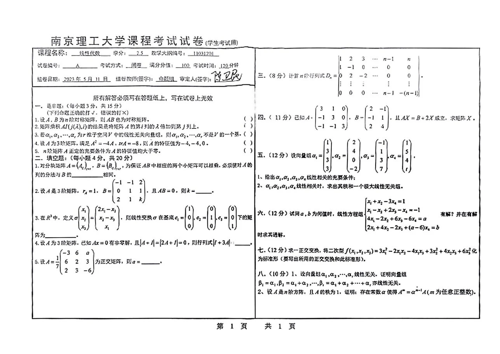

## 南京理工大学课程考试试卷(学生考试用)

<table><tr><td>课程名称:线性代数学分:2.5数学大纲编号:11031201试验编号:A考试方式:闭卷满分分值:100考试时间:120分钟试卷日期:2023年5月11日组要教师(签字):命题机审定人(签字):陈卫民</td><td>三.(8分)计算n阶行列式 $D_{n}=\begin{vmatrix}1&2&3&\cdots&n-1&n\\1&-1&0&\cdots&0&0\\0&2&-2&\cdots&0&0\\\vdots&\vdots&\vdots&&\vdots&\vdots\\0&0&0&\cdots&n-1&-(n-1)\end{vmatrix}$ .四.(11分)已知 $A=\begin{pmatrix}3&1&0\\-1&3&0\\-1&-1&3\end{pmatrix}$ , $B=\begin{pmatrix}2&-1\\-1&1\\2&4\end{pmatrix}$ ,且 $AX=B+2X$ 成立,求矩阵 $X$ .五.(12分)设向量组 $\alpha_{1}=\begin{pmatrix}1\\3\\3\\3\end{pmatrix}$ , $\alpha_{2}=\begin{pmatrix}2\\4\\0\\-2\end{pmatrix}$ , $\alpha_{3}=\begin{pmatrix}-1\\1\\3\\7\end{pmatrix}$ , $\alpha_{4}=\begin{pmatrix}1\\5\\4\\t\end{pmatrix}$ .1、给出 $\alpha_{1},\alpha_{2},\alpha_{3},\alpha_{4}$ 线性相关的充要条件;2、 $\alpha_{1},\alpha_{2},\alpha_{3},\alpha_{4}$ 线性相关时,求出其秩和一个极大线性无关矩。六.(12分)试问a,b为何值时,线性方程组 $\left\{\begin{aligned}&x_{1}+x_{2}-3x_{4}=1\\&x_{1}-x_{2}+2x_{3}-x_{4}=-1\\&4x_{1}-2x_{2}+6x_{3}-6x_{4}=a\\&2x_{1}+4x_{2}-2x_{3}+(a-6)x_{4}=b\end{aligned}\right.$ 有解?并在有解时求其通解。七.(12分)求一正交变换,将二次型 $f(x_{1},x_{2},x_{3})=3x_{1}^{2}-2x_{1}x_{2}-4x_{1}x_{3}+3x_{2}^{2}+4x_{2}x_{3}+6x_{3}^{2}$ 化为标准形(要写出所用的正交变换和此标准形)。八.(10分)1、设向量组 $\alpha_{1},\alpha_{2},\cdots,\alpha_{r}$ 线性无关.注明向量组 $\beta_{1}=\alpha_{1},\beta_{2}=\alpha_{1}+\alpha_{2},\cdots,\beta_{1}=\alpha_{1}+\alpha_{2}+\cdots+\alpha_{r}$ ,亦线性无关。2、设A是n阶方阵,且A的秩为1,证明:存在常数 $\alpha$ 使得 $A^{m}=\alpha^{m-1}A(m$ 为任意正整数)。</td></tr><tr><td>所有解答必须写在答题纸上,写在试卷上无效一.是非题:(每小题3分,共15分)(下列命题正确的打√.错误的打×)设A,B为n阶对称矩阵,则AB也为对称矩阵。( )短阵乘积 $AI(j(\lambda),i)$ 的结果是将矩阵A的第i列的λ倍加到第j列上。( )若 $\alpha_{1},\alpha_{2},\cdots,\alpha_{r}$ 为r维子空间V中的线性无关向量组,则 $\alpha_{1},\alpha_{2},\cdots,\alpha_{r}$ 不是V的一个基。( )设A为3阶矩阵,满足 $A^{2}=-4A$ ,则A的特征值为 $-4,-4,0$ 。( )n阶矩阵A正定的充展条件为A的特征值均大于零。( )二.填空题:(每小题4分,共20分)对分块矩阵 $A=(A_{v})_{s,s}$ , $B=(B_{v})_{s,s}$ ,为保证AB中相应的两个小矩阵可以相乘,必须使对A的列的分法与B的____相同。设A是3阶矩阵, $r_{A}=1$ , $B=\begin{pmatrix}-1&-1&2\\0&1&1\\2&1&k\end{pmatrix}$ ,且AB=0,则k=____。在 $R^{3}$ 中,定义 $\sigma\begin{pmatrix}x_{1}\\x_{2}\\x_{3}\end{pmatrix}=\begin{pmatrix}2x_{1}-x_{1}\\x_{2}-x_{3}\\x_{1}\end{pmatrix}$ ,则线性变换 $\sigma$ 在基底 $c_{1}=\begin{pmatrix}1\\0\\0\end{pmatrix}$ , $c_{2}=\begin{pmatrix}0\\1\\0\end{pmatrix}$ , $c_{3}=\begin{pmatrix}0\\0\\1\end{pmatrix}$ 下的矩阵为____。设A为3阶矩阵,已知Ax=0有非零解,且 $|A+I|=|2A+I|=0$ ,则行列式 $|I+3A|$ :____。设 $A=\frac{1}{7}\begin{pmatrix}-3&6&a\\6&2&3\\2&3&-6\end{pmatrix}$ 为正交矩阵,则 $a=$ ____。</td><td></td></tr></table>

第1页 共1页

## 第2页

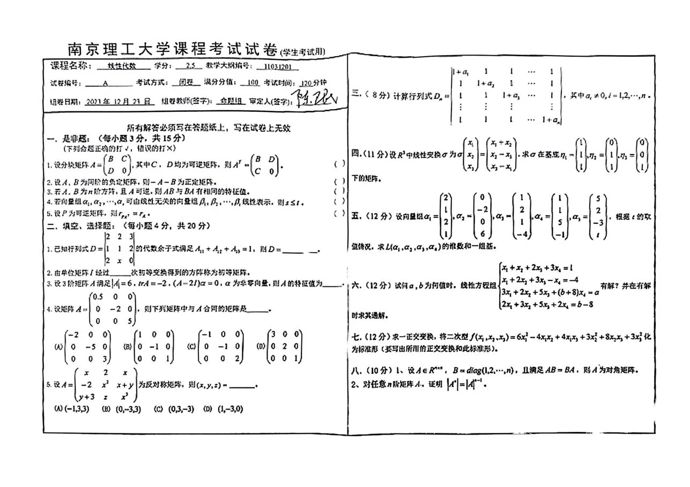

## 南京理工大学课程考试试卷(学生考试用)

课程名称： 城性代数 学分： 2.5 数学大招编号： 11031201

试卷编号：\_\_\_\_ A \_\_\_\_ 考试方式：闭卷 满分分值：100 考试时间：120 分钟

组卷日期：2021年12月23日 组卷教师(签字)：金熙旭 审定人(签字)：陈

### 所有解答必须写在答题纸上，写在试卷上无效

### 一. 是非题：（低小题3分，共15分）

(下列命题正确的打√，错误的打×)

1. 设分块矩阵 $A = \begin{pmatrix} B & C \\ D & 0 \end{pmatrix}$ , 其中 $C, D$ 均为可逆矩阵, 则 $A^T = \begin{pmatrix} B & D \\ C & 0 \end{pmatrix}$ .

2. 设 $A, B$ 为同阶的负定矩阵，则 $-A - B$ 为正定矩阵。

3. 若 $A, B$ 为 $n$ 阶方阵，且 $A$ 可逆，则 $AB$ 与 $BA$ 有相同的特征值。

4. 若向量组 $\alpha_{1}, \alpha_{2}, \cdots, \alpha$ ，可由线性无关的向量组 $\beta_{1}, \beta_{2}, \cdots, \beta_{i}$ 线性表示，则 $s \leq t$ 。
5. 设 P 为可逆矩阵，则 $r_{P,A'} = r_{A}$ 。

### 二. 坝空、选择题: (每小题4分, 共20分)

1. 已知行列式 $D = \begin{vmatrix} 2 & 2 & 3 \\ 1 & 1 & 2 \\ 2 & x & 0 \end{vmatrix}$ 的代数余子式满足 $A_{i1} + A_{i2} + A_{i3} = 1$ ，则 $D = \_\_\_\_\_.$

2. 由单位矩阵 I 经过 \_\_\_\_ 次初等变换得到的方阵称为初等矩阵。

3. 设 3 阶矩阵 A 洞足 $\left|A\right|=6$ , trA=-2, (A=2J)α=0, α 为非零向量，则 A 的特征值为 \_\_\_\_。

4. 设矩阵 $A = \begin{pmatrix} 0.5 & 0 & 0 \\ 0 & -2 & 0 \\ 0 & 0 & 5 \end{pmatrix}$ ，则下列矩阵中与 $A$ 合同的矩阵是 \_\_\_\_。

(A) $\begin{pmatrix}-2&0&0\\0&-5&0\\0&0&3\end{pmatrix}$ (B) $\begin{pmatrix}1&0&0\\0&-1&0\\0&0&1\end{pmatrix}$ (C) $\begin{pmatrix}-1&0&0\\0&-1&0\\0&0&2\end{pmatrix}$ (D) $\begin{pmatrix}3&0&0\\0&2&0\\0&0&1\end{pmatrix}$

5. 设 $A = \begin{pmatrix} x & 2 & x \\ -2 & x^2 & x + y \\ y + 3 & z & x^3 \end{pmatrix}$ 为反对称矩阵，则 $(x, y, z) =$ \_\_\_\_. (A) $(-1, 3, 3)$ (B) $(0, -3, 3)$ (C) $(0, 3, -3)$ (D) $(1, -3, 0)$

三.（8分）计算行列式 $D_{n}=\left|\begin{array}{cccccc}1+a_{1}&1&1&\cdots&1\\1&1+a_{2}&1&\cdots&1\\1&1&1+a_{3}&\cdots&1\\\vdots&\vdots&\vdots&&\vdots\\1&1&1&\cdots&1+a_{n}\end{array}\right|$ ，其中 $a_{i}\neq0,l=1,2,\cdots,n$

四.（11分）设 $R^3$ 中线性交换 $\sigma$ 为 $\sigma \begin{pmatrix} x_1 \\ x_2 \\ x_3 \end{pmatrix} = \begin{pmatrix} x_1 + x_2 \\ x_2 - x_3 \\ x_3 - x_4 \end{pmatrix}$ . 求 $\sigma$ 在底座 $\eta_1 = \begin{pmatrix} 1 \\ 1 \\ 1 \end{pmatrix}, \eta_2 = \begin{pmatrix} 0 \\ 1 \\ 1 \end{pmatrix}, \eta_3 = \begin{pmatrix} 0 \\ 0 \\ 1 \end{pmatrix}$ 下的矩阵。

五.（12分）设向量组 $\alpha_{1} = \begin{pmatrix} 2 \\ 1 \\ 2 \\ 1 \end{pmatrix}, \alpha_{2} = \begin{pmatrix} 0 \\ -2 \\ 0 \\ 6 \end{pmatrix}, \alpha_{3} = \begin{pmatrix} 1 \\ 2 \\ 1 \\ -4 \end{pmatrix}, \alpha_{4} = \begin{pmatrix} 1 \\ 1 \\ 5 \\ -1 \end{pmatrix}, \alpha_{5} = \begin{pmatrix} 5 \\ 2 \\ -3 \\ t \end{pmatrix}$ ，根据 $t$ 的取

值情况，求 $L(\alpha_{1},\alpha_{2},\alpha_{3},\alpha_{4})$ 的维数和一组基。

六.（12分）试问 $a, b$ 为何值时。线性方程组 $\left\{ \begin{array}{l} x_{1} + x_{2} + 2x_{1} + 3x_{4} = 1 \\ x_{1} + 2x_{2} + 3x_{3} - x_{4} = -4 \\ 3x_{1} + 2x_{2} + 5x_{3} + (b + 8)x_{4} = a \\ 2x_{1} + 3x_{2} + 5x_{3} + 2x_{4} = b - 8 \end{array} \right.$ 有解？并在有解

时求其通解。

七.（12分）求一正交变换，将二次型 $f(x_{1},x_{2},x_{3})=6x_{1}^{2}-4x_{1}x_{2}+4x_{1}x_{3}+3x_{2}^{2}+8x_{2}x_{3}+3x_{3}^{2}$ 化为标准形（要写出所用的正交变换和此标准形）。

八.（10分）1、设 $A\in R^{n,n}$ ， $B=\text{diag}(1,2,\cdots,n)$ ，且满足AB=BA，则A为对角矩阵。
2、对任意n阶矩阵A，证明 $\left|A^{*}\right|=\left|A\right|^{n-1}$

## 第3页

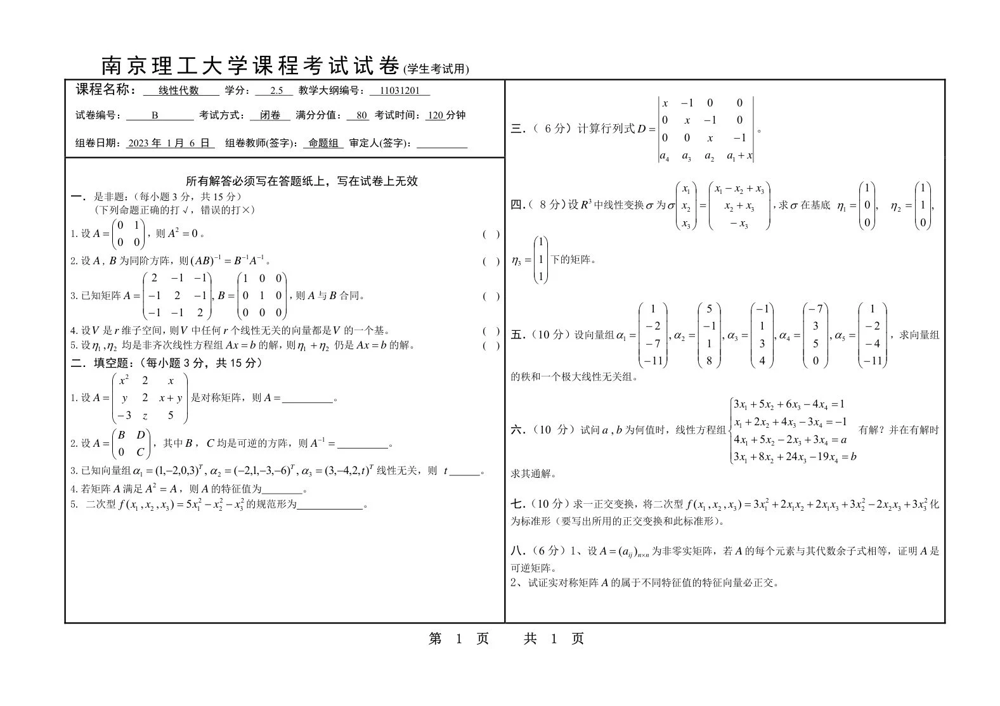

## 南京理工大学课程考试试卷 (学生考试用)

### 课程名称： 线性代数 学分： 2.5 教学大纲编号： 11031201

试卷编号：B 考试方式：闭卷 满分分值：80 考试时间：120 分钟

组卷日期：2023年1月6日 组卷教师(签字)：命题组 审定人(签字)：

### 所有解答必须写在答题纸上，写在试卷上无效

### 一．是非题：（每小题3分，共15分）

(下列命题正确的打 √，错误的打 ×)

1. 设 $A=\begin{pmatrix}0 & 1 \\ 0 & 0\end{pmatrix}$ ，则 $A^{2}=0$ 。

2. 设 $A, B$ 为同阶方阵，则 $(AB)^{-1} = B^{-1}A^{-1}$ 。 （）

3. 已知矩阵 $A = \begin{pmatrix} 2 & -1 & -1 \\ -1 & 2 & -1 \\ -1 & -1 & 2 \end{pmatrix}$ , $B = \begin{pmatrix} 1 & 0 & 0 \\ 0 & 1 & 0 \\ 0 & 0 & 0 \end{pmatrix}$ , 则 $A$ 与 $B$ 合同。

4. 设 $V$ 是 $r$ 维子空间，则 $V$ 中任何 $r$ 个线性无关的向量都是 $V$ 的一个基。  
5. 设 $\eta_1, \eta_2$ 均是非齐次线性方程组 $Ax = b$ 的解，则 $\eta_1 + \eta_2$ 仍是 $Ax = b$ 的解。

### 二．填空题：（每小题3分，共15分）

1. 设 $A = \begin{pmatrix} x^{2} & 2 & x \\ y & 2 & x + y \\ -3 & z & 5 \end{pmatrix}$ 是对称矩阵，则 A = \_\_\_\_。

2. 设 $A=\begin{pmatrix}B & D \\ 0 & C\end{pmatrix}$ ，其中 B，C 均是可逆的方阵，则 $A^{-1}=$ \_\_\_\_。

3. 已知向量组 $\alpha_{1} = (1, -2, 0, 3)^{T}$ , $\alpha_{2} = (-2, 1, -3, -6)^{T}$ , $\alpha_{3} = (3, -4, 2, t)^{T}$ 线性无关, 则 $t$ \_\_\_\_。

$$
A ^ {2} = A
$$

5. 二次型 $f(x_{1}, x_{2}, x_{3}) = 5x_{1}^{2} - x_{2}^{2} - x_{3}^{2}$ 的规范形为 \_\_\_\_。

三.（6分）计算行列式 $D = \left| \begin{array}{cccc}x & -1 & 0 & 0\\ 0 & x & -1 & 0\\ 0 & 0 & x & -1\\ a_4 & a_3 & a_2 & a_1 + x \end{array} \right|$

四.（8分）设 $R^3$ 中线性变换 $\sigma$ 为 $\sigma \begin{pmatrix} x_1 \\ x_2 \\ x_3 \end{pmatrix} = \begin{pmatrix} x_1 - x_2 + x_3 \\ x_2 + x_3 \\ -x_3 \end{pmatrix}$ ，求 $\sigma$ 在基底 $\eta_1 = \begin{pmatrix} 1 \\ 0 \\ 0 \end{pmatrix}, \quad \eta_2 = \begin{pmatrix} 1 \\ 1 \\ 0 \end{pmatrix}$ ， $\eta_3 = \begin{pmatrix} 1 \\ 1 \\ 1 \end{pmatrix}$ 下的矩阵。

五.（10分）设向量组 $\alpha_{1} = \begin{pmatrix} 1 \\ -2 \\ -7 \\ -11 \end{pmatrix}, \alpha_{2} = \begin{pmatrix} 5 \\ -1 \\ 1 \\ 8 \end{pmatrix}, \alpha_{3} = \begin{pmatrix} -1 \\ 1 \\ 3 \\ 4 \end{pmatrix}, \alpha_{4} = \begin{pmatrix} -7 \\ 3 \\ 5 \\ 0 \end{pmatrix}, \alpha_{5} = \begin{pmatrix} 1 \\ -2 \\ -4 \\ -11 \end{pmatrix}$ ，求向量组

六.（10分）试问 $a, b$ 为何值时，线性方程组 $\left\{ \begin{array}{l} 3x_{1} + 5x_{2} + 6x_{3} - 4x_{4} = 1 \\ x_{1} + 2x_{2} + 4x_{3} - 3x_{4} = -1 \\ 4x_{1} + 5x_{2} - 2x_{3} + 3x_{4} = a \\ 3x_{1} + 8x_{2} + 24x_{3} - 19x_{4} = b \end{array} \right.$ 有解？并在有解时

七.（10 分）求一正交变换，将二次型 $f(x_{1}, x_{2}, x_{3}) = 3x_{1}^{2} + 2x_{1}x_{2} + 2x_{1}x_{3} + 3x_{2}^{2} - 2x_{2}x_{3} + 3x_{3}^{2}$ 化为标准形（要写出所用的正交变换和此标准形）。

八.（6分）1、设 $A = (a_{ij})_{n \times n}$ 为非零实矩阵，若 $A$ 的每个元素与其代数余子式相等，证明 $A$ 是可逆矩阵。

2、试证实对称矩阵 $A$ 的属于不同特征值的特征向量必正交。

第1页 共1页

## 第4页

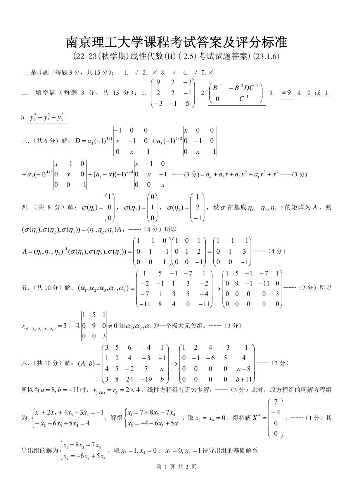

## 南京理工大学课程考试答案及评分标准

## (22-23(秋学期)线性代数(B)(2.5)考试试题答案)(23.1.6)

### 一.是非题（每题3分，共15分）： 1. √ 2. × 3. √ 4. √ 5. ×

二．填空题（每题3分，共15分）：1. $\begin{pmatrix}9&2&-3\\2&2&-1\\-3&-1&5\end{pmatrix}$ 2. $\begin{pmatrix}B^{-1}&-B^{-1}DC^{-1}\\0&C^{-1}\end{pmatrix}$ 3.≠9 4.0或1

$$
y _ {1} ^ {2} - y _ {2} ^ {2} - y _ {3} ^ {2}
$$

三.（共6分）解： $D = a_{4}(-1)^{4 + 1}\left| \begin{array}{ccc} - 1 & 0 & 0\\ x & -1 & 0\\ 0 & x & -1 \end{array} \right| + a_{3}(-1)^{4 + 2}\left| \begin{array}{ccc} x & 0 & 0\\ 0 & -1 & 0\\ 0 & x & -1 \end{array} \right|$

$$
+ a _ {2} (- 1) ^ {4 + 3} \left| \begin{array}{c c c} x & - 1 & 0 \\ 0 & x & 0 \\ 0 & 0 & - 1 \end{array} \right| + (a _ {1} + x) (- 1) ^ {4 + 4} \left| \begin{array}{c c c} x & - 1 & 0 \\ 0 & x & - 1 \\ 0 & 0 & x \end{array} \right| - - - - - (3 \text {分}) = a _ {4} + a _ {3} x + a _ {2} x ^ {2} + a _ {1} x ^ {3} + x ^ {4} - - - - - (3 \text {分})
$$

四．（共8分）解： $\sigma (\eta_1) = \begin{pmatrix} 1\\ 0\\ 0 \end{pmatrix}$ ， $\sigma (\eta_{2}) = \begin{pmatrix} 0\\ 1\\ 0 \end{pmatrix}$ ， $\sigma (\eta_3) = \begin{pmatrix} 1\\ 2\\ -1 \end{pmatrix}$ ，设 $\sigma$ 在基底 $\eta_1$ ， $\eta_2,\eta_3$ 下的矩阵为 $A$ ，则

$$
(\sigma (\eta_ {1}), \sigma (\eta_ {2}), \sigma (\eta_ {3})) = (\eta_ {1}, \eta_ {2}, \eta_ {3}) A
$$

$$
A = \left(\eta_ {1}, \eta_ {2}, \eta_ {3}\right) ^ {- 1} \left(\sigma \left(\eta_ {1}\right), \sigma \left(\eta_ {2}\right), \sigma \left(\eta_ {3}\right)\right) = \left( \begin{array}{c c c} 1 & - 1 & 0 \\ 0 & 1 & - 1 \\ 0 & 0 & 1 \end{array} \right) \left( \begin{array}{c c c} 1 & 0 & 1 \\ 0 & 1 & 2 \\ 0 & 0 & - 1 \end{array} \right) = \left( \begin{array}{c c c} 1 & - 1 & - 1 \\ 0 & 1 & 3 \\ 0 & 0 & - 1 \end{array} \right) - - - - - (4 \text {分})
$$

五.（共10分）解： $(\alpha_{1},\alpha_{2},\alpha_{3},\alpha_{4},\alpha_{5}) = \begin{pmatrix} 1 & 5 & -1 & -7 & 1\\ -2 & -1 & 1 & 3 & -2\\ -7 & 1 & 3 & 5 & -4\\ -11 & 8 & 4 & 0 & -11 \end{pmatrix}\rightarrow \begin{pmatrix} 1 & 5 & -1 & -7 & 1\\ 0 & 9 & -1 & -11 & 0\\ 0 & 0 & 0 & 0 & 3\\ 0 & 0 & 0 & 0 & 0 \end{pmatrix}$ ——（7分）所以

$r_{\{\alpha_1,\alpha_2,\alpha_3,\alpha_4,\alpha_5\}} = 3$ ，且 $\begin{vmatrix} 1 & 5 & 1\\ 0 & 9 & 0\\ 0 & 0 & 3 \end{vmatrix}\neq 0$ 知 $\alpha_{1},\alpha_{2},\alpha_{5}$ 为一个极大无关组。----（3分）

六.（共10分）解： $(A|b)=\begin{pmatrix}3&5&6&-4&1\\1&2&4&-3&-1\\4&5&-2&3&a\\3&8&24&-19&b\end{pmatrix}\rightarrow\begin{pmatrix}1&2&4&-3&-1\\0&-1&-6&5&4\\0&0&0&0&a-8\\0&0&0&0&b+11\end{pmatrix}$ ----（3分）

所以当 $a = 8, b = -11$ 时， $r_{(A|b)} = r_A = 2 < 4$ ，线性方程组有无穷多解， $-$ （3分）此时，原方程组的同解方程组为 $\left\{ \begin{array}{l} x_1 + 2x_2 + 4x_3 - 3x_4 = -1 \\ -x_2 - 6x_3 + 5x_4 = 4 \end{array} \right.$ ，解得 $\left\{ \begin{array}{l} x_1 = 7 + 8x_3 - 7x_4 \\ x_2 = -4 - 6x_3 + 5x_4 \end{array} \right.$ ，取 $x_3 = x_4 = 0$ ，得特解 $X^* = \left( \begin{array}{c} 7 \\ -4 \\ 0 \\ 0 \end{array} \right)$ ， $-$ （1分）其导出组的解为 $\left\{ \begin{array}{l} x_1 = 8x_3 - 7x_4 \\ x_2 = -6x_3 + 5x_4 \end{array} \right.$ ，取 $x_3 = 1, x_4 = 0$ ； $x_3 = 0, x_4 = 1$ 得导出组的基础解系

第1页共2页

## 第5页

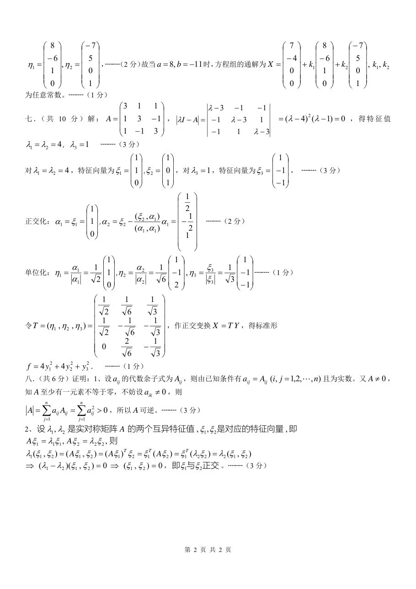

$\eta_{1}=\begin{pmatrix}8\\-6\\1\\0\end{pmatrix},\eta_{2}=\begin{pmatrix}-7\\5\\0\\1\end{pmatrix},----(2分)$ 故当a=8,b=-11时，方程组的通解为 $X=\begin{pmatrix}7\\-4\\0\\0\end{pmatrix}+k_{1}\begin{pmatrix}8\\-6\\1\\0\end{pmatrix}+k_{2}\begin{pmatrix}-7\\5\\0\\1\end{pmatrix},k_{1},k_{2}$ 为任意常数。----（1分）
七．（共10分）解： $A=\begin{pmatrix}3&1&1\\1&3&-1\\1&-1&3\end{pmatrix},\quad|\lambda I-A|=\begin{vmatrix}\lambda-3&-1&-1\\-1&\lambda-3&1\\-1&1&\lambda-3\end{vmatrix}=(\lambda-4)^{2}(\lambda-1)=0$ ，得特征值 $\lambda_{1}=\lambda_{2}=4,\quad\lambda_{3}=1$ ----（3分）
对 $\lambda_{1}=\lambda_{2}=4$ ，特征向量为 $\xi_{1}=\begin{pmatrix}1\\1\\0\end{pmatrix},\xi_{2}=\begin{pmatrix}1\\0\\1\end{pmatrix}$ ，对 $\lambda_{3}=1$ ，特征向量为 $\xi_{3}=\begin{pmatrix}1\\-1\\-1\end{pmatrix}$ ，----（3分）
正交化： $\alpha_{1}=\xi_{1}=\begin{pmatrix}1\\1\\0\end{pmatrix},\alpha_{2}=\xi_{2}-\frac{(\xi_{2},\alpha_{1})}{(\alpha_{1},\alpha_{1})}\alpha_{1}=\begin{pmatrix}\frac{1}{2}\\-\frac{1}{2}\\1\end{pmatrix}$ ----（2分）
单位化： $\eta_{1}=\frac{\alpha_{1}}{\left|\alpha_{1}\right|}=\frac{1}{\sqrt{2}}\begin{pmatrix}1\\1\\0\end{pmatrix},\eta_{2}=\frac{\alpha_{2}}{\left|\alpha_{2}\right|}=\frac{1}{\sqrt{6}}\begin{pmatrix}1\\-1\\2\end{pmatrix},\eta_{3}=\frac{\xi_{3}}{\left|\xi_{3}\right|}=\frac{1}{\sqrt{3}}\begin{pmatrix}1\\-1\\-1\end{pmatrix}$ ----（1分）
令 $T=(\eta_{1},\eta_{2},\eta_{3})=\begin{pmatrix}\frac{1}{\sqrt{2}}&\frac{1}{\sqrt{6}}&\frac{1}{\sqrt{3}}\\\frac{1}{\sqrt{2}}&-\frac{1}{\sqrt{6}}&-\frac{1}{\sqrt{3}}\\0&\frac{2}{\sqrt{6}}&-\frac{1}{\sqrt{3}}\end{pmatrix}$ ，作正交变换 X=TY，得标准形 $f=4y_{1}^{2}+4y_{2}^{2}+y_{3}^{2}.$ ----（1分）
八．（共6分）证明：1、设 $a_{ij}$ 的代数余子式为 $A_{ij}$ ，则由已知条件有 $a_{ij}=A_{ij}(i,j=1,2,\cdots,n)$ 且为实数。又 $A\neq0$ ，
知 A 至少有一元素不等于零，不妨设 $a_{ik}\neq0$ ，则 $\left|A\right|=\sum_{j=1}^{n}a_{ij}A_{ij}=\sum_{j=1}^{n}a_{ij}^{2}>0$ ，所以 A 可逆。----（3分）
2、设 $\lambda_{1},\lambda_{2}$ 是实对称矩阵 A 的两个互异特征值， $\xi_{1},\xi_{2}$ 是对应的特征向量，即 $A\xi_{1}=\lambda_{1}\xi_{1},A\xi_{2}=\lambda_{2}\xi_{2}$ ，则 $\lambda_{1}(\xi_{1},\xi_{2})=(A\xi_{1},\xi_{2})=(A\xi_{1})^{T}\xi_{2}=\xi_{1}^{T}(A\xi_{2})=\xi_{1}^{T}(\lambda_{2}\xi_{2})=\lambda_{2}(\xi_{1},\xi_{2})$ $\Rightarrow (\lambda_{1}-\lambda_{2})(\xi_{1},\xi_{2})=0 \Rightarrow (\xi_{1},\xi_{2})=0$ ，即 $\xi_{1}$ 与 $\xi_{2}$ 正交。----（3分）

第2页共2页

## 第6页

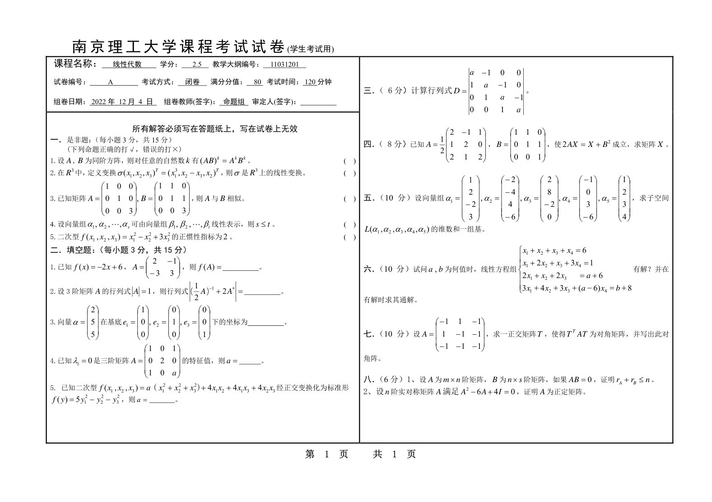

## 南京理工大学课程考试试卷 (学生考试用)

### 课程名称： 线性代数 学分： 2.5 教学大纲编号： 11031201

试卷编号：\_\_\_\_ A \_\_\_\_ 考试方式：\_\_\_\_ 闭卷 \_\_\_\_ 满分分值：\_\_\_\_ 80 考试时间：\_\_\_\_ 120 分钟

组卷日期：2022年12月4日 组卷教师(签字)：命题组 审定人(签字)：

### 所有解答必须写在答题纸上，写在试卷上无效

### 一．是非题：（每小题3分，共15分）

(下列命题正确的打 √，错误的打 ×)

1. 设 A, B 为同阶方阵，则对任意的自然数 k 有 $(AB)^{k} = A^{k}B^{k}$ 。

2. 在 $R^3$ 中，定义变换 $\sigma(x_1, x_2, x_3)^T = (x_1^3, x_2 - x_3, x_2)^T$ ，则 $\sigma$ 是 $R^3$ 上的线性变换。 （）

3. 已知矩阵 $A = \begin{pmatrix} 1 & 0 & 0 \\ 0 & 1 & 0 \\ 0 & 0 & 3 \end{pmatrix}, B = \begin{pmatrix} 1 & 1 & 0 \\ 0 & 1 & 1 \\ 0 & 0 & 3 \end{pmatrix}$ ，则 $A$ 与 $B$ 相似。 （）

4. 设向量组 $\alpha_{1}, \alpha_{2}, \cdots, \alpha_{s}$ 可由向量组 $\beta_{1}, \beta_{2}, \cdots, \beta_{t}$ 线性表示，则 $s \leq t$ 。
5. 二次型 $f(x_{1}, x_{2}, x_{3}) = x_{1}^{2} - x_{2}^{2} + 3x_{3}^{2}$ 的正惯性指标为 2。

### 二．填空题：（每小题3分，共15分）

1. 已知 $f(x) = -2x + 6$ ， $A = \begin{pmatrix} 2 & -1 \\ -3 & 3 \end{pmatrix}$ ，则 $f(A) =$ \_\_\_\_。

2. 设 3 阶矩阵 A 的行列式 $\left|A\right|=1$ ，则行列式 $\left|\left(\frac{1}{2}A\right)^{-1}+2A^{*}\right|=$ \_\_\_\_。

3. 向量 $\alpha = \begin{pmatrix} 2 \\ 5 \\ 5 \end{pmatrix}$ 在基底 $e_{1} = \begin{pmatrix} 1 \\ 0 \\ 0 \end{pmatrix}$ , $e_{2} = \begin{pmatrix} 0 \\ 1 \\ 0 \end{pmatrix}$ , $e_{3} = \begin{pmatrix} 0 \\ 0 \\ 1 \end{pmatrix}$ 下的坐标为 \_\_\_\_。

4. 已知 $\lambda_{1}=0$ 是三阶矩阵 $A=\begin{pmatrix}1&0&1\\0&2&0\\1&0&a\end{pmatrix}$ 的特征值，则 a=\_\_\_\_。

5. 已知二次型 $f(x_{1}, x_{2}, x_{3}) = a(x_{1}^{2} + x_{2}^{2} + x_{3}^{2}) + 4x_{1}x_{2} + 4x_{1}x_{3} + 4x_{2}x_{3}$ 经正交变换化为标准形 $f(y) = 5y_{1}^{2} - y_{2}^{2} - y_{3}^{2}$ ，则 $a =$ \_\_\_\_。

三.（6分）计算行列式 $D = \left| \begin{array}{cccc}a & -1 & 0 & 0\\ 1 & a & -1 & 0\\ 0 & 1 & a & -1\\ 0 & 0 & 1 & a \end{array} \right|$ 。

四.（8分）已知 $A = \frac{1}{2}\left( \begin{array}{ccc}2 & -1 & 1\\ 1 & 2 & 0\\ 2 & 1 & 2 \end{array} \right),B = \left( \begin{array}{ccc}1 & 1 & 0\\ 0 & 1 & 1\\ 0 & 0 & 1 \end{array} \right)$ ，使 $2AX = X + B^2$ 成立，求矩阵 $X$ 。

五．（10分）设向量组 $\alpha_{1} = \left( \begin{array}{c}1\\ 2\\ -2\\ 3 \end{array} \right),\alpha_{2} = \left( \begin{array}{c} - 2\\ -4\\ 4\\ -6 \end{array} \right),\alpha_{3} = \left( \begin{array}{c}2\\ 8\\ -2\\ 0 \end{array} \right),\alpha_{4} = \left( \begin{array}{c} - 1\\ 0\\ 3\\ -6 \end{array} \right),\alpha_{5} = \left( \begin{array}{c}1\\ 2\\ 3\\ 4 \end{array} \right)$ ，求子空间

$$
L (\alpha_ {1}, \alpha_ {2}, \alpha_ {3}, \alpha_ {4}, \alpha_ {5})
$$

六.（10分）试问 $a, b$ 为何值时，线性方程组 $\left\{ \begin{array}{l} x_{1} + x_{2} + x_{3} + x_{4} = 6 \\ x_{1} + 2x_{2} + x_{3} + 3x_{4} = 1 \\ 2x_{1} + x_{2} + 2x_{3} = a + 6 \\ 3x_{1} + 4x_{2} + 3x_{3} + (a - 6)x_{4} = b + 8 \end{array} \right.$ 有解？并在

有解时求其通解。

七.（10分）设 $A = \begin{pmatrix} -1 & 1 & -1\\ 1 & -1 & -1\\ -1 & -1 & -1 \end{pmatrix}$ ，求一正交矩阵 $T$ ，使得 $T^T AT$ 为对角矩阵，并写出此对角阵。

八．（6分）1、设 $A$ 为 $m \times n$ 阶矩阵， $B$ 为 $n \times s$ 阶矩阵，如果 $AB = 0$ ，证明 $r_A + r_B \leq n$ 。2、设 $n$ 阶实对称矩阵 $A$ 满足 $A^2 - 6A + 4I = 0$ ，证明 $A$ 为正定矩阵。

第1页 共1页

## 第7页

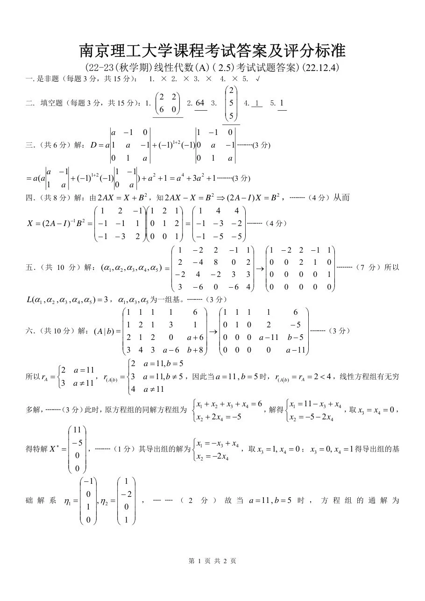

## 南京理工大学课程考试答案及评分标准

(22-23(秋学期)线性代数(A)(2.5)考试试题答案)(22.12.4)

一.是非题（每题3分，共15分）： $1.\times 2.\times 3.\times 4.\times 5.\checkmark$ 二.填空题（每题3分，共15分）：1. $\underline{\begin{pmatrix}2 & 2 \\ 6 & 0\end{pmatrix}}$ 2.64 3. $\underline{\begin{pmatrix}2 \\ 5 \\ 5\end{pmatrix}}$ 4.1 5.1  
三.（共6分）解： $D = a\left|\begin{array}{lll}a & -1 & 0\\ 1 & a & -1\\ 0 & 1 & a\end{array}\right| + (-1)^{1 + 2}(-1)\left|\begin{array}{lll}1 & -1 & 0\\ 0 & a & -1\\ 0 & 1 & a\end{array}\right|$ ----(3分) $= a(a\left|\begin{array}{ll}a & -1\\ 1 & a\end{array}\right| + (-1)^{1 + 2}(-1)\left|\begin{array}{ll}1 & -1\\ 0 & a\end{array}\right|) + a^2 +1 = a^4 +3a^2 +1$ ----(3分)  
四.（共8分）解：由 $2AX = X + B^{2}$ ，知 $2AX - X = B^{2}\Rightarrow (2A - I)X = B^{2}$ ，----（4分）从而 $X = (2A - I)^{-1}B^{2} = \left( \begin{array}{lll}1 & 2 & -1\\ -1 & -1 & 1\\ -1 & -3 & 2 \end{array} \right)\left( \begin{array}{lll}1 & 2 & 1\\ 0 & 1 & 2\\ 0 & 0 & 1 \end{array} \right) = \left( \begin{array}{lll}1 & 4 & 4\\ -1 & -3 & -2\\ -1 & -5 & -5 \end{array} \right)$ ----（4分）  
五.（共10分）解： $(\alpha_{1},\alpha_{2},\alpha_{3},\alpha_{4},\alpha_{5}) = \left( \begin{array}{lllll}1 & -2 & 2 & -1 & 1\\ 2 & -4 & 8 & 0 & 2\\ -2 & 4 & -2 & 3 & 3\\ 3 & -6 & 0 & -6 & 4 \end{array} \right)\rightarrow \left( \begin{array}{lllll}1 & -2 & 2 & -1 & 1\\ 0 & 0 & 2 & 1 & 0\\ 0 & 0 & 0 & 0 & 1\\ 0 & 0 & 0 & 0 & 0 \end{array} \right)$ ----（7分）所以 $L(\alpha_1,\alpha_2,\alpha_3,\alpha_4,\alpha_5) = 3$ ， $\alpha_{1},\alpha_{3},\alpha_{5}$ 为一组基。----（3分）  
六.（共10分）解： $(A|b) = \left( \begin{array}{lllll}1 & 1 & 1 & 1 & 6\\ 1 & 2 & 1 & 3 & 1\\ 2 & 1 & 2 & 0 & a + 6\\ 3 & 4 & 3 & a -6 & b + 8 \end{array} \right)\to \left( \begin{array}{lllll}1 & 1 & 1 & 1 & 6\\ 0 & 1 & 0 & 2 & -5\\ 0 & 0 & 0 & a - 11 & b - 5\\ 0 & 0 & 0 & 0 & a - 11 \end{array} \right)$ ----（3分）  
所以 $r_A = \left\{ \begin{array}{ll}2 & a = 11\\ 3 & a\neq 11 \end{array} \right.$ ， $r_{(A|b)} = \left\{ \begin{array}{ll}2 & a = 11,b = 5\\ 3 & a = 11,b\neq 5\\ 4 & a\neq 11 \end{array} \right.$ 因此当 $a = 11,b = 5$ 时， $r_{(A|b)} = r_A = r_A = 2 <   4$ ，线性方程组有无穷多解，----（3分）此时，原方程组的同解方程组为 $\left\{ \begin{array}{l}x_{1} + x_{2} + x_{3} + x_{4} = 6\\ x_{2} + 2x_{4} = -5 \end{array} \right.$ ，解得 $\left\{ \begin{array}{l}x_1 = 11 - x_3 + x_4\\ x_2 = -5 - 2x_4 \end{array} \right.$ ，取 $x_{3} = x_{4} = 0$ 得特解 $X^{*} = \left( \begin{array}{l}11\\ -5\\ 0\\ 0 \end{array} \right)$ ，----（1分）其导出组的解为 $\left\{ \begin{array}{l}x_1 = -x_3 + x_4\\ x_2 = -2x_4 \end{array} \right.$ ，取 $x_{3} = 1,x_{4} = 0$ ： $x_{3} = 0,x_{4} = 1$ 得导出组的基础解系 $\eta_{1} = \left( \begin{array}{l} -1\\ 0\\ 1\\ 0 \end{array} \right),\eta_{2} = \left( \begin{array}{l}1\\ -2\\ 0\\ 1 \end{array} \right)$ ，----（2分）故当 $a = 11,b = 5$ 时，方程组的通解为

第1页共2页

## 第8页

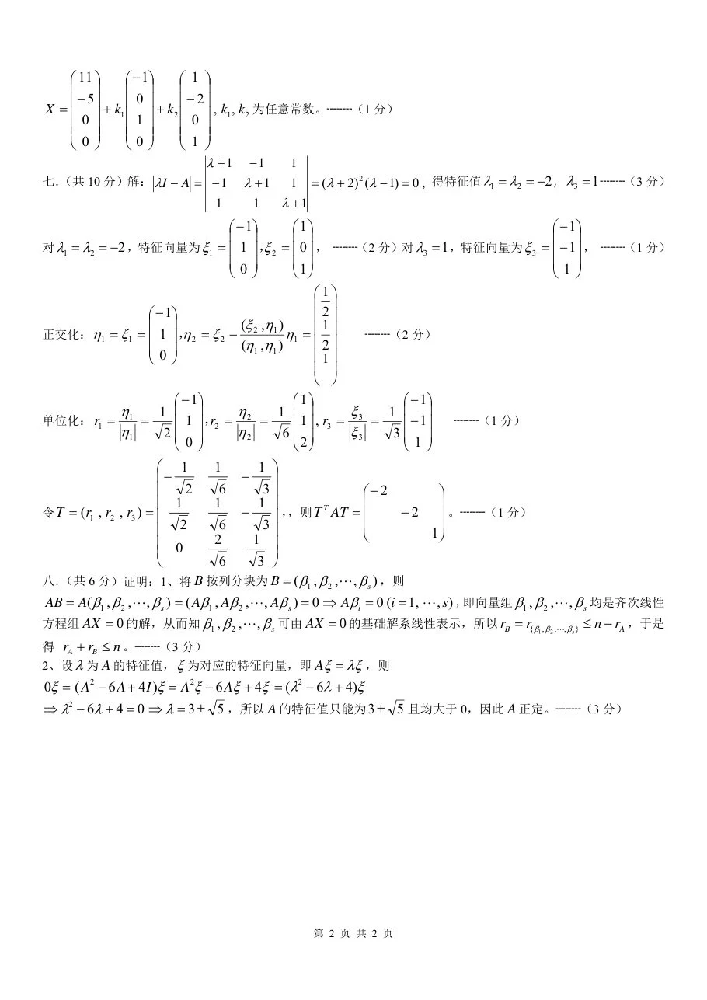

$X = \begin{pmatrix} 1 & 1 \\ -5 \\ 0 \\ 0 \end{pmatrix} + k_1\begin{pmatrix} -1 \\ 0 \\ 1 \\ 0 \end{pmatrix} + k_2\begin{pmatrix} 1 \\ -2 \\ 0 \\ 1 \end{pmatrix}, k_1, k_2$ 为任意常数。----（1分）

七.（共10分）解： $\left|\lambda I-A\right|=\left|\begin{matrix}\lambda+1&-1&1\\-1&\lambda+1&1\\1&1&\lambda+1\end{matrix}\right|=(\lambda+2)^{2}(\lambda-1)=0$ ，得特征值 $\lambda_{1}=\lambda_{2}=-2,\quad\lambda_{3}=1$ ——（3分）

对 $\lambda_{1}=\lambda_{2}=-2$ ，特征向量为 $\xi_{1}=\begin{pmatrix}-1\\1\\0\end{pmatrix},\xi_{2}=\begin{pmatrix}1\\0\\1\end{pmatrix}$ ，----（2 分）对 $\lambda_{3}=1$ ，特征向量为 $\xi_{3}=\begin{pmatrix}-1\\-1\\1\end{pmatrix}$ ，----（1 分）

正交化： $\eta_{1} = \xi_{1} = \left( \begin{array}{c} - 1\\ 1\\ 0 \end{array} \right),\eta_{2} = \xi_{2} - \frac{(\xi_{2},\eta_{1})}{(\eta_{1},\eta_{1})}\eta_{1} = \left( \begin{array}{c}\frac{1}{2}\\ \frac{1}{2}\\ 1 \end{array} \right)$ （2分）

单位化： $r_1 = \frac{\eta_1}{|\eta_1|} = \frac{1}{\sqrt{2}}\left( \begin{array}{c}-1\\ 1\\ 0 \end{array} \right),r_2 = \frac{\eta_2}{|\eta_2|} = \frac{1}{\sqrt{6}}\left( \begin{array}{c}1\\ 1\\ 2 \end{array} \right),r_3 = \frac{\xi_3}{|\xi_3|} = \frac{1}{\sqrt{3}}\left( \begin{array}{c}-1\\ -1\\ 1 \end{array} \right)$ （1分）

令 $T=(r_{1},r_{2},r_{3})=\begin{pmatrix}-\frac{1}{\sqrt{2}}&\frac{1}{\sqrt{6}}&- \frac{1}{\sqrt{3}}\\ \frac{1}{\sqrt{2}}&\frac{1}{\sqrt{6}}&-\frac{1}{\sqrt{3}}\\ 0&\frac{2}{\sqrt{6}}&\frac{1}{\sqrt{3}}\end{pmatrix}$ ，则 $T^{T}AT=\begin{pmatrix}-2& & \\ &-2& \\ & &1\end{pmatrix}$ 。----（1分）

八.（共6分）证明：1、将B按列分块为 $B=(\beta_{1},\beta_{2},\cdots,\beta_{s})$ ，则

$AB = A(\beta_{1}, \beta_{2}, \cdots, \beta_{s}) = (A\beta_{1}, A\beta_{2}, \cdots, A\beta_{s}) = 0 \Rightarrow A\beta_{i} = 0 (i = 1, \cdots, s)$ ，即向量组 $\beta_{1}, \beta_{2}, \cdots, \beta_{s}$ 均是齐次线性方程组 AX = 0 的解，从而知 $\beta_{1}, \beta_{2}, \cdots, \beta_{s}$ 可由 AX = 0 的基础解系线性表示，所以 $r_{B} = r_{\{\beta_{1}, \beta_{2}, \cdots, \beta_{s}\}} \leq n - r_{A}$ ，于是得 $r_{A} + r_{B} \leq n$ 。（3 分）

2、设 $\lambda$ 为 A 的特征值， $\xi$ 为对应的特征向量，即 $A\xi = \lambda\xi$ ，则

$$
0 \xi = (A ^ {2} - 6 A + 4 I) \xi = A ^ {2} \xi - 6 A \xi + 4 \xi = (\lambda^ {2} - 6 \lambda + 4) \xi
$$

$\Rightarrow\lambda^{2}-6\lambda+4=0\Rightarrow\lambda=3\pm\sqrt{5}$ ，所以A的特征值只能为 $3\pm\sqrt{5}$ 且均大于0，因此A正定。……（3分）

第2页共2页

## 第9页

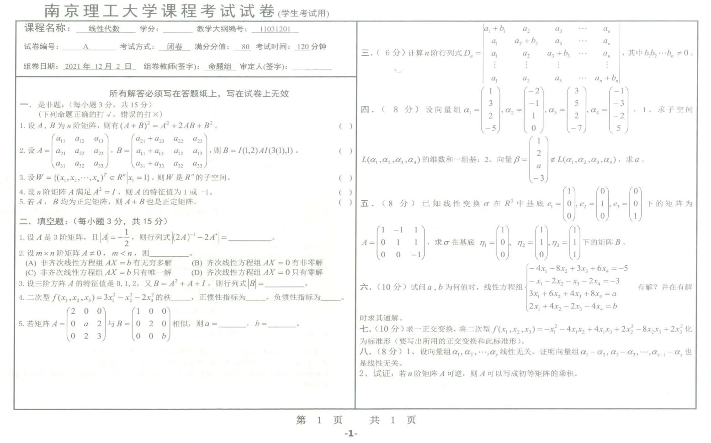

## 南京理工大学课程考试试卷 (学生考试用)

课程名称： 线性代数 学分： 教学大纲编号： 11031201

试卷编号：\_\_\_\_ A \_\_\_\_ 考试方式：\_\_\_\_ 闭卷 满分分值：\_\_\_\_ 80 考试时间：120 分钟

组卷日期：2021年12月2日 组卷教师(签字)：命题组 审定人(签字)：

### 所有解答必须写在答题纸上，写在试卷上无效

### 一．是非题：（每小题3分，共15分）

### (下列命题正确的打√，错误的打×)

1. 设 A, B 为 n 阶矩阵，则有 $(A + B)^{2} = A^{2} + 2AB + B^{2}$ 。

2. 设 $A = \begin{pmatrix} a_{11} & a_{12} & a_{13} \\ a_{21} & a_{22} & a_{23} \\ a_{31} & a_{32} & a_{33} \end{pmatrix}$ ， $B = \begin{pmatrix} a_{21} + a_{23} & a_{22} & a_{23} \\ a_{11} + a_{13} & a_{12} & a_{13} \\ a_{31} + a_{33} & a_{32} & a_{33} \end{pmatrix}$ ，则 $B = I(1,2)AI(3(1),1)$ 。

3. 设 $W = \left\{(x_{1}, x_{2}, \cdots, x_{n})^{T} \in R^{n} \mid x_{1} = 1\right\}$ ，则 W 是 $R^{n}$ 的子空间。

4. 设 n 阶矩阵 A 满足 $A^{2}=I$ ，则 A 的特征值为 1 或 -1。
5. 若 A, B 均为正定矩阵，则 $A + B$ 也是正定矩阵。

### 二. 填空题: (每小题 3 分, 共 15 分)

1. 设 A 是 3 阶矩阵，且 $\left|A\right| = -\frac{1}{2}$ ，则行列式 $\left|(2A)^{-1} - 2A^{*}\right| =$ \_\_\_\_。

2. 设 $m \times n$ 阶矩阵 $A \neq 0$ ，m < n，则 \_\_\_\_。
(A) 非齐次线性方程组 AX = b 有无穷多解 (B) 齐次线性方程组 AX = 0 有非零解
(C) 非齐次线性方程组 AX = b 只有唯一解 (D) 齐次线性方程组 AX = 0 只有零解

3. 设三阶方阵 A 的特征值是 0, 1, 2，又 $B = A^{2} + A + I$ ，则行列式 $\left|B\right| =$ \_\_\_\_。

4. 二次型 $f(x_{1}, x_{2}, x_{3}) = 3x_{1}^{2} - x_{2}^{2} - 2x_{3}^{2}$ 的秩 \_\_\_\_，正惯性指标为 \_\_\_\_，负惯性指标为 \_\_\_\_。

5. 若矩阵 $A = \begin{pmatrix} 2 & 0 & 0 \\ 0 & a & 2 \\ 0 & 2 & 3 \end{pmatrix}$ 与 $B = \begin{pmatrix} 1 & 0 & 0 \\ 0 & 2 & 0 \\ 0 & 0 & b \end{pmatrix}$ 相似，则 a = \_\_\_\_，b = \_\_\_\_。

三.（6分）计算 $n$ 阶行列式 $D_{n} = \left| \begin{array}{cccc}a_{1} + b_{1} & a_{2} & a_{3} & \dots & a_{n}\\ a_{1} & a_{2} + b_{2} & a_{3} & \dots & a_{n}\\ a_{1} & a_{2} & a_{3} + b_{3} & \dots & a_{n}\\ \vdots & \vdots & \vdots & & \vdots \\ a_{1} & a_{2} & a_{3} & \dots & a_{n} + b_{n} \end{array} \right|$ ，其中 $b_{1}b_{2}\dots b_{n}\neq 0$ 。

四．（8分）设向量组 $\alpha_{1} = \begin{pmatrix} 1 \\ 3 \\ 2 \\ -5 \end{pmatrix}, \alpha_{2} = \begin{pmatrix} -2 \\ -1 \\ 1 \\ 0 \end{pmatrix}, \alpha_{3} = \begin{pmatrix} 3 \\ 5 \\ 2 \\ -7 \end{pmatrix}, \alpha_{4} = \begin{pmatrix} -1 \\ -3 \\ -2 \\ 5 \end{pmatrix}$ ，1、求子空间

$L(\alpha_{1},\alpha_{2},\alpha_{3},\alpha_{4})$ 的维数和一组基；2、向量 $\beta = \left( \begin{array}{c}1\\ 2\\ a\\ -3 \end{array} \right)\notin L(\alpha_{1},\alpha_{2},\alpha_{3},\alpha_{4})$ ，求 $a$ 。

五．（8分）已知线性变换 $\sigma$ 在 $R^{3}$ 中基底 $e_{1}=\begin{pmatrix}1\\0\\0\end{pmatrix},e_{2}=\begin{pmatrix}0\\1\\0\end{pmatrix},e_{3}=\begin{pmatrix}0\\0\\1\end{pmatrix}$ 下的矩阵为 $A=\begin{pmatrix}1&-1&1\\0&1&1\\0&0&-1\end{pmatrix}$ ，求 $\sigma$ 在基底 $\eta_{1}=\begin{pmatrix}1\\0\\0\end{pmatrix},\quad\eta_{2}=\begin{pmatrix}1\\1\\0\end{pmatrix},\quad\eta_{3}=\begin{pmatrix}1\\1\\1\end{pmatrix}$ 下的矩阵 B。

六.（10分）试问 $a, b$ 为何值时，线性方程组 $\left\{ \begin{array}{l} -4x_{1} - 8x_{2} + 3x_{3} + 6x_{4} = -5 \\ -x_{1} - 2x_{2} - x_{3} - 2x_{4} = -3 \\ 3x_{1} + 6x_{2} + 4x_{3} + 8x_{4} = a \\ 2x_{1} + 4x_{2} - 2x_{3} - 4x_{4} = b \end{array} \right.$ 有解？并在有解

七.（10分）求一正交变换，将二次型 $f(x_{1},x_{2},x_{3})=-x_{1}^{2}-4x_{1}x_{2}+4x_{1}x_{3}+2x_{2}^{2}-8x_{2}x_{3}+2x_{3}^{2}$ 化为标准形（要写出所用的正交变换和此标准形）。  
八.（8分）1、设向量组 $\alpha_{1},\alpha_{2},\cdots,\alpha_{s}$ 线性无关，证明向量组 $\alpha_{1}-\alpha_{2},\alpha_{2}-\alpha_{3},\cdots,\alpha_{s-1}-\alpha_{s}$ 也是线性无关。  
2、试证：若n阶矩阵A可逆，则A可以写成初等矩阵的乘积。

第1页 共1页

-1-

## 第10页

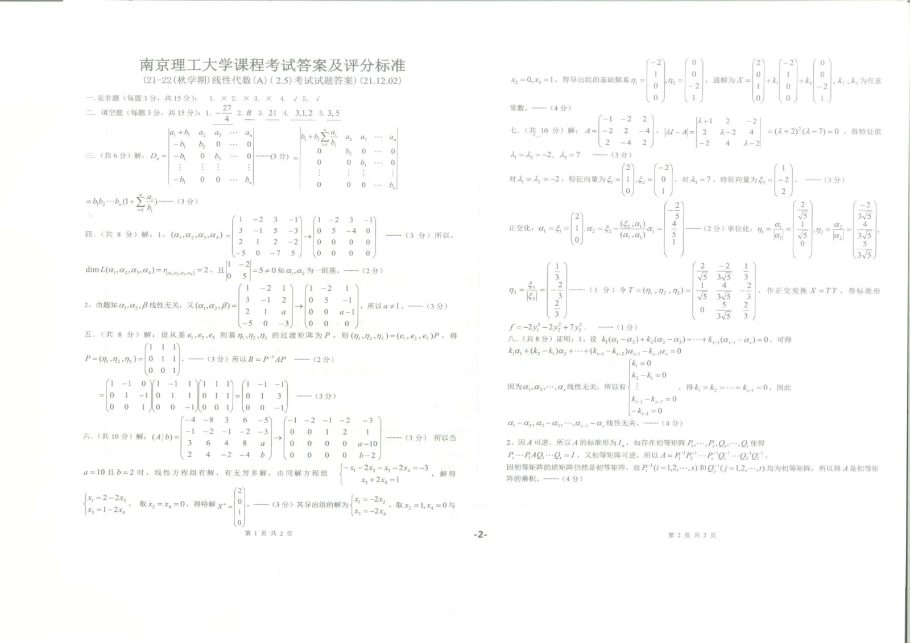

## 南京理工大学课程考试答案及评分标准

(21-22(秋学期)线性代数(A)(2.5)考试试题答案)(21.12.02)

一.是非题（每题3分，共15分）： $1.\times 2.\times 3.\times 4.\checkmark 5.\checkmark$

二. 填空题（每题3分，共15分）：1. $-\frac{27}{4}$ 2. B 3. 21 4. 3,1,2 5. 3,5

三.（共6分）解： $D_{n} = \left| \begin{array}{cccc}a_{1} + b_{1} & a_{2} & a_{3} & \dots & a_{n}\\ -b_{1} & b_{2} & 0 & \dots & 0\\ -b_{1} & 0 & b_{3} & \dots & 0\\ \vdots & \vdots & \vdots & & \vdots \\ -b_{1} & 0 & 0 & \dots & b_{n} \end{array} \right|$ ——(3分）= $\left| \begin{array}{cccccc}b_1 + b_1\sum_{i = 1}^n\frac{a_i}{b_i} & a_2 & a_3 & \dots & a_n\\ 0 & b_2 & 0 & \dots & 0\\ 0 & 0 & b_3 & \dots & 0\\ \vdots & \vdots & \vdots & & \vdots \\ 0 & 0 & 0 & \dots & b_n \end{array} \right|$

$$
= b _ {1} b _ {2} \dots b _ {n} (1 + \sum_ {i = 1} ^ {n} \frac {a _ {i}}{b _ {i}}) - - - - - (3 \text {分}
$$

四.（共8分）解：1、 $(\alpha_{1},\alpha_{2},\alpha_{3},\alpha_{4})=\begin{pmatrix}1&-2&3&-1\\3&-1&5&-3\\2&1&2&-2\\-5&0&-7&5\end{pmatrix}\rightarrow\begin{pmatrix}1&-2&3&-1\\0&5&-4&0\\0&0&0&0\\0&0&0&0\end{pmatrix}$ ——（3分）所以，

$\dim L(\alpha_{1}, \alpha_{2}, \alpha_{3}, \alpha_{4}) = r_{\{\alpha_{1}, \alpha_{2}, \alpha_{3}, \alpha_{4}\}} = 2$ ，且 $\begin{vmatrix} 1 & -2 \\ 0 & 5 \end{vmatrix} = 5 \neq 0$ 知 $\alpha_{1}, \alpha_{2}$ 为一组基。——（2分）

2、由题知 $\alpha_{1},\alpha_{2},\beta$ 线性无关，又 $(\alpha_{1},\alpha_{2},\beta)=\begin{pmatrix}1&-2&1\\3&-1&2\\2&1&a\\-5&0&-3\end{pmatrix}\rightarrow\begin{pmatrix}1&-2&1\\0&5&-1\\0&0&a-1\\0&0&0\end{pmatrix}$ ，所以 $a\neq1$ 。——（3分）

五．（共8分）解：设从基 $e_{1},e_{2},e_{3}$ 到基 $\eta_{1},\eta_{2},\eta_{3}$ 的过渡矩阵为P，则 $(\eta_{1},\eta_{2},\eta_{3})=(e_{1},e_{2},e_{3})P$ ，得 $P=(\eta_{1},\eta_{2},\eta_{3})=\begin{pmatrix}1&1&1\\0&1&1\\0&0&1\end{pmatrix}$ ，----（3分）所以 $B=P^{-1}AP$ ----（2分）

$$
= \left( \begin{array}{c c c} 1 & - 1 & 0 \\ 0 & 1 & - 1 \\ 0 & 0 & 1 \end{array} \right) \left( \begin{array}{c c c} 1 & - 1 & 1 \\ 0 & 1 & 1 \\ 0 & 0 & - 1 \end{array} \right) \left( \begin{array}{c c c} 1 & 1 & 1 \\ 0 & 1 & 1 \\ 0 & 0 & 1 \end{array} \right) = \left( \begin{array}{c c c} 1 & - 1 & - 1 \\ 0 & 1 & 3 \\ 0 & 0 & - 1 \end{array} \right) \quad \text {   ——   (3分)   }
$$

六.（共10分）解： $(A|b)=\begin{pmatrix}-4&-8&3&6&-5\\-1&-2&-1&-2&-3\\3&6&4&8&a\\2&4&-2&-4&b\end{pmatrix}\rightarrow\begin{pmatrix}-1&-2&-1&-2&-3\\0&0&1&2&1\\0&0&0&0&a-10\\0&0&0&0&b-2\end{pmatrix}$ ——（3分）所以当

a=10 且 b=2 时，线性方程组有解，有无穷多解，由同解方程组 $\left\{\begin{aligned}-x_{1}-2x_{2}-x_{3}-2x_{4}&=-3\\ x_{3}+2x_{4}&=1\end{aligned}\right.$ ，解得 $\left\{\begin{aligned}x_{1}&=2-2x_{2}\\ x_{3}&=1-2x_{4}\end{aligned}\right.$ ，取 $x_{2}=x_{4}=0$ ，得特解 $X^{*}=\begin{pmatrix}2\\ 0\\ 1\\ 0\end{pmatrix}$ ，(3分)其导出组的解为 $\left\{\begin{aligned}x_{1}&=-2x_{2}\\ x_{3}&=-2x_{4}\end{aligned}\right.$ ，取 $x_{2}=1,x_{4}=0$ 与$x_{2} = 0, x_{4} = 1$ ，得导出组的基础解系 $\eta_{1} = \begin{pmatrix} -2\\ 1\\ 0\\ 0\end{pmatrix},\eta_{2} = \begin{pmatrix} 0\\ 0\\ -2\\ 1\end{pmatrix}$ ，通解为 $X = \begin{pmatrix} 2\\ 0\\ 1\\ 0\end{pmatrix} + k_{1}\begin{pmatrix} -2\\ 1\\ 0\\ 0\end{pmatrix} + k_{2}\begin{pmatrix} 0\\ 0\\ -2\\ 1\end{pmatrix}, k_{1}, k_{2}$ 为任意

七.（共10分）解： $A = \begin{pmatrix} -1 & -2 & 2\\ -2 & 2 & -4\\ 2 & -4 & 2 \end{pmatrix}$ ， $|\lambda I - A| = \left| \begin{array}{ccc}\lambda +1 & 2 & -2\\ 2 & \lambda -2 & 4\\ -2 & 4 & \lambda -2 \end{array} \right| = (\lambda +2)^{2}(\lambda -7) = 0$ ，得特征值 $\lambda_{1} = \lambda_{2} = -2,\lambda_{3} = 7$ （3分）

对 $\lambda_{1}=\lambda_{2}=-2$ ，特征向量为 $\xi_{1}=\begin{pmatrix}2\\1\\0\end{pmatrix},\xi_{2}=\begin{pmatrix}-2\\0\\1\end{pmatrix}$ ，对 $\lambda_{3}=7$ ，特征向量为 $\xi_{3}=\begin{pmatrix}1\\-2\\2\end{pmatrix}$ ，……（3分）

正交化： $\alpha_{1} = \xi_{1} = \left( \begin{array}{c}2\\ 1\\ 0 \end{array} \right),\alpha_{2} = \xi_{2} - \frac{(\xi_{2},\alpha_{1})}{(\alpha_{1},\alpha_{1})}\alpha_{1} = \left( \begin{array}{c} - \frac{2}{5}\\ \frac{4}{5}\\ 1 \end{array} \right)$ （2分）单位化： $\eta_{1} = \frac{\alpha_{1}}{|\alpha_{1}|} = \left( \begin{array}{c}\frac{2}{\sqrt{5}}\\ \frac{1}{\sqrt{5}}\\ 0 \end{array} \right),\eta_{2} = \frac{\alpha_{2}}{|\alpha_{2}|} = \left( \begin{array}{c}\frac{-2}{3\sqrt{5}}\\ \frac{4}{3\sqrt{5}}\\ \frac{5}{3\sqrt{5}} \end{array} \right),$

$\eta_{3}=\frac{\xi_{3}}{\left|\xi_{3}\right|}=\left(\begin{array}{c}\frac{1}{3}\\-\frac{2}{3}\\ \frac{2}{3}\end{array}\right)$ ——（1分）令 $T=(\eta_{1},\eta_{2},\eta_{3})=\left(\begin{array}{ccc}\frac{2}{\sqrt{5}}&-\frac{2}{3\sqrt{5}}&\frac{1}{3}\\ \frac{1}{\sqrt{5}}&\frac{4}{3\sqrt{5}}&-\frac{2}{3}\\ 0&\frac{5}{3\sqrt{5}}&\frac{2}{3}\end{array}\right)$ ，作正交变换X=TY，得标准形

$$
f = - 2 y _ {1} ^ {2} - 2 y _ {2} ^ {2} + 7 y _ {3} ^ {2}. \quad - - - - (1 \text {分})
$$

八.（共8分）证明：1、设 $k_{1}(\alpha_{1} - \alpha_{2}) + k_{2}(\alpha_{2} - \alpha_{3}) + \dots +k_{s - 1}(\alpha_{s - 1} - \alpha_{s}) = 0$ ，可得 $k_{1}\alpha_{1} + (k_{2} - k_{1})\alpha_{2} + \dots +(k_{s - 1} - k_{s - 2})\alpha_{s - 1} - k_{s - 1}\alpha_{s} = 0$

因为 $\alpha_{1},\alpha_{2},\cdots,\alpha_{s}$ 线性无关，所以有 $\left\{\begin{aligned}k_{1}&=0\\ k_{2}&-k_{1}=0\\ \vdots\\ k_{s-1}&-k_{s-2}=0\\ -k_{s-1}&=0\end{aligned}\right.$ ，得 $k_{1}=k_{2}=\cdots=k_{s-1}=0$ ，因此

$\alpha_{1}-\alpha_{2},\alpha_{2}-\alpha_{3},\cdots,\alpha_{s-1}-\alpha_{s}$ 线性无关。……（4分）

2、因 A 可逆，所以 A 的标准形为 $I_{n}$ ，知存在初等矩阵 $P_{1}, \cdots, P_{s}, Q_{1}, \cdots, Q_{t}$ 使得 $P_{s} \cdots P_{1} A Q_{1} \cdots Q_{t} = I$ ，又初等矩阵可逆，所以 $A = P_{1}^{-1} P_{2}^{-1} \cdots P_{s}^{-1} Q_{t}^{-1} \cdots Q_{2}^{-1} Q_{1}^{-1}$ 。

因初等矩阵的逆矩阵仍然是初等矩阵，故 $P_{i}^{-1} (i = 1, 2, \cdots, s)$ 和 $Q_{j}^{-1} (j = 1, 2, \cdots, t)$ 均为初等矩阵，所以得 A 是初等矩阵的乘积。……（4 分）

第1页共2页

第2页共2页

## 第11页

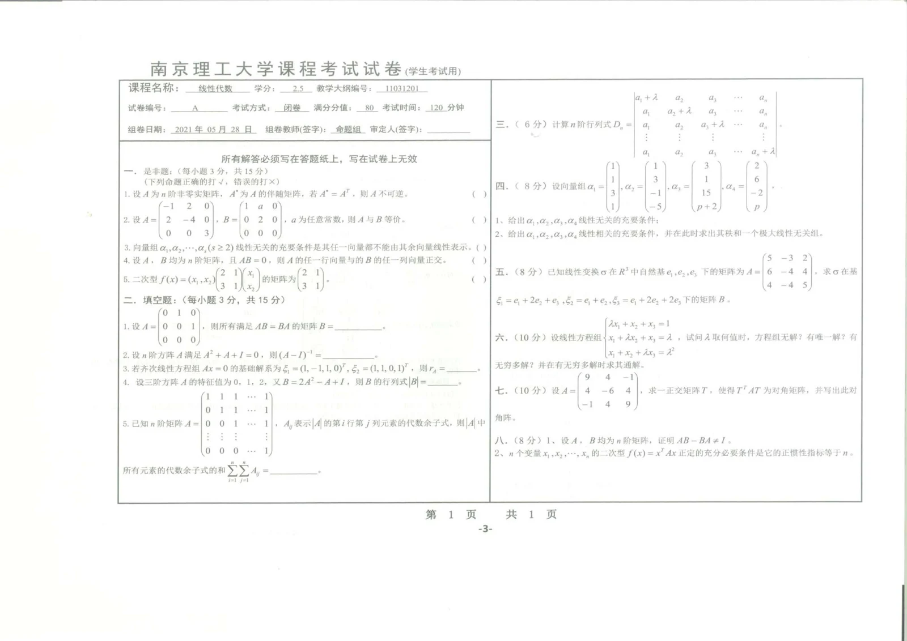

## 南京理工大学课程考试试卷 (学生考试用)

课程名称： 线性代数 学分： 2.5 教学大纲编号： 11031201

试卷编号：\_\_\_\_ A \_\_\_\_ 考试方式：闭卷 满分分值：80 考试时间：120 分钟

组卷日期：2021年05月28日 组卷教师(签字)：命题组 审定人(签字)：

### 所有解答必须写在答题纸上，写在试卷上无效

### 一．是非题：（每小题3分，共15分）

(下列命题正确的打√，错误的打×)

1. 设 A 为 n 阶非零实矩阵， $A^{*}$ 为 A 的伴随矩阵，若 $A^{*} = A^{T}$ ，则 A 不可逆。()

2. 设 $A = \begin{pmatrix} -1 & 2 & 0 \\ 2 & -4 & 0 \\ 0 & 0 & 3 \end{pmatrix}$ ， $B = \begin{pmatrix} 1 & a & 0 \\ 0 & 2 & 0 \\ 0 & 0 & 0 \end{pmatrix}$ ，a 为任意常数，则 A 与 B 等价。

3. 向量组 $\alpha_{1}, \alpha_{2}, \cdots, \alpha_{s} (s \geq 2)$ 线性无关的充要条件是其任一向量都不能由其余向量线性表示。（）4. 设 A, B 均为 n 阶矩阵，且 AB = 0，则 A 的任一行向量与的 B 的任一列向量正交。（）

5. 二次型 $f(x)=(x_{1},x_{2})\begin{pmatrix}2&1\\3&1\end{pmatrix}\begin{pmatrix}x_{1}\\x_{2}\end{pmatrix}$ 的矩阵为 $\begin{pmatrix}2&1\\3&1\end{pmatrix}$ 。

### 二．填空题：（每小题3分，共15分）

1. 设 $A = \begin{pmatrix} 0 & 1 & 0 \\ 0 & 0 & 1 \\ 0 & 0 & 0 \end{pmatrix}$ ，则所有满足 AB = BA 的矩阵 B = \_\_\_\_。

2. 设 n 阶方阵 A 满足 $A^{2} + A + I = 0$ ，则 $(A - I)^{-1} =$ \_\_\_\_ 。

3. 若齐次线性方程组 Ax = 0 的基础解系为 $\xi_{1} = (1, -1, 1, 0)^{T}, \xi_{2} = (1, 1, 0, 1)^{T}$ ，则 $r_{A} =$ \_\_\_\_ 。

4. 设三阶方阵 A 的特征值为 0, 1, 2，又 $B = 2A^{2} - A + I$ ，则 B 的行列式 $|B| =$ \_\_\_\_ 。

5. 已知 n 阶矩阵 $A = \begin{pmatrix} 1 & 1 & 1 & \cdots & 1 \\ 0 & 1 & 1 & \cdots & 1 \\ 0 & 0 & 1 & \cdots & 1 \\ \vdots & \vdots & \vdots & & \vdots \\ 0 & 0 & 0 & \cdots & 1 \end{pmatrix}$ ， $A_{ij}$ 表示 $|A|$ 的第 i 行第 j 列元素的代数余子式，则 $|A|$ 中所有元素的代数余子式的和 $\sum_{i=1}^{n} \sum_{j=1}^{n} A_{ij} =$ \_\_\_\_ 。

三.（6分）计算 $n$ 阶行列式 $D_{n} = \left| \begin{array}{cccc}a_{1} + \lambda & a_{2} & a_{3} & \dots & a_{n}\\ a_{1} & a_{2} + \lambda & a_{3} & \dots & a_{n}\\ a_{1} & a_{2} & a_{3} + \lambda & \dots & a_{n}\\ \vdots & \vdots & \vdots & & \vdots \\ a_{1} & a_{2} & a_{3} & \dots & a_{n} + \lambda \end{array} \right|$

四.（8分）设向量组 $\alpha_{1} = \begin{pmatrix} 1 \\ 1 \\ 3 \\ 1 \end{pmatrix}, \alpha_{2} = \begin{pmatrix} 1 \\ 3 \\ -1 \\ -5 \end{pmatrix}, \alpha_{3} = \begin{pmatrix} 3 \\ 1 \\ 15 \\ p + 2 \end{pmatrix}, \alpha_{4} = \begin{pmatrix} 2 \\ 6 \\ -2 \\ p \end{pmatrix}$

1、给出 $\alpha_{1},\alpha_{2},\alpha_{3},\alpha_{4}$ 线性无关的充要条件；

2、给出 $\alpha_{1}, \alpha_{2}, \alpha_{3}, \alpha_{4}$ 线性相关的充要条件，并在此时求出其秩和一个极大线性无关组。

五.（8分）已知线性变换 $\sigma$ 在 $R^3$ 中自然基 $e_1, e_2, e_3$ 下的矩阵为 $A = \begin{pmatrix} 5 & -3 & 2 \\ 6 & -4 & 4 \\ 4 & -4 & 5 \end{pmatrix}$ ，求 $\sigma$ 在基 $\xi_1 = e_1 + 2e_2 + e_3, \xi_2 = e_1 + e_2, \xi_3 = e_1 + 2e_2 + 2e_3$ 下的矩阵 $B$ 。

六.（10分）设线性方程组 $\left\{ \begin{array}{l} \lambda x_{1} + x_{2} + x_{3} = 1 \\ x_{1} + \lambda x_{2} + x_{3} = \lambda \\ x_{1} + x_{2} + \lambda x_{3} = \lambda^{2} \end{array} \right.$ ，试问 $\lambda$ 取何值时，方程组无解？有唯一解？有无穷多解？并在有无穷多解时求其通解。

七.（10分）设 $A = \begin{pmatrix} 9 & 4 & -1 \\ 4 & -6 & 4 \\ -1 & 4 & 9 \end{pmatrix}$ ，求一正交矩阵 $T$ ，使得 $T^T AT$ 为对角矩阵，并写出此对角阵。

八.（8分）1、设A，B均为n阶矩阵，证明 $AB-BA\neq I$ 。

2、n 个变量 $x_{1}, x_{2}, \cdots, x_{n}$ 的二次型 $f(x) = x^{T}Ax$ 正定的充分必要条件是它的正惯性指标等于 n。

第1页 共1页

-3-

## 第12页

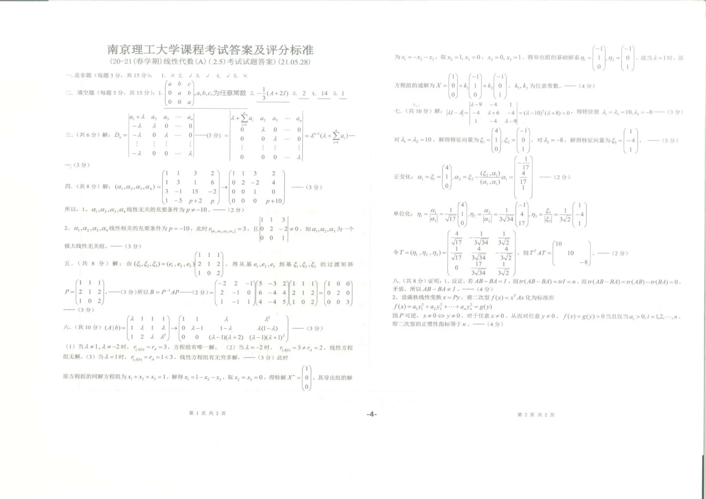

## 南京理工大学课程考试答案及评分标准

(20-21(春学期)线性代数(A)(2.5)考试试题答案)(21.05.28)

一.是非题（每题3分，共15分）：1. × 2. √ 3. √ 4. √ 5. ×

二. 填空题（每题3分，共15分）：1. $\begin{pmatrix}a & b & c \\ 0 & a & b \\ 0 & 0 & a\end{pmatrix}, a, b, c$ ，为任意常数 2. $-\frac{1}{3}(A+2I)$ 3. 2 4. 14 5. 1

三.（共6分）解： $D_{n}=\left|\begin{matrix}a_{1}+\lambda & a_{2} & a_{3} & \cdots & a_{n}\\ -\lambda & \lambda & 0 & \cdots & 0\\ -\lambda & 0 & \lambda & \cdots & 0\\ \vdots & \vdots & \vdots & & \vdots \\ -\lambda & 0 & 0 & \cdots & \lambda\end{matrix}\right|$ ——(3分)= $\left|\begin{matrix}\lambda+\sum_{i=1}^{n}a_{i}&a_{2}&a_{3}&\cdots&a_{n}\\ 0&\lambda&0&\cdots&0\\ 0&0&\lambda&\cdots&0\\ \vdots&\vdots&\vdots&&\vdots\\ 0&0&0&\cdots&\lambda\end{matrix}\right|=\lambda^{n-1}(\lambda+\sum_{i=1}^{n}a_{i})\cdots$

--- (3分)

四.（共8分）解： $(\alpha_{1},\alpha_{2},\alpha_{3},\alpha_{4}) = \begin{pmatrix} 1 & 1 & 3 & 2\\ 1 & 3 & 1 & 6\\ 3 & -1 & 15 & -2\\ 1 & -5 & p + 2 & p \end{pmatrix}\rightarrow \begin{pmatrix} 1 & 1 & 3 & 2\\ 0 & 2 & -2 & 4\\ 0 & 0 & 1 & 0\\ 0 & 0 & 0 & p + 10 \end{pmatrix}$ ——（3分）

$$
1, \alpha_ {1}, \alpha_ {2}, \alpha_ {3}, \alpha_ {4}
$$

$$
p \neq - 1 0 。 - - - - (2 \text {分})
$$

2、 $\alpha_{1},\alpha_{2},\alpha_{3},\alpha_{4}$ 线性相关的充要条件为p=-10，此时 $r_{\{\alpha_{1},\alpha_{2},\alpha_{3},\alpha_{4}\}}=3$ ，且 $\begin{vmatrix}1&1&3\\ 0&2&-2\\ 0&0&1\end{vmatrix}\neq0$ ，知 $\alpha_{1},\alpha_{2},\alpha_{3}$ 为一个极大线性无关组。——（3分）

五．（共8分）解：由 $(\xi_1,\xi_2,\xi_3) = (e_1,e_2,e_3)\left( \begin{array}{ccc}1 & 1 & 1\\ 2 & 1 & 2\\ 1 & 0 & 2 \end{array} \right)$ ，得从基 $e_1,e_2,e_3$ 到基 $\xi_1,\xi_2,\xi_3$ 的过渡矩阵

$$
P = \left( \begin{array}{c c c} 1 & 1 & 1 \\ 2 & 1 & 2 \\ 1 & 0 & 2 \end{array} \right), - - - - - (3
$$

$$
B = P ^ {- 1} A P \text {   - - -   (2分)   } = \left( \begin{array}{c c c} {{- 2}} & {{2}} & {{- 1}} \\ {{2}} & {{- 1}} & {{0}} \\ {{1}} & {{- 1}} & {{1}} \end{array} \right) \left( \begin{array}{c c c} {{5}} & {{- 3}} & {{2}} \\ {{6}} & {{- 4}} & {{4}} \\ {{4}} & {{- 4}} & {{5}} \end{array} \right) \left( \begin{array}{c c c} {{1}} & {{1}} & {{1}} \\ {{2}} & {{1}} & {{2}} \\ {{1}} & {{0}} & {{2}} \end{array} \right) = \left( \begin{array}{c c c} {{1}} & {{0}} & {{0}} \\ {{0}} & {{2}} & {{0}} \\ {{0}} & {{0}} & {{3}} \end{array} \right)
$$

六.（共10分） $(A|b)=\begin{pmatrix}\lambda&1&1&1\\1&\lambda&1&\lambda\\1&2&\lambda&\lambda^{2}\end{pmatrix}\rightarrow\begin{pmatrix}1&1&\lambda&\lambda^{2}\\0&\lambda-1&1-\lambda&\lambda(1-\lambda)\\0&0&(\lambda-1)(\lambda+2)&(\lambda-1)(\lambda+1)^{2}\end{pmatrix}$ ——（3分）

（1）当 $\lambda \neq 1, \lambda \neq -2$ 时， $r_{(A|b)} = r_A = 3$ ，方程组有唯一解。（2）当 $\lambda = -2$ 时， $r_{(A|b)} = 3 \neq r_A = 2$ ，线性方程组无解。（3）当 $\lambda = 1$ 时， $r_{(A|b)} = r_A = 1 < 3$ ，线性方程组有无穷多解，……（3 分）此时

原方程组的同解方程组为 $x_{1} + x_{2} + x_{3} = 1$ ，解得 $x_{1} = 1 - x_{2} - x_{3}$ ，取 $x_{2} = x_{3} = 0$ ，得特解 $X^{*} = \begin{pmatrix} 1 \\ 0 \\ 0 \end{pmatrix}$ ，其导出组的解

为 $x_{1} = -x_{2} - x_{3}$ ，取 $x_{2} = 1, x_{3} = 0$ ； $x_{2} = 0, x_{3} = 1$ ，得导出组的基础解系 $\eta_{1} = \begin{pmatrix} -1\\ 1\\ 0 \end{pmatrix},\eta_{2} = \begin{pmatrix} -1\\ 0\\ 1 \end{pmatrix}$ ，故当 $\lambda = 1$ 时，原

方程组的通解为 $X = \begin{pmatrix} 1 \\ 0 \\ 0 \end{pmatrix} + k_{1} \begin{pmatrix} -1 \\ 1 \\ 0 \end{pmatrix} + k_{2} \begin{pmatrix} -1 \\ 0 \\ 1 \end{pmatrix}$ ， $k_{1}, k_{2}$ 为任意常数。……（4 分）

七.（共10分）解： $\left|\lambda I-A\right|=\begin{vmatrix}\lambda-9&-4&1\\-4&\lambda+6&-4\\1&-4&\lambda-9\end{vmatrix}=(\lambda-10)^{2}(\lambda+8)=0$ ，得特征值 $\lambda_{1}=\lambda_{2}=10,\lambda_{3}=-8$ ——（3分）

对 $\lambda_{1}=\lambda_{2}=10$ ，解得特征向量为 $\xi_{1}=\begin{pmatrix}4\\ 1\\ 0\end{pmatrix},\xi_{2}=\begin{pmatrix}-1\\ 0\\ 1\end{pmatrix}$ ，对 $\lambda_{3}=-8$ ，解得特征向量为 $\xi_{3}=\begin{pmatrix}1\\ -4\\ 1\end{pmatrix}$ ，……（3分）

正交化： $\alpha_{1} = \xi_{1} = \left( \begin{array}{c}4\\ 1\\ 0 \end{array} \right),\alpha_{2} = \xi_{2} - \frac{(\xi_{2},\alpha_{1})}{(\alpha_{1},\alpha_{1})}\alpha_{1} = \left( \begin{array}{c} - \frac{1}{17}\\ \frac{4}{17}\\ 1 \end{array} \right)$ （2分）

单位化： $\eta_{1} = \frac{\alpha_{1}}{|\alpha_{1}|} = \frac{1}{\sqrt{17}}\left( \begin{array}{c}4\\ 1\\ 0 \end{array} \right),\eta_{2} = \frac{\alpha_{2}}{|\alpha_{2}|} = \frac{1}{3\sqrt{34}}\left( \begin{array}{c} - 1\\ 4\\ 17 \end{array} \right),\eta_{3} = \frac{\xi_{3}}{|\xi_{3}|} = \frac{1}{3\sqrt{2}}\left( \begin{array}{c}1\\ -4\\ 1 \end{array} \right)$

$$
\text {令} T = (\eta_ {1}, \eta_ {2}, \eta_ {3}) = \left( \begin{array}{c c c} {{\frac {4}{\sqrt {1 7}}}} & {{- \frac {1}{3 \sqrt {3 4}}}} & {{\frac {1}{3 \sqrt {2}}}} \\ {{\frac {1}{\sqrt {1 7}}}} & {{\frac {4}{3 \sqrt {3 4}}}} & {{- \frac {4}{3 \sqrt {2}}}} \\ {{0}} & {{\frac {1 7}{3 \sqrt {3 4}}}} & {{\frac {1}{3 \sqrt {2}}}} \end{array} \right), \text {则} T ^ {T} A T = \left( \begin{array}{c c c} {{1 0}} & {} & {} \\ {} & {{1 0}} & {} \\ {} & {} & {{- 8}} \end{array} \right) 。 - - - - (2 \text {分})
$$

八.（共8分）证明：1、反证，若 $AB - BA = I$ ，则 $tr(AB - BA) = trI = n$ ，而 $tr(AB - BA) = tr(AB) - tr(BA) = 0$ 矛盾，所以 $AB - BA \neq I$ 。……（4分）

$$
f (x) = x ^ {T} A x
$$

$$
f (x) = a _ {1} y _ {1} ^ {2} + a _ {2} y _ {2} ^ {2} + \dots + a _ {n} y _ {n} ^ {2} = g (y)
$$

因 P 可逆， $x \neq 0 \Leftrightarrow y \neq 0$ ，对于任意 $x \neq 0$ ，从而对任意 $y \neq 0$ ， $f(x) = g(y) > 0$ 当且仅当 $a_{i} > 0, i = 1, 2, \cdots, n$ ，即二次型的正惯性指标等于 n。……（4 分）

第1页共2页

-4-

第2页共2页

## 第13页

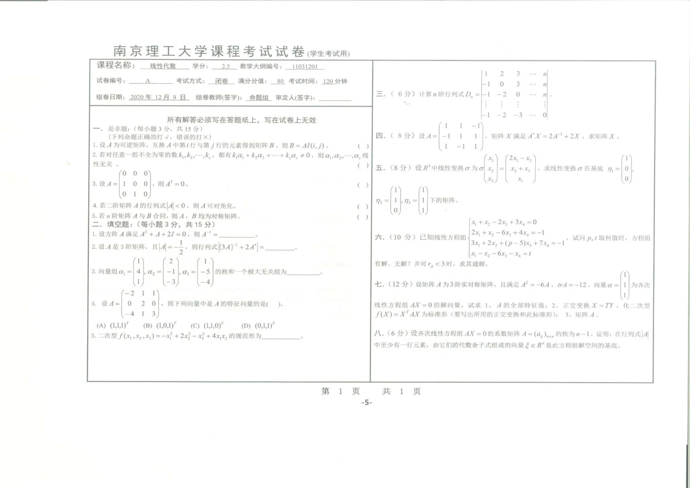

## 南京理工大学课程考试试卷 (学生考试用)

课程名称： 线性代数 学分： 2.5 教学大纲编号： 11031201

试卷编号：\_\_\_\_ A \_\_\_\_ 考试方式：闭卷 满分分值：80 考试时间：120 分钟

组卷日期：2020年12月9日 组卷教师(签字)：命题组 审定人(签字)：

### 所有解答必须写在答题纸上，写在试卷上无效

### 一. 是非题: (每小题 3 分, 共 15 分)

(下列命题正确的打√，错误的打×)

1. 设 A 为可逆矩阵，互换 A 中第 i 行与第 j 行的元素得到矩阵 B，则 $B = AI(i, j)$ 。
2. 若对任意一组不全为零的数 $k_{1}, k_{2}, \cdots, k_{s}$ ，都有 $k_{1}\alpha_{1} + k_{2}\alpha_{2} + \cdots + k_{s}\alpha_{s} \neq 0$ ，则 $\alpha_{1}, \alpha_{2}, \cdots, \alpha_{s}$ 线性无关。

3. 设 $A = \begin{pmatrix} 0 & 0 & 0 \\ 1 & 0 & 0 \\ 0 & 1 & 0 \end{pmatrix}$ ，则 $A^{3} = 0$ 。

4. 若二阶矩阵 A 的行列式 $\left|A\right|<0$ ，则 A 可对角化。

5. 若 n 阶矩阵 A 与 B 合同，则 A，B 均为对称矩阵。

### 二．填空题：（每小题3分，共15分）

1. 设方阵 A 满足 $A^{2} + A + 2I = 0$ ，则 $A^{-1} =$ \_\_\_\_ 。

2. 设 A 是 3 阶矩阵，且 $\left|A\right| = -\frac{1}{2}$ ，则行列式 $\left|(3A)^{-1} + 2A^{*}\right| =$ \_\_\_\_。

3. 向量组 $\alpha_{1}=\begin{pmatrix}1\\4\\1\end{pmatrix},\alpha_{2}=\begin{pmatrix}2\\-1\\-3\end{pmatrix},\alpha_{3}=\begin{pmatrix}1\\-5\\-4\end{pmatrix}$ 的秩和一个极大无关组为 \_\_\_\_。

4. 设 $A = \begin{pmatrix} -2 & 1 & 1 \\ 0 & 2 & 0 \\ -4 & 1 & 3 \end{pmatrix}$ ，则下列向量中是 $A$ 的特征向量的是（ ）。(A) $(1,1,1)^T$ (B) $(1,0,1)^T$ (C) $(1,1,0)^T$ (D) $(0,1,1)^T$

5. 二次型 $f(x_{1}, x_{2}, x_{3}) = -x_{1}^{2} + 2x_{2}^{2} - x_{3}^{2} + 4x_{1}x_{2}$ 的规范形为 \_\_\_\_。

三.（6分）计算 $n$ 阶行列式 $D_{n} = \left| \begin{array}{cccccc}1 & 2 & 3 & \dots & n\\ -1 & 0 & 3 & \dots & n\\ -1 & -2 & 0 & \dots & n\\ \vdots & \vdots & \vdots & & \vdots \\ -1 & -2 & -3 & \dots & 0 \end{array} \right|$ 。

四.（8分）设 $A = \begin{pmatrix} 1 & 1 & -1 \\ -1 & 1 & 1 \\ 1 & -1 & 1 \end{pmatrix}$ ，矩阵 $X$ 满足 $A^{*}X = 2A^{-1} + 2X$ ，求矩阵 $X$ 。

五.（8分）设 $R^3$ 中线性变换 $\sigma$ 为 $\sigma \begin{pmatrix} x_1 \\ x_2 \\ x_3 \end{pmatrix} = \begin{pmatrix} 2x_1 - x_2 \\ x_2 + x_3 \\ x_1 \end{pmatrix}$ ，求线性变换 $\sigma$ 在基底 $\eta_1 = \begin{pmatrix} 1 \\ 0 \\ 0 \end{pmatrix}$ ， $\eta_2 = \begin{pmatrix} 1 \\ 1 \\ 0 \end{pmatrix}, \eta_3 = \begin{pmatrix} 1 \\ 1 \\ 1 \end{pmatrix}$ 下的矩阵。

六.（10分）已知线性方程组 $\left\{ \begin{array}{l} x_{1} + x_{2} - 2x_{3} + 3x_{4} = 0 \\ 2x_{1} + x_{2} - 6x_{3} + 4x_{4} = -1 \\ 3x_{1} + 2x_{2} + (p - 5)x_{3} + 7x_{4} = -1 \\ x_{1} - x_{2} - 6x_{3} - x_{4} = t \end{array} \right.$ ，试问 $p, t$ 取何值时，方程组有解、无解？并对 $r_{A} < 3$ 时，求其通解。

七.（12分）设矩阵A为3阶实对称矩阵，且满足 $A^{2}=-6A$ ，trA=-12，向量 $\alpha=\begin{pmatrix}1\\ 1\\ 1\end{pmatrix}$ 为齐次

线性方程组 AX = 0 的解向量，试求 1、A 的全部特征值；2、正交变换 X = TY，化二次型 $f(X) = X^{T}AX$ 为标准形（要写出所用的正交变换和此标准形）；3、矩阵 A。

八.（6分）设齐次线性方程组 $AX = 0$ 的系数矩阵 $A = (a_{ij})_{n\times n}$ 的秩为 $n - 1$ ，证明：在行列式 $\left|A\right|$ 中至少有一行元素，由它们的代数余子式组成的向量 $\xi \in R^n$ 是此方程组解空间的基底。

第1页 共1页

-5-

## 第14页

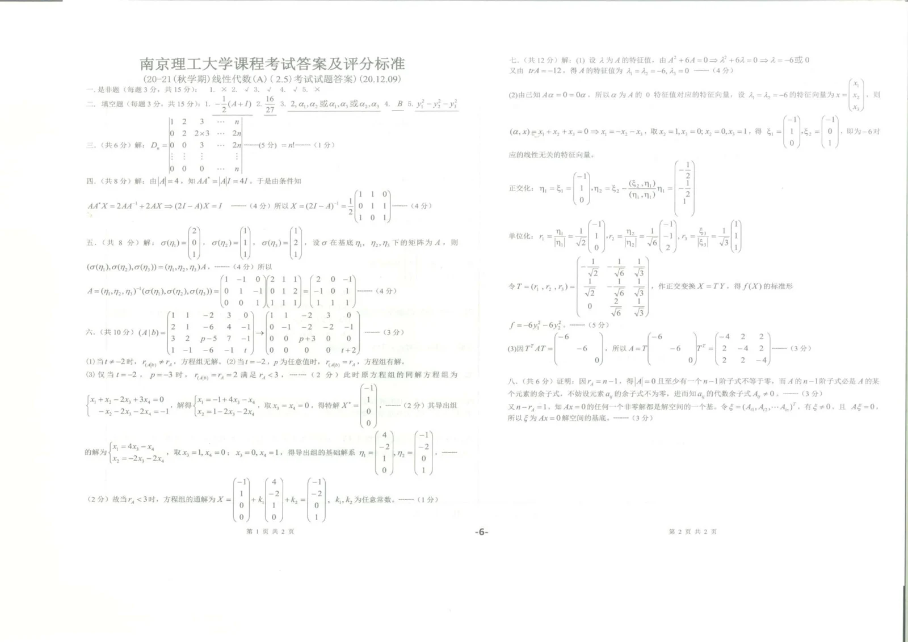

## 南京理工大学课程考试答案及评分标准

(20-21(秋学期)线性代数(A)(2.5)考试试题答案)(20.12.09)

一.是非题（每题3分，共15分）：1. × 2. √ 3. √ 4. √ 5. ×

二. 填空题（每题3分，共15分）：1. $-\frac{1}{2}(A+I)$ 2. $\frac{16}{27}$ 3. $2, \alpha_{1}, \alpha_{2}$ 或 $\alpha_{1}, \alpha_{3}$ 或 $\alpha_{2}, \alpha_{3}$ 4. B 5. $y_{1}^{2}-y_{2}^{2}-y_{3}^{2}$ 三.（共6分）解： $D_{n}=\begin{vmatrix}1&2&3&\cdots&n\\0&2&2\times3&\cdots&2n\\0&0&3&\cdots&2n\\\vdots&\vdots&\vdots&&\vdots\\0&0&0&\cdots&n\end{vmatrix}$ ——(5分)=n!——(1分)

四.（共8分）解：由 $|A|=4$ ，知 $AA^{*}=|A|I=4I$ 。于是由条件知

$AA^{*}X=2AA^{-1}+2AX\Rightarrow(2I-A)X=I$ ——（4分）所以 $X=(2I-A)^{-1}=\frac{1}{2}\begin{pmatrix}1&1&0\\0&1&1\\1&0&1\end{pmatrix}$ ——（4分）

五．（共8分）解： $\sigma (\eta_1) = \begin{pmatrix} 2\\ 0\\ 1 \end{pmatrix}$ ， $\sigma (\eta_{2}) = \begin{pmatrix} 1\\ 1\\ 1 \end{pmatrix}$ ， $\sigma (\eta_3) = \begin{pmatrix} 1\\ 2\\ 1 \end{pmatrix}$ ，设 $\sigma$ 在基底 $\eta_1$ ， $\eta_{2},\eta_{3}$ 下的矩阵为 $A$ ，则

$$
(\sigma (\eta_ {1}), \sigma (\eta_ {2}), \sigma (\eta_ {3})) = (\eta_ {1}, \eta_ {2}, \eta_ {3}) A, - - - - (4 \text {分})
$$

$$
A = (\eta_ {1}, \eta_ {2}, \eta_ {3}) ^ {- 1} (\sigma (\eta_ {1}), \sigma (\eta_ {2}), \sigma (\eta_ {3})) = \left( \begin{array}{c c c} 1 & - 1 & 0 \\ 0 & 1 & - 1 \\ 0 & 0 & 1 \end{array} \right) \left( \begin{array}{c c c} 2 & 1 & 1 \\ 0 & 1 & 2 \\ 1 & 1 & 1 \end{array} \right) = \left( \begin{array}{c c c} 2 & 0 & - 1 \\ - 1 & 0 & 1 \\ 1 & 1 & 1 \end{array} \right) - - - (4 \text {分})
$$

六.（共10分） $(A|b)=\begin{pmatrix}1&1&-2&3&0\\2&1&-6&4&-1\\3&2&p-5&7&-1\\1&-1&-6&-1&t\end{pmatrix}\rightarrow\begin{pmatrix}1&1&-2&3&0\\0&-1&-2&-2&-1\\0&0&p+3&0&0\\0&0&0&0&t+2\end{pmatrix}$ ——（3分）

(1) 当 $t \neq -2$ 时， $r_{(A|b)} \neq r_A$ ，方程组无解。(2) 当 $t = -2$ ， $p$ 为任意值时， $r_{(A|b)} = r_A$ ，方程组有解。(3) 仅当 $t = -2$ ， $p = -3$ 时， $r_{(A|b)} = r_A = 2$ 满足 $r_A < 3$ ，……（2分）此时原方程组的同解方程组为 $\left\{ \begin{array}{l} x_1 + x_2 - 2x_3 + 3x_4 = 0 \\ -x_2 - 2x_3 - 2x_4 = -1 \end{array} \right.$ ，解得 $\left\{ \begin{array}{l} x_1 = -1 + 4x_3 - x_4 \\ x_2 = 1 - 2x_3 - 2x_4 \end{array} \right.$ ，取 $x_3 = x_4 = 0$ ，得特解 $X^* = \begin{pmatrix} -1 \\ 1 \\ 0 \\ 0 \end{pmatrix}$ ，……（2分）其导出组的解为 $\left\{ \begin{array}{l} x_1 = 4x_3 - x_4 \\ x_2 = -2x_3 - 2x_4 \end{array} \right.$ ，取 $x_3 = 1, x_4 = 0$ ； $x_3 = 0, x_4 = 1$ ，得导出组的基础解系 $\eta_1 = \begin{pmatrix} 4 \\ -2 \\ 1 \\ 0 \end{pmatrix}, \eta_2 = \begin{pmatrix} -1 \\ -2 \\ 0 \\ 1 \end{pmatrix}$ ，……（2分）故当 $r_A < 3$ 时，方程组的通解为 $X = \begin{pmatrix} -1 \\ 1 \\ 0 \\ 0 \end{pmatrix} + k_1 \begin{pmatrix} 4 \\ -2 \\ 1 \\ 0 \end{pmatrix} + k_2 = \begin{pmatrix} -1 \\ -2 \\ 0 \\ 1 \end{pmatrix}$ ， $k_1, k_2$ 为任意常数。（1分）

七.（共12分）解：(1) 设 $\lambda$ 为 A 的特征值，由 $A^{2} + 6A = 0 \Rightarrow \lambda^{2} + 6\lambda = 0 \Rightarrow \lambda = -6$ 或 0 又由 trA = -12，得 A 的特征值为 $\lambda_{1} = \lambda_{2} = -6, \lambda_{3} = 0$ ——（4分）

(2)由已知 $A\alpha = 0 = 0\alpha$ ，所以 $\alpha$ 为 $A$ 的0特征值对应的特征向量，设 $\lambda_{1} = \lambda_{2} = -6$ 的特征向量为 $x = \begin{pmatrix} x_{1}\\ x_{2}\\ x_{3} \end{pmatrix}$ ，则

$(\alpha, x) = x_{1} + x_{2} + x_{3} = 0 \Rightarrow x_{1} = -x_{2} - x_{3}$ ，取 $x_{2} = 1, x_{3} = 0; x_{2} = 0, x_{3} = 1$ ，得 $\xi_{1} = \begin{pmatrix} -1 \\ 1 \\ 0 \end{pmatrix}, \xi_{2} = \begin{pmatrix} -1 \\ 0 \\ 1 \end{pmatrix}$ ，即为-6对应的线性无关的特征向量。

正交化： $\eta_{1} = \xi_{1} = \left( \begin{array}{c}-1\\ 1\\ 0 \end{array} \right),\eta_{2} = \xi_{2} - \frac{(\xi_{2},\eta_{1})}{(\eta_{1},\eta_{1})}\eta_{1} = \left( \begin{array}{c}-\frac{1}{2}\\ -\frac{1}{2}\\ 1 \end{array} \right)$

单位化： $r_1 = \frac{\eta_1}{|\eta_1|} = \frac{1}{\sqrt{2}}\left( \begin{array}{c}-1\\ 1\\ 0 \end{array} \right),r_2 = \frac{\eta_2}{|\eta_2|} = \frac{1}{\sqrt{6}}\left( \begin{array}{c}-1\\ -1\\ 2 \end{array} \right),r_3 = \frac{\xi_3}{|\xi_3|} = \frac{1}{\sqrt{3}}\left( \begin{array}{c}1\\ 1\\ 1 \end{array} \right)$

令 $T = (r_1, r_2, r_3) = \left( \begin{array}{ccc} -\frac{1}{\sqrt{2}} & -\frac{1}{\sqrt{6}} & \frac{1}{\sqrt{3}} \\ \frac{1}{\sqrt{2}} & -\frac{1}{\sqrt{6}} & \frac{1}{\sqrt{3}} \\ 0 & \frac{2}{\sqrt{6}} & \frac{1}{\sqrt{3}} \end{array} \right)$ ，作正交变换 $X = TY$ ，得 $f(X)$ 的标准形

$$
f = - 6 y _ {1} ^ {2} - 6 y _ {2} ^ {2} 。 \dots (5 \text {分})
$$

(3)因 $T^T A T = \left( \begin{array}{ccc} - 6 & & \\ & -6 & \\ & & 0 \end{array} \right)$ ，所以 $A = T\left( \begin{array}{ccc} - 6 & & \\ & -6 & \\ & & 0 \end{array} \right) T^T = \left( \begin{array}{ccc} -4 & 2 & 2\\ 2 & -4 & 2\\ 2 & 2 & -4 \end{array} \right)$ ——（3分）

八.（共6分）证明：因 $r_{A}=n-1$ ，得 $|A|=0$ 且至少有一个n-1阶子式不等于零，而A的n-1阶子式必是A的某个元素的余子式，不妨设元素 $a_{ij}$ 的余子式不为零，进而知 $a_{ij}$ 的代数余子式 $A_{ij}\neq0$ 。……（3分）

又 $n-r_{A}=1$ ，知Ax=0的任何一个非零解都是解空间的一个基。令 $\xi=(A_{i1},A_{i2},\cdots,A_{in})^{T}$ ，有 $\xi\neq0$ ，且 $A\xi=0$ ，所以 $\xi$ 为Ax=0解空间的基底。……（3分）

第1页共2页

第2页共2页

## 第15页

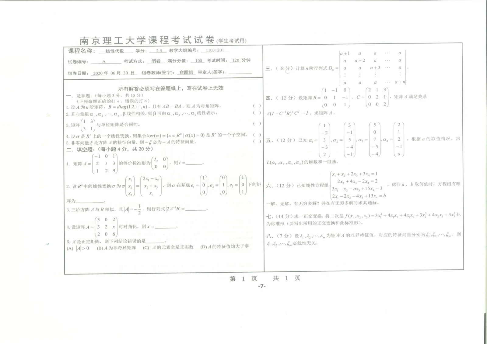

## 南京理工大学课程考试试卷 (学生考试用)

课程名称： 线性代数 学分： 2.5 教学大纲编号： 11031201
试卷编号： A 考试方式： 闭卷 满分分值： 100 考试时间： 120 分钟
组卷日期： 2020 年 06 月 30 日 组卷教师(签字)： 命题组 审定人(签字)：

### 所有解答必须写在答题纸上，写在试卷上无效

### 一．是非题：（每小题3分，共15分）

### (下列命题正确的打√，错误的打×)

1. 设 A 为 n 阶矩阵， $B = \text{diag}(1,2,\cdots,n)$ ，且有 AB = BA，则 A 为对角矩阵。

2. 若向量组 $\alpha_{1}, \alpha_{2}, \cdots, \alpha_{s}, \beta$ 线性相关，则 $\beta$ 可由 $\alpha_{1}, \alpha_{2}, \cdots, \alpha_{s}$ 线性表示。

$$
\left( \begin{array}{c c} 1 & 3 \\ 3 & 1 \end{array} \right)
$$

4. 设 $\sigma$ 是 $R^{n}$ 上的一个线性变换，则集合 $\ker(\sigma)=\{x\in R^{n}\mid\sigma(x)=0\}$ 是 $R^{n}$ 的一个子空间。（）  
5. 非零向量 $\xi$ 是方阵 A 的特征向量，则 $-\xi$ 必为 -A 的特征向量。 （）

### 二．填空题：（每小题4分，共20分）

1. 矩阵 $A=\begin{pmatrix}-1&0&1\\2&t&3\\1&2&9\end{pmatrix}$ 的等价标准形为 $\begin{pmatrix}I_{2}&0\\0&0\end{pmatrix}$ ，则 t= \_\_\_\_。

2. 设 $R^{3}$ 中的线性变换 $\sigma$ 为 $\sigma\begin{pmatrix} x_{1} \\ x_{2} \\ x_{3} \end{pmatrix} = \begin{pmatrix} 2x_{1} - x_{2} \\ x_{2} + x_{3} \\ x_{1} \end{pmatrix}$ ，则 $\sigma$ 在基底 $e_{1} = \begin{pmatrix} 1 \\ 0 \\ 0 \end{pmatrix}$ ， $e_{2} = \begin{pmatrix} 0 \\ 1 \\ 0 \end{pmatrix}$ ， $e_{3} = \begin{pmatrix} 1 \\ 0 \\ 1 \end{pmatrix}$ 下的矩阵为 \_\_\_\_。

3. 三阶方阵 A 与 B 相似，且 $\left|A\right| = -\frac{1}{2}$ ，则行列式 $\left|2A^{-1}B\right| =$ \_\_\_\_。

4. 设矩阵 $A = \begin{pmatrix} 3 & 0 & 2 \\ 3 & 2 & x \\ 2 & 0 & 6 \end{pmatrix}$ 可对角化，则 x = \_\_\_\_。

5. A 是正定矩阵，则下列结论错误的是\_\_\_\_。
(A) $\left|A\right| > 0$ (B) A 为非奇异矩阵 (C) A 的元素全是正实数 (D) A 的特征值均大于零三.（8分）计算 $n$ 阶行列式 $D_{n} = \left| \begin{array}{cccc}a + 1 & a & a & \cdots & a\\ a & a + 2 & a & \cdots & a\\ a & a & a + 3 & \cdots & a\\ \vdots & \vdots & \vdots & & \vdots \\ a & a & a & \cdots & a + n \end{array} \right|$ 。

四.（12分）设矩阵 $B = \begin{pmatrix} 1 & -1 & 0\\ 0 & 1 & -1\\ 0 & 0 & 1 \end{pmatrix}, C = \begin{pmatrix} 2 & 1 & 3\\ 0 & 2 & 1\\ 0 & 0 & 2 \end{pmatrix}$ ，矩阵 $A$ 满足关系

$A(I-C^{-1}B)^{T}C^{T}=I$ ，求矩阵A。

五.（12分）已知 $\alpha_{1} = \begin{pmatrix} 1 \\ -2 \\ 3 \\ -3 \\ 2 \end{pmatrix}, \alpha_{2} = \begin{pmatrix} 3 \\ -1 \\ 5 \\ -4 \\ -1 \end{pmatrix}, \alpha_{3} = \begin{pmatrix} 5 \\ 0 \\ 7 \\ -5 \\ -4 \end{pmatrix}, \alpha_{4} = \begin{pmatrix} 2 \\ 1 \\ 2 \\ -1 \\ a \end{pmatrix}$ ，根据 $a$ 的取值情况，求

$L(\alpha_{1},\alpha_{2},\alpha_{3},\alpha_{4})$ 的维数和一组基。

六.（12分）已知线性方程组 $\left\{ \begin{array}{l} x_{1} + x_{2} + 2x_{3} + 3x_{4} = 1 \\ 2x_{2} + 4x_{3} - 2x_{4} = 2 \\ 3x_{1} - x_{2} - ax_{3} + 15x_{4} = 3 \\ 2x_{1} - 2x_{2} - 4x_{3} + 13x_{4} = b \end{array} \right.$ ，试问 $a$ ， $b$ 取何值时，方程组有唯

七.（14分）求一正交变换，将二次型 $f(x_{1},x_{2},x_{3})=3x_{1}^{2}+4x_{1}x_{2}+4x_{1}x_{3}+3x_{2}^{2}+4x_{2}x_{3}+3x_{3}^{2}$ 化为标准形（要写出所用的正交变换和此标准形）。

八.（7分）设 $\lambda_1, \lambda_2, \dots, \lambda_m$ 为矩阵 $A$ 的互异特征值，对应的特征向量分别为 $\xi_1, \xi_2, \dots, \xi_m$ ，则 $\xi_1, \xi_2, \dots, \xi_m$ 必线性无关。

第1页 共1页

-7-

## 第16页

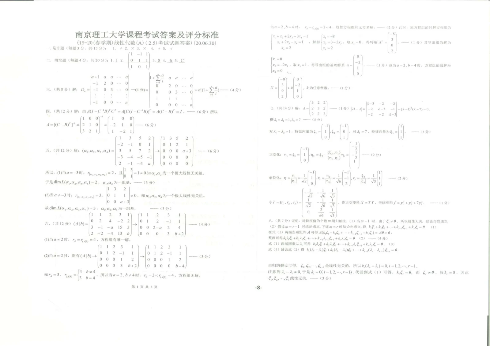

## 南京理工大学课程考试答案及评分标准

(19-20(春学期)线性代数(A)(2.5)考试试题答案)(20.06.30)

一.是非题（每题3分，共15分）：1.√2.×3.×4.√5.√

二. 填空题（每题4分，共20分）：1. 1 2. $\begin{pmatrix}1 & -1 & 1 \\ 0 & 1 & 1 \\ 1 & 0 & 1\end{pmatrix}$ 3. 8 4. 6 5. C

三.（共8分）解： $D_{n} = \left| \begin{array}{cccc}a + 1 & a & a & \dots & a\\ -1 & 2 & 0 & \dots & 0\\ -1 & 0 & 3 & \dots & 0\\ \vdots & \vdots & \vdots & & \vdots \\ -1 & 0 & 0 & \dots & n \end{array} \right|$ 一(4分)= $\left| \begin{array}{cccccc}1 + \sum_{i = 1}^{n}\frac{a}{i} & a & a & \dots & a\\ 0 & 2 & 0 & \dots & 0\\ 0 & 0 & 3 & \dots & 0\\ \vdots & \vdots & \vdots & & \vdots \\ 0 & 0 & 0 & \dots & n \end{array} \right| = n!(1 + \sum_{i = 1}^{n}\frac{a}{i})$ ——（4分）

四.（共12分）解：由 $A(I - C^{-1}B)^{T}C^{T} = A[C(I - C^{-1}B)]^{T} = A(C - B)^{T} = I$ ，……（6分）所以

$$
A = [ (C - B) ^ {T} ] ^ {- 1} = \left( \begin{array}{c c c} {{1}} & {{0}} & {{0}} \\ {{2}} & {{1}} & {{0}} \\ {{3}} & {{2}} & {{1}} \end{array} \right) ^ {- 1} = \left( \begin{array}{c c c} {{1}} & {{0}} & {{0}} \\ {{- 2}} & {{1}} & {{0}} \\ {{1}} & {{- 2}} & {{1}} \end{array} \right) \dots \tag {6分}
$$

五.（共12分）解： $(\alpha_{1},\alpha_{2},\alpha_{3},\alpha_{4}) = \begin{pmatrix} 1 & 3 & 5 & 2\\ -2 & -1 & 0 & 1\\ 3 & 5 & 7 & 2\\ -3 & -4 & -5 & -1\\ 2 & -1 & -4 & a \end{pmatrix}\rightarrow \begin{pmatrix} 1 & 3 & 5 & 2\\ 0 & 1 & 2 & 1\\ 0 & 0 & 0 & a + 3\\ 0 & 0 & 0 & 0\\ 0 & 0 & 0 & 0 \end{pmatrix}$ ——（6分）

所以，(1)当 $a = -3$ 时， $r_{\{\alpha_1, \alpha_2, \alpha_3, \alpha_4\}} = 2$ ，且 $\begin{vmatrix} 1 & 3 \\ 0 & 1 \end{vmatrix} = 1 \neq 0$ 知 $\alpha_1, \alpha_2$ 为一个极大线性无关组。

$$
\dim L \left(\alpha_ {1}, \alpha_ {2}, \alpha_ {3}, \alpha_ {4}\right) = 2, \quad \alpha_ {1}, \alpha_ {2}
$$

(2)当 $a \neq -3$ 时， $r_{\{\alpha_1, \alpha_2, \alpha_3, \alpha_4\}} = 3$ ， $\left| \begin{array}{ccc}1 & 3 & 2 \\ 0 & 1 & 1 \\ 0 & 0 & a + 3 \end{array} \right| \neq 0$ ，知 $\alpha_1, \alpha_2, \alpha_4$ 为一个极大线性无关组。

故 $\dim L(\alpha_1, \alpha_2, \alpha_3, \alpha_4) = 3$ ， $\alpha_1, \alpha_2, \alpha_4$ 为一组基。——（3分）

六.（共12分） $(A|b)=\begin{pmatrix}1&1&2&3&1\\0&2&4&-2&2\\3&-1&a&15&3\\2&-2&-4&13&b\end{pmatrix}\rightarrow\begin{pmatrix}1&1&2&3&1\\0&1&2&-1&1\\0&0&2-a&2&4\\0&0&0&3&b+2\end{pmatrix}$ ——（4分）

(1)当 $a \neq 2$ 时， $r_A = r_{(A|b)} = 4$ ，方程组有唯一解。

(2)当 $a = 2$ 时，则有 $(A|b)\rightarrow \left( \begin{array}{lllll}1 & 1 & 2 & 3 & 1\\ 0 & 1 & 2 & -1 & 1\\ 0 & 0 & 0 & 1 & 2\\ 0 & 0 & 0 & 3 & b + 2 \end{array} \right)\rightarrow \left( \begin{array}{lllll}1 & 1 & 2 & 3 & 1\\ 0 & 1 & 2 & -1 & 1\\ 0 & 0 & 0 & 1 & 2\\ 0 & 0 & 0 & 0 & b - 4 \end{array} \right)$ ——（3分）

知 $r_A = 3$ ， $\bar{r}_{(A|b)} = \begin{cases} 4 & b\neq 4\\ 3 & b = 4 \end{cases}$ ，所以当 $a = 2,b\neq 4$ 时， $r_A = 3 <   r_{(A|b)} = 4$ ，方程组无解。

当 $a = 2, b = 4$ 时， $r_A = r_{(a|b)} = 3 < 4$ ，线性方程组有无穷多解， $-$ （2分）此时，原方程组的同解方程组为 $\left\{ \begin{array}{l} x_1 + x_2 + 2x_3 + 3x_4 = 1 \\ x_2 + 2x_3 - x_4 = 1 \\ x_4 = 2 \end{array} \right.$ ，解得 $\left\{ \begin{array}{l} x_1 = -8 \\ x_2 = 3 - 2x_3 \\ x_4 = 2 \end{array} \right.$ ，取 $x_3 = 0$ ，得特解 $X^* = \left( \begin{array}{c} -8 \\ 3 \\ 0 \\ 2 \end{array} \right)$ ， $-$ （1分）其导出组的解为 $\left\{ \begin{array}{l} x_1 = 0 \\ x_2 = -2x_3 \\ x_4 = 0 \end{array} \right.$ ，取 $x_3 = 1$ ，得导出组的基础解系 $\eta = \left( \begin{array}{c} 0 \\ -2 \\ 1 \\ 0 \end{array} \right)$ ， $-$ （1分）故当 $a = 2, b = 4$ 时，方程组的通解为 $X = \left( \begin{array}{c} -8 \\ 3 \\ 0 \\ 2 \end{array} \right) + k \left( \begin{array}{c} 0 \\ -2 \\ 1 \\ 0 \end{array} \right)$ ， $k$ 为任意常数。 $-$ （1分）七．（共14分）解： $A = \left( \begin{array}{ccc} 3 & 2 & 2 \\ 2 & 3 & 2 \\ 2 & 2 & 3 \end{array} \right)$ ——（1分） $|\lambda I - A| = \left| \begin{array}{ccc} \lambda - 3 & -2 & -2 \\ -2 & \lambda - 3 & -1 \\ -2 & -2 & \lambda - 3 \end{array} \right| = (\lambda - 1)^2 (\lambda - 7) = 0$ ，得 $\lambda_1 = \lambda_2 = 1, \lambda_3 = 7$ ——（5分）对 $\lambda_1 = \lambda_2 = 1$ ，特征向量为 $\xi_1 = \left( \begin{array}{c} -1 \\ 1 \\ 0 \end{array} \right), \xi_2 = \left( \begin{array}{c} -1 \\ 0 \\ 1 \end{array} \right)$ ，对 $\lambda_3 = 7$ ，特征向量为 $\xi_3 = \left( \begin{array}{c} 1 \\ 1 \\ 1 \end{array} \right)$ ， $-$ （3分）正交化： $\eta_1 = \xi_1 = \left( \begin{array}{c} -1 \\ 1 \\ 0 \end{array} \right), \eta_2 = \xi_2 - \frac{(\xi_2, \eta_1)}{(\eta_1, \eta_1)}\eta_1 = \left( \begin{array}{c} -\frac{1}{2} \\ -\frac{1}{2} \\ 1 \end{array} \right)$ ——（2分）单位化： $r_1 = \frac{\eta_1}{|\eta_1|} = \frac{1}{\sqrt{2}}\left( \begin{array}{c} -1 \\ 1 \\ 0 \end{array} \right), r_2 = \frac{\eta_2}{|\eta_2|} = \frac{1}{\sqrt{6}}\left( \begin{array}{c} -1 \\ -1 \\ 2 \end{array} \right), r_3 = \frac{\xi_3}{|\xi_3|} = \frac{1}{\sqrt{3}}\left( \begin{array}{c} 1 \\ 1 \\ 1 \end{array} \right)$ ——（2分）令 $T = (r_1, r_2, r_3) = \left( \begin{array}{ccc} -\frac{1}{\sqrt{2}} & -\frac{1}{\sqrt{6}} & \frac{1}{\sqrt{3}} \\ \frac{1}{\sqrt{2}} & -\frac{1}{\sqrt{6}} & \frac{1}{\sqrt{3}} \\ 0 & \frac{2}{\sqrt{6}} & \frac{1}{\sqrt{3}} \end{array} \right)$ ，作正交变换 $X = TY$ ，得标准形 $f = y_1^2 + y_2^2 + 7y_3^2$ 。——（1分）八．（共7分）证明：对特征值的个数 $m$ 用归纳法。（1）当 $m = 1$ 时，由于 $\xi_1 \neq 0$ ，所以线性无关。结论自然成立。（2）假设 $m = r - 1$ 时结论成立。下证 $m = r$ 时结论也成立。设 $k_1\xi_1 + k_2\xi_2 + \cdots + k_{r-1}\xi_{r-1} + k_r\xi_r = 0$ 。（1）在式（1）两端左乘矩阵 $A$ 可得 $A(k_1\xi_1 + k_2\xi_2 + \cdots + k_{r-1}\xi_{r-1} + k_r\xi_r) = A0 = 0$ ，整理可得 $k_1\lambda_1\xi_1 + k_2\lambda_2\xi_2 + \cdots + k_{r-1}\lambda_{r-1}\xi_{r-1} + k_r\lambda_r\xi_r = 0$ （2）——（4分）式（1）两端同乘以 $\lambda_r$ 可得 $k_1\lambda_r\xi_1 + k_2\lambda_r\xi_2 + \cdots + k_{r-1}\lambda_r\xi_{r-1} + k_r\lambda_r\xi_r = 0$ 。（3）式（3）减去式（2）得 $k_1(\lambda_r - \lambda_1)\xi_1 + k_2(\lambda_r - \lambda_2)\xi_2 + \cdots + k_{r-1}(\lambda_r - \lambda_{r-1})\xi_{r-1} = 0$ 。

由归纳假设可得， $\xi_{1},\xi_{2},\cdots,\xi_{r-1}$ 是线性无关的，所以 $k_{i}(\lambda_{r}-\lambda_{i})=0,i=1,2,\cdots,r-1$ .
注意到 $\lambda_{r}-\lambda_{i}\neq0$ ，于是 $k_{i}=0(i=1,2,\cdots,r-1)$ 。代回到式（1）可得， $k_{r}\xi_{r}=0$ ，而 $\xi_{r}\neq0$ ，故 $k_{r}=0$ ，因此 $\xi_{1},\xi_{2},\cdots,\xi_{r}$ 线性无关。——（3分）

第1页共3页

## 第17页

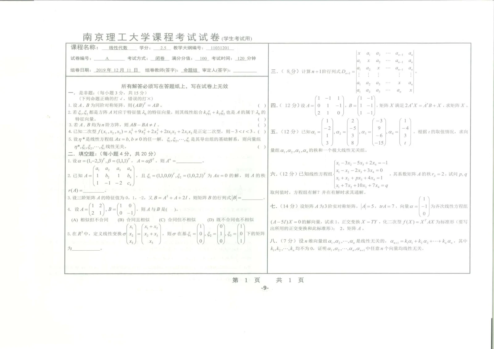

## 南京理工大学课程考试试卷 (学生考试用)

课程名称： 线性代数 学分： 2.5 教学大纲编号： 11031201

试卷编号：\_\_\_\_ A \_\_\_\_ 考试方式：\_\_\_\_ 闭卷 满分分值：\_\_\_\_ 100 考试时间：\_\_\_\_ 120 分钟

组卷日期：2019年12月11日 组卷教师(签字)：命题组 审定人(签字)：

### 所有解答必须写在答题纸上，写在试卷上无效

### 一．是非题：（每小题3分，共15分）

(下列命题正确的打√，错误的打×)

1. 设 A, B 为同阶对称矩阵，则 $(AB)^{T} = AB$ 。

2. 若 $\xi_{1}, \xi_{2}$ 都是方阵 A 对应于特征值 $\lambda_{0}$ 的特征向量，则其线性组合 $k_{1}\xi_{1} + k_{2}\xi_{2}$ 也是 A 的属于 $\lambda_{0}$ 的特征向量。
3. 若 A, B 均为 n 阶方阵，则 $AB - BA \neq I$ 。

4. 已知二次型 $f(x_{1}, x_{2}, x_{3}) = x_{1}^{2} + 9x_{2}^{2} + 2x_{3}^{2} + 2tx_{1}x_{2} + 2x_{1}x_{3}$ 是正定二次型，则 -3 < t < 3。（）5. 设 $\eta^{*}$ 是线性方程组 Ax = b, $b \neq 0$ 的任一解， $\xi_{1}, \xi_{2}, \cdots, \xi_{t}$ 是其导出组的基础解系，则向量组 $\eta^{*}, \xi_{1}, \xi_{2}, \cdots, \xi_{t}$ 线性无关。

### 二．填空题：（每小题4分，共20分）

1. 设 $\alpha=(1,-2,3)^{T},\beta=(1,1,1)^{T}$ ， $A=\alpha\beta^{T}$ ，则 $A^{n}=$ \_\_\_\_。

2. 已知 $A = \begin{pmatrix} a_{1} & a_{2} & a_{3} & a_{4} \\ 1 & b_{2} & 1 & b_{4} \\ 1 & -1 & -2 & c_{4} \end{pmatrix}$ ，且 $\xi_{1} = (1,1,0,0)^{T}, \xi_{2} = (1,0,2,1)^{T}$ 为 Ax = 0 的解，则 A 的秩 $r(A) =$ \_\_\_\_ 。

3. 设三阶矩阵 A 的特征值为 0, 1, -2，又 $B = A^{2} + A + 2I$ ，则矩阵 B 的行列式 $|B| =$ \_\_\_\_ 。
4. 设 $A = \begin{pmatrix} 1 & 2 \\ 2 & 1 \end{pmatrix}$ , $B = \begin{pmatrix} 1 & 0 \\ 0 & -1 \end{pmatrix}$ ，则 A 与 B 是（）。

5. 在 $R^{3}$ 中，定义线性变换 $\sigma\begin{pmatrix}x_{1}\\x_{2}\\x_{3}\end{pmatrix}=\begin{pmatrix}x_{1}+x_{2}\\x_{2}+x_{3}\\x_{3}\end{pmatrix}$ ，则 $\sigma$ 在基 $\xi_{1}=\begin{pmatrix}1\\0\\0\end{pmatrix},\xi_{2}=\begin{pmatrix}0\\1\\0\end{pmatrix},\xi_{3}=\begin{pmatrix}1\\0\\1\end{pmatrix}$ 下的矩阵为 \_\_\_\_。

三.（8分）计算 $n + 1$ 阶行列式 $D_{n + 1} = \left| \begin{array}{cccccc}x & a_1 & a_2 & \dots & a_{n - 1} & a_n\\ a_1 & x & a_2 & \dots & a_{n - 1} & a_n\\ a_1 & a_2 & x & \dots & a_{n - 1} & a_n\\ \vdots & \vdots & \vdots & & \vdots & \vdots \\ a_1 & a_2 & a_3 & \dots & x & a_n\\ a_1 & a_2 & a_3 & \dots & a_n & x \end{array} \right|$

四.（12分）设 $A = \begin{pmatrix} 1 & -1 & 1\\ 0 & 1 & -1\\ 2 & 1 & 0 \end{pmatrix},B = \begin{pmatrix} 1 & -1\\ 1 & -1\\ 1 & -1 \end{pmatrix}$ ，矩阵 $X$ 满足 $2A^{*}X = A^{*}B + X$ ，求矩阵 $X$ 。

五.（12分）已知 $\alpha_{1} = \begin{pmatrix} 1 \\ -2 \\ 1 \\ 3 \end{pmatrix}, \alpha_{2} = \begin{pmatrix} 2 \\ -5 \\ 3 \\ 8 \end{pmatrix}, \alpha_{3} = \begin{pmatrix} -3 \\ 9 \\ -6 \\ -15 \end{pmatrix}, \alpha_{4} = \begin{pmatrix} 1 \\ -4 \\ 3 \\ t \end{pmatrix}$ ，根据 $t$ 的取值情况，求向

$$
\alpha_ {1}, \alpha_ {2}, \alpha_ {3}, \alpha_ {4}
$$

六.（12分）已知线性方程组 $\left\{ \begin{array}{l} x_{1} - 3x_{2} - 5x_{3} + 2x_{4} = -1 \\ x_{1} - x_{2} - 2x_{3} + 3x_{4} = 0 \\ x_{1} + x_{2} + px_{3} + 4x_{4} = 1 \\ x_{1} + 7x_{2} + 10x_{3} + 7x_{4} = q \end{array} \right.$ ，其系数矩阵 $A$ 的秩 $r_A = 2$ ，试问 $p, q$ 取何值时，方程组有解？并在有解时求其通解。

$$
\left| A \right| = 5, t r A = 7
$$

$$
\alpha = \left( \begin{array}{c} 1 \\ - 1 \\ 0 \end{array} \right)
$$

$$
(A - 5 I) X = 0
$$

$$
X = T Y
$$

$$
f (X) = X ^ {T}
$$

八.（7分）设 $n$ 维向量组 $\alpha_{1},\alpha_{2},\dots ,\alpha_{n}$ 是线性无关的， $\alpha_{n + 1} = k_1\alpha_1 + k_2\alpha_2 + \dots +k_n\alpha_n$ ，其中 $k_{1},k_{2},\dots ,k_{n}$ 均不为0，证明 $\alpha_{1},\alpha_{2},\dots ,\alpha_{n},\alpha_{n + 1}$ 中任意 $n$ 个向量均线性无关。

第1页 共1页

-9-

## 第18页

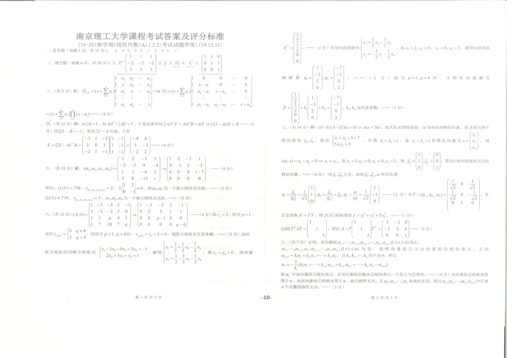

## 南京理工大学课程考试答案及评分标准

(13-26《执学期》线性代数(A)(2.5)与试试题答案)(19.12.11)

一.是非题（每题3分，共15分）： 1. × 2. × 3. √ 4. × 5. √

二.填空题（每题4分，共20分）： 1. $2^{n-1}\begin{pmatrix}1 & 1 & 1 \\ -2 & -2 & -2 \\ 3 & 3 & 3\end{pmatrix}$ 2. 2 3. 32 4. C 5. $\begin{pmatrix}1 & 1 & 0 \\ 0 & 1 & 1 \\ 0 & 0 & 1\end{pmatrix}$ 三.（共8分）解： $D_{n+1}=(x+\sum_{i=1}^{n}a_{i})\left|\begin{array}{cccc|c}1 & a_{1} & a_{2} & \cdots & a_{n}\\ 1 & x & a_{2} & \cdots & a_{n}\\ 1 & a_{2} & x & \cdots & a_{n}\\ \vdots & \vdots & \vdots & & \vdots\\ 1 & a_{2} & a_{3} & \cdots & x\end{array}\right|-(4\text{分})=(x+\sum_{i=1}^{n}a_{i})\left|\begin{array}{cccccc}1 & 0 & 0 & \cdots & 0\\ 1 & x-a_{1} & 0 & \cdots & 0\\ 1 & a_{2}-a_{1} & x-a_{2} & \cdots & 0\\ \vdots & \vdots & \vdots & & \vdots\\ 1 & a_{2}-a_{1} & a_{3}-a_{2} & \cdots & x-a_{n}\end{array}\right|$ $=(x+\sum_{i=1}^{n}a_{i})\prod_{i=1}^{n}(x-a_{i})----(4\text{分})$ 四.（共12分）解：由 $|A|=1$ ，知 $AA^{*}=|A|I=I$ 。于是由条件知 $2AA^{*}X=AA^{*}B+AX\Rightarrow(2I-A)X=B----(6\text{分})$ 因 $|2I-A|=-1$ ，所以2I-A可逆，于是 $X=(2I-A)^{-1}B=\begin{pmatrix}-3 & 1 & -2 \\ 2 & 0 & 1 \\ -2 & 1 & -1\end{pmatrix}\begin{pmatrix}1 & -1 \\ 1 & -1 \\ 1 & -1\end{pmatrix}=\begin{pmatrix}-4 & 4 \\ 3 & -3 \\ -2 & 2\end{pmatrix}----(6\text{分})$ 五.（共12分）解： $(\alpha_{1},\alpha_{2},\alpha_{3},\alpha_{4})=\begin{pmatrix}1 & 2 & -3 & 1 \\ -2 & -5 & 9 & -4 \\ 1 & 3 & -6 & 3 \\ 3 & 8 & -15 & t\end{pmatrix}\rightarrow\begin{pmatrix}1 & 2 & -3 & 1 \\ 0 & -1 & 3 & -2 \\ 0 & 0 & 0 & t-7 \\ 0 & 0 & 0 & 0\end{pmatrix}----(6\text{分})$ 所以，(1)当t=7时， $r_{\{\alpha_{1},\alpha_{2},\alpha_{3},\alpha_{4}\}}=2$ ，且 $\left|\begin{matrix}1&2\\ 0&-1\end{matrix}\right|\neq0$ ，知 $\alpha_{1},\alpha_{2}$ 为一个极大线性无关组。----(3分)

(2)当 $t\neq7$ 时， $r_{\{\alpha_{1},\alpha_{2},\alpha_{3},\alpha_{4}\}}=3$ ， $\alpha_{1},\alpha_{2},\alpha_{4}$ 为一个极大线性无关组。----(3分)

六.（共12分） $(A|b)=\begin{pmatrix}1&-3&-5&2&-1\\ 1&-1&-2&3&0\\ 1&1&p&4&1\\ 1&7&10&7&q\end{pmatrix}\rightarrow\begin{pmatrix}1&-3&-5&2&-1\\ 0&2&3&1&1\\ 0&0&p-1&0&0\\ 0&0&0&0&q-4\end{pmatrix}----(4\text{分})$ 因 $r_{A}=2$ ，所以p=1，

此时 $r_{(A|b)}=\begin{cases}3&q\neq4\\2&q=4\end{cases}$ ，因此当p=1，q=4时， $r_{(A|b)}=r_{A}=2<4$ ，线性方程组有无穷多解，----(3分）此时

原方程组的同解方程组为 $\left\{\begin{aligned}&x_{1}-3x_{2}-5x_{3}+2x_{4}=-1\\&2x_{2}+3x_{3}+x_{4}=1\end{aligned}\right.$ ，解得 $\left\{\begin{aligned}&x_{1}=\frac{1}{2}+\frac{1}{2}x_{3}-\frac{7}{2}x_{4}\\&x_{2}=\frac{1}{2}-\frac{3}{2}x_{3}-\frac{1}{2}x_{4}\end{aligned}\right.$ ，取 $x_{3}=x_{4}=0$ ，得特解

$X^{*}=\left(\begin{array}{c}\frac{1}{2}\\ \frac{1}{2}\\ 0\\ 0\end{array}\right)$ ，----（2分）其导出组的解为 $\left\{\begin{aligned}x_{1}&=\frac{1}{2}x_{3}-\frac{7}{2}x_{4}\\ x_{2}&=-\frac{3}{2}x_{3}-\frac{1}{2}x_{4}\end{aligned}\right.$ ，取 $x_{3}=2,x_{4}=0;\quad x_{3}=0,x_{4}=2$ ，得导出组的基础解系 $\eta_{1}=\left(\begin{array}{c}1\\ -3\\ 2\\ 0\end{array}\right),\eta_{2}=\left(\begin{array}{c}-7\\ -1\\ 0\\ 2\end{array}\right)$ ，----（2分）故当p=1,q=4时，方程组的通解为 $X=\left(\begin{array}{c}\frac{1}{2}\\ \frac{1}{2}\\ 0\\ 0\end{array}\right)+k_{1}\left(\begin{array}{c}1\\ -3\\ 2\\ 0\end{array}\right)+k_{2}=\left(\begin{array}{c}-7\\ -1\\ 0\\ 2\end{array}\right)$ ， $k_{1},k_{2}$ 为任意常数。----（1分）
七．（共14分）解：(1)由 $(A-5I)\alpha=0\Rightarrow A\alpha=5\alpha$ ，知5为A的特征值， $\alpha$ 为对应的特征向量，设A的另两个特征值为 $\lambda_{1},\lambda_{2}$ ，则有 $\left\{\begin{aligned}\lambda_{1}+\lambda_{2}+5=7\\ 5\lambda_{1}\lambda_{2}=5\end{aligned}\right.$ ，可得 $\lambda_{1}=\lambda_{2}=1$ 。设 $\lambda_{1}=\lambda_{2}=1$ 的特征向量为 $x=\left(\begin{matrix}x_{1}\\ x_{2}\\ x_{3}\end{matrix}\right)$ ，则 $(\alpha,x)=x_{1}-x_{2}=0\Rightarrow x_{1}=x_{2}$ ，取 $x_{2}=1,x_{3}=0;x_{2}=0,x_{3}=1$ ，得 $\xi_{1}=\left(\begin{matrix}1\\ 1\\ 0\end{matrix}\right),\xi_{2}=\left(\begin{matrix}0\\ 0\\ 1\end{matrix}\right)$ ，即为1对应的线性无关的特征向量。----（6分）因 $\xi_{1},\xi_{2}$ 正交，故将 $\xi_{1},\xi_{2},\alpha$ 单位化得 $\eta_{1}=\frac{\xi_{1}}{\left|\xi_{1}\right|}=\frac{1}{\sqrt{2}}\left(\begin{matrix}1\\ 1\\ 0\end{matrix}\right),\eta_{2}=\frac{\xi_{2}}{\left|\xi_{2}\right|}=\xi_{2},\eta_{3}=\frac{\alpha}{\left|\alpha\right|}=\frac{1}{\sqrt{2}}\left(\begin{matrix}1\\ -1\\ 0\end{matrix}\right)$ ----（2分）令 $T=(\eta_{1},\eta_{2},\eta_{3})=\left(\begin{matrix}\frac{1}{\sqrt{2}}&0&\frac{1}{\sqrt{2}}\\\frac{1}{\sqrt{2}}&0&-\frac{1}{\sqrt{2}}\\0&1&0\end{matrix}\right)$ ，作正交变换X=TY，得 $f(X)$ 的标准形 $f=y_{1}^{2}+y_{2}^{2}+5y_{3}^{2}$ 。----（1分）
(2)因 $T^{T}AT=\left(\begin{matrix}1\\ 1\\ 5\end{matrix}\right)$ ，所以 $A=T\left(\begin{matrix}1\\ 1\\ 5\end{matrix}\right)T^{T}=\left(\begin{matrix}3&-2&0\\ -2&3&0\\ 0&0&1\end{matrix}\right)$ ----（5分）
八．（共7分）证明：设向量组 $\alpha_{1},\cdots,\alpha_{i-1},\alpha_{i+1},\cdots,\alpha_{n},\alpha_{n+1}(1\leq i\leq n)$ 为①， $\alpha_{1},\cdots,\alpha_{i-1},\alpha_{i},\alpha_{i+1},\cdots,\alpha_{n},\alpha_{n+1}(1\leq i\leq n)$ 为②，显然向量组①可由向量组②线性表示。又因 $\alpha_{n+1}=k_{1}\alpha_{1}+k_{2}\alpha_{2}+\cdots+k_{n}\alpha_{n}$ ，且 $k_{1},k_{2},\cdots,k_{n}$ 均不为0，所以 $\alpha_{i}=-\frac{1}{k_{i}}(k_{1}\alpha_{1}+\cdots+k_{i-1}\alpha_{i-1}+k_{i+1}\alpha_{i+1}+\cdots+k_{n}\alpha_{n}-\alpha_{n+1})$ 即 $\alpha_i$ 可由向量组①线性表示，从而向量组②能由①线性表示，于是①与②等价，----（4分）而向量组②的秩显然等于n，从而向量组①的秩也等于n，故①线性无关，又 $\alpha_{1},\alpha_{2},\cdots,\alpha_{n}$ 是线性无关，所以 $\alpha_{1},\alpha_{2},\cdots,\alpha_{n},\alpha_{n+1}$ 中任意n个向量均线性无关。----（3分）

第1页共2页

第2页共2页

## 第19页

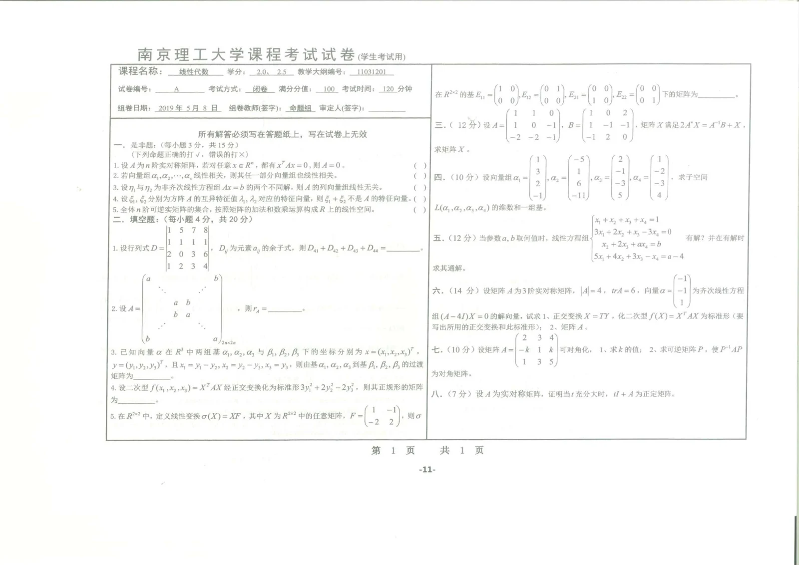

## 南京理工大学课程考试试卷 (学生考试用)

<table><tr><td>课程名称:线性代数学分:2.0、2.5教学大纲编号:11031201试卷编号:A考试方式:闭卷满分分值:100考试时间:120分钟组卷日期:2019年5月8日组卷教师(签字):命题组审定人(签字):</td><td>在 $R^{2 \times 2}$ 的基 $E_{11}=\begin{pmatrix}1 & 0 \\ 0 & 0\end{pmatrix},E_{12}=\begin{pmatrix}0 & 1 \\ 0 & 0\end{pmatrix},E_{21}=\begin{pmatrix}0 & 0 \\ 1 & 0\end{pmatrix},E_{22}=\begin{pmatrix}0 & 0 \\ 0 & 1\end{pmatrix}$ 下的矩阵为____。三.(12分)设 $A=\begin{pmatrix}1 & 1 & 0 \\ 1 & 0 & -1 \\ -2 & -2 & -1\end{pmatrix},B=\begin{pmatrix}1 & 0 & 2 \\ 1 & -1 & -1 \\ -1 & 2 & 0\end{pmatrix}$ ,矩阵X满足 $2A^{*}X=A^{-1}B+X$ ,求矩阵X。四.(10分)设向量组 $\alpha_{1}=\begin{pmatrix}1 \\ 3 \\ 2 \\ -1\end{pmatrix},\alpha_{2}=\begin{pmatrix}-5 \\ 1 \\ 6 \\ -11\end{pmatrix},\alpha_{3}=\begin{pmatrix}2 \\ -1 \\ -3 \\ 5\end{pmatrix},\alpha_{4}=\begin{pmatrix}1 \\ -2 \\ -3 \\ 4\end{pmatrix}$ ,求子空间 $L(\alpha_{1},\alpha_{2},\alpha_{3},\alpha_{4})$ 的维数和一组基。五.(12分)当参数a,b取何值时,线性方程组 $\begin{cases}x_{1}+x_{2}+x_{3}+x_{4}=1\\3x_{1}+2x_{2}+x_{3}-3x_{4}=0\\x_{2}+2x_{3}+ax_{4}=b\\5x_{1}+4x_{2}+3x_{3}-x_{4}=a-4\end{cases}$ 有解?并在有解时求其通解。六.(14分)设矩阵A为3阶实对称矩阵, $|A|=4$ ,trA=6,向量 $\alpha=\begin{pmatrix}-1 \\-1 \\1\end{pmatrix}$ 为齐次线性方程组 $(A-4I)X=0$ 的解向量,试求1、正交变换X=TY,化二次型 $f(X)=X^{T}AX$ 为标准形(要写出所用的正交变换和此标准形);2、矩阵A。七.(10分)设矩阵 $A=\begin{pmatrix}2 & 3 & 4 \\-k & 1 & k \\1 & 3 & 5\end{pmatrix}$ 可对角化,1、求k的值;2、求可逆矩阵P,使 $P^{-1}AP$ 为对角矩阵。八.(7分)设A为实对称矩阵,证明当t充分大时,tI+A为正定矩阵。</td></tr><tr><td>所有解答必须写在答题纸上,写在试卷上无效一.是非题:(每小题3分,共15分)(下列命题正确的打√,错误的打×)1.设A为n阶实对称矩阵,若对任意 $x\in R^{n}$ ,都有 $x^{T}Ax=0$ ,则A=0。( )2.若向量组 $\alpha_{1},\alpha_{2},\cdots,\alpha_{s}$ 线性相关,则其任一部分向量组也线性相关。( )3.设 $\eta_{1}$ 与 $\eta_{2}$ 为非齐次线性方程组Ax=b的两个不同解,则A的列向量组线性无关。( )4.设 $\xi_{1},\xi_{2}$ 分别为方阵A的互异特征值 $\lambda_{1},\lambda_{2}$ 对应的特征向量,则 $\xi_{1}+\xi_{2}$ 不是A的特征向量。( )5.全体n阶可逆实矩阵的集合,按照矩阵的加法和数乘运算构成R上的线性空间。( )二.填空题:(每小题4分,共20分)1.设行列式 $D=\begin{vmatrix}1 & 5 & 7 & 8 \\ 1 & 1 & 1 & 1 \\ 2 & 0 & 3 & 6 \\ 1 & 2 & 3 & 4\end{vmatrix}$ , $D_{ij}$ 为元素 $a_{ij}$ 的余子式,则 $D_{41}+D_{42}+D_{43}+D_{44}=$ ____。2.设 $A=\begin{pmatrix}a & & & & b \\ & \ddots & & & \ddots \\ & & a & b & & \\ & & b & a & & \\ & \ddots & & & \ddots \\ & & & & a\end{pmatrix}_{2n\times2n}$ ,则 $r_{A}=$ ____。3.已知向量α在 $R^{3}$ 中两组基 $\alpha_{1},\alpha_{2},\alpha_{3}$ 与 $\beta_{1},\beta_{2},\beta_{3}$ 下的坐标分别为 $x=(x_{1},x_{2},x_{3})^{T}$ , $y=(y_{1},y_{2},y_{3})^{T}$ ,且 $x_{1}=y_{1}-y_{2}$ , $x_{2}=y_{2}-y_{3}$ , $x_{3}=y_{3}$ ,则由基 $\alpha_{1},\alpha_{2},\alpha_{3}$ 到基 $\beta_{1},\beta_{2},\beta_{3}$ 的过渡矩阵为____。4.设二次型 $f(x_{1},x_{2},x_{3})=X^{T}AX$ 经正交变换化为标准形 $3y_{1}^{2}+2y_{2}^{2}-2y_{3}^{2}$ ,则其正规形的矩阵为____。5.在 $R^{2 \times 2}$ 中,定义线性变换 $\sigma(X)=XF$ ,其中X为 $R^{2 \times 2}$ 中的任意矩阵, $F=\begin{pmatrix}1 & -1 \\-2 & 2\end{pmatrix}$ ,则 $\sigma$ </td><td></td></tr></table>

第1页 共1页

-11

## 第20页

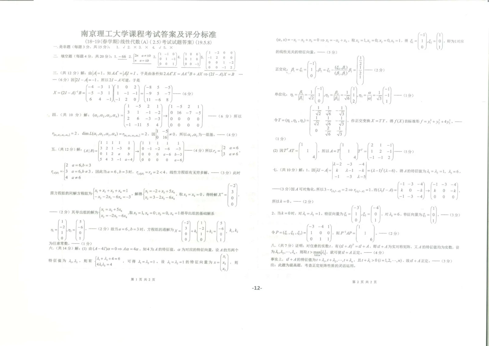

## 南京理工大学课程考试答案及评分标准

(18-19(春学期)线性代数(A)(2.5)考试试题答案)(19.5.8)

一.是非题（每题3分，共15分）： 1. √2. ×3. ×4. √5. ×
二.填空题（每题4分，共20分）：1. -66 2. $\begin{cases} 2n & a \neq \pm b \\ n & a = \pm b \end{cases}$ 3. $\begin{pmatrix} 1 & -1 & 0 \\ 0 & 1 & -1 \\ 0 & 0 & 1 \end{pmatrix}$ 4. $\begin{pmatrix} 1 & 0 & 0 \\ 0 & 1 & 0 \\ 0 & 0 & -1 \end{pmatrix}$ 5. $\begin{pmatrix} 1 & -2 & 0 & 0 \\ -1 & 2 & 0 & 0 \\ 0 & 0 & 1 & -2 \\ 0 & 0 & -1 & 2 \end{pmatrix}$ 三.（共12分）解：由 $|A|=1$ ，知 $AA^{*}=|A|I=I$ 。于是由条件知 $2AA^{*}X=AA^{-1}B+AX\Rightarrow(2I-A)X=B$ ——（6分）因 $|2I-A|=-1$ ，所以 $2I-A$ 可逆，于是 $X=(2I-A)^{-1}B=\begin{pmatrix}-4 & -3 & 1 \\-5 & -3 & 1 \\6 & 4 & -1\end{pmatrix}\begin{pmatrix}1 & 0 & 2 \\1 & -1 & -1 \\-1 & 2 & 0\end{pmatrix}=\begin{pmatrix}-8 & 5 & -5 \\-9 & 5 & -7 \\11 & -6 & 8\end{pmatrix}$ ——（6分）
四．（共10分）解： $(\alpha_{1},\alpha_{2},\alpha_{3},\alpha_{4})=\begin{pmatrix}1 & -5 & 2 & 1 \\3 & 1 & -1 & -2 \\2 & 6 & -3 & -3 \\-1 & -11 & 5 & 4\end{pmatrix}\rightarrow\begin{pmatrix}1 & -5 & 2 & 1 \\0 & 16 & -7 & -5 \\0 & 0 & 0 & 0 \\0 & 0 & 0 & 0\end{pmatrix}$ ——（6分）所以 $r_{\{\alpha_{1},\alpha_{2},\alpha_{3},\alpha_{4}\}}=2$ ， $\dim L(\alpha_{1},\alpha_{2},\alpha_{3},\alpha_{4})=r_{\{\alpha_{1},\alpha_{2},\alpha_{3},\alpha_{4}\}}=2$ ，因 $\begin{vmatrix}1 & -5 \\0 & 16\end{vmatrix}\neq0$ ，所以 $\alpha_{1},\alpha_{2}$ 为一组基。——（4分）
五．（共12分）解： $(A|B)=\begin{pmatrix}1 & 1 & 1 & 1 & 1 \\3 & 2 & 1 & -3 & 0 \\0 & 1 & 2 & a & b \\5 & 4 & 3 & -1 & a-4\end{pmatrix}\rightarrow\begin{pmatrix}1 & 1 & 1 & 1 & 1 \\0 & -1 & -2 & -6 & -3 \\0 & 0 & 0 & a-6 & b-3 \\0 & 0 & 0 & 0 & a-6\end{pmatrix}$ ——（4分）所以 $r_A=\begin{cases}2 & a=6 \\3 & a \neq 6\end{cases}$ ， $r_{(A|B)}=\begin{cases}2 & a=6,b=3 \\3 & a=6,b \neq 3 \\4 & a \neq 6\end{cases}$ ，因此当 $a=6,b=3$ 时， $r_{(A|B)}=r_A=2<4$ ，线性方程组有无穷多解，——（3分）此时
原方程组的同解方程组为 $\begin{cases}x_1+x_2+x_3+x_4=1\\-x_2-2x_3-6x_4=-3\end{cases}$ ，解得 $\begin{cases}x_1=-2+x_3+5x_4\\x_2=3-2x_3-6x_4\end{cases}$ ，取 $x_3=x_4=0$ ，得特解 $X^{*}=\begin{pmatrix}-2\\3\\0\\0\end{pmatrix}$ ，——（2分）其导出组的解为 $\begin{cases}x_1=x_3+5x_4\\x_2=-2x_3-6x_4\end{cases}$ ，取 $x_3=1,x_4=0;x_3=0,x_4=1$ 得导出组的基础解系 $\eta_1=\begin{pmatrix}1\\-2\\1\\0\end{pmatrix},\eta_2=\begin{pmatrix}5\\-6\\0\\1\end{pmatrix}$ ，——（2分）故当 $a=6,b=3$ 时，方程组的通解为 $X=\begin{pmatrix}-2\\3\\0\\0\end{pmatrix}+k_1\begin{pmatrix}1\\-2\\1\\0\end{pmatrix}+k_2=\begin{pmatrix}5\\-6\\0\\1\end{pmatrix}$ ， $k_1,k_2$ 为任意常数。——（1分）
六．（共14分）解：(1)由 $(A-4I)\alpha=0\Rightarrow A\alpha=4\alpha$ ，知4为A的特征值，α为对应的特征向量，设A的另两个特征值为 $\lambda_{1},\lambda_{2}$ ，则有 $\begin{cases}\lambda_{1}+\lambda_{2}+4=6\\4\lambda_{1}\lambda_{2}=4\end{cases}$ ，可得 $\lambda_{1}=\lambda_{2}=1$ 。设 $\lambda_{1}=\lambda_{2}=1$ 的特征向量为 $x=\begin{pmatrix}x_{1}\\x_{2}\\x_{3}\end{pmatrix}$ ，则$(\alpha, x) = -x_1 - x_2 + x_3 = 0 \Rightarrow x_1 = -x_2 + x_3$ ，取 $x_2 = 1, x_3 = 0; x_2 = 0, x_3 = 1$ ，得 $\xi_1 = \begin{pmatrix} -1 \\ 1 \\ 0 \end{pmatrix}, \xi_2 = \begin{pmatrix} 1 \\ 0 \\ 1 \end{pmatrix}$ ，即为1对应的线性无关的特征向量。——（5分）

正交化： $\beta_1 = \xi_1 = \begin{pmatrix} -1 \\ 1 \\ 0 \end{pmatrix}, \beta_2 = \xi_2 = \frac{(\xi_2, \beta_1)}{(\beta_1, \beta_1)} \beta_1 = \begin{pmatrix} \frac{1}{2} \\ \frac{1}{2} \\ 1 \end{pmatrix}$ ——（2分）

单位化： $\eta_1 = \frac{\beta_1}{|\beta_1|} = \frac{1}{\sqrt{2}} \begin{pmatrix} -1 \\ 1 \\ 0 \end{pmatrix}, \eta_2 = \frac{\beta_2}{|\beta_2|} = \frac{1}{\sqrt{6}} \begin{pmatrix} 1 \\ 1 \\ 2 \end{pmatrix}, \eta_3 = \frac{\alpha}{|\alpha|} = \frac{1}{\sqrt{3}} \begin{pmatrix} -1 \\ -1 \\ 1 \end{pmatrix}$ ——（1分）

令 $T = (\eta_1, \eta_2, \eta_3) = \begin{pmatrix} -\frac{1}{\sqrt{2}} & \frac{1}{\sqrt{6}} & -\frac{1}{\sqrt{3}} \\ \frac{1}{\sqrt{2}} & \frac{1}{\sqrt{6}} & -\frac{1}{\sqrt{3}} \\ 0 & \frac{2}{\sqrt{6}} & \frac{1}{\sqrt{3}} \end{pmatrix}$ ，作正交变换 $X = TY$ ，得 $f(X)$ 的标准形 $f = y_1^2 + y_2^2 + 4y_3^2$ 。——（1分）

(2) 因 $T^T A T = \begin{pmatrix} 1 &  &  \\ & 1 & \\ & & 4 \end{pmatrix}$ ，所以 $A = T \begin{pmatrix} 1 &  &  \\ &  & 4 \end{pmatrix} T^T = \begin{pmatrix} 2 & 1 & -1 \\ 1 & 2 & -1 \\ -1 & -1 & 2 \end{pmatrix}$ ——（5分）

七.（共10分）解：1、因 $|\lambda I - A| = \begin{vmatrix} \lambda - 2 & -3 & -4 \\ k & \lambda - 1 & -k \\ -1 & -3 & \lambda - 5 \end{vmatrix} = (\lambda - 1)^2 (\lambda - 6)$ ，得 $A$ 的特征值为 $\lambda_1 = \lambda_2 = 1, \lambda_3 = 6$ 。

——（3分）因 $A$ 可对角化，所以 $3 - r_{(\lambda_1 I - A)} = 2 \Rightarrow r_{(\lambda_1 I - A)} = 1$ ，而 $(\lambda_1 I - A) = \begin{pmatrix} -1 & -3 & -4 \\ k & 0 & -k \\ -1 & -3 & -4 \end{pmatrix} \to \begin{pmatrix} -1 & -3 & -4 \\ k & 0 & -k \\ 0 & 0 & 0 \end{pmatrix}$ ，所以 $k = 0$ 。——（2分）

2、当 $k = 0$ 时，对 $\lambda_1 = \lambda_2 = 1$ ，特征向量为 $\xi_1 = \begin{pmatrix} -3 \\ 1 \\ 0 \end{pmatrix}, \xi_2 = \begin{pmatrix} -4 \\ 0 \\ 1 \end{pmatrix}$ ，对 $\lambda_3 = 6$ ，特征向量为 $\xi_3 = \begin{pmatrix} 1 \\ 0 \\ 1 \end{pmatrix}$ ，——（3分）

令 $P = (\xi_1, \xi_2, \xi_3) = \begin{pmatrix} -3 & -4 & 1 \\ 1 & 0 & 0 \\ 0 & 1 & 1 \end{pmatrix}$ ，则 $P^{-1} A P = \begin{pmatrix} 1 & & \\ & 1 & \\ & & 6 \end{pmatrix}$ 。——（2分）

八.（共7分）证明：对任意的实数 $t$ ，有 $(tI + A)^T = tI + A$ ，即 $tI + A$ 为实对称矩阵，又 $A$ 的特征值均为实数，设为 $\lambda_1, \lambda_2, \cdots, \lambda_n$ ，则取 $t > \max_{1 \leq i < n} |\lambda_i|$ ，就可使 $tI + A$ 正定。——（4分）

事实上， $tI + A$ 的特征值为 $t + \lambda_1, t + \lambda_2, \cdots, t + \lambda_n$ ，且 $t + \lambda_i > 0 (i=1,2,\cdots,n)$ ，故 $tI + A$ 正定。——（3分）

注：此题为提高题，考查正定矩阵性质的灵活运用。

第1页共2页

12

第2页共2页

## 第21页

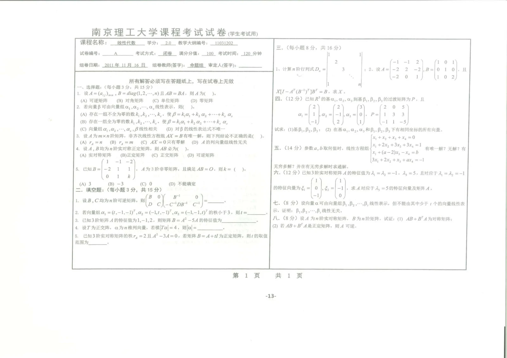

## 南京理工大学课程考试试卷 (学生考试用)

课程名称： 线性代数 学分： 2.0 教学大纲编号： 11031202

试卷编号：\_\_\_\_ A\_\_\_\_ 考试方式：闭卷 满分分值：100 考试时间：120 分钟

组卷日期：2011年11月16日 组卷教师(签字)：命题组 审定人(签字)：

### 所有解答必须写在答题纸上，写在试卷上无效

### 一、选择题：（每小题3分，共15分）

1. 设 $A = (a_{ij})_{n \times n}$ ， $B = diag(1, 2, \cdots, n)$ 且 AB = BA，则 A 为（）。(A) 可逆矩阵 (B) 对角矩阵 (C) 单位矩阵 (D) 零矩阵

2. 若向量 $\beta$ 可由向量组 $\alpha_{1}, \alpha_{2}, \cdots, \alpha_{s}$ 线性表示，则()。
(A) 存在一组不全为零的数 $k_{1}, k_{2}, \cdots, k_{s}$ ，使 $\beta = k_{1}\alpha_{1} + k_{2}\alpha_{2} + \cdots + k_{s}\alpha_{s}$ (B) 存在一组全为零的数 $k_{1}, k_{2}, \cdots, k_{s}$ ，使 $\beta = k_{1}\alpha_{1} + k_{2}\alpha_{2} + \cdots + k_{s}\alpha_{s}$ (C) 向量组 $\alpha_{1}, \alpha_{2}, \cdots, \alpha_{s}, \beta$ 线性相关 (D) 对 $\beta$ 的线性表达式不唯一

3. 设 A 为 $m \times n$ 阶矩阵，非齐次线性方程组 AX = B 有唯一解，则下列结论不正确的是()。
(A) $r_{A} = n$ (B) $r_{A} = m$ (C) AX = 0 只有零解 (D) A 的列向量组线性无关

4. 设 A, B 均为 n 阶实对称正定矩阵，则 AB 必为( )。
(A) 实对称矩阵 (B) 正定矩阵 (C) 正交矩阵 (D) 可逆矩阵

5. 已知 $B=\begin{pmatrix}1&-1&-2\\-2&1&1\\0&1&k\end{pmatrix}$ ，A 为 3 阶非零矩阵，且满足 AB=O，则 $k=(\quad)$ 。
(A) 3 (B) -3 (C) 0 (D) 不能确定

### 二. 填空题: (每小题 3 分, 共 15 分)

1. 设 B, C 均为 n 阶可逆矩阵，则 $\begin{pmatrix} B & 0 \\ D & C \end{pmatrix}$ $\begin{pmatrix} B^{-1} & 0 \\ -C^{-1}DB^{-1} & C^{-1} \end{pmatrix} =$ \_\_\_\_。

2. 若向量组 $\alpha_{1}=(t,-1,-1)^{T},\alpha_{2}=(-1,t,-1)^{T},\alpha_{3}=(-1,-1,t)^{T}$ 的秩小于 3，则 t= \_\_\_\_。

3. 已知3阶矩阵A的特征值为1,-1,2，则矩阵 $B=A^{2}-5A$ 的特征值为\_\_\_\_。

4. 设 $T$ 为正交阵， $\alpha$ 为 $n$ 维列向量，若模 $\left|T\alpha\right|=4$ ，则 $\left|\alpha\right|=$ \_\_\_\_。

5. 已知3阶实对称矩阵的秩 $r_A = 2$ 且 $A^2 - 3A = 0$ ，若矩阵 $B = A + tI$ 为正定矩阵，则 $t$ 的取值范围为 \_\_\_\_。

### 三.（每小题8分，共16分）

1、计算 n 阶行列式 $D_{n}=\left|\begin{array}{cccc}1 & & & & 1 \\ & 2 & & & \\ & & 3 & & \\ & & & \ddots & \\ 1 & & & & n\end{array}\right|$ ; 2、设 $A=\begin{pmatrix}-1 & -1 & 2 \\-2 & 2 & -2 \\-2 & 0 & 1\end{pmatrix}, B=\begin{pmatrix}1 & 0 & 1 \\0 & 1 & 0 \\1 & 0 & 2\end{pmatrix}$ ，且

$X[I-A^{T}(B^{-1})^{T}]B^{T}=B$ ，求X。

四.（12分）已知 $R^3$ 的基 $\alpha_{1},\alpha_{2},\alpha_{3}$ 到基 $\beta_{1},\beta_{2},\beta_{3}$ 的过渡矩阵为 $P$ ，且

$$
\alpha_ {1} = \left( \begin{array}{c} 2 \\ 1 \\ - 1 \end{array} \right), \alpha_ {2} = \left( \begin{array}{c} 2 \\ - 1 \\ 2 \end{array} \right), \alpha_ {3} = \left( \begin{array}{c} 3 \\ 0 \\ 1 \end{array} \right), P = \left( \begin{array}{c c c} 2 & 0 & 5 \\ 1 & 3 & 3 \\ - 1 & 1 & - 5 \end{array} \right)
$$

试求：(1)基 $\beta_{1},\beta_{2},\beta_{3}$ ；(2)在基 $\alpha_{1},\alpha_{2},\alpha_{3}$ 和 $\beta_{1},\beta_{2},\beta_{3}$ 下有相同坐标的所有向量。

五.（14分）参数a,b取何值时，线性方程组 $\left\{\begin{aligned}x_{1}+x_{2}+x_{3}+x_{4}&=0\\ x_{1}+2x_{2}+3x_{3}+3x_{4}&=1\\ x_{1}+(a-2)x_{3}-x_{4}&=b\\ 3x_{1}+2x_{2}+x_{3}+ax_{4}&=-1\end{aligned}\right.$ 有唯一解？无解？有

无穷多解？并在有无穷多解时求通解。

六.（12分）已知3阶实对称矩阵A的特征值为 $\lambda_{1}=\lambda_{2}=-1,\quad\lambda_{3}=5$ ，且对应于 $\lambda_{1}=\lambda_{2}=-1$ 的特征向量为 $\xi_{1}=\begin{pmatrix}1\\0\\-1\end{pmatrix},\quad\xi_{2}=\begin{pmatrix}1\\-1\\0\end{pmatrix}$ ，求A对应于 $\lambda_{3}=5$ 的特征向量及矩阵A。

七.（8 分）设向量 $\alpha$ 可由向量组 $\beta_{1}, \beta_{2}, \cdots, \beta_{t}$ 线性表示，但不能由其中少于 t 个的向量线性表示，证明： $\beta_{1}, \beta_{2}, \cdots, \beta_{t}$ 线性无关。

八.（8分）设 $A$ 为 $n$ 阶实对称矩阵， $B$ 为 $n$ 阶矩阵，试证：(1) $AB + B^T A$ 为对称矩阵；(2) 若 $AB + B^T A$ 是正定矩阵，则 $A$ 可逆。

第1页 共1页

13

## 第22页

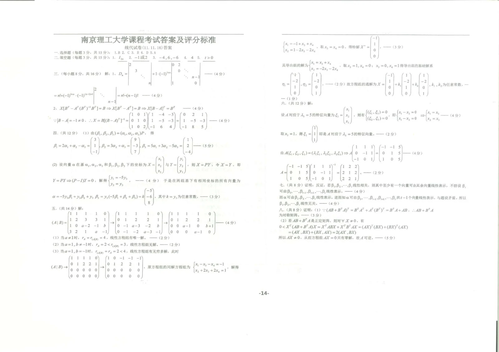

## 南京理工大学课程考试答案及评分标准

## 线代试卷(11.11.16)答案

一. 选择题（每题3分，共15分）：1. B 2. C 3. B 4. D 5. A

二. 填空题（每题3分，共15分）：1. $I_{2n}$ 2. -1或2 3. -4,6,-6 4. 4 5. t>0三.（每小题8分，共16分）解：1、 $D_{n}=\left|\begin{array}{ccc}2 & & \\ & 3 & \\ & & \ddots \\ & & n\end{array}\right|+1\cdot(-1)^{1+n}\left|\begin{array}{cccc}0 & 2 & & \\ & 0 & \ddots & \\ & & \ddots & n-1 \\ 1 & & & 0\end{array}\right|$ ——（4分） $=n!+(-1)^{1+n}\cdot(-1)^{(n-1)+1}\left|\begin{array}{ccc}2 & & \\ & \ddots & \\ & & n-1\end{array}\right|=n!-(n-1)!$ ——（4分）

2、 $X[B^{T} - A^{T}(B^{T})^{-1}B^{T}] = B\Rightarrow X[B^{T} - A^{T}] = B\Rightarrow X[B - A]^{T} = B^{T}$ ——（4分）

$$
\left| B - A \right| = - 1 \neq 0, \therefore X = B [ (B - A) ^ {T} ] ^ {- 1} = \left( \begin{array}{l l l} 1 & 0 & 1 \\ 0 & 1 & 0 \\ 1 & 0 & 2 \end{array} \right) \left( \begin{array}{l l l} 1 & - 4 & - 3 \\ 1 & - 5 & - 3 \\ - 1 & 6 & 4 \end{array} \right) = \left( \begin{array}{l l l} 0 & 2 & 1 \\ 1 & - 5 & - 3 \\ - 1 & 8 & 5 \end{array} \right) \tag {4分}
$$

四.（共12分）（1）由 $(\beta_{1},\beta_{2},\beta_{3}) = (\alpha_{1},\alpha_{2},\alpha_{3})P$ ，得

$$
\beta_ {1} = 2 \alpha_ {1} + \alpha_ {2} - \alpha_ {3} = \left( \begin{array}{l} 3 \\ 1 \\ - 1 \end{array} \right),   \beta_ {2} = 3 \alpha_ {2} + \alpha_ {3} = \left( \begin{array}{l} 9 \\ - 3 \\ 7 \end{array} \right),   \beta_ {3} = 5 \alpha_ {1} + 3 \alpha_ {2} - 5 \alpha_ {3} = \left( \begin{array}{l} 1 \\ 2 \\ - 4 \end{array} \right) - (5 \text {分})
$$

(2) 设向量 $\alpha$ 在基 $\alpha_{1}, \alpha_{2}, \alpha_{3}$ 和 $\beta_{1}, \beta_{2}, \beta_{3}$ 下的坐标为 $X = \begin{pmatrix} x_{1} \\ x_{2} \\ x_{3} \end{pmatrix}$ 与 $Y = \begin{pmatrix} y_{1} \\ y_{2} \\ y_{3} \end{pmatrix}$ ，则 $X = PY$ ，令 $X = Y$ ，即 $Y = PY \Rightarrow (P - I)Y = 0$ ，解得 $\left\{ \begin{array}{l} y_{1} = -5y_{3} \\ y_{2} = y_{3} \end{array} \right.$ ，——（4分）于是在两组基下有相同坐标的所有向量为 $\alpha = -5y_{3}\beta_{1} + y_{3}\beta_{2} + y_{3}\beta_{3} = y_{3}(-5\beta_{1} + \beta_{2} + \beta_{3}) = k\begin{pmatrix} -5 \\ -6 \\ 8 \end{pmatrix}$ ，其中 $k = y_{3}$ 为任意常数。——（3分）

$$
(A \mid B) = \left(\begin{array}{c c c c c}1&1&1&1&0\\1&2&3&3&1\\1&0&a - 2&- 1&b\\3&2&1&a&- 1\end{array}\right)\rightarrow \left(\begin{array}{c c c c c}1&1&1&1&0\\0&1&2&2&1\\0&- 1&a - 3&- 2&b\\0&- 1&- 2&a - 3&- 1\end{array}\right)\rightarrow \left(\begin{array}{c c c c c}1&1&1&1&0\\0&1&2&2&1\\0&0&a - 1&0&b + 1\\0&0&0&a - 1&0\end{array}\right) — — (4 \text {分})
$$

（1）当 $a \neq 1$ 时， $r_A = r_{(A|B)} = 4$ ，线性方程组有唯一解。----（2分）

(2) 当 $a=1, b \neq -1$ 时， $r_{A}=2<r_{(A|B)}=3$ ，线性方程组无解。——（2分）

（3）当 $a = 1, b = -1$ 时， $r_{(A|B)} = r_A = 2 < 4$ ，线性方程组有无穷多解，此时

$(A \mid B) \rightarrow \begin{pmatrix} 1 & 1 & 1 & 1 & 0 \\ 0 & 1 & 2 & 2 & 1 \\ 0 & 0 & 0 & 0 & 0 \\ 0 & 0 & 0 & 0 & 0 \end{pmatrix} \rightarrow \begin{pmatrix} 1 & 0 & -1 & -1 & -1 \\ 0 & 1 & 2 & 2 & 1 \\ 0 & 0 & 0 & 0 & 0 \\ 0 & 0 & 0 & 0 & 0 \end{pmatrix}$ , 原方程组的同解方程组为 $\left\{ \begin{array}{l} x_{1} - x_{3} - x_{4} = -1 \\ x_{2} + 2x_{3} + 2x_{4} = 1 \end{array} \right.$ , 解得

$\left\{ \begin{array}{l} x_{1} = -1 + x_{3} + x_{4} \\ x_{2} = 1 - 2x_{3} - 2x_{4} \end{array} \right.$ 取 $x_{3} = x_{4} = 0$ ，得特解 $X^{*} = \left( \begin{array}{c}-1\\ 1\\ 0\\ 0 \end{array} \right)$ ，----（3分）

其导出组的解为 $\left\{ \begin{array}{l} x_{1} = x_{3} + x_{4} \\ x_{2} = -2x_{3} - 2x_{4} \end{array} \right.$ ，取 $x_{3} = 1, x_{4} = 0$ ； $x_{3} = 0, x_{4} = 1$ 得导出组的基础解系

$\eta_{1}=\begin{pmatrix}-1\\-2\\1\\0\end{pmatrix},\eta_{2}=\begin{pmatrix}1\\-2\\0\\1\end{pmatrix},$ ——（2分）故方程组的通解为 $X=\begin{pmatrix}-1\\1\\0\\0\end{pmatrix}+k_{1}\begin{pmatrix}1\\-2\\1\\0\end{pmatrix}+k_{2}\begin{pmatrix}1\\-2\\0\\1\end{pmatrix},k_{1},k_{2}$ 为任意常数。—

$$
- (1 \text {分})
$$

设 A 对应于 $\lambda_{3}=5$ 的特征向量为 $\xi_{3}=\begin{pmatrix}x_{1}\\x_{2}\\x_{3}\end{pmatrix}$ ，则有 $\left\{\begin{matrix}(\xi_{1},\xi_{3})=0\\ (\xi_{2},\xi_{3})=0\end{matrix}\right.$ ，即 $\left\{\begin{matrix}x_{1}-x_{3}=0\\ x_{1}-x_{2}=0\end{matrix}\right.\Rightarrow\left\{\begin{matrix}x_{1}=x_{3}\\ x_{2}=x_{3}\end{matrix}\right.$ ——（4 分）

取 $x_{3} = 1$ ，得 $\xi_3 = \begin{pmatrix} 1\\ 1\\ 1\end{pmatrix}$ 即是 $A$ 对应于 $\lambda_3 = 5$ 的特征向量。——（2分）

$$
\xi_ {1}, \xi_ {2}, \xi_ {3}) = (\lambda_ {1} \xi_ {1}, \lambda_ {2} \xi_ {2}, \lambda_ {3} \xi_ {3}) \Rightarrow A \left( \begin{array}{c c c} 1 & 1 & 1 \\ 0 & - 1 & 1 \\ - 1 & 0 & 1 \end{array} \right) = \left( \begin{array}{c c c} - 1 & - 1 & 5 \\ 0 & 1 & 5 \\ 1 & 0 & 5 \end{array} \right) - (4 \text {分})
$$

$$
A = \left( \begin{array}{c c c} - 1 & - 1 & 5 \\ 0 & 1 & 5 \\ 1 & 0 & 5 \end{array} \right) \left( \begin{array}{c c c} 1 & 1 & 1 \\ 0 & - 1 & 1 \\ - 1 & 0 & 1 \end{array} \right) ^ {- 1} = \left( \begin{array}{c c c} 1 & 2 & 2 \\ 2 & 1 & 2 \\ 2 & 2 & 1 \end{array} \right) 。
$$

七.（共8分）证明：反证，若 $\beta_{1},\beta_{2},\cdots,\beta_{t}$ 线性相关，则其中至少有一个向量可由其余向量线性表示，不妨设 $\beta_{i}$ 可由 $\beta_{1},\cdots,\beta_{i-1},\beta_{i+1},\cdots,\beta_{t}$ 线性表示，——（4分）

而 $\alpha$ 可由 $\beta_{1}, \beta_{2}, \cdots, \beta_{t}$ 线性表示，进而知 $\alpha$ 可由 $\beta_{1}, \cdots, \beta_{i-1}, \beta_{i+1}, \cdots, \beta_{t}$ 共 t-1 个向量线性表示，与题设矛盾。所以 $\beta_{1}, \beta_{2}, \cdots, \beta_{t}$ 线性无关。——（4 分）

$$
\because (A B + B ^ {T} A) ^ {T} = B ^ {T} A ^ {T} + A ^ {T} (B ^ {T}) ^ {T} = B ^ {T} A + A B, \therefore A B + B ^ {T} A \tag {1}
$$

(2) 若 $AB + B^{T}A$ 是正定矩阵，则对 $\forall X \neq 0$ ，有

$$
0 <   X ^ {T} (A B + B ^ {T} A) X = X ^ {T} A B X + X ^ {T} B ^ {T} A X = (A X) ^ {T} (B X) + (B X) ^ {T} (A X)
$$

所以 $AX \neq 0$ ，从而方程组 AX = 0 只有零解，故 A 可逆。……（5 分）

1. 2017年1月1日

-14-

## 第23页

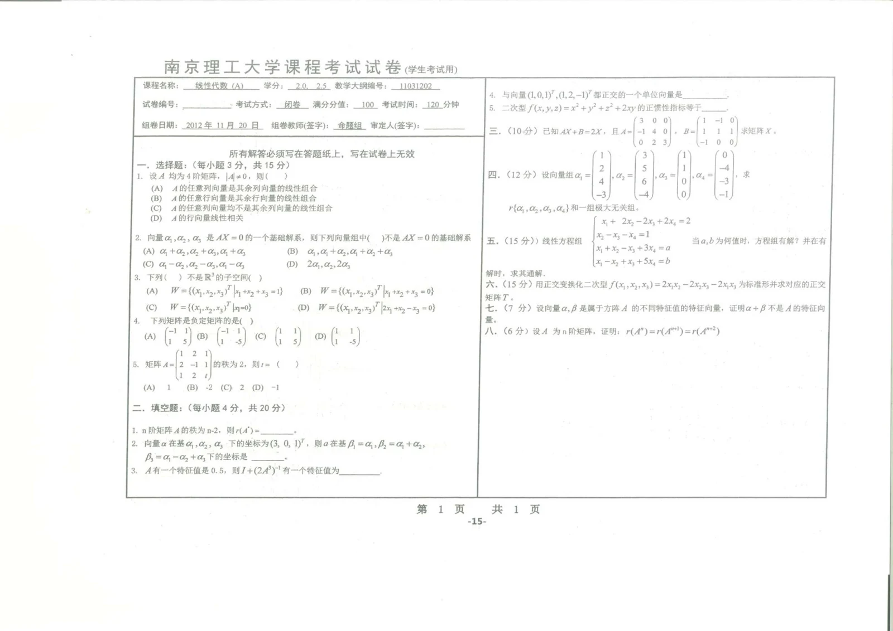

## 南京理工大学课程考试试卷 (学生考试用)

课程名称： 线性代数(A) 学分： 2.0、2.5 教学大纲编号： 11031202

试卷编号：\_\_\_\_ 考试方式：闭卷 满分分值：100 考试时间：120 分钟

组卷日期：2012年11月20日 组卷教师(签字)：命题组 审定人(签字)：

### 所有解答必须写在答题纸上，写在试卷上无效

### 一. 选择题: (每小题 3 分, 共 15 分)

1. 设 A 均为 4 阶矩阵， $|A| \neq 0$ ，则（）
(A) A 的任意列向量是其余列向量的线性组合
(B) A 的任意行向量是其余行向量的线性组合
(C) A 的任意列向量均不是其余列向量的线性组合
(D) A 的行向量线性相关

2. 向量 $\alpha_{1}, \alpha_{2}, \alpha_{3}$ 是 AX = 0 的一个基础解系，则下列向量组中（）不是 AX = 0 的基础解系
(A) $\alpha_{1} + \alpha_{2}, \alpha_{2} + \alpha_{3}, \alpha_{1} + \alpha_{3}$ (B) $\alpha_{1}, \alpha_{1} + \alpha_{2}, \alpha_{1} + \alpha_{2} + \alpha_{3}$ (C) $\alpha_{1}-\alpha_{2},\alpha_{2}-\alpha_{3},\alpha_{1}-\alpha_{3}$ (D) $2\alpha_{1},\alpha_{2},2\alpha_{3}$

3. 下列（）不是 $\mathbb{R}^3$ 的子空间（）
(A) $W = \{(x_1, x_2, x_3)^T | x_1 + x_2 + x_3 = 1\}$ (B) $W = \{(x_1, x_2, x_3)^T | x_1 + x_2 + x_3 = 0\}$ (C) $W = \{(x_1, x_2, x_3)^T | x_1 = 0\}$ (D) $W = \{(x_1, x_2, x_3)^T | 2x_1 + x_2 - x_3 = 0\}$

4. 下列矩阵是负定矩阵的是( )
(A) $\begin{pmatrix}-1 & 1 \\ 1 & 5\end{pmatrix}$ (B) $\begin{pmatrix}-1 & 1 \\ 1 & -5\end{pmatrix}$ (C) $\begin{pmatrix}1 & 1 \\ 1 & 5\end{pmatrix}$ (D) $\begin{pmatrix}1 & 1 \\ 1 & -5\end{pmatrix}$

5. 矩阵 $A=\begin{pmatrix}1&2&1\\2&-1&1\\1&2&t\end{pmatrix}$ 的秩为 2，则 t=（）
(A) 1 (B) -2 (C) 2 (D) -1

### 二. 填空题: (每小题 4 分, 共 20 分)

1. n 阶矩阵 A 的秩为 n-2，则 $r(A^{*})=$ \_\_\_\_。

2. 向量 $\alpha$ 在基 $\alpha_{1}, \alpha_{2}, \alpha_{3}$ 下的坐标为 $(3, 0, 1)^{T}$ ，则 a 在基 $\beta_{1} = \alpha_{1}, \beta_{2} = \alpha_{1} + \alpha_{2}, \beta_{3} = \alpha_{1} - \alpha_{2} + \alpha_{3}$ 下的坐标是 \_\_\_\_。

3. A 有一个特征值是 0.5，则 $I + (2A^{3})^{-1}$ 有一个特征值为 \_\_\_\_.

4. 与向量 $(1,0,1)^T,(1,2,-1)^T$ 都正交的一个单位向量是

5. 二次型 $f(x, y, z) = x^2 + y^2 + z^2 + 2xy$ 的正惯性指标等于 \_\_\_\_.

三.（10分）已知 $AX + B = 2X$ ，且 $A = \begin{pmatrix} 3 & 0 & 0\\ -1 & 4 & 0\\ 0 & 2 & 3 \end{pmatrix}$ ， $B = \begin{pmatrix} 1 & -1 & 0\\ 1 & 1 & 1\\ -1 & 0 & 0 \end{pmatrix}$ 求矩阵 $X$ 。

四.（12分）设向量组 $\alpha_{1} = \begin{pmatrix} 1 \\ 2 \\ 4 \\ -3 \end{pmatrix}, \alpha_{2} = \begin{pmatrix} 3 \\ 5 \\ 6 \\ -4 \end{pmatrix}, \alpha_{3} = \begin{pmatrix} 1 \\ 1 \\ 0 \\ 0 \end{pmatrix}, \alpha_{4} = \begin{pmatrix} 0 \\ -4 \\ -3 \\ -1 \end{pmatrix}$ ，求

$$
\left. \alpha_ {2}, \alpha_ {3}, \alpha_ {4} \right\}
$$

五.（15分）线性方程组 $\left\{\begin{aligned}x_{1}+2x_{2}-2x_{3}+2x_{4}&=2\\ x_{2}-x_{3}-x_{4}&=1\\ x_{1}+x_{2}-x_{3}+3x_{4}&=a\\ x_{1}-x_{2}+x_{3}+5x_{4}&=b\end{aligned}\right.$ 当a,b为何值时，方程组有解？并在有

### 解时，求其通解.

六.（15分）用正交变换化二次型 $f(x_{1},x_{2},x_{3}) = 2x_{1}x_{2} - 2x_{2}x_{3} - 2x_{1}x_{3}$ 为标准形并求对应的正交矩阵 $T$ 。  
七.（7分）设向量 $\alpha ,\beta$ 是属于方阵 $A$ 的不同特征值的特征向量，证明 $\alpha +\beta$ 不是 $A$ 的特征向量。  
八.（6分）设 $A$ 为n阶矩阵，证明： $r(A^n) = r(A^{n + 1}) = r(A^{n + 2})$

第1页 共1页

-15-

## 第24页

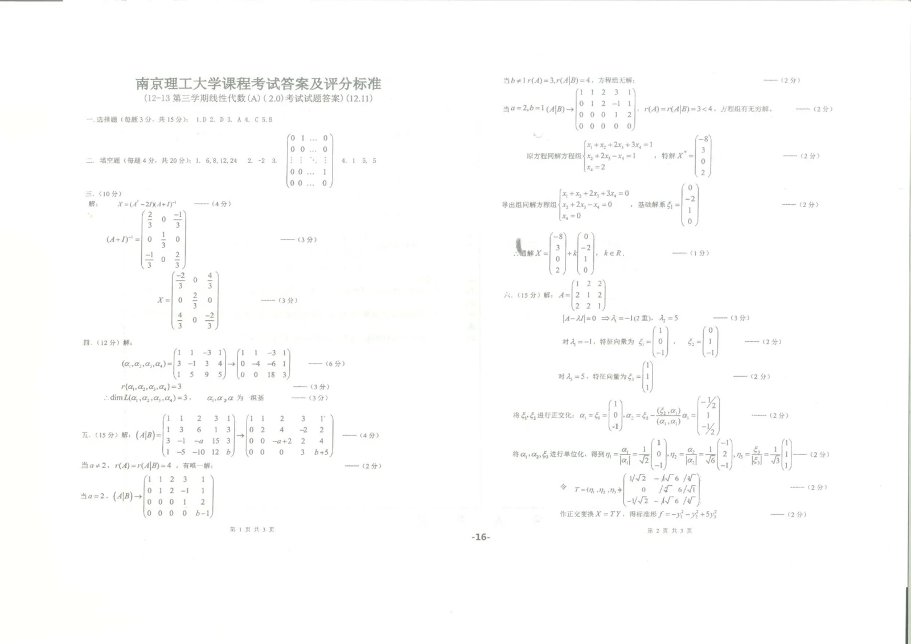

## 南京理工大学课程考试答案及评分标准

(12-13 第三学期线性代数(A)(2.0)考试试题答案)(12.11)

一. 选择题（每题3分，共15分）：1. D 2. D 3. A 4. C 5. B

二. 填空题（每题4分，共20分）：1. 6,8,12,24 2.-2 3. $\left( \begin{array}{cccc}0 & 1 & \dots & 0\\ 0 & 0 & \dots & 0\\ \vdots & \vdots & \ddots & \vdots \\ 0 & 0 & \dots & 1\\ 0 & 0 & \dots & 0 \end{array} \right)$ 4.15.5

三.（10分）

解： $X = (A^2 - 2I)(A + I)^{-1}$ ——（4分）

$$
(A + I) ^ {- 1} = \left( \begin{array}{c c c} \frac {2}{3} & 0 & \frac {- 1}{3} \\ 0 & \frac {1}{3} & 0 \\ \frac {- 1}{3} & 0 & \frac {2}{3} \end{array} \right)
$$

$$
X = \left( \begin{array}{c c c} {\frac {- 2}{3}} & {0} & {\frac {4}{3}} \\ {0} & {\frac {2}{3}} & {0} \\ {\frac {4}{3}} & {0} & {\frac {- 2}{3}} \end{array} \right) \qquad \text {   - - -   (3分)   }
$$

四.（12分）解：

$$
\begin{array}{r l r}&{(\alpha_ {1}, \alpha_ {2}, \alpha_ {3}, \alpha_ {4}) = \left(\begin{array}{c c c c}{1}&{1}&{- 3}&{1}\\{3}&{- 1}&{3}&{4}\\{1}&{5}&{9}&{5}\end{array}\right)\rightarrow \left(\begin{array}{c c c c}{1}&{1}&{- 3}&{1}\\{0}&{- 4}&{- 6}&{1}\\{0}&{0}&{1 8}&{3}\end{array}\right)}&{\text {--- (6 分)}}\\&{r \{\alpha_ {1}, \alpha_ {2}, \alpha_ {3}, \alpha_ {4} \} = 3}&{\text {--- (3 分)}}\\&{\therefore \dim L (\alpha_ {1}, \alpha_ {2}, \alpha_ {3}, \alpha_ {4}) = 3, \qquad \alpha_ {1}, \alpha_ {2}, \alpha \text {为一组基}}&{\text {--- (3 分)}}\end{array}
$$

五.（15分）解： $(A|B) = \begin{pmatrix} 1 & 1 & 2 & 3 & 1\\ 1 & 3 & 6 & 1 & 3\\ 3 & -1 & -a & 15 & 3\\ 1 & -5 & -10 & 12 & b \end{pmatrix}\rightarrow \begin{pmatrix} 1 & 1 & 2 & 3 & 1\\ 0 & 2 & 4 & -2 & 2\\ 0 & 0 & -a + 2 & 2 & 4\\ 0 & 0 & 0 & 3 & b + 5 \end{pmatrix}$ ——（4分）

当 $a \neq 2$ ， $r(A) = r(A|B) = 4$ ，有唯一解：

$$
\text {当} a = 2, \left(A | B\right)\rightarrow \left(\begin{array}{c c c c c}{{1}}&{{1}}&{{2}}&{{3}}&{{1}}\\{{0}}&{{1}}&{{2}}&{{- 1}}&{{1}}\\{{0}}&{{0}}&{{0}}&{{1}}&{{2}}\\{{0}}&{{0}}&{{0}}&{{0}}&{{b - 1}}\end{array}\right)
$$

当 $b\neq1r(A)=3,r(A|B)=4$ ，方程组无解；

当 $a = 2, b = 1$ $(A|B) \to \begin{pmatrix} 1 & 1 & 2 & 3 & 1 \\ 0 & 1 & 2 & -1 & 1 \\ 0 & 0 & 0 & 1 & 2 \\ 0 & 0 & 0 & 0 & 0 \end{pmatrix}$ , $r(A) = r(A|B) = 3 < 4$ , 方程组有无穷解。 （2分）

原方程同解方程组 $\left\{\begin{aligned}x_{1}+x_{2}+2x_{3}+3x_{4}&=1\\ x_{2}+2x_{3}-x_{4}&=1\\ x_{4}&=2\end{aligned}\right.$ ，特解 $X^{*}=\left(\begin{aligned}-8\\ 3\\ 0\\ 2\end{aligned}\right)$ ——（2分）

导出组同解方程组 $\left\{\begin{aligned}x_{1}+x_{2}+2x_{3}+3x_{4}&=0\\ x_{2}+2x_{3}-x_{4}&=0\\ x_{4}&=0\end{aligned}\right.$ ，基础解系 $\xi_{1}=\left(\begin{aligned}0\\ -2\\ 1\\ 0\end{aligned}\right)$ ——（2分）

∴通解 $X=\begin{pmatrix}-8\\3\\0\\2\end{pmatrix}+k\begin{pmatrix}0\\-2\\1\\0\end{pmatrix},\quad k\in R.$

六.（15分）解； $A = \begin{pmatrix} 1 & 2 & 2\\ 2 & 1 & 2\\ 2 & 2 & 1 \end{pmatrix}$ $|A - \lambda I| = 0\Rightarrow \lambda_{1} = -1(2$ 重）， $\lambda_{2} = 5$ （3分）

对 $\lambda_{1}=-1$ ，特征向量为 $\xi_{1}=\begin{pmatrix}1\\0\\-1\end{pmatrix}$ ， $\xi_{2}=\begin{pmatrix}0\\1\\-1\end{pmatrix}$ ——（2分）

$$
\text { 对 } \lambda_ {3} = 5, \text { 特征向量为 } \xi_ {3} = \left( \begin{array}{l} 1 \\ 1 \\ 1 \end{array} \right) \tag {2分}
$$

将 $\xi_{1},\xi_{2}$ 进行正交化： $\alpha_{1} = \xi_{1} = \left( \begin{array}{c}1\\ 0\\ -1 \end{array} \right),\alpha_{2} = \xi_{2} - \frac{(\xi_{2},\alpha_{1})}{(\alpha_{1},\alpha_{1})}\alpha_{1} = \left( \begin{array}{c} - \frac{1}{2}\\ 1\\ -\frac{1}{2} \end{array} \right)$ （2分）

将 $\alpha_{1},\alpha_{2},\xi_{3}$ 进行单位化，得到 $\eta_{1} = \frac{\alpha_{1}}{|\alpha_{1}|} = \frac{1}{\sqrt{2}}\left( \begin{array}{c}1\\ 0\\ -1 \end{array} \right),\eta_{2} = \frac{\alpha_{2}}{|\alpha_{2}|} = \frac{1}{\sqrt{6}}\left( \begin{array}{c} - 1\\ 2\\ -1 \end{array} \right),\eta_{3} = \frac{\xi_{3}}{|\xi_{3}|} = \frac{1}{\sqrt{3}}\left( \begin{array}{c}1\\ 1\\ 1 \end{array} \right)$ ——（2分）

$$
\text {令} \quad T = (\eta_ {1}, \eta_ {2}, \eta_ {3}) \neq \left( \begin{array}{c c c} 1 / \sqrt {2} & - / \sqrt {6} & / \sqrt {7} \\ 0 & / \sqrt {7} & 6 / \sqrt {1} \\ - 1 / \sqrt {2} & - / \sqrt {6} & / \sqrt {7} \end{array} \right).
$$

$$
X = T Y
$$

$$
f = - y _ {1} ^ {2} - y _ {2} ^ {2} + 5 y _ {3} ^ {2}
$$

第1页共3页

-16-

第2页共3页

## 第25页

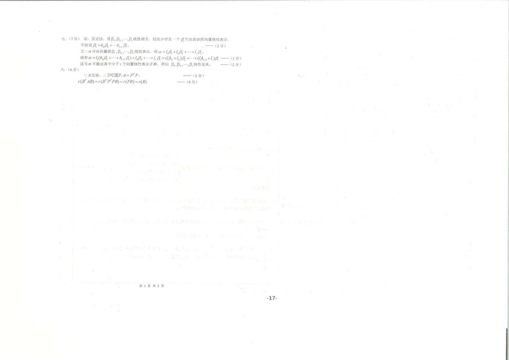

七.（7分）证：反证法，设 $\beta_{1},\beta_{2},\cdots,\beta_{i}$ 线性相关，则至少存在一个 $\beta_{i}$ 可由其余的向量线性表示，

不妨设 $\beta_{1}=k_{2}\beta_{2}+\cdots k_{t-1}\beta_{t}$ ，
……（2分）

又∵ $\alpha$ 可由向量组 $\beta_{1},\beta_{2},\cdots,\beta_{t}$ 线性表示，即 $\alpha=l_{1}\beta_{1}+l_{2}\beta_{2}+\cdots+l_{t}\beta_{t}$ 。

故有 $\alpha=l_{1}(k_{2}\beta_{2}+\cdots+k_{t-1}\beta_{t})+l_{2}\beta_{2}+\cdots+l_{t}\beta_{t}=(l_{1}k_{2}+l_{2})\beta_{2}+\cdots+(l_{1}k_{t-1}+l_{t})\beta_{t}$ ——（3分）

这与 $\alpha$ 不能由其中少于 t 个向量线性表示矛盾，所以 $\beta_{1}, \beta_{2}, \cdots, \beta_{t}$ 线性无关。——（2 分）

八.（6分）

∵ A 正定，∴ ∃可逆 P, $A = P^{T}P$ ,

$$
r (B ^ {T} A B) = r (B ^ {T} P ^ {T} P B) = r (P B) = r (B)
$$

1. 2017年

第3页共3页

-17-

## 第26页

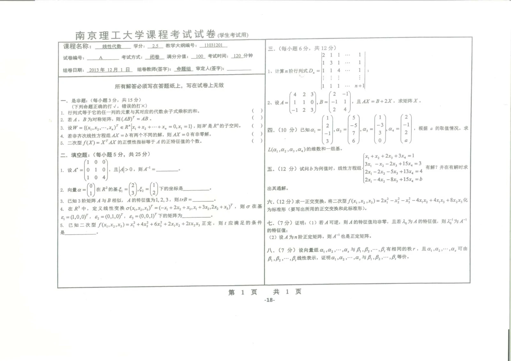

## 南京理工大学课程考试试卷 (学生考试用)

课程名称： 线性代数 学分： 2.5 教学大纲编号： 11031201

试卷编号：\_\_\_\_ A 考试方式：闭卷 满分分值：100 考试时间：120 分钟

组卷日期：2013年12月1日 组卷教师(签字)：命题组 审定人(签字):

所有解答必须写在答题纸上，写在试卷上无效

### 一. 是非题: (每小题 3 分, 共 15 分)

### (下列命题正确的打√，错误的打×)

1. 行列式等于它的任一列的元素与其对应的代数余子式乘积的和。 （）

2. 若 A, B 为对称矩阵，则 $(AB)^{T} = AB$ 。

3. 设 $W = \left\{(x_{1}, x_{2}, \cdots, x_{n})^{T} \in R^{n} \mid x_{1} + x_{2} + \cdots + x_{n} = 0, x_{1} = 1\right\}$ ，则 W 是 $R^{n}$ 的子空间。 （）

4. 若非齐次线性方程组 AX = b 有两个不同的解，则 AX = 0 有非零解。 （）

5. 二次型 $f(X) = X^T AX$ 的正惯性指标等于 $A$ 的正特征值的个数。 （）

### 二. 填空题: (每小题 5 分, 共 25 分)

1. 设 $A^{*}=\begin{pmatrix}1&0&0\\0&1&0\\1&0&4\end{pmatrix}$ ，且 $|A|>0$ ，则 $A^{-1}=$ \_\_\_\_。

2. 向量 $\alpha=\begin{pmatrix}0\\1\end{pmatrix}$ 在 $R^{2}$ 的基 $\xi_{1}=\begin{pmatrix}2\\3\end{pmatrix},\xi_{2}=\begin{pmatrix}1\\2\end{pmatrix}$ 下的坐标是 \_\_\_\_。

3. 已知 3 阶矩阵 A 与 B 相似，A 的特征值为 1, 2, 3，则 trB = \_\_\_\_。

4. 在 $R^3$ 中，定义线性变换 $\sigma(x_1, x_2, x_3)^T = (-x_1 + 2x_2 + x_3, x_1 + 3x_2, 2x_2 + x_3)^T$ ，则 $\sigma$ 在基

$$
\varepsilon_ {1} = (1, 0, 0) ^ {T}, \varepsilon_ {2} = (0, 1, 0) ^ {T}, \varepsilon_ {3} = (0, 0, 1) ^ {T}
$$

5. 已知二次型 $f(x_{1}, x_{2}, x_{3}) = x_{1}^{2} + 4x_{2}^{2} + 6x_{3}^{2} + 2x_{1}x_{2} + 2tx_{2}x_{3}$ 正定，则 t 应满足的条件是 \_\_\_\_。

### 三.（每小题6分，共12分）

1、计算 n 阶行列式 $D_{n}=\left|\begin{matrix}2&1&1&\cdots&1\\ 1&3&1&\cdots&1\\ 1&1&4&\cdots&1\\\vdots&\vdots&\vdots&&\vdots\\ 1&1&1&\cdots&n+1\end{matrix}\right|$ ;

2、设 $A = \begin{pmatrix} 4 & 2 & 3 \\ 1 & 1 & 0 \\ -1 & 2 & 3 \end{pmatrix}, B = \begin{pmatrix} 2 & -1 \\ -1 & 1 \\ 2 & 4 \end{pmatrix}$ ，且 $AX = B + 2X$ ，求矩阵 $X$ 。

四.（10分）已知 $\alpha_{1} = \left( \begin{array}{c}1\\ 2\\ -1\\ 3 \end{array} \right),\alpha_{2} = \left( \begin{array}{c}5\\ -5\\ 7\\ 6 \end{array} \right),\alpha_{3} = \left( \begin{array}{c}1\\ -3\\ 3\\ 0 \end{array} \right),\alpha_{4} = \left( \begin{array}{c}2\\ -1\\ 2\\ a \end{array} \right)$ ，根据 $a$ 的取值情况，求

$$
L \left(\alpha_ {1}, \alpha_ {2}, \alpha_ {3}, \alpha_ {4}\right)
$$

五.（12 分）试问 b 为何值时，线性方程组 $\left\{\begin{aligned}x_{1}+x_{2}+2x_{3}+3x_{4}&=1\\ 3x_{1}-x_{2}-2x_{3}+15x_{4}&=3\\ 2x_{1}-2x_{2}-5x_{3}+13x_{4}&=4\\ 2x_{1}-4x_{2}-8x_{3}+15x_{4}&=b\end{aligned}\right.$ 有解？并在有解时求出其通解。

六.（12分）求一正交变换，将二次型 $f(x_{1},x_{2},x_{3})=2x_{1}^{2}-x_{2}^{2}-x_{3}^{2}-4x_{1}x_{2}+4x_{1}x_{3}+8x_{2}x_{3}$ 化为标准形（要写出所用的正交变换和此标准形）。

七. (7 分) 证明: (1) 若 $A$ 可逆, 则 $A$ 的特征值均非零, 且若 $\lambda_{0}$ 为 $A$ 的特征值, 则 $\lambda_{0}^{-1}$ 为 $A^{-1}$ 的特征值;

(2) 设 A 为 n 阶正定矩阵，则 $A^{-1}$ 也是正定矩阵。

八.（7 分）设向量组 $\alpha_{1},\alpha_{2},\cdots,\alpha_{s}$ 与 $\beta_{1},\beta_{2},\cdots,\beta_{t}$ 有相同的秩 r，且 $\alpha_{1},\alpha_{2},\cdots,\alpha_{s}$ 可由 $\beta_{1},\beta_{2},\cdots,\beta_{t}$ 线性表示，证明 $\alpha_{1},\alpha_{2},\cdots,\alpha_{s}$ 与 $\beta_{1},\beta_{2},\cdots,\beta_{t}$ 等价。

第1页 共1页

18-

## 第27页

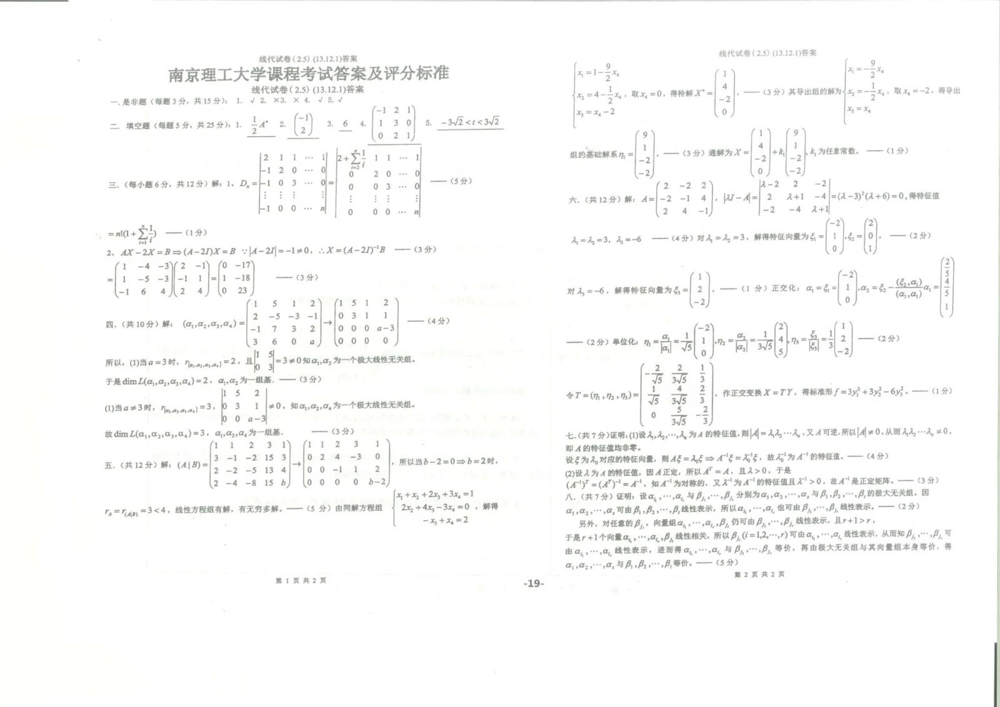

## 线代试卷(2.5)(13.12.1)答案 南京理工大学课程考试答案及评分标准

线代试卷（2.5）(13.12.1)答案

一.是非题（每题3分，共15分）：1. √2. ×3. ×4. √5. √二. 填空题（每题5分，共25分）：1. $\frac{1}{2}A^{*}$ 2. $\left(\begin{array}{c}-1\\2\end{array}\right)$ 3. 6 4. $\left(\begin{array}{ccc}-1 & 2 & 1\\1 & 3 & 0\\0 & 2 & 1\end{array}\right)$ 5. $-3\sqrt{2}<t<3\sqrt{2}$

三.（每小题6分，共12分）解：1、 $D_{n}=\begin{vmatrix}2&1&1&\cdots&1\\-1&2&0&\cdots&0\\-1&0&3&\cdots&0\\\vdots&\vdots&\vdots&&\vdots\\-1&0&0&\cdots&n\end{vmatrix}=\begin{vmatrix}2+\sum_{i=2}^{n}\frac{1}{i}&1&1&\cdots&1\\0&2&0&\cdots&0\\0&0&3&\cdots&0\\\vdots&\vdots&\vdots&&\vdots\\0&0&0&\cdots&n\end{vmatrix}$ ——（5分）

$$
= n! (1 + \sum_ {i = 1} ^ {n} \frac {1}{i}) \quad - (1 \text {分})
$$

$$
A X - 2 X = B \Rightarrow (A - 2 I) X = B \because | A - 2 I | = - 1 \neq 0, \therefore X = (A - 2 I) ^ {- 1} B \quad - - (3 \text {分})
$$

$$
= \left( \begin{array}{c c c} 1 & - 4 & - 3 \\ 1 & - 5 & - 3 \\ - 1 & 6 & 4 \end{array} \right) \left( \begin{array}{c c} 2 & - 1 \\ - 1 & 1 \\ 2 & 4 \end{array} \right) = \left( \begin{array}{c c} 0 & - 1 7 \\ 1 & - 1 8 \\ 0 & 2 3 \end{array} \right) \quad - - (3 \text {分})
$$

四.（共10分）解： $(\alpha_{1},\alpha_{2},\alpha_{3},\alpha_{4}) = \begin{pmatrix} 1 & 5 & 1 & 2\\ 2 & -5 & -3 & -1\\ -1 & 7 & 3 & 2\\ 3 & 6 & 0 & a \end{pmatrix}\rightarrow \begin{pmatrix} 1 & 5 & 1 & 2\\ 0 & 3 & 1 & 1\\ 0 & 0 & 0 & a - 3\\ 0 & 0 & 0 & 0 \end{pmatrix}$ ——（4分）

所以，(1)当 $a = 3$ 时， $r_{\{\alpha_1, \alpha_2, \alpha_3, \alpha_4\}} = 2$ ，且 $\begin{vmatrix} 1 & 5 \\ 0 & 3 \end{vmatrix} = 3 \neq 0$ 知 $\alpha_1, \alpha_2$ 为一个极大线性无关组。

$$
L \left(\alpha_ {1}, \alpha_ {2}, \alpha_ {3}, \alpha_ {4}\right) = 2, \quad \alpha_ {1}, \alpha_ {2}
$$

(1)当 $a \neq 3$ 时， $r_{\{\alpha_1, \alpha_2, \alpha_3, \alpha_4\}} = 3$ ， $\left| \begin{array}{ccc}1 & 5 & 2 \\ 0 & 3 & 1 \\ 0 & 0 & a - 3 \end{array} \right| \neq 0$ ，知 $\alpha_1, \alpha_2, \alpha_4$ 为一个极大线性无关组。

$$
L \left(\alpha_ {1}, \alpha_ {2}, \alpha_ {3}, \alpha_ {4}\right) = 3, \quad \alpha_ {1}, \alpha_ {2}, \alpha_ {4} \text {为一组基}
$$

五.（共12分）解： $(A|B) = \begin{pmatrix} 1 & 1 & 2 & 3 & 1\\ 3 & -1 & -2 & 15 & 3\\ 2 & -2 & -5 & 13 & 4\\ 2 & -4 & -8 & 15 & b \end{pmatrix}\rightarrow \begin{pmatrix} 1 & 1 & 2 & 3 & 1\\ 0 & 2 & 4 & -3 & 0\\ 0 & 0 & -1 & 1 & 2\\ 0 & 0 & 0 & 0 & b - 2 \end{pmatrix}$ ，所以当 $b - 2 = 0\Rightarrow b = 2$ 时， $r_A = r_{(A|B)} = 3 <   4$ ，线性方程组有解，有无穷多解。——（5分）由同解方程组 $\left\{ \begin{array}{l}x_{1} + x_{2} + 2x_{3} + 3x_{4} = 1\\ 2x_{2} + 4x_{3} - 3x_{4} = 0\\ -x_{3} + x_{4} = 2 \end{array} \right.$ ，解得 \(\left\{ \begin{array} { l } { x \_ { 1 } = 1 - \frac { 9 } { 2 } x \_ { 4 } } \\ { x \_ { 2 } = 4 - \frac { 1 } { 2 } x \_ { 4 } , \text { 取 } x \_ { 4 } = 0 , \text { 得特解 } X ^ { \* } = \left( \begin{array} { c } { 1 } \\ { 4 } \\ { - 2 } \\ { 0 } \end{array} \right) , \text { —— (3 分) 其导出组的解为 } \left\{ \begin{array} { l } { x \_ { 1 } = - \frac { 9 } { 2 } x \_ { 4 } } \\ { x \_ { 2 } = - \frac { 1 } { 2 } x \_ { 4 } , \text { 取 } x \_ { 4 } = - 2 , \text { 得导出 } } \\ { x \_ { 3 } = x \_ { 4 } - 2 } \\ { x \_ { 4 } = x \_ { 4 } - 2 } \\ { x \_ { 5 } = x \_ { 5 } - 2 } \\ { x \_ { 6 } = x \_ { 6 } - 2 } \\ { x \_ { 7 } = x \_ { 7 } - 2 } \\ { x \_ { 8 } = x \_ { 8 } - 2 } \\ { x \_ { 9 } = x \_ { 9 } - 2 } \\ { x \_ { 1 0 } = x \_ { 1 0 } - 2 } \\ { x \_ { 1 1 } = x \_ { 1 1 } - 2 } \\ { x \_ { 1 2 } = x \_ { 1 2 } - 2 } \\ { x \_ { 1 3 } = x \_ { 1 3 } - 2 } \\ { x \_ { 1 4 } = x \_ { 1 4 } - 2 } \\ { x \_ { 1 5 } = x \_ { 1 5 } - 2 } \\ { x \_ { 1 6 } = x \_ { 1 6 } - 2 } \\ { x \_ { 1 7 } = x \_ { 1 7 } - 2 } \\ { x \_ { 1 8 } = x \_ { 1 8 } - 2 } \\ { x \_ { 1 9 } = x \_ { 1 9 } - 2 } \\ { x \_ { 2 0 } = x \_ { 2 0 } - 2 } \\ { x \_ { 2 1 } = x \_ { 2 1 } - 2 } \\ { x \_ { 2 2 } = x \_ { 2 2 } - 2 } \\ { x \_ { 2 3 } = x \_ { 2 3 } - 2 } \\ { x \_ { \mathrm { i n t a t e r g e s t h e r m a t e r s y f o r t h e r m a t e r s y f o r t h e r m a t e r s y f o r t h e r m a t e r s y f o r t h e r m a t e r s y f o r t h e r m a t e r s y f o r t h e r m a t e r s y f o r t h e r m a t e r s y f o r t   \mathrm { i n d   u n   s   e   }\cdots\cdots\cdots\cdots\cdots\cdots\cdots\cdots\cdots\cdots\cdots\cdots\cdots\cdots\cdots\cdots\cdots\cdots\cdots\cdots\cdots\cdots\cdots\cdots\cdots\cdots\cdots\cdots\cdots\cdots\cdots\cdots\cdots\cdots\end{array} \right.\)

六. (共12分) 解: \( A = \left( \begin{array} { c c c } { 2 } & {- 2 } & { 2 } \\ {- 2 } & {- 1 } & { 4 } \\ { 2 } & { 4 } & {- 1 } \\ { - 2 } & & & & & & & & & & & & & & & & & & & & & & & & & & & & & & & & & & & & & & & & & & & & & & & & & & & & & & & & & & & & & & & & & & & & & & & & & & & & & & & & & & & & & & & & & & & & & & & & & & & & \\ \lambda \_ { 1 } = \lambda \_ { 2 } = -6 \quad \textbf{——（4分）对}\lambda \_{1} = \lambda \_{2} =3 , \text{解得特征向量为}\xi \_{1}=\left( \begin{array} { c c c c c c c c c c c c c c c c c c c c c c c c c c c c c c c c c c c c c c c c c c c c c c c c c c c c c c c c c c c c c c c c c c c c c c c c c c c c c c c c c c c c c c c c c c c c c c c c c c c    \lambda \_{1} = \lambda \_{2} =3 , \lambda \_{3} =-6 \quad \textbf{——（4分）对}\lambda\_{1}=\lambda\_{2}=3 , \text{解得特征向量为}\xi \_{1}=\left( \begin{array} { l l l l l l l l l l l l l l l l l l l l l l l l l l l l l l l l l l l l l l l l l l l l l l l l l l l l l l l l l l l l l l l l l l l l l l l l l l l l l l l l l l l l l l l l l l l l l    \lambda \_{1} = \lambda \_{2} =3 , \lambda \_{3} =-6 \quad \textbf{——（4分）对}\lambda\_{1}=\lambda\_{2}=3 , \text{解得特征向量为}\xi \_{1}=\left( \begin{array} { c c c c c c c c c c c c c c c c c c c c c c   \lambda \_{1} = \lambda \_{2} =3 , \lambda \_{3} =-6 , \lambda \_{4} =3 , \lambda \_{5} =-6 , \lambda \_{6} =3 , \lambda \_{7} =-6 , \lambda \_{8} =3 , \lambda \_{9} =-6 , \lambda \_{10} =-6 , \lambda \_{11} =-6 , \lambda \_{12} =-6 , \lambda \_{13} =-6 , \lambda \_{14} =-6 , \lambda \_{15} =-6 , \lambda \_{16} =-6 , \lambda \_{17} =-6 , \lambda \_{18} =-6 , \lambda \_{19} =-6 , \lambda \_{20} =-6 , \lambda \_{21} =-6 , \lambda \_{22} =-6 , \lambda \_{23} =-6 , \lambda \_{24} =-6 , \lambda \_{25} =-6 , \lambda \_{26} =-6 , \lambda \_{27} =-6 , \lambda \_{28} =-6 , \lambda \_{29} =-6 , \lambda \_{30} =-6 , \lambda \_{31} =-6 , \lambda \_{32} =-6 , \lambda \_{33} =-6 , \lambda \_{34} =-6 , \lambda \_{35} =-6 , \lambda \_{36} =-6 , \lambda \_{37} =-6 , \lambda \_{38} =-6 , \lambda \_{39} =-6 , \lambda \_{40} =-6 , \lambda \_{41} =-6 , \lambda \_{42} =-6 , \lambda \_{43} =-6 , \lambda \_{44} =-6 , \lambda \_{45} =-6 , \lambda \_{46} =-6 , \lambda \_{47} =-6 , \lambda \_{48} =-6 , \lambda \_{49} =-6 , \lambda \_{50} =-6 , \lambda \_{51} =-6 , \lambda \_{52} =-6 , \lambda \_{53} =-6 , \lambda \_{54} =-6 , \lambda \_{55} =-6 , \lambda \_{56} =-6 , \lambda \_{57} =-6 , \lambda \_{58} =-6 , \lambda \_{59} =-6 , \lambda \_{60} =-6 , \lambda\_{61} =-6 , \lambda\_{62} =-6 , \lambda\_{63} =-6 , \lambda\_{64} =-6 , \lambda\_{65} =-6 , \lambda\_{66} =-6 , \lambda\_{67} =-6 , \lambda\_{68} =-6 , \lambda\_{69} =-6 , \lambda\_{70} =-6 , \lambda\_{71} =-6 , \lambda\_{72} =-6 , \lambda\_{73} =-6 , \lambda\_{74} =-6 , \lambda\_{75} =-6 , \lambda\_{76} =-6 , \lambda\_{77} =-6 , \lambda\_{78} =-6 , \lambda\_{79} =-6 , \lambda\_{80} =-6 , \lambda\_{81} =-6 , \lambda\_{82} =-6 , \lambda\_{83} =-6 , \lambda\_{84} =-6 , \lambda\_{85} =-6 , \lambda\_{86} =-6 , \lambda\_{87} =-6 , \lambda\_{88} =-6 , \lambda\_{89} =-6 , \lambda\_{90} =-6 , \lambda\_{91} =-6 , \lambda\_{92} =-6 , \lambda\_{93} =-6 , \lambda\_{94} =-6 , \lambda\_{95} =-6 , \lambda\_{96} =-6 , \lambda\_{97} =-6 , \lambda\_{98} =-6 , \lambda\_{99} =-6 , \lambda\_{100}=x, y, z, w, x, y, z, w, z, w, z, w, z, w, z, w, z, w, z, w, z, w, z, w, z, w, z, w, z, w, z, w, z, w, z, w, z, w, z, w, z, w, z, w, z, w, z, w, z, w, z, w, z, w, z, w, z, v,w,x,z,w,z,w,z,w,z,w,z,w,z,w,z,w,z,w,z,w,z,w,z,w,z,w,z,w,z,w,z,w,z,w,z,w,z,w,z,w,z,w,z,w,z,w,z,w,z,w,z,w,z,w,z,w,z,w,z,w,z,w,z,w,z,w,z,w,z,w,z,w,z,w,z,w,z,w,z,w,z,w,z,w,z,w,z,w,z,w,z,w,z,w,z,w,z,w,z,w,z,w,z,k,l,l,l,l,l,l,l,l,l,l,l,l,l,l,l,l,l,l,l,l,l,l,l,l,l,l,l,l,l,l,l,l,l,l,l,l,l,l,l,l,l,l,l,l,l,l,l,l,l,l,l,l,l,l,l,l,l,l,l,l,l,l,l,l,l,l,l,l,l,l,l,l,l,l,l,l,l,l,l,l,l,l,l,l,l,l,l,l,l,l,l,l,l,l,l,l,l,l,l,ll,n,n,n,n,n,n,n,n,n,n,n,n,n,n,n,n,n,n,n,n,n,n,n,n,n,n,n,n,n,n,n,n,n,n,n,n,n,n,n,n,n,n,n,n,n,n,n,n,n,n,n,n,n,n,n,n,n,n,n,n,n,n,n,n,n,n,n,n,n,n,n,n,n,n,n,n,n,n,n,n,n,n,n,n,n,n,n,n,n,n,n,n,n,n,n,n,n,n,n,n,\n\nu n\nu n\nu n\nu n\nu n\nu n\nu n\nu n\nu n\nu n\nu n\nu n\nu n\nu n\nu n\nu n\nu n\nu n\nu n\nu n\nu n\nu n\nu n\nu n\nu n\nu n\nu n\nu n\nu n\nu n\nu n\nu n\nu n\nu n

第1页共2页

线代试卷（2.5）(13.12.1)答案

第2页共2页

## 第28页

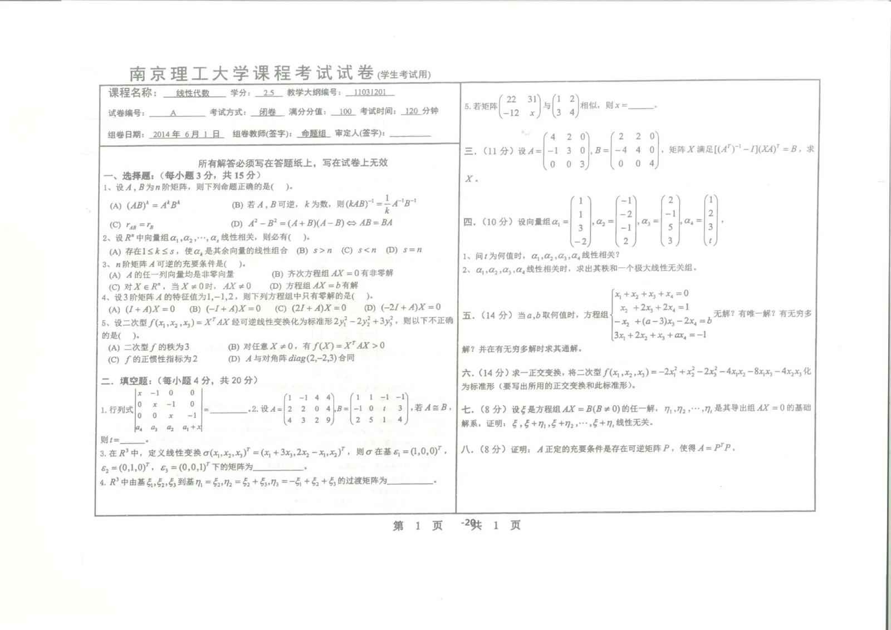

## 南京理工大学课程考试试卷(学生考试用)

课程名称： 线性代数 学分： 2.5 教学大纲编号： 11031201

试卷编号：\_\_\_\_ A 考试方式：闭卷 满分分值：100 考试时间：120 分钟

组卷日期：2014年6月1日 组卷教师(签字)：命题组 审定人(签字):

### 所有解答必须写在答题纸上，写在试卷上无效

### 一、选择题：（每小题3分，共15分）

1、设 A, B 为 n 阶矩阵，则下列命题正确的是()。
(A) $(AB)^{k} = A^{k}B^{k}$ (B) 若 A, B 可逆，k 为数，则 $(kAB)^{-1} = \frac{1}{k}A^{-1}B^{-1}$ (C) $r_{AB} = r_{B}$ (D) $A^{2} - B^{2} = (A + B)(A - B) \Leftrightarrow AB = BA$

2、设 $R^{n}$ 中向量组 $\alpha_{1}, \alpha_{2}, \cdots, \alpha_{s}$ 线性相关，则必有()。
(A) 存在 $1 \leq k \leq s$ ，使 $\alpha_{k}$ 是其余向量的线性组合 (B) s > n (C) s < n (D) s = n

3、n阶矩阵A可逆的充要条件是( )。
(A) A 的任一列向量均是非零向量
(B) 齐次方程组 AX = 0 有非零解
(C) 对 $X \in R^{n}$ ，当 $X \neq 0$ 时， $AX \neq 0$ (D) 方程组 AX = b 有解

4、设3阶矩阵A的特征值为1,-1,2，则下列方程组中只有零解的是( )。
(A) $(I+A)X=0$ (B) $(-I+A)X=0$ (C) $(2I+A)X=0$ (D) $(-2I+A)X=0$

5、设二次型 $f(x_{1},x_{2},x_{3})=X^{T}AX$ 经可逆线性变换化为标准形 $2y_{1}^{2}-2y_{2}^{2}+3y_{3}^{2}$ ，则以下不正确的是()。
(A) 二次型 f 的秩为 3
(B) 对任意 $X \neq 0$ ，有 $f(X) = X^{T}AX > 0$ (C) f 的正惯性指标为 2
(D) A 与对角阵 diag(2,-2,3) 合同

### 二. 填空题: (每小题 4 分, 共 20 分)

1. 行列式 $\begin{vmatrix} x & -1 & 0 & 0 \\ 0 & x & -1 & 0 \\ 0 & 0 & x & -1 \\ a_{4} & a_{3} & a_{2} & a_{1} + x \end{vmatrix} =$ \_\_\_\_。2. 设 $A = \begin{pmatrix} 1 & -1 & 4 & 4 \\ 2 & 2 & 0 & 4 \\ 4 & 3 & 2 & 9 \end{pmatrix}$ ， $B = \begin{pmatrix} 1 & 1 & -1 & -1 \\ -1 & 0 & t & 3 \\ 2 & 5 & 1 & 4 \end{pmatrix}$ ，若 $A \cong B$ ，则 t = \_\_\_\_。
3. 在 $R^{3}$ 中，定义线性变换 $\sigma(x_{1}, x_{2}, x_{3})^{T} = (x_{1} + 3x_{3}, 2x_{2} - x_{1}, x_{2})^{T}$ ，则 $\sigma$ 在基 $\varepsilon_{1} = (1, 0, 0)^{T}$ ， $\varepsilon_{2} = (0, 1, 0)^{T}$ ， $\varepsilon_{3} = (0, 0, 1)^{T}$ 下的矩阵为 \_\_\_\_。
4. $R^{3}$ 中由基 $\xi_{1}, \xi_{2}, \xi_{3}$ 到基 $\eta_{1} = \xi_{2}, \eta_{2} = \xi_{2} + \xi_{3}, \eta_{3} = -\xi_{1} + \xi_{2} + \xi_{3}$ 的过渡矩阵为 \_\_\_\_。

5. 若矩阵 $\begin{pmatrix}22 & 31 \\ -12 & x\end{pmatrix}$ 与 $\begin{pmatrix}1 & 2 \\ 3 & 4\end{pmatrix}$ 相似，则 x = \_\_\_\_。

三.（11分）设 $A = \begin{pmatrix} 4 & 2 & 0 \\ -1 & 3 & 0 \\ 0 & 0 & 3 \end{pmatrix}, B = \begin{pmatrix} 2 & 2 & 0 \\ -4 & 4 & 0 \\ 0 & 0 & 4 \end{pmatrix}$ ，矩阵 $X$ 满足 $[(A^T)^{-1} - I](XA)^T = B$ ，求 $X$ 。

四.（10分）设向量组 $\alpha_{1} = \left( \begin{array}{c}1\\ 1\\ 3\\ -2 \end{array} \right),\alpha_{2} = \left( \begin{array}{c} - 1\\ -2\\ -1\\ 2 \end{array} \right),\alpha_{3} = \left( \begin{array}{c}2\\ -1\\ 5\\ 3 \end{array} \right),\alpha_{4} = \left( \begin{array}{c}1\\ 2\\ 3\\ t \end{array} \right),$

1、问 $t$ 为何值时， $\alpha_{1},\alpha_{2},\alpha_{3},\alpha_{4}$ 线性相关？

2、 $\alpha_{1}, \alpha_{2}, \alpha_{3}, \alpha_{4}$ 线性相关时，求出其秩和一个极大线性无关组。

五.（14分）当a,b取何值时，方程组 $\left\{\begin{aligned}x_{1}+x_{2}+x_{3}+x_{4}&=0\\ x_{2}+2x_{3}+2x_{4}&=1\\ -x_{2}+(a-3)x_{3}-2x_{4}&=b\\ 3x_{1}+2x_{2}+x_{3}+ax_{4}&=-1\end{aligned}\right.$ 无解？有唯一解？有无穷多

六.（14分）求一正交变换，将二次型 $f(x_{1},x_{2},x_{3})=-2x_{1}^{2}+x_{2}^{2}-2x_{3}^{2}-4x_{1}x_{2}-8x_{1}x_{3}-4x_{2}x_{3}$ 化为标准形（要写出所用的正交变换和此标准形）。

七.（8分）设ξ是方程组 $AX=B(B\neq0)$ 的任一解， $\eta_{1},\eta_{2},\cdots,\eta_{t}$ 是其导出组AX=0的基础解系，证明： $\xi,\xi+\eta_{1},\xi+\eta_{2},\cdots,\xi+\eta_{t}$ 线性无关。

八.（8分）证明： $A$ 正定的充要条件是存在可逆矩阵 $P$ ，使得 $A = P^{T}P$ 。

第 1 页 -20 共 1 页

## 第29页

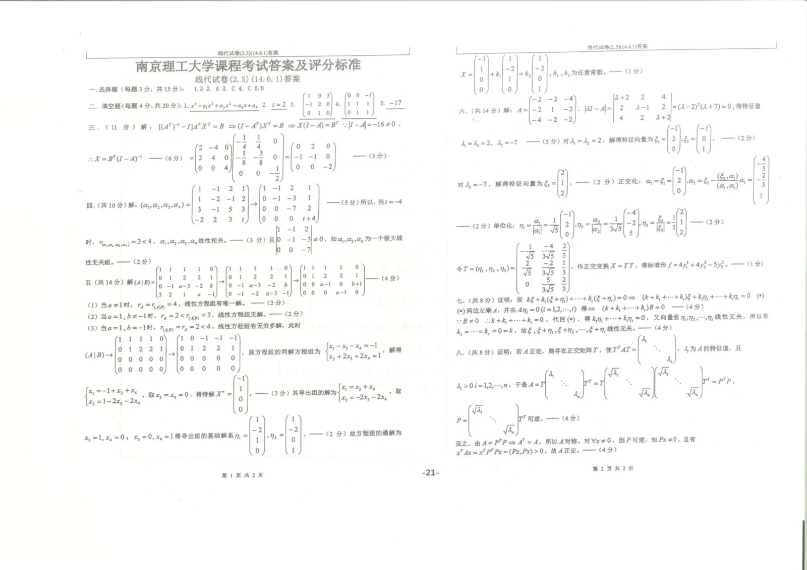

## 南京理工大学课程考试答案及评分标准

线代试卷(2.5)(14.6.1)答案

一. 选择题（每题3分，共15分）：1.D 2.A 3.C 4.C 5.B
二. 填空题（每题4分，共20分）：1. $x^{4} + a_{1}x^{3} + a_{2}x^{2} + a_{3}x + a_{4}$ 2. $t = 2$ 3. $\begin{pmatrix} 1 & 0 & 3 \\ -1 & 2 & 0 \\ 0 & 1 & 0 \end{pmatrix}$ 4. $\begin{pmatrix} 0 & 0 & -1 \\ 1 & 1 & 1 \\ 0 & 1 & 1 \end{pmatrix}$ 5. -17
三．（11分）解： $[(A^T)^{-1} - I]A^TX^T = B \Rightarrow (I - A^T)X^T = B \Rightarrow X(I - A) = B^T$ ∵ $|I - A| = -16 \neq 0$ ，
∴ $X = B^T (I - A)^{-1}$ ——（6分） $= \begin{pmatrix} 2 & -4 & 0 \\ 2 & 4 & 0 \\ 0 & 0 & 4 \end{pmatrix} \begin{pmatrix} -\frac{1}{4} & \frac{1}{4} & 0 \\ -\frac{1}{8} & -\frac{3}{8} & 0 \\ 0 & 0 & -\frac{1}{2} \end{pmatrix} = \begin{pmatrix} 0 & 2 & 0 \\ -1 & -1 & 0 \\ 0 & 0 & -2 \end{pmatrix}$ ——（5分）
四.（共10分）解： $(\alpha_{1}, \alpha_{2}, \alpha_{3}, \alpha_{4}) = \begin{pmatrix} 1 & -1 & 2 & 1 \\ 1 & -2 & -1 & 2 \\ 3 & -1 & 5 & 3 \\ -2 & 2 & 3 & t \end{pmatrix} \rightarrow \begin{pmatrix} 1 & -1 & 2 & 1 \\ 0 & -1 & -3 & 1 \\ 0 & 0 & -7 & 2 \\ 0 & 0 & 0 & t + 4 \end{pmatrix}$ ——（5分）所以，当 $t = -4$ 时， $r_{\{\alpha_1, \alpha_2, \alpha_3, \alpha_4\}} = 3 < 4$ ， $\alpha_1, \alpha_2, \alpha_3, \alpha_4$ 线性相关。——（3分）且 $\begin{vmatrix} 1 & -1 & 2 \\ 0 & -1 & -3 \\ 0 & 0 & -7 \end{vmatrix} \neq 0$ ，知 $\alpha_1, \alpha_2, \alpha_3$ 为一个极大线性无关组。——（2分）
五（共14分）解 $(A|B) = \begin{pmatrix} 1 & 1 & 1 & 1 & 0 \\ 0 & 1 & 2 & 2 & 1 \\ 0 & -1 & a -3 & -2 & b \\ 3 & 2 & 1 & a & -1 \end{pmatrix} \rightarrow \begin{pmatrix} 1 & 1 & 1 & 1 & 0 \\ 0 & 1 & 2 & 2 & 1 \\ 0 & -1 & a -3 & -2 & b \\ 0 & -1 & -2 & a -3 & -1 \end{pmatrix} \rightarrow \begin{pmatrix} 1 & 1 & 1 & 1 & 0 \\ 0 & 1 & 2 & 2 & 1 \\ 0 & 0 & a -1 & 0 & b + 1 \\ 0 & 0 & 0 & a -1 & 0 \end{pmatrix}$ ——（4分）
(1) 当 $a \neq 1$ 时， $r_A = r_{(A|B)} = 4$ ，线性方程组有唯一解。——（2分）
(2) 当 $a = 1, b \neq -1$ 时， $r_A = 2 < r_{(A|B)} = 3$ ，线性方程组无解。——（2分）
(3) 当 $a = 1, b = -1$ 时， $r_{(A|B)} = r_A = 2 < 4$ ，线性方程组有无穷多解，此时 $(A|B) \rightarrow \begin{pmatrix} 1 & 1 & 1 & 1 & 0 \\ 0 & 1 & 2 & 2 & 1 \\ 0 & 0 & 0 & 0 & 0 \\ 0 & 0 & 0 & 0 & 0 \end{pmatrix} \rightarrow \begin{pmatrix} 1 & 0 & -1 & -1 & -1 \\ 0 & 1 & 2 & 2 & 1 \\ 0 & 0 & 0 & 0 & 0 \\ 0 & 0 & 0 & 0 & 0 \end{pmatrix}$ ，原方程组的同解方程组为 $\begin{cases} x_1 - x_3 - x_4 = -1 \\ x_2 + 2x_3 + 2x_4 = 1 \end{cases}$ ，解得 $\left\{\begin{aligned}&x_1=-1+x_3+x_4\\&x_2=1-2x_3-2x_4\end{aligned}\right.$ ，取 $x_3=x_4=0$ ，得特解 $X^*=\begin{pmatrix}-1\\1\\0\\0\end{pmatrix}$ ，——（3分）其导出组的解为 $\begin{cases} x_1=x_3+x_4 \\ x_2=-2x_3-2x_4\end{cases}$ ，取 $x_3=1, x_4=0; x_3=0, x_4=1$ 得导出组的基础解系 $\eta_1=\begin{pmatrix}1\\-2\\1\\0\end{pmatrix},\eta_2=\begin{pmatrix}1\\-2\\0\\1\end{pmatrix}$ ，——（2分）故方程组的通解为

$X=\begin{pmatrix}-1\\1\\0\\0\end{pmatrix}+k_{1}\begin{pmatrix}1\\-2\\1\\0\end{pmatrix}+k_{2}\begin{pmatrix}1\\-2\\0\\1\end{pmatrix},k_{1},k_{2}$ 为任意常数。——（1分）

六.（共14分）解： $A=\begin{pmatrix}-2&-2&-4\\-2&1&-2\\-4&-2&-2\end{pmatrix},\quad|\lambda I-A|=\begin{vmatrix}\lambda+2&2&4\\2&\lambda-1&2\\4&2&\lambda+2\end{vmatrix}=(\lambda-2)^{2}(\lambda+7)=0$ ，得特征值 $\lambda_{1}=\lambda_{2}=2,\quad\lambda_{3}=-7$ ——（5分）对 $\lambda_{1}=\lambda_{2}=2$ ，解得特征向量为 $\xi_{1}=\begin{pmatrix}-1\\2\\0\end{pmatrix},\xi_{2}=\begin{pmatrix}-1\\0\\1\end{pmatrix}$ ，——（2分）

对 $\lambda_{3}=-7$ ，解得特征向量为 $\xi_{3}=\begin{pmatrix}2\\1\\2\end{pmatrix}$ ，——（2分）正交化： $\alpha_{1}=\xi_{1}=\begin{pmatrix}-1\\2\\0\end{pmatrix},\alpha_{2}=\xi_{2}-\frac{(\xi_{2},\alpha_{1})}{(\alpha_{1},\alpha_{1})}\alpha_{1}=\begin{pmatrix}-\frac{4}{5}\\-\frac{2}{5}\\1\end{pmatrix}$ ——（2分）单位化： $\eta_{1}=\frac{\alpha_{1}}{|\alpha_{1}|}=\frac{1}{\sqrt{5}}\begin{pmatrix}-1\\2\\0\end{pmatrix},\eta_{2}=\frac{\alpha_{2}}{|\alpha_{2}|}=\frac{1}{3\sqrt{5}}\begin{pmatrix}-4\\-2\\5\end{pmatrix},\eta_{3}=\frac{\xi_{3}}{|\xi_{3}|}=\frac{1}{3}\begin{pmatrix}2\\1\\2\end{pmatrix}$ ——（2分）

令 $T=(\eta_{1},\eta_{2},\eta_{3})=\begin{pmatrix}-\frac{1}{\sqrt{5}}&-\frac{4}{3\sqrt{5}}&\frac{2}{3}\\ \frac{2}{\sqrt{5}}&-\frac{2}{3\sqrt{5}}&\frac{1}{3}\\ 0&\frac{5}{3\sqrt{5}}&\frac{2}{3}\end{pmatrix}$ ，作正交变换X=TY，得标准形 $f=4y_{1}^{2}+4y_{2}^{2}-5y_{3}^{2}$ 。——（1分）

七.（共8分）证明：设 $k\xi+k_{1}(\xi+\eta_{1})+\cdots+k_{t}(\xi+\eta_{t})=0\Rightarrow(k+k_{1}+\cdots+k_{t})\xi+k_{1}\eta_{1}+\cdots+k_{t}\eta_{t}=0$ (\*)

\*\*两边左乘A，并由 $A\eta_{i}=0(i=1,2,\cdots,t)$ 得 $\Rightarrow(k+k_{1}+\cdots+k_{t})B=0$ ——（4分）

∵ $B\neq0$ ∴ $k+k_{1}+\cdots+k_{t}=0$ ，代回(\*)，得 $k_{1}\eta_{1}+\cdots+k_{t}\eta_{t}=0$ ，又向量组 $\eta_{1},\eta_{2},\cdots,\eta_{t}$ 线性无关，所以有 $k_{1}=\cdots=k_{t}=0=k$ ，故 $\xi,\xi+\eta_{1},\xi+\eta_{2},\cdots,\xi+\eta_{t}$ 线性无关。——（4分）

八.（共8分）证明：若A正定，则存在正交矩阵T，使 $T^{T}AT=\begin{pmatrix}\lambda_{1}&\\\ddots&\\\lambda_{n}\end{pmatrix}$ ， $\lambda_{i}$ 为A的特征值，且 $\lambda_{i}>0i=1,2,\cdots,n$ 。于是 $A=T\begin{pmatrix}\lambda_{1}&\\\ddots&\\\lambda_{n}\end{pmatrix}T^{T}=T\begin{pmatrix}\sqrt{\lambda_{1}}&\\\ddots&\\\sqrt{\lambda_{n}}\end{pmatrix}\begin{pmatrix}\sqrt{\lambda_{1}}&\\\ddots&\\\sqrt{\lambda_{n}}\end{pmatrix}T^{T}=P^{T}P$ ， $P=\begin{pmatrix}\sqrt{\lambda_{1}}&\\\ddots&\\\sqrt{\lambda_{n}}\end{pmatrix}T^{T}$ 可逆。——（4分）

反之，由 $A=P^{T}P\Rightarrow A^{T}=A$ ，所以A对称。对 $\forall x\neq0$ ，因P可逆，知Px≠0，且有 $x^{T}Ax=x^{T}P^{T}Px=(Px,Px)>0$ ，故A正定。——（4分）

线代试卷(2.5)(14.6.1)答案

线代试卷(2.5)(14.6.1)答案

第1页共2页

-21-

第2页共2页

## 第30页

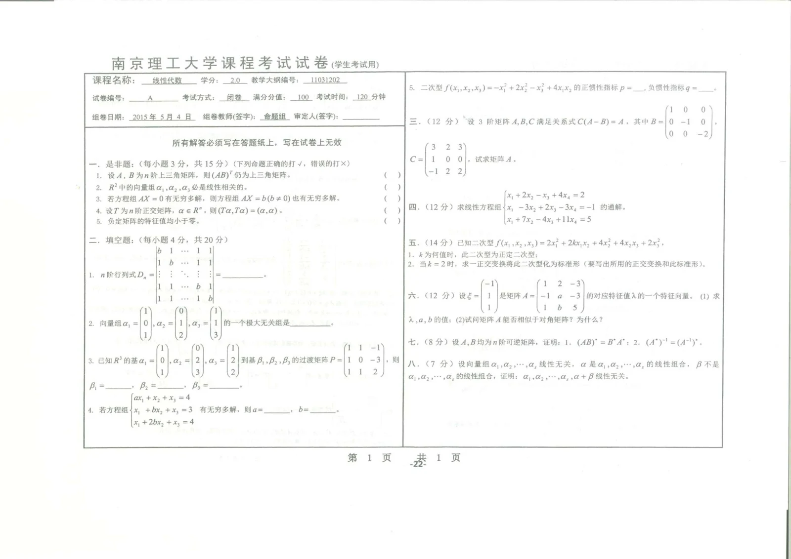

## 南京理工大学课程考试试卷(学生考试用)

课程名称： 线性代数 学分： 2.0 教学大纲编号： 11031202

试卷编号：\_\_\_\_ A \_\_\_\_ 考试方式：\_\_\_\_ 闭卷 满分分值：\_\_\_\_ 100 考试时间：\_\_\_\_ 120 分钟

组卷日期：2015年5月4日 组卷教师(签字)：命题组 审定人(签字)：\_\_\_\_

### 所有解答必须写在答题纸上，写在试卷上无效

### 一. 是非题: (每小题 3 分, 共 15 分) (下列命题正确的打 √, 错误的打 ×)

1. 设 A, B 为 n 阶上三角矩阵，则 $(AB)^{T}$ 仍为上三角矩阵。

2. $R^2$ 中的向量组 $\alpha_{1},\alpha_{2},\alpha_{3}$ 必是线性相关的。 （）

3. 若方程组 AX = 0 有无穷多解，则方程组 $AX = b (b \neq 0)$ 也有无穷多解。

4. 设 T 为 n 阶正交矩阵， $\alpha \in R^{n}$ ，则 $(T\alpha, T\alpha) = (\alpha, \alpha)$ 。

5. 负定矩阵的特征值均小于零。 （）

### 二. 填空题: (每小题 4 分, 共 20 分)

1. n 阶行列式 $D_{n}=\left|\begin{matrix}b&1&\cdots&1&1\\ 1&b&\cdots&1&1\\\vdots&\vdots&\ddots&\vdots&\vdots\\ 1&1&\cdots&b&1\\ 1&1&\cdots&1&b\end{matrix}\right|=$ \_\_\_\_。

2. 向量组 $\alpha_{1}=\begin{pmatrix}1\\0\\1\end{pmatrix},\alpha_{2}=\begin{pmatrix}0\\1\\2\end{pmatrix},\alpha_{3}=\begin{pmatrix}1\\1\\3\end{pmatrix}$ 的一个极大无关组是 \_\_\_\_。

3. 已知 $R^{3}$ 的基 $\alpha_{1}=\begin{pmatrix}1\\0\\1\end{pmatrix},\alpha_{2}=\begin{pmatrix}0\\2\\3\end{pmatrix},\alpha_{3}=\begin{pmatrix}1\\2\\2\end{pmatrix}$ 到基 $\beta_{1},\beta_{2},\beta_{3}$ 的过渡矩阵 $P=\begin{pmatrix}1&1&-1\\1&0&-3\\1&1&2\end{pmatrix}$ ， $\beta_{1}=$ \_\_\_\_， $\beta_{2}=$ \_\_\_\_， $\beta_{3}=$ \_\_\_\_。

4. 若方程组 $\left\{\begin{aligned}ax_{1}+x_{2}+x_{3}&=4\\ x_{1}+bx_{2}+x_{3}&=3\\ x_{1}+2bx_{2}+x_{3}&=4\end{aligned}\right.$ 有无穷多解，则 a=\_\_\_\_，b=\_\_\_\_。

5. 二次型 $f(x_{1}, x_{2}, x_{3}) = -x_{1}^{2} + 2x_{2}^{2} - x_{3}^{2} + 4x_{1}x_{2}$ 的正惯性指标 $p =$ ，负惯性指标 $q =$ \_\_\_\_。

三.（12分）设3阶矩阵 $A,B,C$ 满足关系式 $C(A - B) = A$ ，其中 $B = \begin{pmatrix} 1 & 0 & 0\\ 0 & -1 & 0\\ 0 & 0 & -2 \end{pmatrix}$

$C = \left( \begin{array}{ccc}3 & 2 & 3\\ 1 & 0 & 0\\ -1 & 2 & 2 \end{array} \right),$ 试求矩阵 $A$ 。

四.（12分）求线性方程组 $\left\{ \begin{array}{l}x_{1} + 2x_{2} - x_{3} + 4x_{4} = 2\\ x_{1} - 3x_{2} + 2x_{3} - 3x_{4} = -1\\ x_{1} + 7x_{2} - 4x_{3} + 11x_{4} = 5 \end{array} \right.$ 的通解。

五.（14分）已知二次型 $f(x_{1},x_{2},x_{3}) = 2x_{1}^{2} + 2kx_{1}x_{2} + 4x_{2}^{2} + 4x_{2}x_{3} + 2x_{3}^{2},$

1. $k$ 为何值时，此二次型为正定二次型；

2. 当 $k = 2$ 时，求一正交变换将此二次型化为标准形（要写出所用的正交变换和此标准形）。

六.（12分）设 $\xi = \begin{pmatrix} -1\\ 1\\ 1 \end{pmatrix}$ 是矩阵 $A = \begin{pmatrix} 1 & 2 & -3\\ -1 & a & -3\\ 1 & b & 5 \end{pmatrix}$ 的对应特征值 $\lambda$ 的一个特征向量。（1）求

$\lambda, a, b$ 的值；(2)试问矩阵 A 能否相似于对角矩阵？为什么？

七.（8分）设 $A, B$ 均为 $n$ 阶可逆矩阵，证明：1. $(AB)^{*} = B^{*}A^{*}$ ；2. $(A^{*})^{-1} = (A^{-1})^{*}$ 。

八．（7分）设向量组 $\alpha_{1},\alpha_{2},\dots ,\alpha_{s}$ 线性无关， $\alpha$ 是 $\alpha_{1},\alpha_{2},\dots ,\alpha_{s}$ 的线性组合， $\beta$ 不是 $\alpha_{1},\alpha_{2},\dots ,\alpha_{s}$ 的线性组合，证明： $\alpha_{1},\alpha_{2},\dots ,\alpha_{s},\alpha +\beta$ 线性无关。

第 1 页 共 1 页

## 第31页

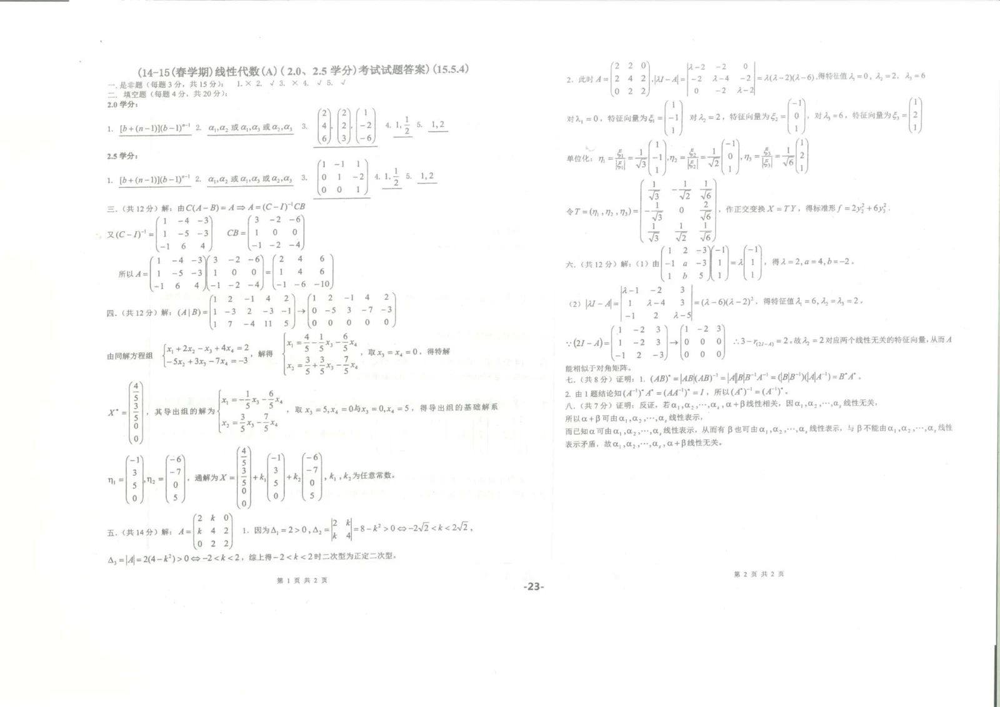

### (14-15(春学期)线性代数(A)(2.0、2.5学分)考试试题答案)(15.5.4)

### 一.是非题（每题3分，共15分）： $1.\times 2.\checkmark 3.\times 4.\checkmark 5.\checkmark$

### 二. 填空题（每题4分，共20分）：

2.0 学分：

1. $\underline{[b+(n-1)](b-1)^{n-1}}$ 2. $\underline{\alpha_{1},\alpha_{2}或\alpha_{1},\alpha_{3}或\alpha_{2},\alpha_{3}}$ 3. $\underline{\begin{pmatrix}2\\4\\6\end{pmatrix},\begin{pmatrix}2\\2\\3\end{pmatrix},\begin{pmatrix}1\\-2\\-6\end{pmatrix}}$ 4. $\underline{1,\frac{1}{2}}$ 5. $\underline{1,2}$

2.5 学分：

1. $\underline{[b+(n-1)](b-1)^{n-1}}$ 2. $\alpha_{1},\alpha_{2}$ 或 $\alpha_{1},\alpha_{3}$ 或 $\alpha_{2},\alpha_{3}$ 3. $\begin{pmatrix}1&-1&1\\0&1&-2\\0&0&1\end{pmatrix}$ 4. $\frac{1}{2}$ 5. $\underline{1,2}$

三.（共12分）解：由 $C(A - B) = A\Rightarrow A = (C - I)^{-1}CB$

$$
\text {又} (C - I) ^ {- 1} = \left( \begin{array}{c c c} {{1}} & {{- 4}} & {{- 3}} \\ {{1}} & {{- 5}} & {{- 3}} \\ {{- 1}} & {{6}} & {{4}} \end{array} \right) \qquad C B = \left( \begin{array}{c c c} {{3}} & {{- 2}} & {{- 6}} \\ {{1}} & {{0}} & {{0}} \\ {{- 1}} & {{- 2}} & {{- 4}} \end{array} \right)
$$

$$
A = \left( \begin{array}{c c c} 1 & - 4 & - 3 \\ 1 & - 5 & - 3 \\ - 1 & 6 & 4 \end{array} \right) \left( \begin{array}{c c c} 3 & - 2 & - 6 \\ 1 & 0 & 0 \\ - 1 & - 2 & - 4 \end{array} \right) = \left( \begin{array}{c c c} 2 & 4 & 6 \\ 1 & 4 & 6 \\ - 1 & - 6 & - 1 0 \end{array} \right)
$$

四.（共12分）解： $(A|B) = \begin{pmatrix} 1 & 2 & -1 & 4 & 2 \\ 1 & -3 & 2 & -3 & -1 \\ 1 & 7 & -4 & 11 & 5 \end{pmatrix} \to \begin{pmatrix} 1 & 2 & -1 & 4 & 2 \\ 0 & -5 & 3 & -7 & -3 \\ 0 & 0 & 0 & 0 & 0 \end{pmatrix}$

由同解方程组 $\left\{\begin{aligned}x_{1}+2x_{2}-x_{3}+4x_{4}&=2\\ -5x_{2}+3x_{3}-7x_{4}&=-3\end{aligned}\right.$ ，解得 $\left\{\begin{aligned}x_{1}&=\frac{4}{5}-\frac{1}{5}x_{3}-\frac{6}{5}x_{4}\\ x_{2}&=\frac{3}{5}+\frac{3}{5}x_{3}-\frac{7}{5}x_{4}\end{aligned}\right.$ ，取 $x_{3}=x_{4}=0$ ，得特解

$X^{*} = \left( \begin{array}{c}\frac{4}{5}\\ \frac{3}{5}\\ 0\\ 0 \end{array} \right)$ ，其导出组的解为 $\left\{ \begin{array}{l}x_{1} = -\frac{1}{5} x_{3} - \frac{6}{5} x_{4}\\ x_{2} = \frac{3}{5} x_{3} - \frac{7}{5} x_{4} \end{array} \right.$ ，取 $x_{3} = 5,x_{4} = 0$ 与 $x_{3} = 0,x_{4} = 5$ ，得导出组的基础解系

$\eta_{1}=\begin{pmatrix}-1\\3\\5\\0\end{pmatrix},\eta_{2}=\begin{pmatrix}-6\\-7\\0\\5\end{pmatrix}$ ，通解为 $X=\begin{pmatrix}\frac{4}{5}\\ \frac{3}{5}\\ 0\\ 0\end{pmatrix}+k_{1}\begin{pmatrix}-1\\3\\5\\0\end{pmatrix}+k_{2}\begin{pmatrix}-6\\-7\\0\\5\end{pmatrix},k_{1},k_{2}$ 为任意常数。

五.（共14分）解： $A = \begin{pmatrix} 2 & k & 0\\ k & 4 & 2\\ 0 & 2 & 2 \end{pmatrix}$ 1.因为 $\Delta_1 = 2 > 0,\Delta_2 = \left| \begin{array}{cc}2 & k\\ k & 4 \end{array} \right| = 8 - k^2 >0\Leftrightarrow -2\sqrt{2} < k < 2\sqrt{2},$ $\Delta_3 = |A| = 2(4 - k^2) > 0\Leftrightarrow -2 < k < 2$ ，综上得-2<k<2时二次型为正定二次型。

2. 此时 $A = \begin{pmatrix} 2 & 2 & 0 \\ 2 & 4 & 2 \\ 0 & 2 & 2 \end{pmatrix}, |\lambda I - A| = \begin{vmatrix} \lambda - 2 & -2 & 0 \\ -2 & \lambda - 4 & -2 \\ 0 & -2 & \lambda - 2 \end{vmatrix} = \lambda (\lambda - 2)(\lambda - 6)$ , 得特征值 $\lambda_1 = 0, \lambda_2 = 2, \lambda_3 = 6$

对 $\lambda_{1}=0$ ，特征向量为 $\xi_{1}=\begin{pmatrix}1\\-1\\1\end{pmatrix}$ 对 $\lambda_{2}=2$ ，特征向量为 $\xi_{2}=\begin{pmatrix}-1\\0\\1\end{pmatrix}$ ，对 $\lambda_{3}=6$ ，特征向量为 $\xi_{3}=\begin{pmatrix}1\\2\\1\end{pmatrix}$

单位化： $\eta_{1} = \frac{\xi_{1}}{|\xi_{1}|} = \frac{1}{\sqrt{3}}\left( \begin{array}{c}1\\ -1\\ 1 \end{array} \right),\eta_{2} = \frac{\xi_{2}}{|\xi_{2}|} = \frac{1}{\sqrt{2}}\left( \begin{array}{c} - 1\\ 0\\ 1 \end{array} \right),\eta_{3} = \frac{\xi_{3}}{|\xi_{3}|} = \frac{1}{\sqrt{6}}\left( \begin{array}{c}1\\ 2\\ 1 \end{array} \right)$

令 $T = (\eta_1, \eta_2, \eta_3) = \left( \begin{array}{ccc}\frac{1}{\sqrt{3}} & -\frac{1}{\sqrt{2}} & \frac{1}{\sqrt{6}}\\ -\frac{1}{\sqrt{3}} & 0 & \frac{2}{\sqrt{6}}\\ \frac{1}{\sqrt{3}} & \frac{1}{\sqrt{2}} & \frac{1}{\sqrt{6}} \end{array} \right)$ ，作正交变换 $X = TY$ ，得标准形 $f = 2y_{2}^{2} + 6y_{3}^{2}$

六.（共12分）解：（1）由 $\begin{pmatrix}1&2&-3\\-1&a&-3\\1&b&5\end{pmatrix}\begin{pmatrix}-1\\1\\1\end{pmatrix}=\lambda\begin{pmatrix}-1\\1\\1\end{pmatrix}$ ，得 $\lambda=2,a=4,b=-2$ 。

(2) $|\lambda I - A| = \begin{vmatrix} \lambda - 1 & -2 & 3 \\ 1 & \lambda - 4 & 3 \\ -1 & 2 & \lambda - 5 \end{vmatrix} = (\lambda - 6)(\lambda - 2)^2$ ，得特征值 $\lambda_1 = 6, \lambda_2 = \lambda_3 = 2$ 。

$\because (2I - A) = \begin{pmatrix} 1 & -2 & 3 \\ 1 & -2 & 3 \\ -1 & 2 & -3 \end{pmatrix} \to \begin{pmatrix} 1 & -2 & 3 \\ 0 & 0 & 0 \\ 0 & 0 & 0 \end{pmatrix} \therefore 3 - r_{(2I - A)} = 2$ 。故 $\lambda_2 = 2$ 对应两个线性无关的特征向量，从而 $A$

能相似于对角矩阵。

七.（共8分）证明：1. $(AB)^{*} = |AB|(AB)^{-1} = |A||B|B^{-1}A^{-1} = (|B|B^{-1})(|A|A^{-1}) = B^{*}A^{*}$ 。

2. 由1题结论知 $(A^{-1})^{*}A^{*}=(AA^{-1})^{*}=I$ ，所以 $(A^{*})^{-1}=(A^{-1})^{*}$ 。

八.（共7分）证明：反证，若 $\alpha_{1},\alpha_{2},\cdots,\alpha_{s},\alpha+\beta$ 线性相关，因 $\alpha_{1},\alpha_{2},\cdots,\alpha_{s}$ 线性无关，

$$
\alpha_ {1}, \alpha_ {2}, \dots , \alpha_ {s}
$$

而已知 $\alpha$ 可由 $\alpha_{1}, \alpha_{2}, \cdots, \alpha_{s}$ 线性表示，从而有 $\beta$ 也可由 $\alpha_{1}, \alpha_{2}, \cdots, \alpha_{s}$ 线性表示，与 $\beta$ 不能由 $\alpha_{1}, \alpha_{2}, \cdots, \alpha_{s}$ 线性表示矛盾，故 $\alpha_{1}, \alpha_{2}, \cdots, \alpha_{s}, \alpha + \beta$ 线性无关。

第1页共2页

第2页共2页

-23

## 第32页

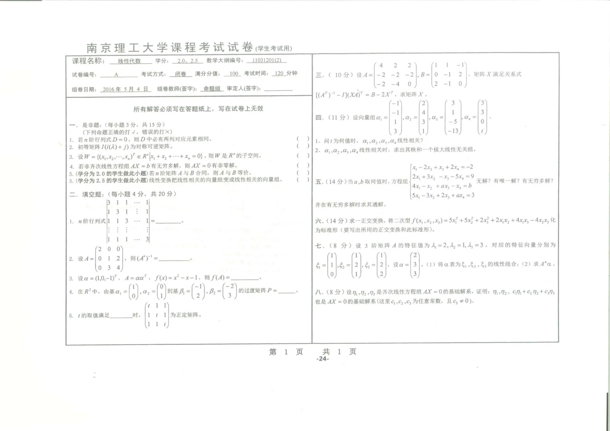

## 南京理工大学课程考试试卷(学生考试用)

<table><tr><td>课程名称:线性代数学分:2.0、2.5教学大纲编号:11031201(2)试卷编号:A考试方式:闭卷满分分值:100考试时间:120分钟组卷日期:2016年5月4日组卷教师(签字):命题组审定人(签字):</td></tr><tr><td>所有解答必须写在答题纸上,写在试卷上无效一.是非题:(每小题3分,共15分)(下列命题正确的打√,错误的打×)若n阶行列式D=0,则D中必有两列对应元素相同。()初等矩阵 $I(i(\lambda)+j)$ 为对称可逆矩阵。()设 $W=\{(x_1,x_2,\cdots,x_n)^T\in R^n|x_1+x_2+\cdots+x_n=0\}$ ,则W是 $R^n$ 的子空间。()若非齐次线性方程组AX=b有无穷多解,则AX=0有非零解。()若n阶矩阵A与B合同,则A与B等价。()5.(学分为2.0的学生做此小题)若n阶矩阵A与B合同,则A与B等价。()5.(学分为2.5的学生做此小题)线性变换把线性相关的向量组变成线性相关的向量组。()填空题:(每小题4分,共20分)n阶行列式 $\begin{vmatrix}3 & 1 & 1 & \cdots & 1 \\ 1 & 3 & 1 & \vdots & 1 \\ 1 & 1 & 3 & \cdots & 1 \\ \vdots & \vdots & \vdots & & \vdots \\ 1 & 1 & 1 & \cdots & 3\end{vmatrix}=$ ____。设 $A=\begin{pmatrix}2 & 0 & 0 \\ 0 & 1 & 2 \\ 0 & 3 & 4\end{pmatrix}$ ,则 $(A^*)^{-1}=$ ____。设 $\alpha=(1,0,-1)^T$ , $A=\alpha\alpha^T$ , $f(x)=x^2-x-1$ ,则 $f(A)=$ ____。在 $R^2$ 中,由基 $\alpha_1=\begin{pmatrix}1 \\ 0\end{pmatrix}$ , $\alpha_2=\begin{pmatrix}0 \\ 1\end{pmatrix}$ 到基 $\beta_1=\begin{pmatrix}-1 \\ 2\end{pmatrix}$ , $\beta_2=\begin{pmatrix}-2 \\ 3\end{pmatrix}$ 的过渡矩阵P=____。t的取值满足____时, $\begin{pmatrix}t & 1 & 1 \\ 1 & t & 1 \\ 1 & 1 & t\end{pmatrix}$ 为正定矩阵。</td></tr><tr><td>三.(10分)设 $A=\begin{pmatrix}4 & 2 & 2 \\ -2 & -2 & -2 \\ -2 & -4 & 0\end{pmatrix}$ , $B=\begin{pmatrix}1 & 1 & -1 \\ 0 & -1 & 2 \\ 2 & -1 & 0\end{pmatrix}$ ,矩阵X满足关系式 $[(A^T)^{-1}-I](XA)^T=B-2X^T$ ,求矩阵X。四.(11分)设向量组 $\alpha_1=\begin{pmatrix}-1 \\ -1 \\ 1 \\ 3\end{pmatrix}$ , $\alpha_2=\begin{pmatrix}2 \\ 4 \\ 3 \\ 1\end{pmatrix}$ , $\alpha_3=\begin{pmatrix}3 \\ 1 \\ -5 \\ -13\end{pmatrix}$ , $\alpha_4=\begin{pmatrix}3 \\ 3 \\ 0 \\ t\end{pmatrix}$ 。五.(14分)当a,b取何值时,方程组 $\begin{cases}x_1-2x_2+x_3+2x_4=-2 \\2x_1+3x_2-x_3-5x_4=9 \\4x_1-x_2+ax_3-x_4=b \\5x_1-3x_2+2x_3+ax_4=3\end{cases}$ 无解?有唯一解?有无穷多解?并在有无穷多解时求其通解。六.(14分)求一正交变换,将二次型 $f(x_1,x_2,x_3)=5x_1^2+5x_2^2+2x_3^2+2x_1x_2+4x_1x_3-4x_2x_3$ 化为标准形(要写出所用的正交变换和此标准形)。七.(8分)设3阶矩阵A的特征值为 $\lambda_1=2$ , $\lambda_2=1$ , $\lambda_3=3$ ,对应的特征向量分别为 $\xi_1=\begin{pmatrix}1 \\ 1 \\ 0\end{pmatrix}$ , $\xi_2=\begin{pmatrix}1 \\ 2 \\ 1\end{pmatrix}$ , $\xi_3=\begin{pmatrix}1 \\ 2 \\ 2\end{pmatrix}$ ,设 $\alpha=\begin{pmatrix}2 \\ 3 \\ 3\end{pmatrix}$ 。(1)将α表为 $\xi_1$ , $\xi_2$ , $\xi_3$ 的线性组合;(2)求 $A^n\alpha$ 。八.(8分)设 $\eta_1$ , $\eta_2$ , $\eta_3$ 是齐次线性方程组AX=0的基础解系,证明: $\eta_1$ , $\eta_2$ , $c_1\eta_1+c_2\eta_2+c_3\eta_3$ 也是AX=0的基础解系(这里 $c_1$ , $c_2$ , $c_3$ 为任意常数,且 $c_3\neq0$ )。</td></tr></table>

-24-

第1页 共1页

## 第33页

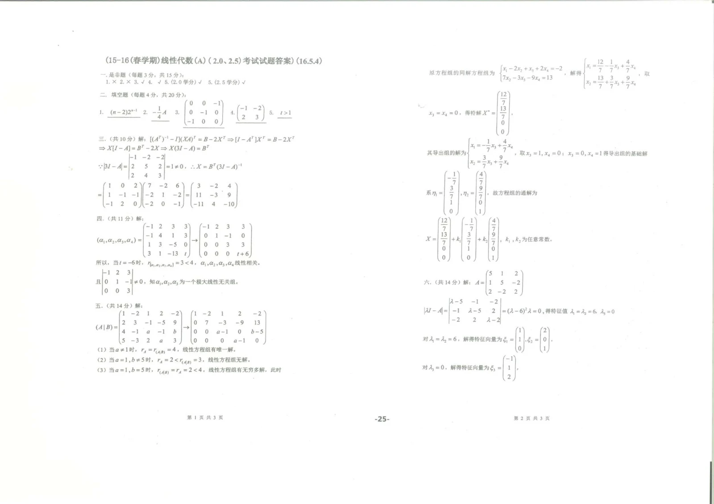

### (15-16(春学期)线性代数(A)(2.0、2.5)考试试题答案)(16.5.4)

### 一.是非题（每题3分，共15分）：

1. × 2. × 3. √ 4. √ 5. (2.0 学分) √ 5. (2.5 学分) √

### 二. 填空题（每题4分，共20分）：

1. $(n-2)2^{n-1}$ 2. $-\frac{1}{4}A$ 3. $\begin{pmatrix}0 & 0 & -1 \\ 0 & -1 & 0 \\ -1 & 0 & 0\end{pmatrix}$ 4. $\begin{pmatrix}-1 & -2 \\ 2 & 3\end{pmatrix}$ 5. t>1

三.（共10分）解： $[ (A^T)^{-1} - I](XA)^T = B - 2X^T\Rightarrow [I - A^T ]X^T = B - 2X^T$

$$
\Rightarrow X [ I - A ] = B ^ {T} - 2 X \Rightarrow X (3 I - A) = B ^ {T}
$$

$\because |3I - A| = \begin{vmatrix} -1 & -2 & -2 \\ 2 & 5 & 2 \\ 2 & 4 & 3 \end{vmatrix} = 1 \neq 0, \therefore X = B^T (3I - A)^{-1}$

$$
= \left( \begin{array}{c c c} 1 & 0 & 2 \\ 1 & - 1 & - 1 \\ - 1 & 2 & 0 \end{array} \right) \left( \begin{array}{c c c} 7 & - 2 & 6 \\ - 2 & 1 & - 2 \\ - 2 & 0 & - 1 \end{array} \right) = \left( \begin{array}{c c c} 3 & - 2 & 4 \\ 1 1 & - 3 & 9 \\ - 1 1 & 4 & - 1 0 \end{array} \right)
$$

四.（共11分）解：

$$
\left(\alpha_ {1}, \alpha_ {2}, \alpha_ {3}, \alpha_ {4}\right) = \left(\begin{array}{c c c c}- 1&2&3&3\\- 1&4&1&3\\1&3&- 5&0\\3&1&- 1 3&t\end{array}\right)\rightarrow \left(\begin{array}{c c c c}- 1&2&3&3\\0&1&- 1&0\\0&0&3&3\\0&0&0&t + 6\end{array}\right)
$$

所以，当 $t = -6$ 时， $r_{\{\alpha_1, \alpha_2, \alpha_3, \alpha_4\}} = 3 < 4$ ， $\alpha_1, \alpha_2, \alpha_3, \alpha_4$ 线性相关。

且 $\left| \begin{array}{ccc} - 1 & 2 & 3\\ 0 & 1 & -1\\ 0 & 0 & 3 \end{array} \right|\neq 0$ ，知 $\alpha_{1},\alpha_{2},\alpha_{3}$ 为一个极大线性无关组。

五.（共14分）解：

$$
= \left(\begin{array}{c c c c c}1&- 2&1&2&- 2\\2&3&- 1&- 5&9\\4&- 1&a&- 1&b\\5&- 3&2&a&3\end{array}\right)\rightarrow \left(\begin{array}{c c c c c}1&- 2&1&2&- 2\\0&7&- 3&- 9&1 3\\0&0&a - 1&0&b - 5\\0&0&0&a - 1&0\end{array}\right)
$$

（1）当 $a \neq 1$ 时， $r_A = r_{(A|B)} = 4$ ，线性方程组有唯一解。

(2) 当 $a=1, b \neq 5$ 时， $r_{A}=2<r_{(A|B)}=3$ ，线性方程组无解。

（3）当 $a = 1, b = 5$ 时， $r_{(A|B)} = r_A = 2 < 4$ ，线性方程组有无穷多解，此时

原方程组的同解方程组为 $\left\{\begin{aligned}x_{1}-2x_{2}+x_{3}+2x_{4}&=-2\\ 7x_{2}-3x_{3}-9x_{4}&=13\end{aligned}\right.$ ，解得 $\left\{\begin{aligned}x_{1}&=\frac{12}{7}-\frac{1}{7}x_{3}+\frac{4}{7}x_{4}\\ x_{2}&=\frac{13}{7}+\frac{3}{7}x_{3}+\frac{9}{7}x_{4}\end{aligned}\right.$ ，取

$x_{3} = x_{4} = 0$ ，得特解 $X^{*} = \left( \begin{array}{c}\frac{12}{7}\\ \frac{13}{7}\\ 0\\ 0 \end{array} \right),$

其导出组的解为 $\left\{\begin{aligned}x_{1}&=-\frac{1}{7}x_{3}+\frac{4}{7}x_{4}\\ x_{2}&=\frac{3}{7}x_{3}+\frac{9}{7}x_{4}\end{aligned}\right.$ ，取 $x_{3}=1,x_{4}=0$ ； $x_{3}=0,x_{4}=1$ 得导出组的基础解

系 $\eta_{1}=\left(\begin{matrix}-\frac{1}{7}\\ \frac{3}{7}\\ 1\\ 0\end{matrix}\right)$ ， $\eta_{2}=\left(\begin{matrix}\frac{4}{7}\\ \frac{9}{7}\\ 0\\ 1\end{matrix}\right)$ ，故方程组的通解为

$X = \begin{pmatrix} \frac{12}{7}\\ \frac{13}{7}\\ 0\\ 0 \end{pmatrix} + k_{1}\left( \begin{array}{c} - \frac{1}{7}\\ \frac{3}{7}\\ 1\\ 0 \end{array} \right) + k_{2}\left( \begin{array}{c}\frac{4}{7}\\ \frac{9}{7}\\ 0\\ 1 \end{array} \right),k_{1},k_{2}$ 为任意常数。

六.（共14分）解： $A = \begin{pmatrix} 5 & 1 & 2\\ 1 & 5 & -2\\ 2 & -2 & 2 \end{pmatrix}$

$\left|\lambda I-A\right|=\left|\begin{matrix}\lambda-5&-1&-2\\-1&\lambda-5&2\\-2&2&\lambda-2\end{matrix}\right|=(\lambda-6)^{2}\lambda=0$ ，得特征值 $\lambda_{1}=\lambda_{2}=6,\quad\lambda_{3}=0$

对 $\lambda_{1}=\lambda_{2}=6$ ，解得特征向量为 $\xi_{1}=\begin{pmatrix}1\\ 1\\ 0\end{pmatrix},\xi_{2}=\begin{pmatrix}2\\ 0\\ 1\end{pmatrix}$

对 $\lambda_{3}=0$ ，解得特征向量为 $\xi_{3}=\begin{pmatrix}-1\\1\\2\end{pmatrix}$

第1页共3页

-25

第2页共3页

## 第34页

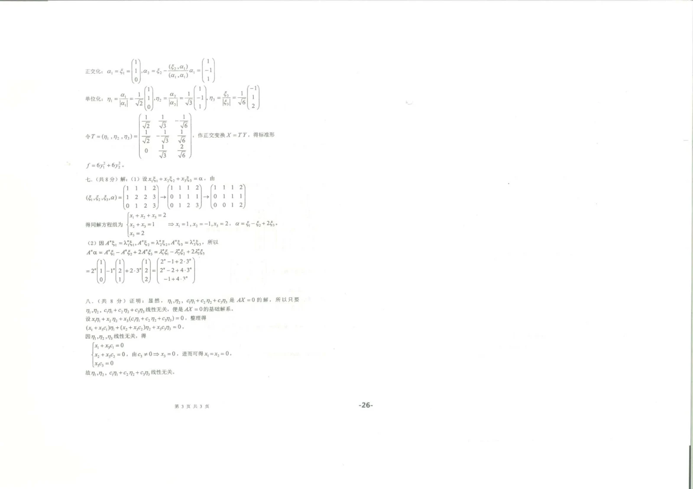

正交化： $\alpha_{1} = \xi_{1} = \left( \begin{array}{c}1\\ 1\\ 0 \end{array} \right),\alpha_{2} = \xi_{2} - \frac{(\xi_{2},\alpha_{1})}{(\alpha_{1},\alpha_{1})}\alpha_{1} = \left( \begin{array}{c}1\\ -1\\ 1 \end{array} \right)$

单位化： $\eta_{1} = \frac{\alpha_{1}}{|\alpha_{1}|} = \frac{1}{\sqrt{2}}\left( \begin{array}{c}1\\ 1\\ 0 \end{array} \right),\eta_{2} = \frac{\alpha_{2}}{|\alpha_{2}|} = \frac{1}{\sqrt{3}}\left( \begin{array}{c}1\\ -1\\ 1 \end{array} \right),\eta_{3} = \frac{\xi_{3}}{|\xi_{3}|} = \frac{1}{\sqrt{6}}\left( \begin{array}{c} - 1\\ 1\\ 2 \end{array} \right)$

令 $T = (\eta_1, \eta_2, \eta_3) = \begin{pmatrix} \frac{1}{\sqrt{2}} & \frac{1}{\sqrt{3}} & -\frac{1}{\sqrt{6}} \\ \frac{1}{\sqrt{2}} & -\frac{1}{\sqrt{3}} & \frac{1}{\sqrt{6}} \\ 0 & \frac{1}{\sqrt{3}} & \frac{2}{\sqrt{6}} \end{pmatrix}$ ，作正交变换 $X = TY$ ，得标准形

$$
f = 6 y _ {1} ^ {2} + 6 y _ {2} ^ {2} 。
$$

七.（共8分）解：（1）设 $x_{1}\xi_{1}+x_{2}\xi_{2}+x_{3}\xi_{3}=\alpha$ ，由

$$
\left. \xi_ {2}, \xi_ {3}, \alpha\right) = \left(\begin{array}{c c c c}1&1&1&2\\1&2&2&3\\0&1&2&3\end{array}\right)\rightarrow \left(\begin{array}{c c c c}1&1&1&2\\0&1&1&1\\0&1&2&3\end{array}\right)\rightarrow \left(\begin{array}{c c c c}1&1&1&2\\0&1&1&1\\0&0&1&2\end{array}\right)
$$

得同解方程组为 $\left\{\begin{aligned}x_{1}+x_{2}+x_{3}&=2\\ x_{2}+x_{3}&=1\\ x_{3}&=2\end{aligned}\right.\Rightarrow x_{1}=1,x_{2}=-1,x_{3}=2,\quad\alpha=\xi_{1}-\xi_{2}+2\xi_{3}$

(2) 因 $A^{n}\xi_{1}=\lambda_{1}^{n}\xi_{1}, A^{n}\xi_{2}=\lambda_{2}^{n}\xi_{2}, A^{n}\xi_{3}=\lambda_{3}^{n}\xi_{3}$ ，所以

$$
A ^ {n} \alpha = A ^ {n} \xi_ {1} - A ^ {n} \xi_ {2} + 2 A ^ {n} \xi_ {3} = \lambda_ {1} ^ {n} \xi_ {1} - \lambda_ {2} ^ {n} \xi_ {2} + 2 \lambda_ {3} ^ {n} \xi_ {3}
$$

$$
= 2 ^ {n} \left( \begin{array}{l} 1 \\ 1 \\ 0 \end{array} \right) - 1 ^ {n} \left( \begin{array}{l} 1 \\ 2 \\ 1 \end{array} \right) + 2 \cdot 3 ^ {n} \left( \begin{array}{l} 1 \\ 2 \\ 2 \end{array} \right) = \left( \begin{array}{c} 2 ^ {n} - 1 + 2 \cdot 3 ^ {n} \\ 2 ^ {n} - 2 + 4 \cdot 3 ^ {n} \\ - 1 + 4 \cdot 3 ^ {n} \end{array} \right)
$$

八．（共8分）证明：显然， $\eta_{1},\eta_{2},c_{1}\eta_{1}+c_{2}\eta_{2}+c_{3}\eta_{3}$ 是AX=0的解，所以只要 $\eta_{1},\eta_{2},c_{1}\eta_{1}+c_{2}\eta_{2}+c_{3}\eta_{3}$ 线性无关，便是AX=0的基础解系。

设 $x_{1}\eta_{1} + x_{2}\eta_{2} + x_{3}(c_{1}\eta_{1} + c_{2}\eta_{2} + c_{3}\eta_{3}) = 0$ ，整理得

$$
\left(x _ {1} + x _ {3} c _ {1}\right) \eta_ {1} + \left(x _ {2} + x _ {3} c _ {2}\right) \eta_ {2} + x _ {3} c _ {3} \eta_ {3} = 0,
$$

因 $\eta_1, \eta_2, \eta_3$ 线性无关，得

$\left\{\begin{aligned}x_{1}+x_{3}c_{1}&=0\\ x_{2}+x_{3}c_{2}&=0\end{aligned}\right.$ ，由 $c_{3}\neq0\Rightarrow x_{3}=0$ ，进而可得 $x_{1}=x_{2}=0$ ， $x_{3}c_{3}=0$

故 $\eta_1, \eta_2, c_1\eta_1 + c_2\eta_2 + c_3\eta_3$ 线性无关。

第3页共3页

-26-

## 第35页

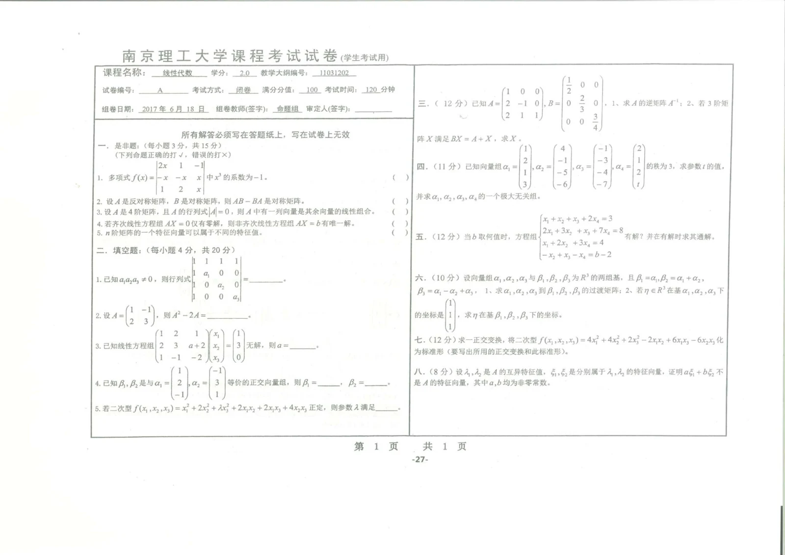

## 南京理工大学课程考试试卷 (学生考试用)

课程名称： 线性代数 学分： 2.0 教学大纲编号： 11031202
试卷编号： A 考试方式： 闭卷 满分分值： 100 考试时间： 120 分钟
组卷日期： 2017 年 6 月 18 日 组卷教师(签字)： 命题组 审定人(签字)：

### 所有解答必须写在答题纸上，写在试卷上无效

### 一．是非题：（每小题3分，共15分）

(下列命题正确的打 √，错误的打×)

1. 多项式 $f(x)=\left|\begin{matrix}2x&1&-1\\ -x&-x&x\\ 1&2&x\end{matrix}\right|$ 中 $x^{3}$ 的系数为 -1。

2. 设 A 是反对称矩阵，B 是对称矩阵，则 AB - BA 是对称矩阵。 （）

3. 设 A 是 4 阶矩阵，且 A 的行列式 $\left|A\right|=0$ ，则 A 中有一列向量是其余向量的线性组合。（）

4. 若齐次线性方程组 AX = 0 仅有零解，则非齐次线性方程组 AX = b 有唯一解。 （）

5. $n$ 阶矩阵的一个特征向量可以属于不同的特征值。 （）

### 二. 填空题: (每小题 4 分, 共 20 分)

1. 已知 $a_{1}a_{2}a_{3} \neq 0$ ，则行列式 $\begin{vmatrix} 1 & 1 & 1 & 1 \\ 1 & a_{1} & 0 & 0 \\ 1 & 0 & a_{2} & 0 \\ 1 & 0 & 0 & a_{3} \end{vmatrix} =$ \_\_\_\_。

2. 设 $A = \begin{pmatrix} 1 & -1 \\ 2 & 3 \end{pmatrix}$ ，则 $A^{2} - 2A =$ \_\_\_\_ 。

3. 已知线性方程组 $\begin{pmatrix}1&2&1\\2&3&a+2\\1&-1&-2\end{pmatrix}\begin{pmatrix}x_{1}\\x_{2}\\x_{3}\end{pmatrix}=\begin{pmatrix}1\\3\\0\end{pmatrix}$ 无解，则 a= \_\_\_\_。

4. 已知 $\beta_{1}, \beta_{2}$ 是与 $\alpha_{1} = \begin{pmatrix} 1 \\ 2 \\ -1 \end{pmatrix}, \alpha_{2} = \begin{pmatrix} -1 \\ 3 \\ 1 \end{pmatrix}$ 等价的正交向量组，则 $\beta_{1} =$ \_\_\_\_， $\beta_{2} =$ \_\_\_\_。

$$
f \left(x _ {1}, x _ {2}, x _ {3}\right) = x _ {1} ^ {2} + 2 x _ {2} ^ {2} + \lambda x _ {3} ^ {2} + 2 x _ {1} x _ {2} + 2 x _ {1} x _ {3} + 4 x _ {2} x _ {3}
$$

三.（12分）已知 $A = \begin{pmatrix} 1 & 0 & 0\\ 2 & -1 & 0\\ 2 & 1 & 1 \end{pmatrix},B = \begin{pmatrix} \frac{1}{2} & 0 & 0\\ 0 & \frac{2}{3} & 0\\ 0 & 0 & \frac{3}{4} \end{pmatrix}$ ，1、求 $A$ 的逆矩阵 $A^{-1}$ ；2、若3阶矩

四.（11分）已知向量组 $\alpha_{1} = \begin{pmatrix} 1 \\ 2 \\ 1 \\ 3 \end{pmatrix}, \alpha_{2} = \begin{pmatrix} 4 \\ -1 \\ -5 \\ -6 \end{pmatrix}, \alpha_{3} = \begin{pmatrix} -1 \\ -3 \\ -4 \\ -7 \end{pmatrix}, \alpha_{4} = \begin{pmatrix} 2 \\ 1 \\ 2 \\ t \end{pmatrix}$ 的秩为3，求参数 $t$ 的值，

$$
\alpha_ {1}, \alpha_ {2}, \alpha_ {3}, \alpha_ {4}
$$

五.（12分）当 $b$ 取何值时，方程组 $\left\{ \begin{array}{l} x_{1} + x_{2} + x_{3} + 2x_{4} = 3 \\ 2x_{1} + 3x_{2} + x_{3} + 7x_{4} = 8 \\ x_{1} + 2x_{2} + 3x_{4} = 4 \\ -x_{2} + x_{3} - x_{4} = b - 2 \end{array} \right.$ 有解？并在有解时求其通解。

六.（10分）设向量组 $\alpha_{1},\alpha_{2},\alpha_{3}$ 与 $\beta_{1},\beta_{2},\beta_{3}$ 为 $R^3$ 的两组基，且 $\beta_{1} = \alpha_{1},\beta_{2} = \alpha_{1} + \alpha_{2}$ ， $\beta_{3} = \alpha_{1} - \alpha_{2} + \alpha_{3}$ ，1、求 $\alpha_{1},\alpha_{2},\alpha_{3}$ 到 $\beta_{1},\beta_{2},\beta_{3}$ 的过渡矩阵；2、若 $\eta \in R^3$ 在基 $\alpha_{1},\alpha_{2},\alpha_{3}$ 下的坐标是 $\begin{pmatrix} 1 \\ 1 \\ 1 \end{pmatrix}$ ，求 $\eta$ 在基 $\beta_{1},\beta_{2},\beta_{3}$ 下的坐标。

七.（12分）求一正交变换，将二次型 $f(x_{1},x_{2},x_{3})=4x_{1}^{2}+4x_{2}^{2}+2x_{3}^{2}-2x_{1}x_{2}+6x_{1}x_{3}-6x_{2}x_{3}$ 化为标准形（要写出所用的正交变换和此标准形）。

八.（8分）设 $\lambda_{1},\lambda_{2}$ 是 $A$ 的互异特征值， $\xi_1,\xi_2$ 是分别属于 $\lambda_{1},\lambda_{2}$ 的特征向量，证明 $a\xi_1 + b\xi_2$ 不是 $A$ 的特征向量，其中 $a,b$ 均为非零常数。

第1页 共1页

-27-

## 第36页

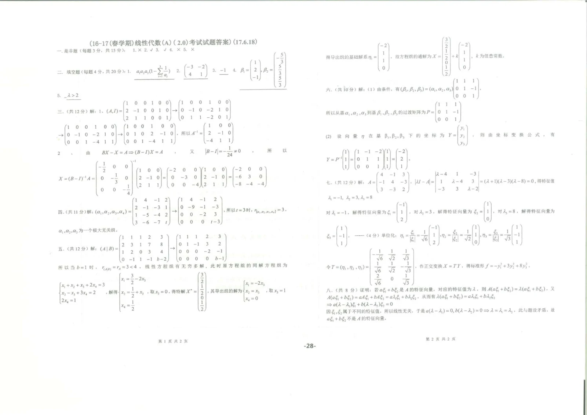

$$
(1 7. 6. 1 8)
$$

(16-17(春学期)线性代数(A)(2.0)考试试题答案)(17.6.18)

一.是非题（每题3分，共15分）： $1.\times2.\sqrt{3}.\sqrt{4}.\times5.\times$ 二.填空题（每题4分，共20分）： $1.\underline{a_{1}a_{2}a_{3}(1-\sum_{i=1}^{3}\frac{1}{a_{i}})}$ 2. $\underline{\begin{pmatrix}-3&-2\\4&1\end{pmatrix}}$ 3. -1 4. $\beta_{1}=\begin{pmatrix}1\\2\\-1\end{pmatrix},\beta_{2}=\begin{pmatrix}-\frac{5}{3}\\ \frac{5}{3}\\ \frac{5}{3}\end{pmatrix}$ 5. $\underline{\lambda>2}$ 三.(共12分)解：1、 $(A,I)=\begin{pmatrix}1&0&0&1&0&0\\2&-1&0&0&1&0\\2&1&1&0&0&1\end{pmatrix}\rightarrow\begin{pmatrix}1&0&0&1&0&0\\0&-1&0&-2&1&0\\0&1&1&-2&0&1\end{pmatrix}$ $\rightarrow\begin{pmatrix}1&0&0&1&0&0\\0&-1&0&-2&1&0\\0&0&1&-4&1&1\end{pmatrix}\rightarrow\begin{pmatrix}1&0&0&1&0&0\\0&1&0&2&-1&0\\0&0&1&-4&1&1\end{pmatrix}$ ，所以 $A^{-1}=\begin{pmatrix}1&0&0\\2&-1&0\\-4&1&1\end{pmatrix}$ 2、由 $BX-X=A\Rightarrow(B-I)X=A$ ，又 $|B-I|=-\frac{1}{24}\neq0$ ，所以 $X=(B-I)^{-1}A=\begin{pmatrix}-\frac{1}{2}&0&0\\0&-\frac{1}{3}&0\\0&0&-\frac{1}{4}\end{pmatrix}^{-1}\begin{pmatrix}1&0&0\\2&-1&0\\2&1&1\end{pmatrix}=\begin{pmatrix}-2&0&0\\0&-3&0\\0&0&-4\end{pmatrix}\begin{pmatrix}1&0&0\\2&-1&0\\2&1&1\end{pmatrix}=\begin{pmatrix}-2&0&0\\-6&3&0\\-8&-4&-4\end{pmatrix}$ 四.(共11分)解： $(\alpha_{1},\alpha_{2},\alpha_{3},\alpha_{4})=\begin{pmatrix}1&4&-1&2\\2&-1&-3&1\\1&-5&-4&2\\3&-6&-7&t\end{pmatrix}\rightarrow\begin{pmatrix}1&4&-1&2\\0&-9&-1&-3\\0&0&-2&3\\0&0&0&t-3\end{pmatrix}$ ，所以t=3时， $r_{\{\alpha_{1},\alpha_{2},\alpha_{3},\alpha_{4}\}}=3$ ， $\alpha_{1},\alpha_{2},\alpha_{3}$ 为一个极大无关组。

五.(共12分)解： $(A|B)=\begin{pmatrix}1&1&1&2&3\\2&3&1&7&8\\1&2&0&3&4\\0&-1&1&-1 billsb-2\end{pmatrix}\rightarrow\begin{pmatrix}1&1&1&&2&&3\\0&1&&-1&&3&&2\\0&&0&&-2&&-1\\0&&0&&0 billsb-1\end{pmatrix}$ 所以当b=1时， $r_{(A|B)}=r_{A}=3<4$ ，线性方程组有无穷多解，此时原方程组的同解方程组为 $\left\{\begin{aligned}&x_{1}+x_{2}+x_{3}+2x_{4}=3\\ &x_{2}-x_{3}+3x_{4}=2\\ &2x_{4}=1\end{aligned}\right.$ ，解得 $\left\{\begin{aligned}&x_{1}=\frac{3}{2}-2x_{3}\\ &x_{2}=\frac{1}{2}+x_{3}\\ &x_{4}=\frac{1}{2}\end{aligned}\right.$ ，取 $x_{3}=0$ ，得特解 $X^{*}=\begin{pmatrix}\frac{3}{2}\\ \frac{1}{2}\\ 0\\\frac{1}{2}\end{pmatrix}$ ，其导出组的解为 $\left\{\begin{aligned}&x_{1}=-2x_{3}\\ &x_{2}=x_{3}\\ &x_{4}=0\end{aligned}\right.$ ，取 $x_{3}=1$

得导出组的基础解系 $\eta_{1} = \begin{pmatrix} -2\\ 1\\ 1\\ 0\end{pmatrix}$ ，故方程组的通解为 $X = \begin{pmatrix} \frac{3}{2}\\ \frac{1}{2}\\ 0\\ \frac{1}{2}\end{pmatrix} + k\begin{pmatrix} -2\\ 1\\ 1\\ 0\end{pmatrix}$ ， $k$ 为任意常数。  
六.（共10分）解：（1）由条件，有 $(\beta_{1},\beta_{2},\beta_{3}) = (\alpha_{1},\alpha_{2},\alpha_{3})\begin{pmatrix} 1 & 1 & 1\\ 0 & 1 & -1\\ 0 & 0 & 1\end{pmatrix}$ 所以从基 $\alpha_{1},\alpha_{2},\alpha_{3}$ 到基 $\beta_{1},\beta_{2},\beta_{3}$ 的过渡矩阵为 $P = \begin{pmatrix} 1 & 1 & 1\\ 0 & 1 & -1\\ 0 & 0 & 1\end{pmatrix}$ (2）设向量 $\eta$ 在基 $\beta_{1},\beta_{2},\beta_{3}$ 下的坐标为 $Y = \begin{pmatrix} y_{1}\\ y_{2}\\ y_{3}\end{pmatrix}$ ，则由坐标变换公式，有 $Y = P^{-1}\begin{pmatrix} 1\\ 1\\ 1\end{pmatrix} = \begin{pmatrix} 1 & -1 & -2\\ 0 & 1 & 1\\ 0 & 0 & 1\end{pmatrix}\begin{pmatrix} 1\\ 1\\ 1\end{pmatrix} = \begin{pmatrix} -2\\ 2\\ 1\end{pmatrix}$ 。  
七.（共12分）解： $A = \begin{pmatrix} 4 & -1 & 3\\ -1 & 4 & -3\\ 3 & -3 & 2\end{pmatrix}$ ， $|\lambda I - A| = \begin{vmatrix} \lambda -4 & 1 & -3\\ 1 & \lambda -4 & 3\\ -3 & 3 & \lambda -2\end{vmatrix} = (\lambda +1)(\lambda -3)(\lambda -8) = 0$ ，得特征值 $\lambda_1 = -1,\lambda_2 = 3,\lambda_3 = 8$ 对 $\lambda_1 = -1$ ，解得特征向量为 $\xi_1 = \begin{pmatrix} -1\\ 1\\ 2\end{pmatrix}$ ，对 $\lambda_2 = 3$ ，解得特征向量为 $\xi_2 = \begin{pmatrix} 1\\ 1\\ 0\end{pmatrix}$ ，对 $\lambda_3 = 8$ ，解得特征向量为 $\xi_3 = \begin{pmatrix} 1\\ -1\\ 1\end{pmatrix}$ ，……（4分）单位化： $\eta_1 = \frac{\xi_1}{|\xi_1|} = \frac{1}{\sqrt{6}}\begin{pmatrix} -1\\ 1\\ 2\end{pmatrix},\eta_2 = \frac{\xi_2}{|\xi_2|} = \frac{1}{\sqrt{2}}\begin{pmatrix} 1\\ 1\\ 0\end{pmatrix},\eta_3 = \frac{\xi_3}{|\xi_3|} = \frac{1}{\sqrt{3}}\begin{pmatrix} 1\\ -1\\ 1\end{pmatrix}$ 令 $T = (\eta_1,\eta_2,\eta_3) = \left( \begin{array}{lll} -\frac{1}{\sqrt{6}} & \frac{1}{\sqrt{2}} & \frac{1}{\sqrt{3}}\\ \frac{1}{\sqrt{6}} & \frac{1}{\sqrt{2}} & -\frac{1}{\sqrt{3}}\\ \frac{2}{\sqrt{6}} & 0 & \frac{1}{\sqrt{3}} \end{array} \right)$ ，作正交变换 $X = TY$ ，得标准形 $f = -y_{1}^{2} + 3y_{2}^{2} + 8y_{3}^{2}$ 。  
八.（共8分）证明：若 $a\xi_{1} + b\xi_{2}$ 是 $A$ 的特征向量，对应的特征值为 $\lambda$ ，则 $A(a\xi_1 + b\xi_2) = \lambda (a\xi_1 + b\xi_2)$ ，又 $A(a\xi_1 + b\xi_2) = aA\xi_1 + bA\xi_2 = a\lambda_1\xi_1 + b\lambda_2\xi_2$ ，从而有 $\lambda (a\xi_1 + b\xi_2) = a\lambda_1\xi_1 + b\lambda_2\xi_2$ $\Rightarrow a(\lambda -\lambda_1)\xi_1 + b(\lambda -\lambda_2)\xi_2 = 0$ 因 $\xi_1,\xi_2$ 属于不同的特征值，所以线性无关，于是 $a(\lambda -\lambda_1) = 0,b(\lambda -\lambda_2) = 0\Rightarrow \lambda = \lambda_1 = \lambda_2$ ，此与题设矛盾，故 $a\xi_1 + b\xi_2$ 不是 $A$ 的特征向量。

第1页共2页

-28

第2页共2页

## 第37页

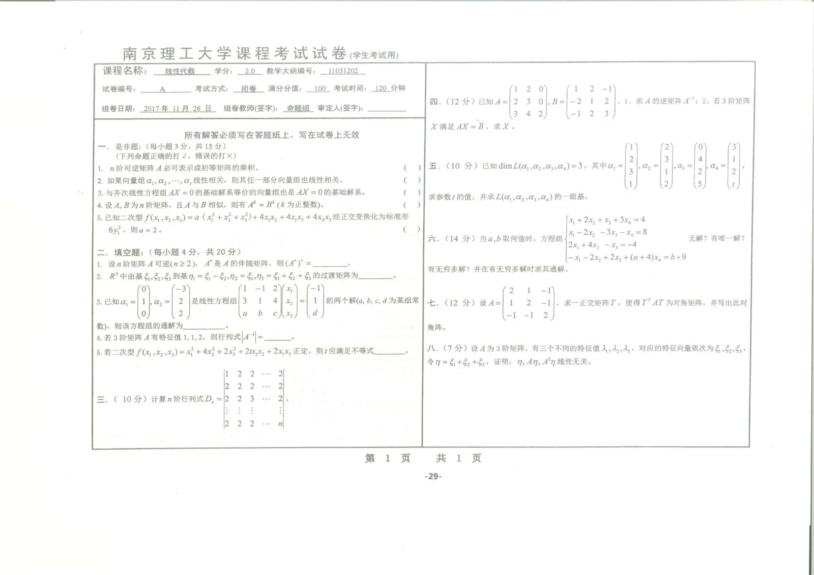

## 南京理工大学课程考试试卷 (学生考试用)

课程名称： 线性代数 学分： 2.0 教学大纲编号： 11031202

试卷编号：\_\_\_\_ A \_\_\_\_ 考试方式：\_\_\_\_ 闭卷 满分分值：\_\_\_\_ 100 考试时间：\_\_\_\_ 120 分钟
组卷日期：2017年11月26日 组卷教师(签字)：命题组 审定人(签字)：\_\_\_\_

### 所有解答必须写在答题纸上，写在试卷上无效

### 一. 是非题: (每小题 3 分, 共 15 分) (下列命题正确的打 √, 错误的打 ×)

1. $n$ 阶可逆矩阵 $A$ 必可表示成初等矩阵的乘积。 （）

2. 如果向量组 $\alpha_{1}, \alpha_{2}, \cdots, \alpha_{s}$ 线性相关，则其任一部分向量组也线性相关。 （）

3.与齐次线性方程组 $AX = 0$ 的基础解系等价的向量组也是 $AX = 0$ 的基础解系。 （）

4. 设 A, B 为 n 阶矩阵，且 A 与 B 相似，则有 $A^{k} = B^{k}$ (k 为正整数)。

5. 已知二次型 $f(x_{1}, x_{2}, x_{3}) = a \left( x_{1}^{2} + x_{2}^{2} + x_{3}^{2} \right) + 4x_{1}x_{2} + 4x_{1}x_{3} + 4x_{2}x_{3}$ 经正交变换化为标准形 $6y_{1}^{2}$ ，则 a = 2。

### 二. 填空题: (每小题 4 分, 共 20 分)

1. 设 $n$ 阶矩阵 $A$ 可逆 $(n \geq 2)$ , $A^{*}$ 是 $A$ 的伴随矩阵, 则 $(A^{*})^{*} =$ \_\_\_\_。

2. $R^{3}$ 中由基 $\xi_{1}, \xi_{2}, \xi_{3}$ 到基 $\eta_{1} = \xi_{1} - \xi_{2}, \eta_{2} = \xi_{1}, \eta_{3} = \xi_{1} + \xi_{2} + \xi_{3}$ 的过渡矩阵为 \_\_\_\_。

3. 已知 $\alpha_{1}=\begin{pmatrix}0\\1\\0\end{pmatrix},\alpha_{2}=\begin{pmatrix}-3\\2\\2\end{pmatrix}$ 是线性方程组 $\begin{pmatrix}1&-1&2\\3&1&4\\a&b&c\end{pmatrix}\begin{pmatrix}x_{1}\\x_{2}\\x_{3}\end{pmatrix}=\begin{pmatrix}-1\\1\\d\end{pmatrix}$ 的两个解 $(a,b,c,d$ 为某组常

### 数)，则该方程组的通解为\_\_\_\_。

4. 若 3 阶矩阵 A 有特征值 1, 1, 2，则行列式 $\left|A^{-1}\right| =$ \_\_\_\_ 。

5. 若二次型 $f(x_{1}, x_{2}, x_{3}) = x_{1}^{2} + 4x_{2}^{2} + 2x_{3}^{2} + 2tx_{1}x_{2} + 2x_{1}x_{3}$ 正定，则 t 应满足不等式 \_\_\_\_。

三.（10分）计算 $n$ 阶行列式 $D_{n} = \left| \begin{array}{cccccc} 1 & 2 & 2 & \cdots & 2\\ 2 & 2 & 2 & \cdots & 2\\ 2 & 2 & 3 & \cdots & 2\\ \vdots & \vdots & \vdots & & \vdots \\ 2 & 2 & 2 & \cdots & n \end{array} \right|$ 四.（12分）已知 $A = \begin{pmatrix} 1 & 2 & 0 \\ 2 & 3 & 0 \\ 3 & 4 & 2 \end{pmatrix}, B = \begin{pmatrix} 1 & 2 & -1 \\ -2 & 1 & 2 \\ -1 & 2 & 3 \end{pmatrix}$ ，1、求 $A$ 的逆矩阵 $A^{-1}$ ；2、若3阶矩阵 $X$ 满足 $AX = B$ ，求 $X$ 。

五.（10分）已知 $\dim L(\alpha_1, \alpha_2, \alpha_3, \alpha_4) = 3$ ，其中 $\alpha_1 = \begin{pmatrix} 1 \\ 2 \\ 3 \\ 1 \end{pmatrix}$ ， $\alpha_2 = \begin{pmatrix} 2 \\ 3 \\ 1 \\ 2 \end{pmatrix}$ ， $\alpha_3 = \begin{pmatrix} 0 \\ 4 \\ 2 \\ 5 \end{pmatrix}$ ， $\alpha_4 = \begin{pmatrix} 3 \\ 1 \\ 2 \\ t \end{pmatrix}$ ，求参数 $t$ 的值，并求 $L(\alpha_1, \alpha_2, \alpha_3, \alpha_4)$ 的一组基。

六.（14分）当a,b取何值时，方程组 $\left\{\begin{aligned}x_{1}+2x_{2}+x_{3}+3x_{4}&=4\\ x_{1}-2x_{2}-3x_{3}-x_{4}&=8\\ 2x_{1}+4x_{2}-x_{3}&=-4\\ -x_{1}-2x_{2}+2x_{3}+(a+4)x_{4}&=b+9\end{aligned}\right.$ 无解？有唯一解？

有无穷多解？并在有无穷多解时求其通解。

七.（12分）设 $A = \begin{pmatrix} 2 & 1 & -1 \\ 1 & 2 & -1 \\ -1 & -1 & 2 \end{pmatrix}$ ，求一正交矩阵 $T$ ，使得 $T^T AT$ 为对角矩阵，并写出此对角阵。

八.（7分）设 $A$ 为3阶矩阵，有三个不同的特征值 $\lambda_1, \lambda_2, \lambda_3$ ，对应的特征向量依次为 $\xi_1, \xi_2, \xi_3$ ，令 $\eta = \xi_1 + \xi_2 + \xi_3$ ，证明： $\eta, A\eta, A^2\eta$ 线性无关。

第1页 共1页

-29-

## 第38页

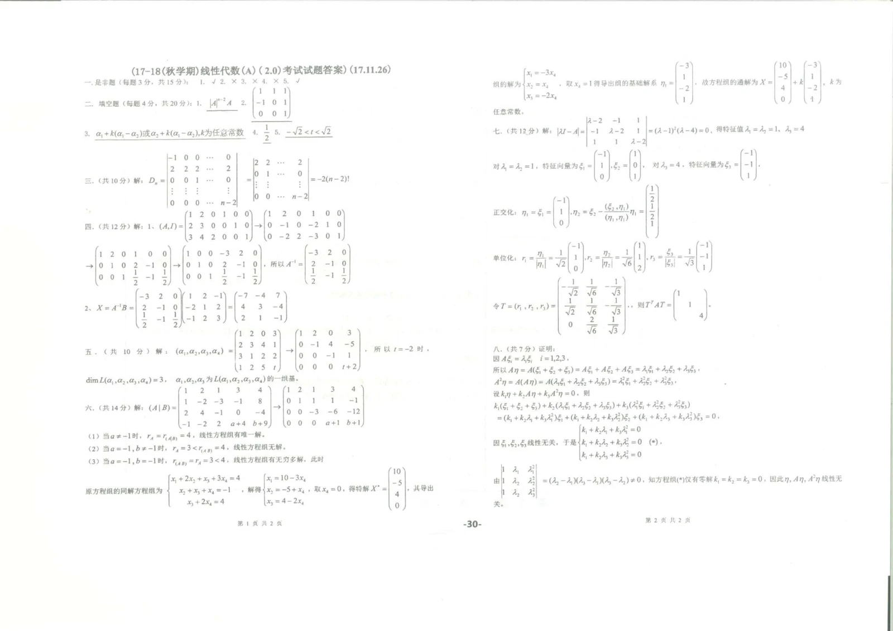

(17-18(秋学期)线性代数(A)(2.0)考试试题答案)(17.11.26)

一.是非题（每题3分，共15分）： 1. √2. ×3. ×4. ×5. √

二.填空题（每题4分，共20分）： 1. $\left|A\right|^{n-2}A$ 2. $\begin{pmatrix}1 & 1 & 1 \\ -1 & 0 & 1 \\ 0 & 0 & 1\end{pmatrix}$ 3. $\alpha_{1}+k(\alpha_{1}-\alpha_{2})$ 或 $\alpha_{2}+k(\alpha_{1}-\alpha_{2}), k$ 为任意常数

4. $\frac{1}{2}$ 5. $-\sqrt{2}<t<\sqrt{2}$ 三.(共10分)解： $D_{n}=\begin{vmatrix}-1 & 0 & 0 & \cdots & 0 \\ 2 & 2 & 2 & \cdots & 2 \\ 0 & 0 & 1 & \cdots & 0 \\ \vdots & \vdots & \vdots & & \vdots \\ 0 & 0 & 0 & \cdots & n-2\end{vmatrix}=\begin{vmatrix}2 & 2 & \cdots & 2 \\ 0 & 1 & \cdots & 0 \\ \vdots & \vdots & & \vdots \\ 0 & 0 & \cdots & n-2\end{vmatrix}=-2(n-2)!$ 四.(共12分)解：1、(A,I)= $\begin{pmatrix}1 & 2 & 0 & 1 & 0 & 0 \\ 2 & 3 & 0 & 0 & 1 & 0 \\ 3 & 4 & 2 & 0 & 0 & 1\end{pmatrix}\rightarrow\begin{pmatrix}1 & 2 & 0 & 1 & 0 & 0 \\ 0 & -1 & 0 & -2 & 1 & 0 \\ 0 & -2 & 2 & -3 & 0 & 1\end{pmatrix}$ $\rightarrow\begin{pmatrix}1 & 2 & 0 & 1 & 0 & 0 \\ 0 & 1 & 0 & 2 & -1 & 0 \\ 0 & 0 & 1 & \frac{1}{2} & -1 & \frac{1}{2}\end{pmatrix}\rightarrow\begin{pmatrix}1 & 0 & 0 & -3 & 2 & 0 \\ 0 & 1 & 0 & 2 & -1 & 0 \\ 0 & 0 & 1 & \frac{1}{2} & -1 & \frac{1}{2}\end{pmatrix}$ ，所以 $A^{-1}=\begin{pmatrix}-3 & 2 & 0 \\ 2 & -1 & 0 \\ \frac{1}{2} & -1 & \frac{1}{2}\end{pmatrix}$ 2、 $X=A^{-1}B=\begin{pmatrix}-3 & 2 & 0 \\ 2 & -1 & 0 \\ \frac{1}{2} & -1 & \frac{1}{2}\end{pmatrix}\begin{pmatrix}1 & 2 & -1 \\ -2 & 1 & 2 \\ -1 & 2 & 3\end{pmatrix}=\begin{pmatrix}-7 & -4 & 7 \\ 4 & 3 & -4 \\ 2 & 1 & -1\end{pmatrix}$ 五.(共10分)解： $(\alpha_{1},\alpha_{2},\alpha_{3},\alpha_{4})=\begin{pmatrix}1 & 2 & 0 & 3 \\ 2 & 3 & 4 & 1 \\ 3 & 1 & 2 & 2 \\ 1 & 2 & 5 & t\end{pmatrix}\rightarrow\begin{pmatrix}1 & 2 & 0 & 3 \\ 0 & -1 & 4 & -5 \\ 0 & 0 & -1 & 1 \\ 0 & 0 & 0 & t+2\end{pmatrix}$ ，所以t=-2时， $\dim L(\alpha_{1},\alpha_{2},\alpha_{3},\alpha_{4})=3,\quad\alpha_{1},\alpha_{2},\alpha_{3}$ 为 $L(\alpha_{1},\alpha_{2},\alpha_{3},\alpha_{4})$ 的一组基。

六.(共14分)解： $(A|B)=\begin{pmatrix}1&2&1&3&4\\1&-2&-3&-1&8\\2&4&-1&0&-4\\-1&-2&2&a+4&b+9\end{pmatrix}\rightarrow\begin{pmatrix}1&2&1&3&4\\0&1&1&1&-1\\0&0&-3&-6&-12\\0&0&0&a+1&b+1\end{pmatrix}$ (1)当 $a\neq-1$ 时， $r_{A}=r_{(A|B)}=4$ ，线性方程组有唯一解。

(2)当a=-1, $b\neq-1$ 时， $r_{A}=3<r_{(AB)}=4$ ，线性方程组无解。

(3)当a=-1, b=-1时， $r_{(AB)}=r_{A}=3<4$ ，线性方程组有无穷多解，此时

原方程组的同解方程组为 $\begin{cases}x_{1}+2x_{2}+x_{3}+3x_{4}=4\\x_{2}+x_{3}+x_{4}=-1\\x_{3}+2x_{4}=4\end{cases}$ ，解得 $\begin{cases}x_{1}=10-3x_{4}\\x_{2}=-5+x_{4}\\x_{3}=4-2x_{4}\end{cases}$ ，取 $x_{4}=0$ ，得特解 $X^{*}=\begin{pmatrix}10\\-5\\4\\0\end{pmatrix}$ ，其导出

组的解为 $\left\{ \begin{array}{l} x_{1} = -3x_{4} \\ x_{2} = x_{4} \\ x_{3} = -2x_{4} \end{array} \right.$ ，取 $x_{4} = 1$ 得导出组的基础解系 $\eta_{1} = \left( \begin{array}{c}-3\\ 1\\ -2\\ 1 \end{array} \right)$ ，故方程组的通解为 $X = \left( \begin{array}{c}10\\ -5\\ 4\\ 0 \end{array} \right) + k\left( \begin{array}{c}-3\\ 1\\ -2\\ 1 \end{array} \right)$ ， $k$ 为任意常数。

七．（共12分）解： $|\lambda I - A| = \left| \begin{array}{ccc} \lambda - 2 & -1 & 1\\ -1 & \lambda - 2 & 1\\ 1 & 1 & \lambda - 2 \end{array} \right| = (\lambda - 1)^{2}(\lambda - 4) = 0$ ，得特征值 $\lambda_{1} = \lambda_{2} = 1$ ， $\lambda_{3} = 4$ 对 $\lambda_{1} = \lambda_{2} = 1$ ，特征向量为 $\xi_{1} = \left( \begin{array}{c}-1\\ 1\\ 0 \end{array} \right),\xi_{2} = \left( \begin{array}{c}1\\ 0\\ 1 \end{array} \right)$ ，对 $\lambda_{3} = 4$ ，特征向量为 $\xi_{3} = \left( \begin{array}{c}-1\\ -1\\ 1 \end{array} \right)$ ,

正交化： $\eta_{1} = \xi_{1} = \left( \begin{array}{c}-1\\ 1\\ 0 \end{array} \right),\eta_{2} = \xi_{2} - \frac{(\xi_{2},\eta_{1})}{(\eta_{1},\eta_{1})}\eta_{1} = \left( \begin{array}{c}\frac{1}{2}\\ \frac{1}{2}\\ 1 \end{array} \right)$ 单位化： $r_{1} = \frac{\eta_{1}}{|\eta_{1}|} = \frac{1}{\sqrt{2}}\left( \begin{array}{c}-1\\ 1\\ 0 \end{array} \right),r_{2} = \frac{\eta_{2}}{|\eta_{2}|} = \frac{1}{\sqrt{6}}\left( \begin{array}{c}1\\ 1\\ 2 \end{array} \right),r_{3} = \frac{\xi_{3}}{|\xi_{3}|} = \frac{1}{\sqrt{3}}\left( \begin{array}{c}-1\\ -1\\ 1 \end{array} \right)$ 令 $T = (r_1, r_2, r_3) = \left( \begin{array}{cccc}-\frac{1}{\sqrt{2}} & \frac{1}{\sqrt{6}} & -\frac{1}{\sqrt{3}}\\ \frac{1}{\sqrt{2}} & \frac{1}{\sqrt{6}} & -\frac{1}{\sqrt{3}}\\ 0 & \frac{2}{\sqrt{6}} & \frac{1}{\sqrt{3}}\end{array} \right)$ ，则 $T^T AT = \left( \begin{array}{cc}1 &  \\ & 1 \\ & 4\end{array} \right)$ 。

八．（共7分）证明：

因 $A\xi_i = \lambda_i\xi_i i = 1,2,3$ ，

所以 $A\eta = A(\xi_1 + \xi_2 + \xi_3) = A\xi_1 + A\xi_2 + A\xi_3 = \lambda_1\xi_1 + \lambda_2\xi_2 + \lambda_3\xi_3$ ， $A^2\eta = A(A\eta) = A(\lambda_1\xi_1 + \lambda_2\xi_2 + \lambda_3\xi_3) = \lambda_1^2\xi_1 + \lambda_2^2\xi_2 + \lambda_3^2\xi_3$ ，

设 $k_1\eta + k_2A\eta + k_3A^2\eta = 0$ ，则 $k_1(\xi_1 + \xi_2 + \xi_3) + k_2(\lambda_1\xi_1 + \lambda_2\xi_2 + \lambda_3\xi_3) + k_3(\lambda_1^2\xi_1 + \lambda_2^2\xi_2 + \lambda_3^2\xi_3)$ $= (k_1 + k_2\lambda_1 + k_3\lambda_1^2)\xi_1 + (k_1 + k_2\lambda_2 + k_3\lambda_2^2)\xi_2 + (k_1 + k_2\lambda_3 + k_3\lambda_3^2)\xi_3 = 0$ ，

因 $\xi_{1},\xi_{2},\xi_{3}$ 线性无关，于是 $\left\{ \begin{array}{l} k_{1} + k_{2}\lambda_{1} + k_{3}\lambda_{1}^{2} = 0 \\ k_{1} + k_{2}\lambda_{2} + k_{3}\lambda_{2}^{2} = 0 \\ k_{1} + k_{2}\lambda_{3} + k_{3}\lambda_{3}^{2} = 0 \end{array} \right.$ 由 $\left| \begin{array}{ccc} 1 & \lambda_{1} & \lambda_{1}^{2}\\ 1 & \lambda_{2} & \lambda_{2}^{2}\\ 1 & \lambda_{2} & \lambda_{3}^{2} \end{array} \right| = (\lambda_{2}-\lambda_{1})(\lambda_{3}-\lambda_{1})(\lambda_{3}-\lambda_{2})\neq 0$ ，知方程组(\*)仅有零解 $k_{1}=k_{2}=k_{3}=0$ ，因此 $\eta,A\eta,A^{2}\eta$ 线性无关。

第1页共2页

-30.

第2页共2页

## 第39页

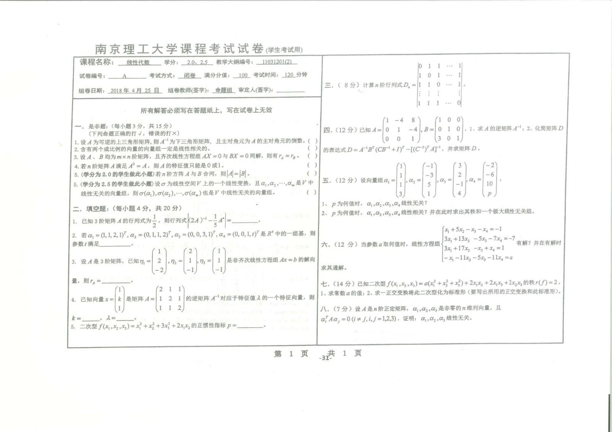

## 南京理工大学课程考试试卷(学生考试用)

课程名称： 线性代数 学分： 2.0、2.5 教学大纲编号： 11031201(2)
试卷编号： A 考试方式： 闭卷 满分分值： 100 考试时间： 120 分钟
组卷日期： 2018 年 4 月 25 日 组卷教师(签字)： 命题组 审定人(签字)：

### 所有解答必须写在答题纸上，写在试卷上无效

### 一. 是非题: (每小题 3 分, 共 15 分)

(下列命题正确的打√，错误的打×)

1. 设 A 为可逆的上三角形矩阵, 则 $A^{-1}$ 为下三角形矩阵, 且主对角元为 A 的主对角元的倒数。 ( )
2. 含有两个成比例的向量的向量组一定是线性相关的。
3. 设 A、B 均为 $m \times n$ 阶矩阵，且齐次线性方程组 AX = 0 与 BX = 0 同解，则有 $r_{A} = r_{B}$ 。 ( )
4. 若 n 阶矩阵 A 满足 $A^{2} = A$ ，则 A 的特征值只能是 0 或 1。
5. (学分为 2.0 的学生做此小题) 若 n 阶方阵 A 与 B 合同，则 $|A| = |B|$ 。

5. (学分为 2.5 的学生做此小题) 设 $\sigma$ 为线性空间 $V$ 上的一个线性变换, 且 $\alpha_{1}, \alpha_{2}, \cdots, \alpha_{m}$ 是 $V$ 中线性无关的向量组, 则 $\sigma(\alpha_{1}), \sigma(\alpha_{2}), \cdots, \sigma(\alpha_{m})$ 也是 $V$ 中线性无关的向量组。 ( )

### 二. 填空题: (每小题 4 分, 共 20 分)

1. 已知 3 阶矩阵 A 的行列式为 $\frac{1}{2}$ ，则行列式 $\left(2A\right)^{-1}-\frac{1}{5}A^{*}=$ \_\_\_\_。

2. 若 $\alpha_{1}=(1,1,2,1)^{T},\alpha_{2}=(0,1,1,2)^{T},\alpha_{3}=(0,0,3,1)^{T},\alpha_{4}=(0,0,1,t)^{T}$ 是 $R^{4}$ 中的一组基，则参数 t 满足 \_\_\_\_。

3. 设 A 是 3 阶矩阵，已知 $\eta_{1}=\begin{pmatrix}1\\2\\-2\end{pmatrix},\eta_{2}=\begin{pmatrix}2\\1\\-1\end{pmatrix},\eta_{3}=\begin{pmatrix}1\\1\\-1\end{pmatrix}$ 是非齐次线性方程组 Ax=b 的解向量，则 $r_{A}=$ \_\_\_\_。

4. 已知向量 $x=\begin{pmatrix}1\\k\\1\end{pmatrix}$ 是矩阵 $A=\begin{pmatrix}2&1&1\\1&2&1\\1&1&2\end{pmatrix}$ 的逆矩阵 $A^{-1}$ 对应于特征值 $\lambda$ 的一个特征向量，则 k=\_\_\_\_， $\lambda=$ \_\_\_\_ 。

5. 二次型 $f(x_{1},x_{2},x_{3}) = x_{1}^{2} + x_{2}^{2} + 3x_{3}^{2} + 2x_{1}x_{2}$ 的正惯性指标 $p =$ \_\_\_\_。

三.（8分）计算 $n$ 阶行列式 $D_{n} = \left| \begin{array}{cccccc}0 & 1 & 1 & \dots & 1\\ 1 & 0 & 1 & \dots & 1\\ 1 & 1 & 0 & \dots & 1\\ \vdots & \vdots & \vdots & & \vdots \\ 1 & 1 & 1 & \dots & 0 \end{array} \right|$ 。

四.（12分）已知 $A = \begin{pmatrix} 1 & -4 & 8 \\ 0 & 1 & -4 \\ 0 & 0 & 1 \end{pmatrix}, B = \begin{pmatrix} 1 & 0 & 0 \\ 0 & 1 & 0 \\ 3 & 0 & 1 \end{pmatrix}$ ，1、求 $A$ 的逆矩阵 $A^{-1}$ ；2、化简矩阵 $D$ 的表达式 $D = A^{-1}B^{T}(CB^{-1} + I)^{T} - [(C^{-1})^{T}A]^{-1}$ ，并求矩阵 $D$ 。

五.（12分）设向量组 $\alpha_{1} = \begin{pmatrix} 1 \\ 1 \\ 1 \\ 3 \end{pmatrix}, \alpha_{2} = \begin{pmatrix} -1 \\ -3 \\ 5 \\ 1 \end{pmatrix}, \alpha_{3} = \begin{pmatrix} 3 \\ 2 \\ -1 \\ 4 \end{pmatrix}, \alpha_{4} = \begin{pmatrix} -2 \\ -6 \\ 10 \\ p \end{pmatrix}$

1、p 为何值时， $\alpha_{1},\alpha_{2},\alpha_{3},\alpha_{4}$ 线性无关？

2、p 为何值时， $\alpha_{1},\alpha_{2},\alpha_{3},\alpha_{4}$ 线性相关？并在此时求出其秩和一个极大线性无关组。

六.（12分）当参数a取何值时，线性方程组 $\left\{\begin{aligned}x_{1}+5x_{2}-x_{3}-x_{4}&=-1\\ 3x_{1}+13x_{2}&-5x_{3}-7x_{4}&=-7\\ 3x_{1}+17x_{2}&-x_{3}+x_{4}&=1\\ -x_{1}-11x_{2}&-5x_{3}-11x_{4}&=a\end{aligned}\right.$ 有解？并在有解时

求其通解。

七.（14分）已知二次型 $f(x_{1},x_{2},x_{3})=a(x_{1}^{2}+x_{2}^{2}+x_{3}^{2})+2x_{1}x_{2}+2x_{1}x_{3}+2x_{2}x_{3}$ 的秩 $r(f)=2$ ，
1、求常数a的值；2、求一正交变换将此二次型化为标准形（要写出所用的正交变换和此标准形）。
八.（7分）设A是n阶正定矩阵， $\alpha_{1},\alpha_{2},\alpha_{3}$ 是非零的n维列向量，且 $\alpha_{i}^{T}A\alpha_{j}=0(i\neq j,i,j=1,2,3)$ ，证明： $\alpha_{1},\alpha_{2},\alpha_{3}$ 线性无关。

第 1 页 共 1 页
-31-

## 第40页

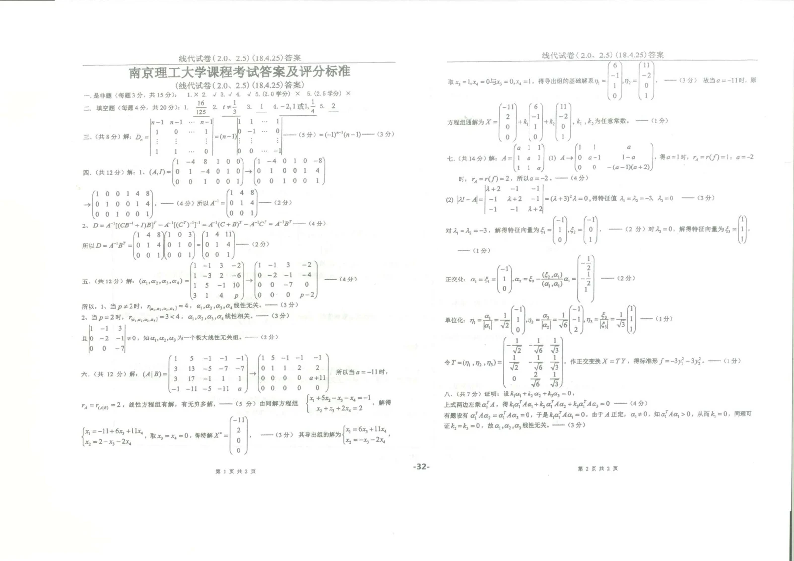

## 南京理工大学课程考试答案及评分标准

(线代试卷(2.0、2.5)(18.4.25)答案)

一.是非题（每题3分，共15分）： $1.\times 2.\sqrt{3}.\sqrt{4}.\sqrt{5.(2.0学分)}\times 5.(2.5学分)\times$ 二.填空题（每题4分，共20分）： $1.\frac{16}{125}$ 2. $t\neq \frac{1}{3}$ 3. $\underline{1}$ 4.-2,1或 $1,\frac{1}{4}$ 5. $\underline{2}$ 三.（共8分）解： $D_{n} = \left| \begin{array}{cccc}n - 1 & n - 1 & \dots & n - 1\\ 1 & 0 & \dots & 1\\ \vdots & \vdots & & \vdots \\ 1 & 1 & \dots & 0 \end{array} \right| = (n - 1)\left| \begin{array}{cccc}1 & 1 & \dots & 1\\ 0 & -1 & \dots & 0\\ \vdots & \vdots & & \vdots \\ 0 & 0 & \dots & -1 \end{array} \right|$ ——(5分） $= (-1)^{n - 1}(n - 1)$ ——（3分）  
四.（共12分）解： $1,(A,I) = \left( \begin{array}{lllll}1 & -4 & 8 & 1 & 0 & 0\\ 0 & 1 & -4 & 0 & 1 & 0\\ 0 & 0 & 1 & 0 & 0 & 1 \end{array} \right)\rightarrow \left( \begin{array}{lllll}1 & -4 & 0 & 1 & 0 & -8\\ 0 & 1 & 0 & 0 & 1 & 4\\ 0 & 0 & 1 & 0 & 0 & 1 \end{array} \right)$ $\rightarrow \left( \begin{array}{lllll}1 & 0 & 0 & 1 & 4 & 8\\ 0 & 1 & 0 & 0 & 1 & 4\\ 0 & 0 & 1 & 0 & 0 & 1 \end{array} \right),$ ——（4分）所以 $A^{-1} = \left( \begin{array}{lll}1 & 4 & 8\\ 0 & 1 & 4\\ 0 & 0 & 1 \end{array} \right)$ ——（2分） $2、D = A^{-1}[(CB^{-1} + I)B]^T -A^{-1}[(C^T)^{-1}]^{-1} = A^{-1}(C + B)^T -A^{-1}C^T = A^{-1}B^T$ ——（4分）所以 $D = A^{-1}B^{T} = \left( \begin{array}{lll}1 & 4 & 8\\ 0 & 1 & 4\\ 0 & 0 & 1 \end{array} \right)\left( \begin{array}{lll}1 & 0 & 3\\ 0 & 1 & 0\\ 0 & 0 & 1 \end{array} \right) = \left( \begin{array}{lll}1 & 4 & 11\\ 0 & 1 & 4\\ 0 & 0 & 1 \end{array} \right)$ ——（2分）五.（共12分）解： $(\alpha_{1},\alpha_{2},\alpha_{3},\alpha_{4}) = \left( \begin{array}{lllll}1 & -1 & 3 & -2\\ 1 & -3 & 2 & -6\\ 1 & 5 & -1 & 10\\ 3 & 1 & 4 & p \end{array} \right)\rightarrow \left( \begin{array}{lllll}1 & -1 & 3 & -2\\ 0 & -2 & -1 & -4\\ 0 & 0 & -7 & 0\\ 0 & 0 & 0 & p - 2 \end{array} \right)$ ——（4分）所以，1、当 $p\neq 2$ 时， $r_{\{\alpha_1,\alpha_2,\alpha_3,\alpha_4\}} = 4$ ， $\alpha_{1},\alpha_{2},\alpha_{3},\alpha_{4}$ 线性无关。——（3分）  
2、当 $p = 2$ 时， $r_{\{\alpha_1,\alpha_2,\alpha_3,\alpha_4\}} = 3 <   4$ ， $\alpha_{1},\alpha_{2},\alpha_{3},\alpha_{4}$ 线性相关。——（3分）且 $\left| \begin{array}{lll}1 & -1 & 3\\ 0 & -2 & -1\\ 0 & 0 & -7 \end{array} \right|\neq 0$ ，知 $\alpha_{1},\alpha_{2},\alpha_{3}$ 为一个极大线性无关组。——（2分）六.（共12分）解： $(A|B) = \left( \begin{array}{lllll}1 & 5 & -1 & -1 & -1\\ 3 & 13 & -5 & -7 & -7\\ 3 & 17 & -1 & 1 & 1\\ -1 & -11 & -5 & -11 & a \end{array} \right)\rightarrow \left( \begin{array}{lllll}1 & 5 & -1 & -1 & -1\\ 0 & 1 & 1 & 2 & 2\\ 0 & 0 & 0 & o & a + 11\\ o& o& o& o& o \\ o& o& o& o& o\end{array} \right)$ ，所以当 $a = -1$ 进时， $r_A = r_{(A|B)} = 2$ ，线性方程组有解，有无穷多解，——（5分）由同解方程组 $\left\{ \begin{array}{l}x_1 + x_2 - x_3 - x_4 = -1\\ x_2 + x_3 + 2x_4 = 2 \end{array} \right.$ ，解得 $\left\{ \begin{array}{l}x_{1} = -1 + bx_{3} + lx_{4}\\ x_{2} = -x_{3} - bx_{4} \end{array} \right.$ ，取 $x_{3} = x_{4} = 0$ ，得特解 $X^{*} = \left( \begin{array}{c}-11\\2\\0\\0\end{array} \right),$ ——（3分）其导出组的解为 $\left\{ \begin{array}{l}x_1 = bx_3 + lx_4\\ x_2 = -x_3 - bx_4\end{array} \right.$

取 $x_{3} = 1, x_{4} = 0$ 与 $x_{3} = 0, x_{4} = 1$ ，得导出组的基础解系 $\eta_{1} = \begin{pmatrix} 6 \\ -1 \\ 1 \\ 0 \end{pmatrix}, \eta_{2} = \begin{pmatrix} 11 \\ -2 \\ 0 \\ 1 \end{pmatrix}$ ，——（3分）故当 $a = -11$ 时，原方程组通解为 $X = \begin{pmatrix} -11 \\ 2 \\ 0 \\ 0 \end{pmatrix} + k_{1} \begin{pmatrix} 6 \\ -1 \\ 1 \\ 0 \end{pmatrix} + k_{2} \begin{pmatrix} 11 \\ -2 \\ 0 \\ 1 \end{pmatrix}$ ， $k_{1}, k_{2}$ 为任意常数。——（1分）

七.（共14分）解： $A = \begin{pmatrix} a & 1 & 1 \\ 1 & a & 1 \\ 1 & 1 & a \end{pmatrix}$ (1) $A \to \begin{pmatrix} 1 & 1 & a \\ 0 & a - 1 & 1 - a \\ 0 & 0 & -(a - 1)(a + 2) \end{pmatrix}$ ，得 $a = 1$ 时， $r_A = r(f) = 1$ ； $a = -2$ 时， $r_A = r(f) = 2$ ，所以 $a = -2$ 。（4分）

(2) $|\lambda I - A| = \begin{vmatrix} \lambda + 2 & -1 & -1 \\ -1 & \lambda + 2 & -1 \\ -1 & -1 & \lambda + 2 \end{vmatrix} = (\lambda + 3)^2\lambda = 0$ ，得特征值 $\lambda_1 = \lambda_2 = -3$ ， $\lambda_3 = 0$ ——（3分）

对 $\lambda_1 = \lambda_2 = -3$ ，解得特征向量为 $\xi_1 = \begin{pmatrix} -1 \\ 1 \\ 0 \end{pmatrix}, \xi_2 = \begin{pmatrix} -1 \\ 0 \\ 1 \end{pmatrix}$ ，——（2分）对 $\lambda_3 = 0$ ，解得特征向量为 $\xi_3 = \begin{pmatrix} 1 \\ 1 \\ 1 \end{pmatrix}$ ，——（1分）

正交化： $\alpha_1 = \xi_1 = \begin{pmatrix} -1 \\ 1 \\ 0 \end{pmatrix}, \alpha_2 = \xi_2 - \frac{(\xi_2, \alpha_1)}{(\alpha_1, \alpha_1)}\alpha_1 = \begin{pmatrix} -\frac{1}{2} \\ -\frac{1}{2} \\ 1 \end{pmatrix}$ ——（2分）

单位化： $\eta_1 = \frac{\alpha_1}{|\alpha_1|} = \frac{1}{\sqrt{2}}\begin{pmatrix} -1 \\ 1 \\ 0 \end{pmatrix}, \eta_2 = \frac{\alpha_2}{|\alpha_2|} = \frac{1}{\sqrt{6}}\begin{pmatrix} -1 \\ -1 \\ 2 \end{pmatrix}, \eta_3 = \frac{\xi_3}{|\xi_3|} = \frac{1}{\sqrt{3}}\begin{pmatrix} 1 \\ 1 \\ 1 \end{pmatrix}$ ——（1分）

令 $T = (\eta_1, \eta_2, \eta_3) = \begin{pmatrix} -\frac{1}{\sqrt{2}} & -\frac{1}{\sqrt{6}} & \frac{1}{\sqrt{3}} \\ \frac{1}{\sqrt{2}} & -\frac{1}{\sqrt{6}} & \frac{1}{\sqrt{3}} \\ 0 & \frac{2}{\sqrt{6}} & \frac{1}{\sqrt{3}} \end{pmatrix}$ ，作正交变换 $X = TY$ ，得标准形 $f = -3y_1^2 - 3y_2^2$ 。（—（1分）

八.（共7分）证明：设 $k_1\alpha_1 + k_2\alpha_2 + k_3\alpha_3 = 0$ ，

上式两边左乘 $\alpha_1^T A$ ，得 $k_1\alpha_1^T A\alpha_1 + k_2\alpha_1^T A\alpha_2 + k_3\alpha_1^T A\alpha_3 = 0$ ——（4分）

有题设有 $\alpha_1^T A\alpha_2 = \alpha_1^T A\alpha_3 = 0$ ，于是 $k_1\alpha_1^T A\alpha_1 = 0$ ，由于 $A$ 正定， $\alpha_1 \neq 0$ ，知 $\alpha_1^T A\alpha_1 > 0$ ，从而 $k_1 = 0$ ，同理可证 $k_2 = k_3 = 0$ ，故 $\alpha_1, \alpha_2, \alpha_3$ 线性无关。（—（3分）

线代试卷(2.0、2.5)(18.4.25)答案

线代试卷(2.0、2.5)(18.4.25)答案

第1页共2页

-32-

第2页共2页

## 第41页

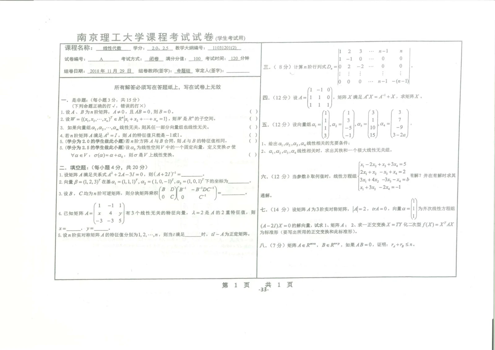

## 南京理工大学课程考试试卷(学生考试用)

课程名称： 线性代数 学分： 2.0、2.5 教学大纲编号： 11031201(2)
试卷编号： A 考试方式： 闭卷 满分分值： 100 考试时间： 120 分钟
组卷日期： 2018 年 11 月 29 日 组卷教师(签字)： 命题组 审定人(签字)：

### 所有解答必须写在答题纸上，写在试卷上无效

### 一. 是非题: (每小题 3 分, 共 15 分)

### (下列命题正确的打√，错误的打×)

1. 设 A、B 为 n 阶矩阵， $A \neq 0$ ，且 AB = 0，则 B = 0。

2. 设 $W = \left\{(x_{1}, x_{2}, \cdots, x_{n})^{T} \in R^{n} \mid x_{1} + x_{2} + \cdots + x_{n} = 1\right\}$ ，则 W 是 $R^{n}$ 的子空间。

3. 如果向量组 $\alpha_{1}, \alpha_{2}, \cdots, \alpha_{m}$ 线性无关，则其任一部分向量组也线性无关。 （）

4. 若 n 阶矩阵 A 满足 $A^{2}=I$ ，则 A 的特征值只能是 -1 或 1。

5. (学分为 2.0 的学生做此小题) 若 $n$ 阶方阵 $A$ 与 $B$ 合同, 则 $A$ 与 $B$ 的特征值相同。

5. (学分为 2.5 的学生做此小题) 设 $\alpha_{0}$ 为线性空间 $V$ 中的一个固定向量, 定义变换 $\sigma$ 使 $\forall \alpha \in V: \sigma (\alpha) = \alpha + \alpha_{0}$ , 则 $\sigma$ 是 $V$ 上线性变换。

### 二. 填空题: (每小题 4 分, 共 20 分)

1. 设矩阵 A 满足关系式 $A^{2} + 2A - 3I = 0$ ，则 $(A + 2I)^{-1} =$ \_\_\_\_。

2. 向量 $\beta=(1,2,3)^{T}$ 在基 $\alpha_{1}=(1,1,1)^{T},\alpha_{2}=(1,0,-1)^{T},\alpha_{3}=(1,0,1)^{T}$ 下的坐标为 \_\_\_\_。

3. 设 B，C 均为 n 阶可逆矩阵，则分块矩阵乘积 $\begin{pmatrix} B & D \\ 0 & C \end{pmatrix}$ $\begin{pmatrix} B^{-1} & -B^{-1}DC^{-1} \\ 0 & C^{-1} \end{pmatrix} =$ \_\_\_\_。

4. 已知矩阵 $A=\begin{pmatrix}1&-1&1\\x&4&y\\-3&-3&5\end{pmatrix}$ 有 3 个线性无关的特征向量， $\lambda=2$ 是 A 的 2 重特征值，则 x=\_\_\_\_，y=\_\_\_\_。

5. 设 n 阶实对称矩阵 A 的特征值分别为 $1, 2, \cdots, n$ ，则当 t 满足 \_\_\_\_ 时，tI - A 为正定矩阵。

三.（8分）计算 $n$ 阶行列式 $D_{n} = \left| \begin{array}{cccccc}1 & 2 & 3 & \cdots & n - 1 & n\\ 1 & -1 & 0 & \cdots & 0 & 0\\ 0 & 2 & -2 & \cdots & 0 & 0\\ \vdots & \vdots & \vdots & & \vdots & \vdots \\ 0 & 0 & 0 & \cdots & n - 1 & -(n - 1) \end{array} \right|$ 。

四.（12分）设 $A = \begin{pmatrix} 1 & -1 & 0\\ 1 & 1 & 0\\ 1 & 1 & 1 \end{pmatrix}$ ，矩阵 $X$ 满足 $A^{*}X = A^{-1} + X$ ，求矩阵 $X$ 。

五.（12分）设向量组 $\alpha_{1} = \begin{pmatrix} 1 \\ 1 \\ 1 \\ 3 \end{pmatrix}, \alpha_{2} = \begin{pmatrix} 1 \\ 3 \\ -5 \\ -1 \end{pmatrix}, \alpha_{3} = \begin{pmatrix} 3 \\ 1 \\ 10 \\ 15 \end{pmatrix}, \alpha_{4} = \begin{pmatrix} 3 \\ 7 \\ -9 \\ 3 - 2a \end{pmatrix}$

1、给出 $\alpha_{1},\alpha_{2},\alpha_{3},\alpha_{4}$ 线性相关的充要条件；

2、 $\alpha_{1},\alpha_{2},\alpha_{3},\alpha_{4}$ 线性相关时，求出其秩和一个极大线性无关组。

六.（12分）当参数b取何值时，线性方程组 $\left\{\begin{aligned}x_{1}-2x_{2}+x_{3}+3x_{4}&=5\\ 2x_{1}+x_{2}-x_{3}+x_{4}&=2\\ 3x_{1}+4x_{2}-3x_{3}-x_{4}&=b\\ x_{1}+3x_{2}-2x_{4}&=-1\end{aligned}\right.$ 有解？并在有解时求其

通解。

$$
\left| A \right| = 2, t r A = 0
$$

$$
\alpha = \left( \begin{array}{c} 1 \\ 1 \\ 1 \end{array} \right)
$$

$(A-2I)X=0$ 的解向量，试求1、矩阵A；2、求一正交变换X=TY化二次型 $f(X)=X^{T}AX$ 为标准形（要写出所用的正交变换和此标准形）。

八.（7分）矩阵 $A \in R^{m \times n}$ ， $B \in R^{n \times p}$ ，如果 $AB = 0$ ，证明： $r_A + r_B \leq n$ 。

第 1 页 共 1 页
-33-

## 第42页

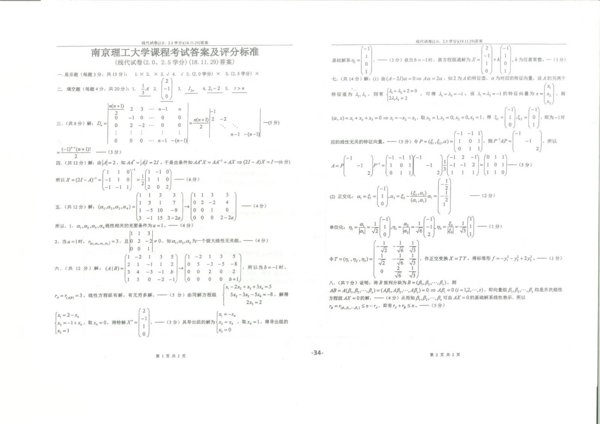

## 南京理工大学课程考试答案及评分标准

(线代试卷(2.0、2.5学分)(18.11.29)答案)

一.是非题（每题3分，共15分）： $1.\times 2.\times 3.\surd 4.\surd 5.(2.0$ 学分） $\times 5.(2.5$ 学分） $\times$ 二.填空题（每题4分，共20分）：1. $\frac{1}{3} A$ 2. $\begin{pmatrix} 2 \\ -1 \\ 0 \end{pmatrix}$ 3. $I_{2n}$ 4. $2, - 2$ 5. $t > n$ 三.（共8分）解： $D_{n} = \left| \begin{array}{cccccc}n(n + 1) & 2 & 3 & \dots & n - 1 & n\\ \hline 2 & 0 & -1 & 0 & \dots & 0 & 0\\ 0 & 2 & -2 & \dots & 0 & 0\\ \vdots & \vdots & \vdots &  & \vdots & \vdots \\ 0 & 0 & 0 & \dots & n - 1 & -(n - 1) \end{array} \right| = \frac{n(n + 1)}{2}\left| \begin{array}{cccc} - 1 &  &  &  \\ 2 & -2 &  &  \\  & \ddots & \ddots &  \\  &  & n - 1 & -(n - 1) \end{array} \right|$ —(5分) $= \frac{(-1)^{n - 1}(n + 1)!}{2}$ ——（3分）  
四.（共12分）解：由 $|A| = 2$ ，知 $AA^{\circ} = |A|I = 2I$ 。于是由条件知 $AA^{*}X = AA^{-1} + AX\Rightarrow (2I - A)X = I$ —(6分)所以 $X = (2I - A)^{-1} = \begin{pmatrix} 1 & 1 & 0 \\ -1 & 1 & 0 \\ -1 & -1 & 1 \end{pmatrix}^{-1} = \frac{1}{2}\begin{pmatrix} 1 & -1 & 0 \\ 1 & 1 & 0 \\ 2 & 0 & 2 \end{pmatrix}$ ——（6分）  
五.（共12分）解： $(\alpha_{1},\alpha_{2},\alpha_{3},\alpha_{4}) = \begin{pmatrix} 1 & 1 & 3 & 3 \\ 1 & 3 & 1 & 7 \\ 1 & -5 & 10 & -9 \\ 3 & -1 & 15 & 3 - 2a \end{pmatrix}\rightarrow \begin{pmatrix} 1 & 1 & 3 & 3 \\ 0 & 2 & -2 & 4 \\ 0 & 0 & 1 & 0 \\ 0 & 0 & 0 & 2 - 2a \end{pmatrix}$ ——（4分）所以，1、 $\alpha_{1},\alpha_{2},\alpha_{3},\alpha_{4}$ 线性相关的充要条件为 $a = 1$ 。——（4分）  
2、当 $a = 1$ 时， $r_{\{\alpha_1,\alpha_2,\alpha_3,\alpha_4\}} = 3$ ，且 $\left| \begin{array}{lll}1 & 1 & 3\\ 0 & 2 & -2\\ 0 & 0 & 1 \end{array} \right|\neq 0$ ，知 $\alpha_{1},\alpha_{2},\alpha_{3}$ 为一个极大线性无关组。——（4分）  
六.（共12分）解： $(A|B) = \begin{pmatrix}1 & -2 & 1 & 3 & 5\\ 2 & 1 & -1 & 1 & 2\\ 3 & 4 & -3 & -1 & b\\ 1 & 3 & 0 & -2 & -1 \end{pmatrix}\rightarrow \begin{pmatrix}1 & -2 & 1 & 3 & 5\\ 0 & 5 & -3 & -5 & -8\\ 0 & 0 & 2 & 0 & 2\\ 0 & 0 & 0 & 0 & b + 1 \end{pmatrix}$ ，所以当 $b = -1$ 时， $r_A = r_{(A|B)} = 3$ ，线性方程组有解，有无穷多解，——（5分）由同解方程组 $\left\{ \begin{array}{l}x_1 - 2x_2 + x_3 + 3x_4 = 5\\ x_2 - 3x_3 - 5x_4 = -8,\\ x_3 = 2 \end{array} \right.$ 解得 $\left\{ \begin{array}{l}x_{1} = 2 - x_{4}\\ x_{2} = -1 + x_{4}\\ x_{3} = 1 \end{array} \right.$ 取 $x_{4} = 0$ ，得特解 $X^{*} = \left( \begin{array}{l}2\\ -1\\ 1\\ 0 \end{array} \right)$ ，——（3分）其导出组的解为 $\left\{ \begin{array}{l}x_{1} = -x_{4}\\ x_{2} = x_{4}\\ x_{3} = 0 \end{array} \right.$ ，取 $x_{4} = 1$ ，得导出组的基础解系 $\eta_{1}=\begin{pmatrix}-1\\1\\0\\1\end{pmatrix}$ ，——（3分）故当 b=-1 时，原方程组通解为 $X=\begin{pmatrix}2\\-1\\1\\0\end{pmatrix}+k\begin{pmatrix}-1\\1\\0\\1\end{pmatrix}$ ，k 为任意常数。——（1分）

七.（共14分）解：（1）由 $(A-2I)\alpha=0\Rightarrow A\alpha=2\alpha$ ，知2为A的特征值， $\alpha$ 为对应的特征向量，设 A 的另两个特征值为 $\lambda_{1},\lambda_{2}$ ，则有 $\left\{\begin{aligned}\lambda_{1}+\lambda_{2}+2&=0\\2\lambda_{1}\lambda_{2}&=2\end{aligned}\right.$ ，可得 $\lambda_{1}=\lambda_{2}=-1$ 。设 $\lambda_{1}=\lambda_{2}=-1$ 的特征向量为 $x=\begin{pmatrix}x_{1}\\x_{2}\\x_{3}\end{pmatrix}$ ，则 $(\alpha,x)=x_{1}+x_{2}+x_{3}=0\Rightarrow x_{1}=-x_{2}-x_{3}$ ，取 $x_{2}=1,x_{3}=0;x_{2}=0,x_{3}=1$ ，得 $\xi_{1}=\begin{pmatrix}-1\\1\\0\end{pmatrix},\xi_{2}=\begin{pmatrix}-1\\0\\1\end{pmatrix}$ ，即为-1对

应的线性无关的特征向量。——（5分）令 $P=(\xi_{1},\xi_{2},\alpha)=\begin{pmatrix}-1&-1&1\\1&0&1\\0&1&1\end{pmatrix}$ ，则 $P^{-1}AP=\begin{pmatrix}-1&\\&-1\\&&2\end{pmatrix}$ ，所以 $A=P\begin{pmatrix}-1&\\&-1&\\&2\end{pmatrix}P^{-1}=\begin{pmatrix}-1&-1&1\\1&0&1\\0&1&1\end{pmatrix}\begin{pmatrix}-1&\\&-1&\\&2\end{pmatrix}\frac{1}{3}\begin{pmatrix}-1&2&-1\\-1&-1&2\\1&1&1\end{pmatrix}=\begin{pmatrix}0&1&1\\1&0&1\\1&1&0\end{pmatrix}$ ——（5分）

（2）正交化： $\alpha_{1}=\xi_{1}=\begin{pmatrix}-1\\1\\0\end{pmatrix},\alpha_{2}=\xi_{2}-\frac{(\xi_{2},\alpha_{1})}{(\alpha_{1},\alpha_{1})}\alpha_{1}=\begin{pmatrix}-\frac{1}{2}\\-\frac{1}{2}\\1\end{pmatrix}$ ——（2分）

单位化： $\eta_{1}=\frac{\alpha_{1}}{| \alpha_{1}|}=\frac{1}{\sqrt{2}}\begin{pmatrix}-1\\1\\0\end{pmatrix},\eta_{2}=\frac{\alpha_{2}}{| \alpha_{2}|}=\frac{1}{\sqrt{6}}\begin{pmatrix}-1\\-1\\2\end{pmatrix},\eta_{3}=\frac{\xi_{3}}{| \xi_{3}|}=\frac{1}{\sqrt{3}}\begin{pmatrix}1\\1\\1\end{pmatrix}$ ——（1分）

令 $T=(\eta_{1},\eta_{2},\eta_{3})=\begin{pmatrix}-\frac{1}{\sqrt{2}}&-\frac{1}{\sqrt{6}}&\frac{1}{\sqrt{3}}\\\frac{1}{\sqrt{2}}&-\frac{1}{\sqrt{6}}&\frac{1}{\sqrt{3}}\\0&\frac{2}{\sqrt{6}}&\frac{1}{\sqrt{3}}\end{pmatrix}$ ，作正交变换 X=TY，得标准形 $f=-y_{1}^{2}-y_{2}^{2}+2y_{3}^{2}$ 。——（1分）

八.（共7分）证明：将 B 按列分块为 $B=(\beta_{1},\beta_{2},\cdots,\beta_{s})$ ，则 $AB=A(\beta_{1},\beta_{2},\cdots,\beta_{s})=(A\beta_{1},A\beta_{2},\cdots,A\beta_{s})=0\Rightarrow A\beta_{i}=0(i=1,2,\cdots,s)$ ，即向量组 $\beta_{1},\beta_{2},\cdots,\beta_{s}$ 均是齐次线性方程组 AX=0 的解，——（4分）从而知 $\beta_{1},\beta_{2},\cdots,\beta_{s}$ 可由 AX=0 的基础解系线性表示，所以 $r_{B}=r_{(\beta_{1},\beta_{2},\cdots,\beta_{s})}\leq n-r_{A}$ ，即有 $r_{A}+r_{B}\leq n$ 。——（3分）

线代试卷(2.0、2.5学分)(18.11.29)答案

线代试卷(2.0、2.5学分)(18.11.29)答案

第1页共2页

第2页共2页

-34-
