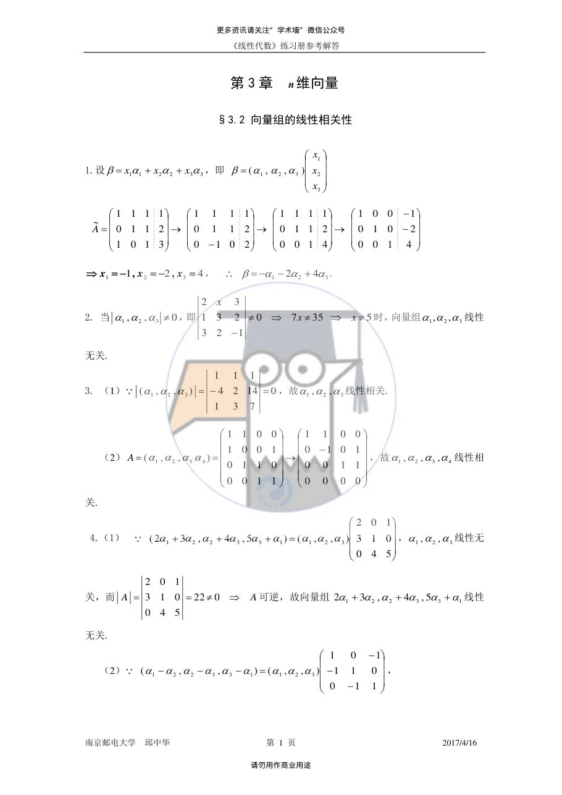
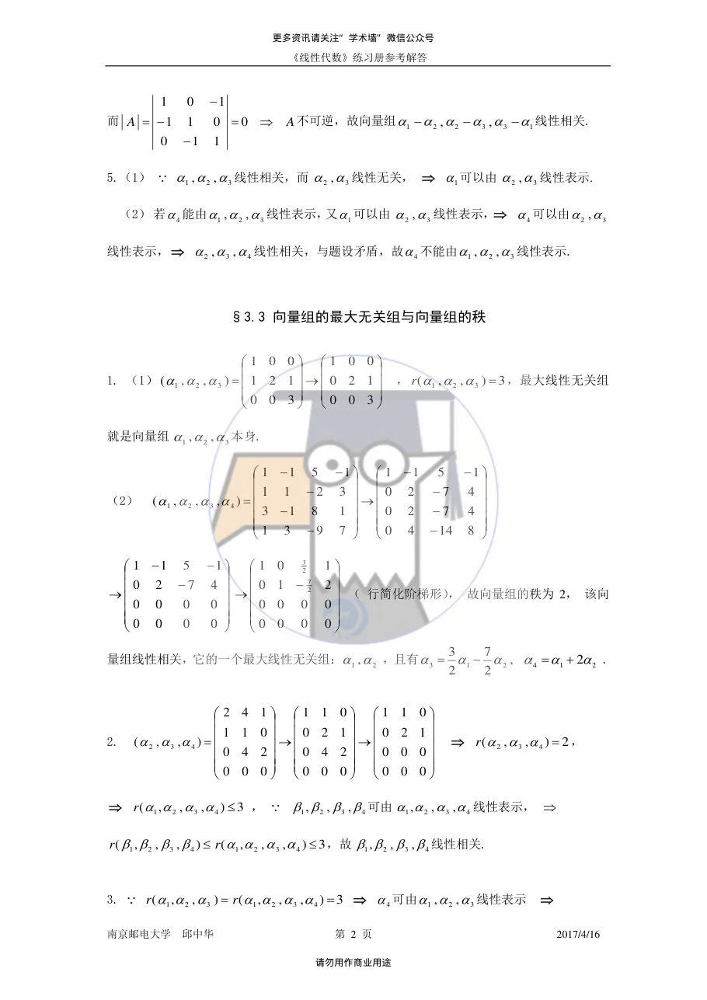
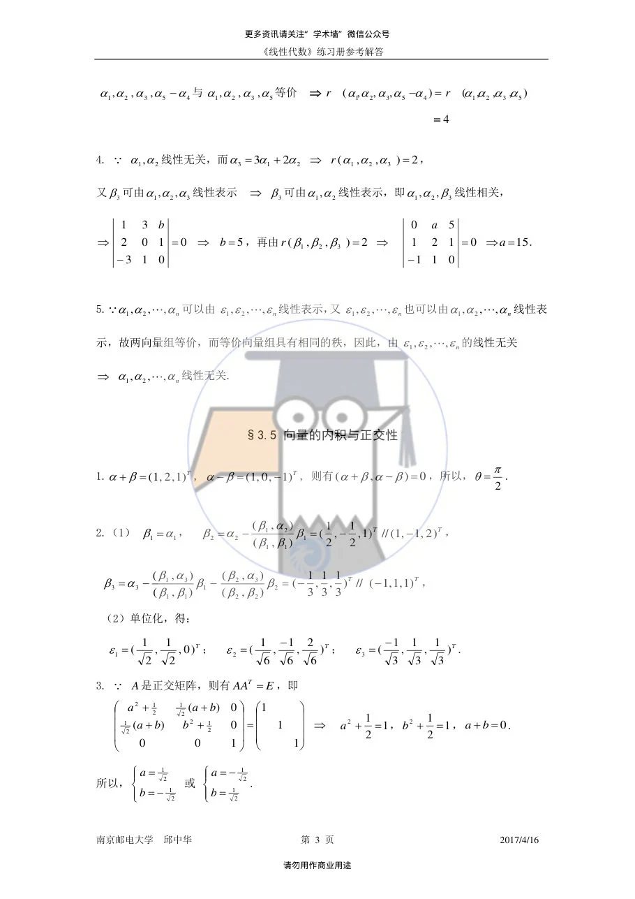
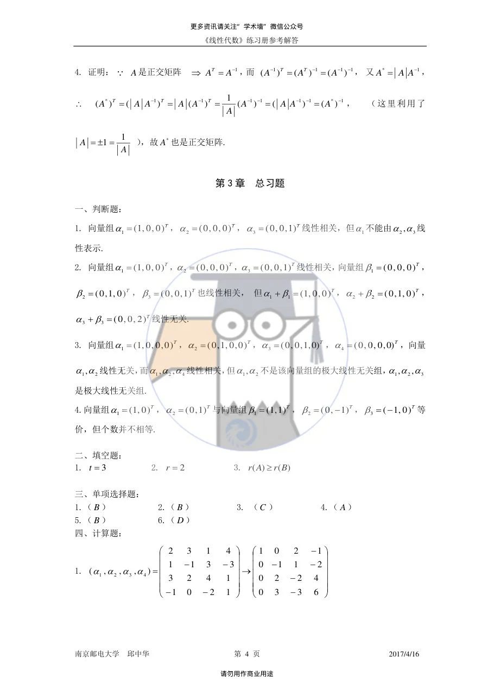
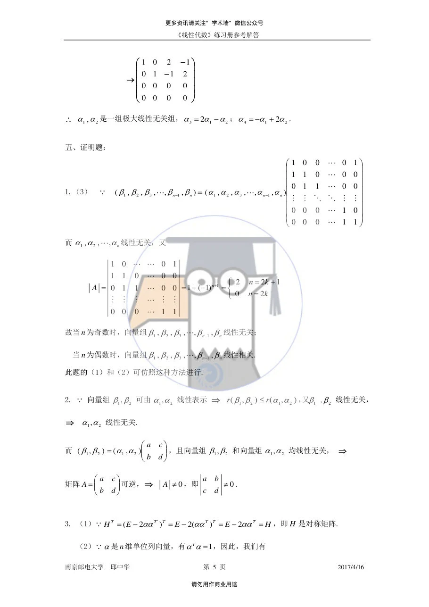
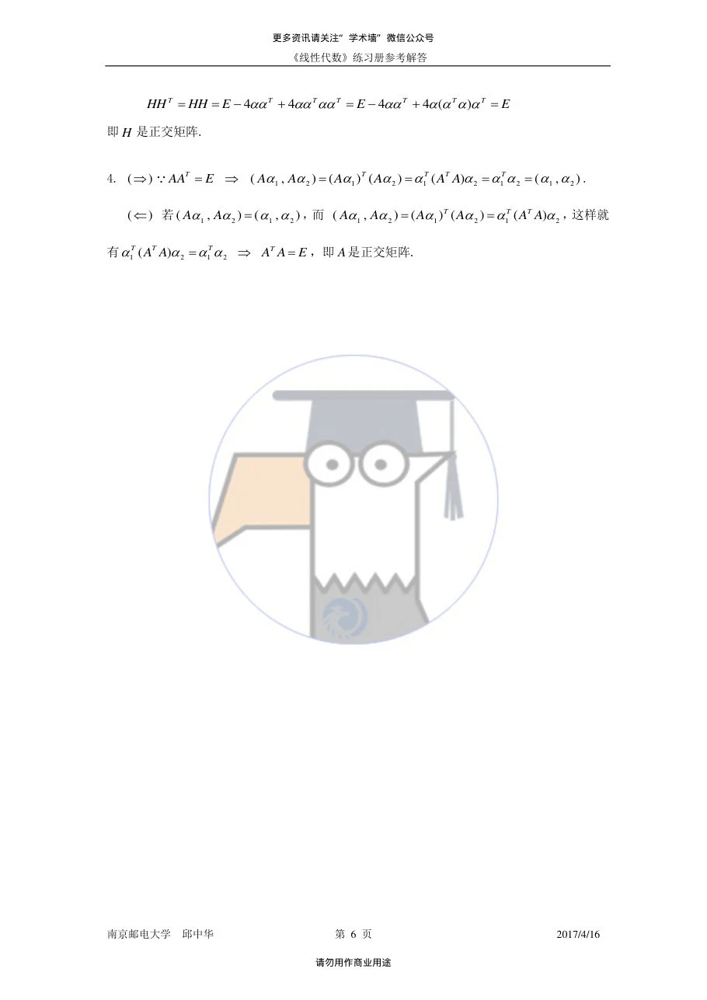

# 《线性代数》第3章 向量组的线性相关性与秩（练习册参考解答）

按原件顺序阅读，文字可对照页图。

## 第1页

### 第3章 $n$ 维向量

### § 3.2 向量组的线性相关性

1. 设 $\beta = x_{1}\alpha_{1} + x_{2}\alpha_{2} + x_{3}\alpha_{3}$ ，即 $\beta = (\alpha_{1},\alpha_{2},\alpha_{3})\left( \begin{array}{c}x_{1}\\ x_{2}\\ x_{3} \end{array} \right)$

$$
\widetilde {A} = \left(\begin{array}{c c c c}1&1&1&1\\0&1&1&2\\1&0&1&3\end{array}\right)\rightarrow \left(\begin{array}{c c c c}1&1&1&1\\0&1&1&2\\0&- 1&0&2\end{array}\right)\rightarrow \left(\begin{array}{c c c c}1&1&1&1\\0&1&1&2\\0&0&1&4\end{array}\right)\rightarrow \left(\begin{array}{c c c c}1&0&0&- 1\\0&1&0&- 2\\0&0&1&4\end{array}\right)
$$

$$
\Rightarrow \boldsymbol {x} _ {1} = - 1, \boldsymbol {x} _ {2} = - 2, \boldsymbol {x} _ {3} = 4, \quad \therefore \beta = - \alpha_ {1} - 2 \alpha_ {2} + 4 \alpha_ {3}.
$$

2. 当 $\left|\alpha_{1},\alpha_{2},\alpha_{3}\right|\neq0$ ，即 $\left|\begin{matrix}2&x&3\\ 1&3&2\\ 3&2&-1\end{matrix}\right|\neq0\Rightarrow7x\neq35\Rightarrow x\neq5$ 时，向量组 $\alpha_{1},\alpha_{2},\alpha_{3}$ 线性无关.

3. (1) $\because \left|\left(\alpha_{1},\alpha_{2},\alpha_{3}\right)\right| = \left|\begin{array}{lll}1 & 1 & 1\\ -4 & 2 & 14\\ 1 & 3 & 7 \end{array}\right| = 0$ ，故 $\alpha_{1},\alpha_{2},\alpha_{3}$ 线性相关.

(2) $A = (\alpha_{1},\alpha_{2},\alpha_{3}\alpha_{4}) = \left( \begin{array}{cccc}1 & 1 & 0 & 0\\ 1 & 0 & 0 & 1\\ 0 & 1 & 1 & 0\\ 0 & 0 & 1 & 1 \end{array} \right)\rightarrow \left( \begin{array}{cccc}1 & 1 & 0 & 0\\ 0 & -1 & 0 & 1\\ 0 & 0 & 1 & 1\\ 0 & 0 & 0 & 0 \end{array} \right),$ 故 $\alpha_{1},\alpha_{2},\alpha_{3},\alpha_{4}$ 线性相

关.

4. (1) $\because (2\alpha_{1} + 3\alpha_{2}, \alpha_{2} + 4\alpha_{3}, 5\alpha_{3} + \alpha_{1}) = (\alpha_{1}, \alpha_{2}, \alpha_{3}) \begin{pmatrix} 2 & 0 & 1 \\ 3 & 1 & 0 \\ 0 & 4 & 5 \end{pmatrix}$ , $\alpha_{1}, \alpha_{2}, \alpha_{3}$ 线性无

关，而 $|A| = \begin{vmatrix} 2 & 0 & 1 \\ 3 & 1 & 0 \\ 0 & 4 & 5 \end{vmatrix} = 22 \neq 0 \Rightarrow A$ 可逆，故向量组 $2\alpha_{1} + 3\alpha_{2}, \alpha_{2} + 4\alpha_{3}, 5\alpha_{3} + \alpha_{1}$ 线性无关.

$$
(2) \because (\alpha_ {1} - \alpha_ {2}, \alpha_ {2} - \alpha_ {3}, \alpha_ {3} - \alpha_ {1}) = (\alpha_ {1}, \alpha_ {2}, \alpha_ {3}) \left( \begin{array}{c c c} 1 & 0 & - 1 \\ - 1 & 1 & 0 \\ 0 & - 1 & 1 \end{array} \right), \tag {2}
$$

更多资讯请关注“学术墙”微信公众号《线性代数》练习册参考解答

南京邮电大学 邱中华

第1页

2017/4/16

请勿用作商业用途

## 第2页

而 $|A|=\begin{vmatrix}1&0&-1\\-1&1&0\\0&-1&1\end{vmatrix}=0\Rightarrow A$ 不可逆，故向量组 $\alpha_{1}-\alpha_{2},\alpha_{2}-\alpha_{3},\alpha_{3}-\alpha_{1}$ 线性相关.

5.（1）∵ $\alpha_{1},\alpha_{2},\alpha_{3}$ 线性相关，而 $\alpha_{2},\alpha_{3}$ 线性无关，⇒ $\alpha_{1}$ 可以由 $\alpha_{2},\alpha_{3}$ 线性表示.

（2）若 $\alpha_{4}$ 能由 $\alpha_{1},\alpha_{2},\alpha_{3}$ 线性表示，又 $\alpha_{1}$ 可以由 $\alpha_{2},\alpha_{3}$ 线性表示， $\Rightarrow \alpha_{4}$ 可以由 $\alpha_{2},\alpha_{3}$ 线性表示， $\Rightarrow \alpha_{2},\alpha_{3},\alpha_{4}$ 线性相关，与题设矛盾，故 $\alpha_{4}$ 不能由 $\alpha_{1},\alpha_{2},\alpha_{3}$ 线性表示.

### § 3.3 向量组的最大无关组与向量组的秩

1. （1） $(\alpha_{1},\alpha_{2},\alpha_{3})=\begin{pmatrix}1&0&0\\1&2&1\\0&0&3\end{pmatrix}\rightarrow\begin{pmatrix}1&0&0\\0&2&1\\0&0&3\end{pmatrix}$ ， $r(\alpha_{1},\alpha_{2},\alpha_{3})=3$ ，最大线性无关组就是向量组 $\alpha_{1},\alpha_{2},\alpha_{3}$ 本身.

$$
\left(\alpha_ {1}, \alpha_ {2}, \alpha_ {3}, \alpha_ {4}\right) = \left(\begin{array}{c c c c}1&- 1&5&- 1\\1&1&- 2&3\\3&- 1&8&1\\1&3&- 9&7\end{array}\right)\rightarrow \left(\begin{array}{c c c c}1&- 1&5&- 1\\0&2&- 7&4\\0&2&- 7&4\\0&4&- 1 4&8\end{array}\right)\tag{2}
$$

$\rightarrow\left(\begin{array}{cccc}1 & -1 & 5 & -1 \\ 0 & 2 & -7 & 4 \\ 0 & 0 & 0 & 0 \\ 0 & 0 & 0 & 0\end{array}\right)\rightarrow\left(\begin{array}{cccc}1 & 0 & \frac{3}{2} & 1 \\ 0 & 1 & -\frac{7}{2} & 2 \\ 0 & 0 & 0 & 0 \\ 0 & 0 & 0 & 0\end{array}\right)$ （行简化阶梯形），故向量组的秩为2，该向

量组线性相关，它的一个最大线性无关组： $\alpha_{1},\alpha_{2}$ ，且有 $\alpha_{3} = \frac{3}{2}\alpha_{1} - \frac{7}{2}\alpha_{2}$ ， $\alpha_{4} = \alpha_{1} + 2\alpha_{2}$

$$
\left(\alpha_ {2}, \alpha_ {3}, \alpha_ {4}\right) = \left(\begin{array}{l l l}2&4&1\\1&1&0\\0&4&2\\0&0&0\end{array}\right)\rightarrow \left(\begin{array}{l l l}1&1&0\\0&2&1\\0&4&2\\0&0&0\end{array}\right)\rightarrow \left(\begin{array}{l l l}1&1&0\\0&2&1\\0&0&0\\0&0&0\end{array}\right) \Rightarrow r \left(\alpha_ {2}, \alpha_ {3}, \alpha_ {4}\right) = 2,
$$

$\Rightarrow r(\alpha_{1},\alpha_{2},\alpha_{3},\alpha_{4})\leq 3$ ， $\because \beta_{1},\beta_{2},\beta_{3},\beta_{4}$ 可由 $\alpha_{1},\alpha_{2},\alpha_{3},\alpha_{4}$ 线性表示， $\Rightarrow$ $r(\beta_1,\beta_2,\beta_3,\beta_4)\leq r(\alpha_1,\alpha_2,\alpha_3,\alpha_4)\leq 3$ ，故 $\beta_{1},\beta_{2},\beta_{3},\beta_{4}$ 线性相关.

3. $\because r(\alpha_{1},\alpha_{2},\alpha_{3}) = r(\alpha_{1},\alpha_{2},\alpha_{3},\alpha_{4}) = 3 \Rightarrow \alpha_{4}$ 可由 $\alpha_{1},\alpha_{2},\alpha_{3}$ 线性表示 $\Rightarrow$

请勿用作商业用途

更多资讯请关注“学术墙”微信公众号《线性代数》练习册参考解答

第2页

2017/4/16

## 第3页

$$
\begin{array}{r l} \alpha_ {1}, \alpha_ {2}, \alpha_ {3}, \alpha_ {5} - \alpha_ {4} \text {与} \alpha_ {1}, \alpha_ {2}, \alpha_ {3}, \alpha_ {5} \text {等价} & \Rightarrow r (\alpha_ {1}, \alpha_ {2}, \alpha_ {3}, \alpha_ {5} - \alpha_ {4}) = r (\alpha_ {1}, \alpha_ {2}, \alpha_ {3}, \alpha_ {5}) \\ & = 4 \end{array}
$$

4. $\because \alpha_{1},\alpha_{2}$ 线性无关，而 $\alpha_{3} = 3\alpha_{1} + 2\alpha_{2}\Rightarrow r(\alpha_{1},\alpha_{2},\alpha_{3}) = 2,$

又 $\beta_{3}$ 可由 $\alpha_{1},\alpha_{2},\alpha_{3}$ 线性表示 $\Rightarrow \beta_{3}$ 可由 $\alpha_{1},\alpha_{2}$ 线性表示，即 $\alpha_{1},\alpha_{2},\beta_{3}$ 线性相关，

$\Rightarrow \left| \begin{array}{ccc}1 & 3 & b\\ 2 & 0 & 1\\ -3 & 1 & 0 \end{array} \right| = 0\Rightarrow b = 5$ ，再由 $r(\beta_1,\beta_2,\beta_3) = 2\Rightarrow$ $\left| \begin{array}{ccc}0 & a & 5\\ 1 & 2 & 1\\ -1 & 1 & 0 \end{array} \right| = 0\Rightarrow a = 15.$

5. $\because\alpha_{1},\alpha_{2},\cdots,\alpha_{n}$ 可以由 $\varepsilon_{1},\varepsilon_{2},\cdots,\varepsilon_{n}$ 线性表示，又 $\varepsilon_{1},\varepsilon_{2},\cdots,\varepsilon_{n}$ 也可以由 $\alpha_{1},\alpha_{2},\cdots,\alpha_{n}$ 线性表示，故两向量组等价，而等价向量组具有相同的秩，因此，由 $\varepsilon_{1},\varepsilon_{2},\cdots,\varepsilon_{n}$ 的线性无关

$$
\Rightarrow \alpha_ {1}, \alpha_ {2}, \dots , \alpha_ {n}
$$

### § 3.5 向量的内积与正交性

1. $\alpha +\beta = (1,2,1)^T$ ， $\alpha -\beta = (1,0, - 1)^T$ ，则有 $(\alpha +\beta ,\alpha -\beta) = 0$ ，所以， $\theta = \frac{\pi}{2}$

2. (1) $\beta_{1} = \alpha_{1}$ , $\beta_{2} = \alpha_{2} - \frac{(\beta_{1},\alpha_{2})}{(\beta_{1},\beta_{1})}\beta_{1} = (\frac{1}{2}, - \frac{1}{2},1)^{T} / / (1, - 1,2)^{T}$ ,

$$
\beta_ {3} = \alpha_ {3} - \frac {\left(\beta_ {1} , \alpha_ {3}\right)}{\left(\beta_ {1} , \beta_ {1}\right)} \beta_ {1} - \frac {\left(\beta_ {2} , \alpha_ {3}\right)}{\left(\beta_ {2} , \beta_ {2}\right)} \beta_ {2} = \left(- \frac {1}{3}, \frac {1}{3}, \frac {1}{3}\right) ^ {T} / / (- 1, 1, 1) ^ {T},
$$

(2) 单位化，得:

$$
\varepsilon_ {1} = \left(\frac {1}{\sqrt {2}}, \frac {1}{\sqrt {2}}, 0\right) ^ {T}; \quad \varepsilon_ {2} = \left(\frac {1}{\sqrt {6}}, \frac {- 1}{\sqrt {6}}, \frac {2}{\sqrt {6}}\right) ^ {T}; \quad \varepsilon_ {3} = \left(\frac {- 1}{\sqrt {3}}, \frac {1}{\sqrt {3}}, \frac {1}{\sqrt {3}}\right) ^ {T}.
$$

3. $\because A$ 是正交矩阵，则有 $AA^T = E$ ，即

$$
\left( \begin{array}{c c c} a ^ {2} + \frac {1}{2} & \frac {1}{\sqrt {2}} (a + b) & 0 \\ \frac {1}{\sqrt {2}} (a + b) & b ^ {2} + \frac {1}{2} & 0 \\ 0 & 0 & 1 \end{array} \right) = \left( \begin{array}{c c c} 1 & & \\ & 1 & \\ & & 1 \end{array} \right) \Rightarrow a ^ {2} + \frac {1}{2} = 1, b ^ {2} + \frac {1}{2} = 1, a + b = 0.
$$

所以， $\left\{ \begin{array}{ll}a = \frac{1}{\sqrt{2}}\\ b = -\frac{1}{\sqrt{2}} \end{array} \right.$ 或 $\left\{ \begin{array}{ll}a = -\frac{1}{\sqrt{2}}\\ b = \frac{1}{\sqrt{2}} \end{array} \right..$

更多资讯请关注“学术墙”微信公众号《线性代数》练习册参考解答

请勿用作商业用途

南京邮电大学 邱中华

第3页

2017/4/16

## 第4页

4. 证明：∵ A 是正交矩阵 $\Rightarrow A^{T}=A^{-1}$ ，而 $(A^{-1})^{T}=(A^{T})^{-1}=(A^{-1})^{-1}$ ，又 $A^{*}=\left|A\right|A^{-1}$ ， $\therefore \quad (A^{*})^{T} = (\left|A\right|A^{-1})^{T} = \left|A\right|(A^{-1})^{T} = \frac{1}{\left|A\right|}(A^{-1})^{-1} = (\left|A\right|A^{-1})^{-1} = (A^{*})^{-1}$ ，（这里利用了 $\left|A\right|=\pm1=\frac{1}{\left|A\right|}$ ，故 $A^{*}$ 也是正交矩阵.

### 第 3 章 总习题

### 一、判断题：

1. 向量组 $\alpha_{1} = (1,0,0)^{T}$ , $\alpha_{2} = (0,0,0)^{T}$ , $\alpha_{3} = (0,0,1)^{T}$ 线性相关, 但 $\alpha_{1}$ 不能由 $\alpha_{2},\alpha_{3}$ 线性表示.

2. 向量组 $\alpha_{1} = (1,0,0)^{T}$ , $\alpha_{2} = (0,0,0)^{T}$ , $\alpha_{3} = (0,0,1)^{T}$ 线性相关, 向量组 $\beta_{1} = (0,0,0)^{T}$ , $\beta_{2} = (0,1,0)^{T}$ , $\beta_{3} = (0,0,1)^{T}$ 也线性相关, 但 $\alpha_{1} + \beta_{1} = (1,0,0)^{T}$ , $\alpha_{2} + \beta_{2} = (0,1,0)^{T}$ , $\alpha_{3} + \beta_{3} = (0,0,2)^{T}$ 线性无关.

3. 向量组 $\alpha_{1}=(1,0,0,0)^{T}$ ， $\alpha_{2}=(0,1,0,0)^{T}$ ， $\alpha_{3}=(0,0,1,0)^{T}$ ， $\alpha_{4}=(0,0,0,0)^{T}$ ，向量 $\alpha_{1},\alpha_{2}$ 线性无关，而 $\alpha_{1},\alpha_{2},\alpha_{4}$ 线性相关，但 $\alpha_{1},\alpha_{2}$ 不是该向量组的极大线性无关组， $\alpha_{1},\alpha_{2},\alpha_{3}$ 是极大线性无关组.
4. 向量组 $\alpha_{1}=(1,0)^{T}$ ， $\alpha_{2}=(0,1)^{T}$ 与向量组 $\beta_{1}=(1,1)^{T}$ ， $\beta_{2}=(0,-1)^{T}$ ， $\beta_{3}=(-1,0)^{T}$ 等价，但个数并不相等.

二、填空题：
1. t = 3
2. r = 2
3. $r(A) \geq r(B)$

三、单项选择题：
1. (B) 2. (B) 3. (C) 4. (A)
5. (B) 6. (D)

四、计算题：

$$
\left(\alpha_ {1}, \alpha_ {2}, \alpha_ {3}, \alpha_ {4}\right) = \left(\begin{array}{r r r r}2&3&1&4\\1&- 1&3&- 3\\3&2&4&1\\- 1&0&- 2&1\end{array}\right)\rightarrow \left(\begin{array}{r r r r}1&0&2&- 1\\0&- 1&1&- 2\\0&2&- 2&4\\0&3&- 3&6\end{array}\right)
$$

请勿用作商业用途

更多资讯请关注“学术墙”微信公众号《线性代数》练习册参考解答

南京邮电大学 邱中华

第4页

2017/4/16

## 第5页

$$
\rightarrow \left(\begin{array}{c c c c}1&0&2&- 1\\0&1&- 1&2\\0&0&0&0\\0&0&0&0\end{array}\right)
$$

∴ $\alpha_{1},\alpha_{2}$ 是一组极大线性无关组， $\alpha_{3}=2\alpha_{1}-\alpha_{2}$ ; $\alpha_{4}=-\alpha_{1}+2\alpha_{2}$ .

五、证明题：

1. (3)

$$
\because \quad (\beta_ {1}, \beta_ {2}, \beta_ {3}, \dots , \beta_ {n - 1}, \beta_ {n}) = (\alpha_ {1}, \alpha_ {2}, \alpha_ {3}, \dots , \alpha_ {n - 1}, \alpha_ {n}) \left( \begin{array}{c c c c c c} 1 & 0 & 0 & \dots & 0 & 1 \\ 1 & 1 & 0 & \dots & 0 & 0 \\ 0 & 1 & 1 & \dots & 0 & 0 \\ \vdots & \vdots & \ddots & \ddots & \vdots & \vdots \\ 0 & 0 & 0 & \dots & 1 & 0 \\ 0 & 0 & 0 & \dots & 1 & 1 \end{array} \right)
$$

而 $\alpha_{1},\alpha_{2},\cdots,\alpha_{n}$ 线性无关，又

$$
\left| \boldsymbol {A} \right| = \left| \begin{array}{c c c c c c} 1 & 0 & \dots & \dots & 0 & 1 \\ 1 & 1 & 0 & \dots & 0 & 0 \\ 0 & 1 & 1 & \dots & 0 & 0 \\ \vdots & \vdots & \vdots & \dots & \vdots & \vdots \\ 0 & 0 & 0 & \dots & 1 & 1 \end{array} \right| = 1 + (- 1) ^ {n + 1} = \left\{ \begin{array}{l l} 2 & n = 2 k + 1 \\ 0 & n = 2 k \end{array} \right.
$$

故当 n 为奇数时，向量组 $\beta_{1}, \beta_{2}, \beta_{3}, \cdots, \beta_{n-1}, \beta_{n}$ 线性无关；

当 n 为偶数时，向量组 $\beta_{1}, \beta_{2}, \beta_{3}, \cdots, \beta_{n-1}, \beta_{n}$ 线性相关.

此题的（1）和（2）可仿照这种方法进行.

2. $\because$ 向量组 $\beta_{1},\beta_{2}$ 可由 $\alpha_{1},\alpha_{2}$ 线性表示 $\Rightarrow r(\beta_1,\beta_2)\leq r(\alpha_1,\alpha_2)$ ，又 $\beta_{1},\beta_{2}$ 线性无关， $\Rightarrow \alpha_{1},\alpha_{2}$ 线性无关.

而 $(\beta_{1},\beta_{2}) = (\alpha_{1},\alpha_{2})\left( \begin{array}{cc}a & c\\ b & d \end{array} \right)$ ，且向量组 $\beta_{1},\beta_{2}$ 和向量组 $\alpha_{1},\alpha_{2}$ 均线性无关， $\Rightarrow$ 矩阵 $A = \left( \begin{array}{cc}a & c\\ b & d \end{array} \right)$ 可逆， $\Rightarrow |A|\neq 0$ ，即 $\left| \begin{array}{cc}a & b\\ c & d \end{array} \right|\neq 0.$

3. (1) $\because H^{T} = (E - 2\alpha \alpha^{T})^{T} = E - 2(\alpha \alpha^{T})^{T} = E - 2\alpha \alpha^{T} = H$ ，即 $H$ 是对称矩阵.

(2) $\because \alpha$ 是 $n$ 维单位列向量，有 $\alpha^T\alpha = 1$ ，因此，我们有

南京邮电大学 邱中华

更多资讯请关注“学术墙”微信公众号

《线性代数》练习册参考解答

第5页

2017/4/16

请勿用作商业用途

## 第6页

$$
H H ^ {T} = H H = E - 4 \alpha \alpha^ {T} + 4 \alpha \alpha^ {T} \alpha \alpha^ {T} = E - 4 \alpha \alpha^ {T} + 4 \alpha (\alpha^ {T} \alpha) \alpha^ {T} = E
$$

即 H 是正交矩阵.

$$
4. (\Rightarrow) \because A A ^ {T} = E \Rightarrow (A \alpha_ {1}, A \alpha_ {2}) = (A \alpha_ {1}) ^ {T} (A \alpha_ {2}) = \alpha_ {1} ^ {T} (A ^ {T} A) \alpha_ {2} = \alpha_ {1} ^ {T} \alpha_ {2} = (\alpha_ {1}, \alpha_ {2}).
$$

$(\Leftarrow)$ 若 $(A\alpha_{1}, A\alpha_{2}) = (\alpha_{1}, \alpha_{2})$ ，而 $(A\alpha_{1}, A\alpha_{2}) = (A\alpha_{1})^{T}(A\alpha_{2}) = \alpha_{1}^{T}(A^{T}A)\alpha_{2}$ ，这样就有 $\alpha_{1}^{T}(A^{T}A)\alpha_{2} = \alpha_{1}^{T}\alpha_{2} \Rightarrow A^{T}A = E$ ，即 $A$ 是正交矩阵.

更多资讯请关注“学术墙”微信公众号

《线性代数》练习册参考解答

南京邮电大学 邱中华

第6页

2017/4/16

请勿用作商业用途
