# 《马克思主义基本原理》期末复习题库

按原件顺序阅读，文字可对照页图。

## 第1页

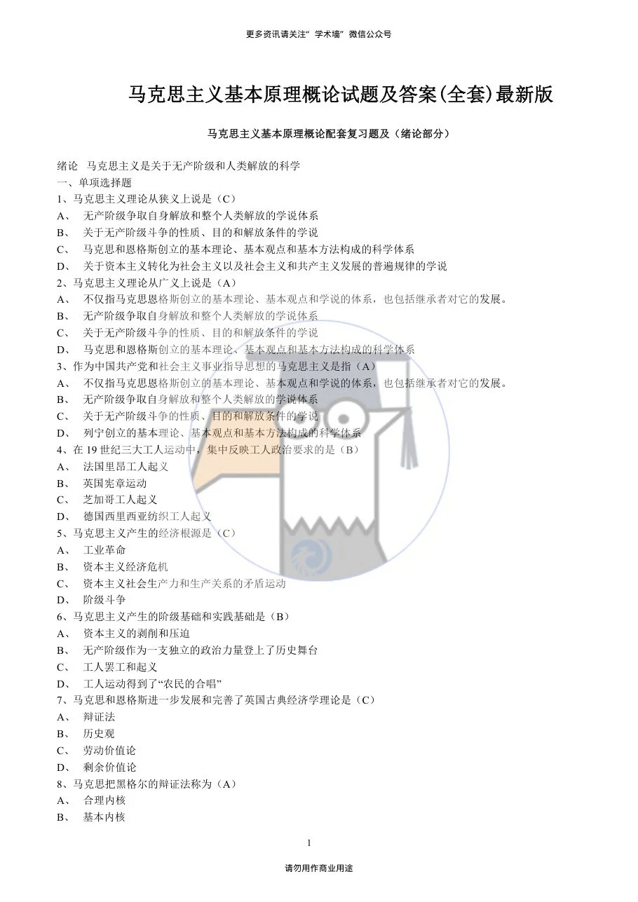

## 马克思主义基本原理概论试题及答案(全套)最新版

### 马克思主义基本原理概论配套复习题及（绪论部分）

绪论 马克思主义是关于无产阶级和人类解放的科学

### 一、单项选择题

1、马克思主义理论从狭义上说是（C）A、 无产阶级争取自身解放和整个人类解放的学说体系B、 关于无产阶级斗争的性质、目的和解放条件的学说C、 马克思和恩格斯创立的基本理论、基本观点和基本方法构成的科学体系D、 关于资本主义转化为社会主义以及社会主义和共产主义发展的普遍规律的学说

2、马克思主义理论从广义上说是（A）A、 不仅指马克思恩格斯创立的基本理论、基本观点和学说的体系，也包括继承者对它的发展。B、 无产阶级争取自身解放和整个人类解放的学说体系C、 关于无产阶级斗争的性质、目的和解放条件的学说D、 马克思和恩格斯创立的基本理论、基本观点和基本方法构成的科学体系

3、作为中国共产党和社会主义事业指导思想的马克思主义是指（A）A、 不仅指马克思恩格斯创立的基本理论、基本观点和学说的体系，也包括继承者对它的发展。B、 无产阶级争取自身解放和整个人类解放的学说体系C、 关于无产阶级斗争的性质、目的和解放条件的学说D、 列宁创立的基本理论、基本观点和基本方法构成的科学体系

4、在 19世纪三大工人运动中，集中反映工人政治要求的是（B）A、 法国里昂工人起义B、 英国宪章运动C、 芝加哥工人起义D、 德国西里西亚纺织工人起义

5、马克思主义产生的经济根源是（C）A、 工业革命B、 资本主义经济危机C、 资本主义社会生产力和生产关系的矛盾运动D、 阶级斗争

6、马克思主义产生的阶级基础和实践基础是（B）A、 资本主义的剥削和压迫B、 无产阶级作为一支独立的政治力量登上了历史舞台C、 工人罢工和起义D、 工人运动得到了“农民的合唱”

7、马克思和恩格斯进一步发展和完善了英国古典经济学理论是（C）A、 辩证法B、 历史观C、 劳动价值论D、 剩余价值论

8、马克思把黑格尔的辩证法称为（A）A、 合理内核B、 基本内核

请勿用作商业用途

更多资讯请关注“学术墙”微信公众号

1

## 第2页

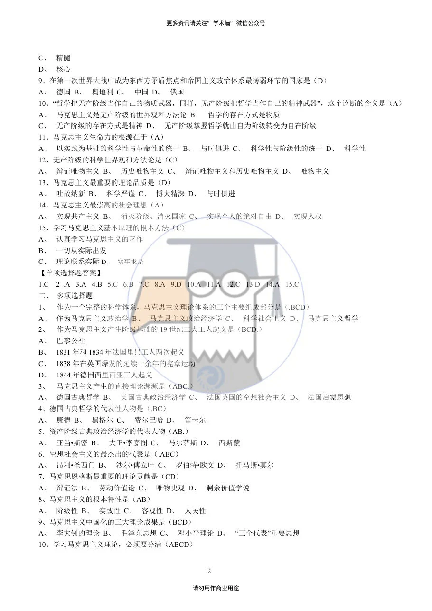

C、 精髓D、 核心

9、在第一次世界大战中成为东西方矛盾焦点和帝国主义政治体系最薄弱环节的国家是（D）A、 德国 B、 奥地利 C、 中国 D、 俄国

10、“哲学把无产阶级当作自己的物质武器，同样，无产阶级把哲学当作自己的精神武器”，这个论断的含义是（A）A、 马克思主义是无产阶级的世界观和方法论 B、 哲学的存在方式是物质C、 无产阶级的存在方式是精神 D、 无产阶级掌握哲学就由自为阶级转变为自在阶级

11、马克思主义生命力的根源在于（A）A、 以实践为基础的科学性与革命性的统一 B、 与时俱进 C、 科学性与阶级性的统一 D、 科学性

12、无产阶级的科学世界观和方法论是（C）A、 辩证唯物主义 B、 历史唯物主义 C、 辩证唯物主义和历史唯物主义 D、 唯物主义

13、马克思主义最重要的理论品质是（D）A、 吐故纳新 B、 科学严谨 C、 博大精深 D、 与时俱进

14、马克思主义最崇高的社会理想（A）A、 实现共产主义 B、 消灭阶级、消灭国家 C、 实现个人的绝对自由 D、 实现人权

15、学习马克思主义基本原理的根本方法（C）A、 认真学习马克思主义的著作B、 一切从实际出发C、 理论联系实际 D、 实事求是【单项选择题答案】

1.C 2 .A 3.A 4.B 5.C 6.B 7.C 8.A 9.D 10.A 11.A 12.C 13.D 14.A 15.C 二、 多项选择题

1、 作为一个完整的科学体系，马克思主义理论体系的三个主要组成部分是（.BCD）A、 作为马克思主义政治学 B、 马克思主义政治经济学 C、 科学社会主义 D、 马克思主义哲学

2、 作为马克思主义产生阶级基础的 19 世纪三大工人起义是（BCD.）A、 巴黎公社B、 1831年和 1834年法国里昂工人两次起义C、 1838年在英国爆发的延续十余年的宪章运动D、 1844 年德国西里西亚工人起义

3、 马克思主义产生的直接理论渊源是（ABC.）A、 德国古典哲学 B、 英国古典政治经济学 C、 法国英国的空想社会主义 D、 法国启蒙思想

4、德国古典哲学的代表性人物是（.BC）A、 康德 B、 黑格尔 C、 费尔巴哈 D、 笛卡尔

5．资产阶级古典政治经济学的代表人物（AB.）A、 亚当•斯密 B、 大卫•李嘉图 C、 马尔萨斯 D、 西斯蒙

6．空想社会主义的最杰出的代表是（.ABC）A、 昂利•圣西门 B、 沙尔•傅立叶 C、 罗伯特•欧文 D、 托马斯•莫尔

7．马克思恩格斯最重要的理论贡献是（CD）A、 辩证法 B、 劳动价值论 C、 唯物史观 D、 剩余价值学说

8、马克思主义的根本特性是（AB）A、 阶级性 B、 实践性 C、 客观性 D、 人民性

9、马克思主义中国化的三大理论成果是（BCD）A、 李大钊的理论 B、 毛泽东思想 C、 邓小平理论 D、 “三个代表”重要思想

10、学习马克思主义理论，必须要分清（ABCD）

更多资讯请关注“学术墙”微信公众号

2

请勿用作商业用途

## 第3页

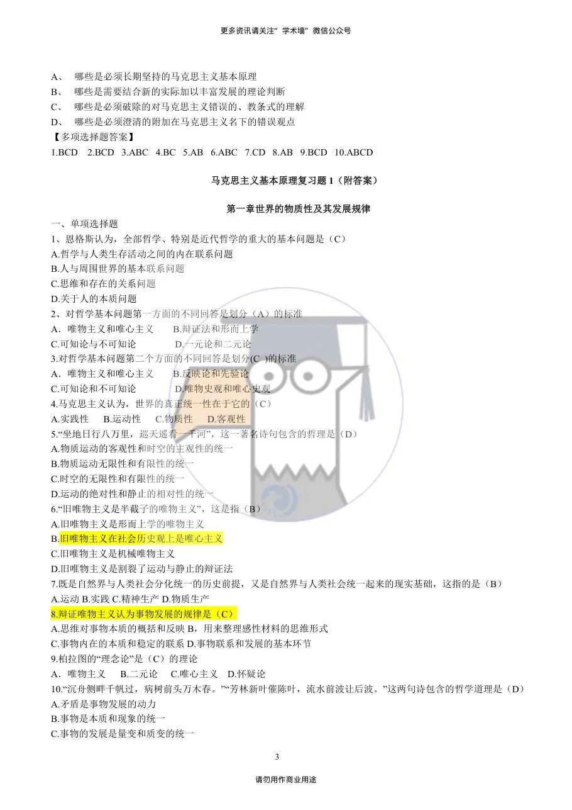

A、 哪些是必须长期坚持的马克思主义基本原理B、 哪些是需要结合新的实际加以丰富发展的理论判断C、 哪些是必须破除的对马克思主义错误的、教条式的理解D、 哪些是必须澄清的附加在马克思主义名下的错误观点

【多项选择题答案】

1.BCD 2.BCD 3.ABC 4.BC 5.AB 6.ABC 7.CD 8.AB 9.BCD 10.ABCD

马克思主义基本原理复习题 1（附答案）

第一章世界的物质性及其发展规律

### 一、单项选择题

1、恩格斯认为，全部哲学、特别是近代哲学的重大的基本问题是（C）A.哲学与人类生存活动之间的内在联系问题B.人与周围世界的基本联系问题C.思维和存在的关系问题D.关于人的本质问题

2、对哲学基本问题第一方面的不同回答是划分（A）的标准A．唯物主义和唯心主义 B.辩证法和形而上学C.可知论与不可知论 D.一元论和二元论

3.对哲学基本问题第二个方面的不同回答是划分(C )的标准A．唯物主义和唯心主义 B.反映论和先验论C.可知论和不可知论 D.唯物史观和唯心史观

4.马克思主义认为，世界的真正统一性在于它的（C）A.实践性 B.运动性 C.物质性 D.客观性

5.“坐地日行八万里，巡天遥看一千河”，这一著名诗句包含的哲理是（D）A.物质运动的客观性和时空的主观性的统一B.物质运动无限性和有限性的统一C.时空的无限性和有限性的统一D.运动的绝对性和静止的相对性的统一

6.“旧唯物主义是半截子的唯物主义”，这是指（B）A.旧唯物主义是形而上学的唯物主义B .旧唯物主义在社会历史观上是唯心主义

C.旧唯物主义是机械唯物主义D.旧唯物主义是割裂了运动与静止的辩证法

7.既是自然界与人类社会分化统一的历史前提，又是自然界与人类社会统一起来的现实基础，这指的是（B）A.运动 B.实践 C.精神生产 D.物质生产8.辩证唯物主义认为事物发展的规律是（C）

A.思维对事物本质的概括和反映 B，用来整理感性材料的思维形式C.事物内在的本质和稳定的联系 D.事物联系和发展的基本环节

9.柏拉图的“理念论”是（C）的理论A．唯物主义 B.二元论 C.唯心主义 D.怀疑论

10.“沉舟侧畔千帆过，病树前头万木春。”“芳林新叶催陈叶，流水前波让后波。”这两句诗包含的哲学道理是（D）A.矛盾是事物发展的动力B.事物是本质和现象的统一C.事物的发展是量变和质变的统一

更多资讯请关注“学术墙”微信公众号

3

请勿用作商业用途

## 第4页

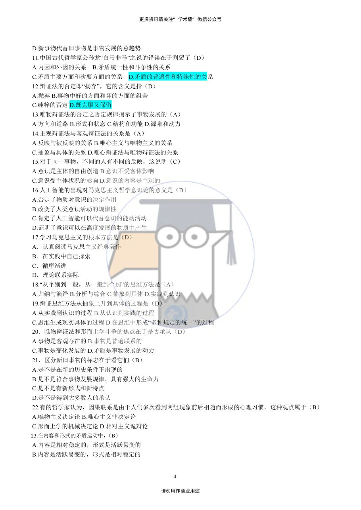

D.新事物代替旧事物是事物发展的总趋势11.中国古代哲学家公孙龙“白马非马”之说的错误在于割裂了（D）A.内因和外因的关系 B.矛盾统一性和斗争性的关系C.矛盾主要方面和次要方面的关系 D.矛盾的普遍性和特殊性的关系

12.辩证法的否定即“扬弃”，它的含义是指（D）A.抛弃 B.事物中好的方面和坏的方面的组合C.纯粹的否定 D.既克服又保留

13.唯物辩证法的否定之否定规律揭示了事物发展的（A）A.方向和道路 B.形式和状态 C.结构和功能 D.源泉和动力

14.主观辩证法与客观辩证法的关系是（A）A.反映与被反映的关系 B.唯心主义与唯物主义的关系C.抽象与具体的关系 D.唯心辩证法与唯物辩证法的关系

15.对于同一事物，不同的人有不同的反映，这说明（C）A.意识是主体的自由创造 B.意识不受客体影响C.意识受主体状况的影响 D.意识的内容是主观的

16.人工智能的出现对马克思主义哲学意识论的意义是（D）A.否定了物质对意识的决定作用B.改变了人类意识活动的规律性C.肯定了人工智能可以代替意识的能动活动D.证明了意识可以在高度发展的物质中产生

17.学习马克思主义的根本方法是（D）A．认真阅读马克思主义经典著作B．在实践中自己探索C．循序渐进D．理论联系实际

A.归纳与演绎 B.分析与综合 C.抽象到具体 D.实践到认识19.辩证思维方法从抽象上升到具体的过程是（D）A.从实践到认识的过程 B.从认识到实践的过程C.思维生成现实具体的过程 D.在思维中形成“多种规定的统一”的过程

20．唯物辩证法和形而上学斗争的焦点在于是否承认（D）A.事物是客观存在的 B.事物是普遍联系的C.事物是变化发展的 D.矛盾是事物发展的动力

21．区分新旧事物的标志在于看它们（B）A.是不是在新的历史条件下出现的B.是不是符合事物发展规律、具有强大的生命力C.是不是有新形式和新特点D.是不是得到大多数人的承认

22.有的哲学家认为，因果联系是由于人们多次看到两组现象前后相随而形成的心理习惯。这种观点属于（B）A.唯物主义决定论 B.唯心主义非决定论C.形而上学的机械决定论 D.相对主义诡辩论

23.在内容和形式的矛盾运动中，（B）A.内容是相对稳定的，形式是活跃易变的B.内容是活跃易变的，形式是相对稳定的

更多资讯请关注“学术墙”微信公众号

4

请勿用作商业用途

## 第5页

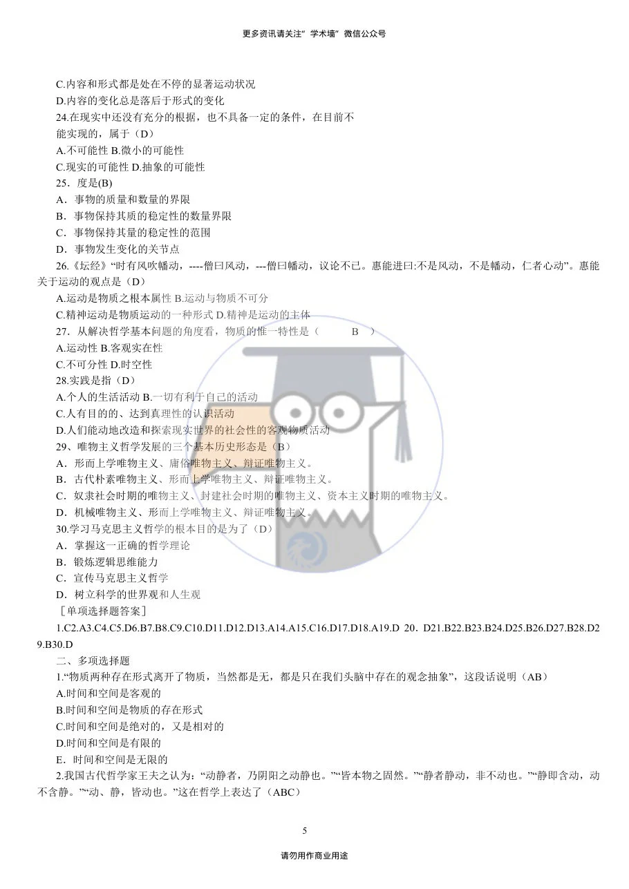

C.内容和形式都是处在不停的显著运动状况D.内容的变化总是落后于形式的变化

24.在现实中还没有充分的根据，也不具备一定的条件，在目前不能实现的，属于（D）A.不可能性 B.微小的可能性C.现实的可能性 D.抽象的可能性

25．度是(B)A．事物的质量和数量的界限B．事物保持其质的稳定性的数量界限C．事物保持其量的稳定性的范围D．事物发生变化的关节点26.《坛经》“时有风吹幡动，----僧曰风

动，---僧曰幡动，议论不已。惠能进曰:不是风动，不是幡动，仁者心动”。惠能关于运动的观点是（D）A.运动是物质之根本属性 B.运动与物质不可分C.精神运动是物质运动的一种形式 D.精神是运动的主体

27．从解决哲学基本问题的角度看，物质的惟一特性是（ BA.运动性 B.客观实在性C.不可分性 D.时空性

28.实践是指（D）A.个人的生活活动 B.一切有利于自己的活动C.人有目的的、达到真理性的认识活动D.人们能动地改造和探索现实世界的社会性的客观物质活动

29、唯物主义哲学发展的三个基本历史形态是（B）A．形而上学唯物主义、庸俗唯物主义、辩证唯物主义。B．古代朴素唯物主义、形而上学唯物主义、辩证唯物主义。C．奴隶社会时期的唯物主义、封建社会时期的唯物主义、资本主义时期的唯物主义。D．机械唯物主义、形而上学唯物主义、辩证唯物主义。

30.学习马克思主义哲学的根本目的是为了（D）A．掌握这一正确的哲学理论B．锻炼逻辑思维能力C．宣传马克思主义哲学D．树立科学的世界观和人生观［单项选择题答案

1.C2.A3.C4.C5.D6.B7.B8.C9.C10.D11.D12.D13.A14.A15.C16.D17.D18.A19.D 20．D21.B22.B23.B24.D25.B26.D27.B28.D2 9.B30.D

二、多项选择题1.“物质两种存在形式离开了物质，当然都是无，都是只在我们头脑中存在的观念抽象”，这段话说明（AB）A.时间和空间是客观的B.时间和空间是物质的存在形式C.时间和空间是绝对的，又是相对的D.时间和空间是有限的E．时间和空间是无限的

2.我国古代哲学家王夫之认为：“动静者，乃阴阳之动静也。”“皆本物之固然。”“静者静动，非不动也。”“静即含动，动不含静。”“动、静，皆动也。”这在哲学上表达了（ABC）

更多资讯请关注“学术墙”微信公众号

5

请勿用作商业用途

## 第6页

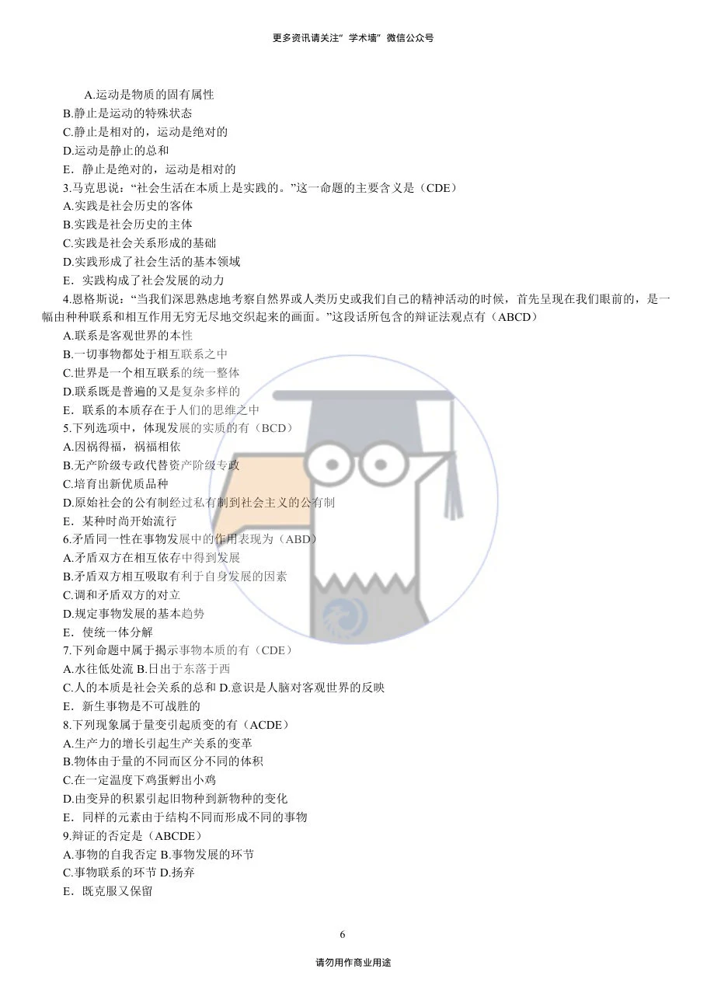

A.运动是物质的固有属性

B.静止是运动的特殊状态C.静止是相对的，运动是绝对的D.运动是静止的总和E．静止是绝对的，运动是相对的

3.马克思说：“社会生活在本质上是实践的。”这一命题的主要含义是（CDE）A.实践是社会历史的客体B.实践是社会历史的主体C.实践是社会关系形成的基础D.实践形成了社会生活的基本领域E．实践构成了社会发展的动力

4.恩格斯说：“当我们深思熟虑地考察自然界或人类历史或我们自己的精神活动的时候，首先呈现在我们眼前的，是一幅由种种联系和相互作用无穷无尽地交织起来 幅由种种联系和相互作用无穷无尽地交织起来的画面。”这段话所包含的辩证法观点有（ABCD）

A.联系是客观世界的本性B.一切事物都处于相互联系之中C.世界是一个相互联系的统一整体D.联系既是普遍的又是复杂多样的E．联系的本质存在于人们的思维之中

5.下列选项中，体现发展的实质的有（BCD）A.因祸得福，祸福相依B.无产阶级专政代替资产阶级专政C.培育出新优质品种D.原始社会的公有制经过私有制到社会主义的公有制E．某种时尚开始流行

6.矛盾同一性在事物发展中的作用表现为（ABDA.矛盾双方在相互依存中得到发展B.矛盾双方相互吸取有利于自身发展的因素C.调和矛盾双方的对立D.规定事物发展的基本趋势E．使统一体分解

7.下列命题中属于揭示事物本质的有（CDE）A.水往低处流 B.日出于东落于西C.人的本质是社会关系的总和 D.意识是人脑对客观世界的反映E．新生事物是不可战胜的

8.下列现象属于量变引起质变的有（ACDE）A.生产力的增长引起生产关系的变革B.物体由于量的不同而区分不同的体积C.在一定温度下鸡蛋孵出小鸡D.由变异的积累引起旧物种到新物种的变化E．同样的元素由于结构不同而形成不同的事物

9.辩证的否定是（ABCDE）A.事物的自我否定 B.事物发展的环节C.事物联系的环节 D.扬弃E．既克服又保留

更多资讯请关注“学术墙”微信公众号

6

请勿用作商业用途

## 第7页

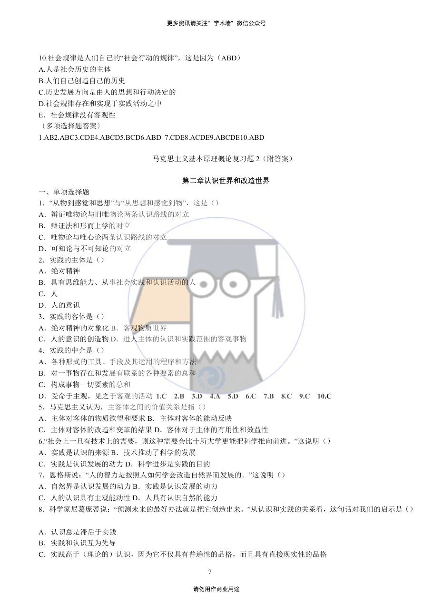

10.社会规律是人们自己的“社会行动的规律”，这是因为（ABD）A.人是社会历史的主体B.人们自己创造自己的历史C.历史发展方向是由人的思想和行动决定的D.社会规律存在和实现于实践活动之中E．社会规律没有客观性〔多项选择题答案

1.AB2.ABC3.CDE4.ABCD5.BCD6.ABD 7.CDE8.ACDE9.ABCDE10.ABD

马克思主义基本原理概论复习题 2（附答案）

### 第二章认识世界和改造世界

### 一、单项选择题

1．“从物到感觉和思想”与“从思想和感觉到物”，这是（）A．辩证唯物论与旧唯物论两条认识路线的对立B．辩证法和形而上学的对立C．唯物论与唯心论两条认识路线的对立D．可知论与不可知论的对立

2．实践的主体是（）A．绝对精神

D．人的意识

3．实践的客体是（）A．绝对精神的对象化B．客观物质世界C．人的意识的创造物 D．进人主体的认识和实践范围的客观事物

4．实践的中介是（）A．各种形式的工具、手段及其运用的程序和方法B．对一事物存在和发展有联系的各种要素的总和C．构成事物一切要素的总和D．受命于主观，见之于客观的活动 1.C 2.B 3.D 4.A 5.D 6.C 7.B 8.C 9.C 10.C

5．马克思主义认为，主客体之间的价值关系是指（）A．主体对客体的物质欲望和要求 B．主体对客体的能动反映C．主体对客体的改造和变革的结果 D．客体对于主体的有用性和效益性

6.“社会上一旦有技术上的需要，则这种需要会比十所大学更能把科学推向前进。”这说明（）A．实践是认识的来源B．技术推动了科学的发展C．实践是认识发展的动力 D．科学进步是实践的目的

7．恩格斯说：“人的智力是按照人如何学会改造自然界而发展的。”这说明（）A．自然界是认识发展的动力B．实践是认识发展的动力C．人的认识具有主观能动性 D．人具有认识自然的能力

8．科学家尼葛庞蒂说：“预测未来的最好办法就是把它创造出来。”从认识和实践的关系看，这句话对我们的启示是（）A．认识总是滞后于实践B．实践和认识互为先导C．实践高于（理论的）认识，因为它不仅具有普遍性的品格，而且具有直接现实性的品格

更多资讯请关注“学术墙”微信公众号

7

请勿用作商业用途

## 第8页

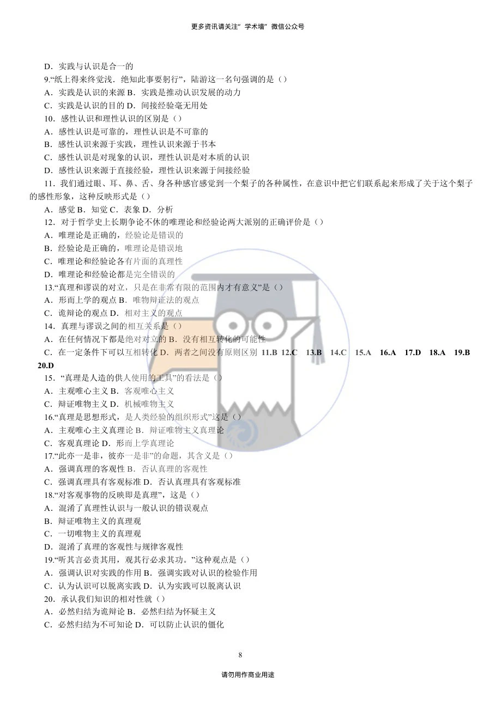

D．实践与认识是合一的

9.“纸上得来终觉浅．绝知此事要躬行”，陆游这一名句强调的是（）A．实践是认识的来源B．实践是推动认识发展的动力C．实践是认识的目的 D．间接经验毫无用处

10．感性认识和理性认识的区别是（）A．感性认识是可靠的，理性认识是不可靠的B．感性认识来源于实践，理性认识来源于书本C．感性认识是对现象的认识，理性认识是对本质的认识D．感性认识来源于直接经验，理性认识来源于间接经验

11．我们通过眼、耳、鼻、舌、身各种感官感觉到一个梨子的各种属性，在意识中把它们联系起来形成了关于这个梨子

的感性形象，这种反映形式是（）A．感觉B．知觉 C．表象D．分析

12．对于哲学史上长期争论不休的唯理论和经验论两大派别的正确评价是（）A．唯理论是正确的，经验论是错误的B．经验论是正确的，唯理论是错误地C．唯理论和经验论各有片面的真理性D．唯理论和经验论都是完全错误的

13.“真理和谬误的对立，只是在非常有限的范围内才有意义”是（）A．形而上学的观点 B．唯物辩证法的观点C．诡辩论的观点 D．相对主义的观点

14．真理与谬误之间的相互关系是（）A．在任何情况下都是绝对对立的 B．没有相互转化的可能性C．在一定条件下可以互相转化 D．两者之间没有原则区别 11.B 12.C 13.B 14.C 15.A 16.A 17.D 18.A 19.B

20.D15．“真理是人造的供人使用的工具”的看法是A．主观唯心主义 B．客观唯心主义C．辩证唯物主义 D．机械唯物主义16.“真理是思想形式，是人类经验的组织形式”这是（）A．主观唯心主义真理论 B．辩证唯物主义真理论C．客观真理论 D．形而上学真理论

17.“此亦一是非，彼亦一是非”的命题，其含义是（）A．强调真理的客观性B．否认真理的客观性C．强调真理具有客观标准 D．否认真理具有客观标准

18.“对客观事物的反映即是真理”，这是（）A．混淆了真理性认识与一般认识的错误观点B．辩证唯物主义的真理观C．一切唯物主义的真理观D．混淆了真理的客观性与规律客观性

19.“听其言必责其用，观其行必求其功。”这种观点是（）A．强调认识对实践的作用 B．强调实践对认识的检验作用C．认为认识可以脱离实践 D．认为实践可以脱离认识

20．承认我们知识的相对性就（）A．必然归结为诡辩论B．必然归结为怀疑主义C．必然归结为不可知论 D．可以防止认识的僵化

更多资讯请关注“学术墙”微信公众号

8

请勿用作商业用途

## 第9页

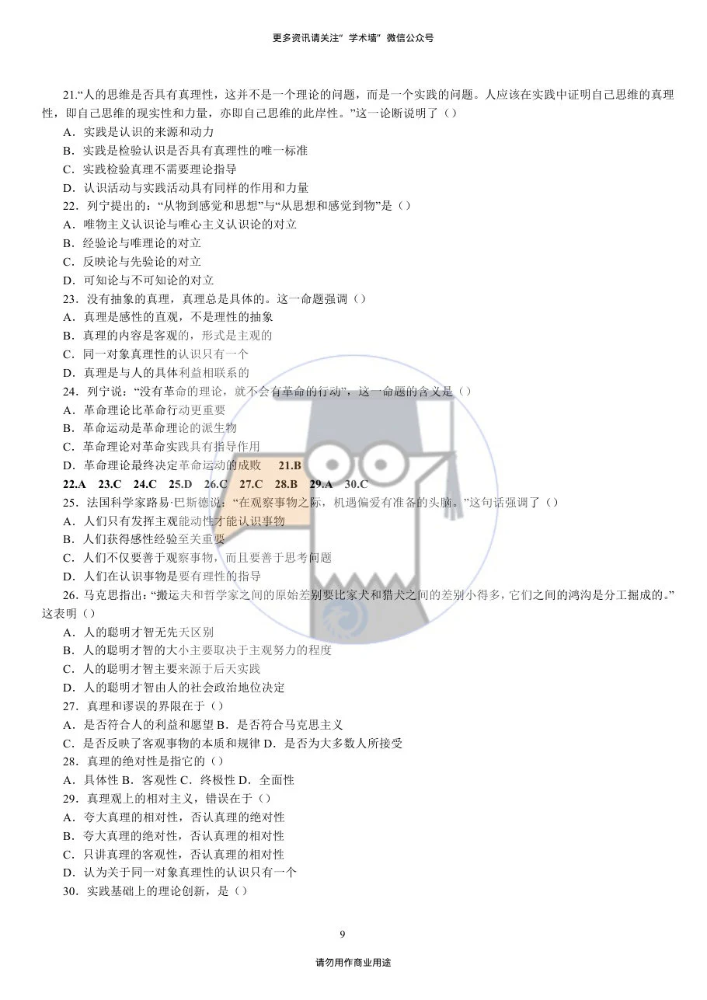

21.“人的思维是否具有真理性，这并不是一个理论的问题，而是一个实践的问题。人应该在实践中证明自己思维的真理性，即自己思维的现实性和力量，亦即自己思维的此岸性。”这一论断说明了（）A．实践是认识的来源和动力B．实践是检验认识是否具有真理性的唯一标准C．实践检验真理不需要理论指导D．认识活动与实践活动具有同样的作用和力量

22．列宁提出的：“从物到感觉和思想”与“从思想和感觉到物”是（）A．唯物主义认识论与唯心主义认识论的对立B．经验论与唯理论的对立C．反映论与先验论的对立D．可知论与不可知论的对立

23．没有抽象的真理，真理总是具体的。这一命题强调（）A．真理是感性的直观，不是理性的抽象B．真理的内容是客观的，形式是主观的C．同一对象真理性的认识只有一个D．真理是与人的具体利益相联系的

24．列宁说：“没有革命的理论，就不会有革命的行动”，这一命题的含义是（）A．革命理论比革命行动更重要B．革命运动是革命理论的派生物C．革命理论对革命实践具有指导作用D．革命理论最终决定革命运动的成败 21.B22.A 23.C 24.C 25.D 26.C 27.C 28.B 29.A 30.C

25．法国科学家路易·巴斯德说：“在观察事物之际，机遇偏爱有准备的头脑。”这句话强调了（）A．人们只有发挥主观能动性才能认识事物B．人们获得感性经验至关重要C．人们不仅要善于观察事物，而且要善于思考问题D．人们在认识事物是要有理性的指导

26．马克思指出：“搬运夫和哲学家之间的原始差别要比家犬和猎犬之间的差别小得多，它们之间的鸿沟是分工掘成的。”这表明（）A．人的聪明才智无先天区别B．人的聪明才智的大小主要取决于主观努力的程度C．人的聪明才智主要来源于后天实践D．人的聪明才智由人的社会政治地位决定

27．真理和谬误的界限在于（）A．是否符合人的利益和愿望B．是否符合马克思主义C．是否反映了客观事物的本质和规律 D．是否为大多数人所接受

28．真理的绝对性是指它的（）A．具体性 B．客观性 C．终极性 D．全面性29．真理观上的相对主义，错误在于（）A．夸大真理的相对性，否认真理的绝对性B．夸大真理的绝对性，否认真理的相对性C．只讲真理的客观性，否认真理的相对性D．认为关于同一对象真理性的认识只有一个

30．实践基础上的理论创新，是（）

更多资讯请关注“学术墙”微信公众号

9

请勿用作商业用途

## 第10页

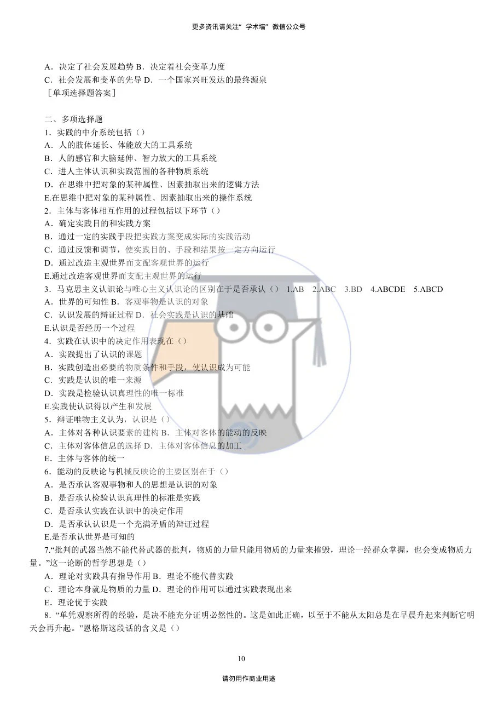

A．决定了社会发展趋势 B．决定着社会变革力度C．社会发展和变革的先导 D．一个国家兴旺发达的最终源泉［单项选择题答案

### 二、多项选择题

1．实践的中介系统包括（）A．人的肢体延长、体能放大的工具系统B．人的感官和大脑延伸、智力放大的工具系统C．进人主体认识和实践范围的各种物质系统D．在思维中把对象的某种属性、因素抽取出来的逻辑方法E.在思维中把对象的某种属性、因素抽取出来的操作系统

2．主体与客体相互作用的过程包括以下环节（）A．确定实践目的和实践方案B．通过一定的实践手段把实践方案变成实际的实践活动C．通过反馈和调节，使实践目的、手段和结果按一定方向运行D．通过改造主观世界而支配客观世界的运行E.通过改造客观世界而支配主观世界的运行

3．马克思主义认识论与唯心主义认识论的区别在于是A．世界的可知性 B．客观事物是认识的对象C．认识发展的辩证过程 D．社会实践是认识的基础E.认识是否经历一个过程

4．实践在认识中的决定作用表现在（）A．实践提出了认识的课题B．实践创造出必要的物质条件和手段，使认识成为可能C．实践是认识的唯一来源D．实践是检验认识真理性的唯一标准E.实践使认识得以产生和发展

5．辩证唯物主义认为，认识是（）A．主体对各种认识要素的建构 B．主体对客体的能动的反映C．主体对客体信息的选择 D．主体对客体信息的加工E．主体与客体的统一

6．能动的反映论与机械反映论的主要区别在于（）A．是否承认客观事物和人的思想是认识的对象B．是否承认检验认识真理性的标准是实践C．是否承认实践在认识中的决定作用D．是否承认认识是一个充满矛盾的辩证过程E.是否承认世界是可知的

7.“批判的武器当然不能代替武器的批判，物质的力量只能用物质的力量来摧毁，理论一经群众掌握，也会变成物质力量。”这一论断的哲学思想是（）A．理论对实践具有指导作用B．理论不能代替实践C．理论本身就是物质的力量 D．理论的作用可以通过实践表现出来E．理论优于实践

8．“单凭观察所得的经验，是决不能充分证明必然性的。这是如此正确，以至于不能从太阳总是在早晨升起来判断它明天会再升起。”恩格斯这段话的含义是（）

更多资讯请关注“学术墙”微信公众号

10

请勿用作商业用途

## 第11页

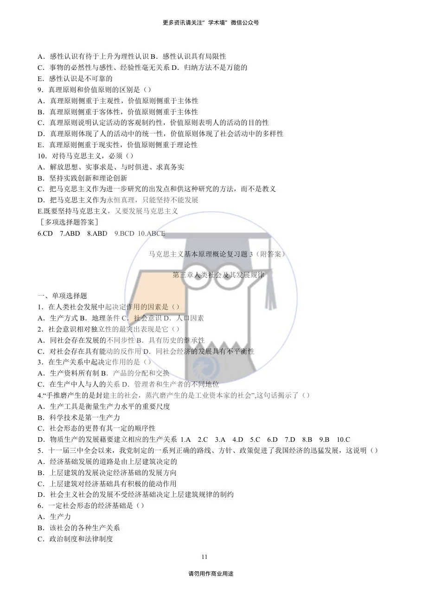

A．感性认识有待于上升为理性认识B．感性认识具有局限性C．事物的必然性与感性、经验性毫无关系 D．归纳方法不是万能的E．感性认识是不可靠的

9．真理原则和价值原则的区别是（）A．真理原则侧重于主观性，价值原则侧重于主体性B．真理原则侧重于客体性，价值原则侧重于主体性C．真理原则说明认定活动的客观制约性，价值原则表明人的活动的目的性D．真理原则体现了人的活动中的统一性，价值原则体现了社会活动中的多样性E．真理原则侧重于现实性，价值原则侧重于理论性

10．对待马克思主义，必须（）A．解放思想、实事求是、与时俱进、求真务实B．坚持实践创新和理论创新C．把马克思主义作为进一步研究的出发点和供这种研究的方法，而不是教义D．把马克思主义作为永恒真理，只能坚持不能发展

E.既要坚持马克思主义，又要发展马克思主义 ［多项选择题答案 6.CD 7.ABD 8.ABD 9.BCD 10.ABCE

马克思主义基本原理概论复习题 3（附答案）第三章人类社会及其发展规律

### 一、单项选择题

1．在人类社会发展中起决定作用的因素是（）A．生产方式 B．地理条件 C．社会意识 D．人口因素

2．社会意识相对独立性的最突出表现是它（）A．同社会存在发展的不同步性 B．具有历史的继承性C．对社会存在具有能动的反作用 D．同社会经济的发展具有不平衡性

3．在生产关系中起决定作用的是（）A．生产资料所有制 B．产品的分配和交换C．在生产中人与人的关系 D．管理者和生产者的不同地位

4.“手推磨产生的是封建主的社会，蒸汽磨产生的是工业资本家的社会”,这句话揭示了（）A．生产工具是衡量生产力水平的重要尺度B．科学技术是第一生产力C．社会形态的更替有其一定的顺序性D．物质生产的发展藉要建立相应的生产关系 1.A 2.C 3.A 4.D 5.C 6.D 7.D 8.B 9.B 10.C

5．十一届三中全会以来，我党制定的一系列正确的路线、方针、政策促进了我国经济的迅猛发展，这说明（）A．经济基础发展的道路是由上层建筑决定的B．上层建筑的发展决定经济基础的发展方向C．上层建筑对经济基础具有积极的能动作用D．社会主义社会的发展不受经济基础决定上层建筑规律的制约

6．一定社会形态的经济基础是（）A．生产力B．该社会的各种生产关系C．政治制度和法律制度

更多资讯请关注“学术墙”微信公众号

11

请勿用作商业用途

## 第12页

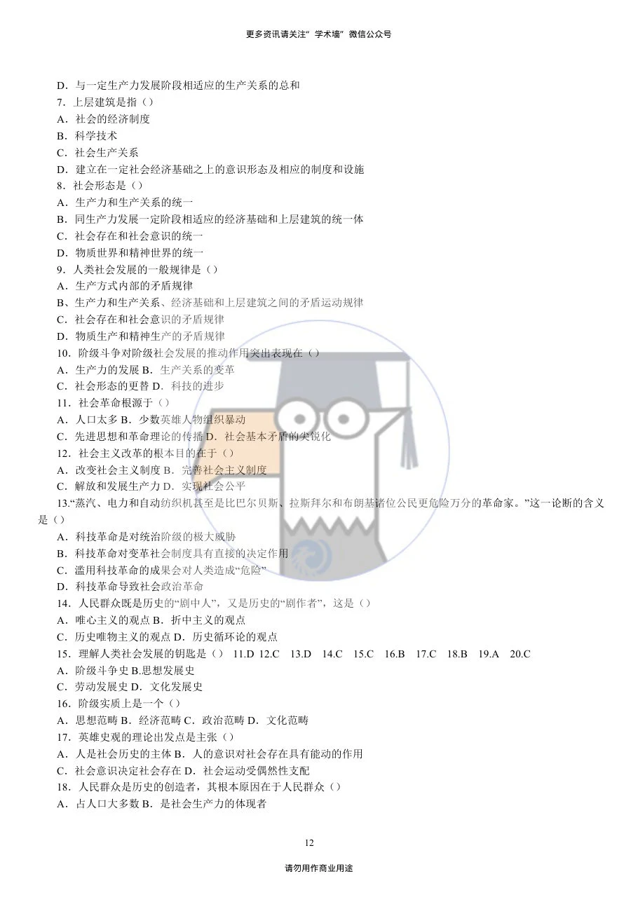

D．与一定生产力发展阶段相适应的生产关系的总和7．上层建筑是指（）A．社会的经济制度B．科学技术C．社会生产关系D．建立在一定社会经济基础之上的意识形态及相应的制度和设施

8．社会形态是（）A．生产力和生产关系的统一B．同生产力发展一定阶段相适应的经济基础和上层建筑的统一体C．社会存在和社会意识的统一D．物质世界和精神世界的统一船规待目

9．人类社会发展的一般规律是（）A．生产方式内部的矛盾规律B、生产力和生产关系、经济基础和上层建筑之间的矛盾运动规律C．社会存在和社会意识的矛盾规律D．物质生产和精神生产的矛盾规律

10．阶级斗争对阶级社会发展的推动作用突出表现在（）A．生产力的发展 B．生产关系的变革C．社会形态的更替 D．科技的进步

11．社会革命根源于（）A．人口太多 B．少数英雄人物组织暴动C．先进思想和革命理论的传播 D．社会基本矛盾的尖锐化

12．社会主义改革的根本目的在于（）A．改变社会主义制度B．完善社会主义制度C．解放和发展生产力 D．实现社会公平

13.“蒸汽、电力和自动纺织机甚至是比巴尔贝斯、拉斯拜尔和布朗基诸位公民更危险万分的革命家。”这一论断的含义是（）A．科技革命是对统治阶级的极大威胁B．科技革命对变革社会制度具有直接的决定作用C．滥用科技革命的成果会对人类造成“危险”D．科技革命导致社会政治革命

14．人民群众既是历史的“剧中人”，又是历史的“剧作者”，这是（）A．唯心主义的观点 B．折中主义的观点C．历史唯物主义的观点 D．历史循环论的观点15．理解人类社会发展的钥匙是（） 11.D 12.C 13.D 14.C 15.C 16.B 17.C 18.B 19.A 20.C

A．思想范畴 B．经济范畴 C．政治范畴 D．文化范畴17．英雄史观的理论出发点是主张（）A．人是社会历史的主体 B．人的意识对社会存在具有能动的作用C．社会意识决定社会存在 D．社会运动受偶然性支配

18．人民群众是历史的创造者，其根本原因在于人民群众（）A．占人口大多数 B．是社会生产力的体现者

更多资讯请关注“学术墙”微信公众号

12

请勿用作商业用途

## 第13页

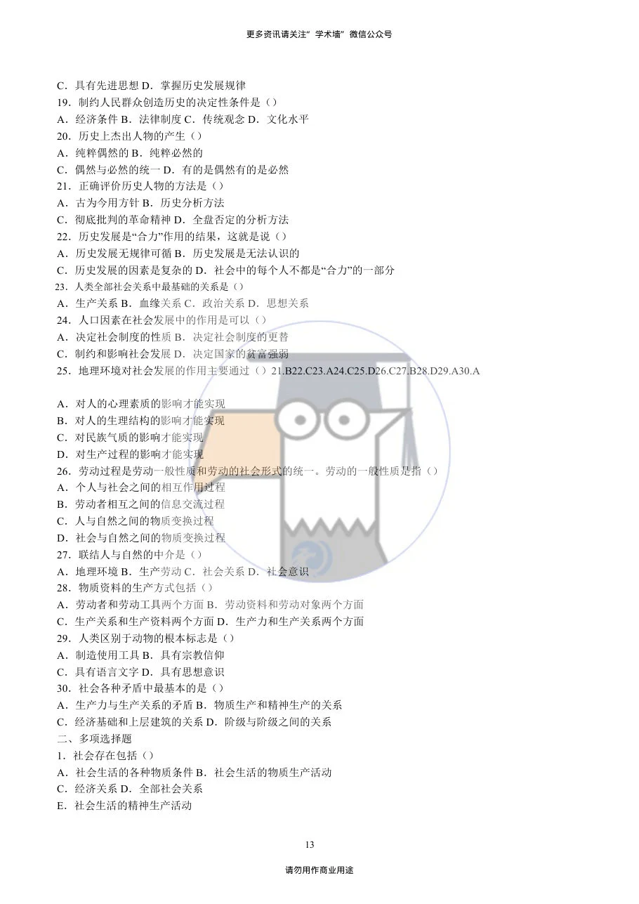

C．具有先进思想 D．掌握历史发展规律

19．制约人民群众创造历史的决定性条件是（）A．经济条件 B．法律制度 C．传统观念 D．文化水平

20．历史上杰出人物的产生（）A．纯粹偶然的B．纯粹必然的C．偶然与必然的统一 D．有的是偶然有的是必然

21．正确评价历史人物的方法是（）A．古为今用方针 B．历史分析方法C．彻底批判的革命精神 D．全盘否定的分析方法

22．历史发展是“合力”作用的结果，这就是说（）A．历史发展无规律可循 B．历史发展是无法认识的C．历史发展的因素是复杂的 D．社会中的每个人不都是“合力”的一部分

23．人类全部社会关系中最基础的关系是（）A．生产关系 B．血缘关系 C．政治关系 D．思想关系

24．人口因素在社会发展中的作用是可以（）A．决定社会制度的性质 B．决定社会制度的更替C．制约和影响社会发展 D．决定国家的贫富强弱

25．地理环境对社会发展的作用主要通过（）21.B22.C23.A24.C25.D26.C27.B28.D29.A30.A 25. 地理环境对社会发展的作用主要

A．对人的心理素质的影响才能实现B．对人的生理结构的影响才能实现C．对民族气质的影响才能实现D．对生产过程的影响才能实现

26．劳动过程是劳动一般性质和劳动的社会形式的统一。劳动的一般性质是指（）A．个人与社会之间的相互作用过程B．劳动者相互之间的信息交流过程C．人与自然之间的物质变换过程D．社会与自然之间的物质变换过程

27．联结人与自然的中介是（）A．地理环境 B．生产劳动 C．社会关系 D．社会意识

28．物质资料的生产方式包括（）A．劳动者和劳动工具两个方面 B．劳动资料和劳动对象两个方面C．生产关系和生产资料两个方面 D．生产力和生产关系两个方面

29．人类区别于动物的根本标志是（）A．制造使用工具 B．具有宗教信仰C．具有语言文字 D．具有思想意识

30．社会各种矛盾中最基本的是（）A．生产力与生产关系的矛盾B．物质生产和精神生产的关系C．经济基础和上层建筑的关系 D．阶级与阶级之间的关系

### 二、多项选择题

1．社会存在包括（）A．社会生活的各种物质条件B．社会生活的物质生产活动C．经济关系 D．全部社会关系E．社会生活的精神生产活动

更多资讯请关注“学术墙”微信公众号

13

请勿用作商业用途

## 第14页

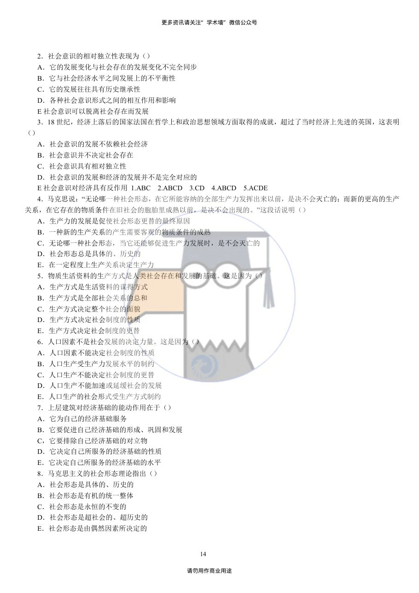

2．社会意识的相对独立性表现为（）A．它的发展变化与社会存在的发展变化不完全同步B．它与社会经济水平之间发展上的不平衡性C．它的发展往往具有历史继承性D．各种社会意识形式之间的相互作用和影响E社会意识可以脱离社会存在而发展

3．18世纪，经济上落后的国家法国在哲学上和政治思想领域方面取得的成就，超过了当时经济上先进的英国，这表明（）A．社会意识的发展不依赖社会经济B．社会意识并不决定社会存在C．社会意识具有相对独立性D．社会意识的发展和经济的发展并不是完全对应的E 社会意识对经济具有反作用 1.ABC 2.ABCD 3.CD 4.ABCD 5.ACDE

4．马克思说：“无论哪一种社会形态，在它所能容纳的全部生产力发挥出来以前，是决不会灭亡的；而新的更高的生产关系，在它存在的物质条件在旧社会的胞胎里成熟以前，是决不会出现的。”这段话说明（）A．生产力的发展是促使社会形态更替的最终原因B．一种新的生产关系的产生需要客观的物质条件的成熟C．无论哪一种社会形态，当它还能够促进生产力发展时，是不会灭亡的D．社会形态总是具体的、历史的E．在一定程度上生产关系决定生产力

5．物质生活资料的生产方式是人类社会存在和发展的基础。这是因为A．生产方式是生活资料的谋得方式B．生产方式是全部社会关系的总和C．生产方式决定整个社会的面貌D．生产方式决定社会制度的性质E．生产方式决定社会制度的更替

6．人口因素不是社会发展的决定力量。这是因为A．人口因素不能决定社会制度的性质B．人口生产受生产力发展水平的制约C．人口生产不能决定社会制度的更替D．人口生产不能加速或延缓社会的发展E．人口生产的社会形式受生产方式制约

7．上层建筑对经济基础的能动作用在于（）A．它为自己的经济基础服务B．它要促进自己经济基础的形成、巩固和发展C，它要排除自己经济基础的对立物D．它决定自己所服务的经济基础的性质E．它决定自己所服务的经济基础的水平

8．马克思主义的社会形态理论指出（）A．社会形态是具体的、历史的B．社会形态是有机的统一整体C．社会形态是永恒的不变的D．社会形态是超社会的、超历史的E．社会形态是由偶然因素所决定的

更多资讯请关注“学术墙”微信公众号

14

请勿用作商业用途

## 第15页

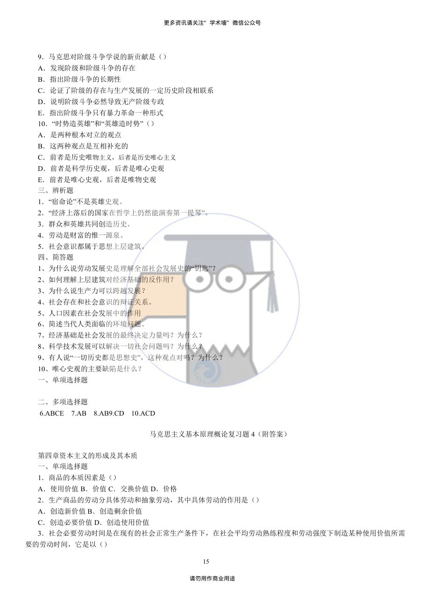

9．马克思对阶级斗争学说的新贡献是（）A．发现阶级和阶级斗争的存在B．指出阶级斗争的长期性C．论证了阶级的存在与生产发展的一定历史阶段相联系D．说明阶级斗争必然导致无产阶级专政E．指出阶级斗争只有暴力革命一种形式

10．“时势造英雄”和“英雄造时势”（）A．是两种根本对立的观点B．这两种观点是互相补充的C．前者是历史唯物主义，后者是历史唯心主义D．前者是科学历史观，后者是唯心史观E．前者是唯心史观，后者是唯物史观

1．“宿命论”不是英雄史观。2．“经济上落后的国家在哲学上仍然能演奏第一提琴”。3．群众和英雄共同创造历史。4．劳动是财富的惟一源泉。

### 四、简答题

1、为什么说劳动发展史是理解全部社会发展史的“钥匙”2、如何理解上层建筑对经济基础的反作用？3、为什么说生产力可以跨越发展？4、社会存在和社会意识的辩证关系。5、人口因素在社会发展中的作用6、简述当代人类面临的环境问题。7、经济基础是社会发展的最终决定力量吗？为什么？8、科学技术发展可以解决一切社会问题吗？为什么？9、有人说“一切历史都是思想史”，这种观点对吗？为什么？

10、唯心史观的主要缺陷是什么？

### 一、单项选择题

二、多项选择题6.ABCE 7.AB 8.AB9.CD 10.ACD CD马克思主义基本原理概论复习题 4（附答案）

### 第四章资本主义的形成及其本质

1．商品的本质因素是（）A．使用价值 B．价值C．交换价值 D．价格

2．生产商品的劳动分具体劳动和抽象劳动，其中具体劳动的作用是（）A．创造新价值B．创造剩余价值C．创造必要价值 D．创造使用价值

3．社会必要劳动时间是在现有的社会正常生产条件下，在社会平均劳动熟练程度和劳动强度下制造某种使用价值所需要的劳动时间，它是以（）

更多资讯请关注“学术墙”微信公众号

15

请勿用作商业用途

## 第16页

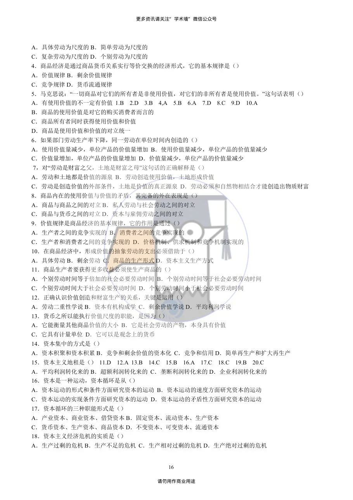

A．具体劳动为尺度的B．简单劳动为尺度的C．复杂劳动为尺度的 D．个别劳动为尺度的

4．商品经济是通过商品货币关系实行等价交换的经济形式，它的基本规律是（）A．价值规律 B．剩余价值规律C．竞争规律 D．货币流通规律

5．马克思说：“一切商品对它们的所有者是非使用价值，对它们的非所有者是使用价值。”这句话表明（）A．有使用价值的不一定有价值 1.B 2.D 3.B 4,A 5.B 6.A 7.D 8.C 9.D 10.A

B．商品的使用价值是对它的购买消费者而言的C．商品所有者同时获得使用价值和价值D．商品是使用价值和价值的对立统一

6．如果部门劳动生产率下降，同一劳动在单位时间内创造的（）A．使用价值量减少，单位产品的价值量增加 B．使用价值量减少，单位产品的价值量减少C．价值量增加，单位产品的价值量增加 D．价值量减少，单位产品的价值量减少

7，对“劳动是财富之父，土地是财富之母”这句话的正确解释是（）A．劳动和土地都是价值的源泉 B．劳动创造使用价值，土地形成价值C．劳动是创造价值的外部条件，土地是价值的真正源泉 D．劳动必须和自然物相结合才能创造出物质财富

8．商品内在的使用价值与价值的矛盾，其完备的外在表现是（）A．商品与商品之间的对立 B．私人劳动与社会劳动之间的对立C．商品与货币之间的对立 D．资本与雇佣劳动之间的对立

9．价值规律是商品经济的基本规律，它的作用是通过（）A．生产者之间的竞争实现的 B．消费者之间的竞争实现的C．生产者和消费者之间的竞争实现的 D．价格机制、供求机制和竟争机制实现的

10．在商品经济中，形成价值的抽象劳动的支出必须借助于（）A．具体劳动 B．剩余劳动 C．商品的生产形式 D．资本主义生产方式

11．商品生产者要获得更多收益必须使生产商品的（）A．个别劳动时间等于倍加的社会必要劳动时间 B．个别劳动时间等于社会必要劳动时间C．个别劳动时间大于社会必要劳动时间 D．个别劳动时间小于社会必要劳动时间

12．正确认识价值创造和财富生产的关系，关键是运用（）A．劳动二重性学说 B．资本有机构成学 C．剩余价值学说 D．平均利润学说

13．货币之所以能执行价值尺度的职能，是因为（）A．它能衡量其他商品价值的大小 B．它是社会劳动的产物，本身具有价值C．它具有计量单位 D．它可以是观念上的货币

14．资本集中的方式是（）A．资本积聚和资本积累 B．竞争和剩余价值的资本化 C．竞争和信用D．简单再生产和扩大再生产

16．资本是一种运动，资本循环是从（）A．资本运动的形式和条件方面研究资本的运动 B．资本运动的速度方面研究资本的运动C．资本运动的实现条件方面研究资本的运动 D．资本运动的矛盾性方面研究资本的运动

A．产业资本、商业资本、借贷资本B．固定资本、流动资本、生产资本C．货币资本、生产资本、商品资本 D．不变资本、可变资本、流通资本

18．资本主义经济危机的实质是（）A．生产过剩的危机 B．生产不足的危机 C．生产相对过剩的危机 D．生产绝对过剩的危机

更多资讯请关注“学术墙”微信公众号

16

请勿用作商业用途

## 第17页

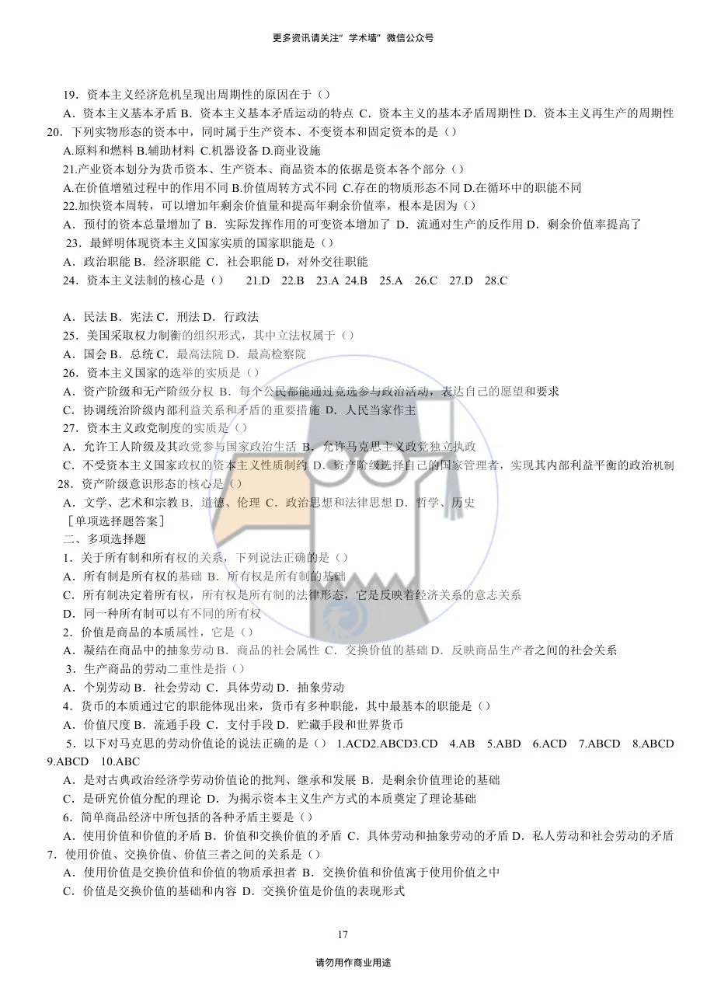

19．资本主义经济危机呈现出周期性的原因在于（）A．资本主义基本矛盾 B．资本主义基本矛盾运动的特点 C．资本主义的基本矛盾周期性 D．资本主义再生产的周期性

20．下列实物形态的资本中，同时属于生产资本、不变资本和固定资本的是（）A.原料和燃料 B.辅助材料 C.机器设备 D.商业设施

21.产业资本划分为货币资本、生产资本、商品资本的依据是资本各个部分（）A.在价值增殖过程中的作用不同 B.价值周转方式不同 C.存在的物质形态不同 D.在循环中的职能不同

22.加快资本周转，可以增加年剩余价值量和提高年剩余价值率，根本是因为（）A．预付的资本总量增加了 B．实际发挥作用的可变资本增加了 D．流通对生产的反作用 D．剩余价值率提高了

23．最鲜明体现资本主义国家实质的国家职能是（）A．政治职能 B．经济职能 C．社会职能 D，对外交往职能24．资本主义法制的核心是（） 21.D 22.B 23.A 24.B 25.A 26.C 27.D 28.C

25．美国采取权力制衡的组织形式，其中立法权属于（）A．国会B．总统 C．最高法院 D．最高检察院

26．资本主义国家的选举的实质是（）A．资产阶级和无产阶级分权 B．每个公民都能通过竞选参与政治活动，表达自己的愿望和要求C．协调统治阶级内部利益关系和矛盾的重要措施 D．人民当家作主

27．资本主义政党制度的实质是（）A．允许工人阶级及其政党参与国家政治生活 B．允许马克思主义政党独立执政C．不受资本主义国家政权的资本主义性质制约 D．资产阶级选择自己的国家管理者，实现其内部利益平衡的政治机制

28．资产阶级意识形态的核心是（）A．文学、艺术和宗教B．道德、伦理 C．政治思想和法律思想 D．哲学、历史［单项选择题答案二、多项选择题

1．关于所有制和所有权的关系，下列说法正确的是（）A．所有制是所有权的基础 B．所有权是所有制的基础C．所有制决定着所有权，所有权是所有制的法律形态，它是反映着经济关系的意志关系D．同一种所有制可以有不同的所有权

2．价值是商品的本质属性，它是（）A．凝结在商品中的抽象劳动B．商品的社会属性 C．交换价值的基础 D．反映商品生产者之间的社会关系

3．生产商品的劳动二重性是指（）A．个别劳动 B．社会劳动 C．具体劳动 D．抽象劳动

4．货币的本质通过它的职能体现出来，货币有多种职能，其中最基本的职能是（）A．价值尺度 B．流通手段 C．支付手段 D．贮藏手段和世界货币5．以下对马克思的劳动价值论的说法正确的是（） 1.ACD2.ABCD3.CD 4.AB 5.ABD 6.ACD 7.ABCD 8.ABCD

9.ABCD 10.ABCA．是对古典政治经济学劳动价值论的批判、继承和发展 B．是剩余价值理论的基础C．是研究价值分配的理论 D．为揭示资本主义生产方式的本质奠定了理论基础6．简单商品经济中所包括的各种矛盾主要是（）A．使用价值和价值的矛盾 B．价值和交换价值的矛盾 C．具体劳动和抽象劳动的矛盾 D．私人劳动和社会劳动的矛盾 A. 使用价值和价值的矛盾B. 价值和交换价值的矛盾C. 具体劳动和抽象劳动的矛盾D. 私人劳动和社会劳动的矛盾

7．使用价值、交换价值、价值三者之间的关系是（）A．使用价值是交换价值和价值的物质承担者 B．交换价值和价值寓于使用价值之中C．价值是交换价值的基础和内容 D．交换价值是价值的表现形式

更多资讯请关注“学术墙”微信公众号

17

请勿用作商业用途

## 第18页

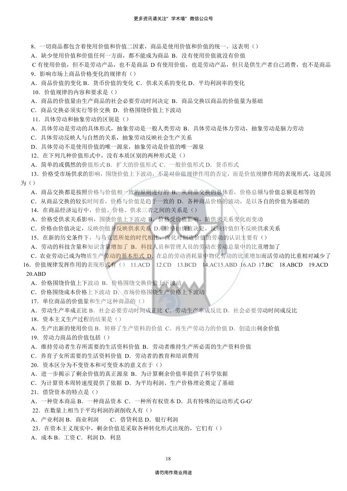

8．一切商品都包含着使用价值和价值二因素，商品是使用价值和价值的统一。这表明（）A．缺少使用价值和价值任何一方面，都不能成为商品 B．没有使用价值就没有价值

C 有使用价值，但不是劳动产品，也不是商品 D 有使用价值，也是劳动产品，但只是供生产者自己消费，也不是商品9．影响市场上商品价格变化的规律有（）A．商品价值的变化 B．货币价值的变化 C．供求关系的变化 D．平均利润率的变化

10．价值规律的内容和要求是（）A．商品的价值量由生产商品的社会必要劳动时间决定 B．商品交换以商品的价值量为基础C．商品交换必须实行等价交换 D．价格围绕价值上下波动

11．具体劳动和抽象劳动的区别是（）A．具体劳动是劳动的具体形式，抽象劳动是一般人类劳动 B．具体劳动是体力劳动，抽象劳动是脑力劳动C．具体劳动反映人与自然的关系，抽象劳动反映社会生产关系D．具体劳动不是使用价值的唯一源泉，抽象劳动是价值的唯一源泉12．在下列几种价值形式中，没有本质区别的两种形式是（）A．简单的或偶然的价值形式B．扩大的价值形式 C．一般价值形式 D．货币形式

13．价格受市场供求的影响，围绕价值上下波动，不是对价值规律作用的否定，而是价值规律作用的表现形式，这是因为（）A．商品交换都是按照价格与价值相一致的原则进行的 B．从商品交换的总体看，价格总额与价值总额是相等的C．从商品交换的较长时间看，价格与价值是趋于一致的 D．各种商品价格的波动，是以各自的价值为基础的

14．在商品经济运行中，价值、价格、供求三者之间的关系是（）A．价格受供求关系影响，围绕价值上下波动 B．价格受价值影响，随供求关系变化而变动C．价格由价值决定，反映价值并反映供求关系 D．价格由价值决定，反映价值但不反映供求关系

15．在新的历史条件下，与马克思所处的时代相比，深化对创造价值的劳动的认识主要有（）A．劳动的科技含量和知识含量增加了 B．科技人员和管理人员的劳动在劳动总量中的比重增加了C 农业劳动已成为物质生产劳动的基本形式D在总的劳动消耗量中物化劳动的比重增加而活劳 C．农业劳动已成为物质生产劳动的基本形式 D．在总的劳动消耗量中物化劳动的比重增加而活劳动的比重相对减少了

16. 价值规律发挥作用的表现形式有（）11.ACD 16．价值规律发挥作用的表现形式有（） 11.ACD 12.CD 13.BCD 14.AC15.ABD 16.AD 17.BC 18.ABCD 19.ACD 12.CD 13.BCD

20.ABDA．价格围绕价值上下波动 B．价格围绕交换价值上下波动C．价格围绕成本价格上下波动 D．市场价格围绕生产价格上下波动

17．单位商品的价值量和生产这种商品的（）A．劳动生产率成正比B．社会必要劳动时间成正比 C．劳动生产率成反比 D．社会必要劳动时间成反比

18．资本主义生产过程的结果是（）A．生产出新的使用价值 B．转移了生产资料的价值 C．再生产劳动力的价值 D．创造出剩余价值

19．劳动力商品的价值包括（）A．维持劳动者生存所需要的生活资料价值 B．劳动者维持生产所必需的生产资料价值C．养育子女所需要的生活资料价值 D．劳动者的教育和培训费用

20．资本区分为不变资本和可变资本的意义在于（）A．进一步揭示了剩余价值的真正源泉 B．为计算剩余价值率提供了科学依据C．为计算资本周转速度提供了依据 D．为平均利润、生产价格理论奠定了基础21．借贷资本的特点是（） 21.借贷资本的特点是（）

A．一种资本商品 B．一种商品资本 C．一种所有权资本 D．具有特殊的运动形式 G-G′

22．在数量上相当于平均利润的剥削收人有（） A．产业利润 B．商业利润 C．借贷利息 D．银行利润

23．在资本主义现实中，剩余价值是采取各种转化形式出现的，它们有（）A．成本B．工资 C．利润D．利息

更多资讯请关注“学术墙”微信公众号

18

请勿用作商业用途

## 第19页

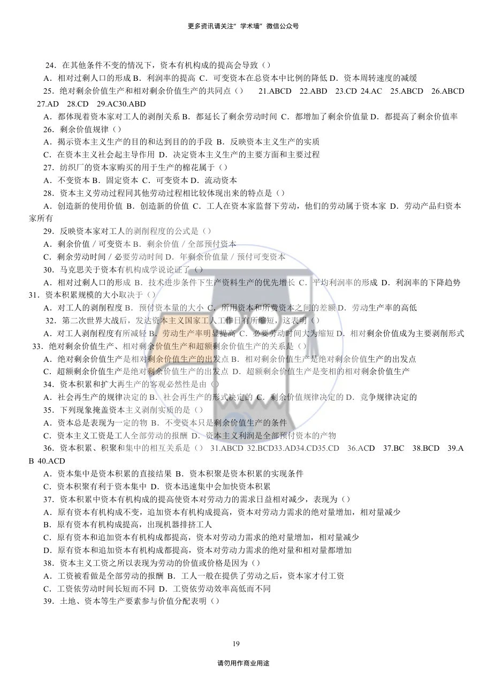

24．在其他条件不变的情况下，资本有机构成的提高会导致（）A．相对过剩人口的形成 B．利润率的提高 C．可变资本在总资本中比例的降低 D．资本周转速度的减缓

26．剩余价值规律（）A．揭示资本主义生产的目的和达到目的的手段 B．反映资本主义生产的实质C．在资本主义社会起主导作用 D．决定资本主义生产的主要方面和主要过程

27．纺织厂的资本家购买的用于生产的棉花属于（）A．不变资本 B．固定资本 C．可变资本 D．流动资本28．资本主义劳动过程同其他劳动过程相比较体现出来的特点是（）

A．创造新的使用价值 B．创造新的价值 C．工人在资本家监督下劳动，他们的劳动属于资本家 D．劳动产品归资本家所有

29．反映资本家对工人的剥削程度的公式是（）A．剩余价值／可变资本 B．剩余价值／全部预付资本C．剩余劳动时间／必要劳动时间 D．年剩余价值量／预付可变资本

31．资本积累规模的大小取决于（）A．对工人的剥削程度B．预付资本量的大小 C．所用资本和所费资本之间的差额 D．劳动生产率的高低32．第二次世界大战后，发达资本主义国家工人工作日有所缩短，这表明（）A．对工人剥削程度有所减轻 B．劳动生产率明显提高 C．必要劳动时间大为缩短 D．相对剩余价值成为主要剥削形式

33．绝对剩余价值生产、相对剩余价值生产和超额剩余价值生产的关系是（）A．绝对剩余价值生产是相对剩余价值生产的出发点 B．相对剩余价值生产是绝对剩余价值生产的出发点C．超额剩余价值生产是绝对剩余价值生产的出发点 D．超额剩余价值生产是变相的相对剩余价值生产34．资本积累和扩大再生产的客观必然性是由（）A．社会再生产的规律决定的B．社会再生产的形式决定的 C．剩余价值规律决定的 D．竞争规律决定的

35．下列现象掩盖资本主义剥削实质的是（）A．资本总是表现为一定的物 B．不变资本只是剩余价值生产的条件C．资本主义工资是工人全部劳动的报酬 D．资本主义利润是全部预付资本的产物36．资本积累、积聚和集中的相互关系是（） 31.ABCD 32.BCD33.AD34.CD35.CD 36.ACD 37.BC 38.BCD 39.A

B 40.ACDA．资本集中是资本积累的直接结果 B．资本积聚是资本积累的实现条件C．资本积聚有利于资本集中 D．资本迅速集中会加快资本积累

37．资本积累中资本有机构成的提高使资本对劳动力的需求日益相对减少，表现为（）A．原有资本有机构成不变，追加资本有机构成提高，资本对劳动力需求的绝对量增加，相对量减少B．原有资本有机构成提高，出现机器排挤工人C．原有资本和追加资本有机构成都提高，资本对劳动力需求的绝对量增加，相对量减少D．原有资本和追加资本有机构成都提高，资本对劳动力需求的绝对量和相对量都增加

38．资本主义工资之所以表现为劳动的价值或价格是因为（）A．工资被看做是全部劳动的报酬 B．工人一般在提供了劳动之后，资本家才付工资C．工资依劳动时间长短而不同 D．工资依劳动效率高低而不同

39．土地、资本等生产要素参与价值分配表明（）

更多资讯请关注“学术墙”微信公众号

19

请勿用作商业用途

## 第20页

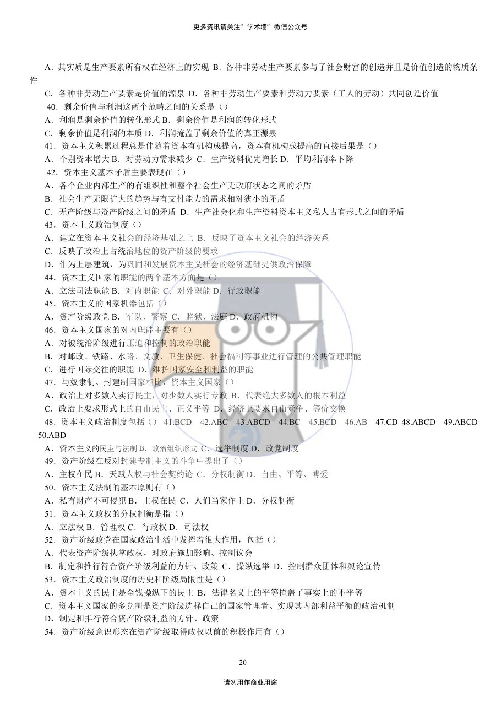

A．其实质是生产要素所有权在经济上的实现 B．各种非劳动生产要素参与了社会财富的创造并且是价值创造的物质条件C．各种非劳动生产要素是价值的源泉 D．各种非劳动生产要素和劳动力要素（工人的劳动）共同创造价值

40．剩余价值与利润这两个范畴之间的关系是（）A．利润是剩余价值的转化形式 B．剩余价值是利润的转化形式C．剩余价值是利润的本质 D．利润掩盖了剩余价值的真正源泉

41．资本主义积累过程总是伴随着资本有机构成提高，资本有机构成提高的直接后果是（）A．个别资本增大 B．对劳动力需求减少 C．生产资料优先增长D．平均利润率下降

42．资本主义基本矛盾主要表现在（）A．各个企业内部生产的有组织性和整个社会生产无政府状态之间的矛盾B．社会生产无限扩大的趋势与有支付能力的需求相对狭小的矛盾C．无产阶级与资产阶级之间的矛盾 D．生产社会化和生产资料资本主义私人占有形式之间的矛盾

43．资本主义政治制度（）A．建立在资本主义社会的经济基础之上 B．反映了资本主义社会的经济关系C．反映了政治上占统治地位的资产阶级的要求D．作为上层建筑，为巩固和发展资本主义社会的经济基础提供政治保障

44．资本主义国家的职能的两个基本方面是（）A．立法司法职能 B．对内职能 C．对外职能 D．行政职能

45．资本主义的国家机器包括（）A．资产阶级政党 B．军队、警察 C．监狱、法庭D．政府机构

46．资本主义国家的对内职能主要有（）A．对被统治阶级进行压迫和控制的政治职能B．对邮政、铁路、水路、文教、卫生保健、社会福利等事业进行管理的公共管理职能C．进行国际交往的职能 D．维护国家安全和利益的职能47．与奴隶制、封建制国家相比，资本主义国家（） 47.与奴隶制、封建制国家相比，资本主义国家（）

A．政治上对多数人实行民主，对少数人实行专政 B．代表绝大多数人的根本利益C．政治上要求形式上的自由民主、正义平等 D．经济上要求自由竞争、等价交换

48．资本主义政治制度包括（） 41.BCD 42.ABC 43.ABCD 44.BC 45.BCD 46.AB 47.CD 48.ABCD 49.ABCD50.ABDA．资本主义的民主与法制 B．政治组织形式 C．选举制度 D．政党制度

49．资产阶级在反对封建专制主义的斗争中提出了（）A．主权在民 B．天赋人权与社会契约论 C．分权制衡 D．自由、平等、博爱

50．资本主义法制的基本原则有（）A．私有财产不可侵犯B．主权在民 C．人们当家作主 D．分权制衡

51．资本主义政权的分权制衡是指（）A．立法权 B．管理权 C．行政权 D．司法权

52．资产阶级政党在国家政治生活中发挥着很大作用，包括（）A．代表资产阶级执掌政权，对政府施加影响、控制议会B．制定和推行符合资产阶级利益的方针、政策 C．操纵选举 D．控制群众团体和舆论宣传

53．资本主义政治制度的历史和阶级局限性是（）A．资本主义的民主是金钱操纵下的民主 B．法律名义上的平等掩盖了事实上的不平等C．资本主义国家的多党制是资产阶级选择自己的国家管理者、实现其内部利益平衡的政治机制D．制定和推行符合资产阶级利益的方针、政策

54．资产阶级意识形态在资产阶级取得政权以前的积极作用有（）

更多资讯请关注“学术墙”微信公众号

20

请勿用作商业用途

## 第21页

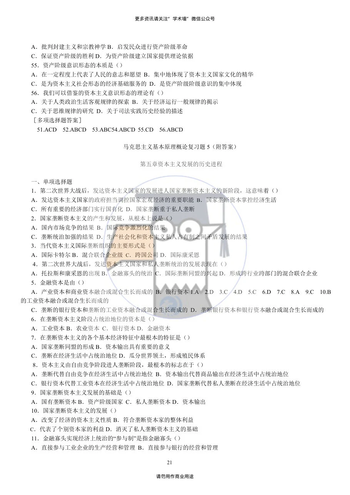

A．批判封建主义和宗教神学B．启发民众进行资产阶级革命C．保证资产阶级的胜利 D．为资产阶级建立国家提供理论依据

55．资产阶级意识形态的本质是（）A．在一定程度上代表了人民的意志和愿望 B．集中地体现了资本主义国家文化的精华C．是为资本主义社会形态的经济基础服务的 D．是资产阶级阶级意识的集中体现

56．我们可以借鉴的资本主义意识形态的理论有（）A．关于人类政治生活客观规律的探索 B．关于经济运行一般规律的揭示C．关于思维规律的研究 D．关于司法实践历史经验的描述［多项选择题答案51.ACD 52.ABCD 53.ABC54.ABCD 55.CD 56.ABCD

马克思主义基本原理概论复习题 5（附答案）

第五章资本主义发展的历史进程

### 一、单项选择题

1．第二次世界大战后，发达资本主义国家的发展进人国家垄断资本主义的新阶段，这意味着（）A．发达资本主义国家的政府担当调控国家宏观经济的重要职能 B．国家垄断资本掌控经济生活C．所有重要的经济部门实行国有化 D．国家垄断重于私人垄断

2．国家垄断资本主义的产生和发展，从根本上说是（）A．国内市场竞争的结果 B．国际竞争激烈化的结果C．垄断统治加强的结果 D．生产社会化和资本主义私人占有制之间矛盾发展的结果

3．当代资本主义国际垄断组织的主要形式是（）A．国际卡特尔B．混合联合企业级 C．跨国公司 D．国际康采恩

4．第二次世界大战后，发达资本主义国家和私人垄断统治的发展表现在（）A．托拉斯和康采恩的出现 B．金融寡头的统治 C．国际垄断同盟的兴起 D．形成跨行业跨部门的混合联合企业5．金融资本是由（）A．产业资本和商业资本融合或混合生长而成的 B．银行资本 1.A 2.D 3.C 4.D 5.C 6.D 7.C 8.A 9.C 10.B

的工业资本融合或混合生长而成的C．垄断的银行资本和垄断的工业资本融合或混合生长而成的 D．垄断银行资本和银行资本融合或混合生长而成的

6．在垄断资本主义阶段占统治地位的资本是（）A．工业资本 B．农业资本 C．银行资本 D．金融资本

7．在垄断资本主义的各个基本经济特征中最根本的特征是（）A．国家垄断同盟的形成 B．资本输出具有重要的意义C．垄断在经济生活中占统治地位 D．瓜分世界领土，形成殖民体系

A．垄断代替自由竞争在经济生活中占统治地位 B．资本输出代替商品输出在经济生活中占统治地位C．银行资本代替工业资本在经济生活中占统治地位 D．国家垄断代替私人垄断在经济生活中占统治地位

9．国家垄断资本主义发展的基础是（）A．国有垄断资本 B．资产阶级国家 C．私人垄断资本 D．资本输出

10．国家垄断资本主义的发展（）A．改变了经济的资本主义性质 B．符合垄断资本家的整体利益C．代表了个别资本家的利益D．消灭了私人垄断资本主义的基础

11．金融寡头实现经济上统治的“参与制”是指金融寡头（）A．直接参与工业企业的生产经营和管理 B．直接参与银行的经营和管理

更多资讯请关注“学术墙”微信公众号

21

请勿用作商业用途

## 第22页

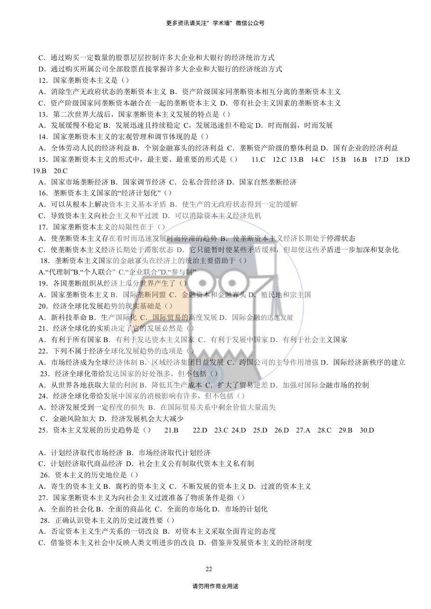

C．通过购买一定数量的股票层层控制许多大企业和大银行的经济统治方式D．通过购买所属公司全部股票直接掌握许多大企业和大银行的经济统治方式

12．国家垄断资本主义是（）A．消除生产无政府状态的垄断资本主义 B．资产阶级国家同垄断资本相互分离的垄断资本主义C．资产阶级国家同垄断资本融合在一起的垄断资本主义 D．带有社会主义因素的垄断资本主义

13．第二次世界大战后，国家垄断资本主义发展的特点是（）A．发展缓慢不稳定 B．发展迅速且持续稳定 C，发展迅速但不稳定 D．时而削弱，时而发展

14．国家垄断资本主义的宏观管理和调节体现的是（）A．全体劳动人民的经济利益B．个别金融寡头的经济利益 C．垄断资产阶级的整体利益 D．国有企业的经济利益

15．国家垄断资本主义的形式中，最主要、最重要的形式是（） 11.C 12.C 13.B 14.C 15.B 16.B 17.D 18.D9.B 20.C

A．国家市场垄断经济B．国家调节经济 C．公私合营经济 D．国家自然垄断经济16．垄断资本主义国家的“经济计划化”（）A．可以从根本上解决资本主义基本矛盾 B．使生产的无政府状态得到一定的缓解C．导致资本主义向社会主义和平过渡 D．可以消除资本主义经济危机

17．国家垄断资本主义的局限性在于（）A．使垄断资本主义存在着时而迅速发展时而停滞的趋势 B．使垄断资本主义经济长期处于停滞状态C．使垄断资本主义经济长期处于滞胀状态 D．它只能暂时使某些矛盾缓和，但却使这些矛盾进一步加深和复杂化

18．垄断资本主义国家的金融寡头在经济上的统治主要借助于（）A.“代理制”B.“个人联合” C.“企业联合”D.“参与制”

19．各国垄断组织从经济上瓜分世界产生了（）A．国家垄断资本主义B．国际垄断同盟 C．金融资本和金融寡头 D．殖民地和宗主国

20．经济全球化发展趋势的现实基础是（）A．新科技革命B．生产国际化 C．国际贸易的高度发展 D．国际金融的迅速发展21．经济全球化的实质决定了它的发展必然是A．有利于所有国家 B．有利于发达资本主义国家 C．有利于发展中国家 D．有利于社会主义国家

22．下列不属于经济全球化发展趋势的选项是A. 市场经济成为全球经济体制B. 区域经济集团日益发展C. 跨国公司的主导作用增强D. 国际经济新秩序的建立 A．市场经济成为全球经济体制 B．区域经济集团日益发展 C．跨国公司的主导作用增强 D．国际经济新秩序的建立

23．经济全球化带给发达国家的好处很多，但不包括（）A．从世界各地获取大量的利润 B．降低其生产成本 C．扩大了贸易逆差 D．加强对国际金融市场的控制

24．经济全球化带给发展中国家的消极影响有许多，但不包括（）A．经济发展受到一定程度的损失 B．在国际贸易关系中剩余价值大量流失C．金融风险加大 D．经济发展机会大大减少

25．资本主义发展的历史趋势是（） 21.B 22.D 23.C 24.D 25.D 26.D 27.A 28.C 29.B 30.D 25.资本主义发展的历史趋势是（）21.B 22.D23.C 24.D2

A．计划经济取代市场经济 B．市场经济取代计划经济C．计划经济取代商品经济 D．社会主义公有制取代资本主义私有制26．资本主义的历史地位是（）

A．寄生的资本主义 B．腐朽的资本主义 C．不断发展的资本主义 D．过渡的资本主义27．国家垄断资本主义为向社会主义过渡准备了物质条件是指（）A．全面的社会化 B．全面的商品化 C．全面的市场化 D．市场的计划化

28．正确认识资本主义的历史过渡性要（）A．否定资本主义生产关系的一切改良 B．对资本主义采取全面肯定的态度C．借鉴资本主义社会中反映人类文明进步的改良 D．借鉴并发展资本主义的经济制度

更多资讯请关注“学术墙”微信公众号

22

请勿用作商业用途

## 第23页

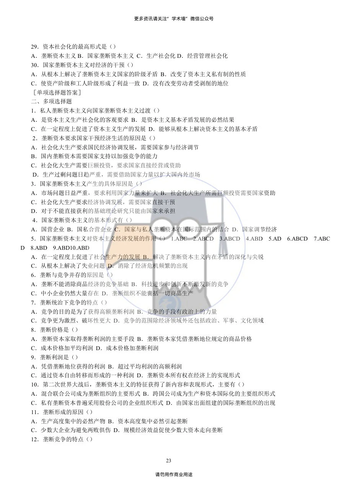

29．资本社会化的最高形式是（）A．垄断资本主义 B．国家垄断资本主义 C．生产社会化D．经营管理社会化

30．国家垄断资本主义对经济的干预（）A．从根本上解决了垄断资本主义国家的阶级矛盾 B．改变了资本主义私有制的性质C．使资产阶级和工人阶级形成了利益一致 D．没有改变劳动者受剥削的地位［单项选择题答案

### 二、多项选择题

1．私人垄断资本主义向国家垄断资本主义过渡（）A．是资本主义生产社会化的客观要求 B．是资本主义基本矛盾发展的必然结果C．在一定程度上促进了资本主义生产的发展 D．能够从根本上解决资本主义的基本矛盾

2．垄断资本要求国家干预经济生活的原因是（）A．社会化大生产要求国民经济协调发展，需要国家参与经济调节B．国内垄断资本需要国家支持以加强竞争的能力C．社会化大生产需要巨额投资，要求国家直接经营或资助D．生产过剩问题日趋严重，需要借助国家力量以扩大国内外市场

3．国家垄断资本主义产生的具体原因是（）A．市场问题日益严重，要求利用国家力量来扩大 B．社会化大生产所需巨额投资需要国家资助C．社会化大生产要求经济协调发展，需要国家直接干预D．对于不能直接获利的基础理论研究只能由国家来承担

4．国家垄断资本主义的基本形式有（）A．国营企业 B．国私合营企业 C．国家与私人垄断资本在国际范围内的结合 D．国家调节经济5．国家垄断资本主义对资本主义经济发展的作用（） 1.ABC 2.ABCD 3.ABCD 4.ABD 5.AD 6.ABCD 7.ABC

D 8.ABD 9.ABD10.ABDA．在一定程度上促进了社会生产力的发展 B．解决了垄断资本主义内在矛盾的深化与尖锐C．从根本上解决了失业问题 D．消除了经济危机频繁的出现6．垄断与竞争并存的原因是（）A．垄断不能消除商品经济的竞争基础 B．科技进步和创新不断激发新的竞争C．中小企业仍然大量存在 D．垄断组织不能囊括一切商品生产

7．垄断统治下竞争的特点（）A．竞争的目的是为了获得高额垄断利润 B．竞争的手段有政治上的力量C．竞争更为激烈、破坏性更大 D．竞争的范围除经济领域外还包括政治、军事、文化领域

8．垄断价格是（）A．垄断资本家取得垄断利润的主要手段 B．垄断资本家凭借垄断地位规定的商品价格C．成本价格加平均利润 D．成本价格加垄断利润

9．垄断利润是（）A．凭借垄断地位获得的利润 B．超过平均利润的高额利润C．通过资本自由转移而形成的一种利润 D．垄断资本所有权在经济上的实现形式10．第二次世界大战后，垄断资本主义的特征获得了新内容和表现形式，主要有（）

A．混合联合公司成为垄断组织的主要形式 B．跨国公司成为生产和资本国际化的主要组织形式C．私有垄断资本普遍采用股份公司的企业组织形式 D．由国家出面组建的国际垄断组织的出现

11．垄断形成的原因（）A．生产高度集中的必然产物 B．资本高度集中必然引起垄断C．少数大企业为避免两败俱伤 D．规模经济效益促使少数大资本走向垄断

12．垄断竞争的特点（）

更多资讯请关注“学术墙”微信公众号

23

请勿用作商业用途

## 第24页

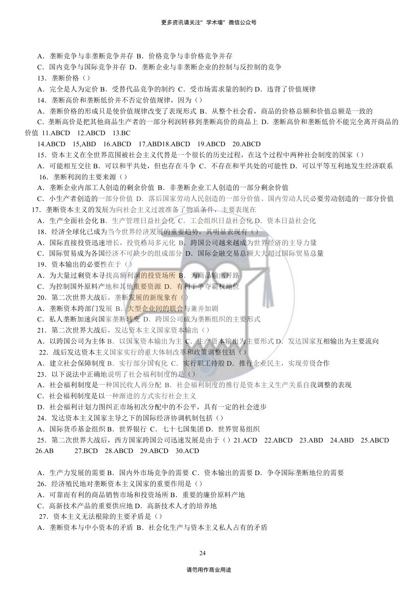

A．垄断竞争与非垄断竞争并存 B．价格竞争与非价格竞争并存C．国内竞争与国际竞争并存 D．垄断企业与非垄断企业的控制与反控制的竞争

13．垄断价格（）A．完全是人为定价 B．受替代品竞争的制约 C．受市场需求量的制约 D．违背了价值规律

14．垄断高价和垄断低价并不否定价值规律，因为（）A．垄断价格的形成只是使价值规律改变了表现形式 B．从整个社会看，商品的价格总额和价值总额是一致的

C．垄断高价是把其他商品生产者的一部分利润转移到垄断高价的商品上 D．垄断高价和垄断低价不能完全离开商品的价值 11.ABCD 12.ABCD 13.BC14.ABCD 15,ABD 16.ABCD 17.ABD18.ABCD 19.ABCD 20.ABCD

15．资本主义在全世界范围被社会主义代替是一个很长的历史过程，在这个过程中两种社会制度的国家（）A．可能相互交往 B．可以和平共处，但也存在斗争 C．不存在和平共处的可能性 D．可以平等互利地发生经济联系16．垄断利润的主要来源（）A．垄断企业内部工人创造的剩余价值 B．非垄断企业工人创造的一部分剩余价值C．小生产者创造的一部分价值 D．落后国家劳动人民创造的一部分价值、国内劳动人民必要劳动创造的一部分价值 C.小生产者创造的一部分价值D. 落后国家劳动人民创造的一部分价值、国内劳动人民必要劳动创造的一部分价值

17．垄断资本主义的发展为向社会主义过渡准备了物质条件，主要表现在A．生产全面社会化 B．生产管理日益社会化 C．工会组织日益社会化 D．资本日益社会化

18．经济全球化已成为当今世界经济发展的重要趋势，其明显表现有（）A．国际直接投资迅速增长，投资格局多元化 B．跨国公司越来越成为世界经济的主导力量C．国际贸易成为各国经济不可缺少的组成部分 D．国际金融交易总额大大超过国际贸易总量

19．资本输出的必要性在于（）A．为大量过剩资本寻找高额利润的投资场所 B．为商品输出开路C．为控制国外原料产地和其他重要资源 D．有利于争夺霸权地位

20．第二次世界大战后，垄断发展的新现象有（）A．垄断资本跨部门发展 B．大型企业间的联合与兼并加剧C．私人垄断加速向国家垄断转变 D．跨国公司成为垄断组织的主要形式21．第二次世界大战后，发达资本主义国家资本输出（） 21.第二次世界大战后，发达资本主义国家资本输出（）

A．以跨国公司为主体B．以国家资本输出为主 C．生产资本输出为主要形式D．发达国家互相输出为主要流向 A. 以跨国公司为主体B. 以国家资本输出为主C. 生产资本输出为主要形式D. 发达国家互相输出为主要流向

22．战后发达资本主义国家实行的重大体制改革和政策调整包括（）A．建立社会保障制度B．实行部分国有化 C．实行职工持股 D．推行企业民主，实现劳资合作

23．以下说法中正确地说明了社会福利制度的是（）A．社会福利制度是一种国民收人再分配 B．社会福利制度的推行是资本主义生产关系自我调整的表现C．社会福利制度是以一种渐进的方式实行社会主义D．社会福利计划力图纠正市场初次分配中的不公平，具有一定的社会进步

24．发达资本主义国家主导之下的国际经济协调机制包括（）A．国际货币基金组织B．世界银行 C．七十七国集团 D．世界贸易组织

25．第二次世界大战后，西方国家跨国公司迅速发展是由于（）21.ACD 22.ABCD 23.ABD 24.ABD 25.ABCD26.AB 27.BCD 28.ABCD 29.ABCD 30.ACD

A．生产力发展的需要B．国内外市场竞争的需要 C．资本输出的需要 D．争夺国际垄断地位的需要26．经济殖民地对垄断资本主义国家的重要作用是（）A．可靠而有利的商品销售市场和投资场所B．重要的廉价原料产地C．高新技术产品的重要供应地 D．高新技术人才的培养地

27．资本主义无法根除的主要矛盾是（）A．垄断资本与中小资本的矛盾 B．社会化生产与资本主义私人占有的矛盾

更多资讯请关注“学术墙”微信公众号

24

请勿用作商业用途

## 第25页

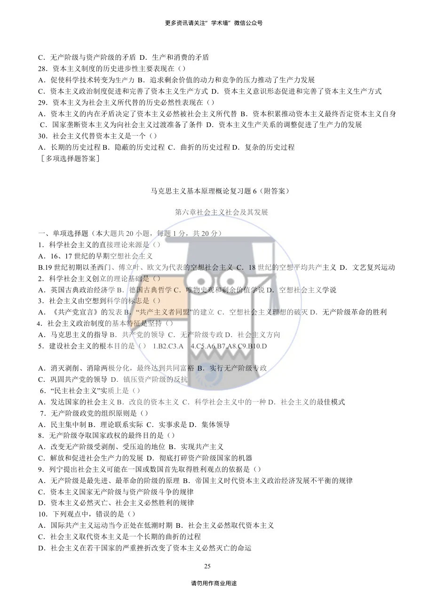

C．无产阶级与资产阶级的矛盾 D．生产和消费的矛盾

28．资本主义制度的历史进步性主要表现在（）A．促使科学技术转变为生产力 B．追求剩余价值的动力和竞争的压力推动了生产力发展C．资本主义政治制度促进和完善了资本主义生产方式 D．资本主义意识形态促进和完善了资本主义生产方式

29．资本主义为社会主义所代替的历史必然性表现在（）A．资本主义的内在矛盾决定了资本主义必然被社会主义所代替 B．资本积累推动资本主义最终否定资本主义自身C．国家垄断资本主义为向社会主义过渡准备了条件 D．资本主义生产关系的调整促进了生产力的发展

30．社会主义代替资本主义是一个（）A．长期的历史过程 B．隐蔽的历史过程 C．曲折的历史过程 D．复杂的历史过程［多项选择题答案

## 马克思主义基本原理概论复习题 6（附答案）

第六章社会主义社会及其发展

### 一、单项选择题（本大题共20 小题，每题 1 分，共20 分）

1．科学社会主义的直接理论来源是（）A．16、17世纪的早期空想社会主义

B.19世纪初期以圣西门、傅立叶、欧文为代表的空想社会主义 C．18世纪的空想平均共产主义 D．文艺复兴运动

2．科学社会主义创立的理论基础是（）A．英国古典政治经济学 B．德国古典哲学 C．唯物史观和剩余价值学说 D．空想社会主义学说3．社会主义由空想到科学的标志是（）A．《共产党宣言》的发表 B．“共产主义者同盟”的建立 C．空想社会主义理想的破灭 D．无产阶级革命的胜利

4．社会主义政治制度的基本特征是坚持（）A．马克思主义的指导B．共产党的领导 C．无产阶级专政 D．社会主义方向

5．建设社会主义的根本目的是（） 1.B2.C3.A 4.C5.A6.B7.A8.C9.B10.D

A．消灭剥削、消除两极分化，最终达到共同富裕 B．实行无产阶级专政C．巩固共产党的领导 D．镇压资产阶级的反抗

6．“民主社会主义”实质上是（）A．发达国家的社会主义 B．改良的资本主义 C．科学社会主义中的一种 D．社会主义的最佳模式

7．无产阶级政党的组织原则是（）A．民主集中制B．理论联系实际 C．实事求是 D．集体领导

8．无产阶级夺取国家政权的最终目的是（）A．改变无产阶级受剥削、受压迫的地位 B．实现共产主义C．解放和促进社会生产力的发展 D．彻底打碎资产阶级国家的机器

9．列宁提出社会主义可能在一国或数国首先取得胜利观点的依据是（）A．无产阶级是最先进、最革命的阶级的原理 B．帝国主义时代资本主义政治经济发展不平衡的规律C．资本主义国家无产阶级与资产阶级斗争的规律D．资本主义必然灭亡、社会主义必然胜利的规律

10．下列观点中，错误的是（）A．国际共产主义运动当今正处在低潮时期 B．社会主义必然取代资本主义C．社会主义取代资本主义是一个长期的曲折的过程D．社会主义在若干国家的严重挫折改变了资本主义必然灭亡的命运

更多资讯请关注“学术墙”微信公众号

25

请勿用作商业用途

## 第26页

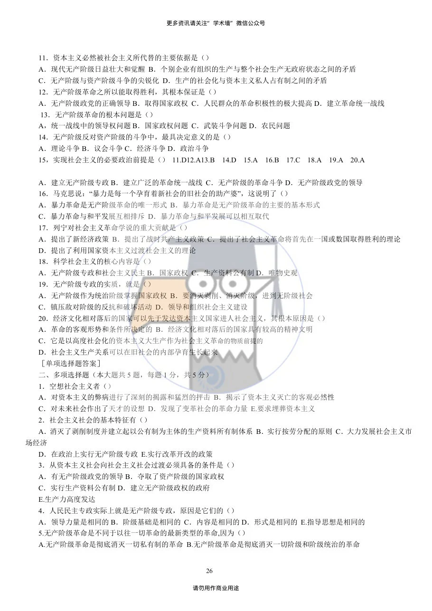

11．资本主义必然被社会主义所代替的主要依据是（）A．现代无产阶级日益壮大和觉醒 B．个别企业有组织的生产与整个社会生产无政府状态之间的矛盾C．无产阶级与资产阶级斗争的尖锐化 D．生产的社会化与资本主义私人占有制之间的矛盾

12．无产阶级革命之所以能取得胜利，其根本保证是（）A．无产阶级政党的正确领导B．取得国家政权 C．人民群众的革命积极性的极大提高 D．建立革命统一战线

13．无产阶级革命的根本问题是（）A，统一战线中的领导权问题B．国家政权问题 C．武装斗争问题 D．农民问题

14．无产阶级反对资产阶级的斗争中，最具决定意义的是（）A．理论斗争 B．议会斗争 C．经济斗争 D．政治斗争

15，实现社会主义的必要政治前提是（） 11.D12.A13.B 14.D 15.A 16.B 17.C 18.A 19.A 20.A

A．建立无产阶级专政B．建立广泛的革命统一战线 C．无产阶级的革命斗争 D．无产阶级政党的领导16．马克思说：“暴力是每一个孕育着新社会的旧社会的助产婆”，这说明了（）A．暴力革命是无产阶级革命的唯一形式 B．暴力革命是无产阶级革命的主要的基本形式C．暴力革命与和平发展互相排斥 D．暴力革命与和平发展可以相互取代

17．列宁对社会主义革命学说的重大贡献是（）A．提出了新经济政策 B．提出了战时共产主义政策 C．提出了社会主义革命将首先在一国或数国取得胜利的理论D．提出了利用国家资本主义过渡社会主义的理论

18．科学社会主义的核心内容是（）A．无产阶级专政和社会主义民主 B．国家政权 C．生产资料公有制 D．唯物史观

19．无产阶级专政的实质，就是（）A．无产阶级作为统治阶级掌握国家政权 B．要消灭剥削、消灭阶级，进到无阶级社会C．镇压敌对阶级的反抗和破坏活动 D．领导和组织社会主义建设

20．经济文化相对落后的国家可以先于发达资本主义国家进人社会主义，其根本原因是（）A．革命的客观形势和条件所决定的 B．经济文化相对落后的国家具有较高的精神文明C．它是以高度社会化的资本主义大生产作为社会主义革命的物质前提的D．社会主义生产关系可以在旧社会的内部孕育生长起来

［单项选择题答案

### 二、多项选择题（本大题共5 题，每题 1 分，共5 分）

1．空想社会主义者（）A．对资本主义的弊病进行了深刻的揭露和猛烈的抨击 B．揭示了资本主义灭亡的客观必然性C．对未来社会作出了天才的设想 D．发现了变革社会的革命力量 E.要求埋葬资本主义2．社会主义社会的基本特征有（）

场经济

D．在政治上实行无产阶级专政 E.实行改革开改的政策3．从资本主义社会向社会主义社会过渡必须具备的条件是（）A．有无产阶级政党的领导 B．夺取了资产阶级的国家政权C．实行生产资料公有制 D．建立无产阶级政权的政府E.生产力高度发达

4．人民民主专政实际上就是无产阶级专政，原因是它们的（）A．领导力量是相同的B．阶级基础是相同的 C．内容是相同的 D．形式是相同的 E.指导思想是相同的

5.无产阶级革命是不同于以往一切革命的最新类型的革命,因为（）A.无产阶级革命是彻底消灭一切私有制的革命 B.无产阶级革命是彻底消灭一切阶级和阶级统治的革命

更多资讯请关注“学术墙”微信公众号

26

请勿用作商业用途

## 第27页

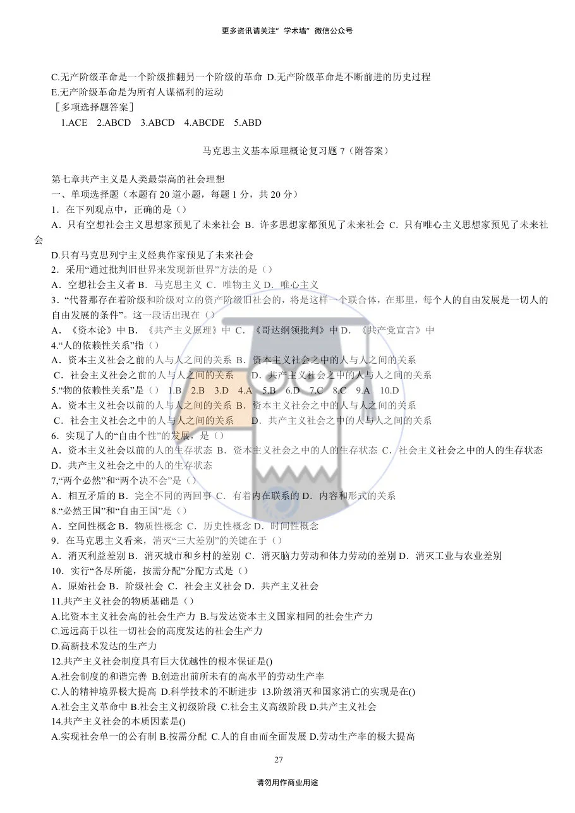

C.无产阶级革命是一个阶级推翻另一个阶级的革命 D.无产阶级革命是不断前进的历史过程E.无产阶级革命是为所有人谋福利的运动［多项选择题答案1.ACE 2.ABCD 3.ABCD 4.ABCDE 5.ABD

马克思主义基本原理概论复习题 7（附答案）

### 第七章共产主义是人类最崇高的社会理想

### 一、单项选择题（本题有 20道小题，每题 1 分，共20 分）

A．只有空想社会主义思想家预见了未来社会 B．许多思想家都预见了未来社会 C．只有唯心主义思想家预见了未来社会D.只有马克思列宁主义经典作家预见了未来社会

2．采用“通过批判旧世界来发现新世界”方法的是（）A．空想社会主义者 B．马克思主义 C．唯物主义 D．唯心主义

3．“代替那存在着阶级和阶级对立的资产阶级旧社会的，将是这样一个联合体，在那里，每个人的自由发展是一切人的自由发展的条件”。这一段话出现在（）A．《资本论》中 B．《共产主义原理》中 C．《哥达纲领批判》中 D．《共产党宣言》中

4.“人的依赖性关系”指（）A．资本主义社会之前的人与人之间的关系 B．资本主义社会之中的人与人之间的关系C．社会主义社会之前的人与人之间的关系 D．共产主义社会之中的人与人之间的关系5.“物的依赖性关系”是（） 1.B 2.B 3.D 4.A 5.B 6.D 7.C 8.C 9.A 10.D

A．资本主义社会以前的人与人之间的关系 B．资本主义社会之中的人与人之间的关系C．社会主义社会之中的人与人之间的关系 D．共产主义社会之中的人与人之间的关系

6．实现了人的“自由个性”的发展，是（）A．资本主义社会以前的人的生存状态 B．资本主义社会之中的人的生存状态 C． 社会主义社会之中的人的生存状态D．共产主义社会之中的人的生存状态

7,“两个必然”和“两个决不会”是（）A．相互矛盾的B．完全不同的两回事 C．有着内在联系的 D．内容和形式的关系

8.“必然王国”和“自由王国”是（）A．空间性概念B．物质性概念 C．历史性概念 D．时间性概念

9．在马克思主义看来，消灭“三大差别”的关键在于（）A．消灭利益差别 B．消灭城市和乡村的差别 C．消灭脑力劳动和体力劳动的差别 D．消灭工业与农业差别

10．实行“各尽所能，按需分配”分配方式是（）A．原始社会 B．阶级社会 C．社会主义社会 D．共产主义社会

11.共产主义社会的物质基础是（）A.比资本主义社会高的社会生产力 B.与发达资本主义国家相同的社会生产力C.远远高于以往一切社会的高度发达的社会生产力D.高新技术发达的生产力

12.共产主义社会制度具有巨大优越性的根本保证是()A.社会制度的和谐完善 B.创造出前所未有的高水平的劳动生产率C.人的精神境界极大提高 D.科学技术的不断进步 13.阶级消灭和国家消亡的实现是在()A.社会主义革命中 B.社会主义初级阶段 C.社会主义高级阶段 D.共产主义社会

14.共产主义社会的本质因素是()A.实现社会单一的公有制 B.按需分配 C.人的自由而全面发展 D.劳动生产率的极大提高

更多资讯请关注“学术墙”微信公众号

27

请勿用作商业用途

## 第28页

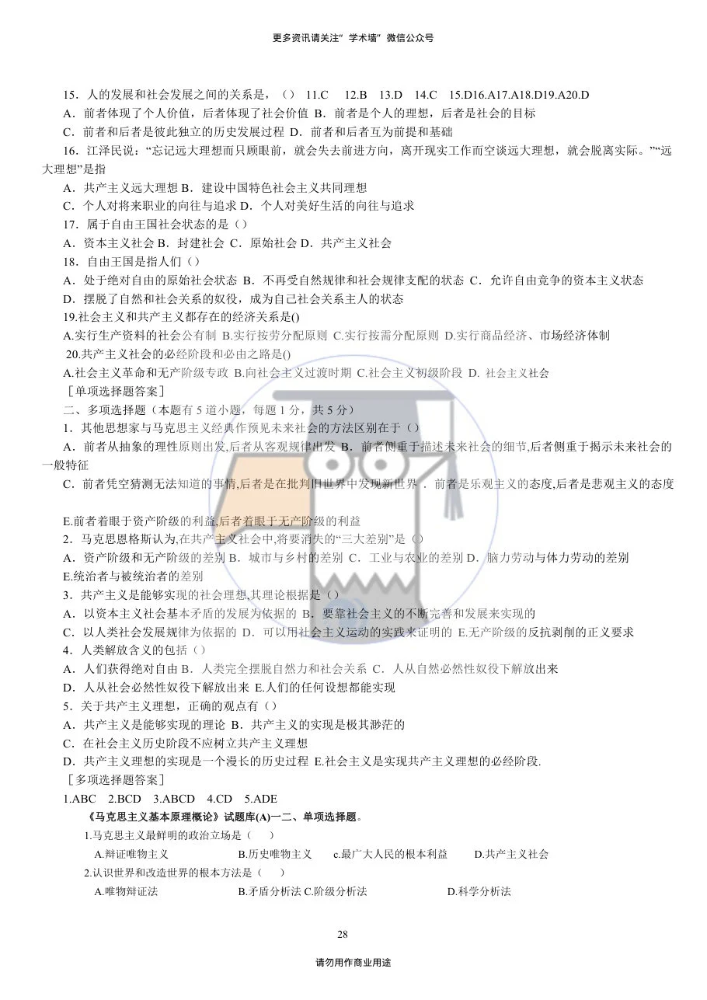

15．人的发展和社会发展之间的关系是，（） 11.C 12.B 13.D 14.C 15.D16.A17.A18.D19.A20.DA．前者体现了个人价值，后者体现了社会价值 B．前者是个人的理想，后者是社会的目标C．前者和后者是彼此独立的历史发展过程 D．前者和后者互为前提和基础

16．江泽民说：“忘记远大理想而只顾眼前，就会失去前进方向，离开现实工作而空谈远大理想，就会脱离实际。”“远大理想”是指A．共产主义远大理想B．建设中国特色社会主义共同理想C．个人对将来职业的向往与追求 D．个人对美好生活的向往与追求

17．属于自由王国社会状态的是（）A．资本主义社会 B．封建社会 C．原始社会 D．共产主义社会

18．自由王国是指人们（）A．处于绝对自由的原始社会状态 B．不再受自然规律和社会规律支配的状态 C．允许自由竞争的资本主义状态D．摆脱了自然和社会关系的奴役，成为自己社会关系主人的状态19.社会主义和共产主义都存在的经济关系是()

A.实行生产资料的社会公有制 B.实行按劳分配原则 C.实行按需分配原则 D.实行商品经济、市场经济体制20.共产主义社会的必经阶段和必由之路是()A.社会主义革命和无产阶级专政 B.向社会主义过渡时期 C.社会主义初级阶段 D. 社会主义社会［单项选择题答案

### 二、多项选择题（本题有 5 道小题，每题1 分，共 5分）

1．其他思想家与马克思主义经典作预见未来社会的方法区别在于（）

A．前者从抽象的理性原则出发,后者从客观规律出发 B．前者侧重于描述未来社会的细节,后者侧重于揭示未来社会的一般特征C．前者凭空猜测无法知道的事情,后者是在批判旧世界中发现新世界 ．前者是乐观主义的态度,后者是悲观主义的态度E.前者着眼于资产阶级的利益,后者着眼于无产阶级的利益

2．马克思恩格斯认为,在共产主义社会中,将要消失的“三大差别”是A．资产阶级和无产阶级的差别 B．城市与乡村的差别 C．工业与农业的差别D．脑力劳动与体力劳动的差别E.统治者与被统治者的差别

3．共产主义是能够实现的社会理想,其理论根据是（）A．以资本主义社会基本矛盾的发展为依据的 B．要靠社会主义的不断完善和发展来实现的C．以人类社会发展规律为依据的 D．可以用社会主义运动的实践来证明的 E.无产阶级的反抗剥削的正义要求

4．人类解放含义的包括（）A．人们获得绝对自由B．人类完全摆脱自然力和社会关系 C．人从自然必然性奴役下解放出来D．人从社会必然性奴役下解放出来 E.人们的任何设想都能实现

5．关于共产主义理想，正确的观点有（）A．共产主义是能够实现的理论 B．共产主义的实现是极其渺茫的C．在社会主义历史阶段不应树立共产主义理想D．共产主义理想的实现是一个漫长的历史过程 E.社会主义是实现共产主义理想的必经阶段.［多项选择题答案

### 1.ABC 2.BCD 3.ABCD 4.CD 5.ADE

### 《马克思主义基本原理概论》试题库(A)一二、单项选择题。

1.马克思主义最鲜明的政治立场是（ ）A.辩证唯物主义 B.历史唯物主义 c.最广大人民的根本利益 D.共产主义社会

2.认识世界和改造世界的根本方法是（ ）A.唯物辩证法 B.矛盾分析法 C.阶级分析法 D.科学分析法

更多资讯请关注“学术墙”微信公众号

28

请勿用作商业用途

## 第29页

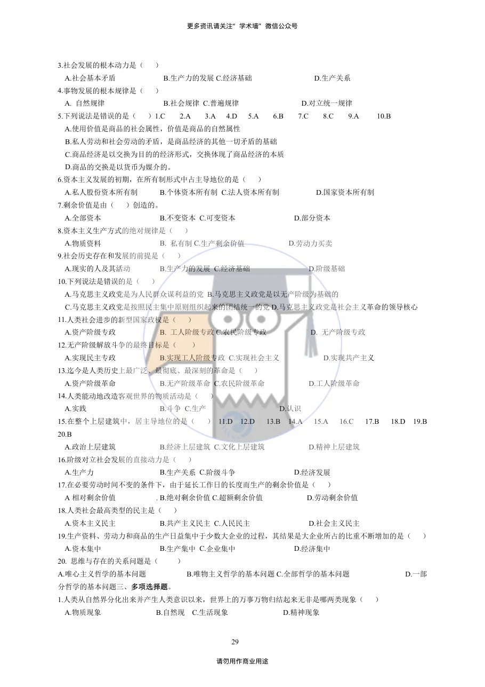

3.社会发展的根本动力是（ ）A.社会基本矛盾 B.生产力的发展 C.经济基础 D.生产关系

4.事物发展的根本规律是（ ）A. 自然规律 B.社会规律 C.普遍规律 D.对立统一规律5.下列说法是错误的是（ ）1.C 5.下列说法是错误的是（ ） 1.C 2.A 3.A 4.D 5.A 6.B 2.A 3.A 4.D 5.A 6.B 7.C 8.C 9.A 10.B

A.使用价值是商品的社会属性，价值是商品的自然属性B.私人劳动和社会劳动的矛盾，是商品经济的其他一切矛盾的基础C.商品经济是以交换为目的的经济形式，交换体现了商品经济的本质D.商品的交换是以货币为媒介的。

6.资本主义发展的初期，在所有制形式中占主导地位的是（ ）A.私人股份资本所有制 B.个体资本所有制 C.法人资本所有制 D.国家资本所有制

7.剩余价值是由（ ）创造的。A.全部资本 B.不变资本 C.可变资本 D.部分资本

8.资本主义生产方式的绝对规律是（ ）A.物质资料 B. 私有制 C.生产剩余价值 D.劳动力买卖

9.社会历史存在和发展的前提是（ ）A.现实的人及其活动 B.生产力的发展 C.经济基础 D.阶级基础

10.下列说法是错误的是（ ）A.马克思主义政党是为人民群众谋利益的党 B.马克思主义政党是以无产阶级为基础的C.马克思主义政党是按照民主集中原则组织起来的团结统一的党D.马克思主义政党是社会主义革命的领导核心

11.人类社会进步的新型国家政权是（ ）A.资产阶级专政 B. 工人阶级专政 C.农民阶级专政

12.无产阶级解放斗争的最终目标是（ ）A.实现民主专政 B.实现工人阶级专政 C.实现社会主义

D. 无产阶级专政D.实现共产主义

13.迄今是人类历史上最广泛、最彻底、最深刻的革命是（ ）A.资产阶级革命 B.无产阶级革命 C.农民阶级革命 D.工人阶级革命

14.人类能动地改造客观世界的物质活动是（A.实践 B.斗争 C.生产 D.认识

15.在整个上层建筑中，居主导地位的是（ ） 11.D 12.D 13.B 14.A 15.A 16.C 17.B 18.D 19.B20.BA.政治上层建筑 B.经济上层建筑 C.文化上层建筑 D.精神上层建筑

16.阶级对立社会发展的直接动力是（ ）A.生产力 B.生产关系 C.阶级斗争 D.经济发展

17.在必要劳动时间不变的条件下，由于延长工作日的长度而生产的剩余价值是（ ）A 相对剩余价值 . B.绝对剩余价值 C.超额剩余价值 D.劳动剩余价值

18.人类社会最高类型的民主是（ ）A.资本主义民主 B.共产主义民主 C.人民民主 D.社会主义民主

19.生产资料、劳动力和商品的生产日益集中于少数大企业的过程，其结果是大企业所占的比重不断增加的是（ ）A.资本集中 B.生产集中 C.企业集中 D.经济集中

20. 思维与存在的关系问题是（ ）A.唯心主义哲学的基本问题 B.唯物主义哲学的基本问题 C.全部哲学的基本问题 D.一部

1.人类从自然界分化出来并产生人类意识以来，世界上的万事万物归结起来无非是哪两类现象（ ）A.物质现象 B.自然现 C.生活现象 D.精神现象

更多资讯请关注“学术墙”微信公众号

29

请勿用作商业用途

## 第30页

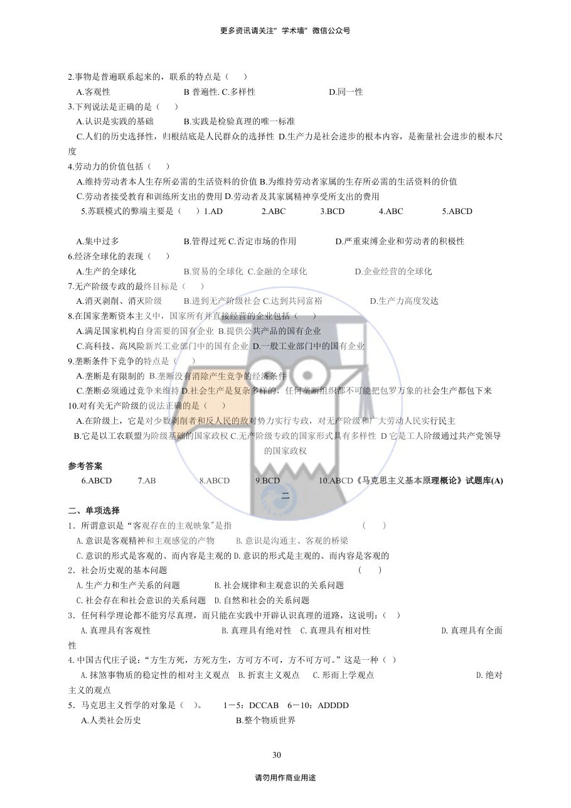

2.事物是普遍联系起来的，联系的特点是（ ）A.客观性 B 普遍性.C.多样性 D.同一性

3.下列说法是正确的是（ ）A.认识是实践的基础 B.实践是检验真理的唯一标准C.人们的历史选择性，归根结底是人民群众的选择性 D.生产力是社会进步的根本内容，是衡量社会进步的根本尺度

4.劳动力的价值包括（ ）A.维持劳动者本人生存所必需的生活资料的价值 B.为维持劳动者家属的生存所必需的生活资料的价值C.劳动者接受教育和训练所支出的费用D.劳动者及其家属精神享受所支出的费用5.苏联模式的弊端主要是（ ）1.AD 2.ABC 3.BCD 4.ABC 5.ABCD

6.经济全球化的表现（ ）A.生产的全球化 B.贸易的全球化 C.金融的全球化 D.企业经营的全球化

7.无产阶级专政的最终目标是（ ）A.消灭剥削、消灭阶级 B.进到无产阶级社会 C.达到共同富裕 D.生产力高度发达

8.在国家垄断资本主义中，国家所有并直接经营的企业包括（ ）A.满足国家机构自身需要的国有企业 B.提供公共产品的国有企业C.高科技、高风险新兴工业部门中的国有企业 D.一般工业部门中的国有企业

9.垄断条件下竞争的特点是A.垄断是有限制的 B.垄断没有消除产生竞争的经济条件C.垄断必须通过竞争来维持D.社会生产是复杂多样的，任何垄断组织都不可能把包罗万象的社会生产都包下来

10.对有关无产阶级的说法正确的是（ ）A.在阶级上，它是对少数剥削者和反人民的敌对势力实行专政，对无产阶级和广大劳动人民实行民主B.它是以工农联盟为阶级基础的国家政权C.无产阶级专政的国家形式具有多样性 D它是工人阶级通过共产党领导

### 参考答案

6.ABCD 7.AB 8.ABCD 9.BCD

10.ABCD《马克思主义基本原理概论》试题库(A)

### 二、单项选择

1．所谓意识是“客观存在的主观映象"是指 ( )A.意识是客观精神和主观感觉的产物 B.意识是沟通主、客观的桥梁C.意识的形式是客观的、而内容是主观的 D.意识的形式是主观的、而内容是客观的

2．社会历史观的基本问题 ( )A.生产力和生产关系的问题 B.社会规律和主观意识的关系问题C.社会存在和社会意识的关系问题 D.自然和社会的关系问题

3．任何科学理论都不能穷尽真理，而只能在实践中开辟认识真理的道路，这说明：（ ）A.真理具有客观性 B.真理具有绝对性 C.真理具有相对性 D.真理具有全面

4.中国古代庄子说：“方生方死，方死方生，方可方不可，方不可方可。”这是一种（ ）A.抹煞事物质的稳定性的相对主义观点 B.折衷主义观点 C.形而上学观点 D.绝对

5．马克思主义哲学的对象是（ ）。 1－5：DCCAB 6－10：ADDDDA.人类社会历史 B.整个物质世界

更多资讯请关注“学术墙”微信公众号

30

请勿用作商业用途

## 第31页

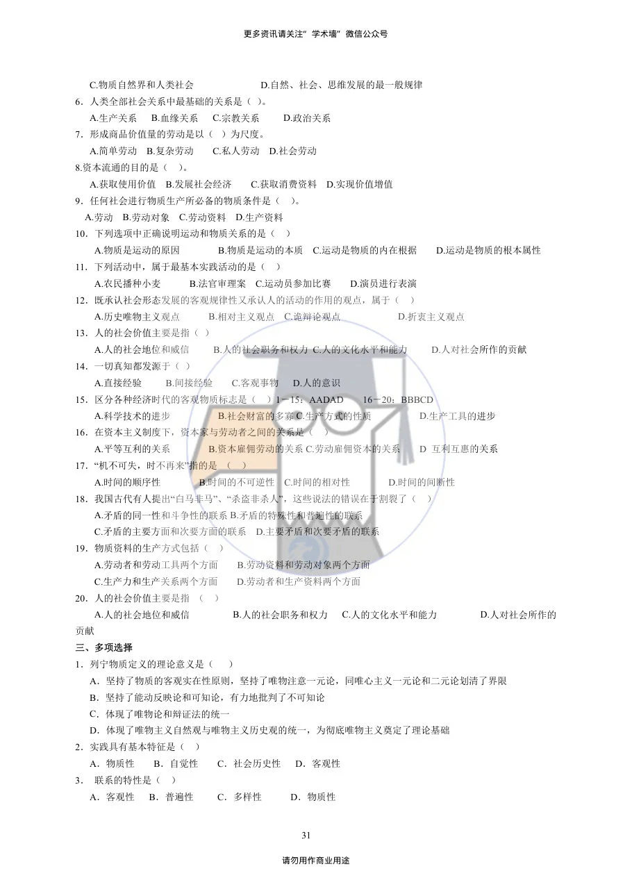

C.物质自然界和人类社会 D.自然、社会、思维发展的最一般规律

6．人类全部社会关系中最基础的关系是（ ）。A.生产关系 B.血缘关系 C.宗教关系 D.政治关系

7．形成商品价值量的劳动是以（ ）为尺度。A.简单劳动 B.复杂劳动 C.私人劳动 D.社会劳动

8.资本流通的目的是（ ）。A.获取使用价值 B.发展社会经济 C.获取消费资料 D.实现价值增值

9．任何社会进行物质生产所必备的物质条件是（ ）。A.劳动 B.劳动对象 C.劳动资料 D.生产资料

10．下列选项中正确说明运动和物质关系的是（ ）A.物质是运动的原因 B.物质是运动的本质 C.运动是物质的内在根据 D.运动是物质的根本属性

11．下列活动中，属于最基本实践活动的是（ ）A.农民播种小麦 B.法官审理案 C.运动员参加比赛 D.演员进行表演

12．既承认社会形态发展的客观规律性又承认人的活动的作用的观点，属于（ ）A.历史唯物主义观点 B.相对主义观点 C.诡辩论观点 D.折衷主义观点

13．人的社会价值主要是指（ ）A.人的社会地位和威信 B.人的社会职务和权力 C.人的文化水平和能力 D.人对社会所作的贡献

14．一切真知都发源于（ ）A.直接经验 B.间接经验 C.客观事物 D.人的意识

15．区分各种经济时代的客观物质标志是（ ）1－15：AADAD 16－20：BBBCDA.科学技术的进步 B.社会财富的多寡 C.生产方式的性质 D.生产工具的进步

16．在资本主义制度下，资本家与劳动者之间的关系是（ ）A.平等互利的关系 B.资本雇佣劳动的关系 C.劳动雇佣资本的关系 D 互利互惠的关系

17．“机不可失，时不再来”指的是 （ ）A.时间的顺序性 B.时间的不可逆性 C.时间的相对性 D.时间的间断性

18．我国古代有人提出“白马非马”、“杀盗非杀人”，这些说法的错误在于割裂了（A.矛盾的同一性和斗争性的联系 B.矛盾的特殊性和普遍性的联系C.矛盾的主要方面和次要方面的联系 D.主要矛盾和次要矛盾的联系

19．物质资料的生产方式包括（ ）A.劳动者和劳动工具两个方面 B.劳动资料和劳动对象两个方面C.生产力和生产关系两个方面 D.劳动者和生产资料两个方面

20．人的社会价值主要是指 （ ）A.人的社会地位和威信 B.人的社会职务和权力 C.人的文化水平和能力 D.人对社会所作的

### 三、多项选择

1．列宁物质定义的理论意义是（ ）A．坚持了物质的客观实在性原则，坚持了唯物注意一元论，同唯心主义一元论和二元论划清了界限B．坚持了能动反映论和可知论，有力地批判了不可知论C．体现了唯物论和辩证法的统一D．体现了唯物主义自然观与唯物主义历史观的统一，为彻底唯物主义奠定了理论基础

2．实践具有基本特征是（ ）A．物质性 B．自觉性 C．社会历史性 D．客观性

3． 联系的特性是（ ）A．客观性 B．普遍性 C．多样性 D．物质性

更多资讯请关注“学术墙”微信公众号

31

请勿用作商业用途

## 第32页

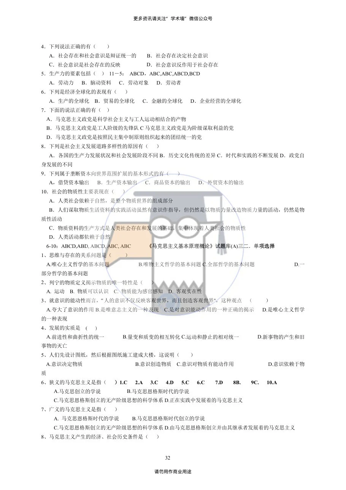

4．下列说法正确的有（ ）A．社会存在和社会意识是辩证统一的 B．社会存在决定社会意识C．社会意识是社会存在的反映 D．社会意识反作用于社会存在

5．生产力的要素包括（ ） 11－5： ABCD，ABC,ABC,ABCD,BCDA．劳动力 B．脑动资料 C．劳动对象 D．劳动者

6．下列是经济全球化的表现有（ ）A．生产的全球化 B．贸易的全球化 C．金融的全球化 D．企业经营的全球化

7．下面的说法正确的有（ ）A．马克思主义政党是科学社会主义与工人运动相结合的产物B．马克思主义政党是工人阶级的先锋队 C马克思主义政党是为阶级谋取利益的党D．马克思主义政党是按照民主集中制原则组织起来的团结统一的党

8．下列是社会主义发展道路多样性的原因有（ ）A．各国的生产力发展状况和社会发展阶段不同 B．历史文化传统的差异 C．时代和实践的不断发展 D．政党自身发展的不同

9．下列属于垄断资本向世界范围扩展的基本形式的有（ ）A，借贷资本输出 B．生产资本输出 C．商品资本的输出 D．外贸资本的输出

B．人们谋取物质生活资料的实践活动虽然有意识作指导，但仍然是以物质力量改造物质力量的活动，仍然是物质性活动C．物质资料的生产方式是人类社会存在和发展的基础，集中体现着人类社会的物质性D．人类活动都依赖于自然6-10：ABCD,ABD, ABCD, ABC, ABC 《马克思主义基本原理概论》试题库(A)三二．单项选择

1、思维与存在的关系问题是A.唯心主义哲学的基本问题 B.唯物主义哲学的基本问题 C.全部哲学的基本问题 D.一

2、列宁的物质定义揭示物质的唯一特性是（A. 运动 B. 物质可以认识 C. 物质能为感官感知 D. 客观实在性

3、就意识的能动性而言，“人的意识不仅反映客观世界，而且创造客观世界"，这种观点 （ ）A.夸大了意识的作用 B.是唯意志主义的一种表现 C.是对意识能动作用的一种正确的揭示 D.是唯心主义哲学的一种表现

4、发展的实质是 ( )A.前进性和曲折性的统一 B.量变和质变的相互转化C.运动和静止的相对统一 D.新事物的产生和旧事物的灭亡

5、人们先设计图纸，然后根据图纸施工建成大楼，这说明（ ）A.意识决定物质 B.意识创造物质 C.意识对物质有能动作用 D.意识依赖于物质

6、狭义的马克思主义是指（ ）1.C 2.A 3.C 4.D 5.C 6.C 7.D 8B. 9C. 10.AA.马克思创立的学说 B.马克思恩格斯时代的学说C.马克思恩格斯创立的无产阶级思想的科学体系 D.正在实践中发展着的马克思主义

7、广义的马克思主义是指（ ）A. 马克思恩格斯时代的学说 B.马克思恩格斯时代创立的学说C.马克思恩格斯创立的无产阶级思想的科学体系 D.由马克思恩格斯创立并由其继承者发展着的马克思主义 C马克思恩格斯创立的无产阶级思想的科学体系D由马克思恩格斯创立并由其继承者发展着的马克思主义

8、马克思主义产生的经济、社会历史条件是（ ）

更多资讯请关注“学术墙”微信公众号

32

请勿用作商业用途

## 第33页

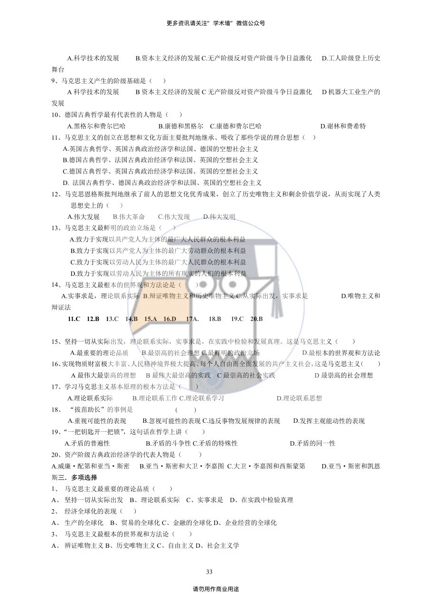

A.科学技术的发展 B.资本主义经济的发展C.无产阶级反对资产阶级斗争日益激化 D.工人阶级登上历史舞台

9、马克思主义产生的阶级基础是（ ）A科学技术的发展 B资本主义经济的发展C无产阶级反对资产阶级斗争日益激化 D机器大工业生产的发展

10、德国古典哲学最有代表性的人物是（ ）A.黑格尔和费尔巴哈 B.康德和黑格尔 C.康德和费尔巴哈 D.谢林和费希特

11、马克思主义的创立在思想和文化方面主要批判地继承、吸收了那些学说的理合思想（ ）A.英国古典哲学、英国古典政治经济学和法国、德国的空想社会主义B.德国古典哲学、法国古典政治经济学和法国、英国的空想社会主义C.德国古典哲学、英国古典政治经济学和法国、英国的空想社会主义D. 法国古典哲学、德国古典政治经济学和法国、英国的空想社会主义

12、马克思恩格斯批判地继承了前人的思想文化优秀成果，创立了历史唯物主义和剩余价值学说，从而实现了人类思想史上的（ ）A.伟大发展 B.伟大革命 C.伟大发现 D.伟大发明

13、马克思主义最鲜明的政治立场是（A.致力于实现以共产党人为主体的最广大人民群众的根本利益B.致力于实现以共产党人为主体的最广大劳动群众的根本利益C.致力于实现以劳动人民为主体的最广大人民群众的根本利益D.致力于实现以劳动人民为主体的所有现实的人们的根本利益

14、马克思主义最根本的世界观和方法论是（

A.实事求是，理论联系实际 B.辩证唯物主义和历史唯物主义 C.从实际出发，实事求是 D.唯物主义和 辩证法 11.C 12.B 13.C 14.B 15.A 16.D 17A. 18.B 19.C 20.B

15、坚持一切从实际出发，理论联系实际，实事求是，在实践中检验和发展真理。这是马克思主义（ ）A.最重要的理论品质 B.最崇高的社会理想C.最鲜明的政治立场 D.最根本的世界观和方法论

16、实现物质财富极大丰富、人民精神境界极大提高、每个人自由而全面发展的共产主义社会，这是马克思主义（ ）A最伟大最崇高的理想 B 最伟大最崇高的实践 C 最崇高的社会实践 D 最崇高的社会理想

17、学习马克思主义基本原理的根本方法是（A.理论联系实际 B.理论联系工作 C.理论联系学习 D.理论联系思想

18、 “拔苗助长”的事例是 ( )A.重视可能性的表现 B.忽视可能性的表现 C.违反事物发展规律的表现 D.发挥主观能动性的表现

19、“一把钥匙开一把锁”，这句话在哲学上讲（ ）A.矛盾的普遍性 B.矛盾的斗争性 C.矛盾的特殊性 D.矛盾的同一性

20、资产阶级古典政治经济学的代表人物是（ ）A.威廉·配第和亚当·斯密 B.亚当·斯密和大卫·李嘉图 C.大卫·李嘉图和西斯蒙第 D.亚当·斯密和凯恩

### 斯三．多项选择

1、 马克思主义最重要的理论品质（ ）A、 坚持一切从实际出发 B、理论联系实际 C、实事求是 D、在实践中检验真理

2、 经济全球化的表现（ ）A、 生产的全球化 B、贸易的全球化 C、金融的全球化D、企业经营的全球化

3、 马克思主义最根本的世界观和方法论（ ）A、 辨证唯物主义 B、历史唯物主义C、自由主义 D、社会主义学

更多资讯请关注“学术墙”微信公众号

33

请勿用作商业用途

## 第34页

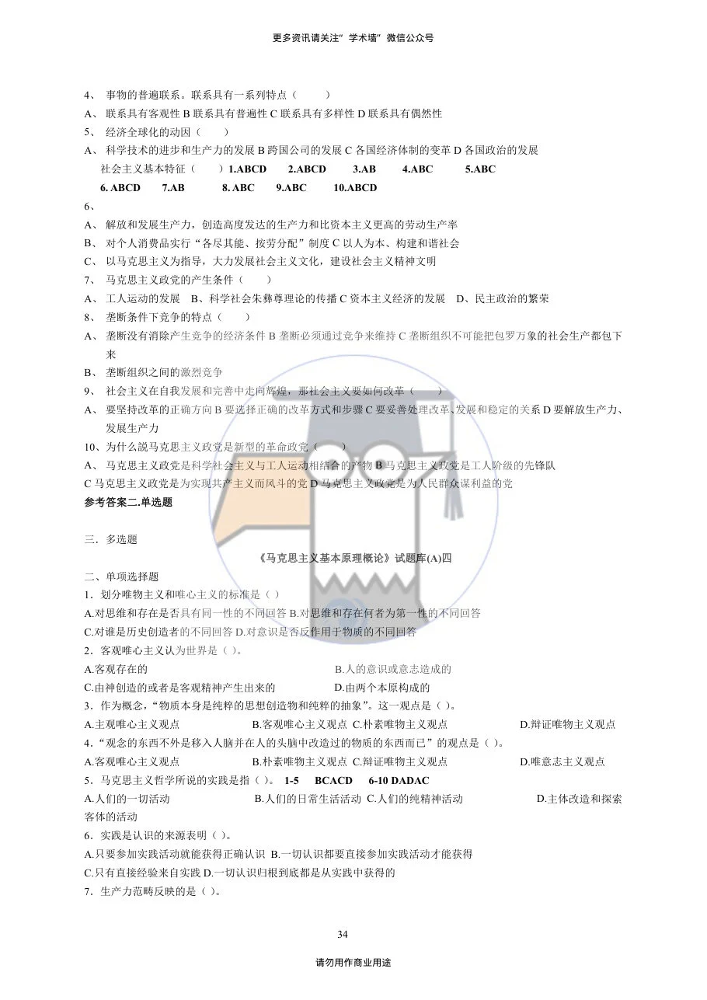

4、 事物的普遍联系。联系具有一系列特点（ ）A、 联系具有客观性 B联系具有普遍性 C 联系具有多样性 D联系具有偶然性

A、 科学技术的进步和生产力的发展 B跨国公司的发展 C 各国经济体制的变革 D各国政治的发展社会主义基本特征（ ）1.ABCD 2.ABCD 3.AB 4.ABC 5.ABC6. ABCD 7.AB 8. ABC 9.ABC 10.ABCD

6、A、 解放和发展生产力，创造高度发达的生产力和比资本主义更高的劳动生产率B、 对个人消费品实行“各尽其能、按劳分配”制度 C以人为本、构建和谐社会C、 以马克思主义为指导，大力发展社会主义文化，建设社会主义精神文明

A、 工人运动的发展 B、科学社会朱彝尊理论的传播 C资本主义经济的发展 D、民主政治的繁荣8、 垄断条件下竞争的特点（ ）

A、 垄断没有消除产生竞争的经济条件 B 垄断必须通过竞争来维持C 垄断组织不可能把包罗万象的社会生产都包下来B、 垄断组织之间的激烈竞争

9、 社会主义在自我发展和完善中走向辉煌，那社会主义要如何改革（A、 要坚持改革的正确方向B要选择正确的改革方式和步骤C要妥善处理改革、发展和稳定的关系D要解放生产力、发展生产力

10、为什么説马克思主义政党是新型的革命政党A、 马克思主义政党是科学社会主义与工人运动相结合的产物 B马克思主义政党是工人阶级的先锋队C 马克思主义政党是为实现共产主义而风斗的党D 马克思主义政党是为人民群众谋利益的党

### 参考答案二.单选题

### 三．多选题

### 《马克思主义基本原理概论》试题库(A)四

### 二、单项选择题

1．划分唯物主义和唯心主义的标准是（ ）A.对思维和存在是否具有同一性的不同回答 B.对思维和存在何者为第一性的不同回答C.对谁是历史创造者的不同回答D.对意识是否反作用于物质的不同回答

2．客观唯心主义认为世界是（ ）。A.客观存在的 B.人的意识或意志造成的C.由神创造的或者是客观精神产生出来的 D.由两个本原构成的

3．作为概念，“物质本身是纯粹的思想创造物和纯粹的抽象”。这一观点是（ ）。A.主观唯心主义观点 B.客观唯心主义观点 C.朴素唯物主义观点 D.辩证唯物主义观点

4．“观念的东西不外是移入人脑并在人的头脑中改造过的物质的东西而已”的观点是（ ）。A.客观唯心主义观点 B.朴素唯物主义观点 C.辩证唯物主义观点 D.唯意志主义观点

5．马克思主义哲学所说的实践是指（ ）。 1-5 BCACD 6-10 DADACA.人们的一切活动 B.人们的日常生活活动 C.人们的纯精神活动 D.主体改造和探索客体的活动

6．实践是认识的来源表明（ ）。A.只要参加实践活动就能获得正确认识 B.一切认识都要直接参加实践活动才能获得C.只有直接经验来自实践D.一切认识归根到底都是从实践中获得的

7．生产力范畴反映的是（ ）。

更多资讯请关注“学术墙”微信公众号

34

请勿用作商业用途

## 第35页

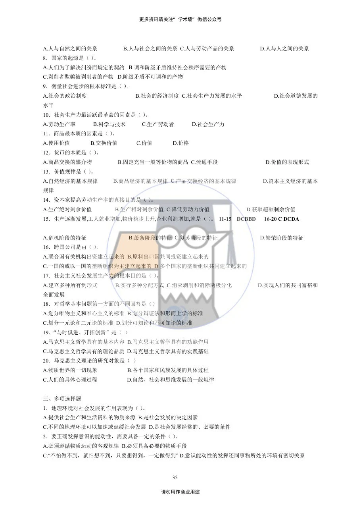

A.人与自然之间的关系 B.人与社会之间的关系 C.人与劳动产品的关系 D.人与人之间的关系

8．国家的起源是（ ）。A.人们为了解决纠纷而规定的契约 B.调和阶级矛盾维持社会秩序需要的产物C.剥削者欺骗被剥削者的产物 D.阶级矛盾不可调和的产物

9．衡量社会进步的根本标准是（ ）。A.社会的政治制度 B.社会的经济制度 C.社会生产力发展的水平 D.社会道德发展的

10．社会生产力最活跃最革命的因素是（ ）。A.劳动生产率 B.科学与技术 C.生产劳动者 D.社会生产力

11．商品最本质的因素是（ ）。A.使用价值 B.交换价值 C.价值 D.价格

A.商品交换的媒介物 B.固定充当一般等价物的商品 C.流通手段 D.价值的表现形式13．价值规律是（ ）。A.自然经济的基本规律 B.商品经济的基本规律 C.产品交换经济的基本规律 D.资本主义经济的基本规律

14．资本家提高劳动生产率的直接目的是（ ）。A.生产绝对剩余价值 B.生产相对剩余价值 C.降低劳动力价值 D.获取超额剩余价值

15．生产逐渐发展,工人就业增加,物价稳步上升,企业利润增加,就是（ ）。 11-15 DCBBD 16-20 C DCDAA.危机阶段的特征 B.萧条阶段的特征 C.复苏阶段的特征 D.繁荣阶段的特征

16．跨国公司是由（ ）。A.联合国有关机构出资建立起来的 B.原料出口国共同投资建立起来的C.一国的或以一国的垄断组织为主建立起来的 D.多个国家的垄断组织共同建立起来的

17．社会主义社会发展生产力的根本目的是（ ）。A.建立多种所有制形式 B.实行多种分配方式 C.消灭剥削和消除两极分化全面发展

18．对哲学基本问题第一方面的不同回答是（）A.划分唯物主义和唯心主义的标准 B.划分辩证法和形而上学的标准C.划分一元论和二元论的标准 D.划分可知论和不可知论的标准

19．“与时俱进、开拓创新”是（ ）A.马克思主义哲学具有的基本内容 B.马克思主义哲学具有的功能作用C.马克思主义哲学具有的理论品质 D.马克思主义哲学具有的实践基础

20．马克思主义理论的研究对象是（ ）A.物质世界的一切现象 B.各个国家和民族发展的具体过程C.人们的具体心理过程 D.自然、社会和思维发展的一般规律

### 三、多项选择题

1．地理环境对社会发展的作用表现为（ ）。A.提供社会生产和生活资料的物质来源 B.是社会发展的决定因素C.不同的地理环境可以加速或延缓社会发展 D.是社会发展经常的、必要的条件

2．要正确发挥意识的能动性，需要具备一定的条件（ ）。A.必须遵循物质运动的客观规律 B.必须具备必要的物质手段

C.“不怕做不到，就怕想不到，只要想得到，一定做得到” D.意识能动性的发挥还同事物所处的环境有密切关系

更多资讯请关注“学术墙”微信公众号

35

请勿用作商业用途

## 第36页

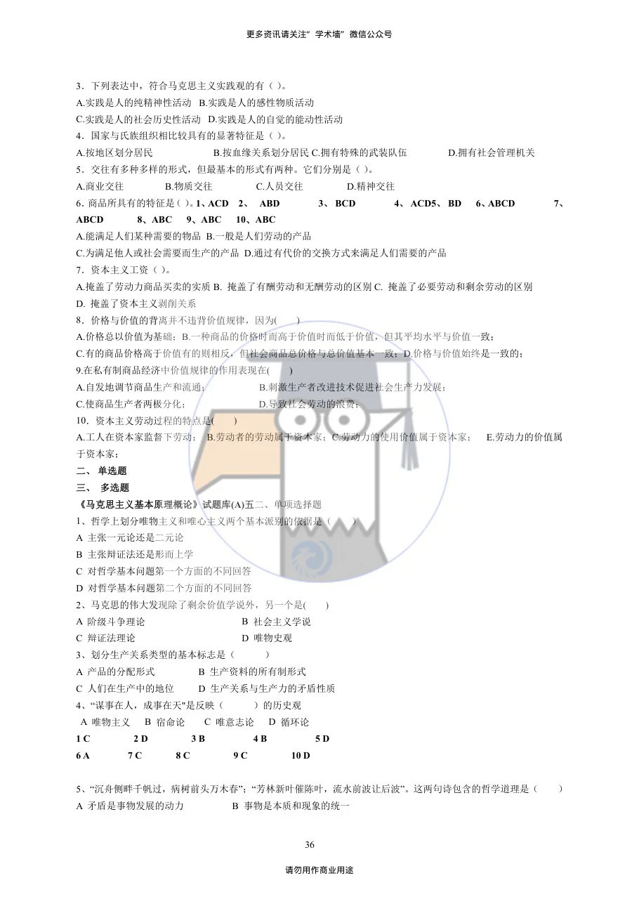

3．下列表达中，符合马克思主义实践观的有（ ）。A.实践是人的纯精神性活动 B.实践是人的感性物质活动C.实践是人的社会历史性活动 D.实践是人的自觉的能动性活动

4．国家与氏族组织相比较具有的显著特征是（ ）。A.按地区划分居民 B.按血缘关系划分居民 C.拥有特殊的武装队伍 D.拥有社会管理机关

5．交往有多种多样的形式，但最基本的形式有两种。它们分别是（ ）。A.商业交往 B.物质交往 C.人员交往 D.精神交往

6．商品所具有的特征是（ ）。1、ACD 2、 ABD 3、 BCD 4、ACD5、 BD 6、ABCD 7、ABCD 8、ABC 9、ABC 10、ABC

A.能满足人们某种需要的物品 B.一般是人们劳动的产品C.为满足他人或社会需要而生产的产品 D.通过有代价的交换方式来满足人们需要的产品7．资本主义工资（ ）。A.掩盖了劳动力商品买卖的实质 B. 掩盖了有酬劳动和无酬劳动的区别C. 掩盖了必要劳动和剩余劳动的区别D. 掩盖了资本主义剥削关系

8．价格与价值的背离并不违背价值规律，因为(A.价格总以价值为基础；B.一种商品的价格时而高于价值时而低于价值，但其平均水平与价值一致；C.有的商品价格高于价值有的则相反，但社会商品总价格与总价值基本一致；D.价格与价值始终是一致的；

9.在私有制商品经济中价值规律的作用表现在( )A.自发地调节商品生产和流通； B.刺激生产者改进技术促进社会生产力发展；C.使商品生产者两极分化； D.导致社会劳动的浪费；

10．资本主义劳动过程的特点是( )

A.工人在资本家监督下劳动； B.劳动者的劳动属于资本家；C.劳动力的使用价值属于资本家； E.劳动力的价值属于资本家；

### 二、 单选题

### 三、 多选题

《马克思主义基本原理概论》试题库(A)五二、单项选择题

1、哲学上划分唯物主义和唯心主义两个基本派别的依据是（A 主张一元论还是二元论B 主张辩证法还是形而上学C 对哲学基本问题第一个方面的不同回答D 对哲学基本问题第二个方面的不同回答

2、马克思的伟大发现除了剩余价值学说外，另一个是( )A 阶级斗争理论 B 社会主义学说C 辩证法理论 D 唯物史观

3、划分生产关系类型的基本标志是（ ）A 产品的分配形式 B 生产资料的所有制形式C 人们在生产中的地位 D 生产关系与生产力的矛盾性质

4、“谋事在人，成事在天"是反映（ ）的历史观A 唯物主义 B 宿命论 C 唯意志论 D 循环论1 C 2 D 3 B 4 B 5 D

6 A 7 C 8 C 9 C 10 D

5、“沉舟侧畔千帆过，病树前头万木春”；“芳林新叶催陈叶，流水前波让后波”。这两句诗包含的哲学道理是（ ）A 矛盾是事物发展的动力 B 事物是本质和现象的统一

更多资讯请关注“学术墙”微信公众号

36

请勿用作商业用途

## 第37页

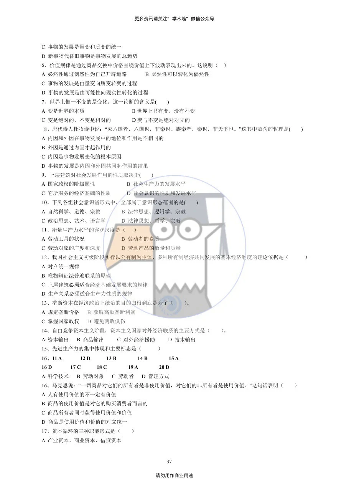

C 事物的发展是量变和质变的统一D 新事物代替旧事物是事物发展的总趋势

6、价值规律是通过商品交换中价格围绕价值上下波动表现出来的。这说明（ ）A 必然性通过偶然性为自己开辟道路 B 必然性可以转化为偶然性C 事物的发展是由量变向质变转变的过程D 事物的发展是由可能性向现实性转化的过程

7、世界上惟一不变的是变化。这一论断的含义是( )A 变是世界的本质 B 世界上只有变，没有不变C 变是绝对的，不变是相对的 D 变与不变是绝对对立的

8、唐代诗人杜牧诗中说：“灭六国者，六国也，非秦也。族秦者，秦也，非天下也。”这其中蕴含的哲理是( )A 内因和外因在事物发展中的地位和作用是不相同的B 外因是通过内因才起作用的C 内因是事物发展变化的根本原因D 事物的发展是内因和外因共同起作用的结果

9、上层建筑对社会发展作用的性质取决于(A 国家政权的阶级属性 B 社会生产力的发展水平C 它所服务的经济基础的性质 D 社会意识的性质和发展水平

10、下列各组社会意识诸形式中，全部属于意识形态范围的是(A 自然科学、道德、宗教 B 法律思想、逻辑学、宗教C 政治思想、艺术、语言学 D 法律思想、哲学、宗教

11、衡量生产力水平的客观尺度是（ ）C 劳动对象的广度和深度 D 劳动产品的数量和质量

12、我国社会主义初级阶段实行以公有制为主体、多种所有制经济共同发展的基本经济制度的理论依据是（ ）A 对立统一规律B 唯物辩证法普遍联系的原理C 上层建筑必须适合经济基础发展要求的规律D 生产关系必须适合生产力性质的规律

13、垄断资本在经济政治上统治的目的归根到底是为了（ ）。A 规定垄断价格 B 获取高额垄断利润C 掌握国家政权 D 避免两败俱伤

14、自由竞争资本主义阶段，资本主义国家对外经济联系的主要方式是（ ）。A 资本输出 B 商品输出 C 对外经济援助 D 技术输出

15、先进生产力的集中体现和主要标志是（ ）16、11 A 12 D 13 B 14 B 15 A

16 D 17 C 18 C 19 A 20 DA 科学技术 B 劳动对象 C 劳动者 D 管理方式

16、马克思说：“一切商品对它们的所有者是非使用价值，对它们的非所有者是使用价值。”这句话表明（ ）A 人有使用价值的不一定有价值B 商品的使用价值是对它的购买消费者而言的C 商品所有者同时获得使用价值和价值D 商品是使用价值和价值的对立统一

17、资本循环的三种职能形式是（ ）A 产业资本、商业资本、借贷资本

更多资讯请关注“学术墙”微信公众号

37

请勿用作商业用途

## 第38页

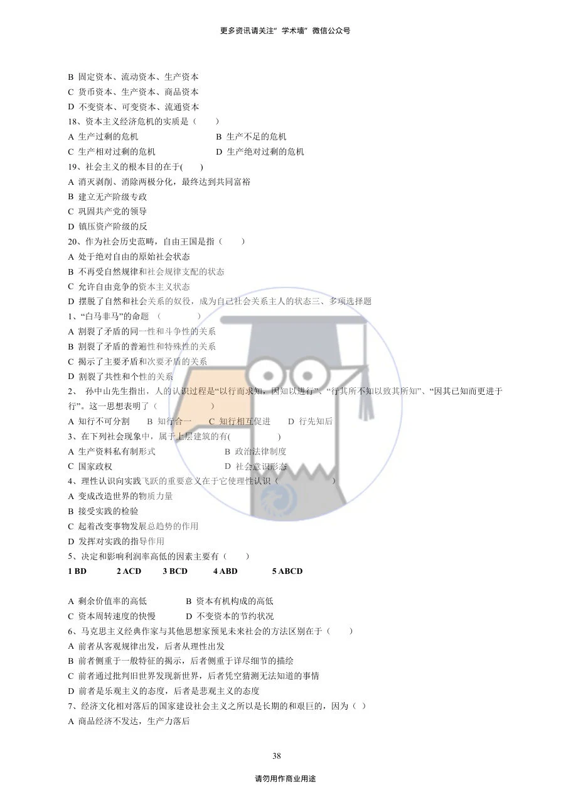

B 固定资本、流动资本、生产资本C 货币资本、生产资本、商品资本D 不变资本、可变资本、流通资本

18、资本主义经济危机的实质是（ ）A 生产过剩的危机 B 生产不足的危机C 生产相对过剩的危机 D 生产绝对过剩的危机

19、社会主义的根本目的在于( )A 消灭剥削、消除两极分化，最终达到共同富裕B 建立无产阶级专政C 巩固共产党的领导D 镇压资产阶级的反

20、作为社会历史范畴，自由王国是指（ ）A 处于绝对自由的原始社会状态B 不再受自然规律和社会规律支配的状态C 允许自由竞争的资本主义状态D 摆脱了自然和社会关系的奴役，成为自己社会关系主人的状态三、多项选择题

2、 孙中山先生指出，人的认识过程是“以行而求知，因知以进行”、“行其所不知以致其所知”、“因其已知而更进于行”。这一思想表明了（ ）A 知行不可分割 B 知行合一 C 知行相互促进 D 行先知后

3、在下列社会现象中，属于上层建筑的有( )A 生产资料私有制形式 B 政治法律制度C 国家政权 D 社会意识形态

4、理性认识向实践飞跃的重要意义在于它使理性认识（A 变成改造世界的物质力量B 接受实践的检验C 起着改变事物发展总趋势的作用D 发挥对实践的指导作用

5、决定和影响利润率高低的因素主要有（ ）1 BD 2 ACD 3 BCD 4 ABD 5 ABCD

A 剩余价值率的高低 B 资本有机构成的高低C 资本周转速度的快慢 D 不变资本的节约状况

6、马克思主义经典作家与其他思想家预见未来社会的方法区别在于（ ）A 前者从客观规律出发，后者从理性出发B 前者侧重于一般特征的揭示，后者侧重于详尽细节的描绘C 前者通过批判旧世界发现新世界，后者凭空猜测无法知道的事情D 前者是乐观主义的态度，后者是悲观主义的态度

7、经济文化相对落后的国家建设社会主义之所以是长期的和艰巨的，因为（ ）A 商品经济不发达，生产力落后

更多资讯请关注“学术墙”微信公众号

38

请勿用作商业用途

## 第39页

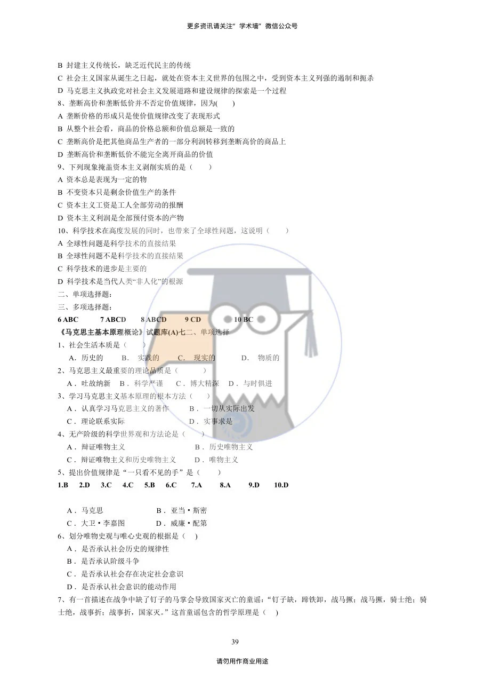

B 封建主义传统长，缺乏近代民主的传统C 社会主义国家从诞生之日起，就处在资本主义世界的包围之中，受到资本主义列强的遏制和扼杀D 马克思主义执政党对社会主义发展道路和建设规律的探索是一个过程

8、垄断高价和垄断低价并不否定价值规律，因为( )A 垄断价格的形成只是使价值规律改变了表现形式B 从整个社会看，商品的价格总额和价值总额是一致的C 垄断高价是把其他商品生产者的一部分利润转移到垄断高价的商品上D 垄断高价和垄断低价不能完全离开商品的价值

9、下列现象掩盖资本主义剥削实质的是（ ）A 资本总是表现为一定的物B 不变资本只是剩余价值生产的条件C 资本主义工资是工人全部劳动的报酬D 资本主义利润是全部预付资本的产物

10、科学技术在高度发展的同时， 也币A 全球性问题是科学技术的直接结果B 全球性问题不是科学技术的直接结果C 科学技术的进步是主要的D 科学技术是当代人类“非人化”的根源

### 二、单项选择题：

### 三、多项选择题：

6 ABC 7 ABCD 8 ABCD 9 CD 10 BC

### 《马克思主基本原理概论》试题库(A)七二、单项选择

1、社会生活本质是（A．历史的 B． 实践的 C． 现实的 D． 物质的

2、马克思主义最重要的理论品质是（ ）A．吐故纳新 B ．科学严谨 C ．博大精深 D ．与时俱进

3、学习马克思主义基本原理的根本方法（A．认真学习马克思主义的著作 B ．一切从实际出发C．理论联系实际 D．实事求是

4、无产阶级的科学世界观和方法论是（A．辩证唯物主义 B ．历史唯物主义C．辩证唯物主义和历史唯物主义 D ．唯物主义

5、提出价值规律是“一只看不见的手”是（ ） 1.B 2.D 3.C 4.C 5.B 6.C 7.A 8.A 9.D 10.D

A．马克思 B ．亚当 •斯密C．大卫 •李嘉图 D ．威廉 •配第

6、划分唯物史观与唯心史观的根据是（ )A．是否承认社会历史的规律性B．是否承认阶级斗争C．是否承认社会存在决定社会意识D．是否承认社会意识的能动作用

7、有一首描述在战争中缺了钉子的马掌会导致国家灭亡的童谣：“钉子缺，蹄铁卸，战马撅；战马撅，骑士绝；骑士绝，战事折；战事折，国家灭。”这首童谣包含的哲学原理是（ )

更多资讯请关注“学术墙”微信公众号

39

请勿用作商业用途

## 第40页

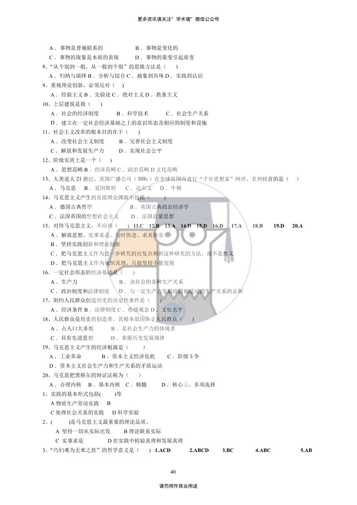

A．事物是普遍联系的 B ．事物是变化的 C．事物的现象是本质的表现 D ．事物的量变引起质变

8、“从个别到一般，从一般到个别”的思维方法是（ )A ．归纳与演绎 B ．分析与综合 C．抽象到具体 D ．实践到认识

9、重视理论创新，必须反对（ )A ．经验主义 B ．先验论C ．绝对主义 D ．教条主义

10、上层建筑是指（ )A ．社会的经济制度 B ．科学技术 C ．社会生产关系D ．建立在一定社会经济基础之上的意识形态及相应的制度和设施

11、社会主义改革的根本目的在于（ )A ．改变社会主义制度 B ．完善社会主义制度C ．解放和发展生产力 D ．实现社会公平

12、阶级实质上是一个（ )A ．思想范畴 B ．经济范畴C ．政治范畴 D 文化范畴

13、人类进人 21世纪，英国广播公司（ BBs ）在全球范围内进行“千年思想家”网评，名列榜首的是（ ）A．马克思 B ．爱因斯坦 C ．达尔文 D ．牛顿

14、马克思主义产生的直接理论渊源不包括（A．德国古典哲学 B ．英国古典政治经济学C．法国英国的空想社会主义 D ．法国启蒙思想

15、对待马克思主义，不应该（ ) 11.C 12.B 13.A 14.D 15.D 16.D 1A ．解放思想、实事求是、与时俱进、求真务实B ．坚持实践创新和理论创新C ．把马克思主义作为进一步研究的出发点和供这种研究的方法，而不是教义D ．把马克思主义作为永恒真理，只能坚持不能发展

16、一定社会形态的经济基础是（ )A ．生产力 B ．该社会的各种生产关系C ．政治制度和法律制度 D ．与一定生产力发展阶段相适应的生产关系的总和

17、制约人民群众创造历史的决定性条件是（A ．经济条件 B ．法律制度C ．传统观念 D ．文化水平

18、人民群众是历史的创造者，其根本原因在于人民群众（ )A ．占人口大多数 B ．是社会生产力的体现者C ．具有先进思想 D ．掌握历史发展规律

19、马克思主义产生的经济根源是（ ）A．工业革命 B ．资本主义经济危机 C ．阶级斗争D．资本主义社会生产力和生产关系的矛盾运动

20、马克思把黑格尔的辩证法称为（ ） A．合理内核 B ．基本内核 C ．精髓 D ．核心三、多项选择

1、实践的基本形式包括( )等A 物质生产劳动实践 BC 处理社会关系的实践 D科学实验

2、( )是马克思主义最重要的理论品质。A 坚持一切从实际出发 B 理论联系实际C 实事求是 D 在实践中检验真理和发展真理

3、“巧妇难为无米之炊”的哲学意义是（ ) 1.ACD 2.ABCD 3.BC 4.ABC 5.AB

更多资讯请关注“学术墙”微信公众号

40

请勿用作商业用途

## 第41页

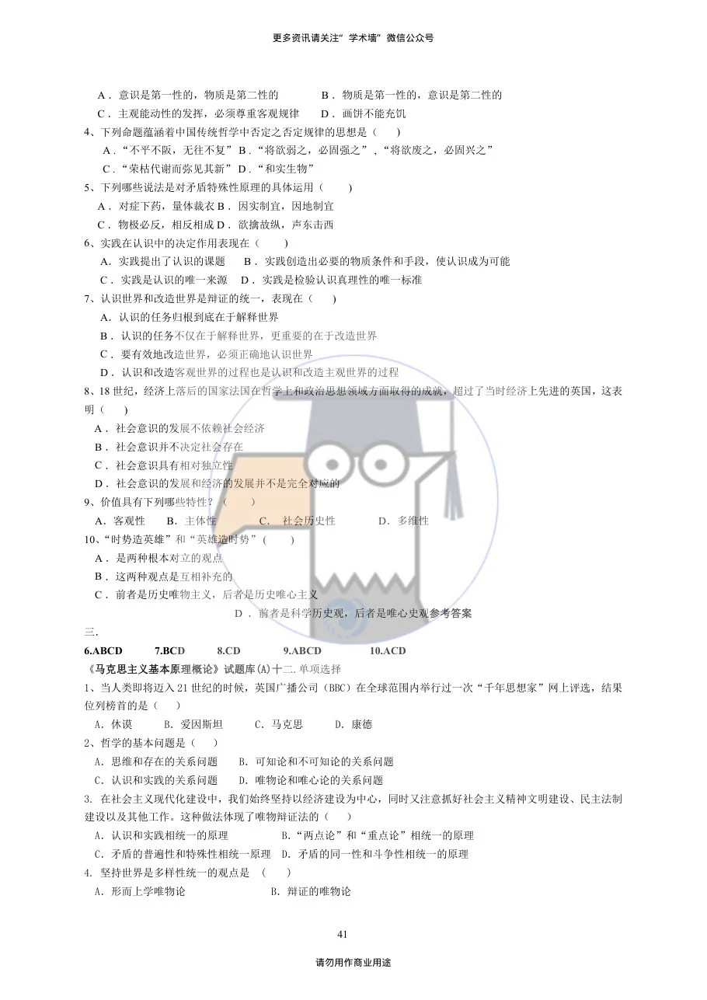

A．意识是第一性的，物质是第二性的 B ．物质是第一性的，意识是第二性的C．主观能动性的发挥，必须尊重客观规律 D ．画饼不能充饥

4、下列命题蕴涵着中国传统哲学中否定之否定规律的思想是（ )A .“不平不阪，无往不复” B .“将欲弱之，必固强之” , “将欲废之，必固兴之”C .“荣枯代谢而弥见其新” D .“和实生物”

5、下列哪些说法是对矛盾特殊性原理的具体运用（ )A．对症下药，量体裁衣 B ．因实制宜，因地制宜C．物极必反，相反相成 D ．欲擒故纵，声东击西

6、实践在认识中的决定作用表现在（ )A．实践提出了认识的课题 B ．实践创造出必要的物质条件和手段，使认识成为可能C ．实践是认识的唯一来源 D ．实践是检验认识真理性的唯一标准

7、认识世界和改造世界是辩证的统一，表现在（ )A．认识的任务归根到底在于解释世界B ．认识的任务不仅在于解释世界，更重要的在于改造世界C ．要有效地改造世界，必须正确地认识世界D ．认识和改造客观世界的过程也是认识和改造主观世界的过程

8、18世纪，经济上落后的国家法国在哲学上和政治思想领域方面取得的成就，超过了当时经济上先进的英国，这表明（ )A ．社会意识的发展不依赖社会经济B ．社会意识并不决定社会存在C ．社会意识具有相对独立性D．社会意识的发展和经济的发展并不是完全对应的

9、价值具有下列哪些特性？A．客观性 B．主体性 C． 社会历史性 D．多维性

10、“时势造英雄”和“英雄造时势” ( )A．是两种根本对立的观点B ．这两种观点是互相补充的C ．前者是历史唯物主义，后者是历史唯心主义D ．前者是科学历史观，后者是唯心史观参考答案三6.ABCD 7.BCD 8.CD 9.ABCD 10.ACD

### 《马克思主义基本原理概论》试题库(A)十二.单项选择

1、当人类即将迈入21世纪的时候，英国广播公司（BBC）在全球范围内举行过一次“千年思想家”网上评选，结果位列榜首的是（ ）A．休谟 B．爱因斯坦 C．马克思 D．康德

2、哲学的基本问题是（ ）A．思维和存在的关系问题 B．可知论和不可知论的关系问题C．认识和实践的关系问题 D．唯物论和唯心论的关系问题

3. 在社会主义现代化建设中，我们始终坚持以经济建设为中心，同时又注意抓好社会主义精神文明建设、民主法制建设以及其他工作。这种做法体现了唯物辩证法的（ ）A．认识和实践相统一的原理 B．“两点论”和“重点论”相统一的原理C．矛盾的普遍性和特殊性相统一原理 D．矛盾的同一性和斗争性相统一的原理

4. 坚持世界是多样性统一的观点是 ( )A．形而上学唯物论 B．辩证的唯物论

更多资讯请关注“学术墙”微信公众号

41

请勿用作商业用途

## 第42页

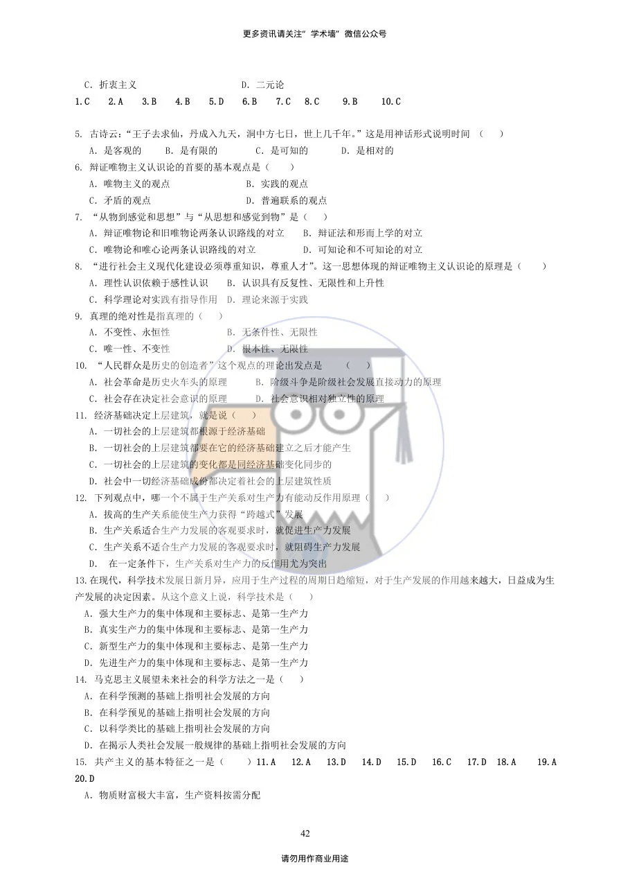

C．折衷主义 D．二元论1.C 2.A 3.B 4.B 5.D 6.B 7.C 8.C 9.B 10.C

5. 古诗云：“王子去求仙，丹成入九天，洞中方七日，世上几千年。”这是用神话形式说明时间 （ ）A．是客观的 B．是有限的 C．是可知的 D．是相对的

6. 辩证唯物主义认识论的首要的基本观点是（ ）A．唯物主义的观点 B．实践的观点C．矛盾的观点 D．普遍联系的观点

7. “从物到感觉和思想”与“从思想和感觉到物”是（ ）A．辩证唯物论和旧唯物论两条认识路线的对立 B．辩证法和形而上学的对立C．唯物论和唯心论两条认识路线的对立 D．可知论和不可知论的对立

8. “进行社会主义现代化建设必须尊重知识，尊重人才”。这一思想体现的辩证唯物主义认识论的原理是（ ）A．理性认识依赖于感性认识 B．认识具有反复性、无限性和上升性C．科学理论对实践有指导作用 D．理论来源于实践

9. 真理的绝对性是指真理的（ ）A．不变性、永恒性 B．无条件性、无限性C．唯一性、不变性 D．根本性、无限性

10. “人民群众是历史的创造者”这个观点的理论出发点是 （A．社会革命是历史火车头的原理 B．阶级斗争是阶级社会发展直接动力的原理C．社会存在决定社会意识的原理 D．社会意识相对独立性的原理

11. 经济基础决定上层建筑，就是说（ ）A．一切社会的上层建筑都根源于经济基础B．一切社会的上层建筑都要在它的经济基础建立之后才能产生C．一切社会的上层建筑的变化都是同经济基础变化同步的D．社会中一切经济基础成份都决定着社会的上层建筑性质

12. 下列观点中，哪一个不属于生产关系对生产力有能动反作用原理（A．拔高的生产关系能使生产力获得“跨越式”发展B．生产关系适合生产力发展的客观要求时，就促进生产力发展C．生产关系不适合生产力发展的客观要求时，就阻碍生产力发展D． 在一定条件下，生产关系对生产力的反作用尤为突出

13.在现代，科学技术发展日新月异，应用于生产过程的周期日趋缩短，对于生产发展的作用越来越大，日益成为生产发展的决定因素。从这个意义上说，科学技术是（ ）A．强大生产力的集中体现和主要标志、是第一生产力B．真实生产力的集中体现和主要标志、是第一生产力C．新型生产力的集中体现和主要标志、是第一生产力D．先进生产力的集中体现和主要标志、是第一生产力

14. 马克思主义展望未来社会的科学方法之一是（ ）A．在科学预测的基础上指明社会发展的方向B．在科学预见的基础上指明社会发展的方向C．以科学类比的基础上指明社会发展的方向D．在揭示人类社会发展一般规律的基础上指明社会发

15. 共产主义的基本特征之一是（ ）11.A 12.A 13.D 14.D 15.D 16.C 17.D 18.A 19.A

更多资讯请关注“学术墙”微信公众号

42

请勿用作商业用途

## 第43页

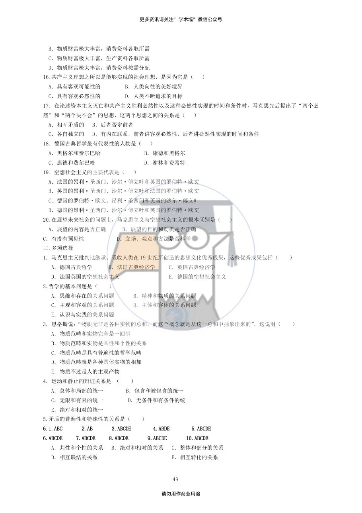

B．物质财富极大丰富，消费资料各取所需 C．物质财富极大丰富，生产资料各取所需 D．物质财富极大丰富，消费资料按需分配

16.共产主义理想之所以是能够实现的社会理想，是因为它是（ ）A．具有客观可能性的 B．人类向往的美好境界C．具有客观必然性的 D．人类不断追求的目标

17. 在论述资本主义灭亡和共产主义胜利必然性以及这种必然性实现的时间和条件时，马克思先后提出了“两个必然”和“两个决不会”的思想，这两个思想之间的关系是（ ）A．相互矛盾的 B．后者否定前者C．各自独立的 D．有内在联系，前者讲客观必然性，后者讲必然性实现的时间和条件

18. 德国古典哲学最有代表性的人物是（ ）A．黑格尔和费尔巴哈 B．康德和黑格尔C．康德和费尔巴哈 D．谢林和费希特

19. 空想社会主义的主要代表是（ ）A．法国的昂利·圣西门、沙尔·傅立叶和英国的罗伯特·欧文B．英国的昂利·圣西门、沙尔·傅立叶和法国的罗伯特·欧文C．德国的罗伯特·欧文、昂利·圣西门和英国的沙尔·傅立叶D．德国的昂利·圣西门、沙尔·傅立叶和英国的罗伯特·欧文

20.在展望未来社会的问题上，马克思主义与空想社会主义的根本区别是（A．展望的内容是否正确 B．展望的目的和动机是否正确C．有没有预见性 D．立场、观点和方法是否科学

### 三.多项选择

1. 马克思主义批判地继承、吸收人类在 19世纪所创造的思想文化优秀成果，这些优秀成果包括（ ）A．德国古典哲学 B．法国古典经济学 C．英国古典经济学D．法国英国的空想社会主义 E．德国的空想社会主义

2.哲学的基本问题是（A．思维和存在的关系问题 B．精神和物质的关系问题C．主观和客观的关系问题 D．主体和客体的关系问题E．认识与实践的关系问题

3. 恩格斯说：“物质无非是各种实物的总和，而这个概念就是从这一总和中抽象出来的”，这说明（ ）A．物质范畴和实物完全是一回事B．物质范畴和实物是共性和个性的关系C．物质范畴是具有普遍性的哲学范畴D．物质范畴就是各种具体实物的相加E．物质不过是人的主观产物

4. 运动和静止的辩证关系是 （ ）A．总体和局部的统一 B．包含和被包含的统一C．无限和有限的统一 D．无条件和有条件的统一E．绝对和相对的统一

5.矛盾的普遍性和特殊性的关系是（ ）6.1.ABC 2.AB 3.ABCDE 4.ABDE 5.ABCDE

6.ABCDE 7.ABCDE 8.ABCDE 9.ABCDE 10.ABCDEA．共性和个性的关系 B．绝对和相对的关系 C．整体和部分的关系D．相互联结的关系 E．相互转化的关系

更多资讯请关注“学术墙”微信公众号

43

请勿用作商业用途

## 第44页

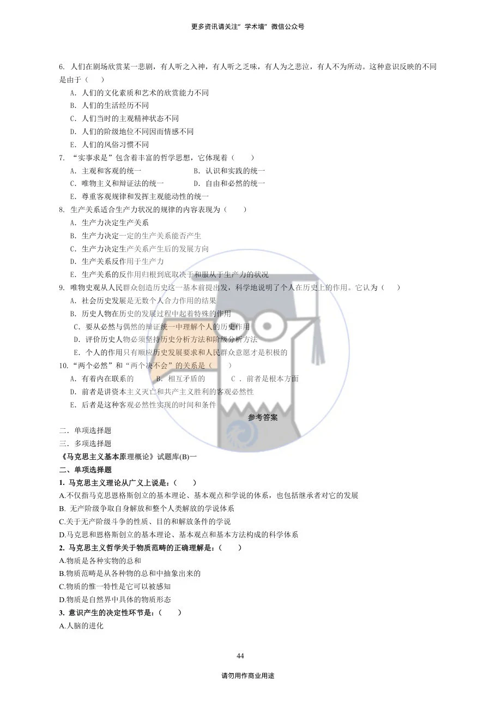

6. 人们在剧场欣赏某一悲剧，有人听之入神，有人听之乏味，有人为之悲泣，有人不为所动。这种意识反映的不同是由于（ ）A．人们的文化素质和艺术的欣赏能力不同B．人们的生活经历不同C．人们当时的主观精神状态不同D．人们的阶级地位不同因而情感不同E．人们的风俗习惯不同

7. “实事求是”包含着丰富的哲学思想，它体现着（ ） A．主观和客观的统一 B．认识和实践的统一 C．唯物主义和辩证法的统一 D．自由和必然的统一 E．尊重客观规律和发挥主观能动性的统一

8. 生产关系适合生产力状况的规律的内容表现为（ ）A．生产力决定生产关系B．生产力决定一定的生产关系能否产生C．生产力决定生产关系产生后的发展方向D．生产关系反作用于生产力E．生产关系的反作用归根到底取决于和服从于生产力的状况

9. 唯物史观从人民群众创造历史这一基本前提出发，科学地说明了个人在历史上的作用。它认为（ ）A．社会历史发展是无数个人合力作用的结果B．历史人物在历史的发展过程中起着特殊的作用C．要从必然与偶然的辩证统一中理解个人的历史作用D．评价历史人物必须坚持历史分析方法和阶级分析方法E．个人的作用只有顺应历史发展要求和人民群众意愿才是积极的

10.“两个必然”和“两个决不会”的关系是（ ）A．有着内在联系的 B．相互矛盾的 C ．前者是根本方D．前者是讲资本主义灭亡和共产主义胜利的客观必然性E．后者是这种客观必然性实现的时间和条件

### 二．单项选择题

《马克思主义基本原理概论》试题库(B)一

### 二、单项选择题

1. 马克思主义理论从广义上说是：（ ）A.不仅指马克思恩格斯创立的基本理论、基本观点和学说的体系，也包括继承者对它的发展B. 无产阶级争取自身解放和整个人类解放的学说体系C.关于无产阶级斗争的性质、目的和解放条件的学说D.马克思和恩格斯创立的基本理论、基本观点和基本方法构成的科学体系

2. 马克思主义哲学关于物质范畴的正确理解是：（ ）A.物质是各种实物的总和B.物质范畴是从各种物的总和中抽象出来的C.物质的惟一特性是它可以被感知D.物质是自然界中具体的物质形态

3. 意识产生的决定性环节是：（ ）A.人脑的进化

更多资讯请关注“学术墙”微信公众号

44

请勿用作商业用途

## 第45页

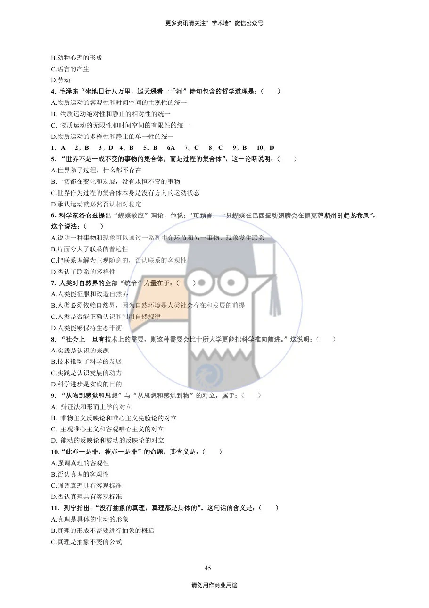

B.动物心理的形成C.语言的产生D.劳动

4. 毛泽东“坐地日行八万里，巡天遥看一千河”诗句包含的哲学道理是：（ ）A.物质运动的客观性和时间空间的主观性的统一B. 物质运动绝对性和静止的相对性的统一C. 物质运动的无限性和时间空间的有限性的统一D.物质运动的多样性和静止的单一性的统一1．A 2。B 3。D 4。B 5。B 6A 7。C 8。C 9。B 10。D

5. “世界不是一成不变的事物的集合体，而是过程的集合体”，这一论断说明：（ ）A.世界除了过程，什么都不存在B.一切都在变化和发展，没有永恒不变的事物C.世界作为过程的集合体本身是没有方向的运动状态D.承认运动就必然否认相对稳定

6. 科学家洛仑兹提出“蝴蝶效应”理论，他说：“可预言：一只蝴蝶在巴西振动翅膀会在德克萨斯州引起龙卷风”，这个说法：（ ）A.说明一种事物和现象可以通过一系列中介环节和另一事物、现象发生联系B.片面夸大了联系的普遍性C.把联系理解为主观随意的，否认联系的客观性D.否认了联系的多样性

7. 人类对自然界的全部“统治”力量在于：（A.人类能征服和改造自然界B.人类必须依赖自然界，因为自然环境是人类社会存在和发展的前提C.人类是否能正确认识和利用自然规律D.人类能够保持生态平衡

8. “社会上一旦有技术上的需要，则这种需要会比十所大学更能把科学推向前进。”这说明：（ ）A.实践是认识的来源B.技术推动了科学的发展C.实践是认识发展的动力D.科学进步是实践的目的

9. “从物到感觉和思想”与“从思想和感觉到物”的对立，属于：（ ）A. 辩证法和形而上学的对立B. 唯物主义反映论和唯心主义先验论的对立C. 主观唯心主义和客观唯心主义的对立D. 能动的反映论和被动的反映论的对立

10.“此亦一是非，彼亦一是非”的命题，其含义是：（ ）A.强调真理的客观性B.否认真理的客观性C.强调真理具有客观标准D.否认真理具有客观标准

11．列宁指出：“没有抽象的真理，真理都是具体的”。这句话的含义是：（ ）A.真理是具体的生动的形象B.真理的形成不需要进行抽象的概括C.真理是抽象不变的公式

更多资讯请关注“学术墙”微信公众号

45

请勿用作商业用途

## 第46页

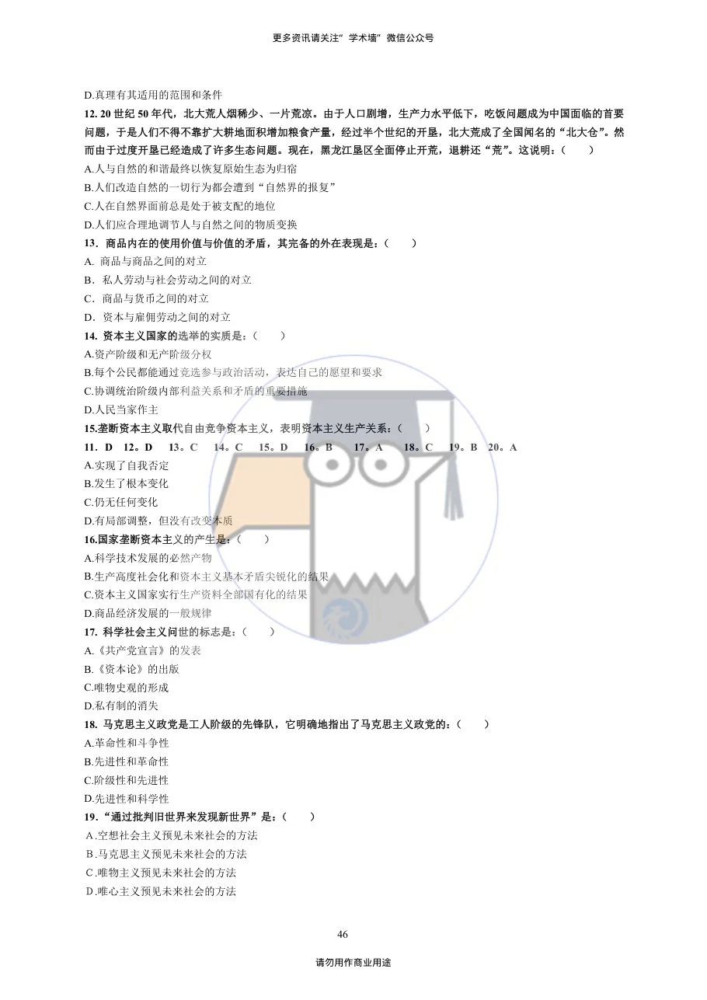

D.真理有其适用的范围和条件

12.20世纪 50年代，北大荒人烟稀少、一片荒凉。由于人口剧增，生产力水平低下，吃饭问题成为中国面临的首要问题，于是人们不得不靠扩大耕地面积增加粮食产量，经过半个世纪的开垦，北大荒成了全国闻名的“北大仓”。然而由于过度开垦已经造成了许多生态问题。现在，黑龙江垦区全面停止开荒，退耕还“荒”。这说明：（ ）A.人与自然的和谐最终以恢复原始生态为归宿B.人们改造自然的一切行为都会遭到“自然界的报复”C.人在自然界面前总是处于被支配的地位D.人们应合理地调节人与自然之间的物质变换

13．商品内在的使用价值与价值的矛盾，其完备的外在表现是：（ ）A. 商品与商品之间的对立B．私人劳动与社会劳动之间的对立C．商品与货币之间的对立D．资本与雇佣劳动之间的对立

14. 资本主义国家的选举的实质是：（ ）A.资产阶级和无产阶级分权B.每个公民都能通过竞选参与政治活动，表达自己的愿望和要求C.协调统治阶级内部利益关系和矛盾的重要措施D.人民当家作主

15.垄断资本主义取代自由竞争资本主义，表明资本主义生产关系：（ ）11．D 12。D 13。C 14。C 15。D 16。B 17。A 18。 C 19。B 20。A

A.实现了自我否定B.发生了根本变化C.仍无任何变化D.有局部调整，但没有改变本质

16.国家垄断资本主义的产生是：（ ）A.科学技术发展的必然产物B.生产高度社会化和资本主义基本矛盾尖锐化的结果C.资本主义国家实行生产资料全部国有化的结果D.商品经济发展的一般规律

17. 科学社会主义问世的标志是：（ ）A.《共产党宣言》的发表B.《资本论》的出版C.唯物史观的形成D.私有制的消失

18. 马克思主义政党是工人阶级的先锋队，它明确地指出了马克思主义政党的：（ ）A.革命性和斗争性B.先进性和革命性C.阶级性和先进性D.先进性和科学性

19．“通过批判旧世界来发现新世界”是：（ ）A.空想社会主义预见未来社会的方法B.马克思主义预见未来社会的方法C.唯物主义预见未来社会的方法D.唯心主义预见未来社会的方法

更多资讯请关注“学术墙”微信公众号

46

请勿用作商业用途

## 第47页

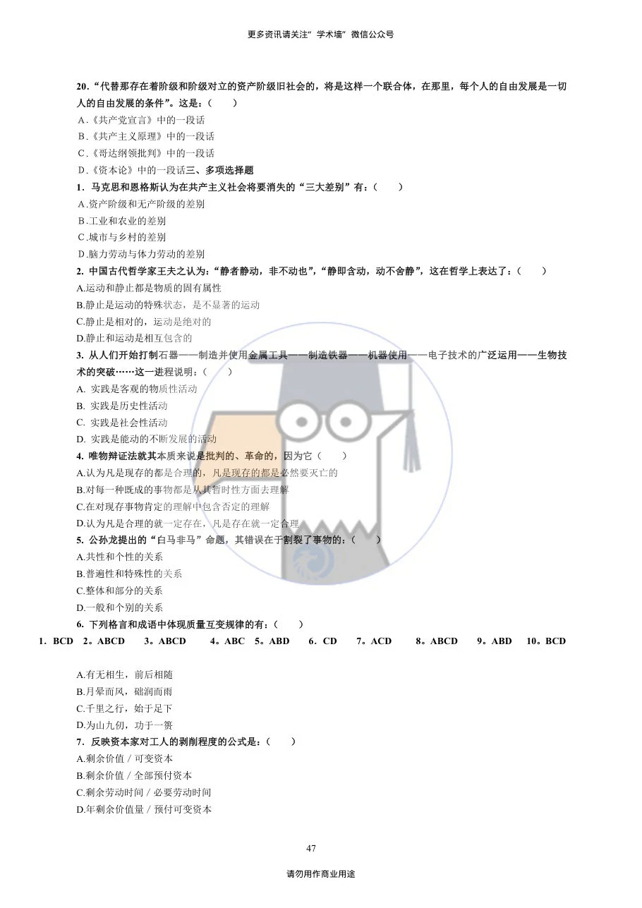

20．“代替那存在着阶级和阶级对立的资产阶级旧社会的，将是这样一个联合体，在那里，每个人的自由发展是一切人的自由发展的条件”。这是：（ ）A.《共产党宣言》中的一段话B.《共产主义原理》中的一段话C.《哥达纲领批判》中的一段话D.《资本论》中的一段话三、多项选择题

1．马克思和恩格斯认为在共产主义社会将要消失的“三大差别”有：（ ）A.资产阶级和无产阶级的差别B.工业和农业的差别C.城市与乡村的差别D.脑力劳动与体力劳动的差别

2. 中国古代哲学家王夫之认为：“静者静动，非不动也”，“静即含动，动不舍静”，这在哲学上表达了：（ ）A.运动和静止都是物质的固有属性B.静止是运动的特殊状态，是不显著的运动C.静止是相对的，运动是绝对的D.静止和运动是相互包含的

3. 从人们开始打制石器——制造并使用金属工具——制造铁器——机器使用——电子技术的广泛运用——生物技术的突破……这一进程说明：（ ）A. 实践是客观的物质性活动B. 实践是历史性活动C. 实践是社会性活动D. 实践是能动的不断发展的活动

4. 唯物辩证法就其本质来说是批判的、革命的，因为它（ ）A.认为凡是现存的都是合理的，凡是现存的都是必然要灭亡的B.对每一种既成的事物都是从其暂时性方面去理解C.在对现存事物肯定的理解中包含否定的理解D.认为凡是合理的就一定存在，凡是存在就一定合理

5. 公孙龙提出的“白马非马”命题，其错误在于割裂了事物的：A.共性和个性的关系B.普遍性和特殊性的关系C.整体和部分的关系D.一般和个别的关系

6. 下列格言和成语中体现质量互变规律的有：（ ）1．BCD 2。ABCD 3。ABCD 1. BCD 2。 ABCD 3。 ABCD 4。 ABC 5。ABD 4。ABC 5。ABD 6．CD 6. CD 7。ACD 7。ACD 8。ABCD 9。ABD 10。BCD 8。 ABCD 9。 ABD 10。 BCD

A.有无相生，前后相随B.月晕而风，础润而雨C.千里之行，始于足下D.为山九仞，功于一篑

7．反映资本家对工人的剥削程度的公式是：（ ）A.剩余价值／可变资本B.剩余价值／全部预付资本C.剩余劳动时间／必要劳动时间D.年剩余价值量／预付可变资本

更多资讯请关注“学术墙”微信公众号

47

请勿用作商业用途

## 第48页

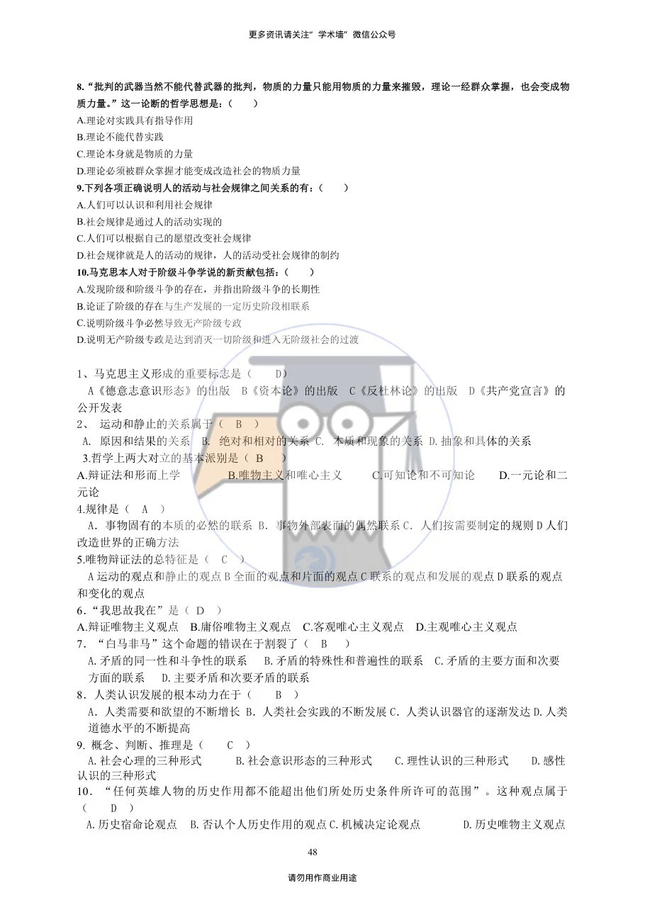

8.“批判的武器当然不能代替武器的批判，物质的力量只能用物质的力量来摧毁，理论一经群众掌握，也会变成物质力量。”这一论断的哲学思想是：（ ）A.理论对实践具有指导作用B.理论不能代替实践C.理论本身就是物质的力量D.理论必须被群众掌握才能变成改造社会的物质力量

9.下列各项正确说明人的活动与社会规律之间关系的有：（ ）A.人们可以认识和利用社会规律B.社会规律是通过人的活动实现的C.人们可以根据自己的愿望改变社会规律D.社会规律就是人的活动的规律，人的活动受社会规律的制约

10.马克思本人对于阶级斗争学说的新贡献包括：（ ）A.发现阶级和阶级斗争的存在，并指出阶级斗争的长期性B.论证了阶级的存在与生产发展的一定历史阶段相联系C.说明阶级斗争必然导致无产阶级专政D.说明无产阶级专政是达到消灭一切阶级和进入无阶级社会的过渡

1、马克思主义形成的重要标志是（ D）A《德意志意识形态》的出版 B《资本论》的出版 C《反杜林论》的出版 D《共产党宣言》的公开发表

2、 运动和静止的关系属于（ BA. 原因和结果的关系 B. 绝对和相对的关系 C. 本质和现象的关系 D.抽象和具体的关系3.哲学上两大对立的基本派别是（ BA.辩证法和形而上学 B.唯物主义和唯心主义 C.可知论和不可知论 D.一元论和二元论4.规律是（ A ）

A．事物固有的本质的必然的联系 B．事物外部表面的偶然联系 C．人们按需要制定的规则 D人们改造世界的正确方法

5.唯物辩证法的总特征是（ C ）A 运动的观点和静止的观点 B 全面的观点和片面的观点 C 联系的观点和发展的观点 D 联系的观点和变化的观点

6．“我思故我在”是（ D ）A.辩证唯物主义观点 B.庸俗唯物主义观点 C.客观唯心主义观点 D.主观唯心主义观点

7．“白马非马”这个命题的错误在于割裂了（ B ）A.矛盾的同一性和斗争性的联系 B.矛盾的特殊性和普遍性的联系 C.矛盾的主要方面和次要方面的联系 D.主要矛盾和次要矛盾的联系

8．人类认识发展的根本动力在于（ B ）A．人类需要和欲望的不断增长 B．人类社会实践的不断发展 C．人类认识器官的逐渐发达 D.人类道德水平的不断提高

9. 概念、判断、推理是（ C ）A.社会心理的三种形式 B.社会意识形态的三种形式 C.理性认识的三种形式 D.感性认识的三种形式

10．“任何英雄人物的历史作用都不能超出他们所处历史条件所许可的范围”。这种观点属于（ D ）A.历史宿命论观点 B.否认个人历史作用的观点 C.机械决定论观点 D.历史唯物主义观点

更多资讯请关注“学术墙”微信公众号

48

请勿用作商业用途

## 第49页

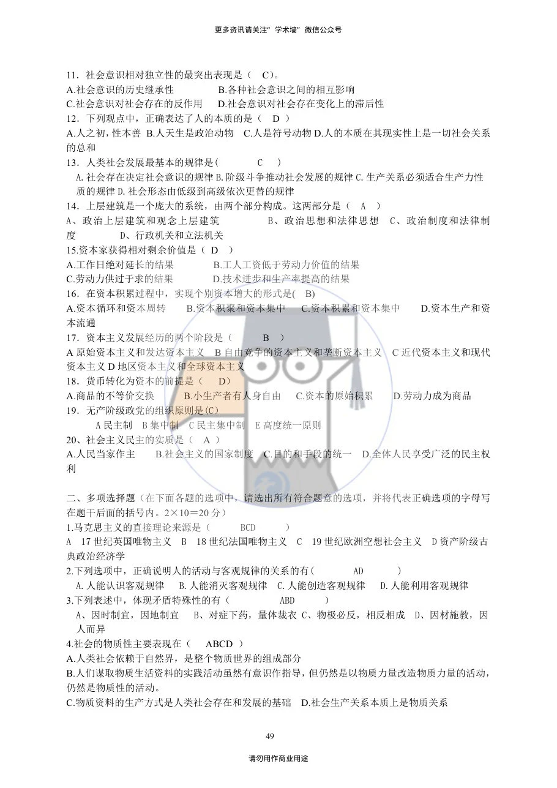

11．社会意识相对独立性的最突出表现是（ C）。A.社会意识的历史继承性 B.各种社会意识之间的相互影响C.社会意识对社会存在的反作用 D.社会意识对社会存在变化上的滞后性

12．下列观点中，正确表达了人的本质的是（ D ）A.人之初，性本善 B.人天生是政治动物 C.人是符号动物 D.人的本质在其现实性上是一切社会关系的总和

13．人类社会发展最基本的规律是( C )A.社会存在决定社会意识的规律 B.阶级斗争推动社会发展的规律 C.生产关系必须适合生产力性质的规律 D.社会形态由低级到高级依次更替的规律

14．上层建筑是一个庞大的系统，由两个部分构成。这两部分是（ A ）A、政治上层建筑和观念上层建筑 B、政治思想和法律思想 C、政治制度和法律制度 D、行政机关和立法机关

15.资本家获得相对剩余价值是（ D ）A.工作日绝对延长的结果 B.工人工资低于劳动力价值的结果C.劳动力供过于求的结果 D.技术进步和生产率提高的结果

16．在资本积累过程中，实现个别资本增大的形式是( B)A.资本循环和资本周转 B.资本积聚和资本集中 C.资本积累和资本集中 D.资本生产和资本流通

17．资本主义发展经历的两个阶段是（ B ）A 原始资本主义和发达资本主义 B 自由竞争的资本主义和垄断资本主义 C 近代资本主义和现代资本主义 D 地区资本主义和全球资本主义

18．货币转化为资本的前提是（ D）A.商品的不等价交换 B.小生产者有人身自由 C.资本的原始积累 D.劳动力成为商品

19．无产阶级政党的组织原则是(C）A 民主制 B 集中制 C民主集中制 E 高度统一原则

20、社会主义民主的实质是（ A ）A.人民当家作主 B.社会主义的国家制度 C.目的和手段的统一 D.全体人民享受广泛的民主权利

### 二、多项选择题（在下面各题的选项中，请选出所有符合题意的选项，并将代表正确选项的字母写在题干后面的括号内。2×10＝20分）

1.马克思主义的直接理论来源是（ BCD ）A 17世纪英国唯物主义 B 18 世纪法国唯物主义 C 19世纪欧洲空想社会主义 D 资产阶级古典政治经济学

2.下列选项中，正确说明人的活动与客观规律的关系的有( AD ) A.人能认识客观规律 B.人能消灭客观规律 C.人能创造客观规律 D.人能利用客观规律

3.下列表述中，体现矛盾特殊性的有（ ABD ）A、因时制宜，因地制宜 B、对症下药，量体裁衣 C、物极必反，相反相成 D、因材施教，因人而异

4.社会的物质性主要表现在（ ABCD ）A.人类社会依赖于自然界，是整个物质世界的组成部分B.人们谋取物质生活资料的实践活动虽然有意识作指导，但仍然是以物质力量改造物质力量的活动，仍然是物质性的活动。C.物质资料的生产方式是人类社会存在和发展的基础 D.社会生产关系本质上是物质关系

更多资讯请关注“学术墙”微信公众号

49

请勿用作商业用途

## 第50页

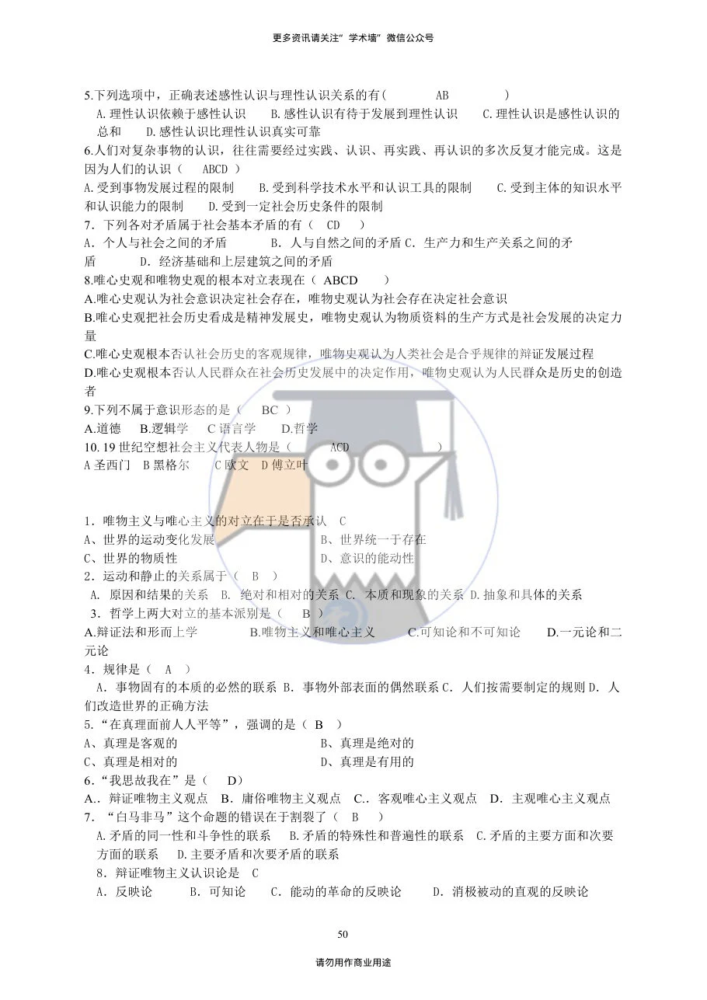

5.下列选项中，正确表述感性认识与理性认识关系的有( AB )A.理性认识依赖于感性认识 B.感性认识有待于发展到理性认识 C.理性认识是感性认识的总和 D.感性认识比理性认识真实可靠

6.人们对复杂事物的认识，往往需要经过实践、认识、再实践、再认识的多次反复才能完成。这是因为人们的认识（ ABCD ）A.受到事物发展过程的限制 B.受到科学技术水平和认识工具的限制 C.受到主体的知识水平和认识能力的限制 D.受到一定社会历史条件的限制

7．下列各对矛盾属于社会基本矛盾的有（ CD ）A．个人与社会之间的矛盾 B．人与自然之间的矛盾 C．生产力和生产关系之间的矛盾 D．经济基础和上层建筑之间的矛盾

8.唯心史观和唯物史观的根本对立表现在（ ABCD ）A.唯心史观认为社会意识决定社会存在，唯物史观认为社会存在决定社会意识

B.唯心史观把社会历史看成是精神发展史，唯物史观认为物质资料的生产方式是社会发展的决定力量C.唯心史观根本否认社会历史的客观规律，唯物史观认为人类社会是合乎规律的辩证发展过程D.唯心史观根本否认人民群众在社会历史发展中的决定作用，唯物史观认为人民群众是历史的创造者

9.下列不属于意识形态的是（ BC ）A.道德 B.逻辑学 C 语言学 D.哲学

10.19世纪空想社会主义代表人物是（ ACDA圣西门 B 黑格尔 C欧文 D 傅立叶

1．唯物主义与唯心主义的对立在于是否承认 CA、世界的运动变化发展 B、世界统一于存在C、世界的物质性 D、意识的能动性

A. 原因和结果的关系 B. 绝对和相对的关系 C. 本质和现象的关系 D.抽象和具体的关系3．哲学上两大对立的基本派别是（ B ）A.辩证法和形而上学 B.唯物主义和唯心主义 C.可知论和不可知论 D.一元论和二元论

4．规律是（ A ）A．事物固有的本质的必然的联系 B．事物外部表面的偶然联系 C．人们按需要制定的规则 D．人们改造世界的正确方法

5.“在真理面前人人平等”，强调的是（ B ）A、真理是客观的 B、真理是绝对的C、真理是相对的 D、真理是有用的

A.．辩证唯物主义观点 B．庸俗唯物主义观点 C.．客观唯心主义观点 D．主观唯心主义观点

7．“白马非马”这个命题的错误在于割裂了（ B ）A.矛盾的同一性和斗争性的联系 B.矛盾的特殊性和普遍性的联系 C.矛盾的主要方面和次要方面的联系 D.主要矛盾和次要矛盾的联系8．辩证唯物主义认识论是 CA．反映论 B．可知论 C．能动的革命的反映论 D．消极被动的直观的反映论

更多资讯请关注“学术墙”微信公众号

50

请勿用作商业用途

## 第51页

9. 概念、判断、推理是（ C ）A.社会心理的三种形式 B.社会意识形态的三种形式 C.理性认识的三种形式 D.感性认识的三种形式

10．“任何英雄人物的历史作用都不能超出他们所处历史条件所许可的范围”。这种观点属于（ D ）A.历史宿命论观点 B.否认个人历史作用的观点 C.机械决定论观点 D.历史唯物主义观点11．社会意识相对独立性的最突出表现是（ C）。A．.社会意识的历史继承性 B.．各种社会意识之间的相互影响C．.社会意识对社会存在的反作用 D．.社会意识对社会存在变化上的滞后性

12．历史唯物主义认为，社会历史发展的根本动力是 （ D ）A．科学技术 B．阶级斗争C．社会革命 D．社会基本矛盾

13．人类社会发展最基本的规律是( C )A.社会存在决定社会意识的规律 B.阶级斗争推动社会发展的规律C.生产关系必须适合生产力性质的规律 D.社会形态由低级到高级依次更替的规律

14．历史唯物主义认为，全部社会生活本质上是 ( C )A、运动的 B、发展的 C、实践的 D、矛盾的

15.资本家获得相对剩余价值是（ DA.．工作日绝对延长的结果 B．.工人工资低于劳动力价值的结果C.．劳动力供过于求的结果 D．.技术进步和生产率提高的结果

16．在资本积累过程中，实现个别资本增大的形式是( B )A．.资本循环和资本周转 B．资本积聚和资本集中C.．资本积累和资本集中 D．资本生产和资本流通

17．资本主义发展经历的两个阶段是（ B ）A．原始资本主义和发达资本主义 B．自由竞争的资本主义和垄断资本主义C．近代资本主义和现代资本主义 D．地区资本主义和全球资本主义

18．货币转化为资本的前提是（ D ）A．商品的不等价交换 B．小生产者有人身自由C.．资本的原始积累 D．劳动力成为商品

19．无产阶级政党的根本组织原则是（ C ）A．民主制 B．政治协商制 C．民主集中制 D．高度统一原则

20、社会主义民主的实质是（ A ）A．.人民当家作主 B．社会主义的国家制度C．目的和手段的统一 D．全体人民享受广泛的民主权利

### 二、多项选择题（在下面各题的选项中，请选出所有符合题意的选项，并将代表正确选项的字母写在题干后面的括号内。2×10＝20分）

1.马克思主义的直接理论来源是（ ACD ）A 、德国的古典哲学 B、18世纪法国唯物主义 C、19 世纪欧洲空想社会主义 D、资产阶级古典政治经济学

2.下列哪些见解能引导人们正确发挥主观能动性的是 （ BC ）A、有条件要上，没有条件也要上B、尊重客观规律，按规律办事C、自由是对必然的认识和对客观世界的改造D、“人有多大胆，地有多大产”

3.下列表述中，体现矛盾特殊性的有（ ABD ）

更多资讯请关注“学术墙”微信公众号

51

请勿用作商业用途

## 第52页

### A、因时制宜，因地制宜 B、对症下药，量体裁衣 C、物极必反，相反相成 D、因材施教，因人而异

B.、人们谋取物质生活资料的实践活动虽然有意识作指导，但仍然是以物质力量改造物质力量的活动，仍然是物质性的活动。C.、物质资料的生产方式是人类社会存在和发展的基础D、.社会生产关系本质上是物质关系

5..唯物主义的基本历史形态有 （ BCD ）A、客观辩证法 B、朴素唯物主义C、形而上学唯物主义 D、辩证唯物主义和历史唯物主义

6.人们对复杂事物的认识，往往需要经过实践、认识、再实践、再认识的多次反复才能完成。这是因为人们的认识（ ABCD ）A.受到事物发展过程的限制 B.受到科学技术水平和认识工具的限制 C.受到主体的知识水平和认识能力的限制 D.受到一定社会历史条件的限制

7．下列各对矛盾属于社会基本矛盾的有（ CD ）A．个人与社会之间的矛盾 B．人与自然之间的矛盾 C．生产力和生产关系之间的矛盾 D．经济基础和上层建筑之间的矛盾

8.唯心史观和唯物史观的根本对立表现在（ ABCD ）A.、唯心史观认为社会意识决定社会存在，唯物史观认为社会存在决定社会意识B、.唯心史观把社会历史看成是精神发展史，唯物史观认为物质资料的生产方式是社会发展的决定力量C.、唯心史观根本否认社会历史的客观规律，唯物史观认为人类社会是合乎规律的辩证发展过程D.、唯心史观根本否认人民群众在社会历史发展中的决定作用，唯物史观认为人民群众是历史的创造者

9.下列不属于意识形态的是（ BC ）A.道德 B.逻辑学 C 语言学 D.哲学

10.19世纪空想社会主义代表人物是（ ACD ）A、圣西门 B、黑格尔 C、欧文 D、傅立叶

更多资讯请关注“学术墙”微信公众号

52

请勿用作商业用途
