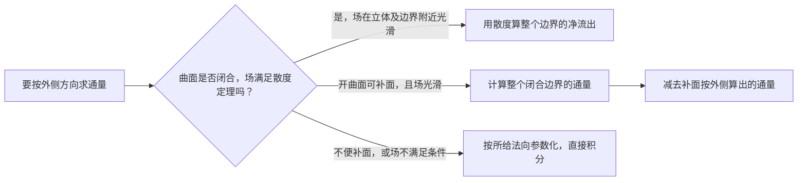

# 高等数学 A（Ⅰ）下：开曲面的通量从哪里来

2021–2022 学年第二学期的练习题转写件包含曲面积分和外向通量题。本页只取这两类作对照，例题、参数和解答均为自编，不是原题转录或源答案订正。

## 补充：转个方向，积分值会不会变？

给一张曲面铺一层薄膜。若算薄膜质量，小片只贡献自己的面积及密度，翻面不影响总和。若算穿过薄膜的净流量，就得先选哪边算「流出」；倒转法向，原来算流出的量就成了流入。

| 题目问什么 | 每个面元要提供什么 | 换反侧会怎样 |
|---|---|---|
| 标量的曲面积分 | 面元大小 $\mathrm dS$ 与标量 $g$ | $\iint_S g\,\mathrm dS$ 不变 |
| 向量场的通量 | 选定单位法向 $\mathbf n$，只取法向分量 $\mathbf F\cdot\mathbf n$ | $\iint_S\mathbf F\cdot\mathbf n\,\mathrm dS$ 变号 |

平面边界上的[格林公式](../../../topics/高等数学/平面环流与格林公式.md)同样有把局部变化累加为边界量的思想。三维的通量用散度表示单位体积的净流出率：内部相邻小块在共用面上的外法向相反，通量恰好抵消，只剩整个立体的外边界。因此，==曲面没封闭==时不能直接把它替换为体积分。

## 一项仅靠体积分看不见的通量

设 $R>0$。取球面 $x^2+y^2+z^2=R^2$ 的上半球面 $S$，法向从球心指向外侧。向量场 $\mathbf F(x,y,z)=(x,y,z+c)$ 中 $c$ 为常数。求通过 $S$ 的通量，并解释为什么把 $c$ 改变后，散度不变，答案却会变。

**参考解答。** 先补上 $z=0$ 的圆盘 $D$。这个立体在圆盘的上方，圆盘的**外法向向下**，所以 $\mathbf F\cdot\mathbf n=-c$，圆盘贡献 $-c\pi R^2$。闭合面内的散度恒为 $3$（三个坐标分量沿各自坐标的偏导各为 $1$）；上半球体积是 $2\pi R^3/3$，总外向通量为 $2\pi R^3$。故曲面 $S$ 的外向通量为
$$
\Phi_S=2\pi R^3-(-c\pi R^2)=2\pi R^3+c\pi R^2.
$$

也可以只积球面本身。记 $\varphi$ 为球面位置与正 $z$ 轴的夹角，$\theta$ 为绕 $z$ 轴的方位角。法向投影是 $\mathbf F\cdot\mathbf n=R+c\cos\varphi$，面元是 $R^2\sin\varphi\,\mathrm d\varphi\,\mathrm d\theta$，所以
$$
\Phi_S
=2\pi R^2\int_0^{\pi/2}(R+c\cos\varphi)\sin\varphi\,\mathrm d\varphi
=2\pi R^3+c\pi R^2.
$$

> [!WARNING]
> 常量场 $c(0,0,1)$ 没有源，不代表通过每一块曲面的通量都为零。取 $c>0$ 时，它单独贡献的 $c\pi R^2$ 是从底盘流入的量。只算体内的源，得不出通量在两个边界面之间怎样分配。

把「场」换成有方向的电场，同样要区分部分表面与整个闭合边界；参见[电通量与高斯定理](../../../topics/大学物理/电通量与高斯定理.md)。
