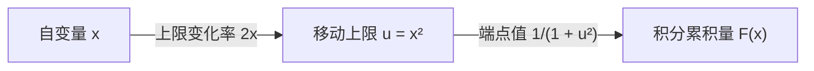

# 高等数学 A（Ⅱ）上：2023–2024 学年第一学期复习提示

现存单页转写以极限、微分与积分为复习范围，特别提示中值定理的应用。原件未核，以下不是原文重排、当年试卷统计或现行考纲。

## 补充：先分清题目要你做什么

看见两个式子相减，是直接代入，还是必须追踪相减后留下的余差？看见积分号，是计算面积、判断能否积出有限值，还是求累积量变化得多快？式子长得相似，所需的条件却不同。

| 题面信号 | 先检查什么 | 解法入口 |
|---|---|---|
| 两项相减后，一阶近似完全抵消 | 需要把余差算到分母的哪一阶 | [有理化或保留更高阶](../../../topics/高等数学/泰勒公式与余项.md) |
| 上限随自变量改变，问导数 | 被积函数在移动端点附近是否连续，上限是否可导 | [微积分基本定理与链式法则](../../../topics/高等数学/定积分与微积分基本定理.md) |
| 积分区间无限，或被积函数在区间端点无界 | 截断积分的极限是否存在且有限 | [广义积分与收敛](../../../topics/高等数学/广义积分与收敛.md) |

**例一。** 求 $\displaystyle\lim_{x\to 0}\frac{\sqrt{1+x}-1-x/2}{x^2}$。看到 ==一阶项相减==，先保留余差。设 $s=\sqrt{1+x}$，则在 $x$ 充分接近零、但 $x\ne 0$ 时
$$
\frac{s-1-x/2}{x^2}
=\frac{1/(s+1)-1/2}{x}
=\frac{1-s}{2x(s+1)}
=-\frac{1}{2(s+1)^2}.
$$
因此极限为 $-1/8$。若把 $s-1$ 直接换成等价的 $x/2$，减法就把两项一起抹掉了，留下的零无法代表真正的余差。参见[极限与连续](../../../topics/高等数学/极限与连续.md)。

**例二。** 设 $F(x)=\int_0^{x^2}\frac{1}{1+t^2}\,dt$。把上限单独记为 $u=x^2$：上限每移动一小段，积分的变化率是端点处的函数值；但 $x$ 不是上限，必须再乘 $u$ 随 $x$ 的变化率。

两条边的变化率相乘，得 $F'(x)=2x/(1+x^4)$。由于 $F(-x)=F(x)$，导数应为奇函数。漏乘 $2x$，不仅会报出错误的大小，还会把 $x<0$ 一侧减小的累积量误判为增加。

> [!TIP]
> 当移动上限靠近被积函数的奇点时，先核对截断积分是否定义出函数，以及讨论求导的点是否在连续区间内；不要直接在奇点套用端点公式。
