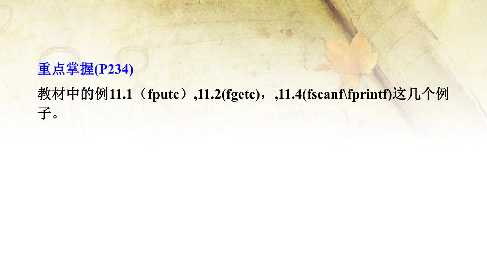

# C语言期末速成（电气工程及其自动化）

原件经识别和整理；“参考解答”是我们补的。

# C语言期末速成（电气工程及其自动化）

本资料为《C 语言期末速成（电气工程及其自动化）》复习要点第 1 部分，由识别工具读取并整理，内容涵盖内存基础、数据类型、流程控制、函数及数组等核心知识点。

## 模块一：基础知识部分

### 选择 1

题干：若计算机有 32 根地址总线，则其存储器的最大存储容量可达？
A. 32MB
B. 32GB
C. 4GB
D. 8GB

答案：C。
知识点：[计算机硬件组成（CPU、存储器等）及工作过程](../../../topics/C语言程序设计/计算机组成及工作过程.md)

### 选择 2

题干：以下哪一种不是从源程序到目标程序的翻译方式？
A. 编辑
B. 编译
C. 汇编
D. 解释

答案：A。
知识点：[C程序开发过程（源程序到可执行文件的全过程）](../../../topics/C语言程序设计/C程序开发过程.md)

### 练习 1

题干：下列哪一个是合法的用户自定义标识符？
A. `_do_while`
B. `begin?end`
C. `for`
D. `2nd_run`

答案：A。
知识点：[合法的用户标识符命名规则](../../../topics/C语言程序设计/标识符的定名规则.md)

### 计算 1

题干：区分宏定义中的参数替换规则。
已知宏定义：
1. `#define MUL(x, y) x*y`
2. `#define MUL(x, y) (x)*(y)`

主函数中调用：$c = \text{MUL}(3 + 2, 4 + 5)$。
请分别计算两种定义下变量 $c$ 的值。

答案：
1. 当定义为 `x*y` 时，$c = 3 + 2 * 4 + 5 = 3 + 8 + 5 = 16$。
2. 当定义为 `(x)*(y)` 时，$c = (3 + 2) * (4 + 5) = 5 * 9 = 45$。
知识点：[无参宏指令与带参宏指令的定义及使用](../../../topics/C语言程序设计/宏定义.md)、[算术运算符及其优先级说明](../../../topics/C语言程序设计/算术运算符.md)

### 选择 3

题干：在下面四个运算符中，优先级别最低的是？
A. `!`
B. `&&`
C. `==`
D. `=`

答案：D。
知识点：[算术运算符及其优先级说明](../../../topics/C语言程序设计/算术运算符.md)、[逻辑运算符与逻辑表达式](../../../topics/C语言程序设计/逻辑运算符.md)、[赋值运算符及复合赋值运算符](../../../topics/C语言程序设计/赋值及复合赋值运算符.md)

### 计算 2

题干：设 a, b, c, d 均为 0，执行 `(m=a==b) && (n=c!=d)` 后，m, n 的值为多少？
A. 0, 0
B. 0, 1
C. 1, 0
D. 1, 1

答案：C。
知识点：[赋值运算符及复合赋值运算符](../../../topics/C语言程序设计/赋值及复合赋值运算符.md)

### 选择 4

题干：设 a, b, c, d 都是 int 型变量，且 a=3, b=4, c=5，则下列表达式的值为 0 的是？
A. `'a' && 'b'`
B. `a<=b`
C. `a || b+c && b-c`
D. `!(a<b&&!c||0)`

答案：D。
知识点：[关系运算符与关系表达式](../../../topics/C语言程序设计/关系运算符.md)、[逻辑运算符与逻辑表达式](../../../topics/C语言程序设计/逻辑运算符.md)、[逻辑运算中的短路现象](../../../topics/C语言程序设计/逻辑短路现象.md)

### 选择 5

题干：下列哪一个是合法的实型常量？
A. `234E3.1`
B. `E3`
C. `234.`
D. `234`

答案：C。
知识点：[实型数据的合法表示形式](../../../topics/C语言程序设计/实型数据的合法形式.md)、[C语言的数据类型分类](../../../topics/C语言程序设计/C语言的数据类型.md)

### 选择 6

题干：下列不合法的常量是？
A. `'\x4A'`
B. `" "`
C. `.8e0`
D. `'\483'`

答案：D。
知识点：[转义字符及其进制表示](../../../topics/C语言程序设计/转义字符与进制表示.md)、[实型数据的合法表示形式](../../../topics/C语言程序设计/实型数据的合法形式.md)、[常量与变量的概念](../../../topics/C语言程序设计/常量与变量.md)

### 填空 1

题干：整型常量有三种合法制式：十进制、八进制（如 012）、十六进制（如 0xa3）。另外还可以有 L (l)、U (u) 作后缀。
注意：068 不是正确的整型数，因为 0 开头表示八进制，但数字 8 不是八进制的合理数字。
十进制的 25 在源程序中的八进制表示为 \_\_\_\_，十六进制表示为 \_\_\_\_。

答案：031; 0x19 (或 0X19)。
知识点：[二进制等进制问题与转换](../../../topics/C语言程序设计/进制转换.md)

### 简答 1

题干：请简述变量与指针变量的区别，以及全局变量与局部变量的存储属性区别。

答案：
1. **变量与指针变量**：普通变量存放的是数据值，指针变量存放的是内存地址。
2. **全局变量**：在所有函数之外定义，作用域从定义点到程序结束（除非被同名局部变量遮蔽），程序运行期间一直存在。
3. **局部变量**：
   - **auto** (默认)：函数调用时分配空间，函数结束时销毁，每次调用重新初始化（若无初值则为随机值）。
   - **static**：程序启动时分配空间并只初始化一次（无初值默认为 0），函数结束后依然存在，下次调用保留上次的值。

知识点：[C语言的数据类型分类](../../../topics/C语言程序设计/C语言的数据类型.md)、[变量的定义及初始化方法](../../../topics/C语言程序设计/变量的定义及初始化.md)、[局部变量与全局变量的作用域范围](../../../topics/C语言程序设计/变量的作用域.md)

### 简答 2

题干：请说明 scanf 和 printf 中 `%s` 格式控制符的特殊性。

答案：
- `%s` 对应的总是地址。
- 在 `scanf` 中，需要传入字符数组名（即首地址）。
- 在 `printf` 中，也需要传入字符数组名（即首地址），而不是单个字符或值。
- 其他格式符如 `%d`, `%c`, `%f` 等在 `scanf` 中需要地址（`&var`），但在 `printf` 中直接传值即可。

知识点：[scanf函数的格式控制与使用](../../../topics/C语言程序设计/scanf函数.md)、[printf函数的格式控制与使用](../../../topics/C语言程序设计/printf函数.md)、[字符数组的定义、循环赋值与字符串常量初始化](../../../topics/C语言程序设计/字符数组的定义与初始化.md)

### 简答 3

题干：请简述宏定义 `#define MUL(x, y) x*y` 与 `#define MUL(x, y) (x)*(y)` 的区别及潜在风险。

答案：
- **区别**：前者直接替换文本，后者在替换时将参数用括号包裹。
- **风险**：若使用 `MUL(3+2, 4+5)`，前者展开为 `3+2*4+5`，因乘除优先级高于加减，结果为 16；后者展开为 `(3+2)*(4+5)`，结果为 45。
- **建议**：带参数的宏定义应始终给参数加上括号，以避免运算优先级错误。

## 模块二：数据类型

知识点：[无参宏指令与带参宏指令的定义及使用](../../../topics/C语言程序设计/宏定义.md)、[算术运算符及其优先级说明](../../../topics/C语言程序设计/算术运算符.md)

### 简答 4

题干：C 语言的数据类型分为哪四大类？基本类型包含哪些？构造类型包含哪些？

答案：
- **四大类**：基本类型、构造类型、指针类型、空类型。
- **基本类型**：整型、实型、字符型。
- **构造类型**：枚举型、数组类型、结构体类型、共同体类型。
- **指针类型特殊性**：变量中存放的是内存地址信息，而非内存中的值。

## 模块三：程序流程控制

知识点：[C语言的数据类型分类](../../../topics/C语言程序设计/C语言的数据类型.md)

### 选择 7

题干：已知变量 tf 为整型，下面的条件语句中，五种表达有一种与其它四个不等价，它是？
A. `if(tf) 语句 1; else 语句 2;`
B. `if(tf==0) 语句 2; else 语句 1;`
C. `if(tf!=0) 语句 1; else 语句 2;`
D. `if(!tf) 语句 2; else 语句 1;`
E. `if(tf==1) 语句 1; else 语句 2;`

答案：E。
知识点：[关系运算符与关系表达式](../../../topics/C语言程序设计/关系运算符.md)、[if单分支与双分支选择语句](../../../topics/C语言程序设计/if语句.md)

### 阅读 1

题干：写出下面程序的运行结果。
```c
int x=1, y=2, z=3;
if (x=y) z=10; else z=20;
```

答案：z 的值为 10。
知识点：[if单分支与双分支选择语句](../../../topics/C语言程序设计/if语句.md)、[赋值运算符及复合赋值运算符](../../../topics/C语言程序设计/赋值及复合赋值运算符.md)

### 阅读 2

题干：分析 `if (x%2)` 和 `if (!(x%2))` 的含义。

答案：
- `if (x%2)`：等价于 `if (x%2 != 0)`，判断 x 是否为奇数。
- `if (!(x%2))`：等价于 `if (x%2 == 0)`，判断 x 是否为偶数。

知识点：[if单分支与双分支选择语句](../../../topics/C语言程序设计/if语句.md)、[算术运算符及其优先级说明](../../../topics/C语言程序设计/算术运算符.md)、[关系运算符与关系表达式](../../../topics/C语言程序设计/关系运算符.md)

### 简答 5

题干：switch 语句在使用时有哪些特别注意事项？

答案：
1. **表达式类型**：switch 后的表达式必须是整型、字符型或枚举型，不能是 float 或 double 型。
2. **执行流程**：匹配到常量后开始执行，直到遇到 `break` 或 switch 结束。若分支后无 `break`，会继续向下执行（穿透现象），这是常见考点。
3. **嵌套**：嵌套 switch 需注意每一层的起止位置，避免混淆。

知识点：[顺序、选择、循环三种基本控制结构](../../../topics/C语言程序设计/三种基本控制结构.md)

### 循环 1

题干：对于如下循环语句，循环体执行的次数分别为多少？
```c
int i;
for (i=0; i<3; i++); 
s+=i;
```

答案：3 次（循环体为空语句）。
知识点：[for循环语句及表达式省略规则](../../../topics/C语言程序设计/for循环.md)、[表达式语句、控制语句、复合语句与空语句](../../../topics/C语言程序设计/语句的分类.md)、[自增（++）、自减（--）运算符](../../../topics/C语言程序设计/自增自减运算符.md)

### 计算 3

题干：如何计算一个整数是否为质数？如何找出一定范围内所有的质数？

答案：
1. **判断单个整数**：使用一层循环，从 2 遍历到 $\sqrt{n}$，若能整除则不是质数。
2. **找出范围内所有质数**：使用两层循环。外层循环遍历范围内的每个数，内层循环判断该数是否为质数。
3. **输出**：按要求格式输出结果。

知识点：[质数（素数）判断的经典算法实现](../../../topics/C语言程序设计/质数判断算法.md)、[for循环语句及表达式省略规则](../../../topics/C语言程序设计/for循环.md)、[算术运算符及其优先级说明](../../../topics/C语言程序设计/算术运算符.md)

### 计算 4

题干：数列求和的一般步骤是什么？

答案：
1. 设累加器（sum）初始化为 0。
2. 在循环体内，计算当前项的值。每一项可表达为：$1.0 \times \text{分子} \times \text{符号位} / \text{分母}$。
3. 将当前项加到累加器中。
4. 注意处理正负项交替的情况（符号位）以及分子分母为常量的简化情况。

## 模块四：函数

知识点：[累加和与阶乘等数列求和算法](../../../topics/C语言程序设计/数列求和算法.md)

### 简答 6

题干：C 语言函数的定义规则及返回值机制是怎样的？

答案：
- **组成**：函数首部（返回值类型 + 函数名 + 形式参数表）和函数体。
- **返回值**：若缺省，默认为 `int` 型。若无需返回值，定义为 `void`。
- **转换**：return 后的表达式类型若与返回值类型不一致，会自动转换。
- **限制**：函数只能通过 return 返回一个值。若需返回多个信息，可使用指针形参。
- **嵌套**：函数可以嵌套调用，但不能嵌套定义。

知识点：[函数的定义格式与函数体](../../../topics/C语言程序设计/函数的定义.md)、[表达式中及赋值中的自动类型转换原则](../../../topics/C语言程序设计/自动类型转换.md)

### 代码 1

题干：请分析以下代码片段的功能及指针传递的作用。
```c
int f(int a[], int n, int *max); // 声明
// ...
int sum = SortAndPlus(a, 10, &max);
printf("%d %d\n", max, sum);
```

答案：
- **功能**：计算数组前 n 个元素之和（通过返回值），同时通过指针 `max` 修改主函数中的 `max` 变量，使其获得数组最大值。
- **指针传递**：实参 `&max` 是 `max` 的地址，传递给形参 `*max`。函数内部通过 `*max = ...` 修改的是主函数中 `max` 变量的值，实现了“多值返回”的效果。

知识点：[函数参数中传值与传地址的区别及应用](../../../topics/C语言程序设计/传值与传址.md)、[指针变量的概念、基类型与定义方法](../../../topics/C语言程序设计/指针的概念与定义.md)、[一维和二维数组作为函数参数的传递方式](../../../topics/C语言程序设计/数组作为函数参数.md)

### 选择 8

题干：若用一维数组名作为函数调用时的实在参数，则实际上传递给形参的是什么？
A. 数组第一个元素的值
B. 数组的首地址
C. 数组的长度
D. 整个数组

答案：B。
知识点：[函数参数中传值与传地址的区别及应用](../../../topics/C语言程序设计/传值与传址.md)、[一维数组的定义格式与内存存储方式](../../../topics/C语言程序设计/一维数组的定义与存储.md)、[一维和二维数组作为函数参数的传递方式](../../../topics/C语言程序设计/数组作为函数参数.md)

### 选择 9

题干：若在主函数中定义了数组变量 `int arr[20]`，并调用了函数 `f(arr)`，则下列关于函数 f 的原型声明，哪几个是完全等效的？
A. `void f(int x[20]);`
B. `void f(int x[ ]);`
C. `void f(int x[10]);`
D. `void f(int x);`
E. `void f(int *x);`

答案：ABCE。
知识点：[C程序中的六种符号](../../../topics/C语言程序设计/C程序中的六种符号.md)、[一维和二维数组作为函数参数的传递方式](../../../topics/C语言程序设计/数组作为函数参数.md)

### 简答 7

题干：值形式参数和指针形式参数的区别是什么？如何实现交换两个变量的值？

答案：
- **值形式参数**：实参的值复制给形参，函数内修改形参不影响实参。
- **指针形式参数**：实参的地址传给形参，函数内通过解引用修改指针指向的内容，可以改变实参的值。
- **交换实现**：
  - 正确：`swap(int *x, int *y)`，调用 `swap(&a, &b)`。
  - 错误：`swap(int *x, int y)`，调用 `swap(&a, b)`，只能修改 a，无法完成互换。

## 模块五：数组

知识点：[值传递与地址传递（传址）的区别](../../../topics/C语言程序设计/参数传递方式.md)、[指针变量的概念、基类型与定义方法](../../../topics/C语言程序设计/指针的概念与定义.md)、[函数参数中传值与传地址的区别及应用](../../../topics/C语言程序设计/传值与传址.md)

### 简答 8

题干：数组的定义和初始化有哪些规则？

答案：
1. **定义**：方括号内必须是整型常量或常量表达式，不能使用变量（如 `int n=10; int a[n];` 错误）。
2. **下标**：起始下标为 0，有效范围为 0 到 N-1，不可越界访问。
3. **初始化**：
   - 可缺省元素个数（编译器自动计算）。
   - 二维数组只能缺省行数。
   - 规则：从左至右依次赋值，初值个数不超过容量。
   - 剩余元素默认初始化为 0。
4. **访问**：
   - 元素表示：`a[i]` 与 `*(a+i)` 等效。
   - 元素地址：`a+i` 与 `&a[i]` 等效。

# C语言期末速成（电气工程及其自动化）复习要点

## 模块五：数组算法与定义

- 必须熟练掌握在一维数组中的以下算法：
    - 输入数组所有元素、输出数组所有元素
    - 寻找最大数、最小数
    - 求元素的和或平均值
    - 查找某一个值是否是数组中的元素
    - 冒泡排序和简单选择排序算法
    - 删除元素（方法1：覆盖移动法；方法2：把不需要删除的内容复制下来）
    - 数组元素的逆置（从两边往中间，元素两两交换）
- 教材中基本都有对应的函数定义及调用方法。
- 算法核心：首先要理解一维数组名作实参和形式参数传地址的实质；理解 `void f(int a[])` 中的形式参数 `a` 实质上是一个指针形式参数，也就是该函数首部可以写成：`void f(int *a)` 或 `void f(int a[10])`，这里的 10 可以是任意整数都是完全等效的。

知识点：[一维数组的定义格式与内存存储方式](../../../topics/C语言程序设计/一维数组的定义与存储.md)、[一维数组的初始化方法及长度省略规则](../../../topics/C语言程序设计/一维数组的初始化.md)、[利用循环实现对一维数组元素的访问](../../../topics/C语言程序设计/一维数组元素的访问.md)

### 练习

#### 选择 1

有数组定义 `int a[m][n]`，则在 `a[i][j]` 之前的元素的个数为\_\_\_\_。

答案：`i*n+j`

#### 选择 2

以下一维数组的定义正确的是\_\_\_\_

- A. `int n=3, a[n];`
- B. `#define N=3 int a[N];`
- C. `const int n=3; int a[n];`
- D. `#define N 3 int a[N*3];`

答案：D

#### 选择 3

以下一维数组定义及初始化正确的是\_\_\_\_

- A. `int a[]；`
- B. `int a[]={1,2,3}`
- C. `int a[3]={1,2,3,4}`
- D. `int a[3]={,2,}`

答案：B

#### 选择 4

以下选择中，能正确定义二维数组的是\_\_\_\_

- A. `int x[][2];`
- B. `int x[][2] = {2*2};`
- C. `int x[2][ ]={1, 2, 3, 4};`
- D. `int a[2][3]={, {1}};`

答案：B

#### 填空 1

若定义 `int m[10] = {9, 1, 15, 6, 2, 11, 8, 7, 19, 3};`，则 `m[m[1] + 2*m[4]]` 的值是 \_\_\_\_，`*m+m[8]` 的值为 \_\_\_\_。

答案：11, 28

#### 选择 5

下列字符数组定义与初始化不正确的是\_\_\_\_

- A. `chars[] = "abc";`
- B. `chars[] = {"abc"};`
- C. `chars[3] = {'a', 'b', 'c'};`
- D. `chars[3] = "abc";`

答案：D

#### 选择 6

下列关于数组的描述中不正确的是\_\_\_\_

- A. 可以对字符型数组进行整体输入、输出
- B. 可以对整型数组进行整体输入、输出
- C. 利用字符型数组可以实现字符串操作
- D. 不能通过赋值运算符“=”对字符型数组进行整体赋值

答案：B

## 模块六：指针

- 基本概念：
    - 举个最简单的例子: `int *p`
    - `int *` 是数据类型，`p` 是变量
- 指针与数组的关系：
    - 内存地址示例：
        ```text
        0000000000061FE14 -> a
        0000000000061FE15 -> b
        ```
    - 区别 `*p++` 和 `(*p)++` 这两个表达式的不同含义
- 指针与函数的关系：

```c
int main() {
    int a = 1, b = 2;
    int *x = &a;
    int *y = &b;
    swap1(a, b);
    printf("%d\n", a);
    printf("%d\n", b);
    swap2(x, y);
    printf("%d\n", a);
    printf("%d\n", b);
    return 0;
}
```

- 用字符指针操作字符串：比用字符数组操作字符串具有更大的灵活性，注意二者的区别。
    - 例: `char *s= “ABC”;` 和 `char *s; s=“ABC”;` 都是正确的
    - `char p[4] = “ABC”;` 正确，但是 `char p[4]; p="ABC";` 却错误
    - `s=p；` 是正确的赋值，但是 `s=*p`，`*s="AB"` 都是错误的

知识点：[数组名的实质及指针访问一维数组的方法](../../../topics/C语言程序设计/指针与一维数组.md)、[%s整体输入输出与%c逐个字符输入输出](../../../topics/C语言程序设计/字符串的输入输出.md)

### 练习

#### 填空 2

已知: `char *s = "student";`，则 `printf("%s\n", s+3)` 输出为\_\_\_\_

答案: `dent`

#### 选择 7

若有说明：`int a, b=9, *p=&a;`，则能完成 `a=b` 赋值功能的语句是\_\_\_\_

- A. `a=*p;`
- B. `*p=&b;`
- C. `a=&b;`
- D. `*p=&*b;`

答案: B

## 模块七：字符串

知识点：[数组名的实质及指针访问一维数组的方法](../../../topics/C语言程序设计/指针与一维数组.md)、[%s整体输入输出与%c逐个字符输入输出](../../../topics/C语言程序设计/字符串的输入输出.md)

### 一、理解字符串常量

- 字符串常量是双引号括起来的任意字符序列
- 如: `"HelloWorld"`, `"Hello\"Accp\""` 可以包含转义字符
- 字符串结束符 `\0`

知识点：[字符串常量的存储及'\0'结束标志](../../../topics/C语言程序设计/字符串的存储.md)、[转义字符及其进制表示](../../../topics/C语言程序设计/转义字符与进制表示.md)

### 二、理解字符数组和字符串的异同

- C语言中没有专门的字符串变量，通常用一个字符数组来存放一个字符串
- 字符数组和字符串的区别是字符串的末尾有一个空字符 `\0`

```c
char name[15]={'M','i','k','u','\0'}; //手工加空字符
char name[15]="Miku"; //系统自动加空字符
char password electronics["12345678"; //省略数组大小,系统自动计算
```

知识点：[字符数组的定义、循环赋值与字符串常量初始化](../../../topics/C语言程序设计/字符数组的定义与初始化.md)、[字符数组与普通字符串在内存表示上的异同](../../../topics/C语言程序设计/字符数组和字符串的区别.md)、[字符串常量的存储及'\0'结束标志](../../../topics/C语言程序设计/字符串的存储.md)

### 三、字符串输入输出函数的使用

```c
//scanf("%s",name3); //使用scanf时不能输入空格
//printf("输入姓名为:%s",name3);

gets(name3); //从键盘读入一行存入name,并用\0去带行尾\n
puts(name3); //把字符串输出
//按一定格式输出是通常使用printf
```

知识点：[字符数据的合法表示形式](../../../topics/C语言程序设计/字符数据的合法形式.md)

### 四、sizeof和strlen

```c
char s[] = "hello";
s[2] = '\0';
sizeof(s);
strlen(s);
printf("%d\n", sizeof(s));
printf("%d\n", strlen(s));
return 0;
```

- `sizeof`: 计算数据类型所占空间
- `strlen`: 计算字符串所占空间

知识点：[字符串常量的存储及'\0'结束标志](../../../topics/C语言程序设计/字符串的存储.md)、[sizeof运算符与strlen函数计算长度的区别](../../../topics/C语言程序设计/sizeof和strlen.md)、[字符数据的合法表示形式](../../../topics/C语言程序设计/字符数据的合法形式.md)

### 五、字符串处理函数，头文件为 `<string.h>`

- `strcmp`: 进行两个字符串的比较 (例如: 判断串 s1 是否大于 s2, 不能用 `s1>s2`, 而应该用 `strcmp(s1,s2)>0`)
- `strcpy`: 实现字符串的赋值
- `strcat`: 实现字符串的连接
- `strupr` 和 `strlwr`: 实现字符串大小写的转换

知识点：[<string.h>中常用字符串处理函数的使用](../../../topics/C语言程序设计/字符串处理函数.md)、[字符数组与普通字符串在内存表示上的异同](../../../topics/C语言程序设计/字符数组和字符串的区别.md)

### 六、理解指针与字符串的关系

#### 选择题

下列程序段运行后，`i` 的正确结果为\_\_\_\_。

```c
int i=0;
char *s="a\041#041\b";
while(*s++) i++;
```

- A. 5
- B. 8
- C. 11
- D. 12

答案: B

#### 填空题

程序运行时从第一行开始输入 `this is a cat !<回车>`，则输出结果是\_\_\_\_。

```c
char *p = "hello";
p[2] = 'L';
putchar(p[2]);

char s[] = "hello";
s[2] = 'L';
putchar(s[2]);
return 0;
```

$$
\text { char } ^ {*} p = \text {"hello"};
$$

出现异常。× Segmentation fault

关于内存的错误！

不能通过指针更改字符串常量的值！

## 模块八：结构体

- 结构体声明
- 结构体变量
    - 定义一个变量: 数据类型 + 变量 (`int a;`)
    - 定义一个结构体变量也是如此
- 结构体指针

```c
struct point {
    int x;
    int y;
};
struct point p1 = {1, 2};
printf("%d", p1.x);
```

```c
struct point{
    int x;
    int y;
};
typedef struct point point;
point p1 = {1, 2};
printf("%d", p1.x);
```

```c
struct point {
    int x;
    int y;
} p1 = {1, 2};
printf("%d", p1.x);
```

```c
typedef struct point{
    int x;
    int y;
}point;
point p1 = {1, 2};
printf("%d", p1.x);
```

```c
struct {
int x;
int y;
}p1 = {1, 2};
printf("%d", p1.x);
```

```c
typedef struct{
    int x;
    int y;
}point;
point p1 = {1, 2};
printf("%d", p1.x);
```

知识点：[指针变量的概念、基类型与定义方法](../../../topics/C语言程序设计/指针的概念与定义.md)、[数组名的实质及指针访问一维数组的方法](../../../topics/C语言程序设计/指针与一维数组.md)、[字符串常量的存储及'\0'结束标志](../../../topics/C语言程序设计/字符串的存储.md)

### 我对上述程序的改写

#### 练习

##### 填空 3

定义 `struct Point{ int x,y; }pos[ ]={{1,2},{3,4},{5,6}}, *pt=pos;`，则表达式 `(++pt)->y` 的值为\_\_\_\_，`++(pt->x)` 的值为\_\_\_\_，`++pt->x` 的值为\_\_\_\_、`(*pt).y` 的值为\_\_\_\_。

答案: 4, 2, 2, 2

##### 选择 8

以下对结构体变量 `stu` 中成员的非法引用是\_\_\_\_。

```c
struct Point
{
    int x;
    int y;
} pos, *p=&pos;
```

- A. `pos.x`
- B. `(*p).y`
- C. `p->x`
- D. `Point.y`

答案：D

## 模块九：文件

- C语言中的文件的组成及分类：
    - C中的文件由数据流形式组成，可按数据的存放形式分为二进制文件和文本文件
- C文件打开的方式：
    - 基本方式: `r`(只读) `w`(只写)、`a`(追加)
    - 后面可以加上 `+` 表示可读可写
    - 加上 `b` 表示打开二进制文件，否则默认是对文本文件操作

| 打开方式 | 说明 |
| :--- | :--- |
| r | 以只读方式打开文件,该文件必须存在。 |
| r+ | 以读/写方式打开文件,该文件必须存在。 |
| rb+ | 以读/写方式打开一个二进制文件,只允许读/写数据。 |
| rt+ | 以读/写方式打开一个文本文件,允许读和写。 |
| w | 打开只写文件,若文件存在则长度清为0,即该文件内容消失,若不存在则创建该文件。 |
| w+ | 打开可读/写文件,若文件存在则文件长度清为零,即该文件内容会消失。若文件不存在则建立该文件。 |
| a | 以附加的方式打开只写文件。若文件不存在,则会建立该文件,如果文件存在,写入的数据会被加到文件尾,即文件原先的内容会被保留(EOF符保留)。 |
| a+ | 以附加方式打开可读/写的文件。若文件不存在,则会建立该文件,如果文件存在,则写入的数据会被加到文件尾后,即文件原先的内容会被保留(原来的EOF符不保留)。 |
| wb | 以只写方式打开或新建一个二进制文件,只允许写数据。 |
| wb+ | 以读/写方式打开或建立一个二进制文件,允许读和写。 |
| wt+ | 以读/写方式打开或建立一个文本文件,允许读写。 |
| at+ | 以读/写方式打开一个文本文件,允许读或在文本末追加数据。 |
| ab+ | 以读/写方式打开一个二进制文件,允许读或在文件末追加数据。 |

知识点：[基类型为结构体的指针定义与使用](../../../topics/C语言程序设计/结构体指针.md)、[结构体变量成员的依次赋值与访问](../../../topics/C语言程序设计/结构体成员的访问.md)、[fopen函数的模式参数与fclose函数的使用](../../../topics/C语言程序设计/文件的打开和关闭.md)

### 文件的操作步骤

1. 定义 `FILE*` 文件指针，一个文件对应一个指针
2. 利用文件指针打开文件 `fp=fopen(文件名, 打开方式)`，注意文件名要用双引号括起，并且路径之间用 `\\`，打开方式也要用双引号括起
3. 进行文件读写操作，共四对函数：
    - 单字符读写：`fgetc`、`fputc`
    - 字符串读写：`fgets`、`fputs`
    - 格式化读写：`fscanf`、`fprintf`
    - 块数据读写：`fread`、`fwrite`

知识点：[FILE结构体与文件指针的定义](../../../topics/C语言程序设计/文件指针.md)、[fopen函数的模式参数与fclose函数的使用](../../../topics/C语言程序设计/文件的打开和关闭.md)、[文件中单个字符的读写操作函数](../../../topics/C语言程序设计/字符读写函数.md)

### 文件操作函数介绍

1. **fgetc** 从文件中读出一个字符
   - 函数原型: `int fgetc(FILE *fp)`
2. **fputc** 将指定字符写入文件
   - 函数原型: `int fputc( int c, FILE *fp )`
3. **fgets** 从文件中读取字符串
   - 函数原型: `char *fgets(char *s, int n, FILE *fp)`
4. **fputs** 将字符串写入文件
   - 函数原型: `int fputs(const char* s, FILE *fp)`
5. **fscanf** 从文件中读取内容给变量
   - 函数原型: `int fscanf (FILE *fp, const char* format, 地址1, 地址2, ...)`
6. **fprintf** 将内容写入文件
   - 函数原型: `int fprintf ( FILE *fp, const char* format, 输出参数1,输出参数2,…)`
7. **fread** 从文件读取内容给变量
   - 函数原型: `int fread ( void *buffer, int size, int n, FILE *fp )`
8. **fwrite** 将内容写入文件
   - 函数原型: `int fwrite( const void *buffer, int size, int n, FILE *fp)`

知识点：[文件中单个字符的读写操作函数](../../../topics/C语言程序设计/字符读写函数.md)、[fopen函数的模式参数与fclose函数的使用](../../../topics/C语言程序设计/文件的打开和关闭.md)、[fread和fwrite函数的原型及块数据读写](../../../topics/C语言程序设计/块数据读写函数.md)

### 重点掌握(P234)

教材中的例11.1（`fputc`），11.2(`fgetc`)，11.4(`fscanf` `fprintf`)这几个例子。




知识点：[fopen函数的模式参数与fclose函数的使用](../../../topics/C语言程序设计/文件的打开和关闭.md)、[文件中单个字符的读写操作函数](../../../topics/C语言程序设计/字符读写函数.md)、[fread和fwrite函数的原型及块数据读写](../../../topics/C语言程序设计/块数据读写函数.md)
