# 《C语言程序设计》第2章 基本数据类型（课件）

原件的每一页，下面附识别出的文字。

### C语言程序设计

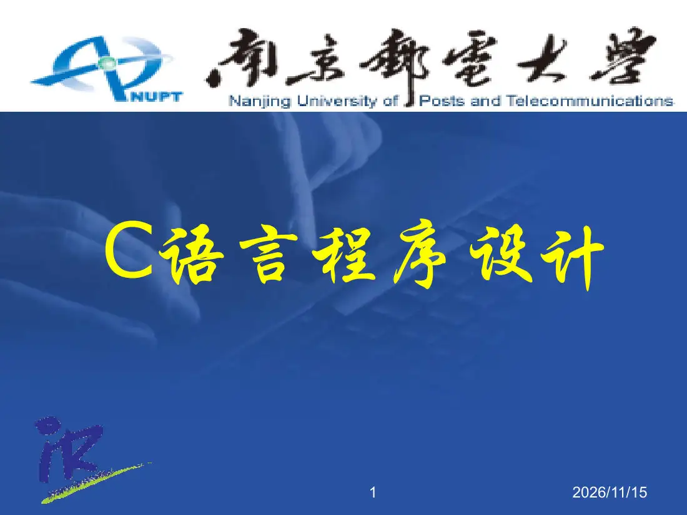

原文：

C语言程序设计

2026/11/15

A南京郵電大学 Nanjing University of Posts and Telecommunications

1

### 第二章 基本数据类型

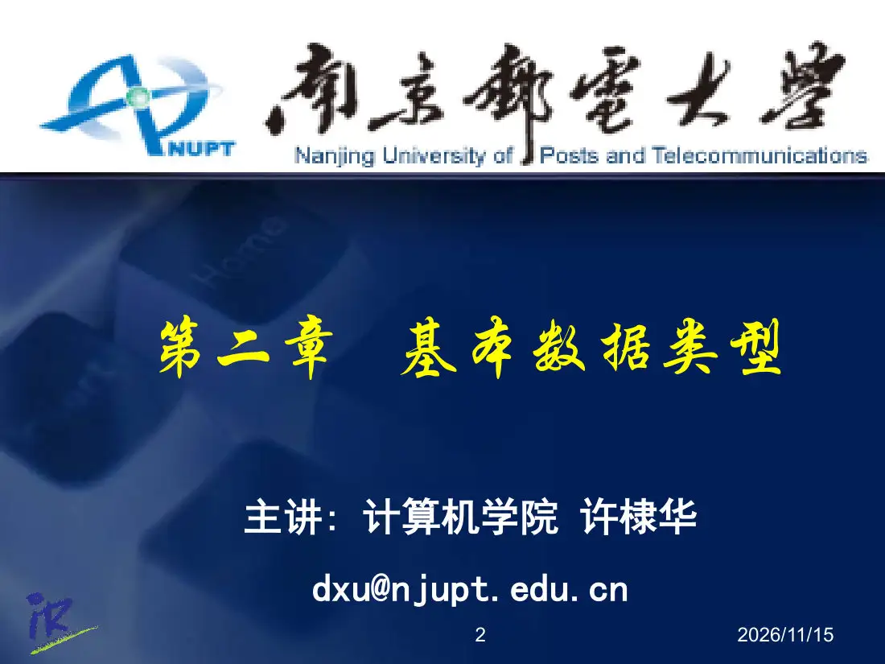

原文：

第二章 基本数据类型

主讲: 计算机学院 许棣华

dxu@njupt.edu.cn

2

2026/11/15

之南京郵電大学 HUPT Nanjing University of Posts and Telecommunications

### 重点掌握

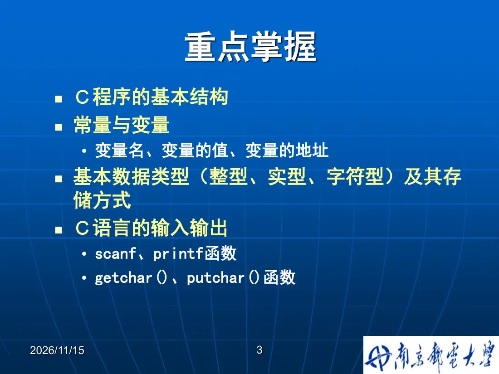

原文：

重点掌握

◼ C程序的基本结构

常量与变量

变量名、变量的值、变量的地址

基本数据类型（整型、实型、字符型）及其存储方式

◼ C语言的输入输出

scanf、printf函数

• getchar()、putchar()函数

2026/11/15

3

彤南京郵電大学

### 我的第一个C程序

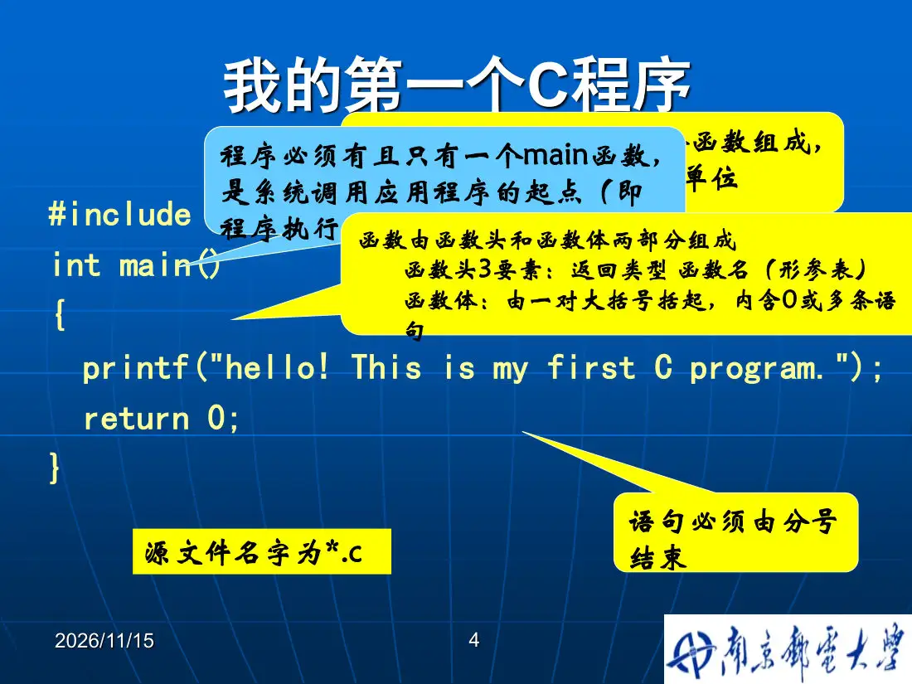

原文：

我的第一个C程序

程序必须有且只有一个main函数，是系统调用应用程序的起点（即

函数组成，单位

include

int main()

程序执行

函数由函数头和函数体两部分组成

函数头3要素：返回类型 函数名（形参表）

函数体：由一对大括号括起，内含0或多条语 句

printf("hello! This is my first C program.");

return 0;

源文件名字为\*.c语句必须由分号结束

2026/11/15

4

华南京郵電大學

### C语言的数据类型

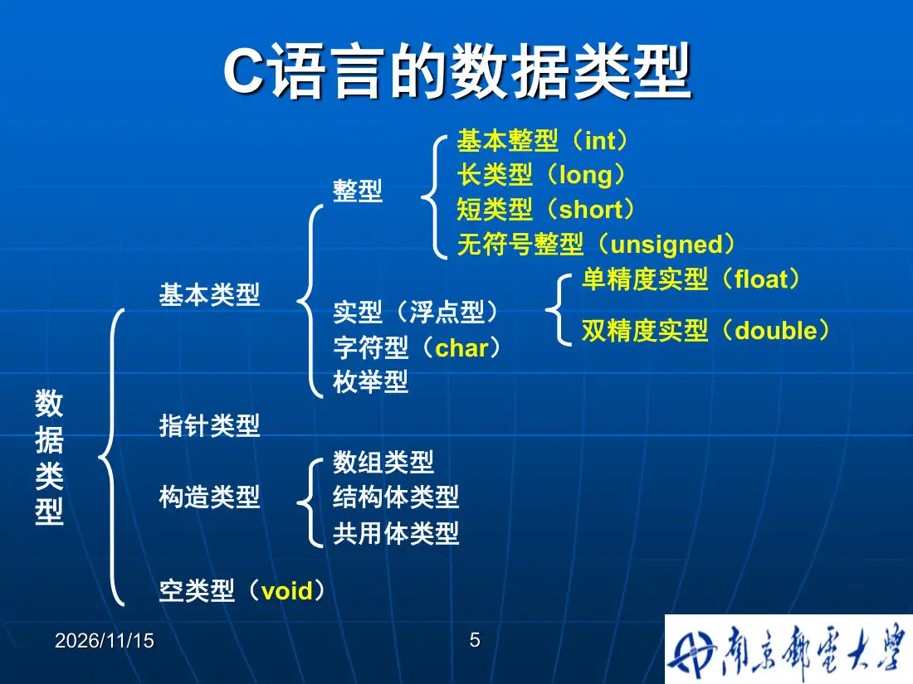

原文：

C语言的数据类型

数
据
类
型

指针类型

构造类型

整型

空类型（void）

基本类型

基本整型（int）

数组类型

长类型（long）

实型（浮点型）

枚举型

短类型（short）

结构体类型

字符型（char）

共用体类型

无符号整型（unsigned）

单精度实型（float）

双精度实型（double）

2026/11/15

5

彤南京郵電大学

### 常量与变量

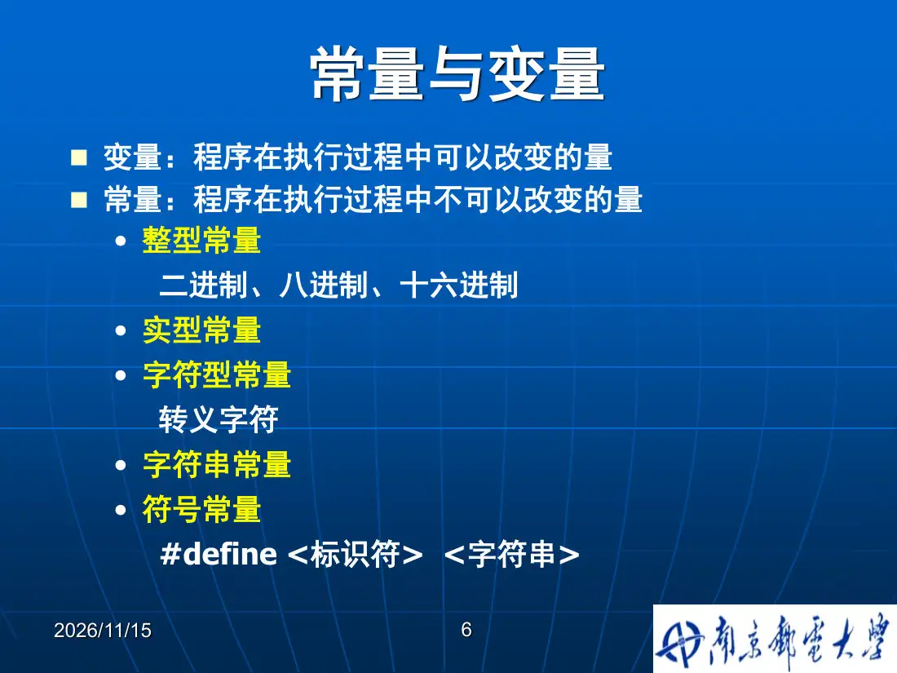

原文：

常量与变量

◼ 变量：程序在执行过程中可以改变的量

◼ 常量：程序在执行过程中不可以改变的量

整型常量

二进制、八进制、十六进制

实型常量

• 字符型常量

转义字符

字符串常量

符号常量

define <标识符> <字符串>变量名必须是用户自定义标识符

2026/11/15

6

彤南京郵電大学

### 变量

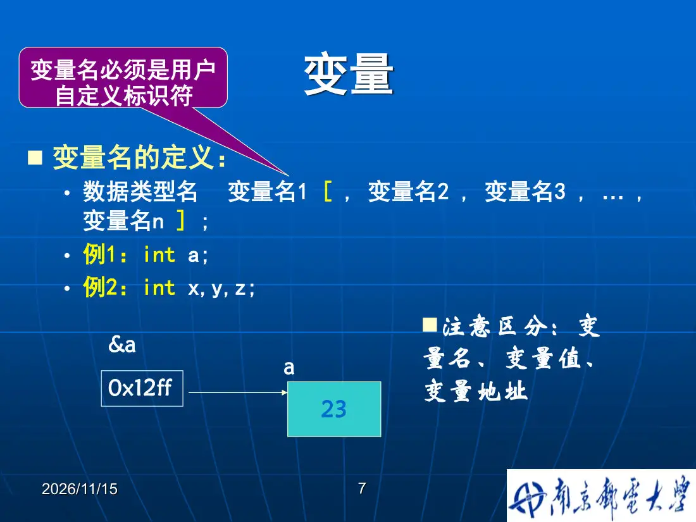

原文：

变量

变量名的定义：

数据类型名 变量名1 [ , 变量名2 , 变量名3 , 变量名n ] ;

• 例1：int a;

• 例2：int x,y,z;

0x12ff

23

◼注意区分：变量名、变量值、变量地址

2026/11/15

7

华南京郵電大學

### 标识符的定名规则

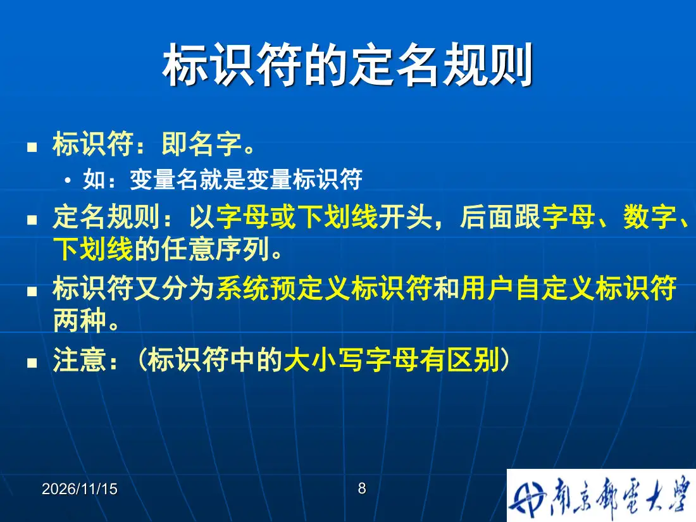

原文：

标识符的定名规则

标识符：即名字。

• 如：变量名就是变量标识符

定名规则：以字母或下划线开头，后面跟字母、数字、下划线的任意序列。

标识符又分为系统预定义标识符和用户自定义标识符两种。

◼ 注意：(标识符中的大小写字母有区别)

2026/11/15

8

今南京郵電大学

### 变量的定义及初始化

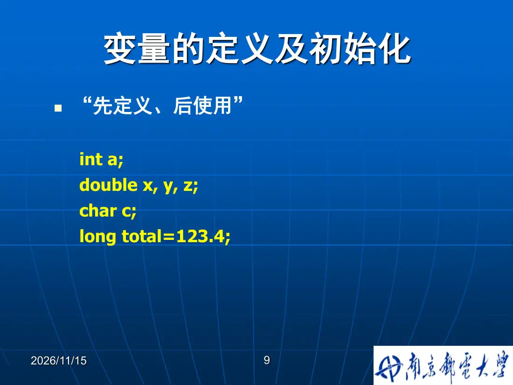

原文：

变量的定义及初始化

“先定义、后使用”

int a;

double x, y, z;

char c;

long total=123.4;

2026/11/15

9

彤南京郵電大学

### 变量的输出— printf函数

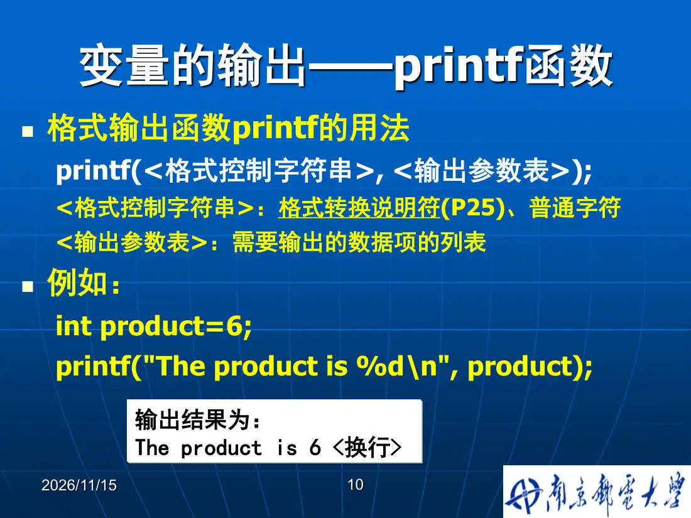

原文：

变量的输出— printf函数

格式输出函数printf的用法

printf(<格式控制字符串>, <输出参数表>);

<格式控制字符串>：格式转换说明符(P25)、普通字符

<输出参数表>：需要输出的数据项的列表

例如：

int product=6;

printf("The product is %d\n", product);

输出结果为： The product is 6 <换行>

2026/11/15

10

彤南京郵電大学

### 变量的输入—— scanf函数

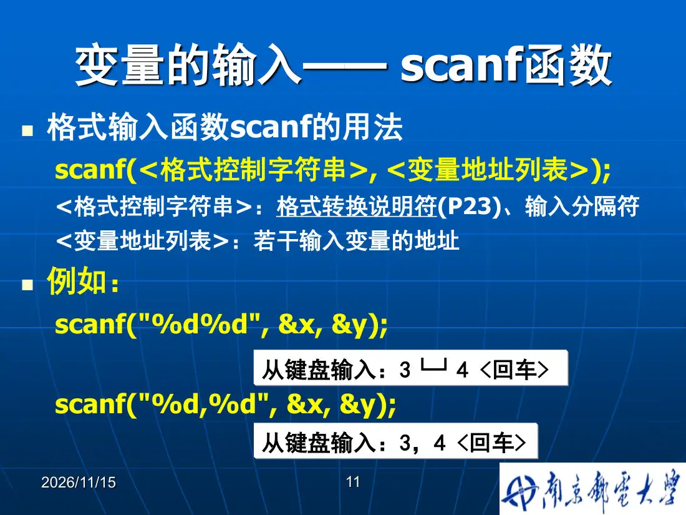

原文：

变量的输入—— scanf函数

格式输入函数scanf的用法scanf(<格式控制字符串>, <变量地址列表>);<格式控制字符串>：格式转换说明符(P23)、输入分隔符<变量地址列表>：若干输入变量的地址

例如：

scanf("%d%d", &x, &y);

从键盘输入：3└┘4 <回车>

scanf("%d,%d", &x, &y);

从键盘输入：3，4 <回车>

2026/11/15

11

彤南京郵電大学

### 例2.2

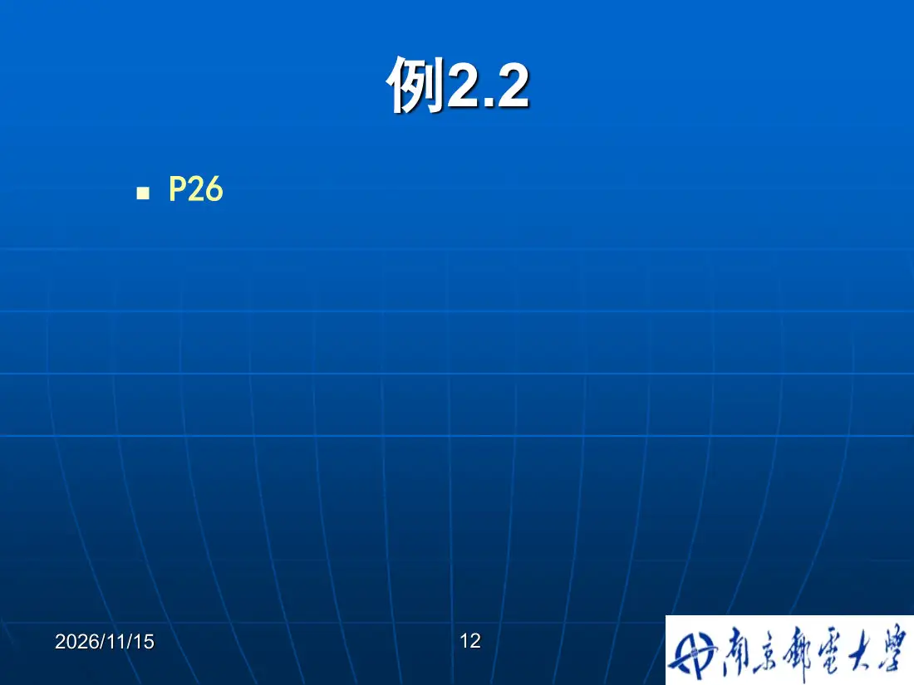

原文：

例2.2

### 字符的输入和输出getchar函数、putchar函数

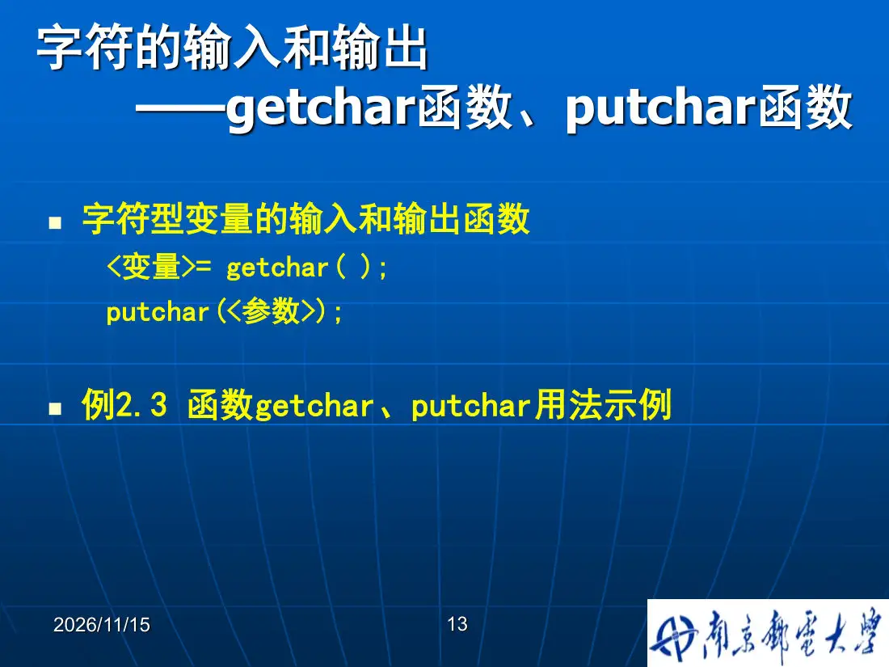

原文：

字符的输入和输出getchar函数、putchar函数

字符型变量的输入和输出函数

<变量>= getchar( );

putchar(<参数>);

◼ 例2.3 函数getchar、putchar用法示例

2026/11/15

13

今南京郵電大学

### 用const修饰符限定变量

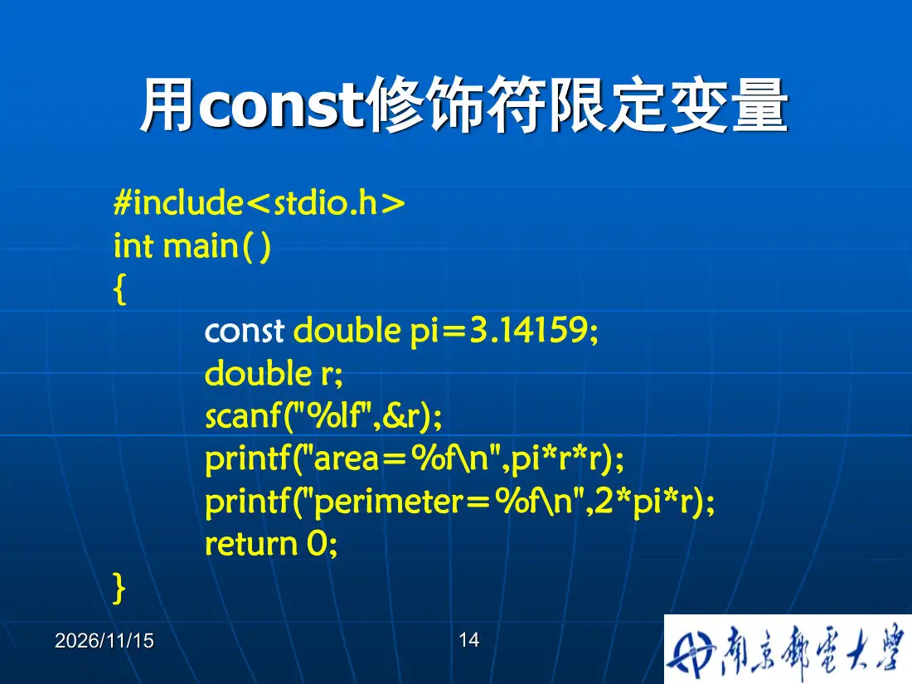

原文：

用const修饰符限定变量

include<stdio.h> int main( )

const double pi=3.14159; double r; scanf("%lf",&r); printf("area=%f\n",pi\*r\*r); printf("perimeter=%f\n",2\*pi\*r); return 0;

2026/11/15

14

彤南京郵電大学

### The end of chapter 2

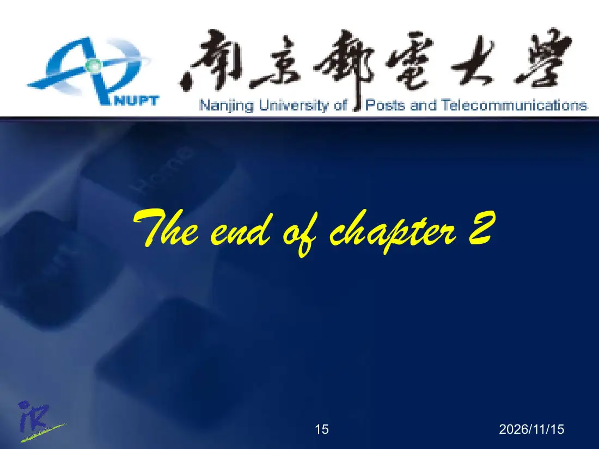

原文：

The end of chapter 2

之南京郵電大学 Nanjing University of Posts and Telecommunications

iR

15

2026/11/15
