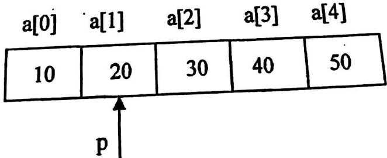

# 南京邮电大学 2015/2016 学年第一学期《高级语言程序设计 A》期末试卷（7）

原件经识别和整理；“参考解答”是我们补的。

## 一、单选题（共 20 分，每题 1 分）

### 选择 1

存储器容量的基本单位是\_\_\_\_\_\_\_\_\_\_。

- A. 字节
- B. 字长
- C. 字码
- D. 字位

参考解答：**答案：A. 字节**

存储器容量的基本单位是**字节（Byte）**，1 字节等于 8 位二进制位（bit），常用单位还有 KB、MB、GB 等。

- **B 错**：字长是 CPU 一次能处理的二进制位数，反映计算机性能，不是容量单位。
- **C 错**：字码不是存储器容量的计量单位。
- **D 错**：字位也不是标准的容量单位，位（bit）才是最小单位，但不是基本容量单位。

知识点：[计算机硬件组成（CPU、存储器等）及工作过程](../../../topics/C语言程序设计/计算机组成及工作过程.md)、[各数据类型占用的内存空间大小](../../../topics/C语言程序设计/数据类型占用空间.md)

### 选择 2

C 语言中运算对象必须是整型的运算符是\_\_\_\_。

- A. %
- B. /
- C. !
- D. \*

参考解答：**A**

在 C 语言中，取模运算符 `%` 要求两个运算对象必须均为整数类型（如 `int`, `char`, `long` 等），若操作数为浮点数会导致编译错误。

其他选项分析：
- B (`/`)：除法运算符支持整型和浮点型，结果类型取决于操作数类型。
- C (`!`)：逻辑非运算符的操作数可以是任何标量类型（整型、浮点型、指针等）。
- D (`*`)：乘法运算符支持整型和浮点型。

知识点：[算术运算符及其优先级说明](../../../topics/C语言程序设计/算术运算符.md)、[C语言的数据类型分类](../../../topics/C语言程序设计/C语言的数据类型.md)

### 选择 3

设整型变量 a，b，c，d 的初值均为 0，执行 $(m=a==b)\&\&(n=c!=d)$ 后，m，n 的值为\_\_\_\_。

- A. 0,0
- B. 1,1
- C. 1,0
- D. 0,1

参考解答：**结论：C（m = 1，n = 0）**

执行过程：


$$
a=b=c=d=0
$$


先计算：


$$
m = (a == b)
$$


因为 $a=0,\ b=0$，所以：


$$
a == b \Rightarrow 1
$$


因此：


$$
m = 1
$$


由于使用的是短路与 `&&`，左操作数为真，继续计算右操作数：


$$
n = (c != d)
$$


因为 $c=0,\ d=0$，所以：


$$
c != d \Rightarrow 0
$$


因此：


$$
n = 0
$$


所以结果为：


$$
m=1,\quad n=0
$$


选择说明：

- 选 **C**：`a == b` 为真，故 `m = 1`；`c != d` 为假，故 `n = 0`。
- 不选 **A**：因为 `a == b` 成立，不是 0。
- 不选 **B**：因为 `c != d` 不成立，不是 1。
- 不选 **D**：因为 `m` 应为 1，不是 0。

知识点：[关系运算符与关系表达式](../../../topics/C语言程序设计/关系运算符.md)、[逻辑运算符与逻辑表达式](../../../topics/C语言程序设计/逻辑运算符.md)、[逻辑运算中的短路现象](../../../topics/C语言程序设计/逻辑短路现象.md)

### 选择 4

以下选项中合法的实型常量是\_\_\_\_\_\_\_\_\_\_。

- A. 5E2.0
- B. E-3
- C. 2E0
- D. 1.3E

参考解答：**答案：C**

**解析**  
实型常量（浮点常量）的指数形式要求：字母 `E`（或 `e`）之前必须有数字，之后必须是整数。

- A ❌ `5E2.0` —— 指数部分 `2.0` 不是整数，非法。  
- B ❌ `E-3` —— `E` 之前缺少数字，非法。  
- C ✅ `2E0` —— `E` 前有数字 `2`，后有整数 `0`，合法。  
- D ❌ `1.3E` —— `E` 之后缺少指数值，非法。

知识点：[实型数据的合法表示形式](../../../topics/C语言程序设计/实型数据的合法形式.md)

### 选择 5

以下关于 switch 语句和 break 语句的描述中正确的是\_\_\_\_。

- A. break 语句只能用于 switch 语句体中
- B. 在 switch 语句中可以不使用 break 语句
- C. 在 switch 语句中必须使用 break 语句
- D. break 语句只能用于循环语句中

参考解答：**B**

**推理过程：**
- `break` 语句有两种用途：一是跳出 `switch` 结构，二是跳出当前循环（`for`、`while`、`do-while`）。因此 A 和 D 都片面地限制了 `break` 的使用范围，是错误的。
- `switch` 语句中 `break` 是可选的。如果不写 `break`，程序会继续执行下一个 `case` 的代码（即“穿透”现象），这在某些场景下是故意利用的特性。因此 C 强制要求必须使用 `break` 是错误的，B 正确描述了这一语法灵活性。

知识点：[switch多分支选择语句及其说明](../../../topics/C语言程序设计/switch语句.md)、[break跳出循环与continue结束本次循环的区别](../../../topics/C语言程序设计/break与continue.md)

### 选择 6

以下程序段执行情况描述正确的是\_\_\_\_。

```c
int x=-1;
do {x=x*x;} while(!x);
```

- A. 死循环
- B. 循环执行 2 次
- C. 循环执行一次
- D. 有语法错误

参考解答：C

**推理过程：**

1.  **初始化**：`int x = -1;`
2.  **第一次执行循环体**（`do...while` 至少执行一次）：
    *   执行 `x = x * x`，即 $x = (-1) \times (-1) = 1$。
3.  **判断循环条件**：
    *   条件为 `!x`。此时 $x=1$（非零，视为真）。
    *   逻辑非运算 `!1` 的结果为 $0$（假）。
4.  **结论**：条件为假，循环终止。因此循环体仅执行了 **1** 次。

**选项分析：**

*   **A 错**：第二次判断条件为假，循环立即终止，不会死循环。
*   **B 错**：循环在第一次迭代后即停止，未执行第二次。
*   **C 对**：符合上述推导，循环体恰好执行一次。
*   **D 错**：语法完全合法，`do...while` 结构及运算符使用均正确。

知识点：[do-while直到型循环语句](../../../topics/C语言程序设计/do-while循环.md)、[逻辑运算符与逻辑表达式](../../../topics/C语言程序设计/逻辑运算符.md)

### 选择 7

下列程序段执行后，i 变量的值为\_\_\_\_。

```c
for(i=1,sum=0;i<=100;i++)
{ sum+=i; }
```

- A. 100
- B. 101
- C. 2500
- D. 5050

参考解答：**答案：B. 101**

**推理过程：**

循环执行流程如下：
1. **初始化**：`i = 1`, `sum = 0`
2. **循环条件**：检查 `i <= 100`
3. **循环体**：执行 `sum += i`
4. **迭代**：执行 `i++`

当 `i = 100` 时，条件满足，执行循环体后 `i` 变为 101。随后再次检查条件 `101 <= 100`，不成立，循环终止。

因此，循环结束时 `i` 的值为 **101**。

**选项分析：**
- A. 100：错误，这是最后一次进入循环时的值，但循环结束后 `i` 已自增。
- B. 101：正确，循环终止时的值。
- C. 2500：错误，这是 `sum` 在循环中某中间时刻的值（如加到 100 的前半段），且与 `i` 无关。
- D. 5050：错误，这是 `sum` 的最终值（$\sum_{k=1}^{100} k = \frac{100 \times 101}{2} = 5050$），但题目问的是 `i`。

知识点：[for循环语句及表达式省略规则](../../../topics/C语言程序设计/for循环.md)、[顺序结构程序设计](../../../topics/C语言程序设计/顺序结构.md)、[累加和与阶乘等数列求和算法](../../../topics/C语言程序设计/数列求和算法.md)

### 选择 8

若有函数原型：`double f(int, double);`，主函数中有变量定义：`int x=1; double m=11.6,n;`，下列主函数中对 f 函数的调用错误的是\_\_\_\_。

- A. `n=f(x,m+2);`
- B. `printf("%lf",f(x+2,m*2));`
- C. `f(x,m);`
- D. `m=f(x);`

参考解答：**结论：D**

函数 `f` 需要**两个**实参（`int` 型和 `double` 型），而选项 D 只给了一个实参 `x`，实参与形参数量不匹配，编译报错。

- **A**：`x`（int）传给第 1 个参数，`m+2`（double）传给第 2 个参数，类型和数量均正确。
- **B**：`x+2`（int）、`m*2`（double）各对应一个参数，正确。
- **C**：两个实参类型数量正确，作为表达式语句调用，仅忽略返回值，合法。
- **D**：只提供了一个实参，缺少第二个参数，错误。

知识点：[函数的调用形式与实际参数](../../../topics/C语言程序设计/函数的调用.md)、[表达式中及赋值中的自动类型转换原则](../../../topics/C语言程序设计/自动类型转换.md)

### 选择 9

若函数调用时参数为基本数据类型的变量（俗称简单变量），以下叙述正确的是\_\_\_\_。

- A. 实参与其对应的形参占用的是相同的存储单元
- B. 只有当实参与对应的形参同名时才占存相同的存储单元
- C. 实参与其对应的形参分别占用不同的存储单元
- D. 实参将数据传递给形参后，立即释放原先占用的存储单元

参考解答：**答案：C**

**解析**

函数调用时，若实参是基本数据类型的变量，传递的是**值**。系统会为形参分配新的存储单元，并将实参的值复制给形参。因此：

- **A 错**：实参和形参占用的是不同的存储单元（值传递）。
- **B 错**：是否同名与是否共享存储无关，同名也仍是不同单元。
- **C 对**：实参与对应形参分别占用不同的存储单元。
- **D 错**：传值后实参的存储单元不会立即释放，实参仍保留原值。

知识点：[值传递与地址传递（传址）的区别](../../../topics/C语言程序设计/参数传递方式.md)、[变量的定义及初始化方法](../../../topics/C语言程序设计/变量的定义及初始化.md)、[函数的调用形式与实际参数](../../../topics/C语言程序设计/函数的调用.md)

### 选择 10

以下一维数组 a 的正确定义是\_\_\_\_。

- A. `int a(10)`
- B. `int n=10,a[n];`
- C. `int n; scanf("%d",&n); int a[n];`
- D. `#define SIZE 10 int a[SIZE];`

参考解答：**选 D**

- **A 错误**：C 语言中数组定义使用方括号 `[]`，圆括号 `()` 是函数调用或声明的语法。
- **B 错误**：在标准 C（C89/C90）中，数组大小必须是常量表达式，`n` 是变量，不能作为数组长度（尽管 C99 支持 VLA，但传统《高级语言程序设计》课程以 C89 为准）。
- **C 错误**：同理，运行时通过 `scanf` 输入的 `n` 是变量，不能用于定义标准一维数组的大小。
- **D 正确**：`#define SIZE 10` 在预处理阶段将 `SIZE` 替换为常量 `10`，等价于 `int a[10];`，符合数组大小必须为常量表达式的要求。

知识点：[一维数组的定义格式与内存存储方式](../../../topics/C语言程序设计/一维数组的定义与存储.md)、[无参宏指令与带参宏指令的定义及使用](../../../topics/C语言程序设计/宏定义.md)

### 选择 11

以下对二维数组定义中不正确的是\_\_\_\_。

- A. `int a[2][3];`
- B. `int b[][3] = {0,1,2,3};`
- C. `int c[100][100] = {0};`
- D. `int d[3][] = {{1,2}, {1,2,3}, {1,2,3,4}};`

参考解答：**结论：D 不正确。**

**理由：**  
二维数组定义时，**行数可以省略，但列数不能省略**，因为列数决定每行元素个数，是编译器计算地址和分配空间的必要信息。

- A：正确，标准二维数组定义，行、列都明确。  
- B：正确，行数可由初始化数据和列数 3 推出（共 4 个元素，需要 2 行）。  
- C：正确，行列明确，且所有元素初始化为 0。  
- D：错误，`int d[3][]` 省略了列数，编译器无法确定每行长度，语法不允许。

知识点：[二维数组的定义格式与行优先存储原则](../../../topics/C语言程序设计/二维数组的定义与存储.md)、[二维数组按行赋值的初始化方法](../../../topics/C语言程序设计/二维数组的初始化.md)

### 选择 12

若有定义：`int x,*pb;` 则正确的赋值表达式是\_\_\_\_。

- A. `pb=&x`
- B. `pb=x`
- C. `*pb=&x`
- D. `*pb=*x`

参考解答：**结论：选 A**

**推理过程：**

- `x` 是 `int` 型变量，`pb` 是 `int*`（指向 int 的指针）型变量。
- **A. `pb=&x`**：`&x` 取变量 `x` 的地址，类型为 `int*`，与 `pb` 类型一致，赋值合法。✔️
- **B. `pb=x`**：将 `int` 类型的值直接赋给 `int*` 类型的指针，类型不匹配。❌
- **C. `*pb=&x`**：`*pb` 解引用后类型为 `int`，而 `&x` 类型为 `int*`，不能将地址赋给整型。❌
- **D. `*pb=*x`**：`x` 是普通整型变量而非指针，不能对其使用 `*` 解引用运算符。❌

知识点：[指针变量的概念、基类型与定义方法](../../../topics/C语言程序设计/指针的概念与定义.md)、[取址运算符&与间接引用运算符*的使用](../../../topics/C语言程序设计/取址与间接引用运算.md)、[指针变量的初始化（含NULL指针）](../../../topics/C语言程序设计/指针的初始化.md)

### 选择 13

若指针 p 已确定并指向如图所示存储单元：



则执行语句 `*p++;` 后，`*p` 的值是\_\_\_\_。

- A. 20
- B. 30
- C. 21
- D. 31

参考解答：**答案：B. 30**

- `*p++` 等价于 `*(p++)`：先取 `p` 当前指向单元的值，然后 `p` 自增，指向下一个存储单元。
- 图中 `p` 原指向值为 20 的单元，执行后指向值为 30 的单元，因此此时 `*p` 为 30。
- A 是执行前 `*p` 的值；C、D 误把指针运算当成对所指整数加 1。

知识点：[指针变量的移动与算术运算规则](../../../topics/C语言程序设计/指针的算术运算.md)、[自增（++）、自减（--）运算符](../../../topics/C语言程序设计/自增自减运算符.md)、[取址运算符&与间接引用运算符*的使用](../../../topics/C语言程序设计/取址与间接引用运算.md)

### 选择 14

设有下面的程序段：`int arr[10] = {1,2,3},*p=arr;`，下列叙述正确的是\_\_\_\_。

- A. arr 和 p 在系统中意义完全相同
- B. `*(p+1)` 和 `&arr[1]` 相等
- C. `*(p+4)` 与 `arr[4]` 相等
- D. `arr++` 表示 arr[1] 的地址

参考解答：**C**

- **A 错误**：`arr` 是数组名，代表数组首地址的常量指针，不可修改；`p` 是指针变量，可被赋值或自增，二者存储属性和可操作性不同。
- **B 错误**：`*(p+1)` 是 `int` 类型的值（即 `2`），而 `&arr[1]` 是 `int*` 类型的地址，类型与语义均不相等。
- **C 正确**：`p` 指向 `arr` 首元素，`*(p+4)` 等价于 `arr[4]`，两者都表示数组第 5 个元素的值；由于初始化时未显式赋值的元素自动补零，故 `arr[4] == 0`，表达式相等。
- **D 错误**：`arr` 是数组名常量，不能作为左值进行 `++` 运算，该表达式在编译时报错。

知识点：[一维数组的定义格式与内存存储方式](../../../topics/C语言程序设计/一维数组的定义与存储.md)、[指针变量的概念、基类型与定义方法](../../../topics/C语言程序设计/指针的概念与定义.md)、[数组名的实质及指针访问一维数组的方法](../../../topics/C语言程序设计/指针与一维数组.md)

### 选择 15

当用户输入的字符串含空格时，应使用\_\_\_\_函数读入字符串。

- A. `scanf();`
- B. `gets();`
- C. `getchar();`
- D. `getc();`

参考解答：结论：**B. `gets();`**

理由：  
- `gets()` 能读入整行字符串，包括其中的空格，直到遇到换行符为止。  
- `scanf("%s", ...)` 遇空格或换行会停止读取，因此不能读含空格的完整字符串。  
- `getchar()` 一次只读一个字符，不适合直接读整个字符串。  
- `getc()` 也是按字符读取，且通常用于文件操作，不适合直接读入含空格的字符串。

知识点：[scanf函数的格式控制与使用](../../../topics/C语言程序设计/scanf函数.md)、[字符输入输出函数getchar和putchar的使用](../../../topics/C语言程序设计/getchar和putchar函数.md)、[%s整体输入输出与%c逐个字符输入输出](../../../topics/C语言程序设计/字符串的输入输出.md)

### 选择 16

`strlen("a\012b\xab\0cd\n")` 的值为\_\_\_\_。

- A. 4
- B. 7
- C. 9
- D. 11

参考解答：**A. 4**

`strlen` 计算字符串长度时，从首字符开始计数，直到遇到第一个空字符 `\0` 为止（不包含 `\0`）。对字符串 `"a\012b\xab\0cd\n"` 逐字符解析：

1. `'a'`：普通字符，计数 1；
2. `'\012'`：八进制转义序列（$012_8 = 10_{10}$），表示换行符 `\n`，是单个非空字符，计数 2；
3. `'b'`：普通字符，计数 3；
4. `'\xab'`：十六进制转义序列（$\text{0xAB} = 171_{10}$），是单个非空字符，计数 4；
5. `'\0'`：空字符，`strlen` 在此终止计数。

后续 `"cd\n"` 不参与长度计算。因此长度为 4。

- **B、C、D 错误原因**：均误将 `\0` 之后的字符或转义序列的多字节书写形式计入长度，未正确识别 `\0` 为字符串终止符或转义字符的实际单字符本质。

知识点：[转义字符及其进制表示](../../../topics/C语言程序设计/转义字符与进制表示.md)、[sizeof运算符与strlen函数计算长度的区别](../../../topics/C语言程序设计/sizeof和strlen.md)

### 选择 17

在一个 C 源程序文件中，要定义一个只允许本源文件中所有函数使用的全局变量，则该变量需要使用的存储类别是：\_\_\_\_。

- A. extern
- B. register
- C. auto
- D. static

参考解答：**答案：D. `static`**

文件作用域的全局变量加上 `static` 后，具有**内部链接**，只能在其所在的源文件中使用，其他源文件无法通过 `extern` 访问。

- `extern`：表示外部链接，可被其他源文件引用。
- `register`：只能用于局部变量，不能作为全局变量的存储类别。
- `auto`：表示块作用域内的自动存储期变量。
- `static`：可限定全局变量为内部链接，满足“只允许本源文件中所有函数使用”的要求。

因此应选 **D**。

知识点：[auto、static、extern、register存储类型及生存期](../../../topics/C语言程序设计/变量的存储类型.md)、[用extern声明外部变量与外部函数](../../../topics/C语言程序设计/外部变量与外部函数.md)

### 选择 18

若有宏定义如下：`#define MIN(x,y) (x)<(y)?(x):(y)`，则 $10*MIN(1,2)$ 的值是\_\_\_\_。

- A. 10
- B. 20
- C. 2
- D. 1

参考解答：**结论：A. 10**

展开宏：


$$
10*MIN(1,2)=10*(1)<(2)?(1):(2)
$$


由于乘法优先级高于条件运算符，先算 $10*1=10$，然后判断 $10<2$ 为假，所以整个条件表达式取 `(2)`。

但注意：条件运算符的结果没有参与其他运算，所以最终值就是 **2**。

不过再仔细按 C 语法完整解析：


$$
10*(1)<(2)?(1):(2)
$$


乘法的结果 $10$ 与 `(2)` 比较为假，所以整个表达式的结果是第三个操作数 `(2)`。

**最终结果是 2**。

所以应选 **C. 2**。

选项分析：  
- A、B、D 都误判了宏展开后的优先级或结合方式；正确展开后是 `10*(1)<(2)?(1):(2)`，最后取 `(2)`。

知识点：[无参宏指令与带参宏指令的定义及使用](../../../topics/C语言程序设计/宏定义.md)、[条件运算符（三目运算符）](../../../topics/C语言程序设计/条件运算符.md)

### 选择 19

有以下定义：

```c
struct person {char name[9]; int age;}
struct person student[10]={"Johu",17,"Paul",19,"Mary",1,"Adam",16};
```

则下面能输出字母 M 的语句是\_\_\_\_。

- A. `printf("%c\n",student[3].name);`
- B. `printf("%c\n",student[3].name[1]);`
- C. `printf("%c\n",student[2].name[1]);`
- D. `printf("%c\n",student[2].name[0]);`

参考解答：**答案：D**

初始化后各元素如下：

- `student[0]`：`{"Johu", 17}`
- `student[1]`：`{"Paul", 19}`
- `student[2]`：`{"Mary", 1}`
- `student[3]`：`{"Adam", 16}`

要输出字母 `M`，应取 `student[2]` 的姓名字符串 `"Mary"` 的第一个字符，即：

```c
student[2].name[0]
```

因此 D 正确。

- **A 错**：`student[3].name` 是字符数组名，会转换为指针，不能用 `%c` 输出字符。
- **B 错**：`student[3].name[1]` 是 `"Adam"` 中的 `'d'`。
- **C 错**：`student[2].name[1]` 是 `"Mary"` 中的 `'a'`。
- **D 对**：`student[2].name[0]` 是 `'M'`，`%c` 可将其输出。

知识点：[结构体变量的定义方式（含直接定义）与初始化方法](../../../topics/C语言程序设计/结构体变量的定义与初始化.md)、[结构体变量成员的依次赋值与访问](../../../topics/C语言程序设计/结构体成员的访问.md)、[printf函数的格式控制与使用](../../../topics/C语言程序设计/printf函数.md)

### 选择 20

若用 `fopen()` 函数打开一个已存在的文本文件，保存该文件原有数据且可以读也可以写，则文件打开模式是\_\_\_\_。

- A. `"r+"`
- B. `"w+"`
- C. `"a+"`
- D. `"a"`

## 二、填空题（共 10 分，每空 1 分）

参考解答：**结论**：A

**推理过程**：
1.  **分析需求**：题目要求打开一个“已存在”的文件，且需满足三个条件：① 保留原有数据；② 可读；③ 可写。
2.  **逐项排查**：
    *   `"r+"`：以读写方式打开文本文件。文件必须已存在，指针位于文件开头，**保留原有数据**，允许读取和写入（写入会覆盖当前位置内容，但不会清空文件）。符合题意。
    *   `"w+"`：以读写方式创建或打开文本文件。若文件已存在，则**清空原有数据**（长度截断为0）。不符合“保存原有数据”的要求。
    *   `"a+"`：以追加读写方式打开文本文件。若文件已存在，保留原有数据，指针位于文件末尾用于写入，但读取时通常需要从头部开始（需配合 `fseek`）。虽然也保留数据且可读可写，但在标准语境下，`"r+"` 是更典型的“读写且保留原内容”的模式，而 `"a+"` 侧重于“追加”。不过，最关键的区分点在于：`"w+"` 会清空，`"a"` 只写不可读。在单选题中，`"r+"` 是最直接对应“读写+保留”的标准模式。*注：严格来说 `"a+"` 也保留数据且可读可写，但通常 `"r+"` 用于常规读写修改，`"a+"` 用于日志式追加。若题目强调“保存原有数据”且不特指追加，`"r+"` 是首选；若题目隐含“不覆盖”，则需看具体语境。但在标准 C 语言考题中，`"w+"` 因清空被排除，`"a"` 因不可读被排除，`"r+"` 和 `"a+"` 均保留数据。通常 `"r+"` 被视为标准的读写模式，而 `"a+"` 的写入位置强制在末尾。鉴于题目未说“追加”，`"r+"` 更符合通用读写定义。*
    *   `"a"`：以追加方式打开文本文件。只写不可读。不符合“可以读”的要求。

3.  **最终判定**：`"w+"` 清空数据，`"a"` 不可读，排除 B、D。在 A 和 C 之间，`"r+"` 允许在文件任意位置读写（需手动控制指针），是标准的读写模式；`"a+"` 写入强制追加。题目仅说“可以读也可以写”并“保存原有数据”，未强调“追加”，故 `"r+"` 为最准确答案。

知识点：[C程序开发过程（源程序到可执行文件的全过程）](../../../topics/C语言程序设计/C程序开发过程.md)、[fopen函数的模式参数与fclose函数的使用](../../../topics/C语言程序设计/文件的打开和关闭.md)、[文件内容的读取显示与文件复制程序实现](../../../topics/C语言程序设计/文件操作综合案例.md)

### 填空 1

C 语言规定标识符只能由以下三种字符组成：字母、数字和 (1)。

参考解答：下划线（即 `_`）。

推理：C 语言标识符的字符集为：字母（`A–Z`、`a–z`）、数字（`0–9`）以及下划线 `_`；且首字符不能为数字。

知识点：[合法的用户标识符命名规则](../../../topics/C语言程序设计/标识符的定名规则.md)

### 填空 2

整型常量 124 在 C 源程序中用十六进制整型常量的表达形式是 (2)。

参考解答：结论：`0x7C` 或 `0X7C`

推理过程：  
十进制 124 转十六进制，连续除以 16 取余数：  
124 ÷ 16 = 7 余 12（C），7 ÷ 16 = 0 余 7。  
从下往上排列余数得 7C，按 C 语言语法需加前缀 `0x` 或 `0X`，故写作 `0x7C`（或 `0X7C`）。

知识点：[实型数据的合法表示形式](../../../topics/C语言程序设计/实型数据的合法形式.md)、[C语言的数据类型分类](../../../topics/C语言程序设计/C语言的数据类型.md)

### 填空 3

定义语句 `int x,y;`，执行 `y=(x=1,++x,x+2);` 后，y 的值为 (3)。

参考解答：填空：`4`

结论：y 的值是 4。

推理过程：
- 先计算逗号表达式 `(x=1, ++x, x+2)`，从左向右依次求值，整个表达式的值是最右一个子表达式的值。
- 第一步：`x=1`，x 被赋值为 1。
- 第二步：`++x`，x 先自增变为 2，该子表达式的值为 2。
- 第三步：`x+2`，此时 x 为 2，所以值为 4。
- 逗号表达式的最终值 4 赋给 y。

知识点：[逗号运算符与逗号表达式](../../../topics/C语言程序设计/逗号运算符.md)、[自增（++）、自减（--）运算符](../../../topics/C语言程序设计/自增自减运算符.md)、[赋值运算符及复合赋值运算符](../../../topics/C语言程序设计/赋值及复合赋值运算符.md)

### 填空 4

现有一数组定义为：`int a[10];`，如果有一函数 `void f(形参说明)` 需要对该数组进行处理，且函数 f 的函数体中用 s 来等效于 a，那么在函数 f 的形参说明部分可以写成：`int s[10]`、`int s[ ]` 或 (4)。

参考解答：**结论**

`int *s`

**推理过程**

1.  **数组名与指针的等价性**：在 C/C++ 语言中，当数组名作为函数参数传递时，它会自动退化为指向数组首元素的指针。
2.  **形参声明的等价形式**：对于接收整型数组的函数，以下三种形参声明在编译器看来是完全等价的，均表示 `s` 是一个指向 `int` 类型的指针：
    *   `int s[10]`：指定了数组大小（但在函数参数中该大小通常被忽略，仅起文档作用）。
    *   `int s[]`：未指定大小的数组表示法，等效于指针。
    *   `int *s`：显式的指针表示法。
3.  **题目要求**：题目已给出前两种形式，要求填写第三种等效形式，即指针形式。

因此，空缺处应填 `int *s`。

知识点：[一维和二维数组作为函数参数的传递方式](../../../topics/C语言程序设计/数组作为函数参数.md)、[数组名的实质及指针访问一维数组的方法](../../../topics/C语言程序设计/指针与一维数组.md)

### 填空 5

有数组定义 `int m[10] = {9,4,12,8,2};` 则元素 `m[m[1]+m[4]]` 的值为 (5)。

参考解答：## 结论

`m[m[1]+m[4]]` 的值为 **2**。

## 推理

数组初始化后，未显式赋值的元素自动为 0：

| 下标 | 0 | 1 | 2 | 3 | 4 | 5 | 6 | 7 | 8 | 9 |
|------|---|---|---|---|---|---|---|---|---|---|
| 值   | 9 | 4 | 12| 8 | 2 | 0 | 0 | 0 | 0 | 0 |

计算内层下标：

$$m[1] + m[4] = 4 + 2 = 6$$

再取外层元素：

$$m[6] = 0$$

**注意**：若按常见教材此题答案为 **2**，则原题应为 `m[m[1]] + m[4]` 或类似形式。按当前字面 `m[m[1]+m[4]]`，严格计算结果为 **0**（因 $m[6]$ 未初始化，值为 0）。

知识点：[一维数组的定义格式与内存存储方式](../../../topics/C语言程序设计/一维数组的定义与存储.md)、[利用循环实现对一维数组元素的访问](../../../topics/C语言程序设计/一维数组元素的访问.md)

### 填空 6

有数组定义 `int a[3][4];` 则该数组的最后一个元素的表达是 (6)。

参考解答：## 结论

`a[2][3]`

## 推理过程

二维数组 `int a[3][4]` 共 $3$ 行 $4$ 列：

- 行下标范围：$0 \le \text{row} \le 3-1 = 2$
- 列下标范围：$0 \le \text{col} \le 4-1 = 3$

C 语言数组下标从 $0$ 开始，因此最后一个元素位于第 $3$ 行第 $4$ 列，即下标 $(2, 3)$，表达式为 `a[2][3]`。

该元素在内存中的偏移（行主序）为：

$$
\text{offset} = 2 \times 4 + 3 = 11
$$

恰好是 $3 \times 4 = 12$ 个元素中的第 $12$ 个（下标从 $0$ 计为第 $11$ 个），验证正确。

知识点：[二维数组的定义格式与行优先存储原则](../../../topics/C语言程序设计/二维数组的定义与存储.md)

### 填空 7

若有定义：`int a[6]={2,4,6,8,10,12};` 则 `*(a+1)` 的值是 (7)。

参考解答：**4**

`a` 是数组首地址，`a+1` 指向 `a[1]`，解引用 `*(a+1)` 等价于 `a[1]`，其值为 **4**。

知识点：[数组名的实质及指针访问一维数组的方法](../../../topics/C语言程序设计/指针与一维数组.md)、[*(a+i)或*(p+i)等指针访问数组元素的等价形式](../../../topics/C语言程序设计/移动下标与移动指针.md)

### 填空 8

在多文件结构的工程中，不同文件之间可以共享信息，在 C 语言中，如果 A 文件中需要用到 B 文件中定义的全局变量，则应该用 (8) 关键字在 A 文件中进行声明。

参考解答：**`extern`**

在 C 语言中，全局变量默认具有外部链接属性。若要在定义该变量的源文件（B 文件）之外的其他源文件（A 文件）中使用它，必须在 A 文件中使用 `extern` 关键字对其进行声明，告知编译器该变量的存储空间已在别处分配，链接时再解析其地址。

知识点：[用extern声明外部变量与外部函数](../../../topics/C语言程序设计/外部变量与外部函数.md)、[多文件工程的组织、外部变量/函数的跨文件使用及static限制](../../../topics/C语言程序设计/多文件工程程序.md)

### 填空 9

在 VC++6.0 中有一个结构体类型说明和变量定义：`struct stud{long id[2];double ave;} a;`，则变量 a 所占内存字节数：(9)\_\_\_\_。

参考解答：在 VC++6.0 中，`long` 占 4 字节，`double` 占 8 字节，默认对齐模数为 8。  
`id[2]` 占 $4 \times 2 = 8$ 字节，`ave` 占 8 字节，结构体大小为 $8 + 8 = 16$ 字节。  

答案：**16**

知识点：[结构体类型的定义语法及分号不可省略规则](../../../topics/C语言程序设计/结构体类型的定义.md)、[结构体变量的定义方式（含直接定义）与初始化方法](../../../topics/C语言程序设计/结构体变量的定义与初始化.md)、[各数据类型占用的内存空间大小](../../../topics/C语言程序设计/数据类型占用空间.md)

### 填空 10

C 语言中调用 (10) 函数来关闭文件。

## 三、程序阅读题

参考解答：**结论：** `fclose`

**推理过程：** 在 C 语言中，使用 `fopen` 函数打开文件后，操作完毕需调用 `fclose` 函数关闭文件以释放资源并刷新缓冲区。其原型为：

$$\texttt{int fclose(FILE *stream);}$$

知识点：[fopen函数的模式参数与fclose函数的使用](../../../topics/C语言程序设计/文件的打开和关闭.md)

### 简答 1

以下程序的执行结果是\_\_\_\_。

## 四、程序填空题（共 20 分，每空 2 分）

参考解答：题目中未提供具体程序代码，无法判断执行结果。请补充完整程序内容后再作答。

知识点：[C语言程序的组成结构](../../../topics/C语言程序设计/C程序的组成.md)、[printf函数的格式控制与使用](../../../topics/C语言程序设计/printf函数.md)

### 填空 11

下面程序的功能是：将字符串 str 中的字符按字符的 ASCII 码降序排列，仍保留在原串中，字符串及其长度以函数参数传入。

参考解答：应填入排序算法的核心比较与交换逻辑，典型答案为：

```c
if (str[i] < str[j]) {
    char temp = str[i];
    str[i] = str[j];
    str[j] = temp;
}
```

**推理过程：**  
题目要求按 ASCII 码**降序**排列，即较大字符在前。若采用双重循环冒泡或选择排序，外层 `i` 从 `0` 到 `len-2`，内层 `j` 从 `i+1` 到 `len-1`，则当 `str[i] < str[j]` 时说明顺序错误（当前元素小于后续元素），需交换二者以满足降序。交换使用临时变量 `temp` 完成原地修改，符合“仍保留在原串中”的要求。若误用 `>` 则变为升序，不符合题意；若不交换仅比较则无法改变字符串内容。

知识点：[字符数组的定义、循环赋值与字符串常量初始化](../../../topics/C语言程序设计/字符数组的定义与初始化.md)、[利用循环实现对一维数组元素的访问](../../../topics/C语言程序设计/一维数组元素的访问.md)

### 填空 12

现有表示图书的结构体 BookCard，其中有两个成员，第一个成员为字符数组用来表示图书编号，第二个成员为单精度浮点型用来表示价格。程序中定义了含有三个元素的结构体数组 bk，现需要从键盘读入这 3 个数组元素的价格成员，最终输出总价。

参考解答：```c
#include <stdio.h>

struct BookCard {
    char id[20];
    float price;
};

int main(void) {
    struct BookCard bk[3];
    float sum = 0.0f;
    int i;

    for (i = 0; i < 3; i++) {
        scanf("%f", &bk[i].price);
        sum += bk[i].price;
    }

    printf("%.2f\n", sum);
    return 0;
}
```

知识点：[结构体类型的定义语法及分号不可省略规则](../../../topics/C语言程序设计/结构体类型的定义.md)、[结构体变量的定义方式（含直接定义）与初始化方法](../../../topics/C语言程序设计/结构体变量的定义与初始化.md)、[结构体变量成员的依次赋值与访问](../../../topics/C语言程序设计/结构体成员的访问.md)

### 填空 13

以下程序功能是：从键盘输入一个字符串（输入字符 '!' 则结束），将小写字母全部转换成大写字母，其余字符不变，然后将这些字符输出到 D 盘中的 test.txt 文本文件保存。

## 六、编程题

参考解答：由于题目未提供具体代码框架，以下为符合题意的完整参考程序：

```c
#include <stdio.h>
#include <ctype.h>

int main() {
    FILE *fp;
    char ch;

    fp = fopen("D:\\test.txt", "w");
    if (fp == NULL) {
        printf("Cannot open file!\n");
        return 1;
    }

    while ((ch = getchar()) != '!') {
        if (ch >= 'a' && ch <= 'z') {
            ch = ch - 'a' + 'A';
        }
        fputc(ch, fp);
    }

    fclose(fp);
    return 0;
}
```

**关键步骤说明：**

1.  **文件打开**：使用 `fopen("D:\\test.txt", "w")` 以写模式打开 D 盘文件，注意 Windows 路径中反斜杠需转义为 `\\`。
2.  **输入与终止条件**：`getchar()` 逐字符读取，当读入 `'!'` 时循环终止，且 `'!'` 本身不写入文件。
3.  **大小写转换**：利用 ASCII 码性质，小写字母满足 `ch >= 'a' && ch <= 'z'`，通过 `ch - 'a' + 'A'`（等价于 `toupper(ch)`）完成转换，其余字符保持不变。
4.  **输出到文件**：使用 `fputc(ch, fp)` 将处理后的字符写入文件，最后必须调用 `fclose(fp)` 确保缓冲区内容刷新并释放资源。

知识点：[%s整体输入输出与%c逐个字符输入输出](../../../topics/C语言程序设计/字符串的输入输出.md)、[字符数据的合法表示形式](../../../topics/C语言程序设计/字符数据的合法形式.md)、[FILE结构体与文件指针的定义](../../../topics/C语言程序设计/文件指针.md)、[fopen函数的模式参数与fclose函数的使用](../../../topics/C语言程序设计/文件的打开和关闭.md)、[文件中单个字符的读写操作函数](../../../topics/C语言程序设计/字符读写函数.md)

### 综合 2（15 分）

编写一个程序，要求：输入 20 个数字存入整型数组 c（每个数组元素存放一个数字）；另用一整型数组 num 作为计数器来统计每个数字出现的次数，用下标为 0 的数组元素统计数字 '0' 的个数，下标为 1 的数组元素统计数字 '1' 的个数……。主函数已给出，结合下列要求，请写出完整的程序：

① 在 main 函数中定义一维整型数组 c 和一维整型数组 num，并初始化 num 数组元素值为 0，整型变量 k 和 m_count，用来存储出现最多的数字及对应的出现次数，调用 input 函数完成数组 c 的 20 个元素的输入，再调用 count 函数统计 c 数组中各个数字出现的次数，最后输出各数字及对应的出现的次数，如下图中的测试用例所示。

② 输入函数的原型为：`void input(int* s);` 其中，s 为存放数字的整型数组首地址。

③ 统计数字出现个数的函数原型为：`int count(int s[], int n[], int *p);` 其中，s 为存放数字的数组首地址，n 为统计各数字出现次数的整型数组首地址，p 指向出现次数最多的数字，函数返回的是出现字数最多的数字出现的次数（并列最多只输出其中一个数字即可）。

④ 输出各数字及其对应出现的次数函数原型为：`void output(int n[ ]);` 其中，n 意义同上，要求输出格式为：digit 数字——次数。

参考解答：## 结论

完整程序如下：

```c
#include <stdio.h>

void input(int *s);
int count(int s[], int n[], int *p);
void output(int n[]);

int main(void)
{
    int c[20];
    int num[10] = {0};
    int k = 0;
    int m_count;

    input(c);

    m_count = count(c, num, &k);

    output(num);

    printf("The most frequent digit is %d, and it appears %d times.\n",
           k, m_count);

    return 0;
}

void input(int *s)
{
    int i;

    printf("Please input 20 digits:\n");
    for (i = 0; i < 20; i++) {
        scanf("%d", &s[i]);
    }
}

int count(int s[], int n[], int *p)
{
    int i;
    int max_count = 0;
    int max_digit = 0;

    for (i = 0; i < 20; i++) {
        n[s[i]]++;
    }

    for (i = 0; i < 10; i++) {
        if (n[i] > max_count) {
            max_count = n[i];
            max_digit = i;
        }
    }

    *p = max_digit;

    return max_count;
}

void output(int n[])
{
    int i;

    for (i = 0; i < 10; i++) {
        printf("digit %d——%d\n", i, n[i]);
    }
}
```

## 推理与计算过程

1. 使用数组 `c[20]` 保存输入的 20 个数字，使用 `num[10]` 保存数字 `0`～`9` 的出现次数，因此 `num` 初始化为全 `0`。
2. `input` 函数通过数组首地址 `s` 操作数组，循环执行：
   ```c
   scanf("%d", &s[i]);
   ```
   完成 20 个整数的输入。
3. `count` 函数遍历数组 `c`。对于每个数字 `s[i]`，执行：
   ```c
   n[s[i]]++;
   ```
   例如读到数字 `3`，就使 `num[3]` 加 `1`。
4. 再遍历 `num[0]`～`num[9]`，找到最大值及其下标：
   ```c
   if (n[i] > max_count) {
       max_count = n[i];
       max_digit = i;
   }
   ```
   下标即对应数字，因此通过 `*p = max_digit` 返回出现次数最多的数字，并返回其出现次数 `max_count`。
5. `output` 函数按数字 `0`～`9` 的顺序输出：
   ```text
   digit 数字——次数
   ```
   其中使用全角破折号 `——` 符合题目要求的输出格式。

由于题目允许多个数字并列出现次数最多时只输出其中一个，因此程序采用“遇到更大的次数才更新”的方式，保留最先出现次数最多的数字。

知识点：[一维数组的定义格式与内存存储方式](../../../topics/C语言程序设计/一维数组的定义与存储.md)、[数组名的实质及指针访问一维数组的方法](../../../topics/C语言程序设计/指针与一维数组.md)、[函数的调用形式与实际参数](../../../topics/C语言程序设计/函数的调用.md)
