# 《高级语言程序设计》第10章 结构、联合、枚举（课件）

原件的每一页，下面附识别出的文字。

### 高级语言程序设计

原文：

高级语言程序设计

南京邮电大学计算机学院

计算机软件教学中心

### 高级语言程序设计

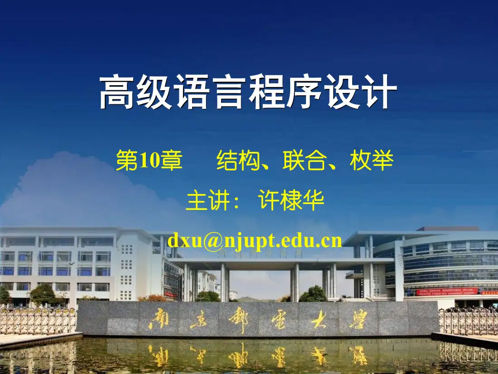

原文：

高级语言程序设计

第10章 结构、联合、枚举

主讲：许棣华

dxu@njupt.edu.cn

### \- 结构体的定义和使用

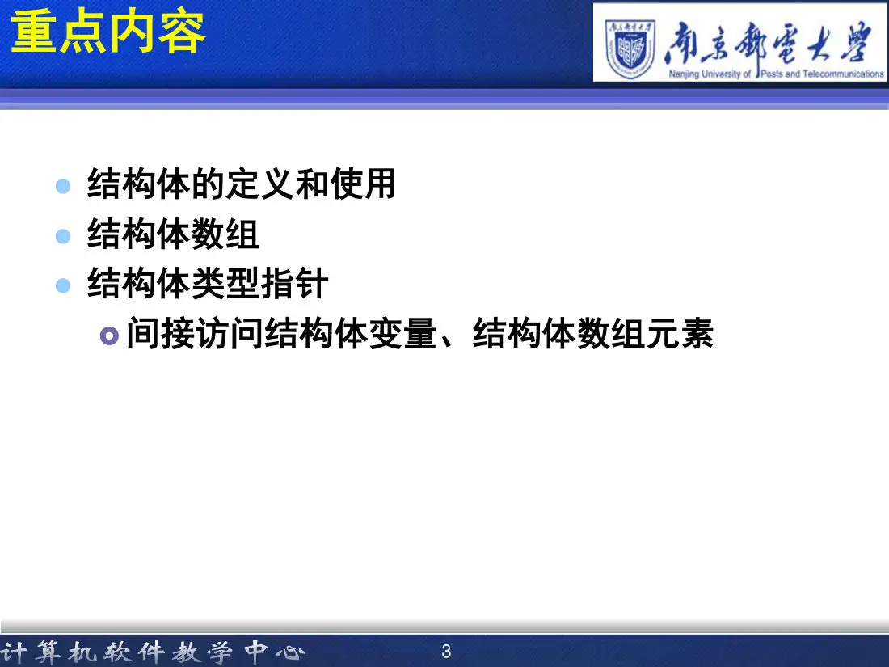

原文：

\- 结构体的定义和使用

\- 结构体数组

\- 结构体类型指针

\- 间接访问结构体变量、结构体数组元素- 编程时，在描述或者表征某个对象时，使用单一类型或者单一数据并不能清楚的描述出这个对象，需要同时使用多种数据，才能全面、准确的刻画对象特征。

重点内容

南京郵電大學
Nanjing University of Posts and Telecommunications

计算机软件教学中心

3

### 1004 Jean F 99

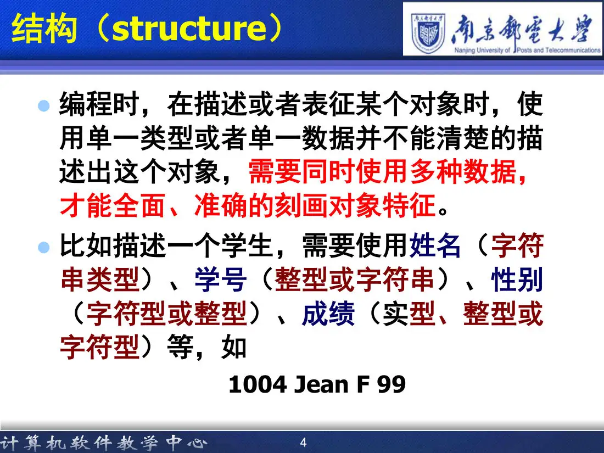

原文：

比如描述一个学生，需要使用姓名（字符串类型）、学号（整型或字符串）、性别（字符型或整型）、成绩（实型、整型或字符型）等，如

1004 Jean F 99

结构（structure）

南京郵電大學
Nanjing University of Posts and Telecommunications

计算机软件教学中心

4

### \- 对于这类数据，C语言提供了结构体机制来进行描述。

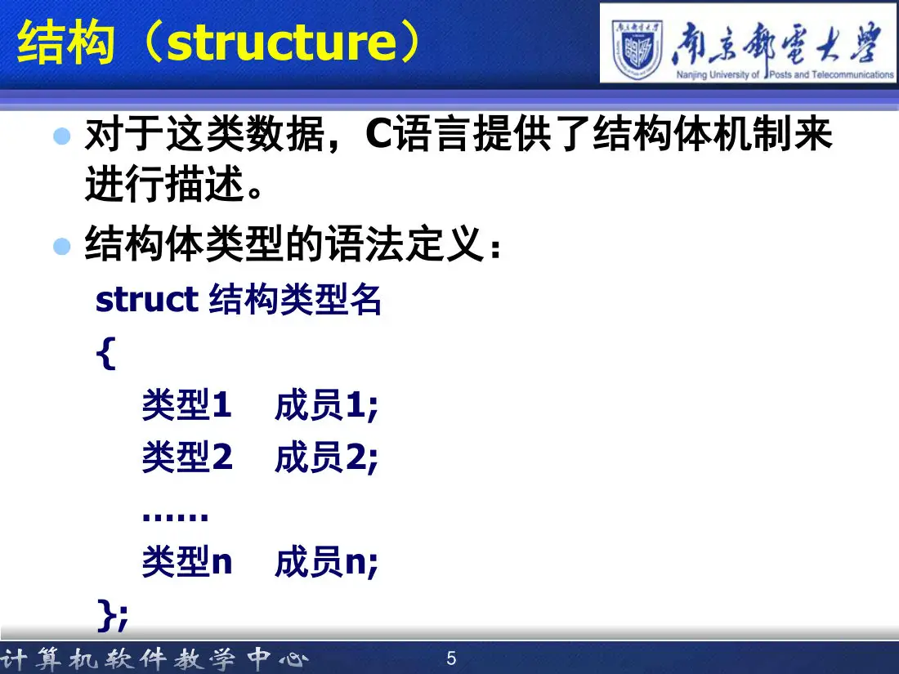

原文：

\- 对于这类数据，C语言提供了结构体机制来进行描述。

\- 结构体类型的语法定义：

struct 结构类型名

{

类型1 成员1;

类型2 成员2;

类型n 成员n;

结构（structure）

南京郵電大學
Nanjing University of Posts and Telecommunications

计算机软件教学中心

5

### \- 结构体类型定义之后的分号不能省略。

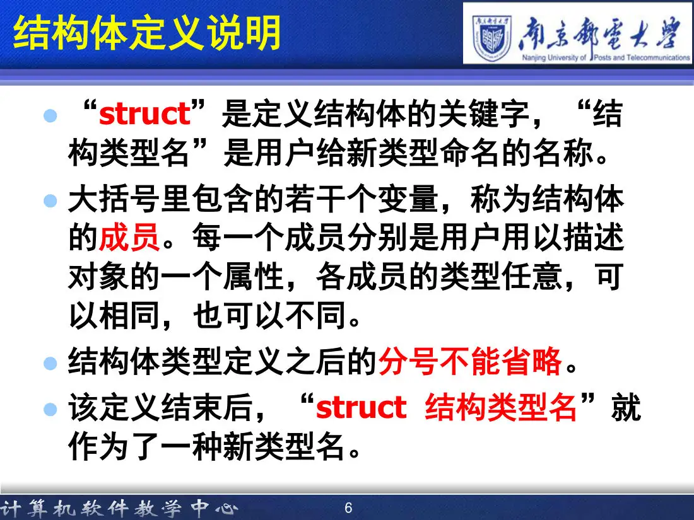

原文：

\- “struct”是定义结构体的关键字，“结构类型名”是用户给新类型命名的名称。

\- 大括号里包含的若干个变量，称为结构体的成员。每一个成员分别是用户用以描述对象的一个属性，各成员的类型任意，可以相同，也可以不同。

\- 结构体类型定义之后的分号不能省略。

\- 该定义结束后，“struct 结构类型名”就作为了一种新类型名。

结构体定义说明

南京郵電大學
Nanjing University of Posts and Telecommunications

计算机软件教学中心

6

### • 例10.1 日期类型的定义。

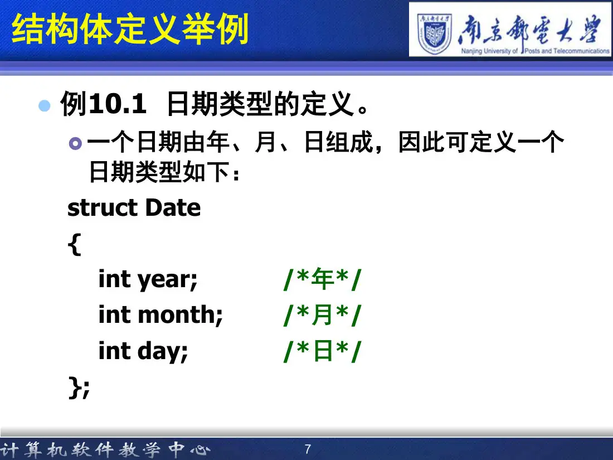

原文：

• 例10.1 日期类型的定义。

\- 一个日期由年、月、日组成，因此可定义一个日期类型如下：

struct Date

int year; /\*年\*/

int month; /\*月\*/

int day; /\*日\*/

结构体定义举例

南京郵電大學
Nanjing University of Posts and Telecommunications

计算机软件教学中心

7

### • 例10.2 学生类型的定义。

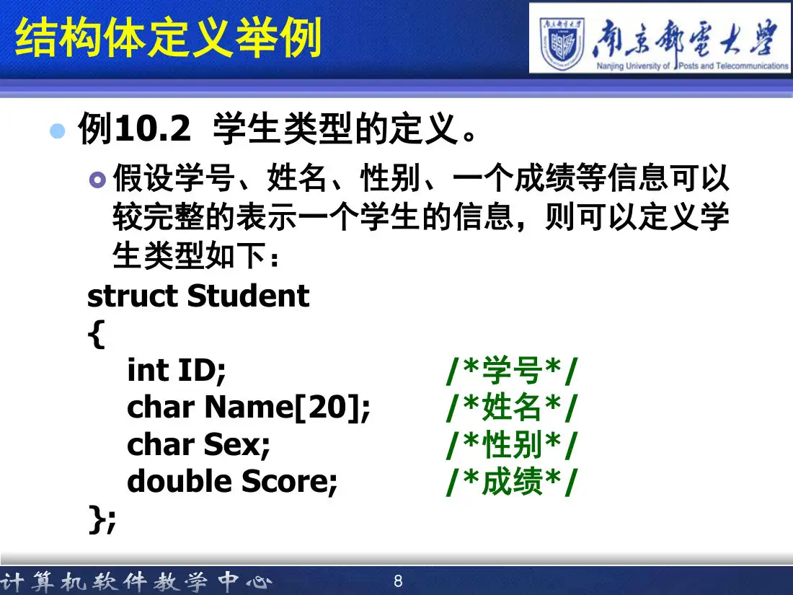

原文：

• 例10.2 学生类型的定义。

\- 假设学号、姓名、性别、一个成绩等信息可以较完整的表示一个学生的信息，则可以定义学生类型如下：

struct Student

int ID;    /\*学号\*/
char Name[20];    /\*姓名\*/
char Sex;    /\*性别\*/
double Score;    /\*成绩\*/
};

结构体定义举例

南京郵電大學
Nanjing University of Posts and Telecommunications

计算机软件教学中心

8

### \- 结构体类型中的成员可以是任何类型。

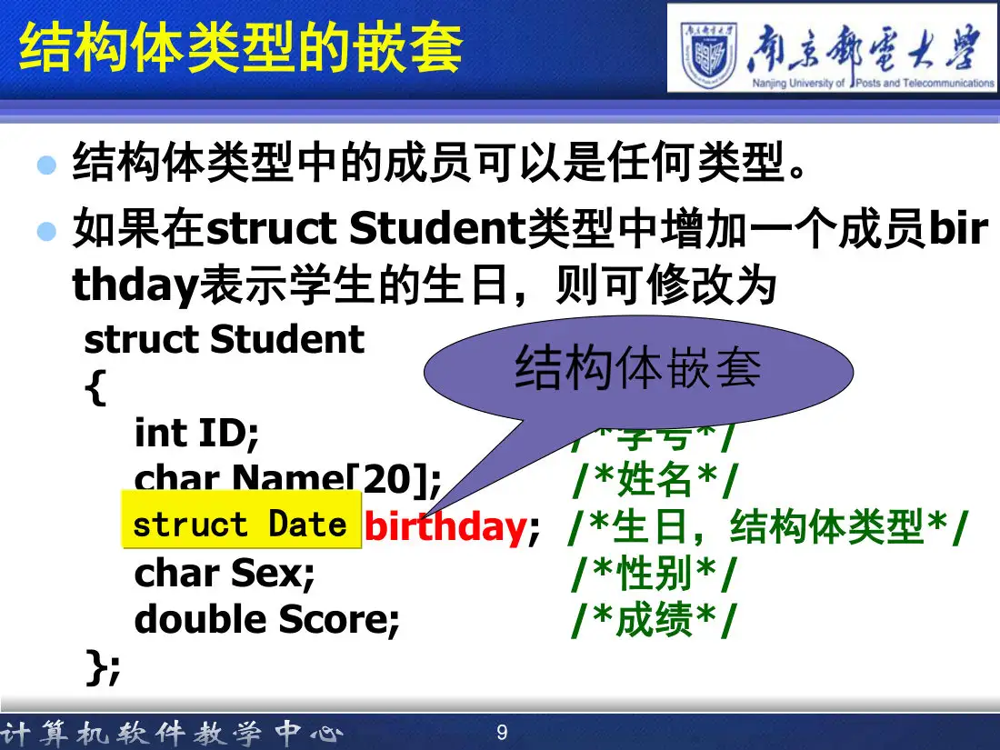

原文：

\- 结构体类型中的成员可以是任何类型。

\- 如果在struct Student类型中增加一个成员birthday表示学生的生日，则可修改为

struct Student
{

int ID;

结构体嵌套

char Name[20];

\*子亏\*/

/\*姓名\*/

struct Date birthday;

/\*生日，结构体类型\*/

char Sex;

double Score;

/\*性别\*/

/\*成绩\*/

结构体类型的嵌套

南京郵電大學
Nanjing University of Posts and Telecommunications

计算机软件教学中心

9

### - 用typedef为结构体起别名的方法

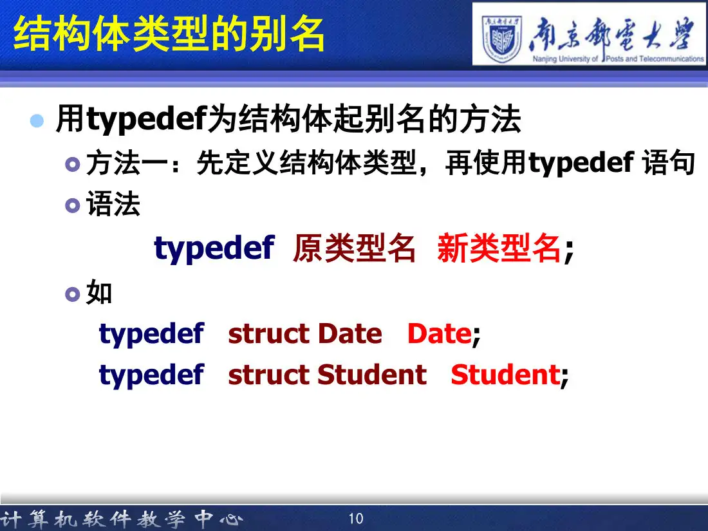

原文：

- 用typedef为结构体起别名的方法

\- 方法一：先定义结构体类型，再使用typedef语句

○语法

typedef 原类型名 新类型名;

如

typedef struct Date Date;

typedef struct Student Student;

结构体类型的别名

南京郵電大學
Nanjing University of Posts and Telecommunications

计算机软件教学中心

10

### \- 用typedef为结构体起别名的方法

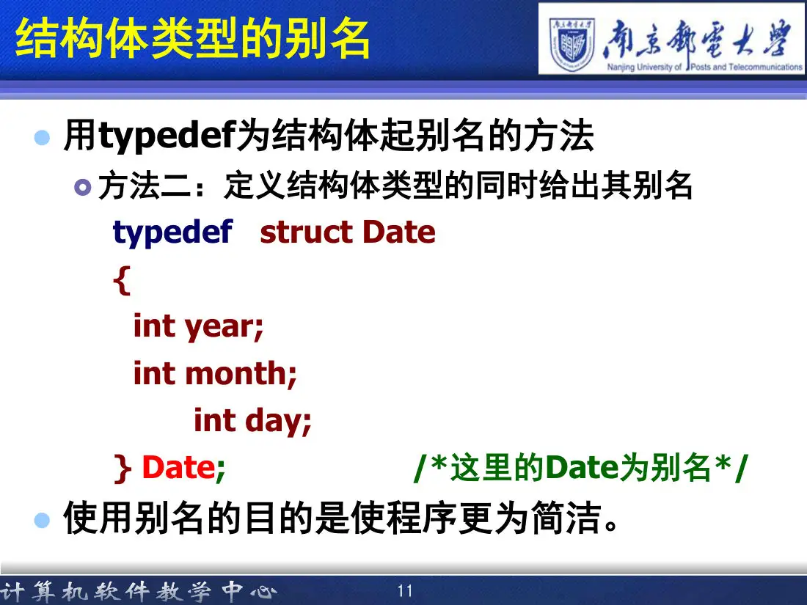

原文：

\- 用typedef为结构体起别名的方法

\- 方法二：定义结构体类型的同时给出其别名

typedef struct Date

int year;

int month;
int day;

} Date;

/\*这里的Date为别名\*/

\- 使用别名的目的是使程序更为简洁。

结构体类型的别名

南京郵電大學
Nanjing University of Posts and Telecommunications

计算机软件教学中心

11

### \- 结构体变量的定义：

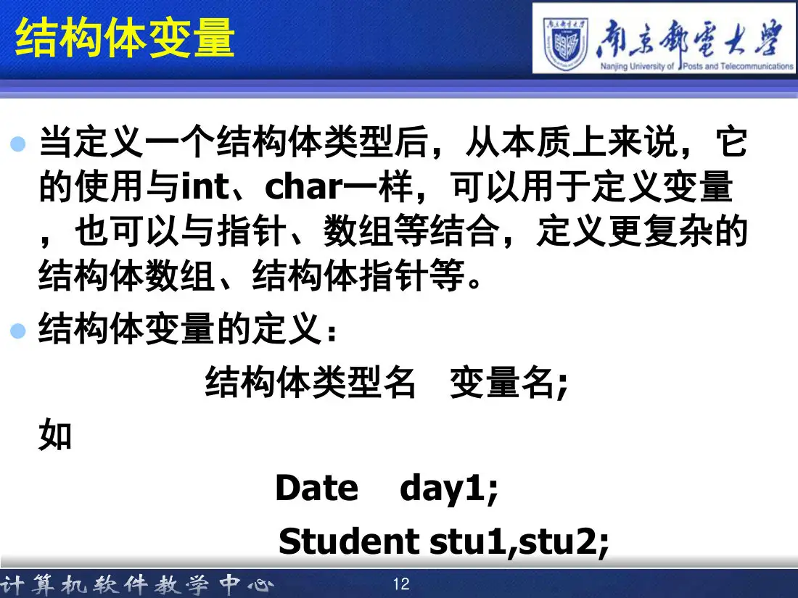

原文：

\- 当定义一个结构体类型后，从本质上来说，它的使用与int、char一样，可以用于定义变量，也可以与指针、数组等结合，定义更复杂的结构体数组、结构体指针等。

\- 结构体变量的定义：

结构体类型名 变量名;

如

Date day1;
Student stu1,stu2;

结构体变量

南京郵電大學
Nanjing University of Posts and Telecommunications

计算机软件教学中心

12

### \- 可以在定义结构体的同时定义变量：

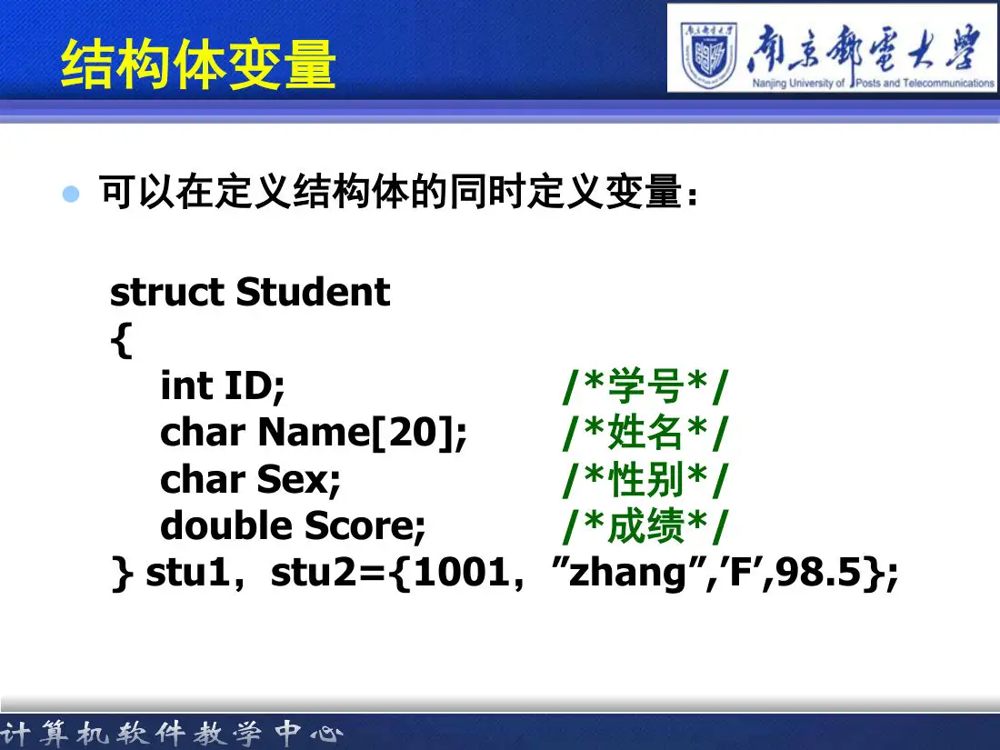

原文：

\- 可以在定义结构体的同时定义变量：

} stu1, stu2={1001, "zhang", 'F', 98.5};

结构体变量

南京郵電大學
Nanjing University of Posts and Telecommunications

计算机软件教学中心

### - 直接定义变量是，可以省略结构体名字

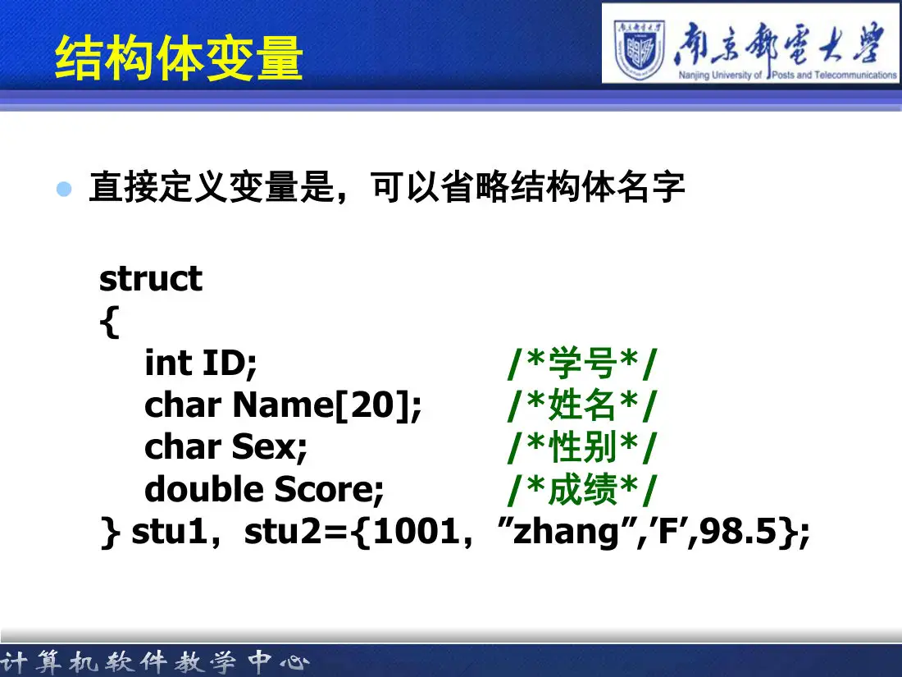

原文：

- 直接定义变量是，可以省略结构体名字

<table><tr><td>struct</td><td></td></tr><tr><td>{</td><td></td></tr><tr><td>int ID;</td><td>/*学号*/</td></tr><tr><td>char Name[20];</td><td>/*姓名*/</td></tr><tr><td>char Sex;</td><td>/*性别*/</td></tr><tr><td>double Score;</td><td>/*成绩*/</td></tr><tr><td colspan="2">} stu1, stu2={1001, &quot;zhang&quot;, &#x27;F&#x27;,98.5};</td></tr></table>

结构体变量

南京郵電大學
Nanjing University of Posts and Telecommunications

计算机软件教学中心

### \- Date是一个类型，不占有内存空间。day1作为一个变量则需要占有内存。

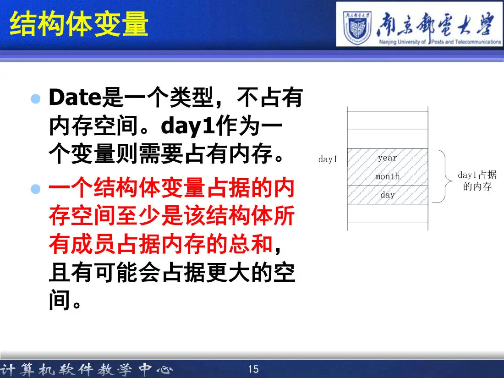

原文：

\- Date是一个类型，不占有内存空间。day1作为一个变量则需要占有内存。

\- 一个结构体变量占据的内存空间至少是该结构体所有成员占据内存的总和，且有可能会占据更大的空间。

结构体变量

南京郵電大學
Nanjing University of Posts and Telecommunications

计算机软件教学中心

15

### (1)定义的时候直接初始化，如：

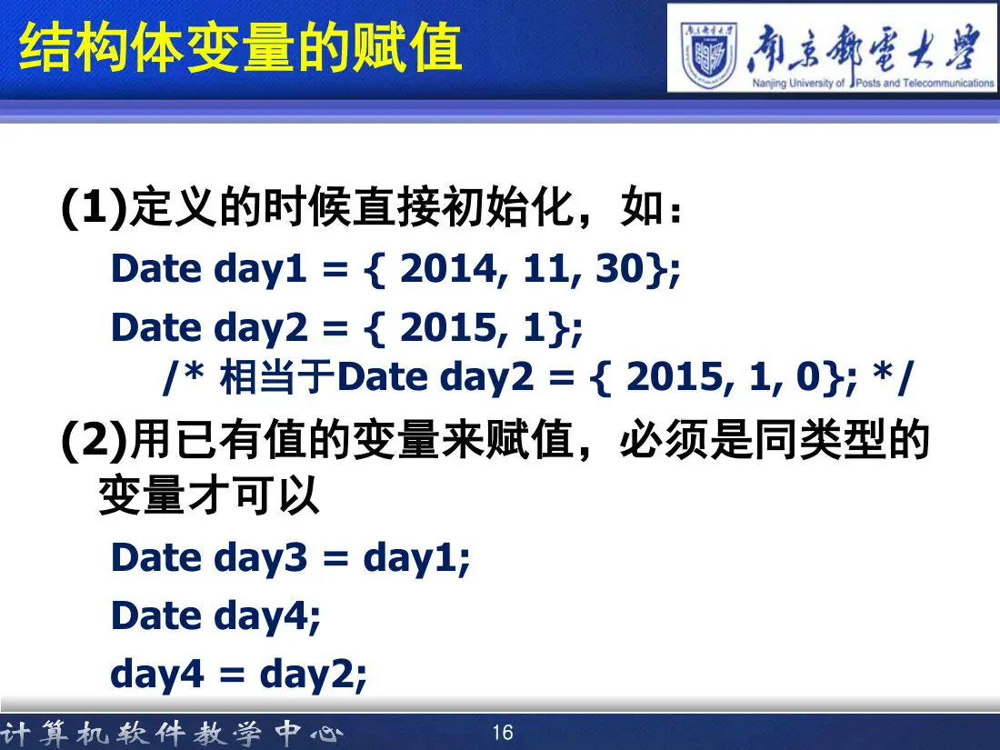

原文：

(1)定义的时候直接初始化，如：

Date day1 = { 2014, 11, 30};

Date day2 = { 2015, 1};

/\* 相当于Date day2 = { 2015, 1, 0}; \*/

(2)用已有值的变量来赋值，必须是同类型的变量才可以

Date day3 = day1;

Date day4;

day4 = day2;

结构体变量的赋值

南京郵電大學
Nanjing University of Posts and Telecommunications

计算机软件教学中心

16

### (3)给每个成员依次赋值

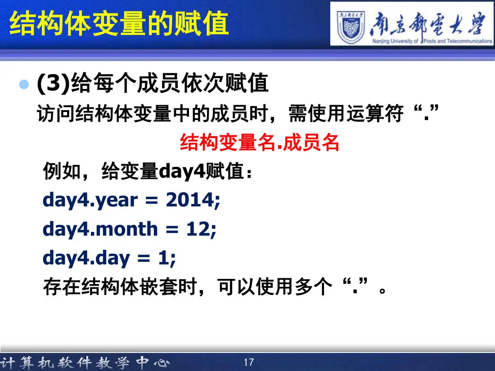

原文：

(3)给每个成员依次赋值

访问结构体变量中的成员时，需使用运算符“.”

结构变量名.成员名

例如，给变量day4赋值：

day4.year = 2014;

day4.month = 12;

day4.day = 1;

存在结构体嵌套时，可以使用多个“.”。

结构体变量的赋值

南京郵電大學
Nanjing University of Posts and Telecommunications

计算机软件教学中心

17

### • 例10.3代码见课本。

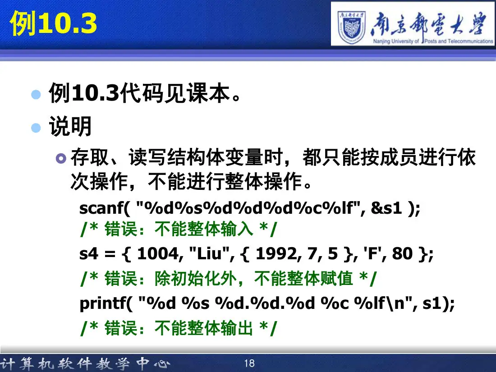

原文：

• 例10.3代码见课本。

说明

\- 存取、读写结构体变量时，都只能按成员进行依次操作，不能进行整体操作。

/\* 错误：不能整体输入 \*/

/\* 错误：除初始化外，不能整体赋值 \*/

/\* 错误：不能整体输出 \*/

例10.3

南京郵電大學
Nanjing University of Posts and Telecommunications

计算机软件教学中心

18

### 说明

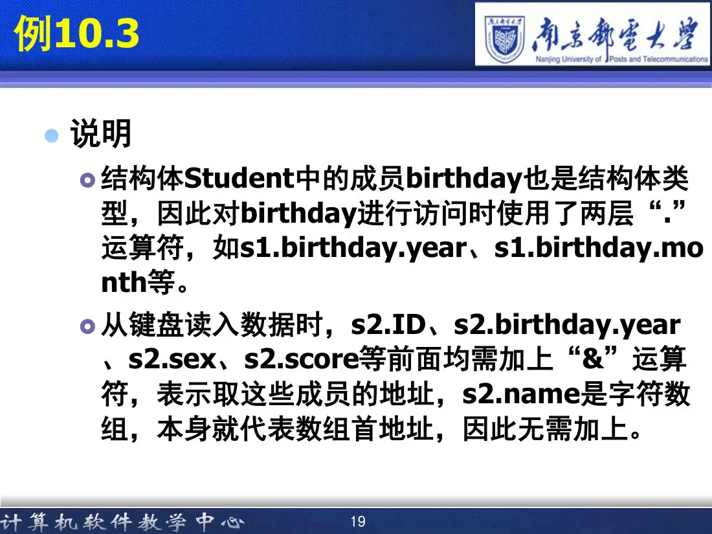

原文：

说明

\- 结构体Student中的成员birthday也是结构体类型，因此对birthday进行访问时使用了两层“.”运算符，如s1.birthday.year、s1.birthday.month等。

从键盘读入数据时，s2.ID、s2.birthday.year、s2.sex、s2.score等前面均需加上“&”运算符，表示取这些成员的地址，s2.name是字符数组，本身就代表数组首地址，因此无需加上。

例10.3

南京郵電大學
Nanjing University of Posts and Telecommunications

计算机软件教学中心

19

### 习题

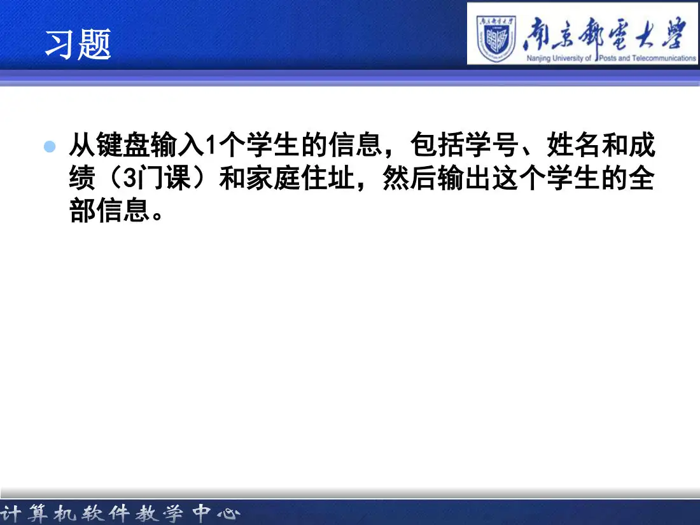

原文：

从键盘输入1个学生的信息，包括学号、姓名和成绩（3门课）和家庭住址，然后输出这个学生的全部信息。

习题

南京郵電大學
Nanjing University of Posts and Telecommunications

计算机软件教学中心

### 南京郵電大學

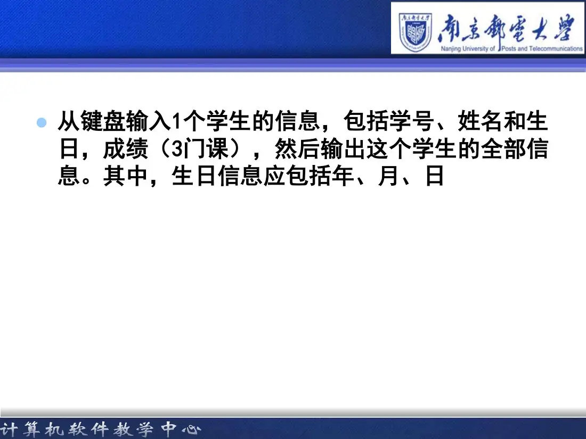

原文：

从键盘输入1个学生的信息，包括学号、姓名和生日，成绩（3门课），然后输出这个学生的全部信息。其中，生日信息应包括年、月、日

南京郵電大學
Nanjing University of Posts and Telecommunications

计算机软件教学中心

### \- 结构体指针就是指基类型为结构体的指针，其定义方式如下：

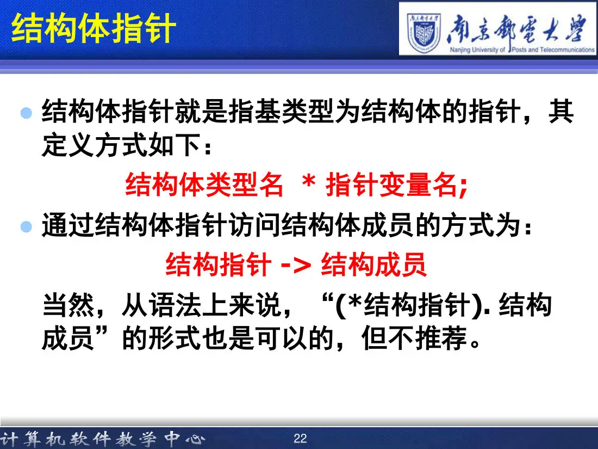

原文：

\- 结构体指针就是指基类型为结构体的指针，其定义方式如下：

结构体类型名 \* 指针变量名;

\- 通过结构体指针访问结构体成员的方式为：

结构指针 -> 结构成员

当然，从语法上来说，“(\*结构指针). 结构成员”的形式也是可以的，但不推荐。

结构体指针

南京郵電大學
Nanjing University of Posts and Telecommunications

计算机软件教学中心

22

### 例10.4主要代码

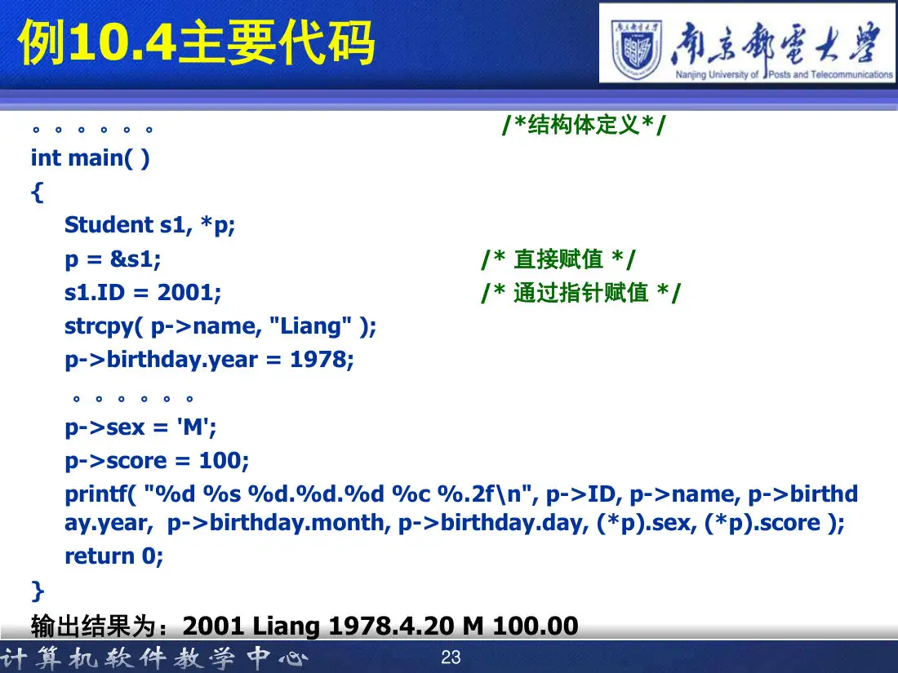

原文：

例10.4主要代码

南京郵電大學
Nanjing University of Posts and Telecommunications

计算机软件教学中心

23

### \- 结构体数组就是元素类型为结构体的数组，其定义方式如下：

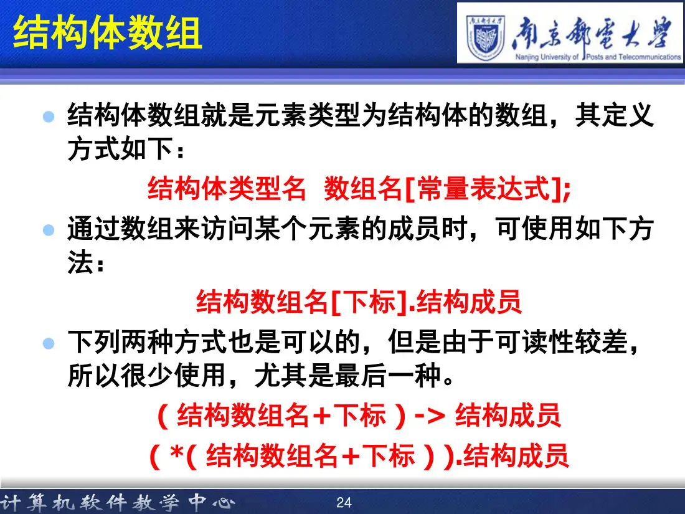

原文：

\- 结构体数组就是元素类型为结构体的数组，其定义方式如下：

结构体类型名 数组名[常量表达式];

\- 通过数组来访问某个元素的成员时，可使用如下方法：

结构数组名[下标].结构成员

\- 下列两种方式也是可以的，但是由于可读性较差，所以很少使用，尤其是最后一种。

(结构数组名+下标) -> 结构成员

(\*(结构数组名+下标)).结构成员

结构体数组

南京郵電大學
Nanjing University of Posts and Telecommunications

计算机软件教学中心

24

### 例10.5主要代码

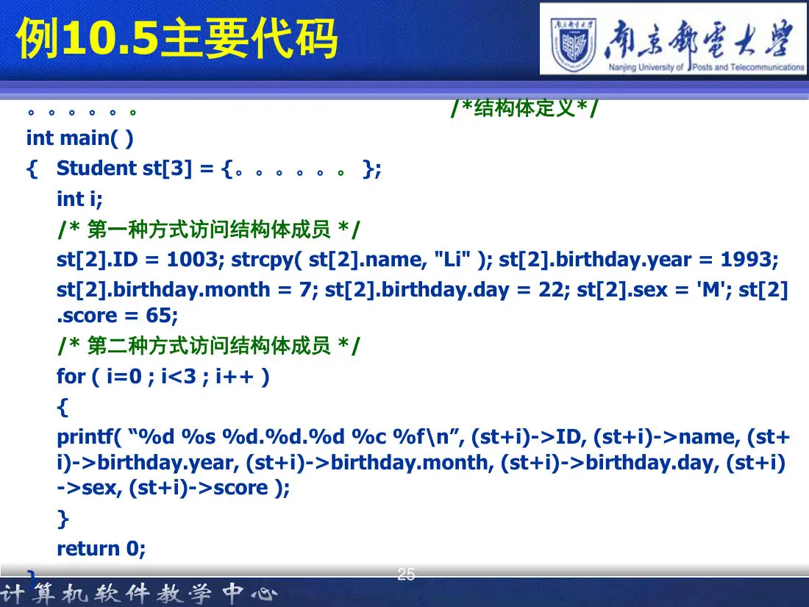

原文：

例10.5主要代码

南京郵電大學
Nanjing University of Posts and Telecommunications

计算机软件教学中心

25

### 说明

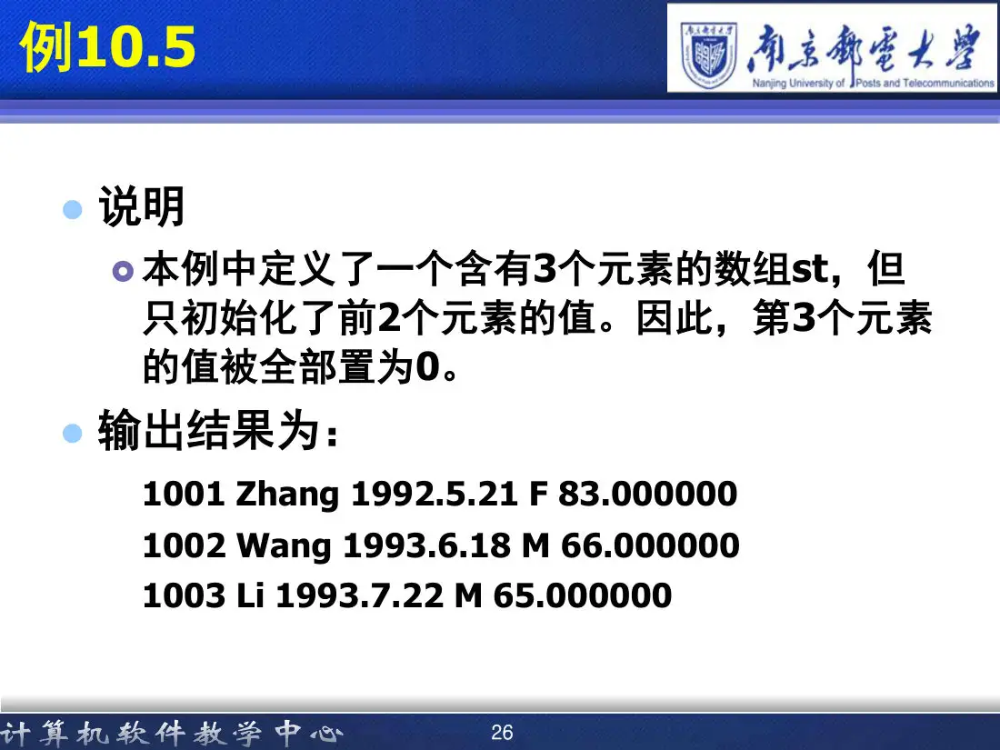

原文：

说明

\- 本例中定义了一个含有3个元素的数组st，但只初始化了前2个元素的值。因此，第3个元素的值被全部置为0。

- 输出结果为:

1001 Zhang 1992.5.21 F 83.000000
1002 Wang 1993.6.18 M 66.000000
1003 Li 1993.7.22 M 65.000000

例10.5

南京郵電大學
Nanjing University of Posts and Telecommunications

计算机软件教学中心

26

### \- 如果在该题中定义一个结构体指针p，即

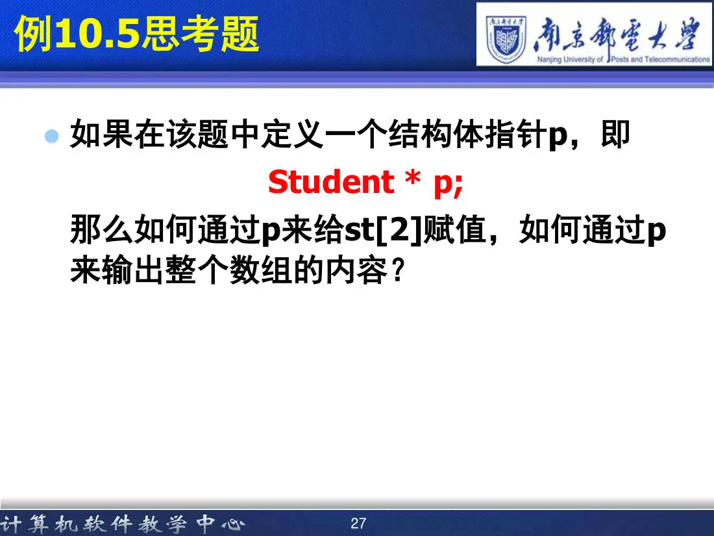

原文：

\- 如果在该题中定义一个结构体指针p，即

Student \* p;

那么如何通过p来给st[2]赋值，如何通过p来输出整个数组的内容？

例10.5思考题

南京郵電大學
Nanjing University of Posts and Telecommunications

计算机软件教学中心

27

### 结构体应用

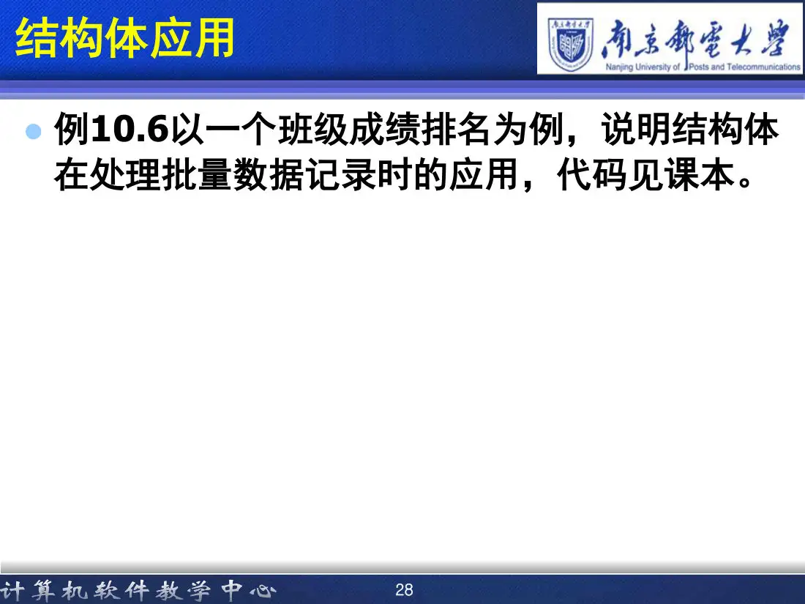

原文：

\- 例10.6以一个班级成绩排名为例，说明结构体在处理批量数据记录时的应用，代码见课本。

结构体应用

南京郵電大學
Nanjing University of Posts and Telecommunications

计算机软件教学中心

28

### 从键盘输入10个学生的信息，包括学号、姓名和成绩，要求输出成绩最高者的全部信息。

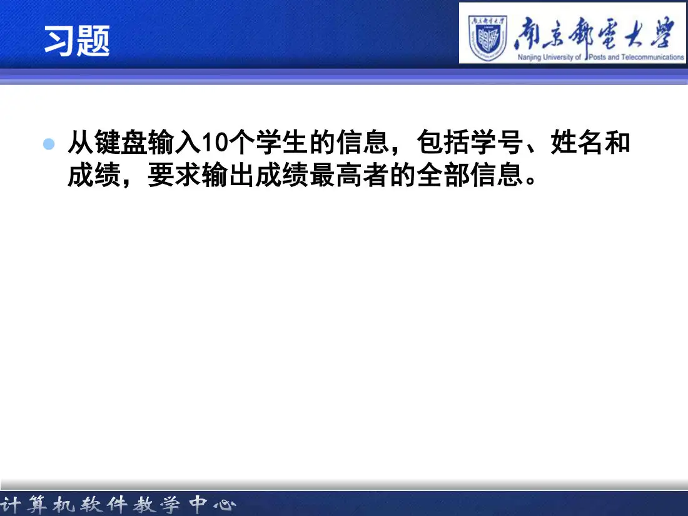

原文：

从键盘输入10个学生的信息，包括学号、姓名和成绩，要求输出成绩最高者的全部信息。

习题

南京郵電大學
Nanjing University of Posts and Telecommunications

计算机软件教学中心

### 输入理想的程序

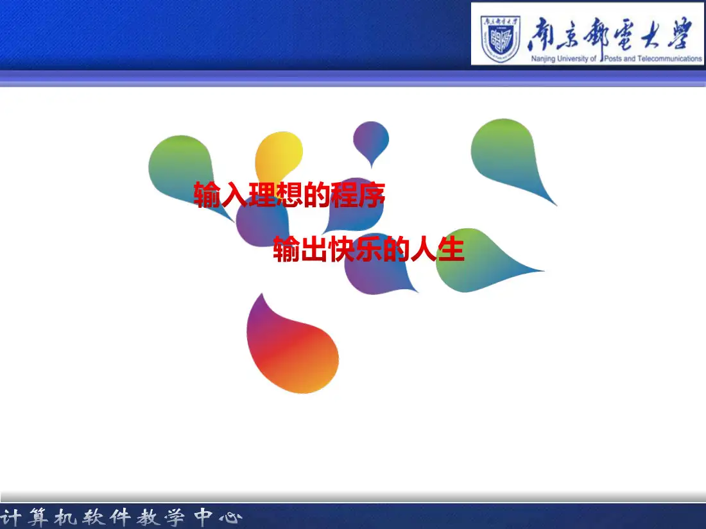

原文：

输入理想的程序

输出快乐的人生

南京郵電大學
Nanjing University of Posts and Telecommunications

计算机软件教学中心
