# 《高级语言程序设计》第11章 文件读写（课件）

原件的每一页，下面附识别出的文字。

### 高级语言程序设计

原文：

高级语言程序设计

南京邮电大学计算机学院

计算机软件教学中心

### 高级语言程序设计

原文：

高级语言程序设计

第11章 文件读写

### \- 文件与文件指针

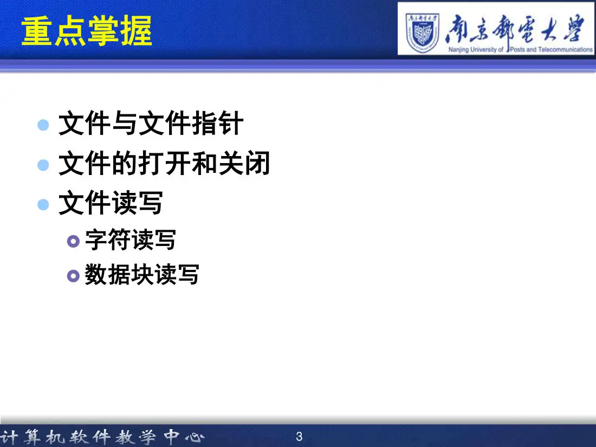

原文：

\- 文件与文件指针

\- 文件的打开和关闭

\- 文件读写

\- 字符读写

\- 数据块读写

重点掌握

南京郵電大學
Nanjing University of Posts and Telecommunications

计算机软件教学中心

3

### 文件与文件指针

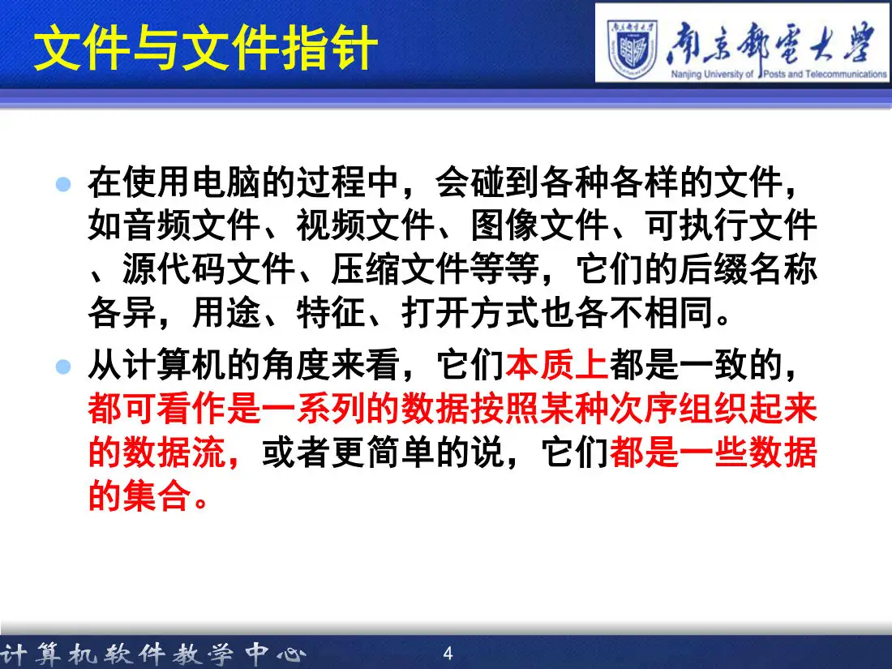

原文：

\- 在使用电脑的过程中，会碰到各种各样的文件，如音频文件、视频文件、图像文件、可执行文件、源代码文件、压缩文件等等，它们的后缀名称各异，用途、特征、打开方式也各不相同。

从计算机的角度来看，它们本质上都是一致的，都可看作是一系列的数据按照某种次序组织起来的数据流，或者更简单的说，它们都是一些数据的集合。

文件与文件指针

南京郵電大學
Nanjing University of Posts and Telecommunications

计算机软件教学中心

4

### 文件与文件指针

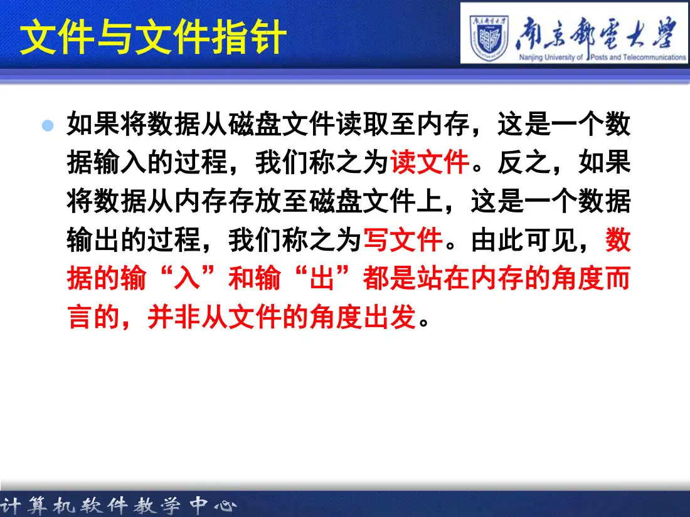

原文：

\- 如果将数据从磁盘文件读取至内存，这是一个数据输入的过程，我们称之为读文件。反之，如果将数据从内存存放至磁盘文件上，这是一个数据输出的过程，我们称之为写文件。由此可见，数据的输“入”和输“出”都是站在内存的角度而言的，并非从文件的角度出发。

文件与文件指针

南京郵電大學
Nanjing University of Posts and Telecommunications

计算机软件教学中心

### \- 根据数据的组成形式，C语言将文件分为两种：文本文件和二进制文件。

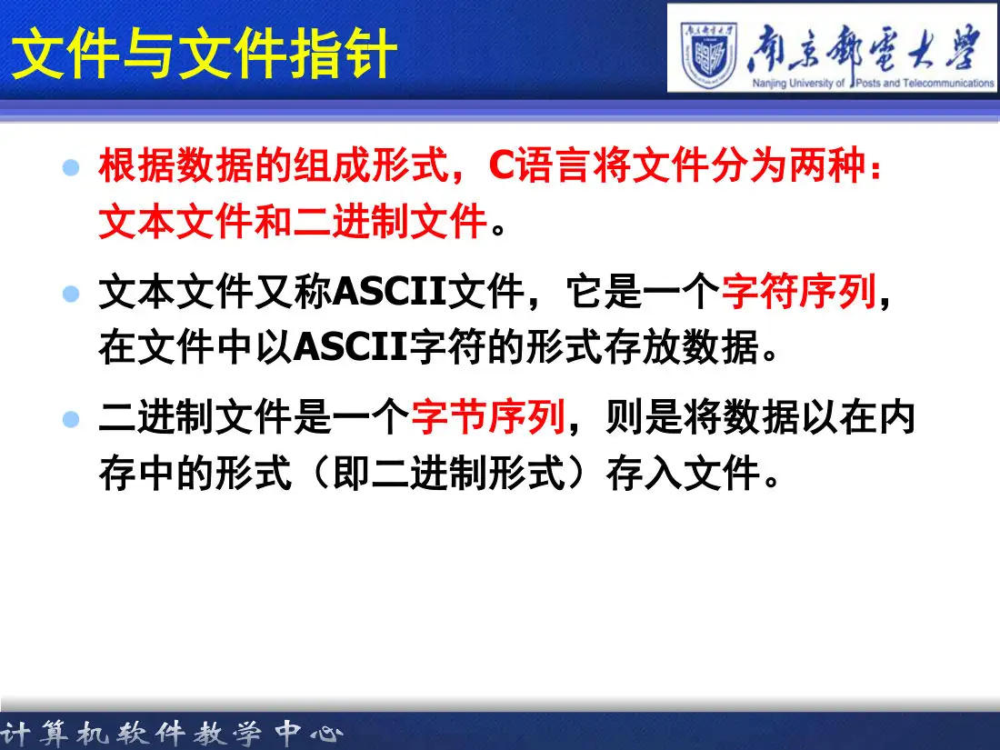

原文：

\- 根据数据的组成形式，C语言将文件分为两种：文本文件和二进制文件。

\- 文本文件又称ASCII文件，它是一个字符序列，在文件中以ASCII字符的形式存放数据。

\- 二进制文件是一个字节序列，则是将数据以在内存中的形式（即二进制形式）存入文件。

文件与文件指针

南京郵電大學
Nanjing University of Posts and Telecommunications

计算机软件教学中心

### 文本文件和二进制文件

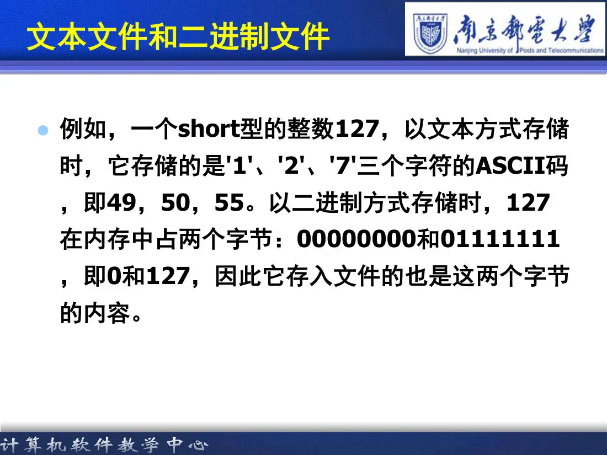

原文：

例如，一个short型的整数127，以文本方式存储时，它存储的是'1'、'2'、'7'三个字符的ASCII码，即49, 50, 55。以二进制方式存储时，127在内存中占两个字节：00000000和01111111，即0和127，因此它存入文件的也是这两个字节的内容。

文本文件和二进制文件

南京郵電大學
Nanjing University of Posts and Telecommunications

计算机软件教学中心

### struct FILE

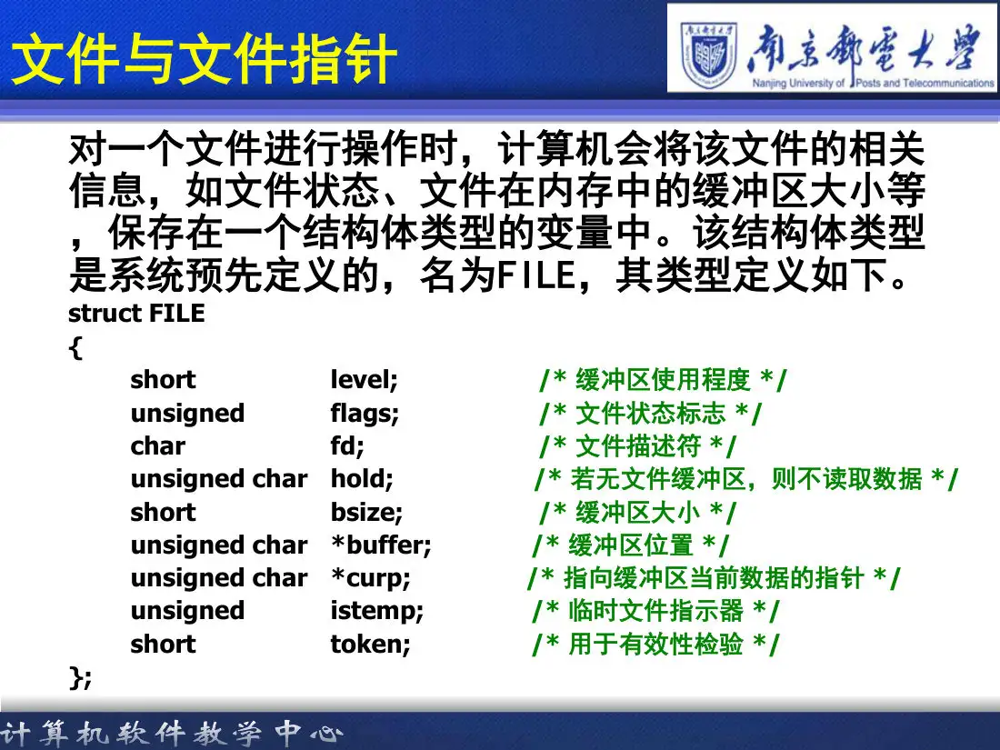

原文：

<table><tr><td>short</td><td>level;</td><td>/* 缓冲区使用程度 */</td></tr><tr><td>unsigned</td><td>flags;</td><td>/* 文件状态标志 */</td></tr><tr><td>char</td><td>fd;</td><td>/* 文件描述符 */</td></tr><tr><td>unsigned char</td><td>hold;</td><td>/* 若无文件缓冲区,则不读取数据 */</td></tr><tr><td>short</td><td>bsize;</td><td>/* 缓冲区大小 */</td></tr><tr><td>unsigned char</td><td>*buffer;</td><td>/* 缓冲区位置 */</td></tr><tr><td>unsigned char</td><td>*curp;</td><td>/* 指向缓冲区当前数据的指针 */</td></tr><tr><td>unsigned</td><td>istemp;</td><td>/* 临时文件指示器 */</td></tr><tr><td>short</td><td>token;</td><td>/* 用于有效性检验 */</td></tr></table>

对一个文件进行操作时，计算机会将该文件的相关信息，如文件状态、文件在内存中的缓冲区大小等，保存在一个结构体类型的变量中。该结构体类型是系统预先定义的，名为FILE，其类型定义如下。

struct FILE

文件与文件指针

南京郵電大學
Nanjing University of Posts and Telecommunications

计算机软件教学中心

### FILE \* fp;

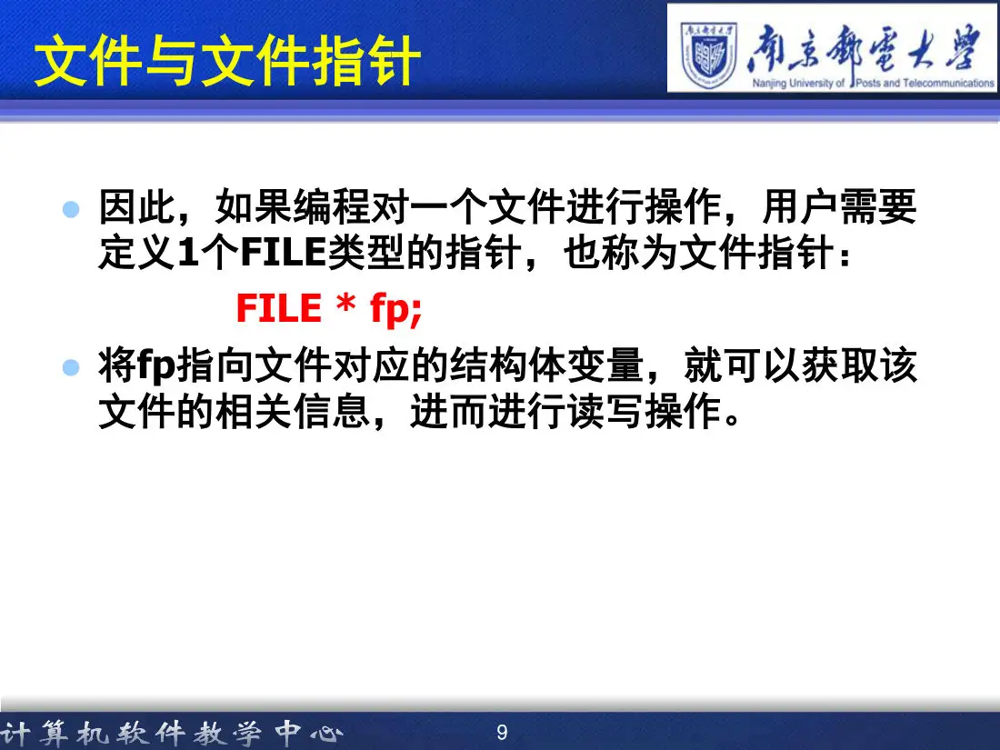

原文：

\- 因此，如果编程对一个文件进行操作，用户需要定义1个FILE类型的指针，也称为文件指针：

FILE \* fp;

\- 将fp指向文件对应的结构体变量，就可以获取该文件的相关信息，进而进行读写操作。

文件与文件指针

南京郵電大學
Nanjing University of Posts and Telecommunications

计算机软件教学中心

9

### 文件的打开和关闭

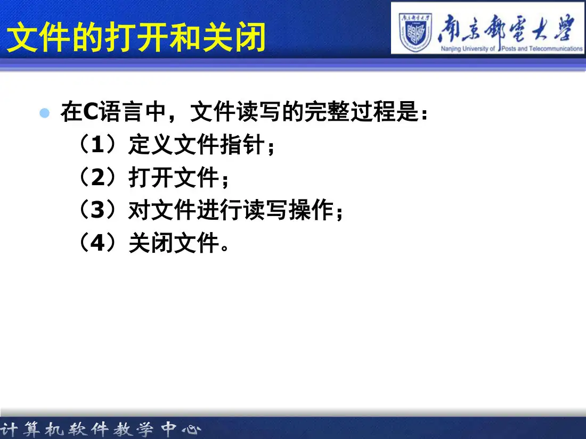

原文：

文件的打开和关闭

\- 在C语言中，文件读写的完整过程是：

（1）定义文件指针；

(2) 打开文件;

(3) 对文件进行读写操作;

(4) 关闭文件。

南京郵電大學
Nanjing University of Posts and Telecommunications

计算机软件教学中心

### \- 在C语言中，文件打开函数的原型为：

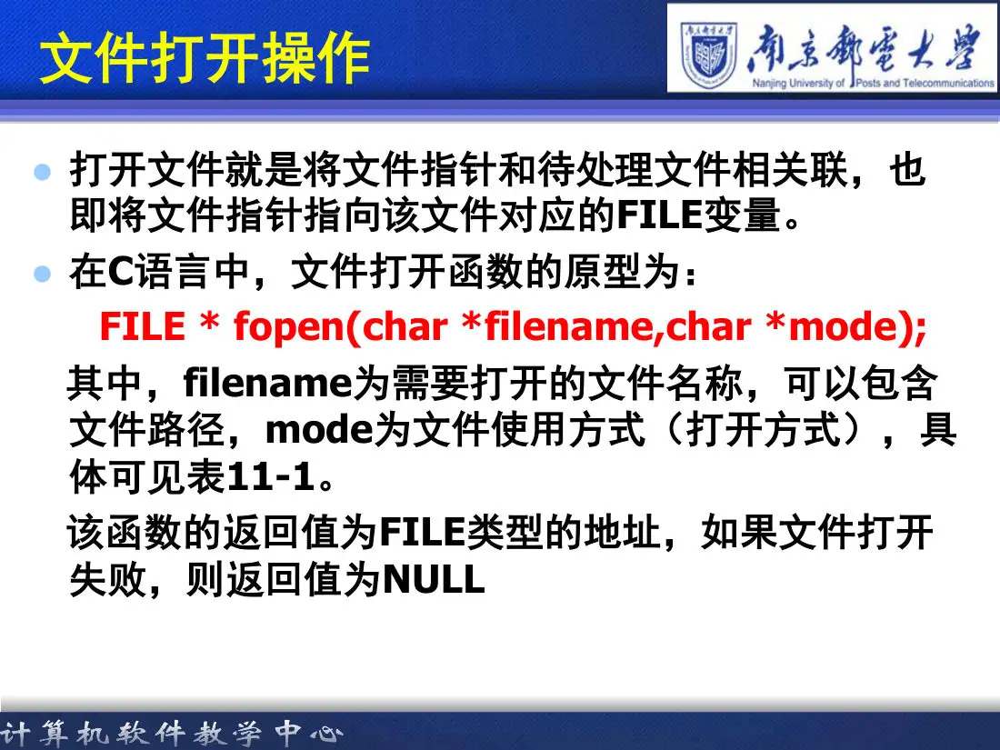

原文：

\- 打开文件就是将文件指针和待处理文件相关联，也即将文件指针指向该文件对应的FILE变量。

\- 在C语言中，文件打开函数的原型为：

FILE \* fopen(char \*filename,char \*mode);其中，filename为需要打开的文件名称，可以包含文件路径，mode为文件使用方式（打开方式），具体可见表11-1。

该函数的返回值为FILE类型的地址，如果文件打开失败，则返回值为NULL

文件打开操作

南京郵電大學
Nanjing University of Posts and Telecommunications

计算机软件教学中心

### fp = fopen( "D:\\data\\file1.txt", "r");

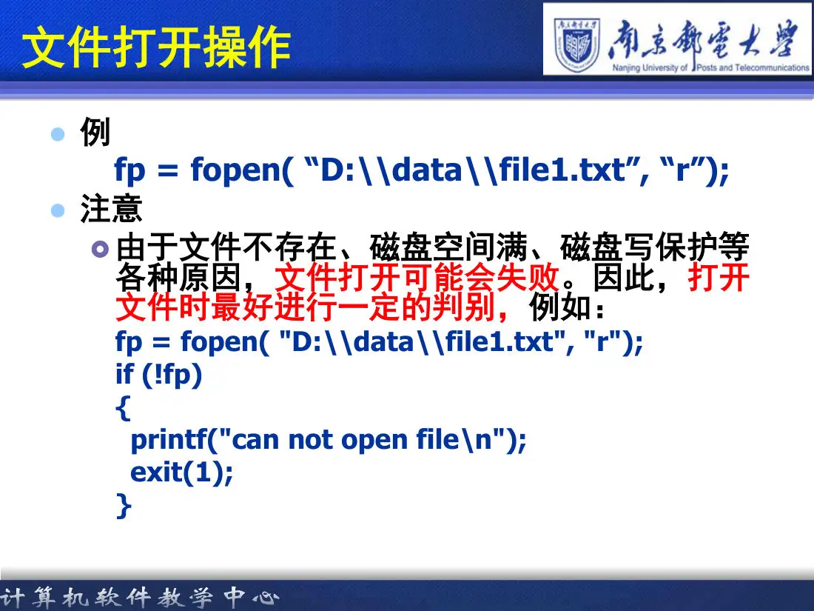

原文：

例

fp = fopen( "D:\\data\\file1.txt", "r");

注意

由于文件不存在、磁盘空间满、磁盘写保护等各种原因，文件打开可能会失败。因此，打开文件时最好进行一定的判别，例如：

文件打开操作

南京郵電大學
Nanjing University of Posts and Telecommunications

计算机软件教学中心

### 文件打开操作

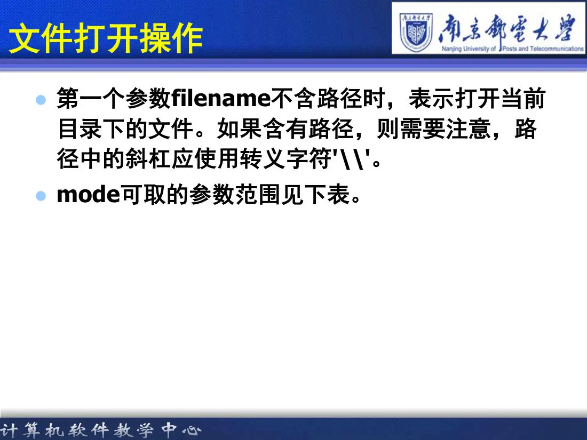

原文：

文件打开操作

\- 第一个参数filename不含路径时，表示打开当前目录下的文件。如果含有路径，则需要注意，路径中的斜杠应使用转义字符'\''。

\- mode可取的参数范围见下表。

南京郵電大學
Nanjing University of Posts and Telecommunications

计算机软件教学中心

### 文件打开操作

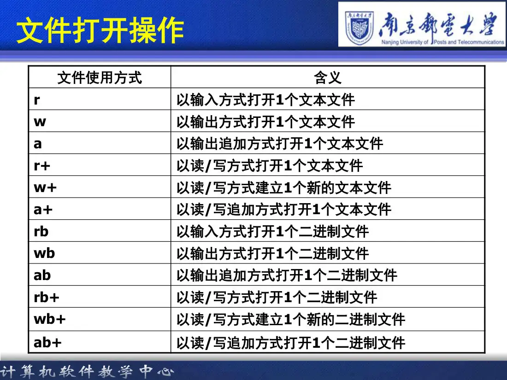

原文：

<table><tr><td>文件使用方式</td><td>含义</td></tr><tr><td>r</td><td>以输入方式打开1个文本文件</td></tr><tr><td>w</td><td>以输出方式打开1个文本文件</td></tr><tr><td>a</td><td>以输出追加方式打开1个文本文件</td></tr><tr><td>r+</td><td>以读/写方式打开1个文本文件</td></tr><tr><td>w+</td><td>以读/写方式建立1个新的文本文件</td></tr><tr><td>a+</td><td>以读/写追加方式打开1个文本文件</td></tr><tr><td>rb</td><td>以输入方式打开1个二进制文件</td></tr><tr><td>wb</td><td>以输出方式打开1个二进制文件</td></tr><tr><td>ab</td><td>以输出追加方式打开1个二进制文件</td></tr><tr><td>rb+</td><td>以读/写方式打开1个二进制文件</td></tr><tr><td>wb+</td><td>以读/写方式建立1个新的二进制文件</td></tr><tr><td>ab+</td><td>以读/写追加方式打开1个二进制文件</td></tr></table>

文件打开操作

南京郵電大學
Nanjing University of Posts and Telecommunications

计算机软件教学中心

### int fclose(FILE \*fp);

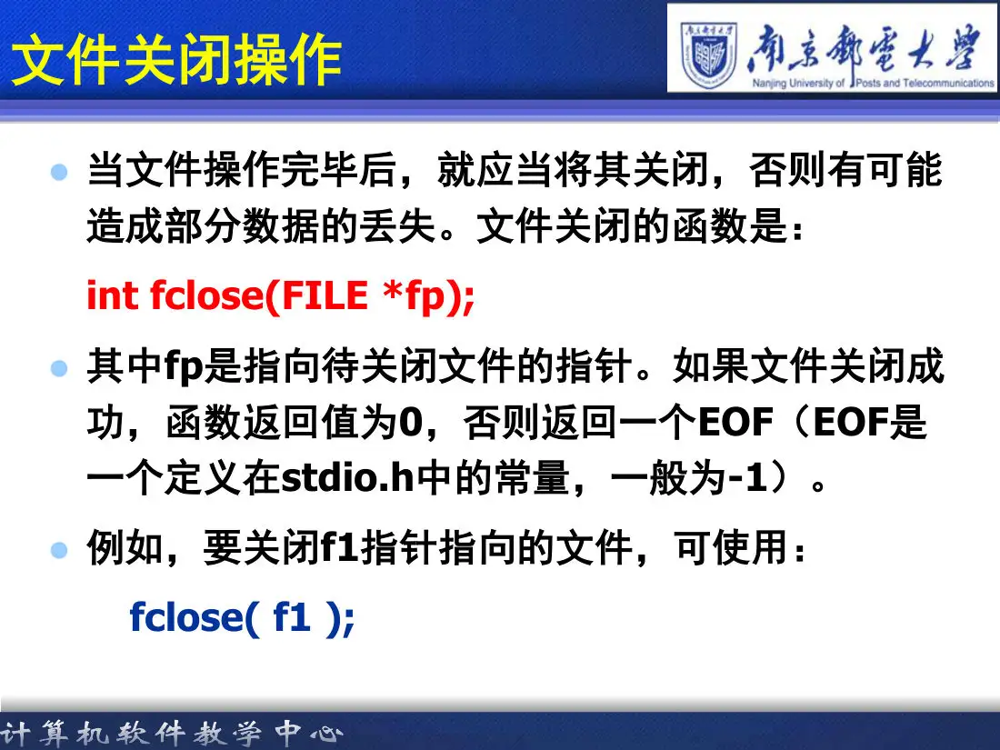

原文：

\- 当文件操作完毕后，就应当将其关闭，否则有可能造成部分数据的丢失。文件关闭的函数是：

int fclose(FILE \*fp);

\- 其中fp是指向待关闭文件的指针。如果文件关闭成功，函数返回值为0，否则返回一个EOF（EOF是一个定义在stdio.h中的常量，一般为-1）。

例如，要关闭f1指针指向的文件，可使用：

fclose( f1 );

文件关闭操作

南京郵電大學
Nanjing University of Posts and Telecommunications

计算机软件教学中心

### 文件读写

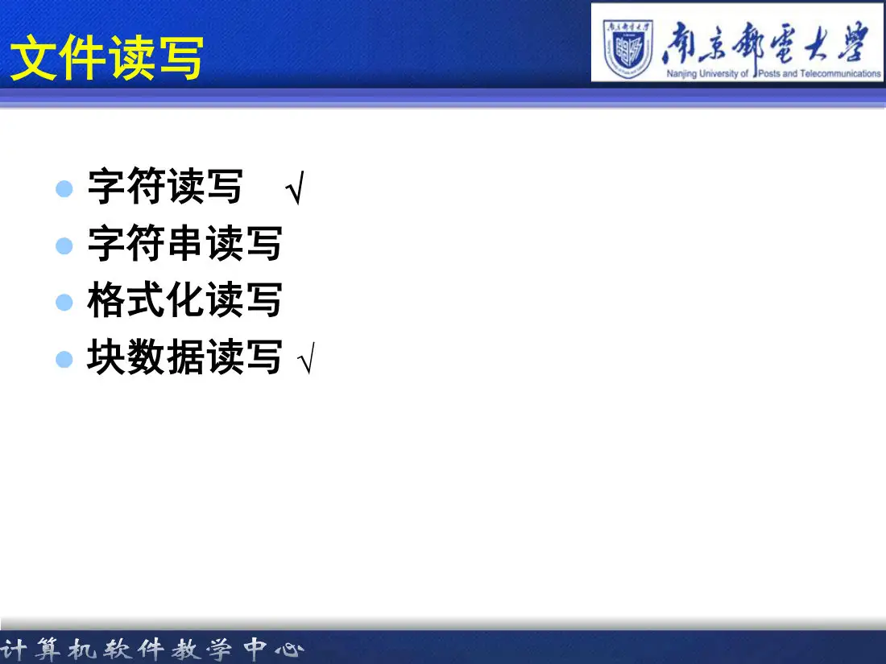

原文：

文件读写

\- 字符读写 √

\- 字符串读写

\- 格式化读写

\- 块数据读写 √

南京郵電大學
Nanjing University of Posts and Telecommunications

计算机软件教学中心

### 字符读写

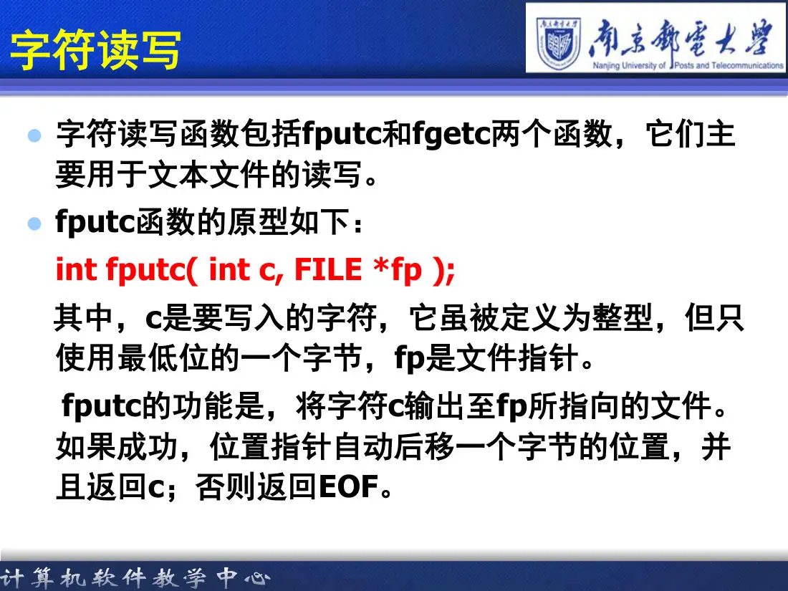

原文：

字符读写

\- 字符读写函数包括fputc和fgetc两个函数，它们主要用于文本文件的读写。

\- fputc函数的原型如下:

int fputc( int c, FILE \*fp );

其中，c是要写入的字符，它虽被定义为整型，但只使用最低位的一个字节，fp是文件指针。

fputc的功能是，将字符c输出至fp所指向的文件。如果成功，位置指针自动后移一个字节的位置，并且返回c；否则返回EOF。

南京郵電大學
Nanjing University of Posts and Telecommunications

计算机软件教学中心

### 字符读写

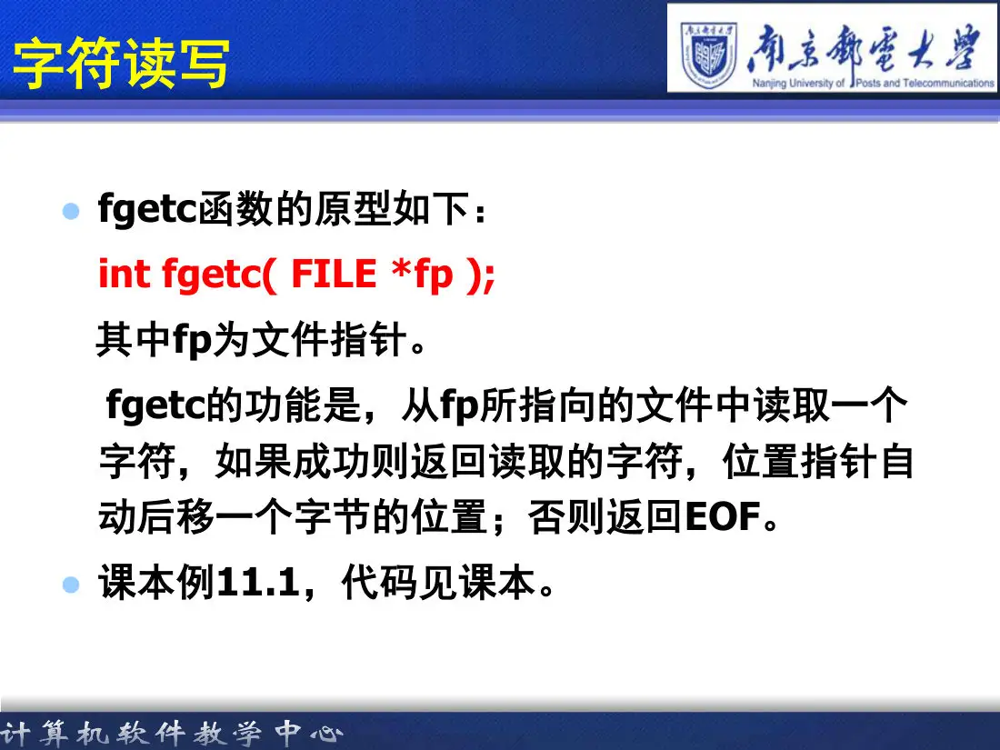

原文：

字符读写

\- fgetc函数的原型如下:

int fgetc(FILE \*fp);

其中fp为文件指针。

fgetc的功能是，从fp所指向的文件中读取一个字符，如果成功则返回读取的字符，位置指针自动后移一个字节的位置；否则返回EOF。

课本例11.1，代码见课本。

南京郵電大學
Nanjing University of Posts and Telecommunications

计算机软件教学中心

### 1. 创建文件指针，并指向待操作的文件

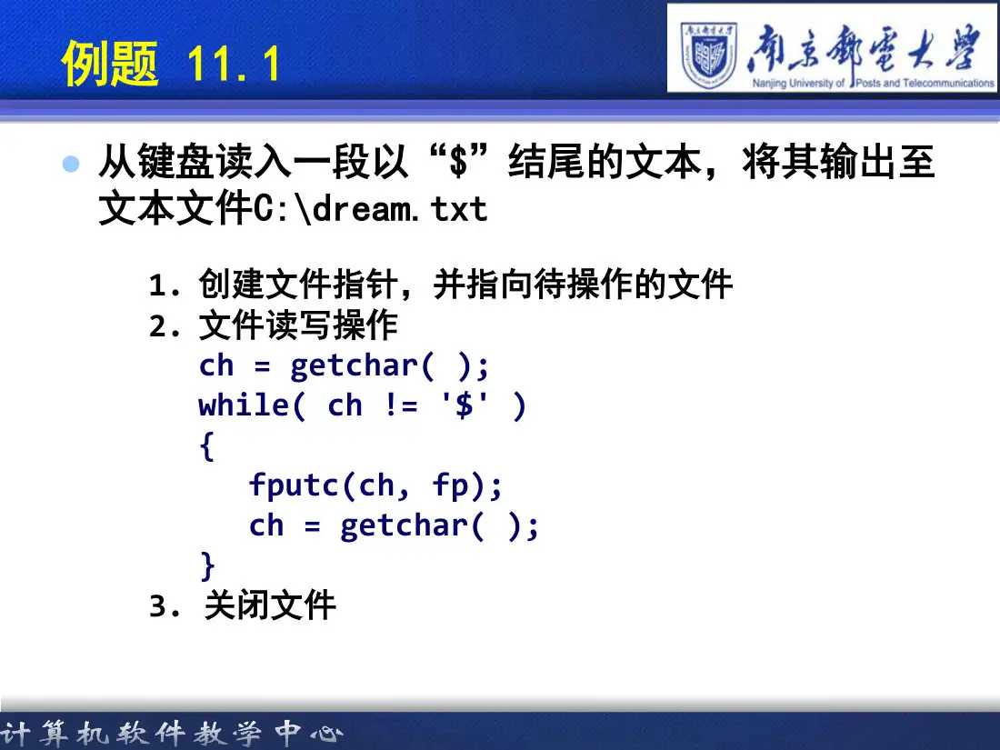

原文：

\- 从键盘读入一段以“\$”结尾的文本，将其输出至文本文件C:\dream.txt

1. 创建文件指针，并指向待操作的文件

2. 文件读写操作

3. 关闭文件

例题 11.1

南京郵電大學
Nanjing University of Posts and Telecommunications

计算机软件教学中心

### \- 读出文本文件C:\dream.txt的内容，并输出到屏幕。

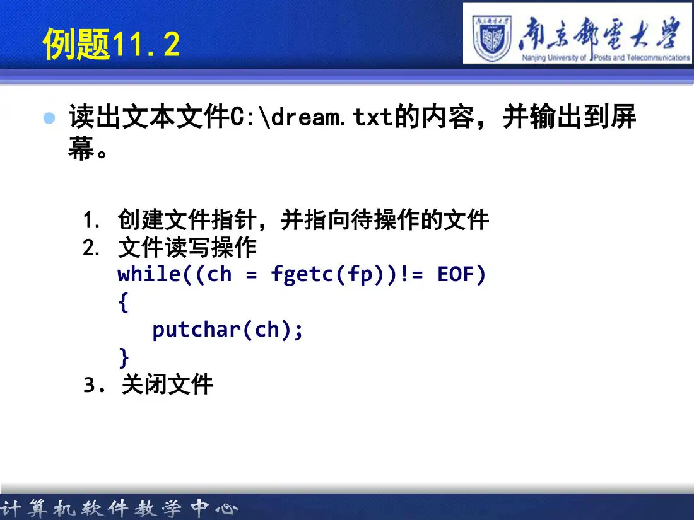

原文：

\- 读出文本文件C:\dream.txt的内容，并输出到屏幕。

1. 创建文件指针，并指向待操作的文件

2. 文件读写操作

3. 关闭文件

例题11.2

南京郵電大學
Nanjing University of Posts and Telecommunications

计算机软件教学中心

### 说明

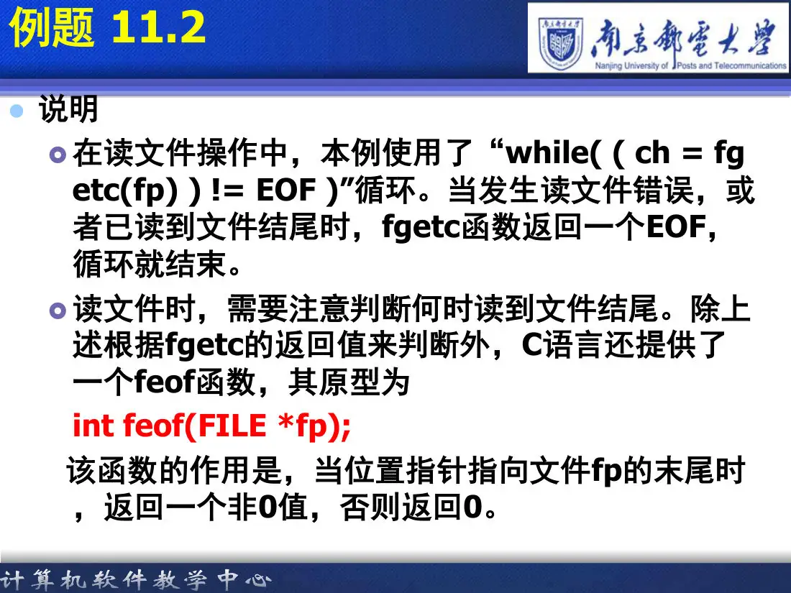

原文：

说明

在读文件操作中，本例使用了“while((ch = fg etc(fp)) != EOF)”循环。当发生读文件错误，或者已读到文件结尾时，fgetc函数返回一个EOF，循环就结束。

\- 读文件时，需要注意判断何时读到文件结尾。除上述根据fgetc的返回值来判断外，C语言还提供了一个feof函数，其原型为

int feof(FILE \*fp);

该函数的作用是，当位置指针指向文件fp的末尾时，返回一个非0值，否则返回0。

例题 11.2

南京郵電大學
Nanjing University of Posts and Telecommunications

计算机软件教学中心

### 例 11.2

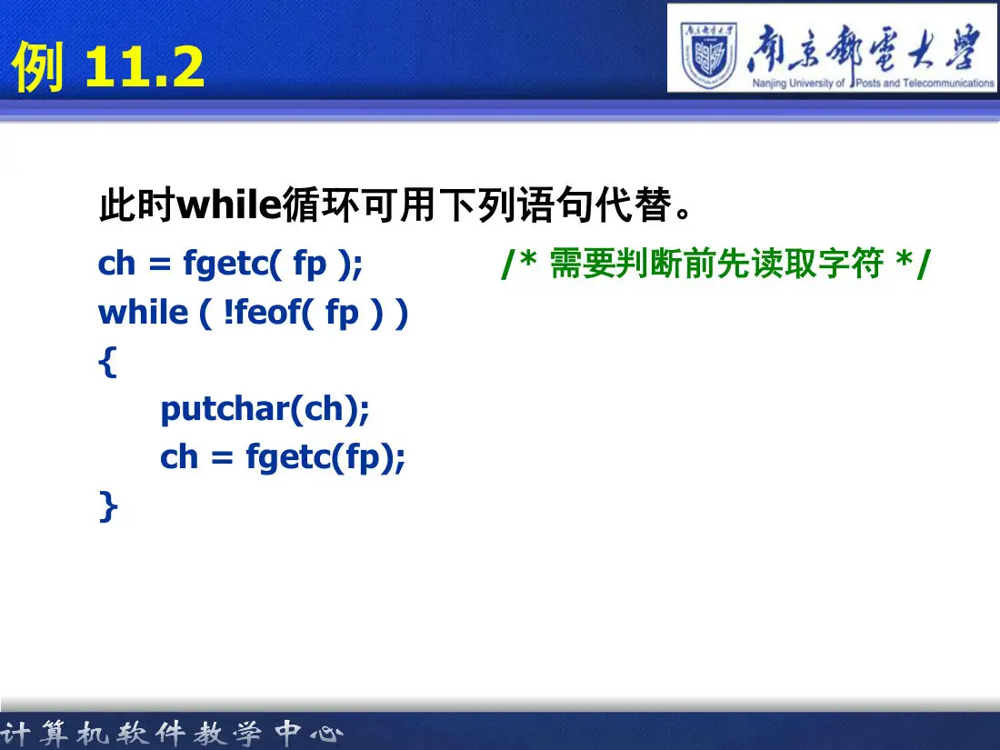

原文：

例 11.2

此时while循环可用下列语句代替。

南京郵電大學
Nanjing University of Posts and Telecommunications

计算机软件教学中心

### \- 编写程序，将d:\abc.txt文件中的内容复制到

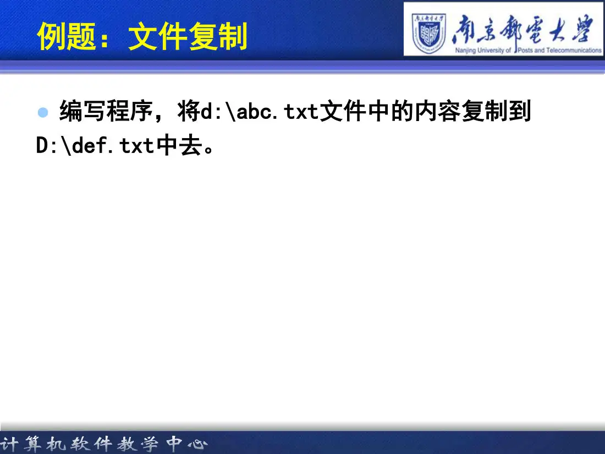

原文：

\- 编写程序，将d:\abc.txt文件中的内容复制到

D:\def.txt中去。

例题：文件复制

南京郵電大學
Nanjing University of Posts and Telecommunications

计算机软件教学中心

### 例题 P259

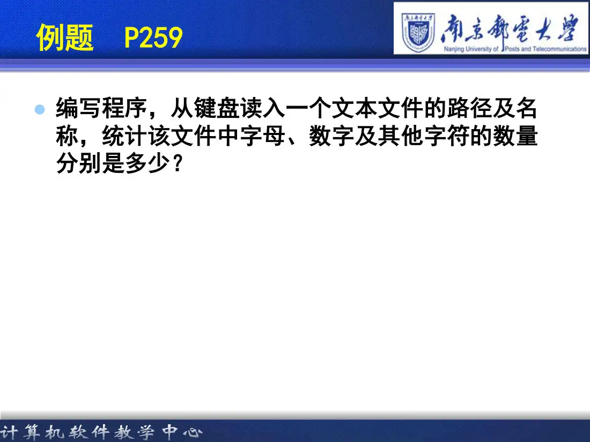

原文：

\- 编写程序，从键盘读入一个文本文件的路径及名称，统计该文件中字母、数字及其他字符的数量分别是多少？

例题 P259

南京郵電大學
Nanjing University of Posts and Telecommunications

计算机软件教学中心

### 块数据读写

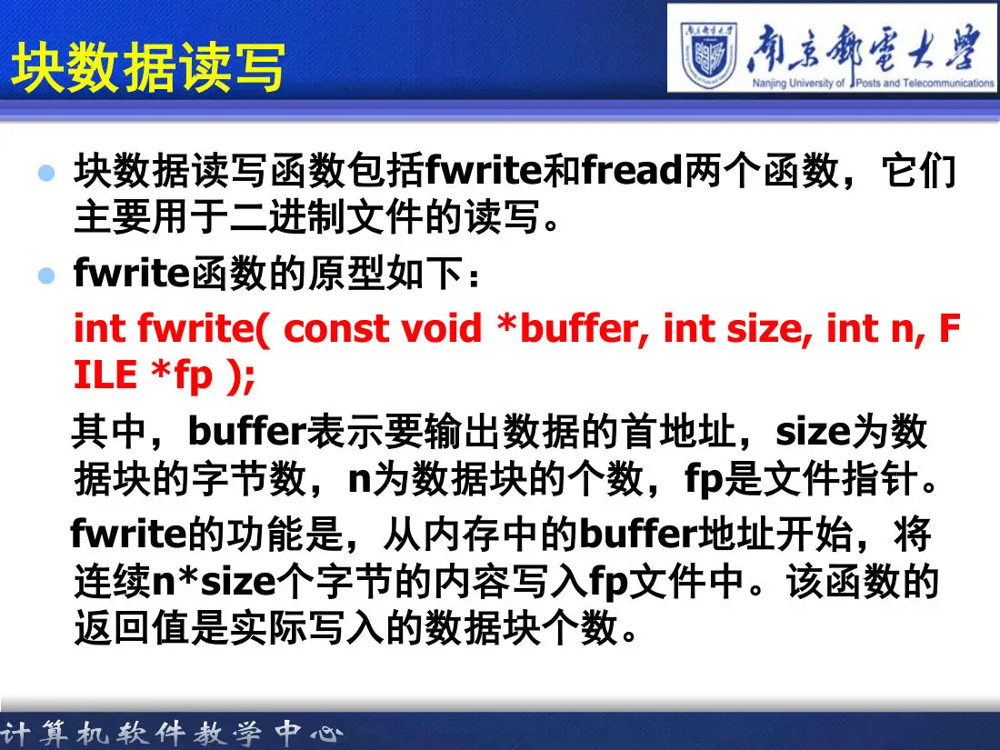

原文：

块数据读写

\- 块数据读写函数包括fwrite和fread两个函数，它们主要用于二进制文件的读写。

\- fwrite函数的原型如下:

int fwrite( const void \*buffer, int size, int n, F ILE \*fp );

其中，buffer表示要输出数据的首地址，size为数据块的字节数，n为数据块的个数，fp是文件指针。fwrite的功能是，从内存中的buffer地址开始，将连续n\*size个字节的内容写入fp文件中。该函数的返回值是实际写入的数据块个数。

南京郵電大學
Nanjing University of Posts and Telecommunications

计算机软件教学中心

### \- fread函数的原型如下:

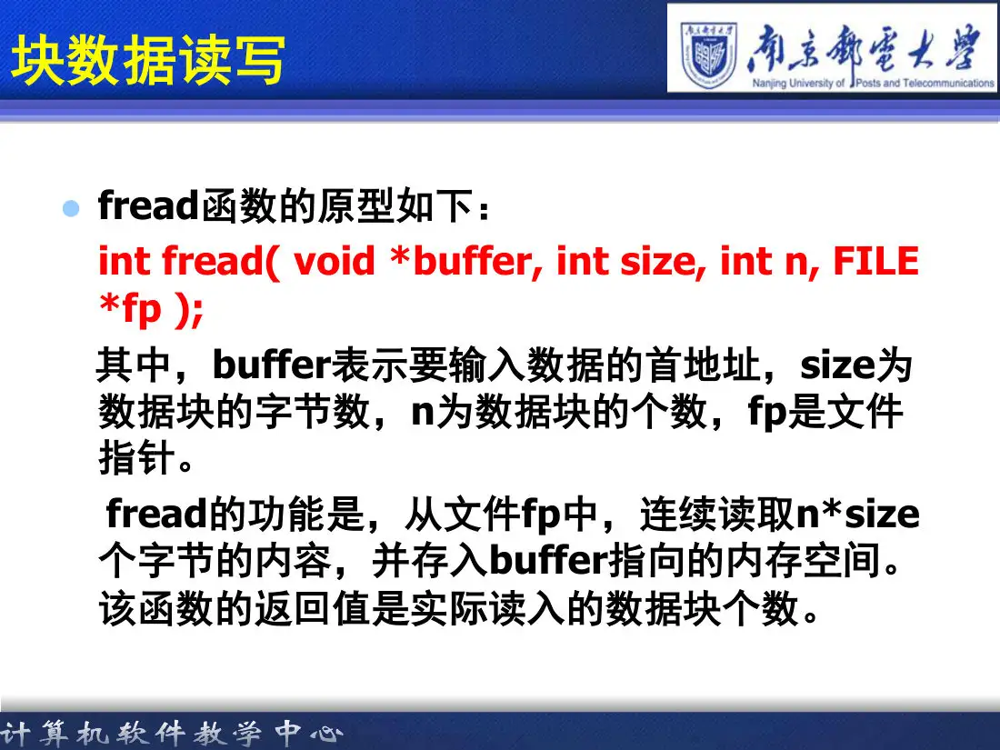

原文：

\- fread函数的原型如下:

int fread( void \*buffer, int size, int n, FILE \*fp );

其中，buffer表示要输入数据的首地址，size为数据块的字节数，n为数据块的个数，fp是文件指针。

fread的功能是，从文件fp中，连续读取n\*size个字节的内容，并存入buffer指向的内存空间。

该函数的返回值是实际读入的数据块个数。

块数据读写

南京郵電大學
Nanjing University of Posts and Telecommunications

计算机软件教学中心

### 例11.5

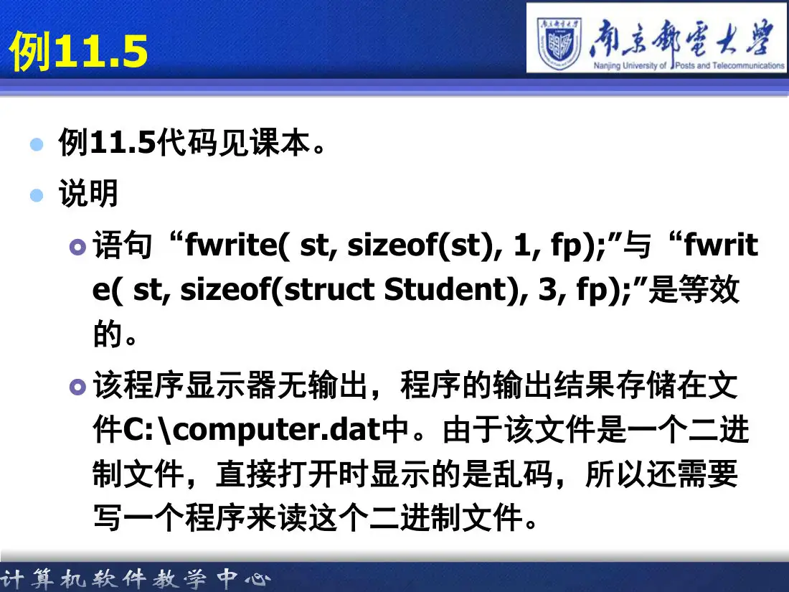

原文：

例11.5

• 例11.5代码见课本。

说明

\- 语句 “fwrite(st, sizeof(st), 1, fp);”与“fwrite(st, sizeof(struct Student), 3, fp);”是等效的。

该程序显示器无输出，程序的输出结果存储在文件C:\computer.dat中。由于该文件是一个二进制文件，直接打开时显示的是乱码，所以还需要写一个程序来读这个二进制文件。

南京郵電大學
Nanjing University of Posts and Telecommunications

计算机软件教学中心

### • 例11.6代码见课本。

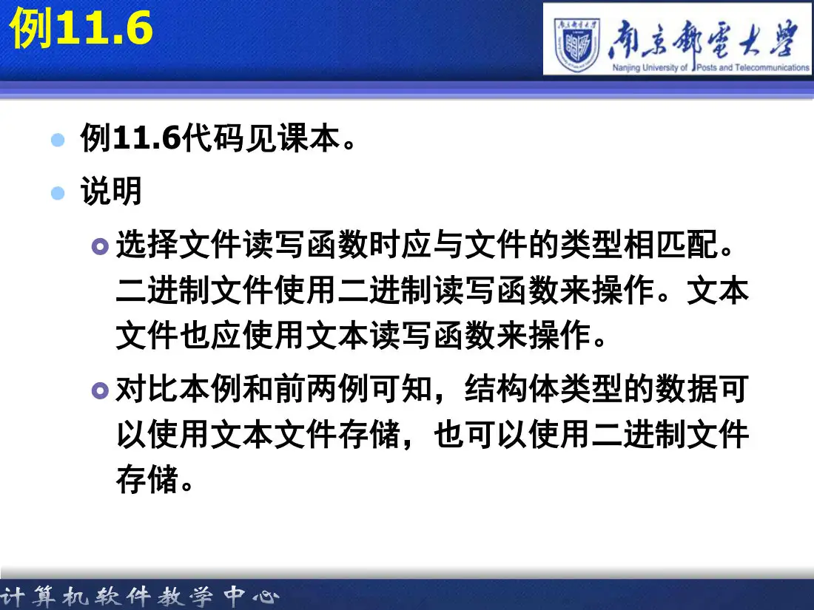

原文：

• 例11.6代码见课本。

说明

\- 选择文件读写函数时应与文件的类型相匹配。二进制文件使用二进制读写函数来操作。文本文件也应使用文本读写函数来操作。

\- 对比本例和前两例可知，结构体类型的数据可以使用文本文件存储，也可以使用二进制文件存储。

例11.6

南京郵電大學
Nanjing University of Posts and Telecommunications

计算机软件教学中心

### 例11.6

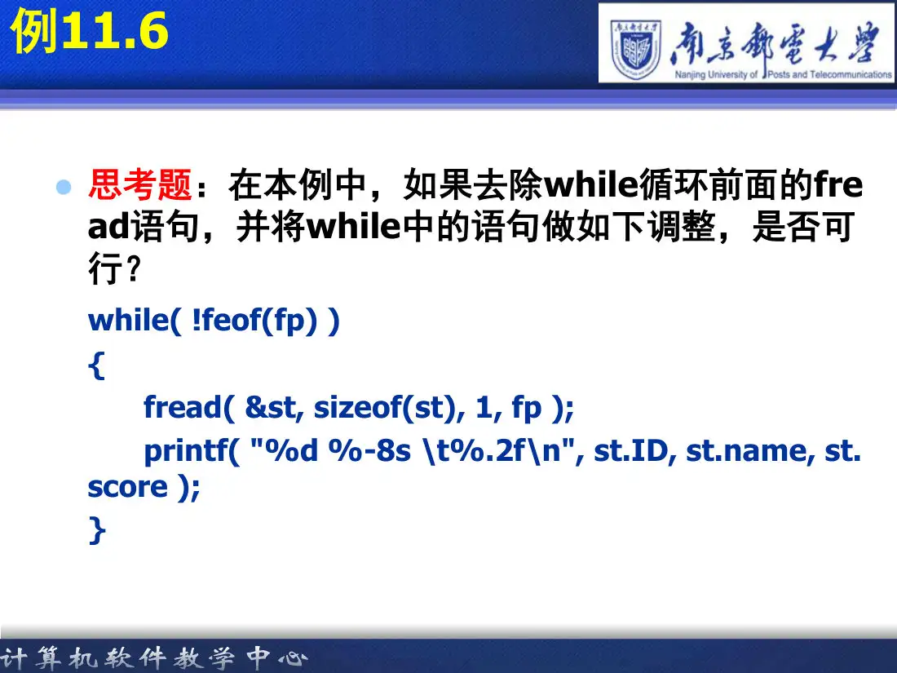

原文：

\- 思考题：在本例中，如果去除while循环前面的fre ad语句，并将while中的语句做如下调整，是否可行？

例11.6

南京郵電大學
Nanjing University of Posts and Telecommunications

计算机软件教学中心

### 习题

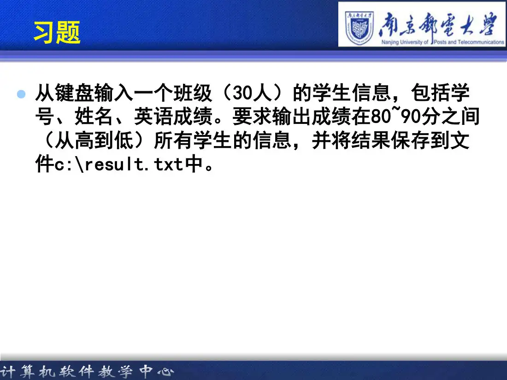

原文：

\- 从键盘输入一个班级（30人）的学生信息，包括学号、姓名、英语成绩。要求输出成绩在80\~90分之间（从高到低）所有学生的信息，并将结果保存到文件c:\result.txt中。

习题

南京郵電大學
Nanjing University of Posts and Telecommunications

计算机软件教学中心
