# 《高级语言程序设计》第1章 计算机、C语言与二进制（课件）

原件的每一页，下面附识别出的文字。

### 高级语言程序设计

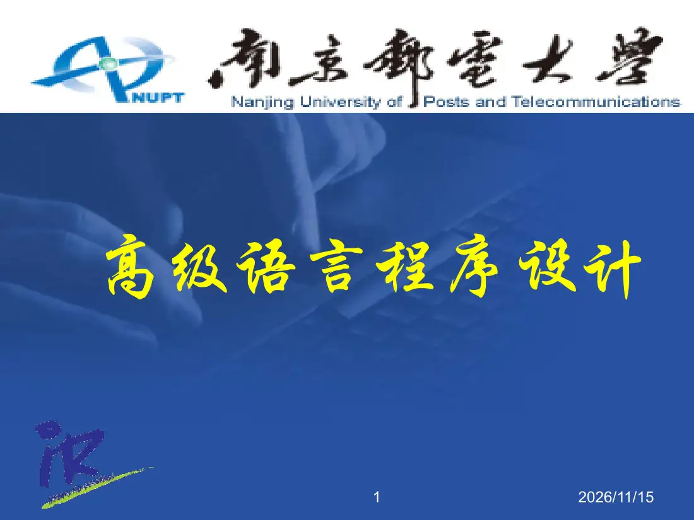

原文：

高级语言程序设计

2026/11/15

A南京郵電大学 Nanjing University of Posts and Telecommunications

1

### 第一章 计算机、C语言

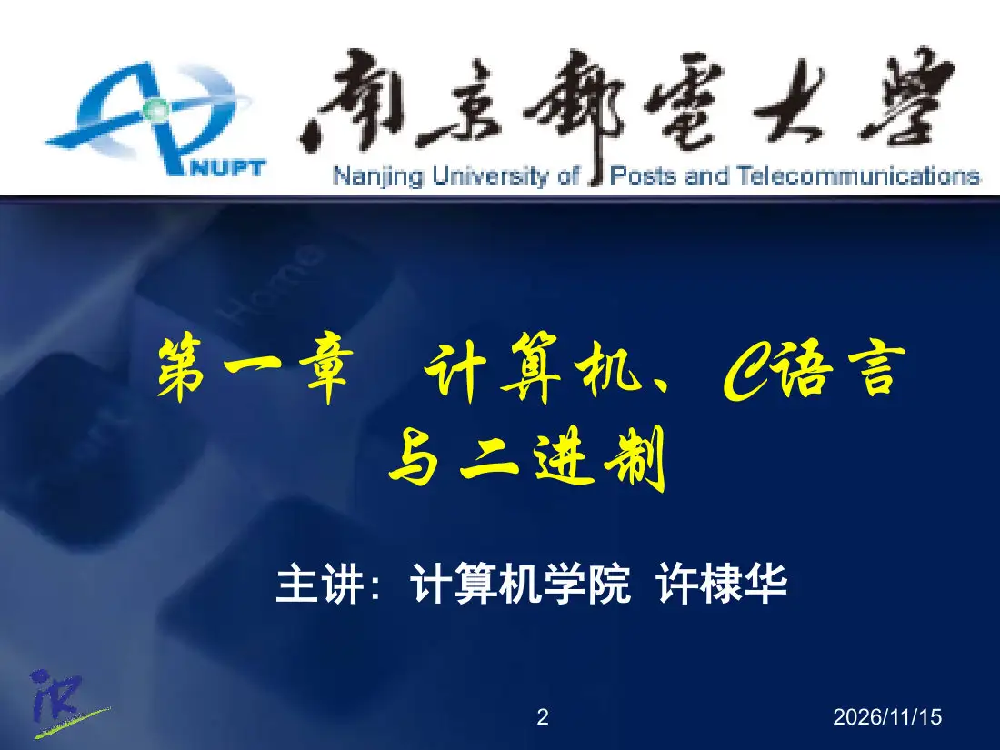

原文：

第一章 计算机、C语言

与二进制

主讲: 计算机学院 许棣华

2

2026/11/15

之南京郵電大学 Nanjing University of Posts and Telecommunications

iR

### 重点掌握

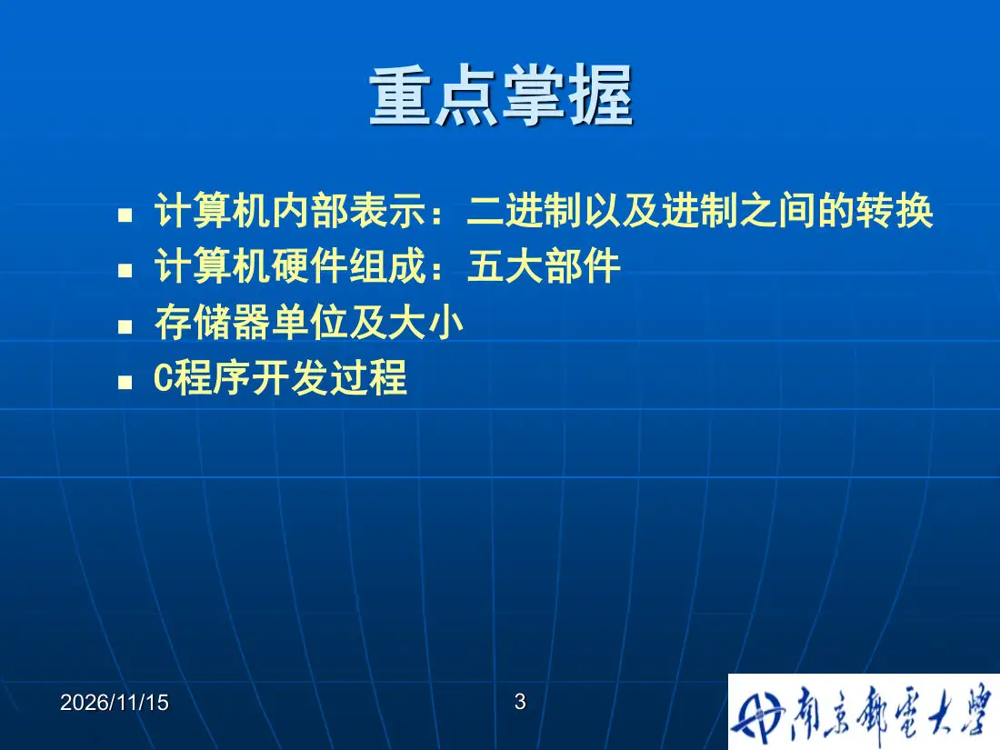

原文：

重点掌握

◼ 计算机内部表示：二进制以及进制之间的转换

计算机硬件组成：五大部件

存储器单位及大小

◼ C程序开发过程

2026/11/15

3

彤南京郵電大学

### 计算机组成及工作过程

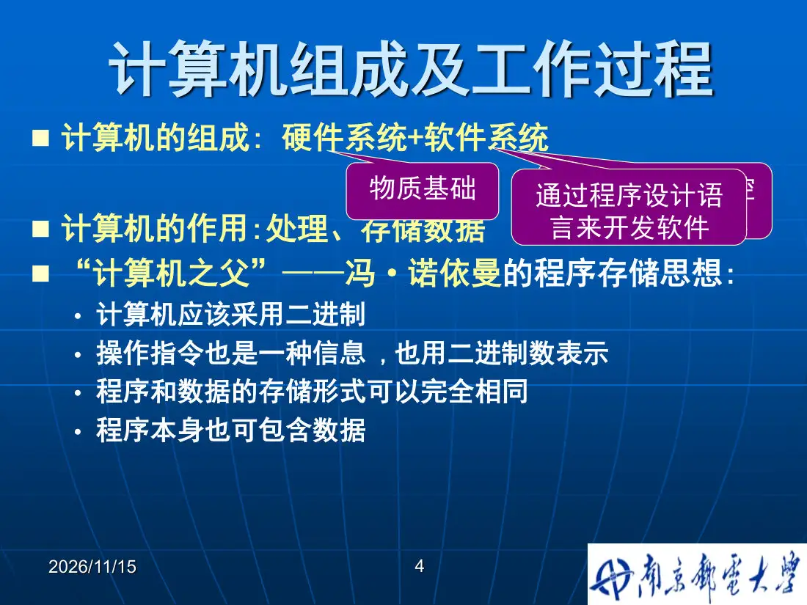

原文：

计算机组成及工作过程

◼ 计算机的组成: 硬件系统+软件系统

物质基础

计算机的作用:处理、存储数据

加在硬件之上,通过程序设计语制硬件完成功言来开发软件

“计算机之父”—— 冯·诺依曼的程序存储思想:

• 计算机应该采用二进制

• 操作指令也是一种信息 ,也用二进制数表示

• 程序和数据的存储形式可以完全相同

程序本身也可包含数据

2026/11/15

4

今南京郵電大学

### •关于二进制等进制问题

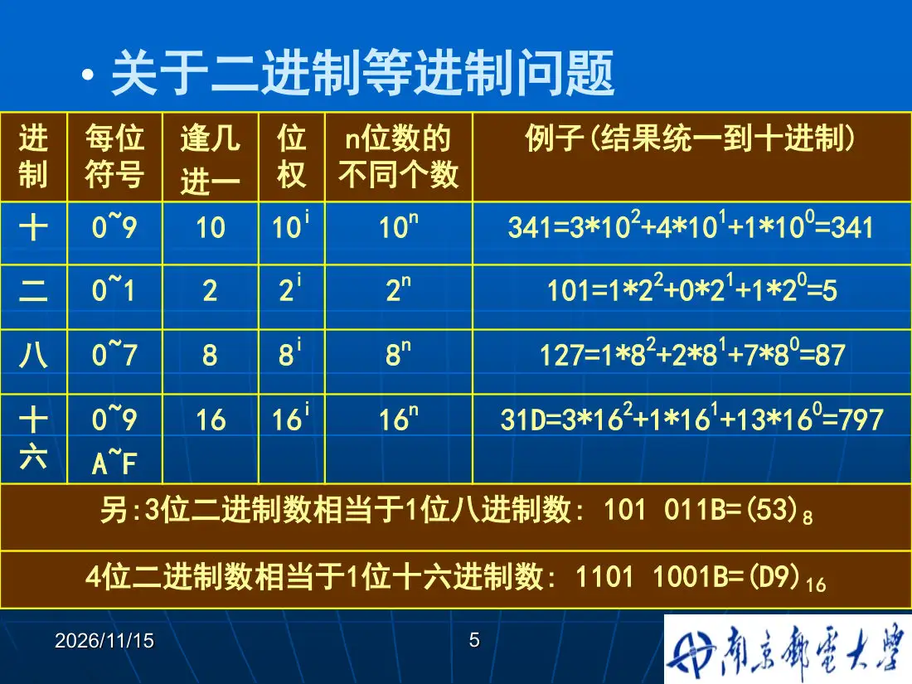

原文：

•关于二进制等进制问题

逢几

进一n位数的不同个数

$$
0 ^ {\sim} 9
$$

$$
0 ^ {\sim} 7
$$

$$
8 ^ {n}
$$

$$
0 \sim 9
$$

$$
1 6 ^ {n}
$$

$$
A ^ {\sim} F
$$

例子(结果统一到十进制)

$$
3 4 1 = 3 * 1 0 ^ {2} + 4 * 1 0 ^ {1} + 1 * 1 0 ^ {0} = 3 4 1
$$

$$
1 0 1 = 1 * 2 ^ {2} + 0 * 2 ^ {1} + 1 * 2 ^ {0} = 5
$$

$$
1 2 7 = 1 * 8 ^ {2} + 2 * 8 ^ {1} + 7 * 8 ^ {0} = 8 7
$$

$$
3 1 D = 3 * 1 6 ^ {2} + 1 * 1 6 ^ {1} + 1 3 * 1 6 ^ {0} = 7 9 7
$$

另:3位二进制数相当于1位八进制数: 101 011B=(53)8

4位二进制数相当于1位十六进制数: 1101 1001B=(D9)16

2026/11/15

5

华南京郵電大學

### 12 Ports 13 Monitor 14 Expansion board

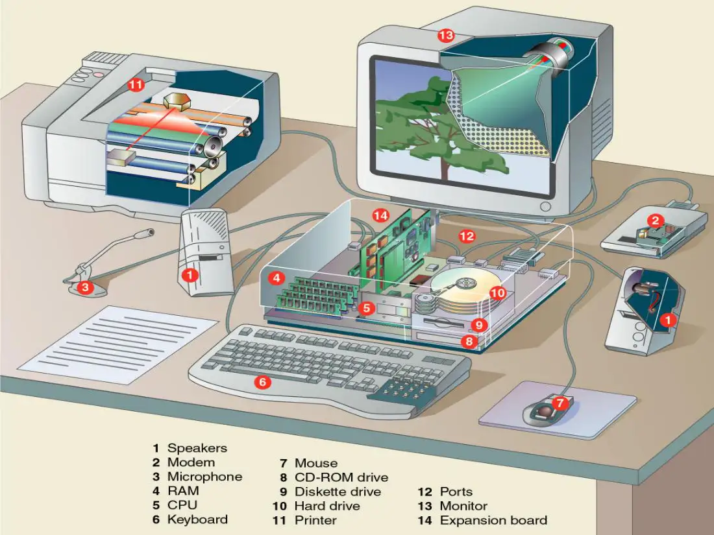

原文：

1 Speakers 2 Modem 3 Microphone 4 5 Cl 6 Keyboard

7 Mouse 8 CD-ROM drive 9 Diskette drive 10 Hard drive 11 Printer

12 Ports 13 Monitor 14 Expansion board

### • 计算机硬件的组成

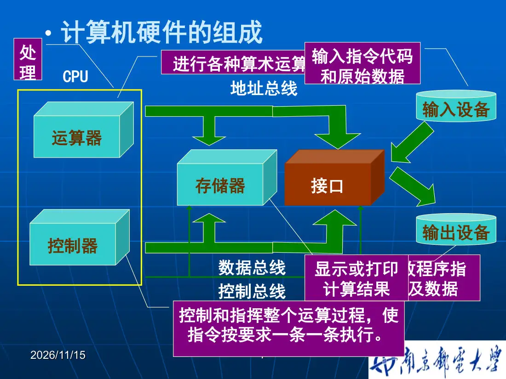

原文：

• 计算机硬件的组成

处理

CPU

运算器

控制器

2026/11/15

进行各种算术运算地址总线输入指令代码和原始数据

输入设备

存储器

数据总线控制总线接口

存显示或打印 放程序指计算结果 及数据

输出设备

控制和指挥整个运算过程，使指令按要求一条一条执行。

部南京郵電大学

### 关于存储器

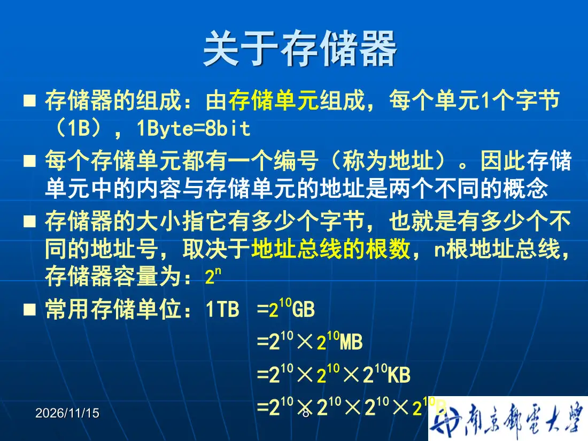

原文：

关于存储器

存储器的组成：由存储单元组成，每个单元1个字节（1B），1Byte=8bit

◼ 每个存储单元都有一个编号（称为地址）。因此存储单元中的内容与存储单元的地址是两个不同的概念

存储器的大小指它有多少个字节，也就是有多少个不同的地址号，取决于地址总线的根数，n根地址总线，存储器容量为： $\textcircled { 2 }$

常用存储单位：1TB =210GB

$$
\begin{array}{r l} {1 \mathrm{TB}} & {= 2 ^ {1 0} \mathrm{GB}} \\ & {= 2 ^ {1 0} \times 2 ^ {1 0} \mathrm{MB}} \\ & {= 2 ^ {1 0} \times 2 ^ {1 0} \times 2 ^ {1 0} \mathrm{KB}} \\ & {= 2 ^ {1 0} \times 2 ^ {1 0} \times 2 ^ {1 0} \times 2 ^ {1}} \end{array}
$$

南京郵電大学

2026/11/15

### 关于CPU

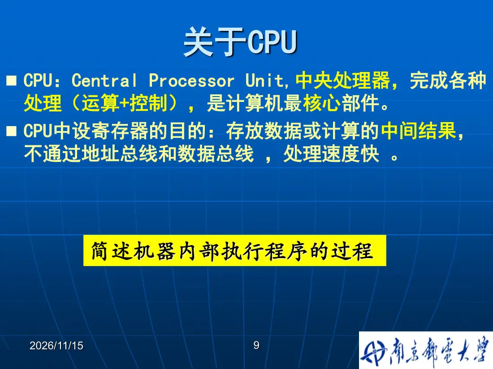

原文：

关于CPU

◼ CPU：Central Processor Unit,中央处理器，完成各种处理（运算+控制），是计算机最核心部件。

CPU中设寄存器的目的：存放数据或计算的中间结果，不通过地址总线和数据总线 ，处理速度快 。

简述机器内部执行程序的过程

2026/11/15

9

今南京郵電大学

### 由低级语言到高级语言

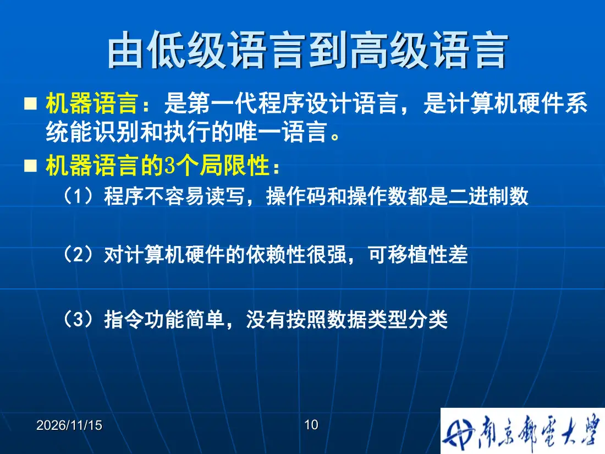

原文：

由低级语言到高级语言

◼ 机器语言：是第一代程序设计语言，是计算机硬件系统能识别和执行的唯一语言。

机器语言的3个局限性：

（1）程序不容易读写，操作码和操作数都是二进制数

（2）对计算机硬件的依赖性很强，可移植性差

（3）指令功能简单，没有按照数据类型分类

2026/11/15

10

今南京郵電大学

### 由低级语言到高级语言

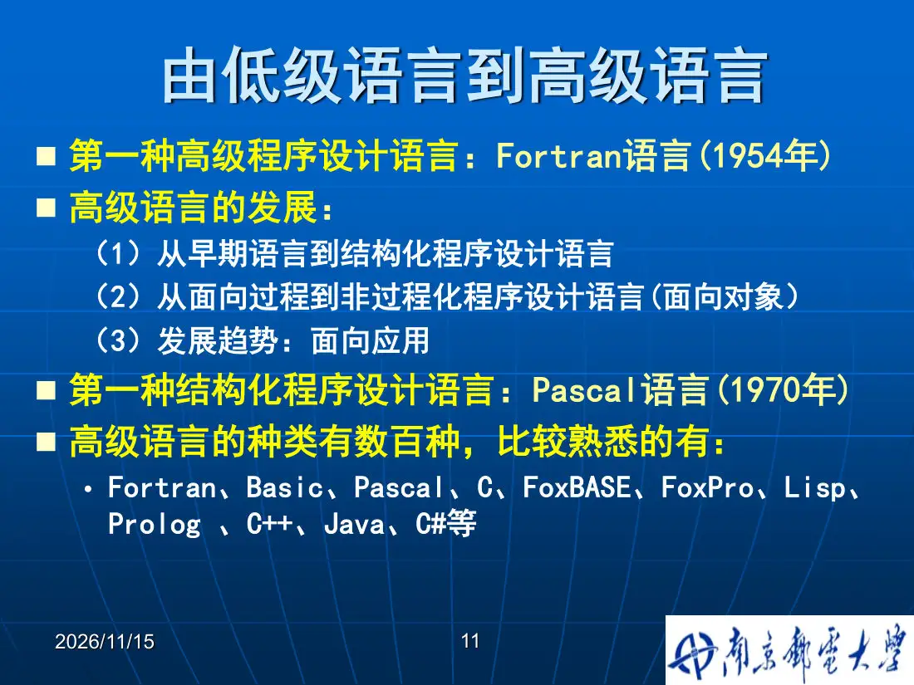

原文：

由低级语言到高级语言

◼ 第一种高级程序设计语言：Fortran语言(1954年)

◼ 高级语言的发展：

（1）从早期语言到结构化程序设计语言

（2）从面向过程到非过程化程序设计语言(面向对象）

（3）发展趋势：面向应用

◼ 第一种结构化程序设计语言：Pascal语言(1970年)

高级语言的种类有数百种，比较熟悉的有：

• Fortran、Basic、Pascal、C、FoxBASE、FoxPro、Lisp、Prolog 、C++、Java、C#等

2026/11/15

11

今南京郵電大学

### C is the most beautiful language!

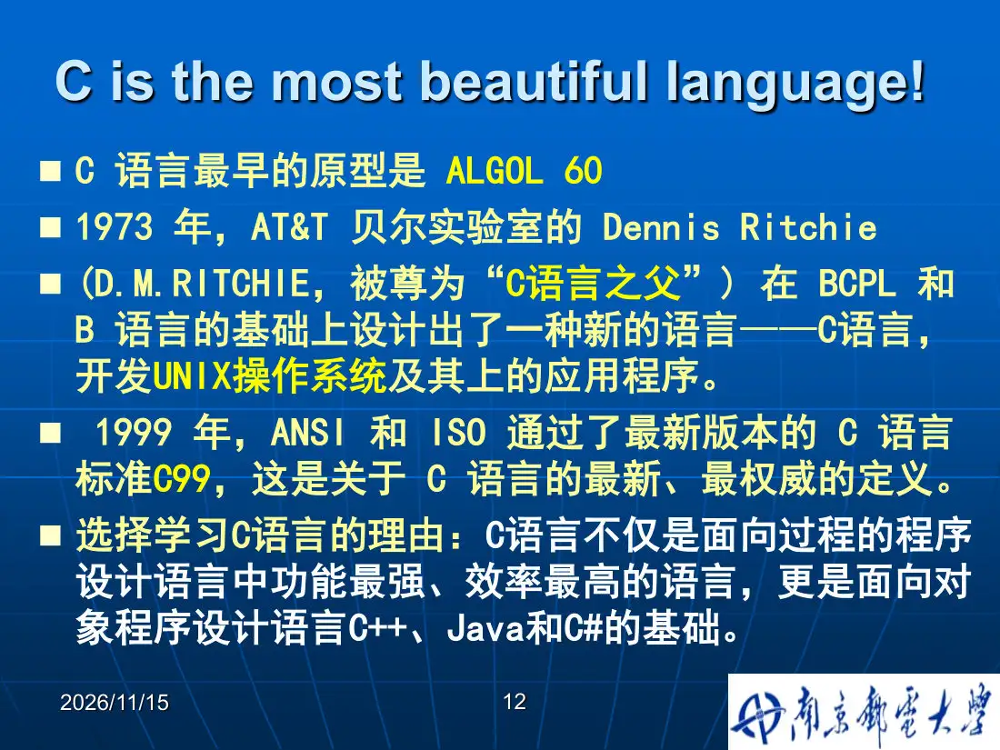

原文：

C is the most beautiful language!

◼ C 语言最早的原型是 ALGOL 60

◼ 1973 年，AT&T 贝尔实验室的 Dennis Ritchie

(D.M.RITCHIE，被尊为“C语言之父”) 在 BCPL 和B 语言的基础上设计出了一种新的语言——C语言，开发UNIX操作系统及其上的应用程序。

1999 年，ANSI 和 ISO 通过了最新版本的 C 语言标准C99，这是关于 C 语言的最新、最权威的定义。

◼ 选择学习C语言的理由：C语言不仅是面向过程的程序设计语言中功能最强、效率最高的语言，更是面向对象程序设计语言C++、Java和C#的基础。

2026/11/15

12

今南京郵電大学

### C is the most beautiful language!

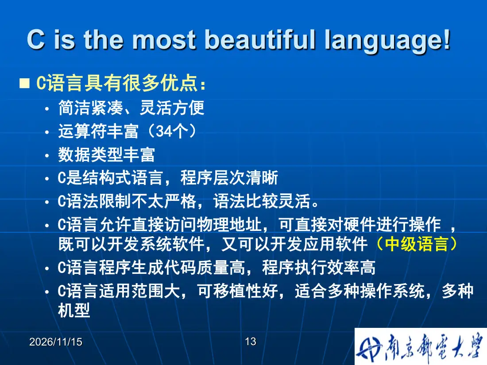

原文：

C is the most beautiful language!

◼ C语言具有很多优点：

简洁紧凑、灵活方便

运算符丰富（34个）

数据类型丰富

C是结构式语言，程序层次清晰

• C语法限制不太严格，语法比较灵活。

• C语言允许直接访问物理地址，可直接对硬件进行操作既可以开发系统软件，又可以开发应用软件（中级语言）

• C语言程序生成代码质量高，程序执行效率高

C语言适用范围大，可移植性好，适合多种操作系统，多种机型

2026/11/15

13

今南京郵電大学

### C程序开发过程

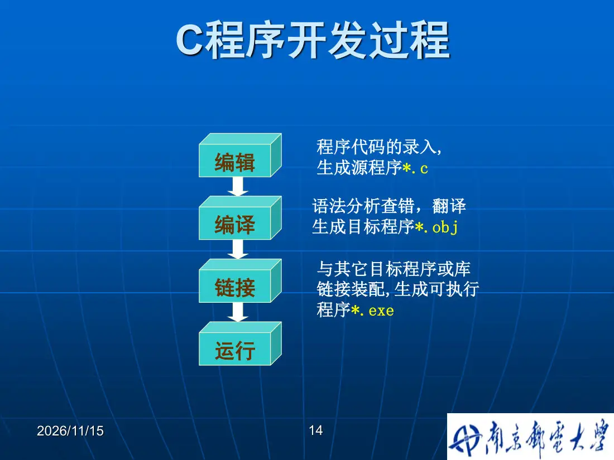

原文：

C程序开发过程

编辑

编译

链接

运行

程序代码的录入,生成源程序\*.c

语法分析查错，翻译生成目标程序\*.obj

与其它目标程序或库链接装配,生成可执行程序\*.exe

2026/11/15

14

彤南京郵電大学

### 在VC++6.0下开发程序的过程

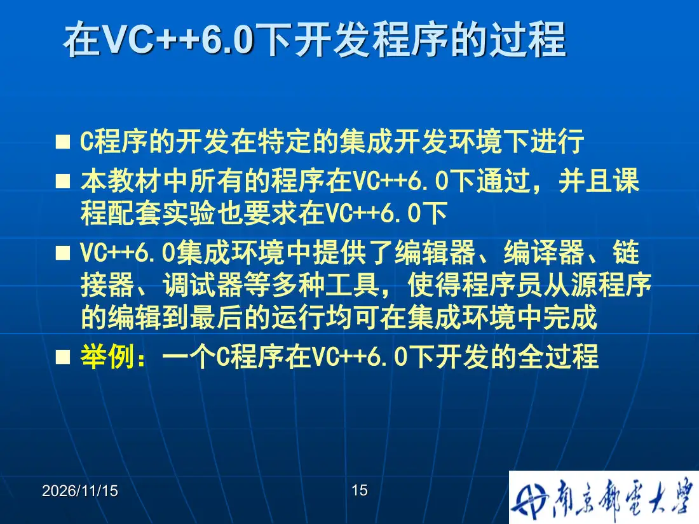

原文：

在VC++6.0下开发程序的过程

◼ C程序的开发在特定的集成开发环境下进行

本教材中所有的程序在VC++6.0下通过，并且课程配套实验也要求在VC++6.0下

VC++6.0集成环境中提供了编辑器、编译器、链接器、调试器等多种工具，使得程序员从源程序的编辑到最后的运行均可在集成环境中完成

◼ 举例：一个C程序在VC++6.0下开发的全过程

2026/11/15

15

今南京郵電大学

### 本章小结

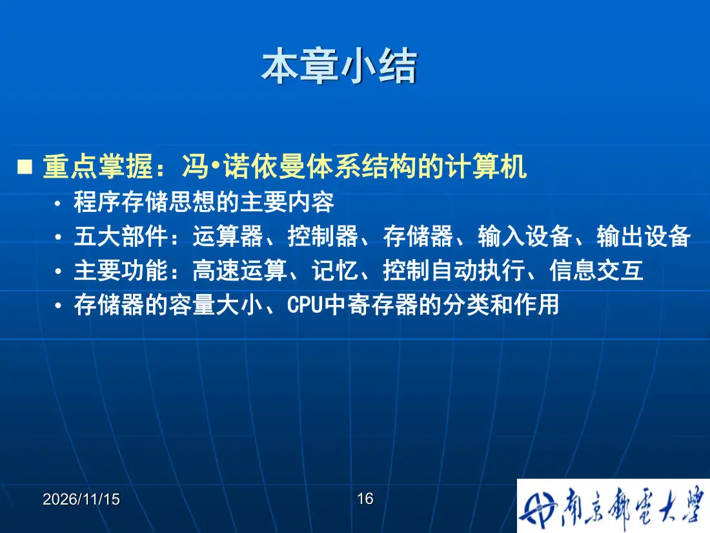

原文：

本章小结

◼ 重点掌握：冯•诺依曼体系结构的计算机

程序存储思想的主要内容

• 五大部件：运算器、控制器、存储器、输入设备、输出设备

• 主要功能：高速运算、记忆、控制自动执行、信息交互

• 存储器的容量大小、CPU中寄存器的分类和作用

2026/11/15

16

今南京郵電大学

### 本章小结

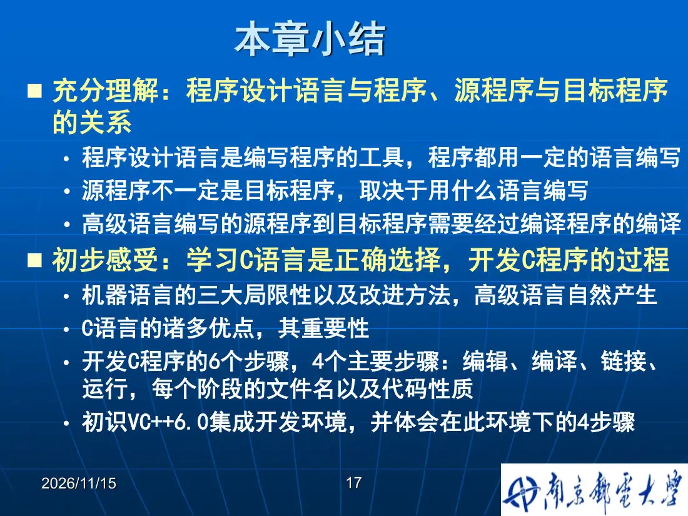

原文：

本章小结

充分理解：程序设计语言与程序、源程序与目标程序的关系

• 程序设计语言是编写程序的工具，程序都用一定的语言编写

• 源程序不一定是目标程序，取决于用什么语言编写

• 高级语言编写的源程序到目标程序需要经过编译程序的编译

◼ 初步感受：学习C语言是正确选择，开发C程序的过程

• 机器语言的三大局限性以及改进方法，高级语言自然产生

C语言的诸多优点，其重要性

开发C程序的6个步骤，4个主要步骤：编辑、编译、链接、运行，每个阶段的文件名以及代码性质

• 初识VC++6.0集成开发环境，并体会在此环境下的4步骤

2026/11/15

17

彤南京郵電大学

### The end of chapter 1

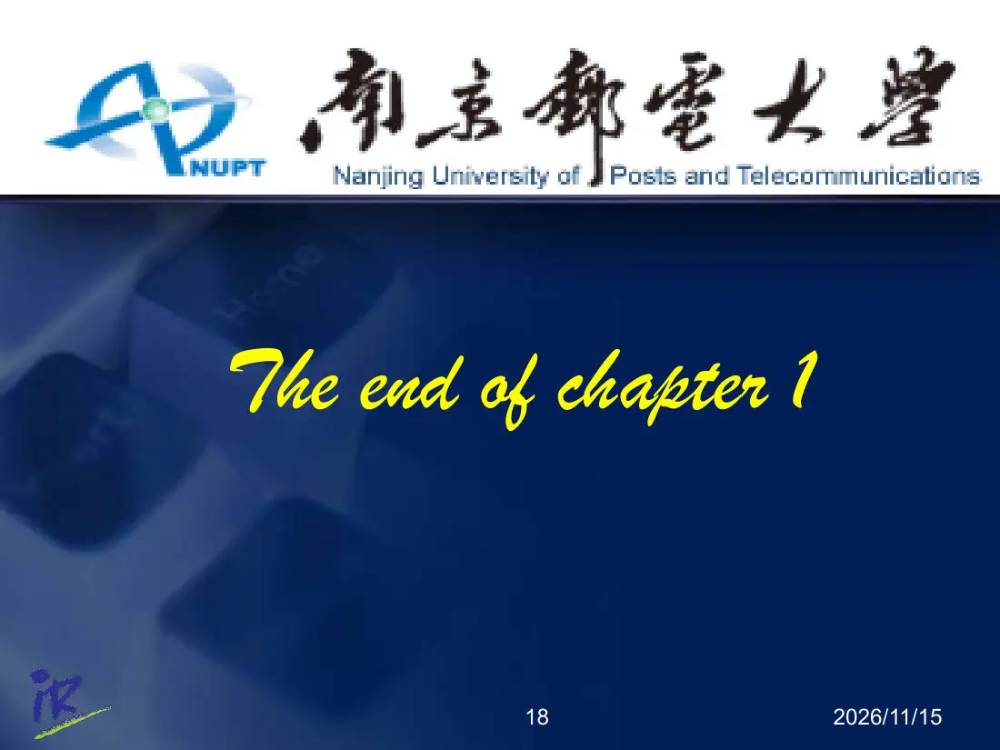

原文：

The end of chapter 1

之南京郵電大學 Nanjing University of Posts and Telecommunications

iR

18

2026/11/15
