# 《高级语言程序设计》第3章 运算符与表达式（课件）

原件的每一页，下面附识别出的文字。

### C语言程序设计

原文：

C语言程序设计

2026/11/15

A南京郵電大学 Nanjing University of Posts and Telecommunications

1

### 第三章 运算符与表达式

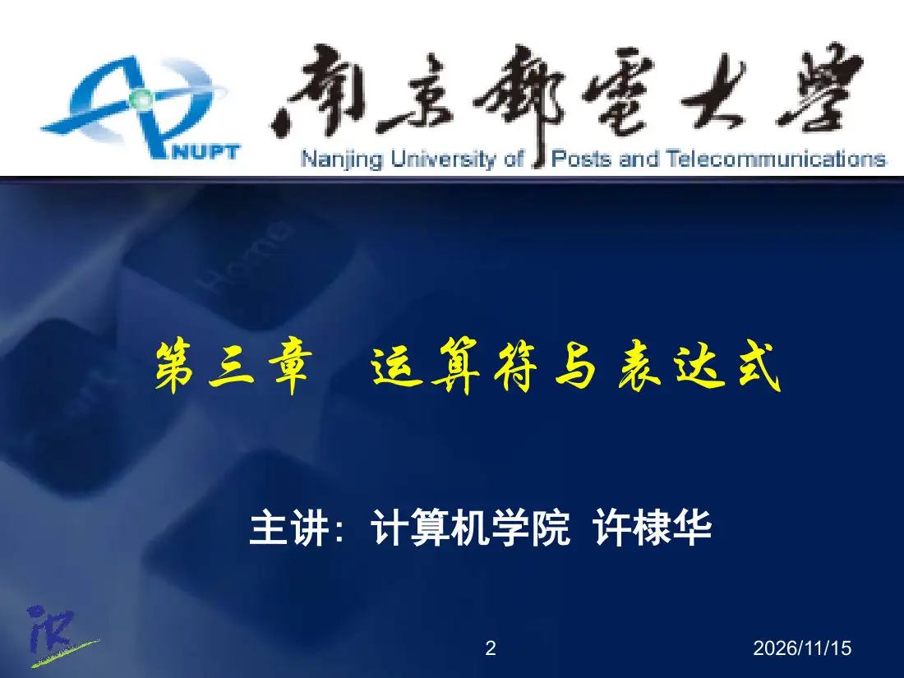

原文：

第三章 运算符与表达式

主讲: 计算机学院 许棣华

2

2026/11/15

之南京郵電大学 HUPT Nanjing University of Posts and Telecommunications

iR

### 重点掌握

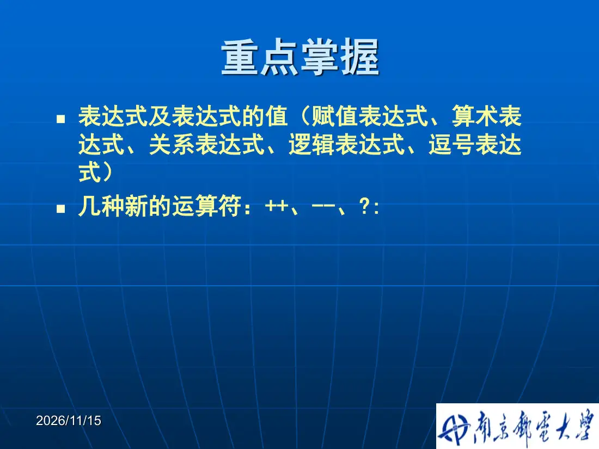

原文：

重点掌握

表达式及表达式的值（赋值表达式、算术表达式、关系表达式、逻辑表达式、逗号表达式）

◼ 几种新的运算符：++、--、?:

2026/11/15

彤南京郵電大学

### 算术运算符

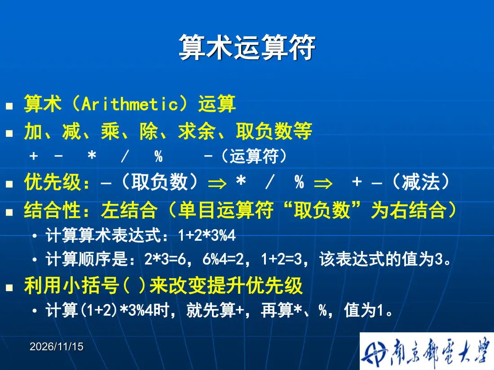

原文：

算术运算符

◼ 算术（Arithmetic）运算

加、减、乘、除、求余、取负数等\* / % -（运算符）

优先级：-（取负数）⇒／%⇒ +-（减法）

结合性：左结合（单目运算符 “取负数”为右结合）计算算术表达式：1+2\*3%4计算顺序是：2\*3=6，6%4=2，1+2=3， 该表达式的值为3。

利用小括号( )来改变提升优先级• 计算(1+2)\*3%4时，就先算+，再算\*、%，值为1。

2026/11/15

今南京郵電大学

### 算术运算符的几点说明

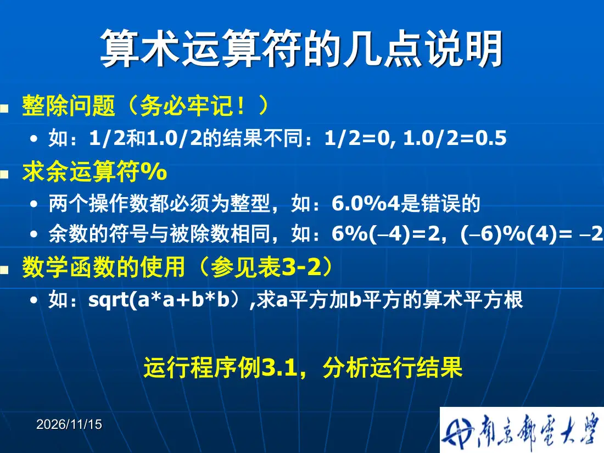

原文：

算术运算符的几点说明

整除问题（务必牢记！）

• 如：1/2和1.0/2的结果不同： $\mathrm { P r } = 0 . 7 7 \mathrm { P r } = 0 . 7 \mathrm { k } = 1 . 7 \mathrm { P r } = 0 . 7 \mathrm { k } = 1 . 7 \mathrm { m }$

求余运算符%

• 两个操作数都必须为整型，如： $\textcircled { 3 } \textcircled { 1 } \textcircled { 9 } \textcircled { 9 }$ 是错误的

• 余数的符号与被除数相同，如：6%(−4)=2， $( \pm 2 ) : ( 2 , 1 ) = ( 3 , 2 )$

数学函数的使用（参见表3-2）

• 如：sqrt(a\*a+b\*b）,求a平方加b平方的算术平方根

运行程序例3.1，分析运行结果

2026/11/15

今南京郵電大学

### 关系运算符

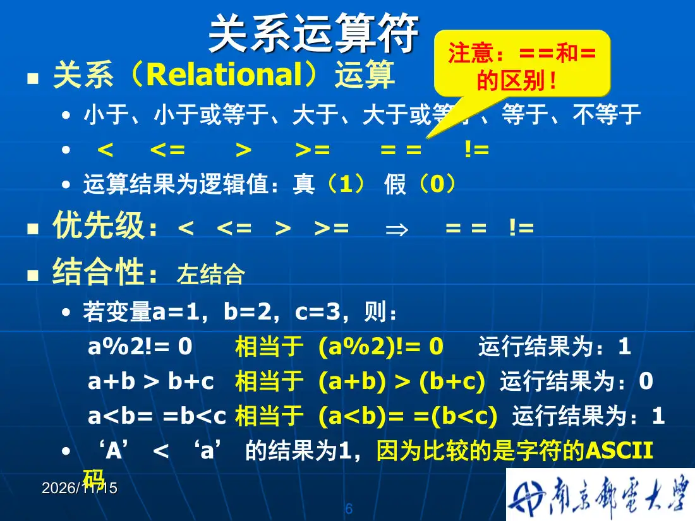

原文：

关系运算符

◼ 关系（Relational）运算

注意：==和=的区别！

• 小于、小于或等于、大于、大于或等于、等于、不等于

< <= > >= = = !=

运算结果为逻辑值：真（1） 假（0）

◼ 优先级：< <= > >=  = = !=

结合性：左结合

若变量a=1，b=2，c=3，则：a%2!= 0 相当于 (a%2)!= 0 运行结果为：1a+b > b+c 相当于 (a+b) > (b+c) 运行结果为：0$: ( : 1 3 1 ) = 1 0 : ( 0 )$ 相当于 $( \epsilon \vec { \bf { \sigma } } \mathbf { \cdot } \vec { \bf { \sigma } } \mathbf { \cdot } \mathbf { \vec { \bf { \sigma } } } ) \mathbf { \bar { \bf { \sigma } } } = \mathbf { \bar { \bf { \sigma } } } ( \mathbf { \bar { \bf { \sigma } } } \mathbf { \cdot } \mathbf { \vec { \bf { \sigma } } } \mathbf { \cdot } \mathbf { \bar { \bf { \sigma } } } )$ 运行结果为：1A a 的结果为1，因为比较的是字符的ASCII

2026/11/15码

华南京郵電大学

### 逻辑运算符

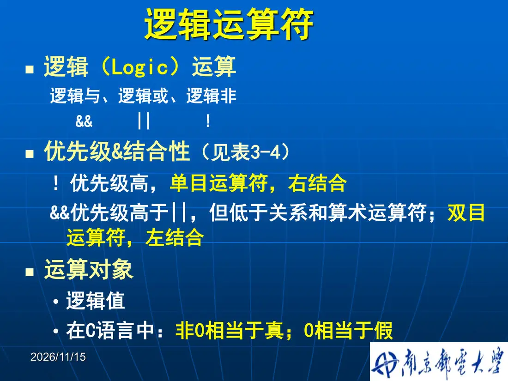

原文：

逻辑运算符

逻辑（Logic）运算逻辑与、逻辑或、逻辑非&&

优先级&结合性（见表3-4）！优先级高，单目运算符，右结合&&优先级高于||，但低于关系和算术运算符；双目运算符，左结合

运算对象

逻辑值

在C语言中：非0相当于真；0相当于假

2026/11/15

彤南京郵電大学

### 逻辑运算符

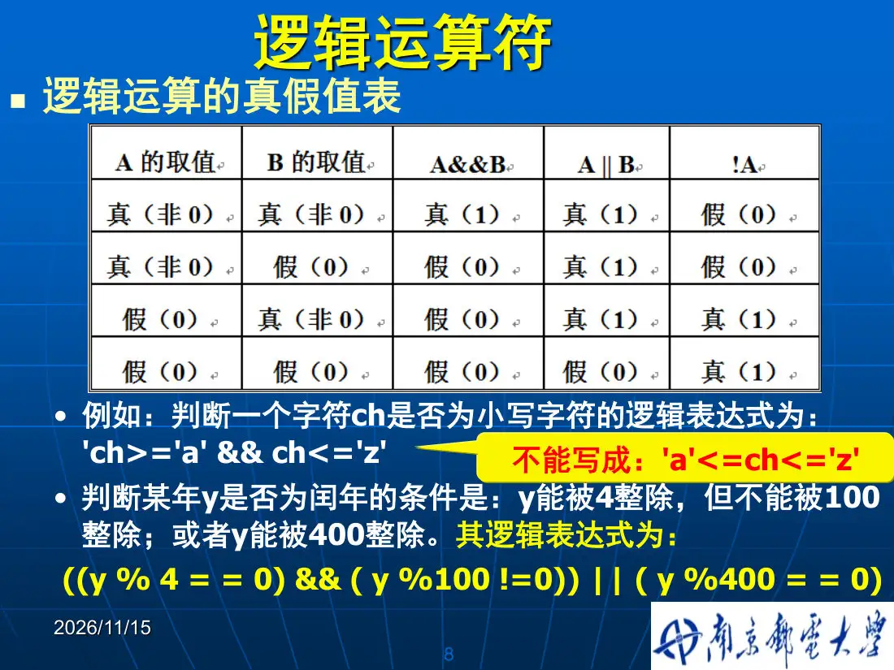

原文：

逻辑运算符

逻辑运算的真假值表

<table><tr><td>A的取值</td><td>B的取值</td><td>A&amp;&amp;B</td><td>A||B</td><td>!A</td></tr><tr><td>真(非0)</td><td>真(非0)</td><td>真(1)</td><td>真(1)</td><td>假(0)</td></tr><tr><td>真(非0)</td><td>假(0)</td><td>假(0)</td><td>真(1)</td><td>假(0)</td></tr><tr><td>假(0)</td><td>真(非0)</td><td>假(0)</td><td>真(1)</td><td>真(1)</td></tr><tr><td>假(0)</td><td>假(0)</td><td>假(0)</td><td>假(0)</td><td>真(1)</td></tr></table>

例如：判断一个字符ch是否为小写字符的逻辑表达式为：$( \cdot \vert 1 ) 2 - \vert ( \cdot ) \vert ( \cdot \vert ( \cdot \vert ) ) = - \vert ( \cdot ) \vert$ 不能写成： $\mathbf { \vec { a } } ^ { \prime } < = \mathbf { c h } < = \mathbf { \vec { z } } ^ { \prime }$ 判断某年y是否为闰年的条件是：y能被4整除，但不能被100整除；或者y能被400整除。其逻辑表达式为：$( \mathrm { C U ~ o f e ~ \mathcal { L } ~  ~ \mathcal { L } ~ = ~ 0 } ) \mathrm { E . ~ \mathcal { L } ~ : ~ } ( \mathrm { C P ~ o f . ~ i n ~ ( v i t ) ~ \mathcal { L } ( \pm 0 ) } ) \mathrm { T . ~ ( v i t ) ~ \mathcal { L } ~ : ~ } ( \mathrm { i n ~ \mathcal { L } ~ \mathrm { v a l t } ~ \mathcal { L } ( \pm 0 ) } - \mathrm { i n . ~ ( v i t ) } )$ 2026/11/15 今南京郵電大学8

### 逻辑运算符

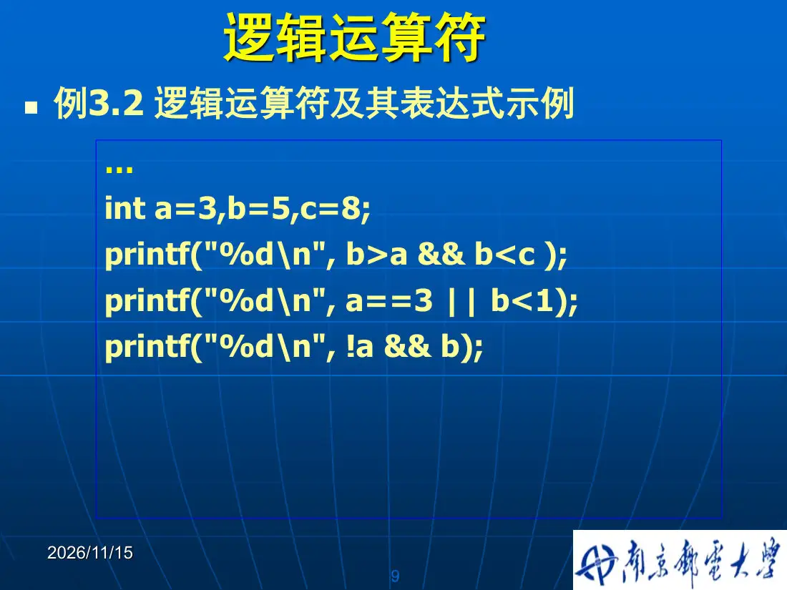

原文：

逻辑运算符

◼ 例3.2 逻辑运算符及其表达式示例

… $1 1 0 \div ( - 1 ) = ( - 1 ) ( - 1 )$ $[ \mathrm { \small ~ \mathscr ~ { ~ a ~ l ~ i ~ l ~ i ~ l ~ } ~ } ] ( \mathrm { \small ~ \mathscr { ~ o ~ } ~ } i \mathrm { \small ~ \mathscr ~ { ~ o ~ l ~ i ~ l ~ } ~ } i ) = \mathrm { \small ~ \mathscr { ~ o ~ } ~ } i \mathrm { \small ~ \mathscr ~ { ~ o ~ l ~ i ~ l ~ } ~ } i \mathrm { \small ~ \mathscr ~ { ~ o ~ l ~ i ~ l ~ } ~ } i \mathrm { \small ~ \mathscr ~ { ~ o ~ l ~ i ~ l ~ } ~ } i \mathrm { \small ~ \mathscr ~ { ~ o ~ l ~ i ~ l ~ } ~ } i \mathrm { \small ~ \mathscr ~ { ~ o ~ l ~ i ~ l ~ } ~ } i \mathrm { \small ~ \mathscr { ~ o ~ l ~ i ~ l ~ } ~ } i \mathrm { \small ~ \mathscr ~ { ~ o ~ l ~ i ~ l ~ } ~ } i \mathrm { \small ~ \mathscr { ~ o ~ l ~ i ~ l ~ } ~ } i ]$ $\boxed { 1 } \boxed { 1 } \boxed { 1 } \boxed { 1 } \boxed { 1 } \boxed { 2 } \boxed { 1 } \boxed { 1 } \boxed { 1 } \boxed { 2 } \boxed { 1 } \boxed { 2 } \boxed { 1 } \boxed { 1 } \boxed { 2 } \boxed { 1 } \boxed { 2 } \boxed { 1 } \boxed { 1 } \boxed { 2 } \boxed { 1 } \boxed { 2 } \boxed { 1 }$ $\mathrm { : | \Omega | | \Omega | | ^ { 4 } ( 4 0 / \Omega ) | \Omega | | \Omega | | ^ { 4 } ( \Omega + \Omega + 2 ) | \Omega | | }$

2026/11/15

彤南京郵電大学

### 逻辑短路现象

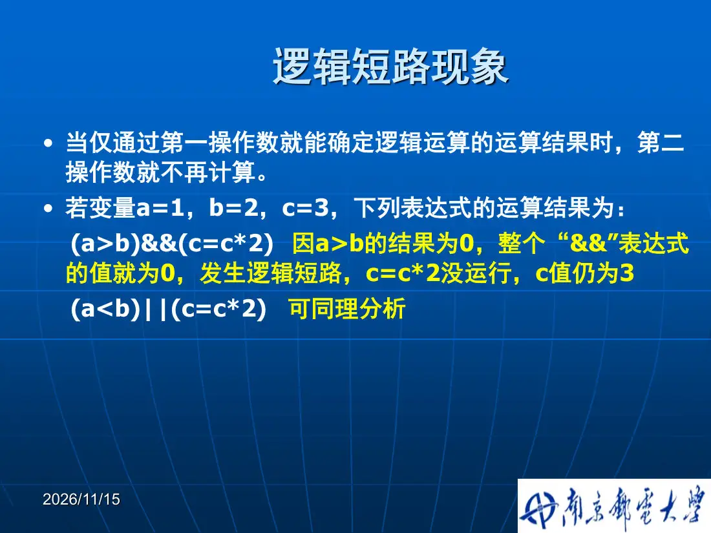

原文：

逻辑短路现象

当仅通过第一操作数就能确定逻辑运算的运算结果时，第二操作数就不再计算。

若变量a=1， $[ 5 ] = 9 2 ( 9 - 5 )$ 下列表达式的运算结果为：$( ( \cdot ) - 2 ( 2 ) ) : 2 : 2 : 1 ( 0 = ( 2 \div 2 )$ 因a>b的结果为0，整个 $\mathbb { G } \mathbb { : } \mathbb { G } ^ { \mathbb { Z } }$ 表达式的值就为0，发生逻辑短路， $\mathbf { \mathfrak { C } } \mathbf { = } \mathbf { \overline { { 9 } } } ^ { 3 }$ 2没运行，c值仍为3$\mathrm { ( t e c - 4 ) } \mathrm { T } \mathrm { I } \mathrm { ( e - 6 9 ) }$ 可同理分析

2026/11/15

华南京郵電大學

### 条件运算符

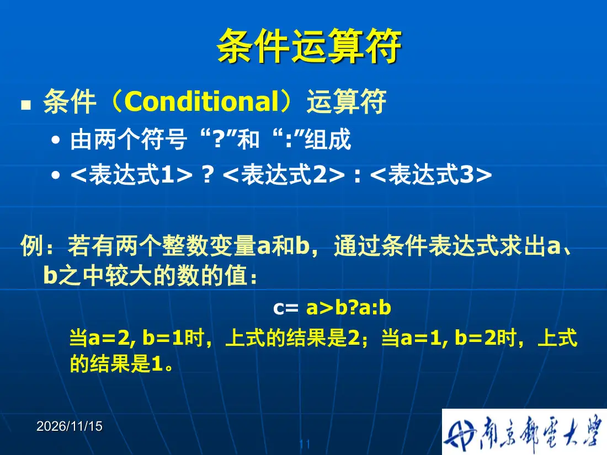

原文：

条件运算符

条件（Conditional）运算符

• 由两个符号“?”和“:”组成

• <表达式1> ? <表达式2> : <表达式3>

例：若有两个整数变量a和b，通过条件表达式求出a、b之中较大的数的值：

c= a>b?a:b

当a=2, b=1时，上式的结果是2；当a=1, b=2时，上式的结果是1。

2026/11/15

今南京郵電大学

### 条件运算符

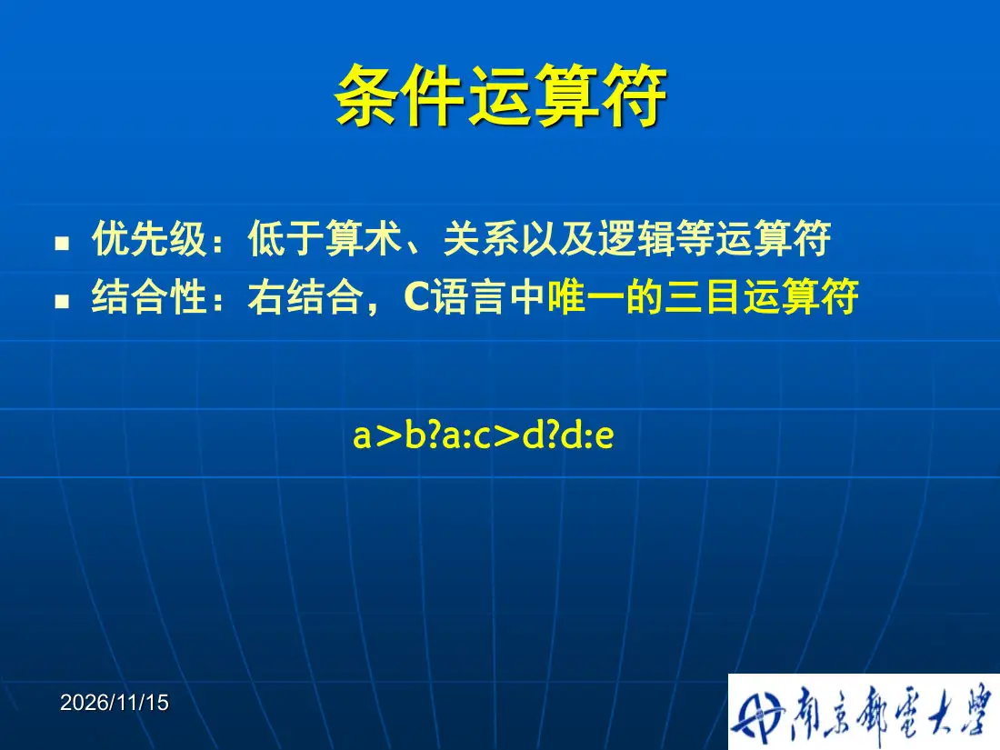

原文：

条件运算符

◼ 优先级：低于算术、关系以及逻辑等运算符

◼ 结合性：右结合，C语言中唯一的三目运算符

a>b?a:c>d?d:e

2026/11/15

今南京郵電大学

### 赋值及复合赋值运算符

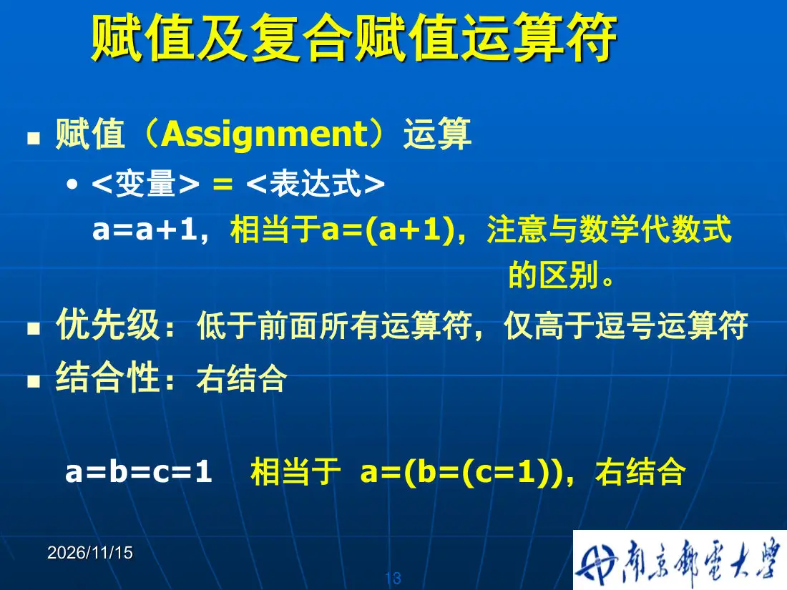

原文：

赋值及复合赋值运算符

赋值（Assignment）运算

• <变量> = <表达式>

$\mathsf { E } \mathsf { E } \mathsf { E } \mathsf { E } \mathsf { E }$ 相当于 $\pmb { \mathrm { E } } \pmb { \mathrm { ( 6 , 5 , 5 ) } }$ 注意与数学代数式的区别。

◼ 优先级：低于前面所有运算符，仅高于逗号运算符

结合性：右结合

$\scriptstyle \mathbf { \bar { c } } \mathbf { E } = \mathbf { \bar { s } } = \mathbf { \bar { c } } = \mathbf { \bar { s } }$ 相当于 $\therefore \angle ( 0 ) = \angle C = \angle D$ ，右结合

13

2026/11/15

今南京郵電大学

### 赋值及复合赋值运算符

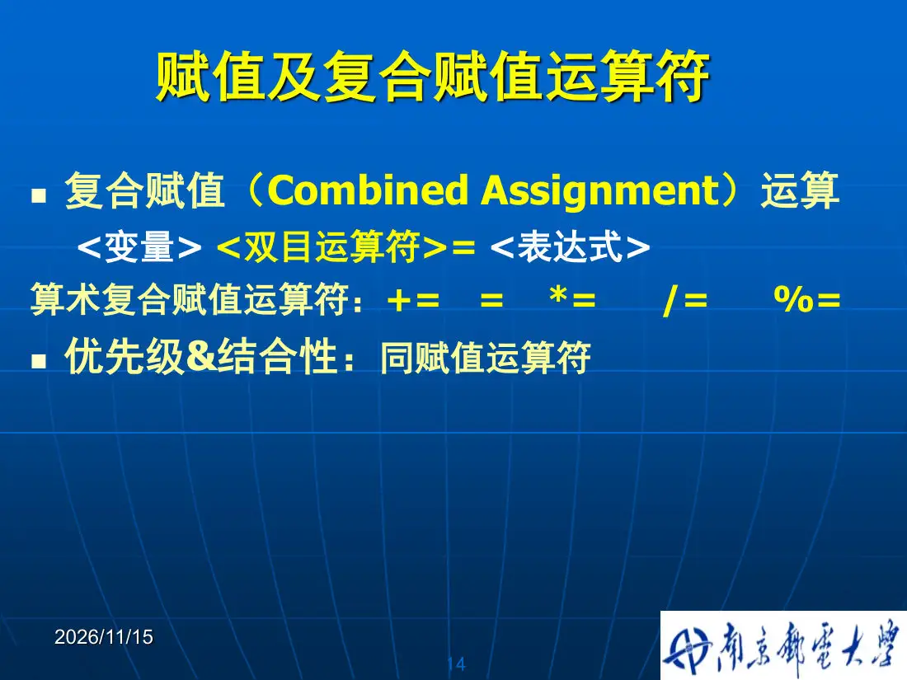

原文：

赋值及复合赋值运算符

◼ 复合赋值（Combined Assignment）运算

<变量> <双目运算符>= <表达式>

算术复合赋值运算符：+= = \*= /= %=

◼ 优先级&结合性：同赋值运算符

2026/11/15

4

华南京郵電大學

### 赋值及复合赋值运算符

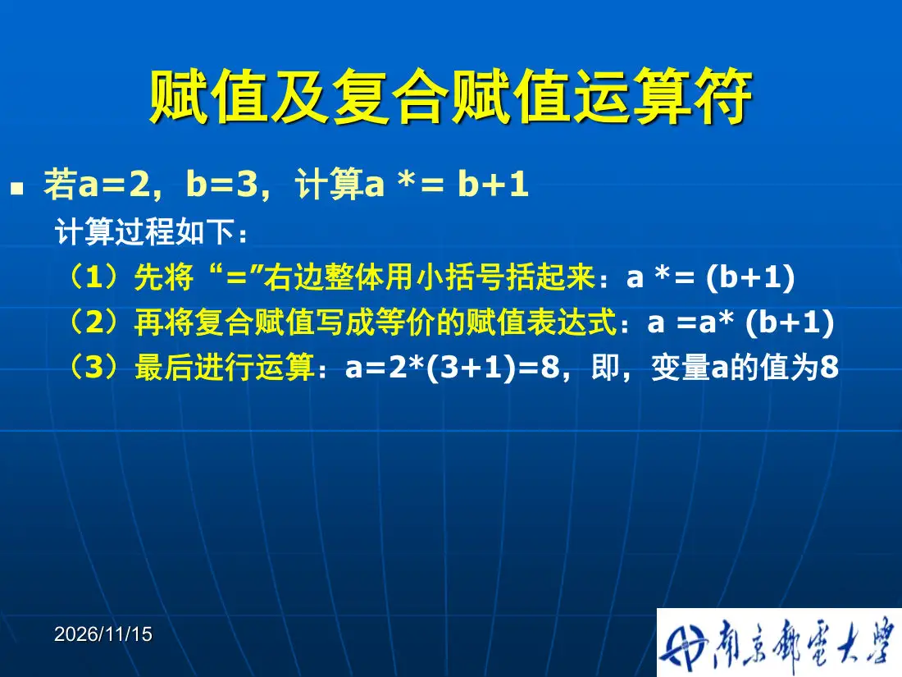

原文：

赋值及复合赋值运算符

若 $6 5 - 5 2 = 5 5$ 计算 $\mathsf { E }$ 计算过程如下：

（1）先将“=”右边整体用小括号括起来： $\in \mathbb { E } ^ { 3 } = ( 0 , 1 , 1 )$

（2）再将复合赋值写成等价的赋值表达式： $\boxed { \div } \boxed { \pm } \boxed { \pm } \boxed { ( \frac { } { } ) } \boxed { \pm } \boxed { \pm }$

（3）最后进行运算： $5 - 5 \times ( - 5 ) = 5 2$ ，即，变量a的值为8

2026/11/15

华南京郵電大學

### 逗号运算符

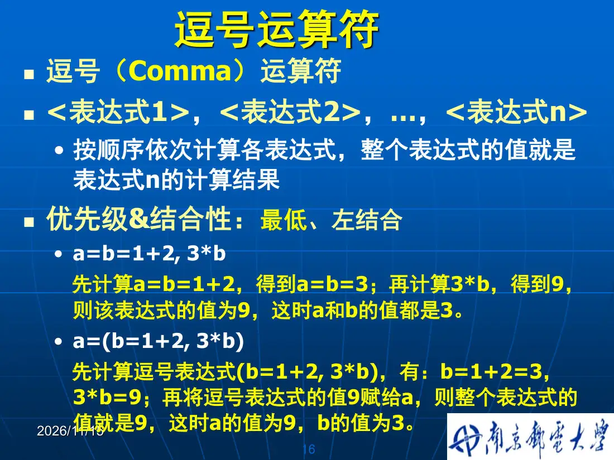

原文：

逗号运算符

逗号（Comma）运算符

◼ <表达式1>，<表达式2>，…，<表达式n>

按顺序依次计算各表达式，整个表达式的值就是表达式n的计算结果

◼ 优先级&结合性：最低、左结合

a=b=1+2, 3\*b先计算a=b=1+2，得到a=b=3；再计算3\*b，得到9，则该表达式的值为9，这时a和b的值都是3。

a=(b=1+2, 3\*b)先计算逗号表达式(b=1+2, 3\*b)，有： $[ \pm ] = [ - \frac { 1 } { 2 } , 0 ] = [ 0 ]$ $\mathbf { \delta E } 3 7 \mathbf { \delta \vec { \mathbf { \mathbf { \mathbf { \mathbf { \mathbf { \varepsilon } } } } } } }$ 再将逗号表达式的值9赋给a，则整个表达式的2026/11/15值就是9， 这时a的值为9，b的值为3。 南立趣康

华南京郵電大學

### 自增、自减运算符

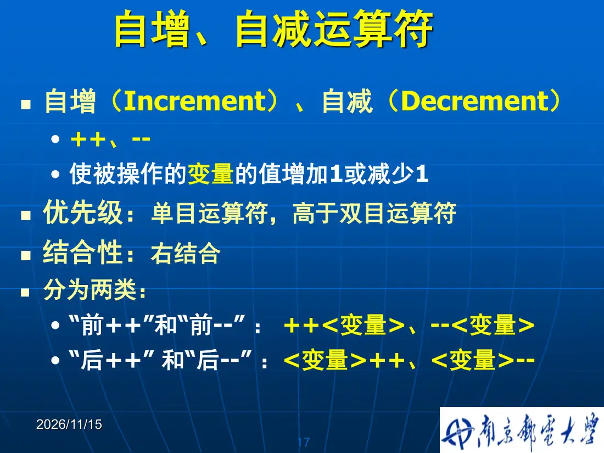

原文：

自增、自减运算符

◼ 自增（Increment）、自减（Decrement）

• ++、--

使被操作的变量的值增加1或减少1

◼ 优先级：单目运算符，高于双目运算符

结合性：右结合

分为两类：

• “前++”和“前--” ： ++<变量>、--<变量>

• “后++” 和“后--” ：<变量>++、<变量>--

2026/11/15

17

今南京郵電大学

### 自增、自减运算符

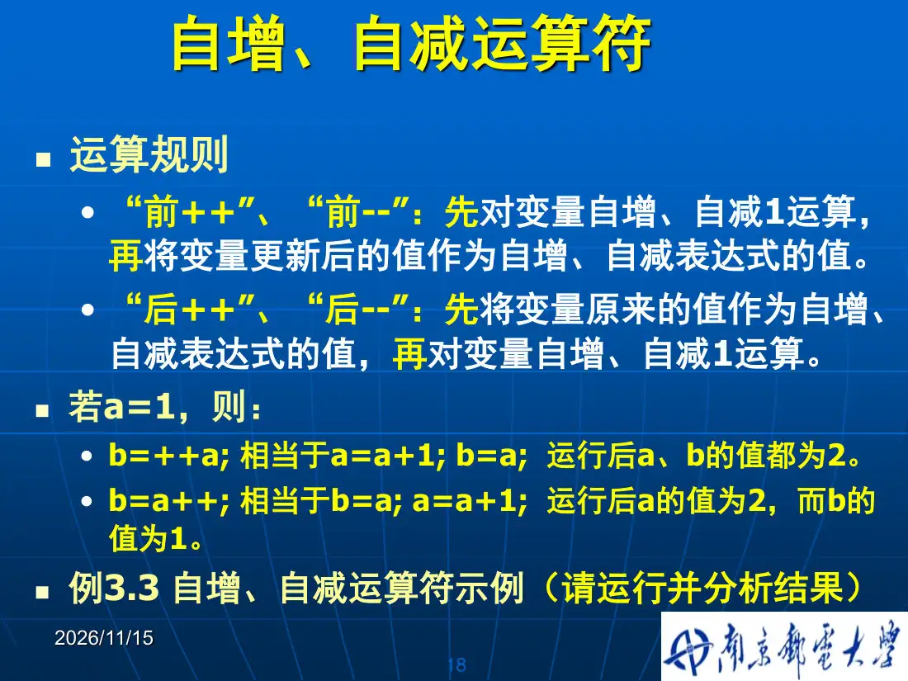

原文：

自增、自减运算符

运算规则

• “前++”、“前--”：先对变量自增、自减1运算，再将变量更新后的值作为自增、自减表达式的值。

“后++”、“后--”：先将变量原来的值作为自增、自减表达式的值，再对变量自增、自减1运算。

若a=1，则：

• b=++a; 相当于a=a+1; b=a; 运行后a、b的值都为2。

b=a++; 相当于b=a; a=a+1; 运行后a的值为2，而b的值为1。

◼ 例3.3 自增、自减运算符示例（请运行并分析结果）

2026/11/15

8

今南京郵電大学

### 3.4 运算过程中的数据类型转换

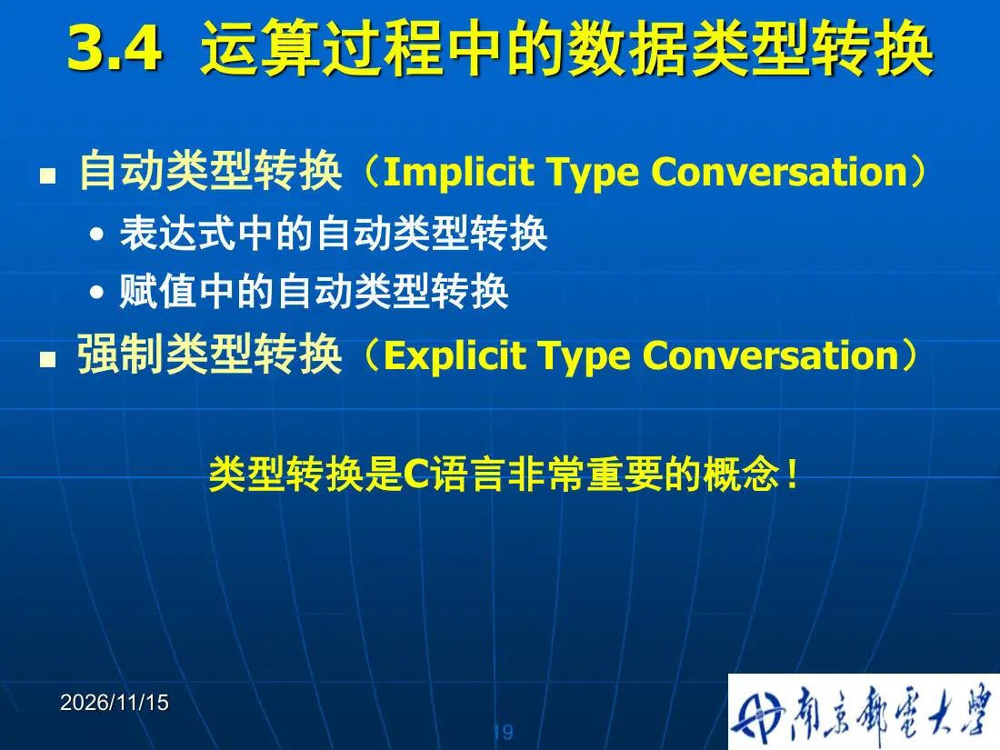

原文：

3.4 运算过程中的数据类型转换

◼ 自动类型转换（Implicit Type Conversation）

表达式中的自动类型转换

赋值中的自动类型转换

◼ 强制类型转换（Explicit Type Conversation）

类型转换是C语言非常重要的概念！

2026/11/15

9

今南京郵電大学

### 表达式中的自动类型转换转换的原则：

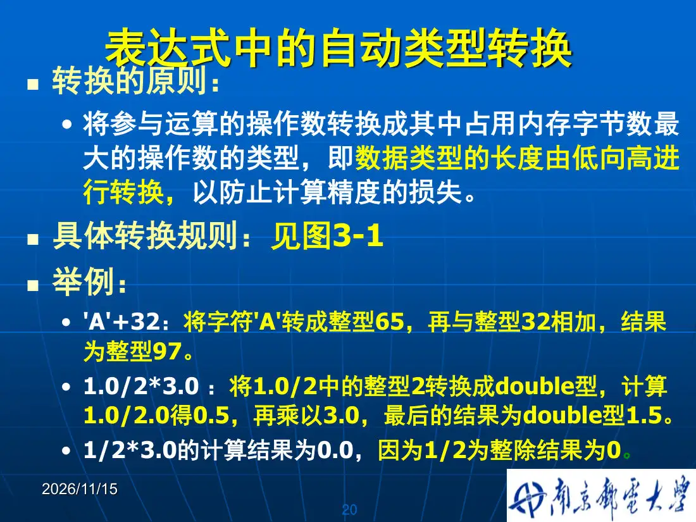

原文：

表达式中的自动类型转换转换的原则：

将参与运算的操作数转换成其中占用内存字节数最大的操作数的类型，即数据类型的长度由低向高进行转换，以防止计算精度的损失。

具体转换规则：见图3-1

举例：

• 'A'+32：将字符'A'转成整型65，再与整型32相加，结果为整型97。

1.0/2\*3.0 ：将1.0/2中的整型2转换成double型，计算1.0/2.0得0.5，再乘以3.0，最后的结果为double型1.5。

• 1/2\*3.0的计算结果为0.0，因为1/2为整除结果为0。

2026/11/15

20

今南京郵電大学

### 赋值中的自动类型转换

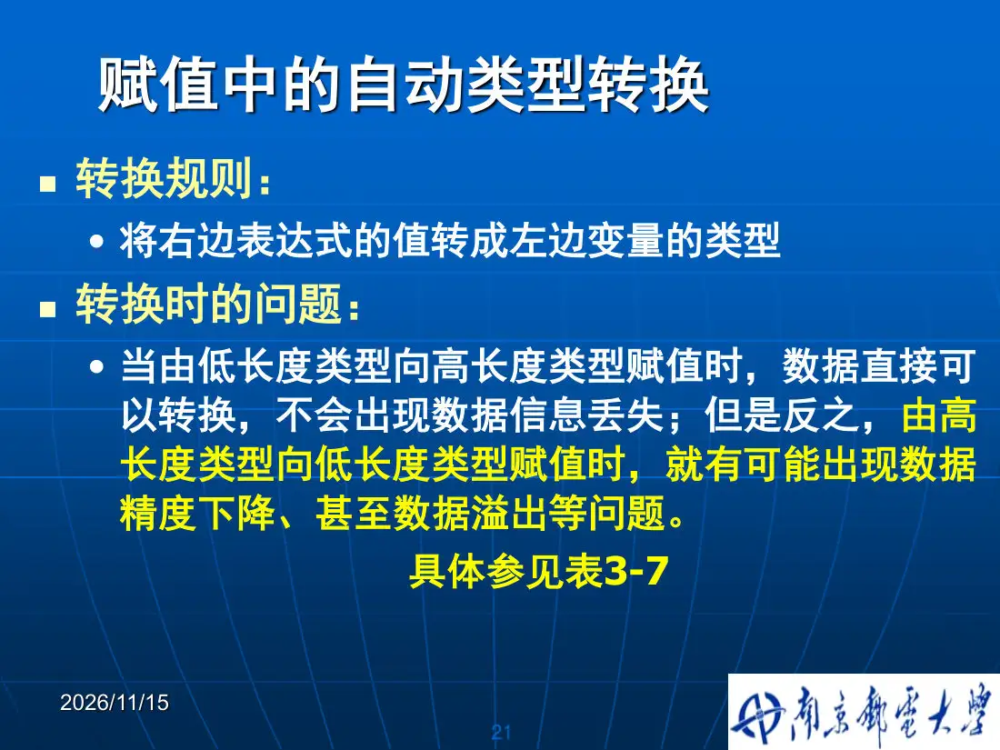

原文：

赋值中的自动类型转换

转换规则：

• 将右边表达式的值转成左边变量的类型

转换时的问题：

当由低长度类型向高长度类型赋值时，数据直接可以转换，不会出现数据信息丢失；但是反之，由高长度类型向低长度类型赋值时，就有可能出现数据精度下降、甚至数据溢出等问题。

具体参见表3-7

2026/11/15

21

今南京郵電大学

### 强制类型转换

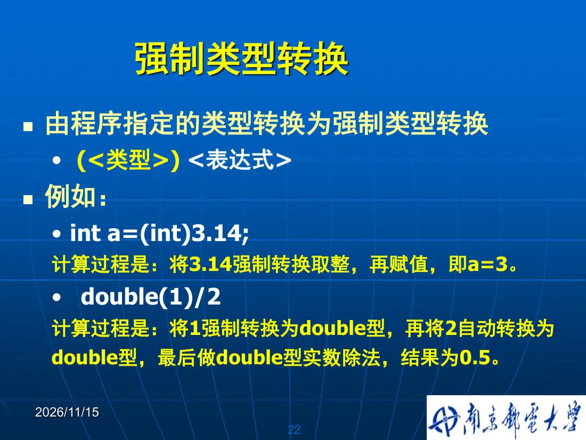

原文：

强制类型转换

由程序指定的类型转换为强制类型转换• (<类型>) <表达式>

◼ 例如：

$\Delta A B E \cong ( \Delta A B ) \sin C ($ 计算过程是：将3.14强制转换取整，再赋值，即a=3。

double(1)/2 计算过程是：将1强制转换为double型，再将2自动转换为 double型， 最后做double型实数除法，结果为0.5。

2026/11/15

22

今南京郵電大学

### The end of chapter 3

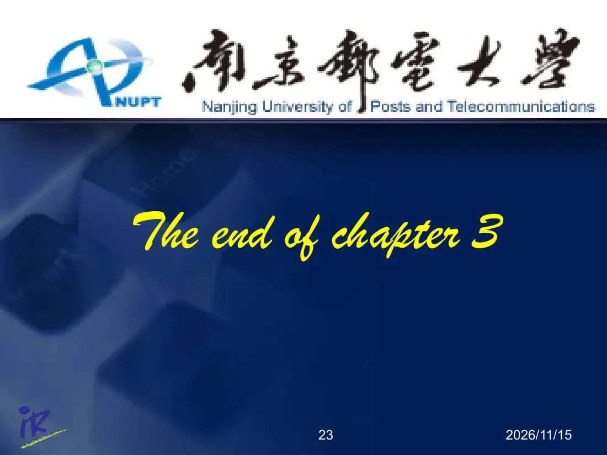

原文：

The end of chapter 3

之南京郵電大学 Nanjing University of Posts and Telecommunications

iR

23

2026/11/15
